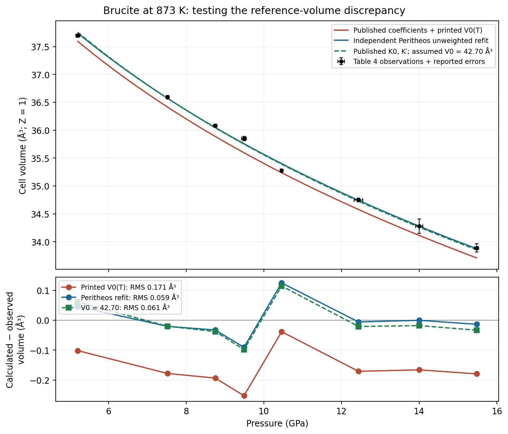
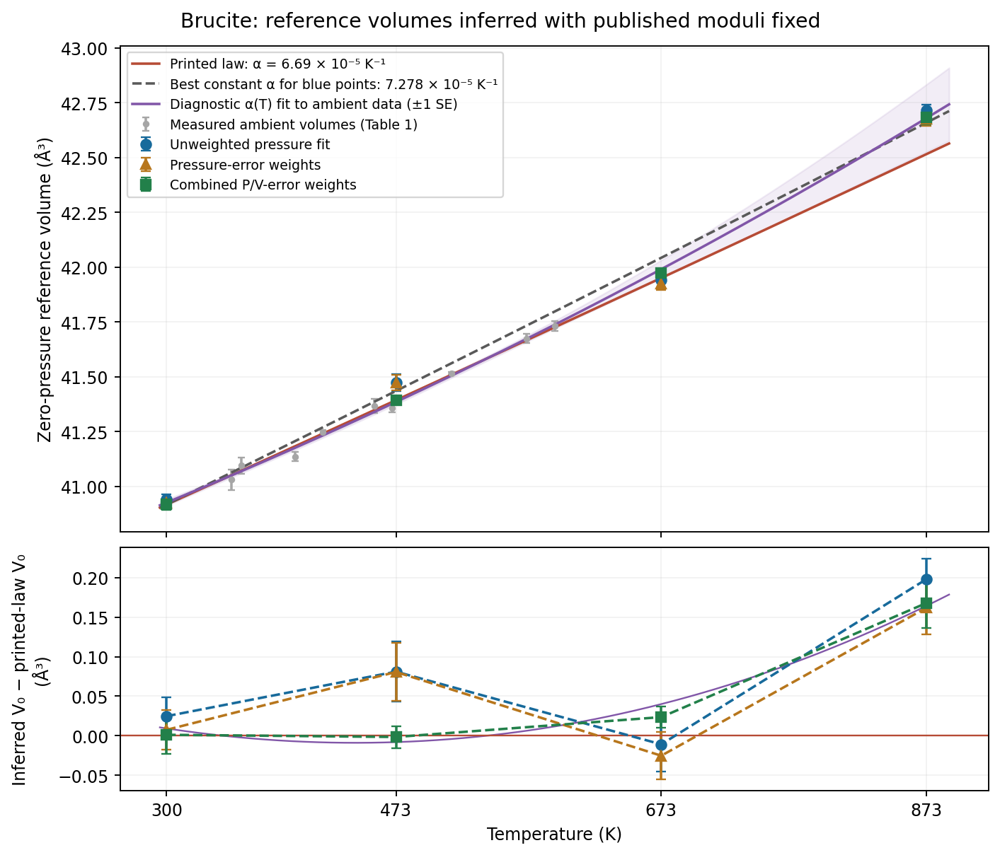
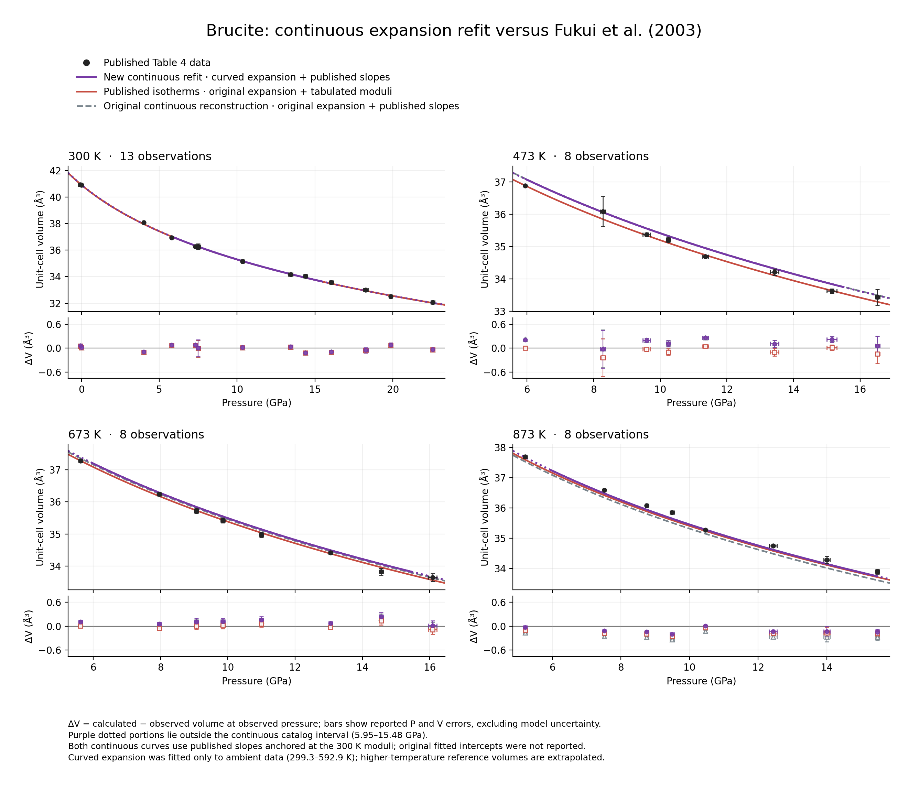
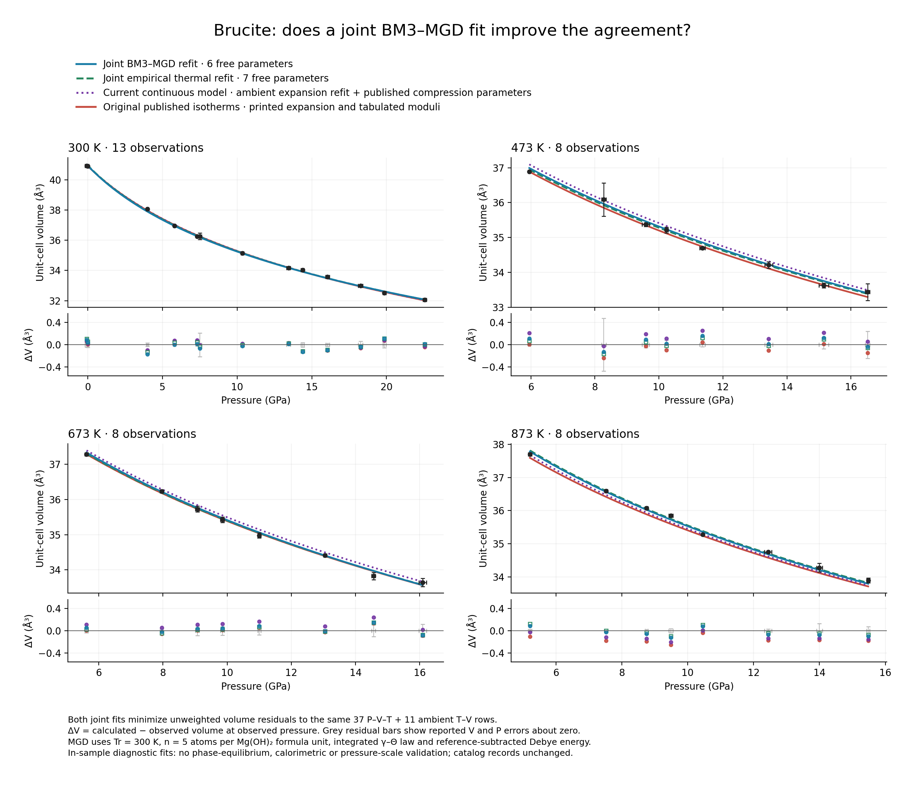
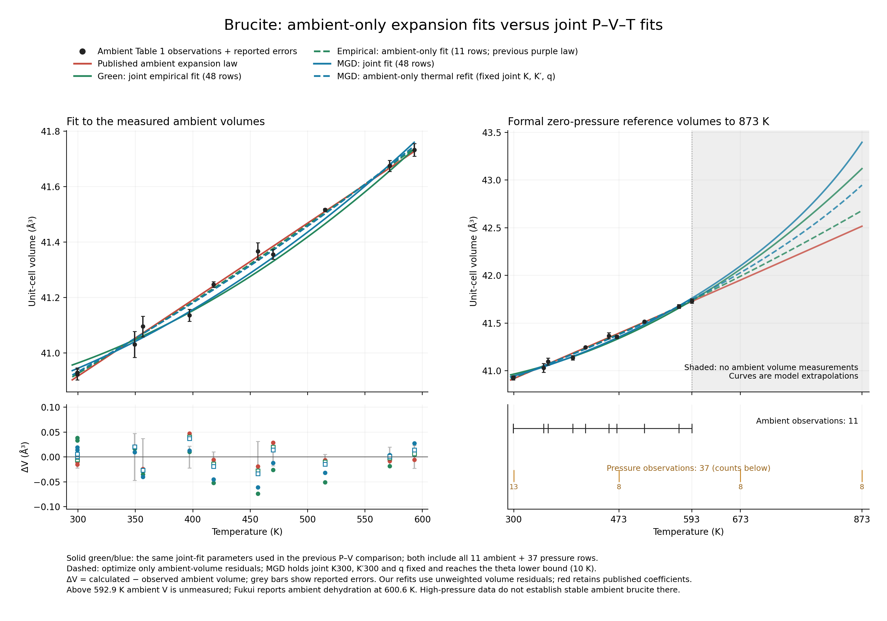

# Brucite source audit and published-range catalog records

Audit date: 2026-10-16. **Disposition: published-range lattice-average EOSs installed.**
The former 0–0.5 GPa restriction was an audit choice without a measured bulk
lattice boundary. It is removed. Hydrogen rearrangement is preserved in the
phase annotations; the empirical volume EOS is not an H-order-resolved
thermodynamic model. The ambient atomic coordinates remain a reference structure.

| Record | Pressure (GPa) | Temperature (K) | Disposition |
|---|---:|---:|---|
| Fukui published 300 K BM3, material default | 0–22.56 | 300 | Source validated; original parameters unchanged |
| Fukui published 473 K BM3 | 5.95–16.52 | 473 | Source validated; original parameters unchanged |
| Fukui published 673 K BM3 | 5.62–16.09 | 673 | Source validated; original parameters unchanged |
| Fukui published 873 K BM3 | 5.21–15.48 | 873 | Qualified explicit selection, `not_reproduced`; original normalization inconsistency preserved |
| Peritheos unweighted 873 K table refit | 5.21–15.48 | 873 | Separate reproducible refit; conditional covariance |
| Peritheos unweighted continuous thermal table refit | 5.95–15.48 | 300–873 | Separate reproducible interpolation model; conditional covariance |
| Literal Fukui 300 K anchored, published-slope reconstruction | 5.95–15.48 | 300–873 | Qualified explicit selection, `not_reproduced`; original surface not recovered |
| Peritheos curved-expansion refits, four source-modulus isotherms | Each source slice’s measured span | 300/473/673/873 | Nondefault shared ambient-expansion refit; published isotherm moduli unchanged |
| Peritheos curved expansion + published thermal slopes | 5.95–15.48 | 300–873 | Nondefault ambient-expansion refit; explicit 300 K anchors, distinct from the four tabulated moduli |

`check_validity=True` enforces these domains. The thermal domain is the common
pressure interval of all four measured slices, not the outer bounding rectangle
of the experiments. At higher pressures use the appropriate source isotherm.
All 102 Fukui/Xia printed observations and errors remain bundled. No source
observation or coefficient is silently changed. Earlier staged cards are retained
as audit snapshots; the installed card contains the current disposition.

## Source authority and recovery

| Source | Evidence inspected | Result |
|---|---|---|
| Fei and Mao (1993), [10.1029/93JB00701](https://doi.org/10.1029/93JB00701) | Publisher abstract; full-PDF request returned HTTP 403; OpenAlex reports closed with no repository copy; geology-repository and author/publication searches did not locate a full copy | Abstract coefficients retained as discovery evidence; no executable Fei record |
| Fukui et al. (2003), [10.1007/s00269-003-0353-z](https://doi.org/10.1007/s00269-003-0353-z) | Final six-page typeset article, [archived PDF](https://repository.geologyscience.ru/bitstream/handle/123456789/35277/Fuku_03.pdf?sequence=1); equations, all tables and relevant figures visually inspected | 11 ambient expansion observations, 37 compression observations, reported errors, four isotherms, temperature slopes and limitations recovered |
| Xia et al. (1998), [10.2138/am-1998-0107](https://doi.org/10.2138/am-1998-0107) | Final seven-page article, [MSA/RRUFF archive](https://www.rruff.net/doclib/am/vol83/AM83_68.pdf); Table 6, Table 7 and Eqs. 5-8 visually inspected | All 54 P-V-T rows recovered; full thermal parameterization held for missing inputs |
| Zigan and Rothbauer (1967), *Neutronenbeugungsmessungen am Brucit*, 137-143 | [COD 1000054 archival CIF](https://qiserver.ugr.es/cod/1000054.cif), not the original printed paper | Complete ambient ordered-H structure retained; direct primary-paper confirmation remains outstanding |
| He (2023), doctoral thesis, [10.15083/0002012205](https://doi.org/10.15083/0002012205) | Primary institutional-repository thesis; Table 4.3 and continuation, printed pp. 81–82 (PDF pp. 89–90), directly rendered and inspected | Complete ambient neutron refinement of fluorine-free hydrogenated Mg(OH)2; active structure source |
| Duffy et al. (1995), [10.2138/am-1995-3-403](https://doi.org/10.2138/am-1995-3-403) | Final primary paper, pp. 225–226 and Fig. 4 | New modes at 4.4 GPa; weaker feature at 1.1 GPa after pressure cycling may be residual transformation |
| Wu et al. (2026), [10.3390/molecules31101631](https://doi.org/10.3390/molecules31101631) | Final open-access primary article, particularly Sections 3–4 and Figs. 6–7 | Medium-dependent room-temperature onsets and temperature dependence; inconsistent printed P–T assignments retained, not turned into an executable boundary |
| Sun et al. (2025), [10.1016/j.gsf.2024.101940](https://doi.org/10.1016/j.gsf.2024.101940) | Final primary [article](https://zhangdongzhou.github.io/pub/Sun_GeoFront_2025.pdf), Sections 3/4.1 and Fig. 4, directly inspected | Layered average lattice retained beyond Fukui's pressure span; no Sun EOS coefficients imported |
| Catti et al. (1995), [10.1007/BF00202300](https://doi.org/10.1007/BF00202300) | Publisher and institutional metadata; publisher PDF request returned a subscription HTML page, not a PDF; STFC ePubs record has no local file | Not substituted for an inspected primary structural source |
| Nagai et al. (2000), [10.2138/am-2000-5-615](https://doi.org/10.2138/am-2000-5-615) | Final [article](https://rruff.info/doclib/am/vol85/AM85_760.pdf), especially pp. 760-761 | Confirms strong anisotropy, possible H rearrangement, and inability of these X-ray measurements to refine H coordinates; no coefficients imported |

The Fukui publisher landing page and final article expose no identified
supplementary-data link. No official machine-readable fit or calibrant file
was found. The Xia final article and publisher record were inspected; no
official supplementary numerical file was identified. These are searches
performed, not proof that unpublished files do not exist. No authors were
contacted.

The source manifest is
`brucite-source.json` (`peritheos/data/datasets/brucite-source.json`).
It retains original table tokens, parameter locations, source PDF checksums,
uncertainty statements, access limitations and rights. The CSVs contain 102
observations in total, with no corrected replacement values. The contribution
does not import shock, acoustic bulk moduli, fluid-water equations, substituted
brucite compositions, or deuterated Mg(OD)2 parameters.

## Identity, structure and normalization

The composition is Mg(OH)2, one Mg, two O and two H atoms per formula unit.
The reference structure is the ambient **average single-site** trigonal
**P -3 m 1** model, number 164, in the primitive hexagonal setting, **Z=1**.
He (2023), Table 4.3, reports a=b=3.14771(3), c=4.77163(5) angstrom and
V=40.9437(7) A^3. Mg occupies 1a (0,0,0), O occupies 2d
(1/3,2/3,0.2189(2)), and H occupies 2d (1/3,2/3,0.4108(4)), all fully
occupied. The sites reproduce Mg(OH)2 exactly. The source's fluorinated
Table 4.5 and deuterated Table 4.7 are separate samples and are not substituted.

The primary source reports 173 observations, wRp=0.0101 and chi-squared=4.275.
The source manifest retains the Table 4.3 atomic-displacement values and
geometry, including the mean-site O–H distance 0.915(2) angstrom and the
motion-corrected value 0.9528 angstrom. The corrected distance is **not** used
to shift H to a fabricated coordinate. “Single-site” describes the average
refinement; it does not establish perfectly immobile protons.

The contributor transcription `brucite-he-2023-table43.cif` and the source PDF
are checksummed. Exact special-position thirds are used; refined coordinates
and cell metrics are not rescaled. He’s structural sample and Fukui’s EOS
sample have distinct reference volumes. The old Zigan/Rothbauer archived CIF
and its unresolved original-paper access are preserved as historical evidence,
but catalog acceptance no longer depends on that indirect transcription.

Every EOS volume is A^3 per Z=1 cell. Conversion to cm^3/mol of formula units
is multiplication by 0.602214076: Fukui's 300 K anchor is
24.640793347692 cm^3/mol. There is no factor of five in the mechanical EOS or
expansivity. Five is the number of atoms per formula unit and would matter
only for an independently specified atom-normalized caloric model; none is
introduced here.

This card is structurally complete for ambient diffraction interchange, with
the primary structural check resolved. It does not predict pressure-induced
H disorder, anisotropic axial compression, or temperature-dependent site
coordinates. Isotropic volume scaling cannot reproduce brucite's a/c response.

## Fukui equations, parameters and uncertainties

Equation (1), p. 512, defines an exponential integral of instantaneous
expansivity, anchored at 300 K. Table 3, p. 513 gives constant volumetric
alpha=6.69(18) x 10^-5 K^-1 over the measured ambient 299.3-592.9 K range:

\[
V_0(T)=40.917\exp[6.69\times10^{-5}(T-300)]\quad\mathrm{A^3}.
\]

This is neither a linear volume law nor a coefficient defined at T=0 in
alpha=alpha0+alpha1*T. A missing alpha1 is not a reported fitted zero.
Table 2 supplies a0=3.1472(2), c0=4.7699(11) A and V0=40.917(12) A^3.
The unweighted ambient-volume diagnostic fit returns V0=40.9165852 A^3 and
alpha=6.69185184 x 10^-5 K^-1, respectively 0.035 and 0.010 reported errors
from the printed values. A volume-sigma-weighted diagnostic is also retained.
These are conditional regression checks, not newly adopted parameters.

Equation (2), p. 513, is ordinary BM3:

\[
P=\frac32 K_0(\eta^7-\eta^5)
\left[1+\frac34(K'_0-4)(\eta^2-1)\right],\qquad
\eta=(V_0/V)^{1/3}.
\]

| Isotherm (K) | V0(T), derived where needed (A^3) | Published K0 (GPa) | Published Kprime | Observed P span (GPa) |
|---|---:|---:|---:|---:|
| 300 | 40.917 | 41.8(1.3) | 6.6(3), Table 5; 6.6(4), Table 6 | -0.06 to 22.56 |
| 473 | 41.3933121128 | 32.6(2.5) | 8.3(1.1) | 5.95 to 16.52 |
| 673 | 41.9508764160 | 28.8(2.1) | 9.0(1.1) | 5.62 to 16.09 |
| 873 | 42.5159510616 | 23.9(1.4) | 10.0(0.9) | 5.21 to 15.48 |

The source explicitly fixes high-temperature V0 from ambient expansion. The
static compression-regression V0 treatment is not separately stated; the
staged 300 K record explicitly adopts the same paper's Table 2 reference
anchor. That is a visible candidate interpretation, not an assertion of exact
author inputs. High-T derived V0 errors remain null because the relevant
parameter covariance is unavailable. Fixed values and zero uncertainty are
different facts. The conflicting 300 K Kprime errors are both retained, with
Table 5's 0.3 in the card.

Table 1 and Table 4 lattice/volume errors are estimated standard deviations.
Table 4 pressure errors derive from gold lattice-parameter standard deviations;
they do not include systematic pressure-scale uncertainty. No row T errors
are printed. Temperature fluctuations below 0.2 K at ambient pressure and
below 1 K under pressure are apparatus statements, not replacement row sigmas.
Parameter confidence convention and covariance are unreported where not
specified by table footnotes.

## Numerical assessment: three separate claims

**Equation mapping:** The standalone NumPy BM3 transcription agrees with
Peritheos and native Rust evaluation. The card inverts and round-trips, and
reference-state and bulk-modulus derivative checks pass. Independent source
checkpoints include Table 4 V=32.058 A^3/P=22.56 GPa at 300 K and
V=36.883 A^3/P=5.95 GPa at 473 K. Tolerances are tied to source errors,
not to values generated by Peritheos.

**Conditional coefficient agreement:** Each isotherm is refitted with its
printed same-T rows and source-derived V0 fixed. Diagnostics compare
unweighted pressure residuals, pressure-sigma weighting and parameter-dependent
effective P/V variance. The source does not specify which objective it used.

| T (K) | Published-curve P RMS (GPa) | Diagnostic K0, pressure-sigma weights (GPa) | Diagnostic Kprime | Largest coefficient difference / reported error |
|---|---:|---:|---:|---:|
| 300 | 0.227910 | 41.594573 | 6.686400 | 0.288 |
| 473 | 0.336307 | 31.868042 | 8.992744 | 0.630 |
| 673 | 0.230275 | 30.435153 | 8.095355 | 0.822 |
| 873 | 0.486257 | 25.241545 | 9.707175 | 0.958 |

Thus one explicit weighting yields both coefficients within their individual
published errors in all four slices. This does not identify the author's
weighting or covariance, or prove statistical equivalence. All alternative
diagnostics and row residuals remain in
[`brucite-reproduction.json`](../data/brucite-reproduction.json); the three diagnostic weighting comparisons do not replace the source curves.
The separately registered Peritheos fits are described below.

**Exact author workflow:** Not reproduced. Original full precision inputs,
regression objective, weights, covariance and static V0 treatment are
unreported. Most seriously, every 873 K residual for the adopted published
curve is negative, with 0.486 GPa RMS and maximum 0.672 GPa. The largest is
6.71 times the combined printed observational P/V error. That statistic omits
coefficient covariance and systematic calibration error; it is a discrepancy,
not a new confidence statement about the source coefficients. Conditional
coefficient agreement does not resolve the systematic curve offset.

Fukui table tokens are checked against the checksummed final PDF using local
`pdftotext` after visual inspection. A known font extraction error maps the
printed minus on -0.06(13) to ')'; the check performs only that documented
substitution and removes the two first-row footnote markers.

## Qualified thermal reconstruction and original-fit limits

Fukui p. 513 explicitly defines B(T)=B(T=300)+(dB/dT)(T−300), with B
standing for K0 or Kprime, and reports dK0/dT=−0.0319(29) GPa/K and
dKprime/dT=0.00571(45) K^-1. The source therefore defines a 300 K reference
convention. A literal reconstruction using the tabulated 300 K values is
possible; the earlier blanket claim that no thermal mapping was available was
too restrictive. It does **not** establish recovery of separately fitted line
intercepts. Unweighted fitting of the rounded Table 6 K0 values gives a
40.08999 GPa intercept, and sigma weighting gives 41.10262 GPa, compared with
the printed 300 K slice value 41.8 GPa. Original weights and covariance are
unreported.

Accordingly `brucite_fukui_2003_300k_anchored_thermal` is **diagnostic**,
**not_reproduced**, **nondefault**, and `catalog_access=explicit_selection`.
It preserves the published slopes, adopts 41.8 GPa and 6.6 as the literal
300 K anchors, and exposes the unresolved original-fit distinction in record
provenance and the common ledger. It is not presented as an exactly reproduced
published continuous surface, new refit, pressure standard, or phase-pure fit.
Its evaluation window is now 5.95–15.48 GPa and 300–873 K, the common
measured pressure interval. The published 300 K isotherm remains the material default.

`ThermalReferenceStateEOS`/`AlphaKT` supports optional `dKprime_dT` in K^-1,
applying Kprime(T)=Kprime(Tr)+dKprime_dT(T−Tr), additive with the existing
logarithmic term. Native Rust, Python/fallback, interchange, fitting and
uncertainty propagation retain it. The diagnostic equation checkpoint at
V=34 A^3, T=873 K is 14.051454515344124 GPa. This checks equation mapping,
not phase equilibrium or original-fit reproduction. Freezing Kprime changes
this pressure by about 3.245 GPa. Table 1’s ambient expansion observations
independently check the fixed expansion law; they do not validate brucite at
ambient pressure above its dehydration temperature.

The [equation documentation](../equation-reference.md#temperature-dependent-reference-state)
defines the runtime law. The broad staged diagnostic retains the original
conditional reconstruction separately.

Xia's final Eqs. (5)-(8) likewise contain Kprime(T), a linear K(T), and an
exponential integral with alpha=alpha0+alpha1*T. Table 7's volume parameters
are K0=38.7(15) GPa, Kprime=7.0(8), dK/dT=-0.015(4) GPa/K,
alpha0=7.3(3)e-5 K^-1 and alpha1=3.6(13)e-8 K^-2. The final table does not
provide fitted V0 or dKprime/dT. The abstract/300 K-only coefficients differ
from these final combined-fit coefficients and must not be mixed. The combined
fit also used Fei-Mao ambient data, which remain unrecovered. No missing
derivative is inferred to be zero.

Xia Table 6 actually includes T=1040 K and P to 9.24 GPa; the abstract's
873 K/11 GPa statement is not substituted for those observed extrema. Its
pressure uncertainty <0.2 GPa is an overall statement, not a row-wise sigma.
Printed cell metrics differ from printed volumes by more than the volume error
on rows 1, 10, 14, 18, 21, 30, 50 and 52. All a, c, V and errors are retained
independently. In particular row 42 V=37.39(2) is visually confirmed despite
OCR's 37.35(2); it is not a scientific correction to the source.

## Calibration, stability and acceptance limits

Fukui uses Au mixed with the sample and the Anderson, Isaak and Yamamoto
(1989) pressure scale, [10.1063/1.342969](https://doi.org/10.1063/1.342969).
This names the existing `gold_anderson_1989_bm3_1` record, without changing it
or the calibration registry. Paired Au lattice readings/volumes are absent,
so exact observation-level re-reduction is impossible. Reported pressure errors
are preserved; synthetic inverse-EOS marker volumes are not substituted.
The W97Re3-W75Re25 thermocouple had no pressure-emf correction. The sample
was annealed at 900 K and measured on cooling. Xia used separate NaCl layers,
Decker (1971), and also provides no paired marker observations.

The ambient dehydration temperature measured by Fukui is **600.6 K**. Ambient
thermal-expansion extrapolation to the high-pressure isotherms is a source
model construction, not a claim that brucite survives at ambient pressure to
873 K. The pressure and temperature spans in the table are marginal coverage,
not a stability rectangle.

Fukui pp. 514–515 discusses H rearrangement beginning around 2 GPa and
saturating above 8 GPa at 300 K, explicitly describing a higher-order transition
of unresolved order. Duffy's Raman modes and Wu's medium-dependent conductivity
onsets are evidence for hydrogen behavior. They do not establish a first-order
bulk lattice discontinuity at 0.5 GPa. Wu's contradictory printed P–T assignments
remain in the manifest and are not turned into an automatic phase selector.

Sun et al. (2025), Sections 3/4.1 and Fig. 4, directly tested the proposed
high-pressure structures using XRD. Their refinements favor layered average
P -3 m 1; no detectable lattice transformation was observed before dehydration,
including measurements to 63 GPa/800 K. This supports using Fukui's empirical
lattice-average EOS over its measured range. It does not prove a unique H
configuration, equilibrium phase stability, or applicability of ambient H
coordinates under compression. Sun's source inconsistencies are retained too:
Fig. 4 says 14 GPa while the discussion says 15 GPa for one comparison. Neither
sets a boundary in Peritheos. No Sun numerical EOS is imported here.

## The 873 K discrepancy: graphical diagnosis and usable independent fit

The original 1292×3452-pixel Fig. 6 raster is retained locally with a checksum.
The source manifest records axis calibration, eight manually read filled-marker
centers, four independent solid-line checkpoints, and a conservative ±5 pixel
reading tolerance. These are **graphical diagnostics**, not additional regression
observations. All model regressions use only printed Table 4 numbers.

The solid curve agrees with the dimensionless BM3 defined by the printed
K0=23.9 GPa and Kprime=10. Four graphical checkpoints differ by less than
0.10 GPa from that equation. However, dividing each printed observation volume
by its digitized plotted V/V0 yields reference volumes **42.673–42.718 A^3**,
mean **42.696 A^3**. The printed expansion law gives **42.515951 A^3**.
Thus the table/figure/reference-volume combination is internally inconsistent;
a simple assertion that K0 should read 25.9 is not supported by the solid curve.
The exact unpublished normalization or author intent remains unrecovered.
The catalog preserves the original curve as `not_reproduced`, explicit selection.

For usable, reproducible 873 K data representation, the separate Peritheos fit
fixes V0 to the **printed** expansion law, retains all eight printed observations,
and minimizes unweighted squared pressure residuals. It gives
**K0=25.476150 GPa, Kprime=9.680393**. Pressure RMS falls from **0.486257**
to **0.158032 GPa**. The estimated parameter standard errors are 1.549081 GPa
and 0.920582, with the full correlated 2×2 covariance retained. These are new
Peritheos results, not corrected Fukui coefficients or original-fit reproduction.



## Reference-volume-only checks across all four isotherms

The follow-up diagnostic fixes each isotherm's **published K0 and Kprime** and
fits only V0 to every printed same-temperature Table 4 row. It preserves all
37 observations, including the negative pressure and duplicate ambient points.
The primary objective is unweighted squared pressure residuals. Pressure-error
and combined P/V-error objectives are separate sensitivity checks; neither is
identified as the author's objective. Results and row residuals are in
[`brucite-v0-audit.json`](../data/brucite-v0-audit.json), reproduced by
`python -m scripts.brucite_v0_audit --check`.

| T (K) | Printed-law V0 (A^3) | V0, unweighted P residuals (A^3) | Conditional standard error (A^3) | V0, combined P/V-error objective (A^3) |
|---|---:|---:|---:|---:|
| 300 | 40.917000 | 40.941675 | 0.023727 | 40.918144 |
| 473 | 41.393312 | 41.474347 | 0.037954 | 41.391699 |
| 673 | 41.950876 | 41.939940 | 0.034545 | 41.974391 |
| 873 | 42.515951 | 42.714095 | 0.025838 | 42.683875 |

The strong, objective-independent offset is at **873 K**. The apparent 473 K
unweighted offset disappears with combined P/V-error weighting. The 300/673 K
values remain close to the printed law. At 873 K the three objectives give
42.678–42.714 A^3; perturbing both moduli by their one-decimal rounding
half-widths (±0.05) gives unweighted V0=42.690–42.739 A^3. Thus rounding alone
does not reconcile that point with 42.516 A^3. These are diagnostic ranges,
not confidence intervals including uncertainty in the moduli.

The conditional V0 errors use SSE/(n−1) × inverse(JᵀJ) for the chosen objective.
They treat published moduli as exact, excluding their substantial reported
uncertainties, unknown covariance and calibration systematics. The combined
objective uses sigma_eff²=sigma_P²+(K_T sigma_V/V)² with parameter-dependent
variance; it is not a confirmed original-author likelihood.



A best constant-alpha fit to the four unweighted inferred volumes, fixing
V(300)=40.917 A^3, gives alpha=7.27788e-5 K^-1, but still misses the 673 K
inferred V0 by 0.103 A^3. The other Table 3 expansion coefficients, compared
with the same 300 K anchor to isolate the law, do not consistently account
for all four inferred volumes either. This comparison does not reproduce
those other authors' complete EOSs or their actual reference volumes.

There is a **plausible curved expansion law**, but it is not uniquely recovered.
An independent unweighted fit to only the 11 ambient Table 1 observations,
allowing alpha(T)=alpha(300)+(dalpha/dT)(T−300) and a free 300 K anchor, gives

\[
V_0(T)=40.926217\exp\left[6.066529\times10^{-5}\Delta T
+\tfrac12(4.389574\times10^{-8})\Delta T^2\right],\quad\Delta T=T-300.
\]

This independently predicts V0 at 473/673/873 K of
41.385/41.991/**42.680 A^3**, close to the combined-error compression inferences.
However, dalpha/dT has conditional standard error **3.99614e-8 K^-2**, nearly
as large as its fitted value. The 873 K extrapolated V0 has conditional
standard error **0.154 A^3**, before model uncertainty. The shaded purple band
shows one conditional standard error for this ambient-data diagnostic, not
experimental confirmation above the measured temperature interval.

These results support unreported curvature as a possible explanation, alongside
other unrecovered fitting/source details. They do **not establish which law
the authors actually used**. This diagnostic adds no catalog records and changes
no published coefficient, source observation, accepted default or validity range.

[All four pressure–volume comparisons](../data/brucite-v0-isotherms.png) show the
original law and V0-only fits with published moduli retained. The script's
`--plot` option regenerates both figures. Independent runtime-equation and
analytic-normal-equation checks validate the unweighted optima and covariance.

## Curved-expansion catalog refits with published moduli

The purple law is now a separate **Peritheos refit variant** in the catalog.
The original seven brucite records, coefficients, qualifications and default
are unchanged. Its three expansion coefficients come only from the unweighted
free-anchor fit to all 11 ambient Table 1 observations above; the compression
moduli are adopted from the publication and are not optimized.

Four additional isothermal records preserve each Table 5/6 modulus exactly:
`brucite_peritheos_fukui_2003_curved_expansion_{T}k_bm3_refit`, with T equal to
300, 473, 673 or 873. Their V0 values are 40.926217, 41.385179, 41.990886 and
42.680332 A^3, respectively. Each retains the original isotherm's accepted
pressure range. Pressure RMS against the 13/8/8/8 Table 4 observations is
0.222129/0.349860/0.261948/0.178676 GPa. This improves the 873 K source-curve
agreement; it is not a uniform improvement at every temperature or objective.

The separate continuous record is
`brucite_peritheos_fukui_2003_curved_expansion_thermal_refit`. It combines the
same curved expansion with the **published temperature slopes**, dK0/dT=-0.0319
GPa/K and dKprime/dT=0.00571 K^-1, explicitly anchored at K0(300)=41.8 GPa and
Kprime(300)=6.6. This defines this new model unambiguously; it does not recover
the authors' separately fitted intercepts. Those straight lines do not pass
exactly through the other three Table 6 moduli. Use the matching isotherm refits
when the exact tabulated moduli are required. No new modulus interpolation or
refit is silently substituted.

The continuous variant covers 300–873 K and 5.95–15.48 GPa, the common
pressure interval of the source slices. Its 37-row pressure RMS is
**0.378081 GPa**, maximum absolute residual **0.896794 GPa**. The full report is
[`brucite-curved-expansion.json`](../data/brucite-curved-expansion.json),
reproduced with `python -m scripts.brucite_curved_expansion --check`.
The pressure data are independent benchmarks, not inputs to this ambient fit.



The comparison includes all 37 Table 4 observations, including points outside
the continuous record's common pressure interval; purple dotted portions mark
that extrapolation. Pressure is on the horizontal axis and volume on the
vertical axis. Lower panels show calculated minus observed volume at each
observed pressure, on the same residual scale. Bars retain the printed volume
and pressure errors; they exclude propagated model uncertainty. The pressure
RMS statistics below retain their original definition and are unchanged by
the plot orientation.

| Temperature (K) | Published isotherm RMS (GPa) | Original continuous reconstruction RMS (GPa) | New continuous refit RMS (GPa) |
| --- | --- | --- | --- |
| 300 | 0.228 | 0.228 | 0.222 |
| 473 | 0.336 | 0.533 | 0.514 |
| 673 | 0.230 | 0.337 | 0.417 |
| 873 | 0.486 | 0.727 | 0.377 |

The new continuous model improves the 873 K benchmark but does not resolve
all four temperatures uniformly. Its 873 K RMS of 0.377 GPa differs from the
separate curved-expansion isotherm's 0.179 GPa because the adopted continuous
modulus slopes do not reproduce each tabulated modulus. Regenerate the
[comparison PDF](../data/brucite-continuous-comparison.pdf) and PNG with
`python -m scripts.brucite_curved_expansion --check --plot`.

The full correlated expansion covariance is retained with parameter order
`rt_eos.V0`, `alpha0`, `alpha1`; `alpha0` means alpha at 300 K under
`linear_reference_temperature`. Each isothermal record propagates that shared
covariance to its single V0. These slices share one regression and are
correlated, not four independent fits. Source modulus/slope error widths are
preserved separately; propagated prediction covariance treats them as fixed
and excludes their unknown covariance, systematic calibration error and model
uncertainty. The curvature and high-temperature extrapolation remain qualified.

```python
from peritheos import get_eos_record

curved = get_eos_record("brucite_peritheos_fukui_2003_curved_expansion_thermal_refit")
volume = curved.volume(10, 873, check_validity=True)

hot_slice = get_eos_record(
    "brucite_peritheos_fukui_2003_curved_expansion_873k_bm3_refit"
)
```

These are nondefault `record_kind=refit` records, explicitly selected by their
identifiers. Registered-refit parity reproduces their ambient expansion fit,
not an original-author expansion law, full fit workflow or phase-equilibrium
calculation. No publisher value is overwritten.

## Diagnostic joint BM3–MGD comparison

A separate diagnostic now fits a conventional BM3–Mie–Grüneisen–Debye
model to all **37 Table 4 P–V–T rows plus all 11 Table 1 ambient T–V rows**.
Table 1 uses P=0 GPa as the ambient-condition assumption, not as a printed
pressure observation. No rows are excluded, no Xia observations are mixed in,
and the original Au pressure scale is retained. These new comparisons do not
modify catalog records, defaults, source coefficients or scientific statuses.

The reference EOS is the 300 K BM3 isotherm. With x=V/V300, the MGD model is

\[
P(V,T)=P_{\rm BM3}(V;V_{300},K_{300},K'_{300})
+10^{-4}\frac{\gamma(V)}{V_{\rm mol}}
\left[E_D(V,T)-E_D(V,300)\right],
\]

\[
\gamma(V)=\gamma_0 x^q,\qquad
\Theta(V)=\Theta_0\exp\left[-\frac{\gamma_0}{q}(x^q-1)\right],\qquad
E_D(V,T)=3nRTD_3(\Theta(V)/T),
\]

using the continuous q=0 limit, Θ=Θ0 x^(−γ0). Here **n=5 atoms per
Mg(OH)2 formula unit**, Z=1, and Vmol=0.0602214076 Vcell in J/bar/mol when
Vcell is in ų. The thermal energy is in J/mol and the total pressure in GPa.
The integrated Grüneisen law and the fixed-volume 300 K energy subtraction
match Peritheos' default MGD convention. Θ0 is fitted as an effective
single-Debye temperature; no literature calorimetric constraint is adopted.

Two explicitly unweighted objectives are replayed: sum of squared pressure
residuals [Pmodel(Vobs,Tobs)−Pobs]² as the baseline, and sum of squared volume
residuals [Vmodel(Pobs,Tobs)−Vobs]² for the displayed volume-oriented
comparison. Each uses the same 48 rows with equal row weights; no reported
coordinate uncertainties enter the objective. V and T are exact predictors
for the pressure objective; P and T are exact predictors for the volume
objective. Pressure and volume residuals are not interchangeable objectives.

For a matched control, the existing empirical thermal family is jointly
refitted to those same 48 rows and objectives. It has seven free parameters:
V300, K300, Kprime300, alpha300, beta, K873 and Kprime873. Its reference volume
retains V300 exp[alpha300 ΔT + beta ΔT²/2], while K and Kprime vary linearly
between their fitted 300 K and 873 K endpoints. The MGD model has six free
parameters: V300, K300, Kprime300, gamma0, q and theta0. Thus improvement over
the current three-parameter ambient-only expansion fit includes the effect of
jointly refitting compression parameters, as well as changing the thermal law.



The plotted joint fits minimize unweighted **volume** residuals. Volume RMS
over the original Table 4 rows, with N=13/8/8/8 at each temperature, is:

| Temperature (K) | Current continuous model (ų) | Joint MGD (ų) | Joint empirical thermal model (ų) |
| --- | --- | --- | --- |
| 300 | 0.06832 | 0.07998 | 0.07464 |
| 473 | 0.16623 | 0.09970 | 0.08985 |
| 673 | 0.12974 | 0.07188 | 0.06617 |
| 873 | 0.12884 | 0.08167 | 0.07593 |
| All 37 Table 4 rows | 0.12183 | 0.08340 | 0.07679 |

MGD reduces the current continuous model's high-pressure volume RMS by
**31.5%**, improving all three hot slices while slightly worsening 300 K.
The joint empirical control has a slightly smaller fitted-row RMS, with one
additional parameter. This is not an out-of-sample model-selection result.
For the 11 ambient rows, volume RMS is 0.03030 ų for joint MGD and 0.03797 ų
for the joint empirical fit, compared with 0.01973 ų for the ambient-only
curved expansion fit. The joint solutions trade ambient agreement against
high-pressure agreement.

The six-parameter **volume-objective MGD** result is:

| Parameter | Estimate | Conditional local standard error |
| --- | ---: | ---: |
| V300 (ų) | 40.94520 | 0.03465 |
| K300 (GPa) | 39.01656 | 1.06291 |
| Kprime300 | 7.40319 | 0.33024 |
| gamma0 | 0.60766 | 0.19568 |
| q | 5.03509 | 1.16456 |
| theta0 (K) | 1120.41 | 650.51 |

All fitted solutions are interior to the disclosed diagnostic bounds, and
the MGD volume solution converges to the same objective from five starts.
The pressure-objective MGD fit gives theta0=2867.06 K and gamma0=1.41676,
with Table 4 pressure RMS 0.24159 GPa. Its ambient volume RMS is 0.09547 ų.
The volume-objective MGD fit has Table 4 pressure RMS 0.25733 GPa, versus
0.37808 GPa for the current continuous model. Fixed-theta profiles at
10–4000 K are saved for both objectives; theta is weakly constrained and
strongly objective-dependent. These coefficients are effective fit results,
not independently established calorimetric parameters.

The [full comparison report](../data/brucite-mgd-comparison.json) retains all
row residuals, row selections, source checksums, bounds, multi-start results,
the four complete conditional covariance matrices and the theta profiles.
Covariance uses SSE/(48−p) times inverse(JᵀJ); it excludes both-coordinate
errors, pressure-scale systematics, inter-row covariance, model discrepancy
and phase uncertainty. An independent 64-node Debye quadrature agrees with
native and Python MGD evaluation to better than 2×10⁻¹³ GPa on 54 states for
each objective. The sampled MGD bulk moduli remain positive. This checks
numerical implementation, not physical validity or the authors' workflow.

The plotted ranges follow each source isotherm, including points outside the
current continuous catalog record's common 5.95–15.48 GPa interval. A scalar
MGD fit does not resolve hydrogen ordering or dehydration equilibrium and
does not establish a rectangular phase-stability region. The source phase
and calibration limitations described above persist.

Regenerate the report and [PDF](../data/brucite-mgd-comparison.pdf) with
`python -m scripts.brucite_mgd_comparison --plot`; use `--check` to replay
the saved numerical results. This comparison remains a diagnostic rather
than a new executable catalog record.

## Ambient-only expansion versus joint-fit reference volumes

The [ambient comparison](../data/brucite-ambient-comparison.png) uses the
**same volume-objective joint coefficients** as the preceding P–V figure.
Green and blue already include all 11 ambient observations and all 37 Table 4
observations at 300/473/673/873 K. The higher-temperature pressure data have
not been omitted from either joint fit.



The solid green curve is the joint empirical fit; dashed green is the
ambient-only three-parameter curved expansion fit previously plotted in
purple. The solid blue curve is joint MGD. Dashed blue optimizes only
V300, gamma0 and theta0 against the 11 ambient volumes, with K300, Kprime300
and q fixed at the joint MGD solution. This conditional thermal refit is
explicitly **not** a six-parameter determination from ambient data alone:
its fixed mechanical/q values still originate from the joint dataset.
The red curve retains the original printed constant-alpha expansion law.

All four Peritheos fits use unweighted volume residuals for this comparison;
the publication's actual objective/weights are not inferred from the red curve.
Ambient-volume RMS over the same 11 rows is:

| Curve | Ambient-volume RMS (ų) |
| --- | ---: |
| Published constant-alpha law | 0.02117 |
| Empirical ambient-only fit (dashed green; earlier purple law) | 0.01973 |
| Empirical joint fit (solid green) | 0.03797 |
| MGD conditional ambient-only thermal refit (dashed blue) | 0.02051 |
| MGD joint fit (solid blue) | 0.03030 |

Thus the joint solutions sacrifice some ambient agreement to improve the
pressure-data representation. The conditional ambient MGD optimization
reaches the theta0=10 K lower bound from all four starts, with gamma0=0.44493
and V300=40.93244 ų. This boundary solution is a diagnostic under the
chosen fixed K/Kprime/q values; **10 K is not a physically determined Debye
temperature**. Its formal local covariance is saved but cannot be interpreted
as reliable symmetric confidence intervals. It excludes uncertainty in the
fixed joint parameters and inter-fit covariance.

The ambient measurements end at **592.9 K**. At 873 K, the actual Table 4
volumes were measured at **5.21–15.48 GPa**, so the joint EOS constrains the
high-temperature response at compressed volumes. Its V(P=0,873 K) must
still be inferred by extrapolating in pressure with that EOS. The five
formal zero-pressure values differ appreciably:

| Curve | Formal V(P=0,873 K) (ų) |
| --- | ---: |
| Published law | 42.51595 |
| Empirical ambient-only | 42.68033 |
| Empirical joint | 43.12027 |
| MGD conditional ambient-only thermal refit | 42.94693 |
| MGD joint | 43.39635 |

These are **model reference volumes**, not high-temperature ambient
measurements. In addition, Fukui reports ambient dehydration at **600.6 K**;
the extrapolated ambient brucite curves above this temperature do not
establish a stable phase. The shaded panel therefore marks all temperatures
beyond the last ambient-volume observation, while the lower coverage panel
separately shows the ambient and pressure-experiment temperature sampling.

The [ambient report](../data/brucite-ambient-comparison.json) preserves its
joint-report/source hashes, unchanged joint coefficients, ambient-only
regressions, conditional covariance and boundary qualification, all 11-row
residuals and the reference-volume projections. Regenerate the report and
[PDF](../data/brucite-ambient-comparison.pdf) with
`python -m scripts.brucite_ambient_comparison --plot`; `--check` replays it.
No joint fit, catalog record, source observation or default is changed by
this additional comparison.

## Continuous table-data refit and uncertainty

A separate Peritheos regression jointly fits K0(300), Kprime(300), dK0/dT
and dKprime/dT to all **37** Table 4 rows using the source's BM3 and linear
modulus laws. V0(300)=40.917 A^3 and alpha=6.69e-5 K^-1 are fixed to the
printed ambient-expansion result; no plot-derived normalization is substituted.
The objective is exactly sum([P_BM3(V_observed,T)−P_observed]^2), in GPa²,
with equal pressure weights. No P/V errors are discarded from the datasets;
they simply do not define the chosen baseline weights.

| Parameter | Peritheos estimate | Conditional standard error |
|---|---:|---:|
| K0(300), GPa | 37.916054 | 1.514044 |
| Kprime(300) | 7.731415 | 0.524996 |
| dK0/dT, GPa/K | -0.0165935804 | 0.0044268747 |
| dKprime/dT, K^-1 | 0.0002691094 | 0.0018612605 |

Overall pressure RMS is **0.310280 GPa**, maximum absolute residual
**0.619543 GPa**; 873 K RMS is **0.277307 GPa**. This smooth four-parameter
model represents the observations less closely than independent isotherms.
It is an interpolation alternative, not a pressure standard or a hidden
replacement for the published moduli. Its fitted 300 K moduli differ from the
independent published 300 K slice; no exact join between those models is claimed.

The continuous fit predicts weak negative volumetric expansivity near the upper
corner (about −4.50e-6 K^-1 at 15.48 GPa/873 K). This is a consequence of the
smooth regression, not an observed anomaly or phase-transition evidence.
Its accepted purpose is empirical volume interpolation; entropy, thermal
expansion anomalies and other differential thermodynamics remain unvalidated.

The report and `.eosmat` retain the full 4×4 covariance, parameter order and
standard errors. Both new fits use SSE/(n−p) × inverse(JᵀJ), with 6 and 33
residual degrees of freedom, respectively. These covariances are conditional
on the fixed source V0/alpha and the chosen pressure-residual model. They exclude
calibrant systematics and uncertainty/covariance in the fixed expansion law;
small fit errors do not establish physical validation or calibration accuracy.

The common refit ledger distinguishes conditional source-coefficient agreement
at 300/473/673 K, the unsuccessful unweighted 873 K source comparison, and
`registered_peritheos_refit_reproduced` for the two independently reproducible
new fits. The latter is not parity with the original paper's coefficients or
workflow. The literal source-slope reconstruction remains `source_reconstruction`.

## Selecting the records

```python
from peritheos import get_material, get_eos_record

static = get_material("brucite").default_record()
static.volume(22.56, 300, check_validity=True)

hot = get_eos_record("brucite_peritheos_fukui_2003_873k_bm3_refit")
hot.volume(15.48, 873, check_validity=True)

thermal = get_eos_record("brucite_peritheos_fukui_2003_thermal_refit")
thermal.volume(10, 873, check_validity=True)
```

Strict `Material.from_eosmat(document)` loading includes the ten source-validated
published/refit records. The qualified original 873 K curve and literal thermal
reconstruction require explicit selection plus `require_primary_validation=False`
through that constructor. Direct identifier lookup also permits that explicit
choice, preserving `not_reproduced`. Search respects each record's validity.

## Reproduction and verification

From the repository root:

```sh
uv run python scripts/brucite_reproduce.py --write --plot
uv run python -m scripts.brucite_stage
uv run python scripts/brucite_reproduce.py --check --source-check
uv run python -m scripts.brucite_stage --check
uv run pytest -q -W error tests/test_brucite.py
cargo test -p peritheos --test brucite_staged --locked
uv run ruff check scripts/brucite_reproduce.py scripts/brucite_stage.py tests/test_brucite.py
uv run ruff format --check scripts/brucite_reproduce.py scripts/brucite_stage.py tests/test_brucite.py
rustfmt --check crates/peritheos/tests/brucite_staged.rs
```

`--source-check` requires the locally checksummed Fukui, He, Duffy and Wu PDFs
at the documented staging-source paths and Poppler `pdftotext`; ordinary reproduction and tests
are offline and do not require publisher PDFs. The report records the Python,
NumPy and SciPy versions. Exact generated-file comparison assumes that recorded
environment; numerical outcomes should be compared with tolerance across
different numerical-library versions.

Catalog integration also refreshes the manifest, source audit, refit and paper
ledgers, coverage snapshot, backlog and current documentation counts. The
[integration note](../research/brucite-integration.md) records the final checks
and remaining qualifications. No commit, push, release or author contact is
part of this addition.
