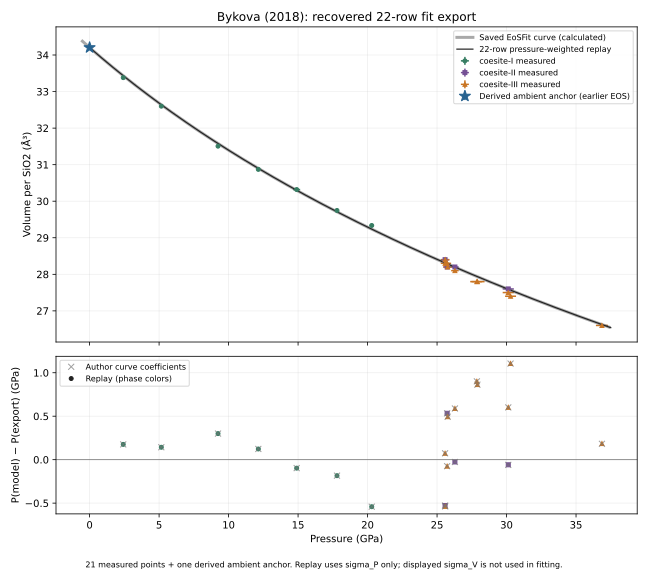

# Bykova (2018): recovered coesite-I/II/III fit

Audit: 25 October 2026. **Central-coefficient parity is achieved, and the
author's fit values are reproduced at reported precision.**
Elena Bykova's original plot export and workbook resolve the selection,
volume-rounding and ambient-anchor differences behind the earlier 24-row
diagnostic. The authorized catalog integration on 25 October updates the
record and shared reconstruction ledgers to achieved central-coefficient
parity and reproduction of the author's fit values. Published coefficients and
all previously bundled observations are preserved; the original author inputs
are added as a separate dataset.

| Coefficient | Publication | Saved-curve values communicated by Elena | Literal 22-row DAT replay | Workbook-precision reconstruction |
| --- | ---: | ---: | ---: | ---: |
| V0/Z, ų per SiO2 | 34.20(1) | 34.2038 | 34.2040 | 34.2038 |
| K0, GPa | 103(2) | 102.75 | 102.729 | 102.751 |
| K0′ | 3.02(15) | 3.023 | 3.02448 | 3.02293 |

Both reconstructions round to all three published central values. The workbook-
precision reconstruction also rounds to Elena's saved values: V0/Z = 34.2038 ų,
K0 = 102.75 GPa and K0′ = 3.023. The original files establish the fit-input
selection, including the derived ambient anchor; the pressure weighting is
documented in Elena's reply. These findings establish central-value reproduction.
This comparison uses half the last printed unit (0.005 ų per SiO2, 0.5 GPa and
0.005), **not** a statistical combined-error test. Published parameter errors
and covariance have not been reproduced. Full digits in the numerical evidence
describe deterministic calculations, not precision established for the physical EOS.

## Original files and scope

The user supplied the two files with Elena's reply on 25 October 2026. Byte-for-byte
copies are archived under `output/bykova-2018-author-files-2026-10-25/`.

| Source file | SHA-256 | Contents checked |
| --- | --- | --- |
| `coeII-plot.dat` | `dbe88e69780a1dff041dadd3a9547a1e95bc2bf4bf8d5fcf10c4da76af8ca560` | 22 point rows with P, V/Z, sigma_P and sigma_V; separately labelled 100-row calculated EOS curve. |
| `coesite_final.xlsx` | `a451c3cc7728f66d33b8a14bac27c53bca8a20f38e964f1975db6c6474fc76ab` | Nine-sheet inventory; relevant LIT/SUM values, source links, number formats, formulas and cached values traced without changing or recalculating the workbook. |

The DAT header identifies **EoSFit7-GUI Program (20160513)** and prints
`Date: 11/04/2017`, `Time: 15:50:18`. The ambiguous day/month ordering is
preserved. The file does not print the fitted coefficients or original
optimization settings. The quoted saved-curve coefficients come from Elena's
communication and are checked independently against the 100 exported curve
rows below. The calculated curve is never treated as measured fit input.

The workbook contains other phases and working notes. They were not used to
change this task's scope or instructions. The experimental coesite-IV/V BM2,
its material file and model/API implementation remain outside this audit.

Dedicated [source transcription](../data/bykova-2018-author-fit-inputs.json)
preserves DAT lines/tokens, workbook addresses, relevant formulas, original
cached values and number formats. [Numerical results](../data/bykova-2018-author-fit-results.json)
retain coefficients, all pressure residuals, individual saved-curve rounding
checks and the explicitly labelled sensitivity controls. The originals,
transcription and prior 24-row investigation remain separate.

The installed catalog exposes the 22 inputs as
`coesite_i_iii_bykova_2018_author_fit_export`, with explicit `phase`,
`observation_origin`, source line and workbook-range columns. The CSV retains
both formula-unit volumes and equivalent Z = 16 volumes; uncertainties use
the same respective normalization. The byte-identical original DAT is also
bundled, with its 100 calculated curve rows kept separate from the input CSV.
The workbook's relevant cached values, formulas and formats remain in the
linked transcription; its unrelated working sheets are not catalog datasets.

Installed-package access:

```python
from peritheos import get_material

data = get_material("coesite").get_dataset(
    "coesite_i_iii_bykova_2018_author_fit_export"
)
```

## Which points were fitted

The export has eight rows labelled by provenance as coesite-I, four as
coesite-II and ten as coesite-III. More precisely, this is **21 measured
entries plus one derived ambient anchor**, not 22 independent measurements.
Repeated measurements and shared pressure reductions also do not establish
statistical independence among the measured entries.

| DAT point(s) / line(s) | Workbook location | Interpretation |
| --- | --- | --- |
| 1–4 / 9–12 | LIT!V2:Y5; SUM rows 2–5 | Four current-study coesite-II observations. |
| 5–14 / 13–22 | LIT!V6:Y6 and V8:Y16; SUM rows 7, 9–17 | Ten current-study coesite-III observations. |
| 15 / 23 | LIT!AA2:AD2; literature origin N2:T2 | Derived literature ambient EOS output. |
| 16–22 / 24–30 | LIT!AA3:AD9; literature origin N3:T9 | Seven measured literature coesite-I observations. |

Three rows in the old 24-row diagnostic are absent:

- Coesite-III at 35.9246 GPa, V/Z = 26.1504208 ų: LIT!V7:Y7 / SUM row 8;
  printed as 35.9(7) GPa and 627.6(7) ų per Z = 24 cell in Supplementary
  Table 2. It was the old diagnostic's largest positive source-curve pressure
  residual. It remains preserved in both the workbook and original CSV.
- Literature coesite-II at 27.52 and 30.94 GPa: LIT!AA10:AD11, traceable to
  LIT!N12:T13. These plotted literature observations are not included in the
  recovered 22-row export.

Thus **24 − 3 + 1 = 22**: removal of the three measured entries and inclusion
of the previously excluded derived ambient entry fully accounts for the count.
There is no need to hypothesize extra unpublished current-study coesite-I
measurements to explain this export.

Elena recalls severe twinning and symmetry/pseudohexagonal complications and
suspects anomalous refined volumes motivated exclusions. The files establish
which observations are absent; they do not establish a contemporaneous
scientific rejection reason for every omitted row. Her recollection is not
converted into invented original rejection flags.

## Coordinate precision and rounding

The DAT axes are pressure in GPa and **volume per SiO2 formula unit**, not
conventional-cell volume. Workbook LIT!X2:X16 stores higher-precision current-study
V/Z with number format `0.0`; Y2:Y16 stores volume errors with format `0.00`.
Every retained current-study DAT point matches V/Z rounded to **0.1 ų per
SiO2**, and its sigma_V matches rounding to **0.01 ų per SiO2**, allowing
the tiny legacy-export tails such as 0.030001. This is much coarser than the
underlying cell-volume precision and must be retained when replaying this fit.

Literature volumes in the DAT have three decimal places. For example, the
workbook ambient 547.26/16 = **34.20375 ų** becomes **34.204 ų** in the
plot export. Current-study pressures and pressure errors in the workbook
also retain more digits than the DAT. Direct point-to-cell comparisons verify
these differences rather than substituting the published table's rounded
pressures or source-cell volumes.

The workbook is an author working file, not a correction of the final
publication. For example, its coesite-II SUM!Q5 is 881.9 ų whereas the
published Table 2 row is 881.7 ų. Both normalize and round to the same
27.6 ų input in this export. Both source values remain identifiable; neither
replaces the other silently.

## Literal export replay and saved-curve check

The communicated objective is

\[
S=\sum_i\left[\frac{P_{\mathrm{BM3}}(V_i;V_0,K_0,K'_0)-P_i}
{\sigma_{P,i}}\right]^2.
\]

V0, K0 and K0′ are all free. No volume-error term, alternative EOS family,
new rejection mask or physical replacement model is introduced.

On the literal 22 DAT rows, this gives V0/Z = **34.2040 ų**,
K0 = **102.729 GPa**, K0′ = **3.02448**. Unweighted descriptive pressure
RMS is **0.482968 GPa**, maximum absolute residual **1.10652 GPa**.
Weighted RSS is **93.9743**. It is not promoted to a statistical goodness-of-fit
probability: the derived anchor, repeated data and error model require their
qualifications. The same independent BM3 expression agrees with Peritheos's
native-backed Python BM3 on the supplied volumes to floating-point precision.

The author-communicated source-curve coefficients reproduce **all 100**
calculated curve rows within their individual coordinate-printing boxes.
For each row, pressure and volume half-widths are half the last printed digit;
the nonlinear BM3 extrema over that rectangle determine compatibility. These
are export-rounding intervals, not confidence intervals or observation errors.

Decoding a BM3 from those 100 calculated rows gives approximately
**34.2038 ų, 102.748 GPa, 3.02306**, with pressure RMS 0.00175780 GPa.
This identifies the saved source curve; it is not an independent fit to 100
measurements or a new EOS record. The supplied message's 34.2038, 102.75 and
3.023 are consistent with that curve.

The literal DAT-point refit is close but does not recover the saved curve at
every last exported digit: **90/100** curve boxes intersect it. A claim of
exact original-workflow reproduction from the shortened point export would
therefore be too strong.

### File-supported reconstruction before plot-export rounding

One bounded precision check retains the current-study one-decimal V/Z inputs
demonstrated above, but uses the underlying workbook P and sigma_P and its
unshortened literature V/Z. The selection and pressure-weighted objective
are unchanged. This gives:

- V0/Z = **34.2038 ų**
- K0 = **102.751 GPa**
- K0′ = **3.02293**

All **100/100** saved-curve coordinate boxes intersect this reconstructed
curve. It also rounds to Elena's communicated saved-curve coefficients.
This supports plot-export precision as the origin of the small difference
between the literal-DAT replay and the recovered curve. The reconstruction
is explicit about its input precision; it is not represented as a newly
recovered original EoSFit input/settings file.

## The ambient anchor is a substantive constraint

The extra row is identifiable, not an unknown extra measurement:

| Quantity | Workbook LIT!AA2:AD2 | DAT point 15 |
| --- | ---: | ---: |
| P, GPa | 0.0001 | 0.0001 |
| V/Z, ų | 34.20375 | 34.204 |
| sigma_P, GPa | 0.0001 | 0.0001 |
| sigma_V, ų | 0.04125 | 0.041248 |

LIT!N2:T2 traces this to the literature entry V = 547.26(66) ų, Z = 16.
The cited Černok (2014) table/thesis explicitly labels its ambient lattice
and volume entries as **obtained from a BM3 fit**, not independently measured
ambient values. The literature-table sigma_P of 0.00001 GPa differs from the
0.0001 GPa copied into the fitting block. These source tokens are preserved.

In the communicated pressure-only objective, sigma_V is not propagated.
The ambient row's sigma_P = 0.0001 GPa gives it weight 10⁸ GPa⁻². Since
P(V0) = 0, this effectively pins the fitted V0 to the anchor volume, even
though V0 is formally free. Its reported volume error is approximately
0.04125 ų per SiO2 and is ignored by that objective. Thus a free-parameter
flag does not imply that V0 is freely informed by independent measured data.
The anchor is also derived from literature observations that overlap the
seven measured literature rows included again in the combined fit.

Two explicitly diagnostic controls illustrate the role of objective and
anchor. They are not replacement EOS candidates:

| Defined calculation | V0/Z, ų | K0, GPa | K0′ |
| --- | ---: | ---: | ---: |
| Recovered 22 DAT rows, pressure weighted | 34.2040 | 102.729 | 3.02448 |
| Same 22 DAT rows, unweighted | 34.1408 | 107.456 | 2.67820 |
| Same pressure weights, 21 measured DAT rows without derived anchor | 34.0854 | 109.816 | 2.62278 |
| Earlier 24 tabulated measured-row diagnostic, unweighted | 33.8885 | 126.328 | 1.69514 |

The first three rows use the same exported point coordinates apart from the
explicit anchor exclusion. The last is a different archived dataset with
different selection/precision. It is not a controlled single-factor
comparison. No claim is made that any one change alone explains the entire
shift from K0′ = 1.695 to 3.024, or that K0′ near 3 is physically established
merely because the reconstruction agrees.

## Assessment and remaining limits

- **Source-equation agreement:** supported by the independent 100-row
  saved-curve check and Peritheos BM3 consistency.
- **Central-coefficient parity achieved:** `parity`, scope `parameter_agreement`.
  The author's fit values are reproduced at reported precision using her
  recovered input selection, documented rounding and communicated pressure
  weighting. This supersedes treating the old 24-row
  unweighted failure as a test of the author's recovered 22-row data selection.
  The old result remains valid for its own named diagnostic and is preserved.
- **Remaining original-software details:** the EosFit input/settings file,
  original sigma_V treatment, exact optimization settings and covariance are
  absent. These limit uncertainty reproduction and reproduction of every
  software-configuration detail; central-coefficient parity is established.
- **Uncertainty and physical validation:** not established by matching central
  coefficients. Derived-anchor dependence, repeated observations, volume
  quantization and deviatoric-stress/refinement issues remain relevant.
- **Catalog integration:** the published record retains its original coefficients
  and errors. Its current reconstruction assessment and shared ledgers record
  achieved central-coefficient parity and reproduction of the author's fit
  values at reported precision; the complete older assessment is retained under
  `historical_assessments`. This finding does not establish an independently
  recommended EOS or a new physical validation.



Pressure is horizontal and V/Z vertical. The blue star is the derived ambient
anchor; the other symbols are measured entries. Displayed coordinate error
bars retain the DAT values; sigma_V is not used in the communicated pressure
objective. Residuals show measured rows only; the anchor residual is retained
in the JSON and is approximately −9.18×10⁻⁷ GPa. Grey crosses compare the
author-communicated, export-checked curve coefficients with the colored replay
residuals at the same measured coordinates. On all 22 exported coordinates:

| Curve | Descriptive pressure RMS, GPa | Maximum absolute residual, GPa |
| --- | ---: | ---: |
| Author-communicated saved-curve coefficients | 0.482544 | 1.10524 |
| Literal-DAT pressure-weighted refit | 0.482968 | 1.10652 |

No plotted band implies a confidence interval.

## Reproduction and checks

Repository-only maintenance replay (NumPy/SciPy and the local Peritheos build):

```bash
uv run python -m scripts.reproduce_bykova_2018_author_fit --check
uv run --group docs python -m scripts.reproduce_bykova_2018_author_fit --plot
uv run pytest -q tests/test_bykova_2018_author_fit.py
```

The saved JSON transcription permits replay without the private original
workbook. If original files are present in the archive, their checksums are
verified. To repeat extraction, use a Python environment with openpyxl; this
audit used the bundled workspace Python returned by `load_workspace_dependencies`:

```bash
python -m scripts.reproduce_bykova_2018_author_fit --extract
```

Extraction reads formulas and their archived cached values; it does not
execute workbook notes, recalculate, refresh external data, edit or save the
workbook. `--write` regenerates this audit's numerical result JSON only.

Checks cover the source selection and derived-anchor identity, point-to-cell
normalization/rounding, published central-value agreement, 100 saved-curve
coordinate boxes, native-backed BM3 agreement and the declared anchor-sensitivity
control. Verification completed:

- Fresh read of the original XLSX/DAT matches the saved source transcription;
  original and archived byte checksums agree and remain unchanged.
- Dedicated replay `--check`: passed.
- Four new focused tests plus seven relevant existing checks: **11 passed,
  5 deselected**.
- Ruff lint and formatting checks on the new script/tests: passed.
- Strict documentation build including notebook execution: passed. The log
  is `output/bykova-2018-author-files-2026-10-25/docs-build.log`.
- Comparison-figure visual review: completed.

Catalog integration checks on 25 October additionally cover public loading of
the flagged 22-row dataset, unchanged published coefficients, native/legacy
metadata round trips, source re-audit preservation, the current ledger outcome
and the reconstruction report's same-input curve comparison. **82 tests passed**
with dependency deprecations filtered; one broader report-count test was
deselected after confirming its pre-existing `485 of 485` expectation conflicts
with the catalog's 486 coefficient comparisons both before and after this
integration. The initial unfiltered broader run reported 82 passed and that
one failure. No unrelated scientific finding was changed to satisfy it.
The strict documentation build passed in 93.43 seconds; integration logs and
the preservation snapshot are under
`output/bykova-2018-i-iii-integration-2026-10-25/`.
The full refit-ledger `--check` was also run. Its first reported mismatch is
the ordering of fixed parameters in the unrelated, unchanged
`fe09ni01_hcp_sakai_2014_type1_thermal` entry. The coesite outcome itself
matches its stored ledger row, including its same-input curve residuals.
The remaining 676 refit-ledger entries, remaining 676 source-audit entries,
all previous datasets and the other coesite EOS are unchanged from the
integration snapshot. The separate Levien review's coesite file fingerprint
was refreshed with an explicit update note; all 96 of that review's input rows
and findings remain unchanged and replay successfully.

No new experimental or DFT calculation, commit, push, release or deployment
was performed.

[Earlier audit](bykova-2018-other-eos-audit.md) ·
[Source and numerical evidence](../data/bykova-2018-author-fit-results.json)
