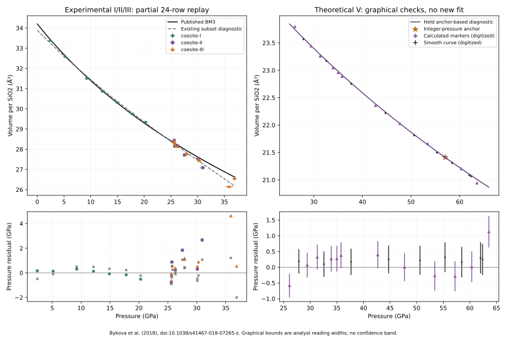

# Bykova (2018): audit of the other silica EOSs

Audit date: 24 October 2026. **Audit only: no material, observation, shared
ledger, model, API or schema was changed.** The combined experimental
coesite-IV/V BM2 at 32.7 GPa is owned by the original chat and is excluded
from this investigation.

The experimental coesite-I/II/III coefficients are faithfully transcribed
and reproduce the published Figure 1 curve. The existing partial refit does
not recover those coefficients. Coesite-IV retains its qualified conditional
refit finding. The held coesite-V diagnostic agrees with the smooth source
curve at the declared graphical resolution, but does not pass through all
calculated markers. One transformed Table 10 state has a much larger pressure
discrepancy with that diagnostic and needs clarification. Two additional
source-owned AM05 results, stishovite/CaCl2 and seifertite, were omitted from
the earlier inventory; neither has enough published inputs for a complete
executable EOS.

## Sources and reproducibility

Primary authority: Bykova et al. (2018), *Nature Communications* **9**, 4789,
[doi:10.1038/s41467-018-07265-z](https://doi.org/10.1038/s41467-018-07265-z),
and its [official supplement](https://media.springernature.com/original/springer-static/esm/art%3A10.1038%2Fs41467-018-07265-z/MediaObjects/41467_2018_7265_MOESM1_ESM.pdf).
The archived article and 23-page supplement are in
`output/coesite-iv-bykova-2018-audit-2026-10-23/`.

| File | SHA-256 |
| --- | --- |
| Article PDF | `776ca4ca61872b7540c1ebaa70c29046f84a41c2d0700725d009eba203bd3cb5` |
| Supplement PDF | `9d4bcb36ae6a89b19f5bbcc3fc671f3c1bfc6530a76915382c6132d3d907e459` |
| Černok thesis PDF | `093882fd5953cc0eab8517e6ed4ddc4e6003628097956b0b5029d5a4822fdd2c` |

Both PDFs were read and their relevant figures/tables inspected visually.
The article's Figure 1 and Supplementary Figures 4–6 and 9, Tables 1–3 and
10–11, computational methods and data statement establish the inventory
below. The cited 2014 diffraction data are traceable through
[Černok's thesis, Table 5.1](https://epub.uni-bayreuth.de/id/eprint/2719/1/AnaCernok_thesis.pdf),
which reproduces that article's Table 1. The previously archived investigation
of the six experimental CIFs, ICSD statement and Tidholm thesis is described
in the [broader audit](tranche-b-mineral-eos-audit.md#bykova-et-al-2018-101038s41467-018-07265-z);
that wider repository/thesis search was not repeated here. The article's data
statement describes crystallographic deposits, not a numerical AM05 EOS grid.
No claim is made that absent inputs cannot exist elsewhere or with the authors.

The thesis was downloaded again from the institutional repository; its checksum
matches the original dataset provenance. All nine measured pressure/volume/error
entries were rechecked against Table 5.1 (printed p. 72, PDF p. 94), including
its footnote identifying the ambient entry as an EOS fit output. The footnote
defines parenthesized errors as estimated standard deviations and pressures
as averages of readings before and after diffraction data collection. That
explicit convention belongs to the 2014 table and does not supply the missing
2018 regression protocol or covariance.

The new [pixel readings](../data/bykova-2018-other-eos-readings.json) record
axis calibration, marker/curve coordinates, rendering/cropping and analyst
reading bounds. [Numerical evidence](../data/bykova-2018-other-eos-audit.json)
retains all 24 experimental rows and their residuals, graphical comparisons,
source/dataset checksums, the earlier coesite-IV replay and coesite-V
sensitivity checks. Original measured and calculated CSVs remain unchanged.

Repository-only maintenance commands:

```bash
uv run python -m scripts.audit_bykova_2018_other_eos --check
uv run --group docs python -m scripts.audit_bykova_2018_other_eos --plot
```

`--check` reads existing inputs and compares the numerical replay with the
saved evidence. `--write` updates only this audit's numerical JSON. `--plot`
writes only its comparison SVG and a local PNG preview. Source PDFs are
optional for numerical replay outside the local archive; when present their
checksums are verified. The script independently evaluates the standard BM3
equation and checks the native-backed Python implementation against it on
the 24 experimental volumes. It also verifies source-cell normalization and
preserved CSV checksums. This establishes numerical consistency, not physical
validation or original-regression reproduction.

## Source ownership and current representation

| Result or comparison | Source location | Ownership and representation |
| --- | --- | --- |
| Combined coesite-I/II/III experimental BM3 | Article p. 2, Results and Figure 1 | New 2018 joint parameterization, incorporating earlier literature measurements. Stored as `coesite_i_iii_bykova_2018_300k_bm3` in `coesite.eosmat`. |
| Coesite-IV AM05 BM3 moduli | Supplementary Table 11, p. 21 | New 2018 calculation. Stored separately as a conditional Peritheos V0 refit with published moduli fixed; V0 is not printed by the authors. |
| Coesite-V AM05 BM3 moduli | Supplementary Table 11, p. 21 | New 2018 calculation. Held non-executable candidate under `coesite_v.eosmat`, with one-anchor diagnostic V0. |
| Stishovite/CaCl2 AM05 BM3 moduli | Supplementary Table 11, p. 21 | New 2018 calculation, one combined source row. No Bykova record in the current material files. Do not silently split this into two independently fitted EOSs. |
| Seifertite AM05 BM3 moduli | Supplementary Table 11, p. 21 | New 2018 calculation. No Bykova record in the current material files. |
| Combined coesite-IV/V experimental BM2 | Figure 1; Supplementary Figure 9 | New 2018 result; excluded here and handled by the original chat. |
| Coesite-I/II open symbols | Figure 1, references 15–16 | Earlier Černok measurements, not new 2018 observations or separate 2018 fits. The joint fit above is source-owned even though it uses literature data. |
| Equilibrium-silica experimental curves | Supplementary Figure 9, references 17–19 | Literature comparisons: Angel (1997), Andrault (2003), Grocholski (2013), as assigned in the caption. These are distinct from the new AM05 Table 11 calculations. |
| Cristobalite X-I curves | Supplementary Figure 9, reference 5 | Černok (2017) literature comparison, not a new Bykova EOS. |
| Glass density / sound velocity | Supplementary Figure 9, references 14 and 20 | Prescher (2017) and Petitgirard (2017) literature comparisons, not new bulk glass EOSs from this paper. |
| Stishovite SiO6 polyhedron-volume BM2 | Supplementary Figure 4a, reference 4 | Comparison fit using Yamanaka (2002) structural data: V0 = 7.38(1) ų, K0 = 308(3) GPa, K0′ = 4. This is the volume of one SiO6 octahedron, not a cell or SiO2 formula volume. Do not register it as an ordinary bulk stishovite EOS. The caption does not by itself establish where that numerical fit was first performed. |

## Experimental coesite-I/II/III

### Equation, coefficients and inputs

The source explicitly uses one effective compression curve for the three
tetrahedral phases, rather than three independent EOSs. The printed values are
V0/Z = **34.20(1) ų per SiO2**, K0 = **103(2) GPa**, K0′ = **3.02(15)**.
The stored equivalent Z = 16 values are V0 = **547.20 ± 0.16 ų**,
K0 = **103 ± 2 GPa**, K0′ = **3.02 ± 0.15**. Those conversions are correct.
The parenthesized error widths are retained; their confidence convention and
parameter covariance are not supplied. The record's 300 K is a room-temperature
representation, not a thermal EOS or evidence that every measurement was made
at exactly 300.000 K. Reference pressure is zero.

The two existing CSVs contain nine Černok (2014) observations and all 15
coesite-II/III rows from Supplementary Table 2: **7 coesite-I, 6 coesite-II,
11 coesite-III**, at 2.42–36.9 GPa. The 15 Bykova rows match the source's
pressures, cell volumes, printed coordinate errors, phase assignments and
sample identities, including repeat measurements. Source cells have Z = 16,
32 and 24 respectively. Evaluation uses source-cell volume × 16/Z, not the
more coarsely rounded printed V/Z column. The 2014 fitted ambient table entry
is excluded as a non-independent EOS output.

The two high-pressure coesite-III observations, 35.9 and 36.9 GPa, remain
included. Their coexistence with coesite-IV does not authorize deleting them
from the source's combined tetrahedral branch. The 0–36.9 GPa catalog range
includes the zero-pressure extrapolated reference; the exact bundled measured
subset starts at 2.42 GPa. It does not establish phase stability across the
whole interval.

Neon is the stated pressure medium and diffraction pressure standard; ruby
was included for pressure estimation. The exact Ne calibration equation,
paired calibrant lattice observations, pressure-error reduction and original
EOS objective/weights/row mask are unavailable in the checked source files.
Recalibration or formal author-workflow reproduction is therefore unavailable.

An existing explanation says several current-study coesite-I points are
visible in Figure 1 and entered the fit. That is **not established**: the
figure legend identifies the coesite-I open symbols as reference 16 and
provides no separate current-study coesite-I symbol. Supplementary Table 1
does list new-run coesite-I measurements, but does not give their volumes.
Whether those observations entered the published regression remains unknown.
Their existence must not be used to explain the coefficient discrepancy as fact.

### Separate curve agreement and refit findings

Seven unobscured black-curve readings in Figure 1, approximately 4.48–34.17
GPa, give pressure RMS **0.0139 GPa**, maximum **0.0166 GPa**, against the
printed central coefficients. All reading boxes intersect the curve. The
analyst ±2-pixel coordinate bounds correspond to about ±0.138 GPa and
±0.0322 ų per SiO2; these are graphical bounds, not source standard errors.
The source equation and its plotted curve therefore agree at the checked
resolution. These readings were not used as fit observations.

Replaying the existing unweighted pressure-residual diagnostic on all 24
bundled observations gives:

| Quantity | Published coefficients | Existing partial-refit diagnostic |
| --- | ---: | ---: |
| V0, ų per equivalent Z = 16 cell | 547.20 | 542.216 |
| K0, GPa | 103 | 126.328 |
| K0′ | 3.02 | 1.69514 |
| Pressure RMS, GPa | 1.26981 | 0.696770 |
| Maximum absolute pressure residual, GPa | 4.62676 | 1.99674 |

The diagnostic K0 differs by +22.65% and K0′ by −1.32486. These remain the
existing failed parameter comparison; no alternative masks, weights, EOS
family or replacement coefficients were developed. Lower diagnostic residuals
do not establish a better scientific EOS or authorize replacing the source.

| Phase | Rows | Published-curve pressure RMS, GPa | Maximum absolute residual, GPa |
| --- | ---: | ---: | ---: |
| Coesite-I | 7 | 0.256577 | 0.517055 |
| Coesite-II | 6 | 1.41646 | 2.66579 |
| Coesite-III | 11 | 1.54330 | 4.62676 |

Residual means P(model at printed volume) − P(observed). The largest residual
is +4.62676 GPa at the 35.9(7) GPa, V = 627.6(7) ų coesite-III row
(Z = 24). The source itself discusses scatter and possible deviatoric stress;
the recovered coordinate errors do not describe that entire variation.
Neither a uniform-noise assumption nor independent Gaussian errors for repeat
measurements is demonstrated.

The stored partial-fit `reduced_chi_square = 0.554844` is RSS/21 for unweighted
pressure residuals, in **GPa²**. With no supplied absolute noise model it is
not a statistical reduced chi-square. Likewise `absolute_sigma: true` does
not supply missing source weights or make the displayed diagnostic coefficient
errors a reproduced author covariance. Preserve those historical fields, but
correct their presentation in any separately authorized integration.

**Assessment:** source-equation/curve agreement is supported; full author-fit
reproduction is not established; the existing partial parameter comparison
remains `not_reproduced` / `parity_not_achieved`. Retain a recommendation hold
for that unresolved reconstruction. This is not evidence that the printed
formula fails to reproduce Figure 1. The current record's source-review label
`primary_source_validated` and failed reconstruction label need to be read
as separate axes; this audit does not change either field or endorse automatic
scientific use.

## Theoretical coesite-IV

The [dedicated coesite-IV audit](coesite-iv-bykova-2018.md) remains applicable
and its replay passes. Its unchanged Z = 16 curve is
V0 = **438.6702 ų**, K0 = **168.52 GPa**, K0′ = **3.34**, at 0 K.
Only the two moduli are printed in Supplementary Table 11. Peritheos fits V0
to three calculated Table 10 states at printed integer pressures 39, 41 and
48 GPa. Those are calculated checkpoints, not measured observations or exact
unrounded pressures. This is a conditional independent refit with both shape
coefficients fixed.

Pressure RMS is **0.0808114 GPa** on the three checkpoints. Five additional
Figure 6 calculated markers give RMS **0.226 GPa**, maximum **0.354 GPa**,
within the earlier analyst ±4-pixel reading bounds. The narrower ±2-pixel
check excludes two markers. These reproduce the earlier qualified finding,
not a new fit or author-workflow claim. The approximately 0.0843 ų formal V0
error is conditional residual-scatter covariance; it excludes integer pressure
rounding, uncertain fixed moduli, DFT systematics and model inadequacy.

The 352.35 ų relaxation transforms to coesite-V according to the article's
p. 7 computational results and remains excluded from the IV refit. No change
to `coesite_iv.eosmat` is made here.

## Theoretical coesite-V

### What the held diagnostic represents

Supplementary Table 11 prints **K0 = 185.26 GPa, K0′ = 3.10**, but no V0,
errors or covariance. Table 10 prints **P = 57 GPa, V = 342.5716 ų** for
coesite-V (Z = 16). Holding both printed moduli fixed and forcing this anchor
determines V0 = **427.3921208 ų**, the existing held diagnostic. Its negligible
anchor residual is an identity imposed by that construction, not independent
EOS validation. Under an explicitly assumed nearest-integer ±0.5 GPa rounding
interpretation, V0 is 426.7608–428.0222 ų. This is a conditional rounding
interval, not a confidence interval or complete parameter uncertainty.

### Smooth curve and calculated markers are different checks

Nine unobscured readings of the purple smooth curve in Supplementary Figure 6
give pressure RMS **0.2268 GPa**, maximum **0.3179 GPa**; all are compatible
with the diagnostic within ±4 pixels per coordinate. Thus the anchor-based
curve is graphically consistent with the plotted smooth source curve.
This check helps constrain the omitted V0 at graphical resolution; it does
not turn that V0 into a published coefficient or recover the source regression.

Separately, all 12 purple calculated triangles were read without moving their
centers onto the smooth curve. The same ±4-pixel bounds mean approximately
±0.157 GPa and ±0.02035 ų per SiO2. They are analyst reading bounds, not
DFT error bars. Exact nonlinear coordinate-box extrema give:

| Marker | P, GPa | V/Z, ų | Pressure residual, GPa | Reading interval, GPa |
| --- | ---: | ---: | ---: | --- |
| 1 | 26.11 | 23.797 | −0.582 | [−0.960, −0.203] |
| 2 | 29.44 | 23.440 | +0.069 | [−0.322, +0.460] |
| 3 | 31.32 | 23.257 | +0.323 | [−0.074, +0.721] |
| 4 | 33.95 | 23.044 | +0.267 | [−0.138, +0.674] |
| 5 | 35.01 | 22.957 | +0.274 | [−0.135, +0.684] |
| 6 | 35.80 | 22.886 | +0.378 | [−0.034, +0.791] |
| 7 | 42.70 | 22.357 | +0.396 | [−0.038, +0.830] |
| 8 | 47.72 | 22.026 | +0.003 | [−0.446, +0.452] |
| 9 | 53.40 | 21.660 | −0.269 | [−0.735, +0.198] |
| 10 | 57.21 | 21.416 | −0.286 | [−0.764, +0.193] |
| 11 | 60.34 | 21.202 | +0.014 | [−0.476, +0.504] |
| 12 | 63.56 | 20.943 | +1.130 | [+0.627, +1.634] |

All-marker RMS is **0.4402 GPa**. Excluding marker 10, the apparent counterpart
of the anchor, the 11 additional markers give **0.4517 GPa**, maximum
**1.1302 GPa**. Markers 1 and 12 miss the four-pixel reading boxes; with a
doubled eight-pixel bound, marker 12 still misses. These are checks of the
unchanged central diagnostic, not a test across every rounding-compatible V0
or an uncertainty distribution for the unknown source coefficients.

A fitted curve need not pass through every calculated state. The methods say
energies, pressures and volumes were used for fitting, without giving the
objective or relative weights. The plotted marker residuals therefore do not
prove a failed author regression or a paper error. They do rule out claiming
that this diagnostic reproduces every calculated marker at digitization precision.

### Transformed Table 10 state

Table 10 also prints a calculated **55 GPa, 352.3491 ų** row under the
coesite-IV starting model. The article explicitly says the 352.35 ų
relaxation transforms to V. This is additional relevant source evidence,
but is not unambiguously labelled as a second equilibrium V EOS input.

The existing V diagnostic predicts **47.78184 GPa** at this volume, a
**−7.21816 GPa** residual relative to the table. Figure 6 has a V marker near
47.72 GPa and V/Z = 22.026 ų (352.42 ų per cell), close in volume to this
state and consistent with the diagnostic at graphical resolution. This is an
apparent correspondence only; no exact row identity is asserted.

Nearest-integer pressure rounding cannot explain a 7.2 GPa difference.
Unresolved possibilities include which stage/branch the printed pressure
describes and the relation between the tabulated relaxation and the EOS grid.
The checked source does not select an explanation. Preserve the pressure,
volume, starting-phase label and transformed-state qualification; do not
relabel it as an exact V fit row or change its pressure to the graph reading.

**Assessment:** retain the non-executable hold. Missing published V0,
unavailable numerical grid and this transformed-state ambiguity prevent a
complete published-parameterization/author-fit claim. Graphical source-curve
agreement is positive evidence and should be retained separately. No new
replacement fit, uncertainty estimate, executable record or recommendation is
created by this audit.

## Other new AM05 results

Supplementary Table 11 is explicitly a table of the authors' ab initio
results, not a literature-comparison table:

| Source row | K0, GPa | K0′ | Missing inputs / limits |
| --- | ---: | ---: | --- |
| Stishovite/CaCl2 | 298.90 | 3.66 | V0; volume normalization/cell for a complete parameterization; E–P–V grid; branch selection across the transition; fit protocol and uncertainty. |
| Seifertite | 310.14 | 4.09 | V0; explicit normalization/cell for the omitted volume; E–P–V grid; fit protocol and uncertainty. |

Both are static AM05 BM3 results. The methods specify PAW VASP, Si 3s/3p
and O 2s/2p valence states, 600 eV cutoff and an 8×8×8 Monkhorst-Pack mesh
for these phases, compared with 3×3×3 for coesite-IV/V. They describe full
structural relaxation and a calculated stishovite-to-CaCl2 transformation
between approximately 35 and 40 GPa. That transition range is not a stated
EOS fitting domain. A single combined Table 11 row does not establish two
separate phase parameterizations or continuity rules for joining them.

Supplementary Figure 5 gives relative enthalpies. It does not provide an
independent phase volume grid: the reference stishovite/CaCl2 enthalpy is
subtracted from each branch. Supplementary Figure 9's black experimental
equilibrium-phase curves are literature comparisons and cannot validate or
supply V0 for the AM05 results. Experimental structures or V0 from another
functional/publication must not be inserted as though source-owned.

**Assessment:** newly identified source-owned candidates, `deferred` /
`not_refittable` as applicable to missing model inputs, not demonstrated
numerical failures. A complete source-defined parameterization plus an
independent source checkpoint/curve could support parameterization-only
validation without the entire regression grid. Here even V0 is missing,
and the checked files supply no suitable independent volume benchmark for
these two calculations. No executable candidates were added.

## Comparison figure



Pressure is horizontal and volume vertical. The experimental panel preserves
the source curve and existing partial diagnostic on the same 24 rows. Their
unweighted pressure RMS values are 1.26981 and 0.696770 GPa. Measured-coordinate
bars retain the CSV's reported error widths, without assigning a new confidence
convention. The V panel separates calculated-marker readings from smooth-curve
readings. Residual intervals propagate graphical coordinate boxes, not parameter
confidence or DFT errors. No displayed comparison establishes experimental
validation. Complete coordinates and residuals are retained in the linked JSON.

## Findings requiring a separately authorized catalog update

1. Preserve the I/II/III published coefficients and existing failed partial
   parameter comparison. Add the positive Figure 1 source-curve check as a
   separate finding. Qualify claims that missing current-run coesite-I points
   are visibly plotted or definitely entered the regression; neither is proven.
2. Clarify the unweighted residual scale currently called reduced chi-square,
   and diagnostic covariance limits. Ensure reconstruction/recommendation
   presentation does not imply author-workflow or physical validation.
3. Retain the coesite-IV conditional-refit qualifications unchanged.
4. Preserve coesite-V's hold, its smooth-curve agreement, calculated-marker
   residuals and transformed-state ambiguity. Replace historical descriptions
   of integer-pressure checkpoints as "exact" with "verbatim transcribed".
5. Add stishovite/CaCl2 and seifertite to the source-owned candidate inventory,
   with their missing V0 and branch/data requirements. Do not classify them
   as literature-only or invent complete EOSs from their two moduli.

Minimum useful author inputs are the actual I/II/III fit table with phase/run
mask, pressure scale and objective/weights; the fitted AM05 V0 and normalization
for each Table 11 row; the DFT E–P–V grid and branch labels; and clarification
of the 55 GPa transformed Table 10 state. Uncertainty/covariance and original
VASP inputs would enable stronger reproduction. No author was contacted.

This report and its dedicated evidence/script are new local files. Shared
scientific classifications and generated ledgers remain untouched. No commit,
push, release or deployment was performed.

## Verification performed

- Dedicated audit `--check`: passed, including source/CSV checksums,
  normalization, stored experimental coefficients, the non-executable V hold,
  independent BM3 evaluation, existing partial-refit replay, graphical
  comparisons and the earlier IV audit.
- Existing focused tests: **7 passed, 5 deselected** using
  `pytest -q tests/test_bykova_2018_coesite_iv.py tests/test_tranche_b_mineral_eos.py -k 'bykova or numerical_replay'`.
- Ruff lint and formatting check on the dedicated script: passed.
- Full strict documentation build, including notebook execution: passed.
  The build log is in `output/bykova-2018-other-eos-audit-2026-10-24/docs-build.log`.
- Source-table/figure visual review and the new comparison-figure visual
  review: completed. No new experimental or DFT calculation was performed.
