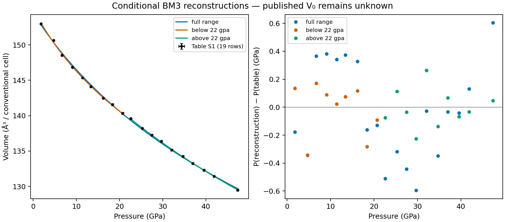

# Fe3C: Scott reconstruction and additional source EOSs

Reviewed 25 October 2026; Prescher recovery updated 30 October 2026.
Source coefficients, observations and uncertainties
are preserved separately from reconstructions. Nothing in this audit changes
the Scott published EOS or establishes experimental validation.

## Scott et al. (2001): similarity, not coefficient parity

The existing `cementite_scott_2001_bm3_1` reconstruction is now **similar**.
The previous generic test accepted both combined-two-error-width overlap and
broad numerical screens (15% in K0; 1.0 absolute or 20% in K0′). That screen
was too permissive to describe this partial reconstruction as coefficient parity.

| Coefficient | Published | Digitized-data reconstruction | Difference |
| --- | ---: | ---: | ---: |
| K0 (GPa) | 175 ± 4 | 161 ± 9 | −14.0586 (−8.02%) |
| K0′ | 5.1 ± 0.3 | 6.0 ± 0.6 | +0.944124 (+18.51%) |

Displayed coefficients follow the repository uncertainty-rounding convention;
full source and reconstructed precision remains in EOSMAT and the numerical report.

The source is Scott, Williams and Knittle,
[doi:10.1029/2000GL012606](https://doi.org/10.1029/2000GL012606),
page 1876 and Figure 3. The body reports K0′=5.1; the abstract gives
5.2. The body values remain the record. V0=155.26(14) ų is held fixed in
the reconstruction; this does not independently recover the ambient volume.

The paper describes **weighted least squares** on two compression runs. Only
21 filled-symbol observations digitized from Figure 3 are bundled; its open,
temperature-quenched point is excluded. Some coordinate error bars cannot be
recovered. The generic row reader consequently discards both incomplete sigma
arrays and minimizes equally weighted pressure residuals. It does not reproduce
the published weighting, numerical rows or run assignments.

The recorded errors use residual-scaled inverse-normal-matrix covariance:
when no observation sigmas are supplied, the fitting API scales by residual
variance even if `absolute_sigma=True`. That flag in the historical ledger
does not establish absolute experimental errors. Neither source confidence
conventions nor shared-data covariance are known. The errors and old broad
comparison flags remain visible; they are not silently replaced.

For this record, coefficient parity additionally requires every free central
coefficient to lie within its printed source error width. Both fail. This is
a dedicated numerical criterion, not a statistical confidence test. The
generic policy and unrelated records are unchanged.

K0 and K0′ are strongly anticorrelated (about −0.985). On a 1001-state pressure
grid from 0 to 73.2 GPa, the source and reconstructed curves differ by at most
0.442 ų, or 0.309% in volume. Pressure RMS on the same 21 digitized rows is
1.657 GPa for the source and 1.552 GPa for the reconstruction. Residual means
P(model) − P(digitized observation). These descriptive RMS values are separate
from parameter uncertainty and are not evidence that the source is wrong.

The original numerical P–V rows with run IDs, weights, covariance, and the
precise fitting objective would be needed for author-workflow reproduction.
No author contact has been made. The correction is local until published;
the Studio deployment is unchanged.

The [dedicated Scott investigation of 30 October](scott-2001-fe3c-investigation.md)
now independently verifies the equation, digitization and fitting machinery.
It demonstrates substantial weighting sensitivity: the same 13 points with
recoverable pressure bars give 161.40/6.093 with equal pressure weights and
171.98/5.275 using those bars as numerical weights. Separately calibrated
markers with relative-pressure loss give 173.62/5.214, within both printed
source widths, while isolated portions of the drawn third-order curve also
support the published pair at scanned-line precision. These are conditional
comparisons, not recovered source weights or author-workflow reproduction.
The final article does not explicitly state that V0 was fixed. Original
coefficients, digitization and the existing reconstruction assessment remain
unchanged; the separate report records the protocol alternatives and limitations.

## Additional primary sources

| Source | Contribution | Disposition in this investigation |
| --- | --- | --- |
| [Prescher et al. (2012)](https://doi.org/10.1103/PhysRevB.85.140402) | Single-crystal compression at 293 K to 47 GPa; three BM3 fits | Main paper and user-supplied final supplement recovered: all 19 Table S1 states and atomic coordinates preserved. Figure 1 has 22 markers, including three states absent from the 19-row supplement. Full-range central coefficients and an approximate source curve are recovered. Both split K0/K0′ comparisons have conditional parameter parity; the low K0 uncertainty is not reproduced. Only the full-range published fit is exposed in the catalog. With curve-derived V0 fixed, all 22 graph markers recover both K coefficients and both formal errors at published precision. The complete final table and graph markers remain public; split fits are retained as audit evidence only. Source confidence and original workflow remain unconfirmed. |
| [Litasov et al. (2013)](https://doi.org/10.1002/2013JB010270) | FM and PM Vinet reference curves, HT, MGD and Kunc–Einstein thermal treatments to 31 GPa and 1473 K | All 81 Table 1 rows recovered with 1σ errors and paired MgO volumes. Literal table/prose alternatives retained; not integrated. |
| [Takahashi et al. (2019)](https://doi.org/10.3390/min9120744) | Nonmagnetic BM3 + MGD, two pressure-scale variants, high-pressure and high-temperature observations | Both source models integrated as pressure-scale variants of nonmagnetic cementite, with all 60 supplementary rows and separate Prescher high-pressure structural provenance. |
| [Li et al. (2002)](https://doi.org/10.1007/s00269-001-0224-4) | Room-temperature compression to 30.5 GPa | Published BM3 integrated with unchanged coefficients and fixed measured V0. All 14 Table 1 rows retained; conditional parameter parity and source-curve checks pass. Author weighting/confidence/calibration workflow remain unresolved. [Audit and integration](li-2002-fe3c.md). |
| [Sata et al. (2010)](https://doi.org/10.1029/2009JB006975) | Compression under core pressures | Original-scale 300 K BM3 retained on `cementite_nonmagnetic` as a qualified nondefault source EOS at 27.2–186.6 GPa. Published coefficients reproduced conditionally; some quoted point errors are smaller than the overall experimental scatter. The recalculated-pressure refit is a separate diagnostic. All nine Fe3C/MgO states plus three cited Li rows and conditional parameter parity preserved; original reducer precision unresolved. The mBM3/Table 6 BM3 forms represent one curve. Litasov's later Vinet recalibration stays separate. [Source audit](sata-2010-fe3c.md). |
| [Ono and Mibe (2010)](https://doi.org/10.1016/j.pepi.2010.03.008) | Experimental and first-principles magnetic-state compression | Original experimental BM3 integrated as nondefault `cementite_ono_mibe_2010_bm3`, at 300 K and 0–34.3 GPa, with all 14 Table 1 rows retained. Published K0=167 GPa and K′0=6.7 preserved; measured V0=155.4(2) ų explicitly adopted. Graphical source-equation check passes; original fitting details remain unknown. The 0 K P–V/E–V calculations and Litasov recalibration stay separate. [Source audit](ono-mibe-2010-fe3c.md). |
| [Hu et al. (2019)](https://doi.org/10.1029/2019GL084545) | Shock Hugoniot and thermal reduction to 245 GPa | Published six-shot linear Us–up Hugoniot retained over the full 85.6–245 GPa experimental range, with the approximately 2% porous precursor explicit. Possible melting at higher pressures; density data do not resolve the phase state. All six original shots through 245 GPa, errors and calculated temperatures retained; coefficient comparison has conditional agreement within published widths. The refit remains a separate diagnostic, and the thermal reduction is not installed. [Source audit](hu-2019-fe3c.md). |

The cited Prescher paper is **2012**, not 2013. Its main text gives
K0=161(2) GPa, K0′=5.9(2) over the full range; 145(3), 8.5(7) below 22 GPa;
and 172(1), 5.1(1) from 22–47 GPa. It does not specify their V0 values in
the main text. The supplied six-page final supplement now provides all 19
Table S1 pressure–volume/lattice states (1.8–47.4 GPa) and all 57 atomic-site
xyzU entries. It provides no ambient row and no V0 values or fixed/shared/refined
constraints for the three fits. The original ambient point visible in Figure 1
therefore cannot be recovered numerically from this table. Earlier failed APS
access attempts remain in the source manifest as access history.

The supporting dataset `cementite_prescher_2012_table_s1` is bundled with
cementite and linked to the three Prescher records added on 30 October 2026;
these are not Scott inputs. Their [integration note](prescher-2012-recovery.md#database-integration)
documents the adopted V0 and conditional coefficient parity separately from
uncertainty and author-workflow reproduction.
Raw last-digit widths and atomic tokens are retained. Pressure widths are
before/after-reading differences according to the main paper, not established
independent standard deviations; error confidence for the printed volume widths
is unspecified. All 19 rows are retained, including R1=8.2% despite the main
paper's statement that refinements were better than 8%.

Two explicitly conditional reconstructions use equal pressure weights or the
reported P/V coordinate widths as numerical errors-in-variables weights. All
three parameters are free, because source V0 and its constraints are unknown.
Neither reconstruction recovers the authors' exact objective or ambient input.
The coordinate-width full-range diagnostic gives V0=154.488 ų,
K0=160.54 GPa and K0′=6.032. Its K0 and K0′ lie within the printed source
widths, but this does **not** establish complete published-EOS parity. The
below-22 and above-22 GPa diagnostics give 128.39/9.965 and 188.64/4.471,
respectively, outside the printed source coefficient pairs. These initial diagnostics used only Table S1. The 30 October follow-up below
recovers additional figure evidence and tests an explicitly conditional shared
V0; the earlier numerical report is preserved unchanged. No diagnostic refit
is registered as a replacement EOS.



Full comparisons and residual-scaled conditional covariance are retained in
[the Prescher reconstruction report](../data/prescher-2012-fe3c-reproduction.json).
The repository maintenance command is
`uv run python -m scripts.reproduce_prescher_2012_fe3c`.

### Original working archive

The user identified a private working archive named `Fe3C`. Its ESRF/APS
spreadsheets, both Origin projects and 24 manuscript drafts were inspected.
The archive files were read without alteration. Original-file checksums, stored
workbook cells, XLSX formulas/caches, recovered Origin values and comparisons
are retained in
[the archive investigation](https://github.com/CPrescher/peritheos/blob/main/peritheos/data/research/cementite/prescher-2012-archive.json).
These working versions are separate from the final published Table S1.

- `ESRF single crystal/Fe3C_up_p19.XLS` contains 20 states labelled p0–p19.
  Its p0 row is at 0 GPa with stored volume 163.4023 ų. This is not identified
  as a fitted reference volume. The next state's volume is 153.6255 ų at
  1.8 GPa, whereas final Table S1 reports 152.98 ų. The earlier workbook
  therefore cannot replace the published observations or supply a fit V0.
- `ESRF single crystal/Data.opj` contains ten finite diffraction states from
  1.8 to 22.6 GPa and no saved functions, graphs or notes. These are closer
  to Table S1, but volumes still differ by up to 0.04 ų and some pressures
  differ by 0.1 GPa. The other allocated rows are missing, not additional
  observations. There is no ambient row. Values were recovered with
  liborigin 3.0.4 at the commit recorded in the investigation, exporting 17
  significant digits without changing the parser. Original columns are named
  A–I; their physical roles are inferred from numerical correspondence with
  Table S1 and the labelled workbook, rather than recovered unit labels.
- `APS single crystal/eos.xls` and `eos.xlsx` contain a separate lower-pressure
  experiment and processing alternatives. They are not identified as the
  final three ESRF fit inputs. Stored XLS values and both XLSX formulas and
  cached results are preserved without recalculation.
- `Analysis/analysis.opj` contains spectroscopy/magnetic and phonon analyses
  in seven sheets. No saved EOS fit function or fit note was found. The
  manuscript drafts did not reveal the missing reference volumes in readable
  EOS passages. Several legacy DOC conversions append binary/object content,
  so this does not establish that every embedded object was decoded.

No final three-fit output or source V0 constraint was recovered in this initial
archive inspection. At that stage, the three Prescher EOSs remained pending;
the inspection added provenance evidence without changing Table S1, its
conditional diagnostics, Scott's published EOS or the Takahashi source models.
The 30 October recovery below subsequently supports the explicitly qualified
[database integration](prescher-2012-recovery.md#database-integration).


### Follow-up: independent SciPy replay and restored MATLAB files (30 October)

**The initial table-only input set was incomplete.** Vector extraction of
Figure 1 identifies 22 markers, including an ambient point near
0 GPa / 155.09 ų and two other markers near 5.93 GPa / 149.51 ų and
44.53 GPa / 130.61 ų. These are separate digitizations, not replacements
for Table S1 or recovered original numerical measurements.

Adding the digitized ambient marker to the 19 printed states, with all three
BM3 parameters free and equal pressure residuals, gives K0=161.36 GPa and
K0′=5.904, recovering the published full-range central pair at printed
rounding. All 22 vector markers give 160.97 / 5.931. The drawn source curve
independently implies V0≈154.568 ų, K0≈161.40 GPa, K0′≈5.891. Thus the
full-range discrepancy is demonstrably sensitive to the omitted ambient
input; absence of a printed V0 alone was not an adequate explanation.

Fixing all three table fits to that graph-recovered V0 gives K0 / K0′ of
160.99 / 5.919, 147.18 / 7.937 and 171.27 / 5.058. These central pairs all
fall within the printed source widths, but that agreement is conditional:
the original shared/fixed V0 convention is unconfirmed, the reported errors
are not recovered, and using the 22-marker row sets for the split fits does
not reproduce the same agreement. Exact original fits remain unresolved.

The restored `Fe3C new calc/run.m`, its backup and `data.mat` describe
MATLAB `lsqcurvefit` straight-line fitting of Mössbauer central shift, with
only P/CS/CS_error variables. Its Debye subdirectory is also unrelated to
BM3 fitting. This confirms MATLAB use in the project without identifying
the EOS routine. Decoded XLS formulas describe volume/ratio/error
calculations. Restored workbook and Origin checksums match the earlier
inspection. The additional restored Debye workspace identifies MATLAB R2009a for
heat-capacity calculations. Inspection of 21 original DOC stream directories
and 14 distinct embedded JPEG figures recovered spectroscopy plots, without
a diffraction EOS fitting object. The complete external archive subsequently supplied by the user contains
15,939 files; all 30 earlier evidence hashes match. Its additional MATLAB
files hold spectra, two SigmaPlot notebooks hold lattice/axial-ratio plots,
and 176 CIFs do not supply the figure-only volumes. The remaining gap is
the original diffraction EOS code/output and its input selection.

The [detailed recovery report](prescher-2012-recovery.md) explains the row-set
effect, curve extraction, residual directions, covariance and remaining
source gaps. [Numerical replay](../data/prescher-2012-fe3c-recovery.json) and
separate figure/workflow evidence preserve provenance. The direct SciPy
replay agrees with Peritheos and an independent linear-power BM3 solution;
no tested implementation or optimizer-starting-point error explains the
initial mismatch. Published data, coefficients and other Fe3C classifications
are unchanged.


### Split-fit assessment: conditional parameter parity

Both split fits are rated **parity for K0/K0′ parameter agreement**, conditional
on the documented inputs and fixed V0. Uncertainty reproduction is recorded
separately and does not downgrade that central-value rating.

| Split fit | Published K0 / K0′ | Conditional replay K0 / K0′ | Uncertainty comparison |
| --- | --- | --- | --- |
| Low | 145 ± **3** / 8.5 ± 0.7 | 144.7616 ± **3.67049** / 8.49439 ± 0.681180 | **K0 error not reproduced (rounds to 4); K0′ error matches** |
| High | 172 ± 1 / 5.1 ± 0.1 | 171.79199 ± 1.105979 / 5.053596 ± 0.0893425 | Both errors match printed precision |

The low replay includes 22.6 GPa and uses absolute 0.2 GPa pressure errors;
the high replay uses the archived own/SHELX cells and absolute 0.1 GPa errors.
Both fix the graph-derived V0. These remain explicit conditions of the parity
assessment. Original author-workflow reproduction is unconfirmed, and the
published low K0 error is not declared incorrect. The [detailed assessment](prescher-2012-recovery.md#current-assessment-conditional-parameter-parity)
separates coefficient parity, uncertainty comparison and source/protocol limits.

### Exact split-fit follow-up

Including the 22.6 GPa state in the low-pressure table fit, with the
full-curve V0 fixed, gives K0=144.7616 GPa, K0′=8.49439: both round to the
printed 145 / 8.5. The errors remain 4.7494 / 0.8814 rather than 3 / 0.7.
This uses P < 24 GPa, consistent with the figure's transition marker but
not the prose's literal below-22 selection. The strain inset contains 19
markers and nearly uniform equivalent 0.2 GPa pressure bars; it is distinct
from the 22-marker main panel and the final table's error display.

A consistent archived own/SHELX cell series with fixed graph-derived V0
and absolute uniform 0.1 GPa pressure errors gives high-range
171.79199 ± 1.10598 GPa and 5.053596 ± 0.089343. All four values round to
172(1), 5.1(1). This is a conditional candidate: its p16 volume is 133.58 ų
rather than the final 133.25 ų, and its absolute-error convention is
unconfirmed. Historical SciPy 0.10.1 `curve_fit` instead scales covariance
by residual variance and does not reproduce those errors.

The [split follow-up](prescher-2012-recovery.md#follow-up-matching-the-split-coefficients-and-reported-errors)
preserves the source versions, exact printed-digit tests, historical
covariance replay and bounded rounding sensitivity. No tested low case
matches all four printed quantities. Author-workflow reproduction remains
unconfirmed for both split fits; published observations and coefficients
are unchanged.


Litasov's Table 2 explicitly recalibrates comparison publications to a newer
ruby/MgO scale. Its V0=154.2 ų for Prescher must therefore not be substituted
for the unverified original fit. Litasov also reports different precision and
values for its own FM and HT fits in Table 2 and the prose; both are retained
in the [source manifest](https://github.com/CPrescher/peritheos/blob/main/peritheos/data/research/cementite/sources.json).
Table 3 contains **calculated KE outputs**, not additional measured MGD inputs.

## Takahashi: source surface versus conditional coefficient refit

The catalog file is `peritheos/data/materials/cementite_nonmagnetic.eosmat`.
The earlier standalone research snapshot remains available for traceability.
It represents the source-assigned nonmagnetic branch separately from the
existing cementite card. Its zero-pressure V0 values are extrapolated reference
intercepts, not measurements of stable ambient nonmagnetic Fe3C. The KBr and
MgO variants describe the same observations; the latter points to the former
with `pressure_scale_variant_of`. That link does not authorize recalibration.

Equations 1–6 map to BM3 plus `MieGruneisenDebye`, with Tr=300 K,
theta0 fixed to 314 K, n=4 atoms per Fe3C formula, and Z=4 formula units per
cell. Gamma follows gamma0(V/V0)^q; theta follows the integrated Grüneisen law.
Cell volumes convert to molar J/bar with N_A × 10⁻²⁵ / Z.

| Pressure-scale variant | V0 (ų/cell) | K0 (GPa) | K0′ | gamma0 | q |
| --- | ---: | ---: | ---: | ---: | ---: |
| KBr, Model 1 | 148.8 ± 1.0 | 311 ± 17 | 3.40 ± 0.10 | 1.1 ± 0.4 | 1.9 ± 1.7 |
| MgO, Model 2 | 147.3 ± 1.0 | 323 ± 17 | 3.43 ± 0.09 | 1.4 ± 0.3 | 1.0 ± 1.0 |

All 60 worksheet rows 4–63 are preserved, including the last ten 300 K
SiO2-marker rows, 50 paired KBr/MgO rows, all marker cells and error tokens.
Raw-cell JSON retains row IDs and Excel number formats. For example,
P5 is displayed as 121.30, so Q5 `(8)` means 0.08 ų, not 0.8 ų.
The worksheet has a 2600 K row despite the article's 2450 K maximum. It is
retained; no exclusion is inferred. Source error confidence is unspecified,
and missing temperature errors at 300 K remain missing.

The source surfaces reproduce the independently specified 329 GPa, 5000 K
density checks (using Fe=55.845 and C=12.011 g/mol): Model 1 gives 12.8355 g/cm³ against the printed 12.83 ± 0.67;
Model 2 gives 12.6406 against a manual Figure 3a reading of 12.64 with a
0.04 g/cm³ graphical reading bound. These are **extrapolated calculated source
benchmarks**, not measured core states or coefficient-refit parity. Figure 3's
caption reverses the dotted/dashed naming relative to its legend; the visible
5000 K branches have lower density than their 300 K counterparts.

One conditional simultaneous five-parameter refit uses all 60 rows and equal
pressure weights. The paper does not give its exact weights or row mask.
No alternate EOS family, temperature law or optimized exclusion was tried.

| Variant | Published-curve pressure RMS (GPa) | Conditional-refit RMS (GPa) | Conditional K0 (GPa) | Conditional K0′ |
| --- | ---: | ---: | ---: | ---: |
| KBr | 2.4753 | 2.2226 | 266.35 | 3.6567 |
| MgO | 1.9654 | 1.9064 | 350.97 | 3.2894 |

Under this equal-pressure objective, both are **similar**, with central-coefficient differences beyond
printed source widths. Full source/reconstructed coefficients, conditional
errors, covariance, selection and density-check bounds are preserved in
[`docs/data/cementite-reproduction.json`](../data/cementite-reproduction.json).
No refit replaces a source coefficient. These numerical findings do not establish
that the publication is wrong: exact source weighting and selections are missing.

The [30 October Takahashi-specific investigation](takahashi-2019-parity.md)
now demonstrates that both variants reach **conditional central-coefficient
parity** when the printed coordinate-error widths are used, retaining all 60
rows and the source model. Effective-variance P/V/T weighting recovers the KBr
central values at printed rounding. This explains the objective sensitivity of
the earlier equal-weight result; it does not identify the authors' exact
workflow or establish the source uncertainty confidence convention. The historical equal-weight
reconstruction is retained separately; both current catalog assessments and
ledger entries are now **parity**, conditional on that documented objective.
KBr coefficients and uncertainties reproduce published rounding; MgO
uncertainties and exact printed values remain unreproduced. Published
coefficients remain intact and original author workflow remains unconfirmed.

The diffraction structure comes from Prescher Table S1 at 47.4 GPa and
293 K, where the main paper assigns the nonmagnetic branch. Its tabulated axes
are cyclically mapped to standard Pnma:
(a,b,c)=(b,c,a)_table and (x,y,z)=(y,z,x)_table, with no origin shift.
The transformed cell is 4.820 × 6.357 × 4.226 Å (129.4878 ų), consistent
with reported 129.50(5) ų. Fe sites 8d and 4c plus C 4c give Z=4 under
explicitly assumed ideal full occupancy; the table does not report refined
occupancies. All original coordinate/U tokens remain in the raw transcription.
This measured finite-pressure structure is not rescaled to either Takahashi V0.

The installed package can load the added material directly:

```python
from peritheos import get_material

material = get_material("cementite_nonmagnetic")
record = material.get_eos_record("cementite_nonmagnetic_takahashi_2019_kbr_bm3_mgd")
pressure_gpa = record.pressure(120.0, 2000.0)
```

KBr is the default within this high-pressure material; that selection is not
an ambient-stability or pressure-calibrant recommendation. Exact marker registry
links and observation-level pressure re-reduction remain unaudited.

The repository-only command `uv run python -m scripts.reproduce_cementite`
replays the audit. It is not an installed-package authoring requirement.
Source checksums, access results, exact locations and literal unmerged values
are in `peritheos/data/research/cementite/sources.json`. The dataset license
note distinguishes source rights from transcription rights.

## Li (2002): published 300 K BM3

The published `cementite_li_2002_bm3` retains V0=155.28(11) ų fixed,
K0=174(6) GPa and K0′=4.8(8). All 14 original Table 1 rows, source tokens
and paired neon lattice measurements are bundled. Source-curve checks and
conditional coefficient parity pass; the original weights, confidence,
covariance and ruby/neon reduction workflow remain unrecovered. The existing
cementite default is unchanged. See the [Li audit and integration](li-2002-fe3c.md).
