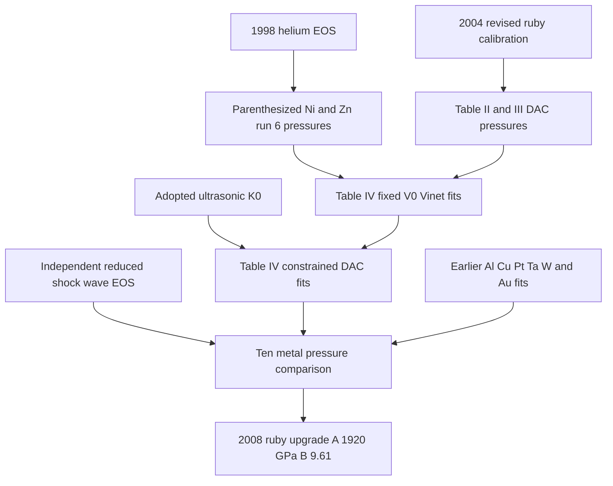
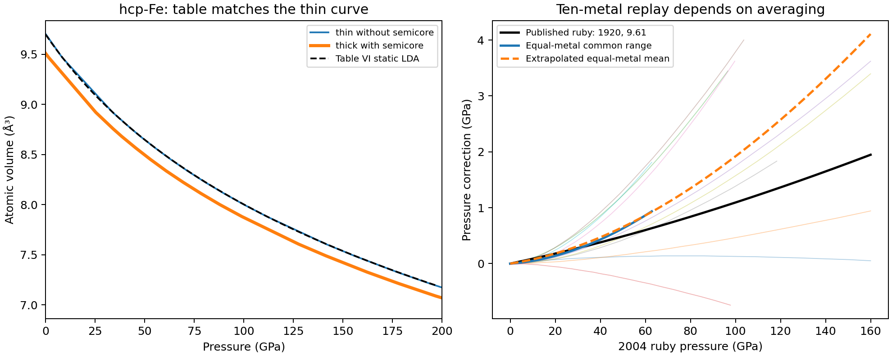

# Dewaele 2008 metal EOS and calibration audit

The original [Dewaele et al. (2008) paper](https://doi.org/10.1103/PhysRevB.78.104102)
resolves the Ag discrepancy. Table IV uses the **2004 revised ruby scale**,
holds the low-pressure reference volume fixed, and excludes run-2 Ag and Mo
points above 100 GPa. The former Ag and Ni records instead contained the
later **2019 Mao-scale** coefficients. Those historical identifiers retain
their original numerical results, with corrected source attribution and
calibration; the actual Table IV fits have new, explicit identifiers.

## Experimental fits

The 13 Table IV DAC parameterizations are bundled: six with fitted `K0` and
`K0_prime`, and seven with adopted ultrasonic `K0` fixed and only `K0_prime`
fitted. Every fit also fixes `V0`, determined separately from 0–5 GPa data.
The table's parenthetical errors are **95% widths**, not one-sigma errors.
The source gives no parameter covariance or exact low-pressure regression
protocol. The independent replay uses unweighted pressure least squares;
all free coefficients lie within their printed 95% intervals. This establishes
conditional numerical coefficient agreement, not complete author-workflow
reproduction or experimental accuracy.

| Material and phase | Atomic V0 fixed, ų | K0 fitted, GPa | K0 prime fitted | Selected rows | Source pressure RMS, GPa |
| --- | ---: | ---: | ---: | ---: | ---: |
| α-Fe, bcc | 11.760 | 171 ± 11 | 4.34 ± 2.10 | 10 | 0.154 |
| Co, hcp | 11.096 | 190.5 ± 2.9 | 4.38 ± 0.18 | 25 | 0.315 |
| Ni, fcc | 10.942 | 176.7 ± 2.5 | 5.23 ± 0.09 | 42 | 0.625 |
| Zn, hcp | 15.213 | 60.5 ± 0.9 | 5.69 ± 0.07 | 43 | 0.558 |
| Mo, bcc | 15.558 | 274.1 ± 3.2 | 3.58 ± 0.12 | 26 | 0.337 |
| Ag, fcc | 17.021 | 103.9 ± 1.4 | 5.78 ± 0.09 | 31 | 0.358 |

The fixed-ultrasonic-modulus branches use 165 GPa for α-Fe; 184 or 190 GPa
for Co; 183 GPa for Ni; 60 GPa for Zn; 261 GPa for Mo; and 101 GPa for Ag.
An adopted ultrasonic uncertainty is not a fitted uncertainty on a fixed `K0`.

All **173 material observations** from Table II and **45 Fe observations**
from Table III are recovered. Source tokens, runs, both printed ruby-pressure
columns, Zn/Co lattice parameters, helium-gauge parentheses and the paired
tungsten readings survive. Excluded observations remain in the files.
The existing small dataset files used by the 2019 audit remain unchanged;
complete source transcriptions are separate, checksummed resources.

For Ag the correct published curve has 0.358 GPa pressure RMS over its 31
selected observations. Its independent fixed-volume refit gives
`K0=104.1220 GPa`, `K0_prime=5.76095`, and 0.356 GPa RMS.
The previous 2.128 GPa statistic combined a different coefficient set,
pressure scale, free-volume convention and row selection.

## Calibration dependencies

The paper contains a directed calibration history. Its references do not
all denote interchangeable pressure standards.



The new 2008 ruby calibration is an **output** of the multi-metal comparison.
It must not be assigned retrospectively as the input pressure scale of
Table IV. Its coefficients were already executable in Peritheos; this audit
adds their source derivation and dependencies. A source citation or common
calibrant is not, by itself, an executable pressure-identity edge.

Figure 2 and Section IV compare DAC and reduced-shock-wave pressures for
eleven metals. Zn is excluded from the final ruby optimization because of
its uncertain shock reduction and melting correction. The remaining ten
are Co, Ni, Mo, Ag, Al, Cu, Pt, Ta, W and Au. The proposed power law is

`P = (1920 / 9.61) [(lambda/lambda0)^9.61 - 1]` GPa.

The follow-up below recovers all ten plotted comparisons and attempts three
explicit numerical replays. Exact reproduction of the original optimization
remains unavailable:
the paper does not provide the complete numerical comparison grid, all
underlying shock reductions, cross-material weights, or covariance. The
new ruby parameters are source-verified; their original optimization is
not claimed as reproduced. The five discrete shock-derived Vinet comparison
triplets in Table IV and Zn's range of derivatives are preserved in the
source manifest rather than promoted to independently validated pressure
standards. Ultrasonic slopes alone also do not create a new complete EOS.

For parenthesized run-6 rows, the Table II caption identifies the helium
Vinet EOS (`V0=24.804 ų/atom`, `K0=0.165 GPa`, `K0_prime=7.483`;
[Loubeyre et al. 1998](https://doi.org/10.1103/PhysRevB.57.10403)).
No simultaneous He volumes are printed. Inverting a tabulated effective ruby
pressure does not recover those missing He observations; exact mixed-gauge
recalibration remains unavailable. Table III preserves actual paired W
lattice parameters, separately from the resulting reported Fe pressures.

## PAW parameterizations

All **54 Table VI coefficient sets** are retained in a separate
[research EOSMAT collection](../research/dewaele-2008-paw.md), outside the main
database and catalog discovery: nine material/phase rows,
three functionals, and two reference states. Every set uses semicore states.
The parenthesized numbers are **static-lattice coefficients**, not errors;
the unparenthesized numbers are fits after adding a 298 K pressure correction,
including zero-point motion. The latter are separate isotherms, not a
continuous thermal model. Their determination is marked hybrid because the
PAW calculations use adopted literature thermal estimates.

The stated constant thermal pressures are 1.0 GPa for both Fe phases,
1.5 for Co, 2.0 for Ni, 1.4 for Zn, 1.6 for Mo, 1.1 for Ag,
1.5 for Pt and 1.4 for Au. No unreported coefficient errors are inferred.

Figure 4 supplies 255 recovered finite-compression vector vertices, with
material, functional, curve and vertex identities and explicit axis mappings.
They are graphical model checkpoints, not raw DFT fitting observations.
Checks use only the corresponding phase and regression pressure domain.
Reading bounds are 1 GPa and 0.04 ų/atom, combined with half-last-digit
coefficient bounds; these are deterministic graphical tolerances, not
statistical confidence intervals. The 298 K check applies the source's
stated thermal pressure to the static-curve coordinates.

Fifty coefficient sets pass these source-curve checks and carry **parity with
source-equation scope** in their research EOSMAT assessments and collection ledger.
The main catalog contains only this paper's **13 experimental Table IV EOS**.
The research files retain the published coefficients, provenance, source checks,
Figure 4 resources and Fe restrictions. This explicitly means graphical equation agreement, not independently refitted
PAW coefficients. The 13 Table IV records instead carry **parity with
parameter-agreement scope**, using the printed 95% widths.
The two α-Fe LDA
sets remain **deferred and document-only** because no separately identified
with-semicore finite-compression curve supplies an independent check.
The two hcp-Fe LDA sets are **not reproduced**: the Table VI curve differs
from the identified thick LDA Figure 4 curve by about 0.11–0.17 ų/atom
within the comparison range. Their source coefficients remain intact as
explicit diagnostics and are not recommended for predictions or calibration.
The follow-up identifies a close match to the thin curve instead. The source's
semicore assignment remains unresolved; the catalog status and coefficients
are unchanged. No replacement material EOS was constructed.

The Table VI experimental comparison rows also differ in some reference
volumes from Table IV, notably α-Fe (11.770 versus 11.760 ų/atom).
They remain comparison annotations and do not overwrite Table IV or create
duplicate experiments. Pt, Au and hcp-Fe cite earlier experiments already
represented by their original source records.

## Follow-up: hcp-Fe LDA curve identity

Both hcp-Fe LDA rows in Table VI closely match the **thin** green dashed-dot
Figure 4 path (PDF curve 24), which the caption assigns to calculations
**without** semicore states. The caption assigns the thick path (curve 25)
to calculations **with** semicore states, as claimed for Table VI. This is
strong evidence for a source curve/table identity mismatch; it does not tell
us which label or coefficient row is wrong.

| Table VI state | Thin path: maximum absolute volume difference, ų/atom | Thick path: volume difference range, ų/atom | Thin / thick pressure RMS, GPa |
| --- | ---: | ---: | ---: |
| Static lattice | 0.00244 | 0.10669–0.16604 | 0.181 / 12.478 |
| 298 K | 0.00138 | 0.10382–0.16516 | 0.071 / 12.242 |

The comparison uses vertices in 17–197 GPa: 14 thin-path vertices span
33.82–193.91 GPa and 15 thick-path vertices span 25.30–196.85 GPa.
For 298 K the source's 1 GPa thermal pressure is added to the static graph
pressure. Both thin-path comparisons pass the existing 0.04 ų/atom reading
bound by a wide margin. No raw DFT observations or coefficient uncertainties
are inferred. The Fe all-electron triangles visible in this panel are filled
GGA symbols; they do not supply an independently identified LDA benchmark.
Consequently, the two affected records retain their non-parity assessment and
use restriction; their metadata now also records the thin-path agreement.

## Follow-up: ten-metal ruby replay

All ten Figure 2(b) comparisons are recovered as vector checkpoints,
including the short dotted Co path. Zn is excluded as in the publication.
Axes and legend identities were checked visually; recovered coordinates are
graphical **model comparisons**, not measured observations or original shock
reductions. The common pressure range ends at **62.847 GPa**, set by Co;
Ag, Mo, Pt, Ta and Au also end below 160 GPa.

The replay first converts the 2004 pressure to a ruby wavelength ratio using
`ln(lambda/lambda0) = ln(1 + 9.5 P2004 / 1904) / 9.5`, then fits the proposed
power law to comparison pressures. This preserves the direction of the
calibration dependency and avoids using the 2008 output scale as its input.

| Explicit diagnostic choice | Fitted A, GPa | Fitted B | Pressure residual RMS, GPa |
| --- | ---: | ---: | ---: |
| Equal-metal mean, uniform common 0–62.847 GPa grid; interpolation only | 1909.48 | 10.2912 | 0.0060 |
| Equal total weight per metal, uniform grid over each metal's own plotted range; pooled residuals | 1937.49 | 9.3448 | 0.8513 |
| Equal-metal mean, uniform 0–160 GPa grid; graph continuations | 1915.67 | 10.0661 | 0.0284 |
| Published ruby result | 1920 | 9.61 | — |

These objectives compare different targets: the pooled residual includes
the between-metal scatter, whereas the other two fit a mean pressure. Their
RMS values therefore do not rank the scientific merit of the choices.
No statistical coefficient errors are inferred from graph vertices.

The last diagnostic continues each comparison using the difference of two
Vinet curves. Fixed compression shapes come from existing catalog entries;
two graph adjustments are fitted to the recovered Figure 2 curve. All ten
graph fits have maximum pressure residual below 0.021 GPa within their
plotted domains. This is **extrapolation**, with no justified precision
outside those domains. In particular, the Au continuation adopts a 2004
compression shape although Figure 2 cites the 2007 pressure-medium study.
The numerical report records every shape, adjustment and extrapolated domain.
These adjustments are not recovered published shock coefficients and create
no executable material records.

That extrapolated equal-metal mean gives **4.051 GPa** correction at a
2004-scale pressure of 160 GPa. The published `A=1920, B=9.61` formula gives
**1.947 GPa** at the same wavelength ratio. The text's approximate 2.5 GPa
statement is also not the exact value of that formula. These differences
show why an unspecified average is insufficient to reproduce the result.
The source does not resolve comparison-grid selection, cross-material
weights or treatment beyond individual DAC ranges. The original reduced
shock calculations and their covariance have not been recovered. The
[earlier 2004 paper](https://doi.org/10.1103/PhysRevB.70.094112) was located,
but its publisher full-text endpoint returned HTTP 401 in this investigation;
its full tables could not be independently re-inspected here.

As a separate input check, **145 of 147 non-helium material rows** in Table II
agree with the Mao-to-2004 conversion within the joint printed rounding
intervals. The two exceptions are one shared Ni/Zn run-6 pressure pair:
the source prints `49.0 → 51.0 GPa`, while the formula gives `50.1037 GPa`.
The supplied PDF was visually checked. This source inconsistency is retained
without correction; it does not establish the cause of the ruby-fit mismatch.
Parenthesized He-derived pressures are excluded from this conversion check.

**Outcome:** the hcp-Fe discrepancy is narrowed to source curve identity;
the ten-metal graph comparison is recoverable, but the published ruby
optimization is **not reproduced** by these declared replay choices. No
catalog coefficients or calibration parameters change. The subsequent record
update records 13 experimental parameter-parity results in the main catalog.
The separate research collection records 50 theoretical source-equation-parity
results. Its two α-Fe LDA records remain deferred and its two hcp-Fe LDA records
retain their unresolved semicore-identity finding.



The [follow-up numerical report](../data/dewaele-2008-followup.json) and
[recovered graph coordinates](../data/dewaele-2008-followup-source.json)
preserve the calculations and source identities separately from the initial
catalog audit.

## Reproduction and evidence

The supplied publisher PDF has SHA-256
`a06fd5cb9433b99f35b20582be5214b1e805014c150a2907fdf8933776cf6daf`.
It is not redistributed with the library. Numerical facts and graphical
coordinates retain attribution; no licence over third-party source content
is asserted.

Repository maintenance commands:

```bash
python scripts/recover_dewaele_2008_metals.py /path/to/PhysRevB.78.104102.pdf
python -m scripts.reproduce_dewaele_2008_metals
python scripts/recover_dewaele_2008_followup.py /path/to/PhysRevB.78.104102.pdf
python -m scripts.reproduce_dewaele_2008_followup
python -m scripts.update_dewaele_2008_assessments
```

The first command additionally needs `pdfplumber`. Package users load the
resulting records with the installed API:

```python
from peritheos import get_eos_record

ag = get_eos_record("silver_dewaele_2008_table4_vinet")
print(ag.pressure(4 * 12.3348))  # conventional fcc cell volume in ų
print(ag.pressure_calibration)
```

[Complete source manifest](https://github.com/CPrescher/peritheos/blob/main/peritheos/data/datasets/dewaele-2008-source.json)
is bundled as `peritheos/data/datasets/dewaele-2008-source.json`.
The [numerical audit](../data/dewaele-2008-metals-reproduction.json) records
each fit, curve comparison, selection and unresolved condition.


## Using the reviewed experimental observations

The 13 Table IV EOS expose native observation views with the published revised
pressure column, conventional-cell volume conversion and fit selection. The
Fe view selects the ten bcc observations; the other five source tables retain
all rows and mark the six excluded high-pressure run-2 Ag/Mo rows outside the
fit. Parenthesized helium-EOS pressures stay as printed. Rowwise uncertainties
are unavailable and remain missing.

```python
from peritheos import get_material_document, resolve_dataset_observations

document = get_material_document("silver")
observations = resolve_dataset_observations(
    document,
    "silver_dewaele_2008_table4_vinet",
    "silver_dewaele_2008_source_table",
)
print(len(observations.row_indices), sum(observations.selected_for_fit))  # 34, 31
```
