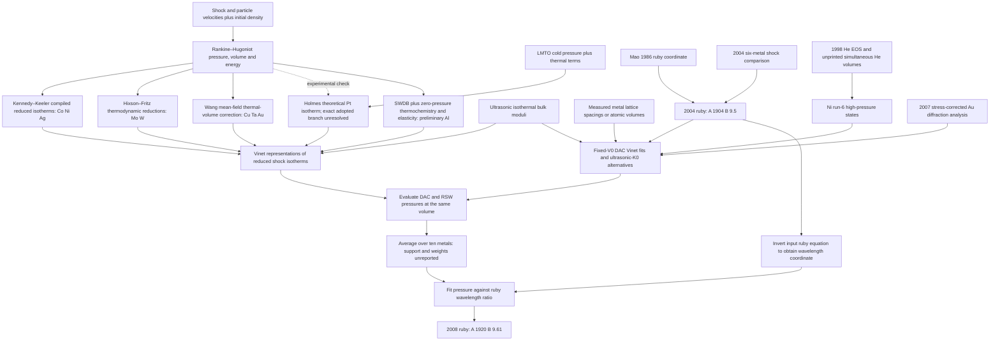

# Dewaele (2008): construction of the ten-metal ruby calibration

## Finding and reconstruction boundary

The published construction can be traced as a sequence of **shock reduction →
Vinet representation → comparison at common volume → ten-metal pressure
average → ruby power-law fit**. The numerical averaging rule and several
upstream inputs remain unrecovered. Consequently, this is a **partial source
reconstruction**, not a reproduction of the authors' optimization. It provides
no replacement pressure standard and changes no material or calibration record.

**Subsequent numerical reconstruction:** after recovering the upstream journal
papers and handbook columns, a separate executable source-based construction
was completed in `output/dewaele-2008-ruby-construction/source-reconstruction/`.
Its `REPORT.md` contains the complete protocol, parameter comparisons,
per-metal checks and 0–160 GPa calibration plots. With equal-metal averages,
uniform pressure sampling and unweighted pressure residuals, the stated-range
reconstruction gives **A=1916.9302 GPa, B=10.152566**, or **+2.6895 GPa** relative
to the published 2008 law at a wavelength corresponding to 160 GPa on that law.
Using the full Co handbook table gives **1915.1381/10.056143**, or **+2.0094 GPa**.
These remain conditional reconstructions: the original averaging/sampling
procedure and Co/Pt input choices are not resolved. Earlier output files in
this investigation remain historical snapshots and were not overwritten by
the new construction.

A new independent check removes one ambiguity: the orange curve in Figure 3
agrees with the printed `A=1920 GPa, B=9.61` formula to **0.0107 GPa maximum**
over 190 recovered vector checkpoints. Thus the published equation and plotted
output are mutually consistent. The earlier extrapolated Figure 2 average is a
different, conditional construction; its disagreement does not establish a typo.

Primary authority is [Dewaele et al. (2008), PRB 78,
104102](https://doi.org/10.1103/PhysRevB.78.104102), especially Section IV,
Tables I–IV and Figures 2–3. The supplied publisher PDF has SHA-256
`a06fd5cb9433b99f35b20582be5214b1e805014c150a2907fdf8933776cf6daf`.
Unless explicitly labelled otherwise in the recovered upstream tables, volumes
below are **ų/atom**, pressures and moduli are **GPa**, and
pressure derivatives are dimensionless. The DAC isotherm is at ambient
temperature; no static-lattice thermal-pressure subtraction belongs in this
ruby calibration calculation.

## Dependency map



The upstream reductions share compilations, techniques and sometimes elastic
constraints. The ten elements are not ten demonstrably independent absolute
pressure realizations. The paper's argument that averaging reduces error is
explicitly conditional on unbiased, mutually independent errors (p. 104102-6).

## What entered the calculation, metal by metal

| Metal | Static input used or cited in 2008 | Reduced-shock input | Recovery status |
| --- | --- | --- | --- |
| Co, hcp | 2008 Table II, runs 4–5; fixed `V0=11.096`; Table IV alternatives `K0=184` or `190` | Kennedy–Keeler (1972), ref. 42 | Both DAC/RSW Vinet pairs and 44 handbook isotherm points now recovered; original shock selection and Dewaele fit support/weights unresolved |
| Ni, fcc | Table II, runs 4–6; `V0=10.942`, `K0=183`; high-pressure run-6 points include a He gauge | Kennedy–Keeler, ref. 42 | Coefficient pair and 44 handbook isotherm points now recovered; raw He volumes and ruby spectra absent from supplied article |
| Mo, bcc | Table II, runs 1–2; exclude run-2 points above 100 GPa; `V0=15.558`, `K0=261` | [Hixson & Fritz (1992)](https://doi.org/10.1063/1.351203), ref. 43 | Published 293 K and 300 K isotherm tables, shock states and main reduction parameters now recovered; Dewaele's sample selection and weights unresolved |
| Ag, fcc | Table II, runs 1–3, same run-2 exclusion; `V0=17.021`, `K0=101` | Kennedy–Keeler, ref. 42 | 2008 pair and 48 handbook isotherm points now recovered; original shock selection and Dewaele fit support/weights unresolved |
| Al, fcc | [2004 six-metal study](https://doi.org/10.1103/PhysRevB.70.094112), Table I and II | [Dorogokupets & Oganov (2007)](https://doi.org/10.1103/PhysRevB.75.024115), **initial** `73.46,4.52` model | Exact adopted coefficients and fitting-stage distinction verified; preliminary full model, SWDB row selection and weights not recovered |
| Cu, fcc | 2004 Table I and II | [Wang, Ahuja & Johansson (2002)](https://doi.org/10.1063/1.1518781) | Wang generalized-EOS coefficients, Hugoniot branches and undamaged 2004 coefficients now recovered; original reduction samples and Dewaele refit choices unresolved |
| Pt, fcc | 2004 Table I and II | [Holmes et al. (1989)](https://doi.org/10.1063/1.344177), Figure 2 legend | Full paper, theoretical 300 K parameterization and seven shock states now recovered; exact source branch and low-pressure constrained refit remain unresolved |
| Ta, bcc | 2004 Table I and II | Wang et al. (2002) | Wang generalized-EOS coefficients, Hugoniot branches and undamaged 2004 coefficients now recovered; original reduction samples and Dewaele refit choices unresolved |
| W, bcc | 2004 Table I and II | Hixson & Fritz (1992) | Published 293 K and 300 K isotherm tables, shock states, main reduction parameters and undamaged 2004 coefficients now recovered; fitting choices unresolved |
| Au, fcc | **Dewaele & Loubeyre (2007), ref. 8**, with nonhydrostatic correction; 2008 Table VI comparison gives `V0=16.962`, `K0=167`, `K0'=5.88` | Wang et al. (2002) | Wang coefficients, stress-correction equation and corrected Au fit now source-verified; exact corrected observation rows and pointwise stress inputs not tabulated |

Zn is explicitly excluded from the final average (2008 p. 6) because its shock
reduction is uncertain and the Hugoniot crosses melting near 80 GPa. Fe is not
one of the ten metals either. Its paired W observations are valuable evidence
for the Fe EOS but are not an additional ruby calibration standard here.

Kennedy and Keeler is the **American Institute of Physics Handbook, 3rd ed.
(1972), Chapter 4, pp. 4-38–4-105**, not a 1964 shock paper. The repository's
previously transcribed low-pressure Cu column of Table 4d-12 is not a substitute
for Co/Ni/Ag. Those three complete columns have now been separately recovered
from the user-supplied book, as documented below; their availability does not
identify the exact rows or interpolated samples used in 2008.
No generic Hugoniot coefficients or thermal parameters have been invented to
complete these branches.

### Directly recovered 2008 comparison coefficients

Both arms share the tabulated fixed `V0` and ultrasonic `K0`. Section IV says
the RSW and DAC fits use Vinet, fix `K0` to the ultrasonic value, and fit over
the pressure range of the current DAC measurements. `V0` is first determined
from the 0–5 GPa measurements, then fixed for the DAC fit. The actual regression
weights and low-pressure volume regression are not specified.

| Branch | `K0` fixed | DAC `K0'` | Reduced-shock `K0'` | Printed DAC / RSW 95% widths |
| --- | ---: | ---: | ---: | --- |
| Co | 184 | 4.73 | 4.93 | 0.06 / 0.04 |
| Co | 190 | 4.37 | 4.67 | 0.04 / 0.03 |
| Ni | 183 | 4.99 | 5.13 | 0.02 / 0.01 |
| Mo | 261 | 4.06 | 4.18 | 0.05 / 0.02 |
| Ag | 101 | 5.97 | 6.19 | 0.02 / 0.01 |

The nominal Mo and Ag pairs agree with their Figure 2 paths to respectively
0.0053 and 0.0099 GPa maximum. Nominal Ni differs by up to 0.285 GPa;
the Co branches differ by up to 0.523 GPa (`184`) or 0.138 GPa (`190`). All
five comparisons fall inside a box obtained from the printed derivative widths
plus the 0.03 GPa graph-reading allowance. This is **interval compatibility**,
not a confidence band: the coefficient covariance is unknown. It does not
identify the authors' precise Co branch, unrounded parameters or fit samples.
In particular, changing Ni's published `5.13` to `5.12` because it follows the
graph more closely would replace source evidence with a diagnostic choice.

### The 2004 chain and recovered coefficient table

The publisher's indexed text recovers the 2004 discussion on p. 094112-3 and
Table II on p. 094112-5. The six RSW EOS were represented by Vinet fits over
**0–160 GPa**. The ruby modification held **A=1904 GPa fixed**, changed B from
7.665 to 9.5, and then produced revised DAC fits. This is an upstream
calibration step, not six independent validations of the 2008 output.

The full PDF was subsequently recovered through the user-requested retrieval
site on 23 October 2026. Its SHA-256,
`1f9e02e4a77f49a868b1a6261290465bdb00597b1660691b1790c7502ec9aeeb`, matches
the earlier repository audit. Table II was visually checked and all 30 Vinet
branches transcribed separately, preserving fixed parameters and printed 95%
fit intervals. The RSW pairs are **Au 167/5.82; Pt 277/4.66; Ta 194/3.76;
W 296/4.45; Cu 133/5.33; Al 73/4.50**. Earlier indexed text had damaged
digit ordering around bold type: the Pt token `277.4,6.6` was an extraction
failure, not the source coefficients. The original numerical reconstruction
files remain historical snapshots; the authoritative later transcription is
`dewaele-2004-table2-vinet-branches.csv`.

One source-identity ambiguity survives inspection: Table II assigns Pt RSW
to ref. 23 (Wang), whereas Figure 3 labels Pt “Holmes”. Both signals are
preserved. Recovering the PDF does not itself settle that branch choice.

All 233 already bundled 2004 factual PV rows are retained in the new input
inventory. They are measured diffraction observations with *derived* pressure
coordinates. The 37 historical Au rows are explicitly marked as historical
comparison data, since 2008 cites the later corrected Au analysis. The
[2007 source](https://doi.org/10.1080/08957950701659627) has now also been
retrieved; its correction and remaining numerical limits are described below.
The later [Takemura–Dewaele gold paper,
PRB 78, 104119](https://doi.org/10.1103/PhysRevB.78.104119) is a related study,
not ref. 8 of the calibration paper; its coefficients must not be substituted.

### Al: preliminary independent branch versus final joint model

Dorogokupets and Oganov's author-hosted full PDF was retrieved and visually
checked. Section II (pp. 3–4) describes two fitting stages. First, shock and
zero-pressure heat-capacity, expansion and elastic data constrain the model.
Second, static compression data with candidate pressure scales are included,
and the material parameters and ruby scale are revised together.

Section III, p. 024115-4, prints preliminary Al `K0=73.46, K0'=4.52`—exactly
the pair adopted in Dewaele (2008). Final Table I, p. 024115-6, instead prints
`72.67,4.62`. The final table cannot stand in for the initial Al input without
introducing the shared DAC/ruby fitting loop. The initial coefficients have no
explicit static-DAC dependency in the described first-stage objective; that
does not prove all their underlying experimental errors independent of the
other metals. The preliminary full thermal model, exact SWDB version and row
selection, fit weights and covariance remain missing. The fitted first-stage
modulus and derivative alone do not reproduce the entire shock reduction.

Wang's author thesis, Section 4.8, pp. 23–24, provides the underlying mean-field
reduction law: at a given pressure the calculated thermal **volume** increment
between the Hugoniot and 300 K isotherm is subtracted from the experimental
Hugoniot volume. This differs from merely subtracting a constant thermal
pressure. The thesis does not contain the full original numerical tables.
The original 2002 paper has now been retrieved: Eq. 7 confirms this reduction,
and Eq. 8/Table II completely specify the published reduced-isotherm
parameterizations. They are generalized universal EOS with a fourth-degree
exponent, not ordinary two-coefficient Vinet EOS. Its five source coefficient
rows, including minus signs damaged by text extraction, were visually checked
and saved in `wang-2002-table2-generalized-eos.csv`; all ten piecewise Hugoniot
branches and source assignments from Table I are saved separately. Original
LAPW energy arrays, intermediate reduced samples and Dewaele's subsequent
Vinet sampling/weights are not supplied. Neglected shock melting and phase
dependence remain explicit source assumptions; no model extension is introduced.

## Exact numerical coordinates and fitting order

Let `r=lambda/lambda0`. The input coordinate is

```text
P04 = (1904/9.5) [r^9.5 - 1]
ln(r) = ln(1 + 9.5 P04/1904) / 9.5
P08 = (1920/9.61) expm1[9.61 ln(r)]
```

For a printed Mao pressure, use `ln(r)=ln(1+7.665 PMao/1904)/7.665` instead.
Inverting the two independently rounded pressure columns need not give exactly
the same ratio. Absolute `lambda0` is unnecessary for this ratio calculation;
the original spectrometer wavelengths are not recovered by inversion.

At a chosen volume, Figure 2's coordinate is explicitly
`(P04(V), P_RSW(V)-P04(V))`. Thus a pressure-grid calculation must first invert
the **DAC** Vinet curve to obtain the volume and evaluate the RSW curve at
that same volume. It is not `P_RSW(P)-P04(P)`, not a volume residual, and not a
comparison of both EOS at the same nominal pressure. With common `V0,K0`,
the pressure ratio is

```text
P_RSW/P_DAC = exp[1.5 (K0'_RSW - K0'_DAC) (1-x)]
x = (V/V0)^(1/3)
```

This identity is useful for the coefficient-pair replay, but does not replace
the preceding shock reduction or recover missing source samples.

Figure 3 changes the horizontal coordinate to **Mao 1986 pressure** and plots
`Pnew-PMao`. Its caption describes a fit of the average of ten RSW pressures
to the ruby power law. This supports a pressure-average target and the stated
functional family. It does **not** specify equal pressure spacing, measured
point weighting, a common grid, a wavelength grid, pointwise renormalization
when a metal ends, extrapolation to 160 GPa, or a numerical residual norm.

The supported order is therefore: recover/reduce shock EOS; represent them
and DAC measurements by Vinet curves under their constraints; form pressures
at common volume and associated ruby coordinates; average over ten elements;
fit the ruby function. In 2008 A and B are both reported as optimized, unlike
2004's fixed A. The paper does not document bounds, parameter covariance,
whether any intermediate curves were iterated, or the exact optimizer.

### What the published curve actually checks

The Figure 3 orange curve is identified by its legend and PDF stroke color,
not by choosing a path that best matches the formula. Its 190 centerline
vertices span 0–182.541 GPa in Mao pressure. Tick positions, PDF curve identity,
mapping and original points are saved separately in `figure3-source.json`.
The printed formula differs by **0.0040 GPa RMS**, with maximum **0.0107 GPa**,
inside the declared 0.03 GPa centerline-reading bound. This establishes
source-equation agreement for the published output curve only.

At the wavelength corresponding to **P04=160 GPa**, the published calibration
gives **P08=161.94746 GPa**, a **1.94746 GPa** increase. The text's approximate
2.5 GPa statement is not this exact equation value. The earlier graph
continuation gives about 4.051 GPa, but continues several curves far beyond
their drawn domains and uses assumed compression shapes. Neither difference
identifies a typographical error or the missing averaging rule.

| Earlier explicitly conditional diagnostic | A, GPa | B | What remains assumed |
| --- | ---: | ---: | --- |
| Equal-metal mean, common 0–62.847 GPa support | 1909.48 | 10.2912 | Uniform pressure support and equal element weights |
| Pooled points on each curve's own domain | 1937.49 | 9.3448 | Equal total weight per metal and within-domain pressure grid |
| Equal-metal graph continuations to 160 GPa | 1915.67 | 10.0661 | Continuation shapes, extrapolation and equal pressure/metal weights |
| Published output, checked against Figure 3 | 1920 | 9.61 | Original optimization inputs and objective unrecovered |

The first three results are retained from the existing scoped audit; they are
not rerun with new arbitrary weights. Figure 2 does not show all ten elements
to 160 GPa: its shortest Co path ends at 62.847 GPa. Hence a ten-element mean
there necessarily requires an additional continuation or support decision.
The paper does not provide enough evidence to select one.

The drawn Figure 2 curves already extend beyond some selected DAC data:
Mo's selected rows end at 97.9 GPa while its recovered path reaches 118.35 GPa;
Ag ends at 97.9 GPa while its visible path reaches 103.71 GPa. The Al/Cu/W
tables reach 153 GPa and the plot reaches 160 GPa. Pt/Ta tables reach 93.6 GPa
and visible paths reach about 99.71/96.65 GPa. Thus the **figure** does use
fitted-curve continuation in places. This does not establish how the final
average handles such domains. A visible path ending at an axis boundary may
be clipped and is not a source statement of an EOS validity limit.

## Shared calibration and uncertainty

The new inventory preserves original pressure/volume tokens and row identities.
It gives two **derived log-wavelength coordinates** for ruby rows and no such
coordinate for He-derived rows. Neither column is called a measured wavelength.
Rows for co-compressed metals can share one ruby determination; counting each
material row as an independent ruby reading would duplicate that information.
The older CSVs do not retain full run identities, so no run assignment or exact
cross-run matching is invented from coincident rounded pressures.

For Ni run 6, the He EOS is identified in the Table II caption as
`V0=24.804 ų/atom, K0=0.165 GPa, K0'=7.483`, from
[Loubeyre et al. (1998)](https://doi.org/10.1103/PhysRevB.57.10403).
The simultaneous He volumes are not printed. The resulting Ni curve must carry
that dependency into the average; those rows are not independent measured
ruby wavelengths or an independent calibration of the He scale.

For residual vector `d`, a defensible symbolic propagation is
`C_d = J_shared C_shared J_shared^T + C_other`, followed by
`Var(w^T d) = w^T C_d w`. Shared terms include input ruby parameters,
co-compressed ruby states, adopted elastic constraints, the He scale, and
common upstream reduction data/models. A shared `K0` appears once in both
arms and its derivative is taken through the difference. It must not be
propagated as two independent moduli. No numerical covariance, standard error
of the mean, effective number of independent standards, or new uncertainty on
A/B is claimed because the required covariance and weights are unavailable.

## Preserved pressure-pair inconsistency

The shared Ni/Zn run-6 state prints `49.0 → 51.0 GPa`. Literal Mao-to-2004
conversion gives **50.10367 GPa**; a 2004 pressure of 51 GPa would instead
correspond to about 49.86 GPa on the Mao scale. The original values survive.
The Ni volume at this state can be evaluated using the published Ni EOS, but
that EOS was fitted to these same data; it cannot independently decide which
printed coordinate is wrong. Zn remains excluded. No correction is applied
and no cause of the ten-metal-fit discrepancy is inferred from this pair.

## Additional upstream data recovered on 23 October 2026

The local Zotero library supplied full publisher copies of **Hixson and Fritz
(1992)** and **Holmes et al. (1989)**. This resolves two earlier full-text access
limitations. Source PDFs and rendered inspection pages remain local under
`output/dewaele-2008-ruby-construction/sources/`; the numerical supplement
excludes those PDFs and their extracted text.

Hixson–Fritz now provides:

- **410 published calculated P–V–T values** from Tables VI–VII: 21 Mo
  compression rows and 20 W rows, each at 100–1000 K in steps of 100 K.
  The **300 K subset contains 41 values**, including the small negative
  pressure extension. These are model calculations, not 410 observations.
- **62 published calculated density points at 293 K** from Tables IV–V:
  31 per material, at 0–300 GPa in 10 GPa steps. The 300 K and 293 K tables
  are distinct and remain separate.
- **14 shock experiment states** from Tables I–II (eight Mo, six W), with
  impactor identity, impactor/particle/shock velocities, pressure and density.
  The Mo3 and Mo1 entries are explicitly attributed to Mitchell et al. (1991),
  ref. 4. The paper does not tabulate individual errors for these rows.
- Main reduction parameters from Table III: Hugoniot initial densities
  `10.215/19.256 g cm⁻³`, intercepts `5.122/4.022 km s⁻¹`, slopes
  `1.245/1.260`, Grüneisen parameters `1.58/1.65`, adjusted caloric amplitudes
  `0.272/0.140 J g⁻¹ K⁻¹`, and Debye temperatures about `411/340 K`,
  respectively for Mo/W. The model assumes `rho*gamma=constant` and Debye
  caloric behaviour. Its adjusted amplitudes must not be replaced by the
  separately printed mass-based Dulong–Petit values.

The source compression variable is `eta=1-rho0*V_specific=1-V/V0`.
Normalized volume in the CSVs is explicitly derived from this definition or
from the printed density ratio; no atom-count or atomic-mass conversion is
needed. The reference density is the 293 K Hugoniot initial density, distinct
from the 25 °C crystallographic density also printed in Table III. In particular,
the printed 300 K pressure at `eta=0` is `0.03 GPa`; it is not forced to zero.

Their reduction ignores possible phase changes and has no explicit electron
thermal term. They estimate overall isotherm accuracy at about **2–3%** and
identify shared Ta/Pt/Cu Hugoniot standards. This is a model-level accuracy
estimate, not a supplied pointwise covariance or an independent uncertainty
for each table entry (pp. 1724–1727).

Holmes now provides **seven Pt shock states with printed 2-sigma intervals**
(Table III), and the analytic **theoretical 300 K isotherm** (Eq. 11, Table IV):

```text
X = (V/V0)^(1/3)
P = 798.31 * (1-X)/X^2 * exp[7.2119*(1-X)] GPa
V0 = 101.9 atomic units of volume per atom
published representation range: 0–550 GPa
```

Use the printed `798.31` and `7.2119` coefficients for this curve. The separately
rounded `K0=266 GPa` and `K0'=5.81` are not exactly equivalent coefficients.
This curve is derived from LMTO cold pressure plus thermal contributions and
checked against shock experiments. Figure 5 separately displays the McQueen
shock-reduced isotherm; the two must not be conflated. Holmes qualifies its
theoretical isotherm accuracy at about 10%. **This recovery alone does not
establish which numerical branch and resampling Dewaele used for the
ultrasonic-constrained low-pressure Vinet representation.**

The new maintenance script
`scripts/recover_dewaele_2008_upstream_tables.py` checks source PDF hashes and
exports these separately classified tables. Rendered source tables were
inspected, including OCR confusions such as Mo `7.74` at 800 K and
`eta=0.02`, W `91.84` at 500 K and `eta=0.18`, and W density `26.357` at
293 K and 180 GPa. Counts, OCR corrections and limits are recorded in
`upstream-recovery-verification.json`. No calibration coefficients, earlier
diagnostic curves or catalogue records were changed.

### Further retrieval through the user-specified site

The requested `sci-hub.usualwant.com` form redirected DOI searches to
`sci-hub.reatk.com` and supplied PDF links hosted at `sci.bban.top`. Three
matching full journal articles were downloaded and inspected: Wang (2002,
six PDF pages including cover), Dewaele (2004, eight pages), and
Dewaele–Loubeyre (2007, eleven pages). Titles, DOIs and article page sequences
match; source checksums and retrieval URLs are in `additional-paper-retrieval.json`.
A search for the AIP Handbook title/year/ISBN returned “No matching papers
were found”; this is a failed retrieval through this site, not proof that no
copy exists elsewhere. The user subsequently supplied a matching full book in
Downloads, resolving that access gap (see the following section). No author
requests or external uploads were made.

The 2007 paper, Sec. 5, Eq. 6 on p. 425, specifies

```text
DeltaP approximately -t*K/30 * (9/C + 6/Cprime)
C=C44; Cprime=(C11-C12)/2; alpha approximately 1 (Reuss assumption)
```

For Au, the quoted correction magnitude is 0–1.6 GPa. With `V0` and `K0`
fixed, the corrected fits on p. 426 give **Au 16.962/167/5.88 ± 0.02** and
**Cu 11.81/133/5.28 ± 0.02**; uncorrected derivatives were 6.00 and 5.30.
These source values and assumptions are preserved in
`dewaele-loubeyre-2007-stress-correction.json`. The paragraph does not restate
the confidence level for its printed ± fit errors. It warns that the
correction is approximate and depends on uncertain high-pressure elastic
constants. Corrected points are shown in Figure 5, a raster image, but the PDF
does not tabulate their exact coordinates or the pointwise correction inputs.
No calculated fit points have been substituted for those observations.

The new source tables fill important input gaps but do not alter the previous
calibration plots or constitute a replay of the ten-metal optimization.

### User-supplied handbook: Co, Ni and Ag tables recovered

The Downloads file
`dokumen.pub_american-institute-of-physics-handbook-3nbsped-007001485x-9780070014855.pdf`
is the **1972 third edition**, ISBN 007001485X, with 2,359 PDF pages and SHA-256
`dda86a046830f63d95933b01e5b56bce9a46572a038ba37e68ceee9f2e059dad`.
Table 4d-12 on printed pp. **4-100 and 4-101** (PDF pages **621 and 622**, one-based)
provides the previously missing calculated 25 °C reduced isotherms:

| Column | Populated entries | Printed pressure coverage | Converted coverage |
| --- | ---: | --- | --- |
| Co | 44 | 15–1,200 kbar | 1.5–120 GPa |
| Ni | 44 | 15–1,200 kbar | 1.5–120 GPa |
| Ag | 48 | 15–2,000 kbar | 1.5–200 GPa |

All **136** populated `V/V0` values were transcribed, with source pressure
tokens and exact `P_GPa=P_kbar/10` conversion. A second export preserves all
**159 printed cells** for these columns, including **23 empty cells**.
No 0 GPa anchor, absolute atomic volume, crystal structure or missing uncertainty
has been synthesized. The source temperature is 25 °C (=298.15 K); it is not
silently changed to 300 K. Each material's values decrease monotonically with
pressure, and all 136 agree with a separate PDF-text extraction after correcting
one OCR error against printed pixels: Ag at 400 kbar is **0.811**, not `0.1811`.
The full table pages and associated method pages were visually inspected.

Section 4d-2, pp. **4-96–4-98** (PDF pages 617–619), identifies the ancestor as
van Thiel's **1966 UCRL-50108 Compendium of Shock Wave Data**, with selected
measurements from Livermore, Los Alamos, Ballistics Research Laboratory and
the Soviet Union. The reduction uses the Grüneisen EOS, a volume-only
`gamma(V)`, and specifically the **Dugdale–MacDonald** curvature relation
(`t=1` in Eq. 4d-6). The 0 K curve is calculated first and the 25 °C thermal
correction added through Eq. 4d-7. This is not the constant `rho*gamma` law
used in Hixson–Fritz. The source warns about phase changes/melting and neglects
finite-strength corrections for these metals. Table labels identify elements
but do not independently specify their crystallographic phase.

The handbook estimates overall isotherm accuracy at roughly **±5% in pressure**,
certainly better than ±10% (p. 4-98). This is a method-level estimate, not a
statistical uncertainty or covariance for each row. The OCR repeatedly reads
the printed `5` as `.5`; the source does **not** state ±0.5% here.

The dedicated source products are
`aip-1972-table4d12-co-ni-ag-isotherms.csv` (populated entries),
`aip-1972-table4d12-co-ni-ag-cells.csv` (including blanks),
`aip-1972-co-ni-ag-source.json` (method, units and source identity), and
`aip-1972-co-ni-ag-verification.json`. The separate maintenance script
`scripts/recover_dewaele_2008_handbook.py` regenerates these source exports.
It can verify the original book using `--pdf /path/to/book.pdf`; no full book
is copied into the repository or numerical archive.

This fills the Co/Ni/Ag published-isotherm table gap. It does not establish
Dewaele's subset, interpolation or weighting, nor reproduce Keeler's reduction
from the individually selected shock measurements.

## Evidence still required for a complete author replay

1. **Exact adopted input representations:** the Pt branch fitted by Dewaele
   and original selections behind the reductions. Kennedy–Keeler Co/Ni/Ag
   columns and method, Wang's published generalized-EOS parameterizations,
   and Hixson–Fritz Mo/W tables/main reduction parameters are now recovered.
   The underlying selected shock rows and Dewaele's sample selection,
   interpolation and weights remain unresolved.
2. **2004 branch selection:** the undamaged Table II is now fully transcribed;
   exact choices among its free/fixed-K0 alternatives and the Pt source-identity
   ambiguity still need resolution for the 2008 workflow.
3. **2007 corrected Au observations:** exact diffraction rows or corrected
   volumes/pressures and the pointwise stress/elastic inputs. The correction
   equation and fitted coefficients are now recovered; exact corrected
   observations are plotted but not tabulated in the PDF.
4. **Preliminary Al model:** full first-stage coefficients, SWDB version and
   measurement selection, fixed constraints and weights. Final Table I is a
   different stage and is not an independent substitute.
5. **Averaging/fitting specification:** actual common-volume or wavelength
   coordinates, included pressure intervals, point/grid construction, metal
   and point weights, handling outside each measured domain, residual norm,
   constraints and order. An original calculation sheet would resolve this
   more directly than further graph fits.
6. **Shared uncertainties:** original wavelength readings, simultaneous He
   volumes, run pairing and covariance. These are needed to substantiate the
   stated statistical improvement, beyond reproducing central coefficients.

These are evidence gaps and access limitations, not statements that the
measurements were never made or that the output calibration is disproven.
Author contact is a possible later step and has not been undertaken.

## Reproducible files and checks

Repository maintenance command, using an isolated environment:

```bash
uv run --no-project --with pdfplumber --with scipy --with matplotlib \
  python scripts/reconstruct_dewaele_2008_ruby_construction.py \
  --recover-pdf /path/to/PhysRevB.78.104102.pdf
```

Once the graph transcription exists, the reconstruction also runs with the
repository's NumPy/SciPy/Matplotlib environment and no PDF dependency:

```bash
python scripts/reconstruct_dewaele_2008_ruby_construction.py
```

Products are under `output/dewaele-2008-ruby-construction/`:

- `reconstruction.json`: coefficients, graph checks, preserved discrepancy,
  dependency qualifications and unresolved inputs.
- `source-table4-vinet-pairs.csv`: the five source coefficient pairs.
- `pressure-volume-input-inventory.csv`: original factual PV tokens and
  explicitly derived ruby coordinates, with historical Au and He flags.
- `figure3-source.json`: independently recovered output-curve checkpoints.
- `evidence-register.json`: source locations and access/recovery levels.
- `dependency-map.json`: directed calibration history and inherited shared
  ancestors, without invented numerical correlations.
- `calibration-comparison.png` and `.svg`: declared diagnostics versus the
  output formula, and the independent Figure 3 equation check.

The script never edits EOSMAT files, existing scripts, the previous metal audit
or common scientific ledgers. Downloaded articles and extracted source text
remain local investigation evidence; no third-party publication rights are
asserted. Numerical transcriptions retain source attribution. Passing the
checks establishes only the stated numerical and provenance properties,
not experimental validation or complete author-workflow reproduction.
