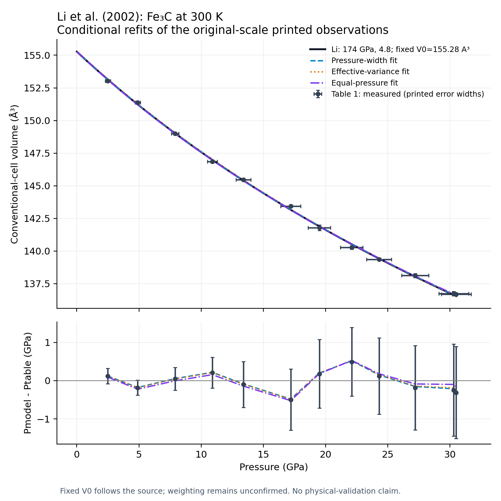

# Li et al. (2002): Fe₃C compression at 300 K

Audit and integration date: 30 October 2026. The published BM3 is bundled as
`cementite_li_2002_bm3`, with all original coefficients and errors preserved.
The existing cementite structure and automatic EOS selection are unchanged.

**The published volumetric BM3 parameterization is reproducible.** It passes
independent graphical curve checks and fits the original-scale printed
observations within their pressure error widths. Independent refits achieve
**conditional parameter parity** with both free coefficients inside their printed
source error widths. The three axial coefficients are recovered at printed
precision. The original author's weighting, error convention and pressure
reduction workflow remain unrecovered. These conclusions do not establish
magnetic-phase coverage, physical accuracy, or a recommendation for use.

| Actual source result | Source equation / result check | Refit result | Author workflow | Catalog disposition |
|---|---|---|---|---|
| Volumetric BM3, fixed measured V₀ | Reproduced against five Figure 2 curve readings; native Peritheos BM3 agrees with direct equation | Conditional parity of K₀ and K′₀ inside printed errors; pressure-weighted central values also round to the printed values | Not recovered; weighting, covariance and confidence unspecified | Bundled as a published record; no default change or extrapolation recommendation |
| Axial linearized BM3: a, b, c | Cubed-axis mapping and positive compressibility convention explicitly stated below | All three central compressibilities match printed precision under both declared weighting cases | Not recovered; same missing controls, plus fixed K′₀/anchor uncertainty propagation unknown | Retained as axial research replay; no new EOS family or catalog records |
| Second-order BM possibility | Source says both second and third order could fit; no independent BM2 coefficient set is printed | A one-parameter BM2 diagnostic is supplied, not a recovered published alternative | No BM2 workflow claimed | No source BM2 record can be inferred |

## Primary evidence and preservation

J. Li, H. K. Mao, Y. Fei, E. Gregoryanz, M. Eremets and C. S. Zha,
“Compression of Fe3C to 30 GPa at room temperature,” *Physics and Chemistry of
Minerals* **29**(3), 166–169 (2002),
[DOI 10.1007/s00269-001-0224-4](https://doi.org/10.1007/s00269-001-0224-4).
Received 30 April 2001; accepted 17 September 2001; issue date April 2002.

The suggested Dropbox `_Archive/Fe3C/Paper/` path is absent in this filesystem.
The existing `output/cementite-eos-audit-2026-10-25/sources/` contains the other
Fe₃C papers but no Li copy. Filename searches under Dropbox/Science and local
ChatGPT/Programming folders did not recover that lead. No archive file was
modified. A publisher-formatted four-page PDF was recovered from
[this repository item](https://repository.geologyscience.ru/items/d85f4b66-7a05-4e7a-a115-4f4886e10c59).
Its DOI, authors, pagination, copyright, abstract and fixed-V₀ coefficient set
agree with the [Springer landing page](https://link.springer.com/article/10.1007/s00269-001-0224-4).
All four PDF pages were visually inspected, including Eq. (2) and Table 1.
This is evidence for the final article's contents, not a verified byte match to
a newly downloaded subscription copy from Springer.

The PDF is 117,927 bytes; SHA-256:
`3b4761baa81a3e4bd419f8e93d5e453d7c5d7c2b64b400514d0f468dbcb211af`.
It is preserved locally at `output/li-2002-fe3c-audit/sources/li-2002.pdf`.
PDF metadata reports creation 3 April 2002 and modification 4 April 2002.
The [source manifest](../data/li-2002-fe3c/source-manifest.json) preserves URLs,
checksums, version evidence, rights, searched locations and missing inputs.
The publisher landing page, DOI-specific correction/supplement searches and all
four article pages revealed no linked supplement or correction. That search
does not establish that none exists. The publisher web page offers subscription
access, while the repository PDF supplied the complete article examined here.

The article states Springer-Verlag 2002 copyright; no open license was found.
Publisher PDFs, full extracted article text and extracted figures remain in the
local output folder. The small tracked CSV contains attributed factual
observations. No claim of CC0 or other rights over third-party text or figures
is made.

## Material, volume and experimental domain

The sample is synthesized polycrystalline cementite, Fe₃C, orthorhombic **Pnma**.
Li reports synthesis from iron and graphite in MgO at 2 GPa and 1273 K;
diffraction and electron-microprobe analysis matched cementite. No numerical
composition assay or uncertainty on Fe:C is printed. The 300 ± 1 K compression
measurements extend from 1 bar to 30.5 GPa. No crystallographic phase transition
was observed; the ambient structure was assumed for cell refinement throughout.
No magnetic measurement or magnetic-state-resolved EOS is reported. An ambient
ferromagnetic interpretation does not demonstrate that the entire compression
series has one magnetic state.

Table 1 reports the **whole orthorhombic cell** in ų, not formula-unit, atomic
or molar volume. Its measured ambient anchor is:

| Quantity | Printed value | Role |
|---|---|---|
| a₀ | 5.087(1) Å | Measured, fixed for axial replay |
| b₀ | 6.752(2) Å | Measured, fixed for axial replay |
| c₀ | 4.521(1) Å | Measured, fixed for axial replay |
| V₀ | 155.28(11) ų | Measured and explicitly constrained in volumetric fit |
| P reference | 0.000100 GPa | 1 bar, approximated by zero in literal Eq. (2) |
| T reference | 300 K | Isothermal fit; ambient room-temperature width ±1 K |

Li does not explicitly print Z. As a separate structural check only,
[Wood et al. (2004), DOI 10.1107/S0021889803024695](https://doi.org/10.1107/S0021889803024695),
Table 1 on p. 88 specifies Pnma sites Fe1 8d, Fe2 4c and C 4c: 12 Fe and 4 C,
so **Z = 4**, with 16 atoms per primitive/conventional P cell. This establishes
the normalization; no Wood EOS coefficient or volume enters the replay.
V₀/4 = 38.82 ų per Fe₃C formula unit, V₀/16 = 9.705 ų per atom, and
V₀Nₐ/4 = 23.37795043 cm³/mol of Fe₃C. The equation depends only on V₀/V, so
any consistently scaled volume basis produces the same pressure.

## Observations and calibration

The [literal Table 1 transcription](../data/li-2002-fe3c/table1-source-tokens.csv)
preserves all **14 printed rows**, all central-value tokens and uncertainty
tokens, missing neon cells and footnotes. It contains 13 measured rows,
including the ambient anchor, and one reference-card row:

- T1-01: PDF no. 35-0772, V = 155.40 ų. This is an adopted reference-card
  comparison, plotted as a cross; it is not a measured input to this study.
- T1-02: the measured ambient anchor. The pressure token `0.000100` and separate
  `(1)` uncertainty token are preserved literally. Footnote b's last-digit rule
  gives 0.000001 GPa; no stronger interpretation of this ambient width is assumed.
- T1-03 through T1-14: all 12 nonambient measured P–V and a,b,c points, at
  2.5–30.5 GPa. The 30.3- and 30.5-GPa rows are both retained.
- Ten rows contain a paired neon lattice parameter, from 7.9 GPa onward;
  lower-pressure entries remain missing. Their a³ values in the numerical report
  are explicitly calculated cell volumes, not additional observations.

The article labels no runs, compression/decompression direction, raw step IDs,
or point-specific diffraction peak selections. The T1 identifiers preserve
printed order without inventing experiment metadata. The normalized rows and
all residuals are retained in the [numerical report](../data/li-2002-fe3c-reproduction.json).
Printed V is used directly; recomputing a×b×c gives differences up to 0.01948 ų,
consistent with the lattice-parameter printing precision. It does not justify
replacing the independently printed volume column.

Table 1 footnote b defines parenthetical last-digit errors. It describes
pressure errors as incorporating ruby and neon calibration precision, pressure
variation during exposures and the neon–ruby difference. Fe₃C lattice errors
reflect reproducibility between individual-peak and Le Bail methods and nearly
duplicate measurements. Neon errors reflect geometry calibration and peak
fitting. The confidence convention and full covariance are **not stated**;
these widths must not silently become measured independent 1σ errors.

Pressure reduction is a material part of this source:

1. Neon is the medium: fluid below about 4.7 GPa, then quasihydrostatic solid in
   the range discussed by the authors. This is the paper's experimental
   interpretation, not an independent stress validation here.
2. Ruby pressure follows Eq. (1), attributed to **Zha et al. (2000)**:
   \(P_R=(1904/7.715)[(1+\Delta\lambda/694.3\,\mathrm{nm})^{7.715}-1]\) GPa.
   Ruby precision is quoted as ±0.2 GPa within the range; measured exposure
   variations also contribute to Table 1 pressure errors.
3. Neon pressures use the cell-volume calibration of **Hemley et al. (1989)**,
   *Physical Review B* **39**, 11820–11827. Li does not reprint its coefficients.
4. Where neon diffraction is available, the paper uses the **average of neon
   and ruby pressures** for Fe₃C. Neon pressures are systematically lower, with
   increasing difference toward high pressure. Below the observed neon rows,
   no neon calibration input is printed; the available measurement is ruby.

Original ruby wavelengths, separate reduced ruby/neon pressure arrays and their
covariances are unavailable. The retained neon a values alone cannot replay
the complete pressure average. No inferred ruby pressure is relabelled as an
observation. This audit uses Table 1's already reduced original-scale pressures.
**Litasov (2013) Table 2's explicitly recalibrated comparison values are not
Li's original parameterization** and do not enter any calculation here.

The source used CHESS C-1 angle-dispersive XRD, 25.02 ± 0.02 keV radiation,
FIT2D integration, a gold geometry standard, individual-peak refinements and
GSAS Le Bail whole-profile fits. Table 1 contains the latter results. Raw frames,
profiles and original fitting projects were not recovered.

## Exact volumetric equation and independent checks

Equation (2), p. 168, is the standard third-order Birch–Murnaghan law:

\[
P(V)=\frac32K_0\left[(V_0/V)^{7/3}-(V_0/V)^{5/3}\right]
\left\{1+\frac34(K'_0-4)\left[(V_0/V)^{2/3}-1\right]\right\}.
\]

The sign is written in the article as minus (4−K′₀), which is equivalent.
The printed result is K₀ = **174 ± 6 GPa**, K′₀ = **4.8 ± 0.8**, with V₀
fixed at the measured 155.28 ų. Neither V₀ nor its 0.11 ų width is a recovered
free fit coefficient. The article gives no other numerical volumetric fit set.
Wood (1993)'s estimates and Scott (2001)'s comparison coefficients on p. 169
belong to those publications, not alternative Li fits.

The [direct replay script](https://github.com/CPrescher/peritheos/blob/main/scripts/reproduce_li_2002_fe3c.py) evaluates
this expression in NumPy, inverts with SciPy Brent roots, differentiates it
analytically, and fits with SciPy directly. Its fits never call Peritheos fitting
machinery. The existing Peritheos BM3 evaluator, through its native Rust path,
agrees with the direct equation to numerical precision. Cell, formula, atom
and molar normalization invariance is checked separately.

Figure 2 is a **1350 × 1394 one-bit embedded raster**, not recoverable vector
curve geometry. Five isolated curve-stripe midpoints were read from a lossless
image extraction. The [unaltered initial pixel readings and calibration](../data/li-2002-fe3c/figure2-curve-readings.json)
are preserved separately. They are calculated-curve checkpoints, **not measured
fit observations**; no digitized curve point enters a refit. The deterministic
reading bound is ±0.12 ų, about seven vertical pixels, covering line half-width
and axis placement. It is not a confidence interval.

| Graphical P (GPa) | Read V (ų) | Direct Eq. (2) V (ų) | Difference (ų) |
|---:|---:|---:|---:|
| 10.0103 | 147.5391 | 147.5733 | +0.0342 |
| 15.0154 | 144.3826 | 144.4222 | +0.0396 |
| 19.9897 | 141.5913 | 141.6240 | +0.0327 |
| 24.9949 | 139.0261 | 139.0807 | +0.0546 |
| 30.0000 | 136.7304 | 136.7636 | +0.0331 |

All pass without exploiting coefficient rounding. As a separate data check,
Eq. (2) gives P = 30.18898 GPa at the independently measured V = 136.68 ų;
the table gives 30.5 ± 1.2 GPa. Across all 12 observations the source curve has
pressure RMS **0.26339 GPa**, maximum absolute pressure residual **0.49838 GPa**,
volume RMS **0.14332 ų** and maximum absolute volume residual **0.28345 ų**.
All pressure residuals are below their printed pressure widths (maximum ratio
0.9111). Volume residuals alone should not be compared against volume widths
while ignoring the stated pressure errors.

## Conditional refits and uncertainty

Every fit uses all 12 nonambient measured rows and fixes V₀ at 155.28 ų.
The reference-card row is excluded. The ambient measured row fixes V₀ and has
no parameter leverage under Eq. (2); it is not inserted as an artificial
high-weight datum with an absolute-pressure residual of 1 bar against a
zero-reference equation. Explicitly adding P₀ = 0.0001 GPa changes the
pressure-weighted fit by only −0.00383 GPa in K₀ and +0.000334 in K′₀.

The paper says “least-squares” and shows an F–f representation, but specifies
neither residual direction nor weights, fitting software, confidence convention,
parameter covariance or residual scaling. A bounded sensitivity set is therefore
used. Let rP = Pmodel(V)−Ptable and rV = Vmodel(P)−Vtable; sP,sV denote printed
widths. Each objective minimizes the sum of the squared residuals listed below.

| Objective residual | K₀ (GPa) | K′₀ | Conditional absolute widths K₀, K′₀ | RMS P (GPa) | RMS V (ų) |
|---|---:|---:|---|---:|---:|
| rP (equal pressure) | 171.89468 | 5.07359 | Arbitrary unit scale; residual-scaled widths 3.57135, 0.38338 | 0.25226 | 0.14033 |
| rP/sP | 174.11847 | 4.80743 | 5.46101, 0.69762 | 0.25991 | 0.14215 |
| rV (equal volume) | 172.62923 | 4.99444 | Arbitrary unit scale; residual-scaled widths 3.24682, 0.36267 | 0.25280 | 0.13997 |
| rV/sV | 173.43904 | 4.93485 | 2.42333, 0.27125 | 0.25577 | 0.14111 |
| rP / √[sP²+(dP/dV·sV)²] | 173.78786 | 4.84972 | 6.19633, 0.77493 | 0.25742 | 0.14125 |
| Orthogonal distance, both coordinates | 173.78484 | 4.85004 | 6.19699, 0.77503 | 0.25740 | 0.14124 |

The five vertical-residual objectives form a bounded diagnostic set; ODR
checks the effective-variance approximation by adjusting both coordinates.
The parameter-dependent effective-variance objective includes no additional
log-variance likelihood term and is labelled accordingly. An independent linear
least-squares solution in K₀ and K₀(K′₀−4) verifies the rP/sP nonlinear result.
No row masks, free V₀, recalibration, replacement family or coefficient-tuned
weight selection was used.

All five vertical objectives recover both free coefficients inside the source's
printed ±6 GPa and ±0.8 widths. This is the audit's **conditional numerical
parameter-parity criterion**, not a statistical confidence test. The pressure-
weighted central values round to 174 and 4.8. Effective variance gives printed-
precision agreement for both coefficients and both error widths. ODR lies
essentially on the rounding boundary for K′₀ (4.85004): whether it prints as
4.8 or 4.9 is not a defensible scientific distinction given the 0.8 source width
and rounded input table. Exact unrounded coefficient recovery is not claimed.

The absolute covariance here is (JᵀJ)⁻¹, treating printed input widths **as if**
independent standard errors. The source does not justify that assumption.
For effective variance, K₀–K′₀ correlation is −0.93028 and the Jacobian condition
number after scaling columns by source parameter magnitudes is 12.8816. Both
the full covariance and alternative residual-scaled widths are retained in JSON.
Multiplying covariance by objective sum-of-squares per degree of freedom
(0.18681) gives widths **2.67830 GPa and 0.33496**, which do not reproduce the
source's printed errors. This distinction explains why a residual-scaled
software default can return much tighter errors while leaving central
coefficients almost unchanged. It does not prove which convention Li used.
Fixed-V₀ uncertainty, calibration systematics, shared errors and cross-fit
covariance are not propagated or silently set to zero.

The pressure-weighted refit curve differs from the source by at most
**0.01545 ų** over 0–30.5 GPa; the effective-variance curve differs by
**0.02595 ų**. Even equal-pressure fitting, whose coefficients move to
171.895 and 5.074, differs by at most 0.06745 ų. Coefficient tradeoff explains
the small curve differences. A lower RMS under another objective does not
authorize replacing the source parameterization.



## Axial fits and the unreported BM2 alternative

On p. 168 Li also reports βa = **0.00184(2)**, βb = **0.00191(2)**,
βc = **0.00200(2) GPa⁻¹**, using measured a₀,b₀,c₀ and K′₀ from the P–V fit.
The conventional linearized BM3 treatment applies the volume equation to
the pseudo-volume l³, with Kpseudo = 1/(3β) and fixed K′pseudo = 4.8.
The cubed-parameter convention is also explicitly described in
[Angel et al. (2021)](https://pmc.ncbi.nlm.nih.gov/articles/PMC8662967/),
which identifies the earlier Angel (2000) treatment cited by Li.
This auxiliary method explanation supplies no Li observations or parameters.

Li's printed definition of β omits the minus sign although compression gives
dl/dP < 0 and the reported β values are positive. The replay explicitly uses
the conventional **β = −(1/l₀)(dl/dP)₀**. This sign clarification preserves
the source's positive coefficients; it is not an unnoticed coefficient edit.

| Axis | Source β (GPa⁻¹) | Refit β using rP/sP | Conditional absolute width | Effective-variance β |
|---|---:|---:|---:|---:|
| a | 0.00184 | 0.001836103 | 0.000022418 | 0.001836263 |
| b | 0.00191 | 0.001909680 | 0.000023332 | 0.001908790 |
| c | 0.00200 | 0.002004306 | 0.000024471 | 0.002004262 |

All three central values round to the printed source coefficients, under both
objectives. Pressure-weighted conditional error widths also round to the
printed 0.00002. They remain conditional, since the source confidence and
propagation of the common fixed bulk K′₀ and ambient lengths are unknown.
βa+βb+βc = 0.00575 GPa⁻¹ is consistent with 1/174 = 0.005747 GPa⁻¹ at the
precision printed. These are axial fits, not three alternative bulk EOSs.

The F–f discussion says BM2 could also fit, but prints no BM2 K₀ or errors.
With K′₀ fixed at 4 and rP/sP weighting, a diagnostic gives K₀ = 180.1035 GPa.
It must not be relabelled as a published Li coefficient set. Figure 2's lower
inset similarly illustrates the K₀–K′₀ tradeoff, not a table of additional
published parameterizations. No numerical fit is inferred from that trendline.

## Database integration

The native [cementite EOSMAT](https://github.com/CPrescher/peritheos/blob/main/peritheos/data/materials/cementite.eosmat)
retains **155.28(11) ų, 174(6) GPa and 4.8(8)**. V₀ remains fixed despite its
measured error. No diagnostic refit coefficient replaces a source coefficient;
no separate refit or axial EOS is registered. The original Scott default and
the complete pre-existing material content are preserved.

`cementite_li_2002_table1` embeds all 14 numerical rows and their original source
tokens in the installed material file. The reference-card row has its own kind
flag. Its observation view displays the 13 measured states and identifies the
12 nonambient rows used in the conditional comparison, with the ambient fixed
anchor excluded from that fit. Pressure and volume widths remain generic
uncertainties of unspecified confidence. Missing neon entries remain null.

The record carries `primary_source_validated` for the primary-source mapping
and a separate `parity` assessment at `parameter_agreement` scope, explicitly
conditional on the effective-variance comparison described above. Original
author workflow, covariance, confidence and pressure-reduction replay remain
unrecovered. The standard reconstruction page links the coefficient comparison
and this source audit. The replay figure above shows source and refit curves,
residuals and pressure RMS on the same 12 rows. Detailed sensitivity alternatives
stay in this audit.

```python
from peritheos import (
    get_eos_record,
    get_material_document,
    resolve_dataset_observations,
)

eos = get_eos_record("cementite_li_2002_bm3")
print(eos.pressure(136.68))  # approximately 30.18898 GPa

observations = resolve_dataset_observations(
    get_material_document("cementite"),
    "cementite_li_2002_bm3",
    "cementite_li_2002_table1",
)
print(len(observations.row_indices))  # 13 measured states
print(observations.selected_for_fit.sum())  # 12 nonambient states
```

## Reproduction and remaining inputs

These are repository-only maintenance commands, not an installed-package API:

```bash
uv run python scripts/reproduce_li_2002_fe3c.py
uv run pytest -q -W error tests/test_li_2002_fe3c.py tests/test_li_2002_catalog.py
uv run ruff check scripts/reproduce_li_2002_fe3c.py scripts/li_2002_catalog.py tests/test_li_2002_fe3c.py tests/test_li_2002_catalog.py
cargo test -p peritheos --test li_2002_catalog --all-features --locked
```

The script works from the tracked factual transcriptions without downloading
anything. The PDF checksum check runs when the local preserved PDF is present;
the source manifest retains its expected checksum when absent. The script
writes the Li-specific numerical JSON and figure, and changes no catalog data.
The separate catalog-mapping helper is `scripts/li_2002_catalog.py`.
The tests check complete row/error preservation, missing calibrant entries,
cell-product printing consistency, independent graphical benchmarks, existing
Rust evaluation versus direct NumPy, volume normalization/inversion/derivative,
linear versus nonlinear fitting, declared conditional coefficient parity,
uncertainty scaling, all three axial coefficients and available source hashes.
The Li-only commit preview passes 574 catalog/interchange/report tests and its
dedicated Rust test, without requiring the other in-progress catalog or report
framework changes. The shared-checkout checks below include those other changes.

Validation completed with **22 Li audit/integration tests passing with warnings
treated as errors**, plus scoped Ruff lint/formatting and the dedicated Rust
catalog test. The broader shared-checkout catalog, dataset, EOSMAT and report selection passed
854 tests: three plotting tests required a filter for the environment's
third-party Pyparsing deprecation warnings. Typing checks passed for all 62
library source files. The final figures were visually inspected. These software
checks do not establish experimental validation.
An isolated CPython 3.9 wheel build and installation outside the checkout also
passed: the published coefficients, native evaluation, complete 14-row dataset,
13-state observation view/12-row fit mask and unchanged default were verified.

The fresh whole-catalog regression replay reproduces the Li ledger row exactly;
all aggregate outcome counts agree. Its global `--check` still encounters
pre-existing ledger ordering differences and fixed-parameter list ordering
differences in seven Fe-Ni/Yamazaki records. Those prior rows and their order
were preserved, rather than overwritten by this integration. All generated
material summaries, catalog coverage, validation totals and reconstruction
reports pass their freshness checks.

Broader checkout checks remain qualified: repository-wide lint/formatting has
unrelated failures, Rust Clippy reports existing issues in shared EOSMAT code,
and the general Rust EOSMAT suite passes 40 of 41 tests with an unrelated
double-Debye error-message assertion failing. The all-bundled-material Rust
load/round-trip test passes. Strict documentation builds now have no Li-link
warnings, but still stop on three existing links in the Litasov/Prescher audits.
These failures were not repaired as incidental catalog work.

The missing author controls prevent a full author-workflow claim, but do not
constitute an unresolved numerical failure: source equation, data agreement
and conditional coefficient parity are established at their stated scopes.
To go further requires the original fit inputs/project and residual/weight
definition, source error/confidence/covariance treatment, and original ruby
wavelengths/separate pressure reductions. A full physical or magnetic-domain
assessment would be a separate task. No author contact, push, release
or deployment was performed.
