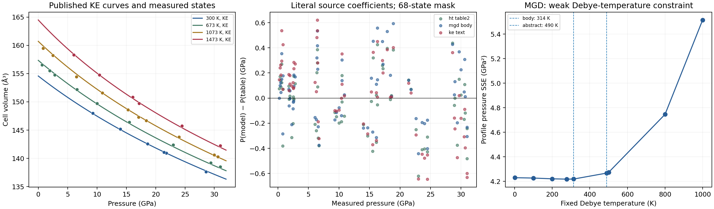

# Litasov (2013) Fe₃C: independent equation and fit replay

Investigated 30 October 2026. **The KE parameterization is numerically
reproducible at the precision of the printed coefficients. The prose HT fit
has conditional central-parameter agreement. Neither result recovers the
authors' complete fitting workflow.** The body MGD fit has agreement for the
coefficients with printed errors, but its reference volume and uncertainty
estimates are not fully recovered. The abstract MGD fit, FM fit and complete
axial fit sets are not recovered by the declared diagnostics. The NM core
extrapolation retains unresolved formulation and source-consistency problems.

This is an investigation, with no catalog addition, source-value replacement,
pressure recalibration, commit, push or release. All scripts and fitted values
are **diagnostic**, not new recommended EOSs or pressure standards.

The authority is Litasov et al., *JGR: Solid Earth* **118**, 5274–5284,
[doi:10.1002/2013JB010270](https://doi.org/10.1002/2013JB010270).
The final publisher article and the recovered final PDF were checked. The
publisher's full-text page lists no supporting information or correction;
the targeted DOI/correction search located no correction. This is a record of
the sources checked, not proof that private fit files never existed.

The [numerical report](../data/litasov-2013-fe3c-reproduction.json) retains
literal coefficients, every selected row ID and residual, full covariance and
correlation matrices, solver bounds, multiple starts, reference-temperature
and weighting sensitivities, calibration diagnostics, and source-calculation
checkpoints. The repository replay (`scripts/reproduce_litasov_2013_fe3c.py`)
uses direct equations and SciPy, without the Peritheos fitting engine. The
library is checked separately.



## Complete inventory and verdicts

`Equation` distinguishes evaluation of a defined equation from matching an
independent source calculation. `Refit` compares central coefficients against
each printed source error width, where provided, rather than a broad generic
similarity screen. These comparisons are **not statistical confidence tests**:
the source parameter-error confidence convention and cross-fit covariance are
unknown. A coefficient with no reported error is not assigned zero uncertainty.

The paper introduces nine literal volumetric parameter alternatives (including
the incompletely specified fixed-500 K alternative), three axial fits, and an
NM thermal-transfer construction. Its twelve Table 2 comparison rows are
inventoried separately below. The PM reference Vinet curves are the cold
branches of the thermal models, not additional independent fits.

| Model / literal alternative | Exact source | Equation / independent calculation result | Refit result | Original workflow / catalog disposition |
|---|---|---|---|---|
| FM Vinet, Table 2 | p. 5279, Table 2 | Evaluated; no separate numerical FM calculation checkpoint printed. On the seven RT rows below 8 GPa: RMS 0.1584 GPa. | Table coefficients are not recovered at printed precision. | Workflow not recovered; preserve this alternative, no integration/recommendation. |
| FM Vinet, prose | p. 5281, §4 [16] | Evaluated; RMS 0.1278 GPa, maximum 0.2130 GPa on the same rows. | **Not reproduced** by either declared objective: equal-pressure K₀=178.663 versus 175±2 GPa. | Numerical refit issue, not proof of physical failure. Exact FM input selection/objective remain missing. |
| PM HT, Table 2 | pp. 5279–5280, Table 2 and [14] | Cold curve consistent with Figure 8 at its graphical resolution; full PVT evaluated, RMS 0.2494 GPa. No independent HT thermal table is printed. | All five coefficients with source errors agree conditionally under equal-pressure weights; V₀=154.5363 versus 154.56 is outside half-last-digit precision, with source V₀ error unknown. **Partial, not complete parameter parity.** | Workflow not recovered; source ambiguity and weighting sensitivity remain, no integration. |
| PM HT, prose | p. 5280, [14] | Same thermal laws; PVT RMS 0.2812 GPa. | **Conditional central-parameter parity** for all six free coefficients on the declared equal-pressure masks. Source error estimates not reproduced exactly. | Exact selection, objective and covariance not recovered; no integration. |
| PM MGD, body/Table 2 | pp. 5279–5281, Table 2 and [14] | Canonical integrated-Grüneisen interpretation evaluated; cold Figure 8 agreement is limited to graphical resolution. PVT RMS 0.2562 GPa. | All five coefficients with errors agree for equal-pressure fits; V₀=154.3979 versus 154.42 is not recovered at printed precision. θ uncertainty is much larger than reported. **Conditional partial agreement.** | Cited-equation sign, source V₀ constraint, weights and covariance unresolved; no integration. |
| PM MGD, abstract | p. 5274, abstract [1] | Distinct complete set, evaluated separately; RMS 0.3011 GPa. Cold Figure 8 cannot discriminate it from body sets. | **Not reproduced:** the free refit does not recover its V₀, K₀′, γ₀ or θ₀ within printed error widths. | Preserve the source conflict; no integration/recommendation of this alternative. |
| PM MGD, θ₀=500 K fixed | p. 5281, continuation of [14] | γ₀ and q are printed, but replacement V₀/K₀/K₀′ are not. Body cold coefficients are adopted only for this diagnostic. RMS 0.2749 GPa. | **Not reproduced as a complete reported fit**; equal-pressure γ₀=2.1562 exceeds 2.13±0.02. q=−0.1541 lies inside −0.36±0.23. | Incomplete source set, exact cold constraints missing; remains deferred. |
| PM KE, prose/abstract | pp. 5274, 5278, 5281, [1], [12], [14] | **Source-calculation reproduction within the printing envelope:** all 25 Table 3 thermodynamic rows; 72 Table 4 volumes agree to max 0.000202 in V/V₀. | Complete joint PVT/thermochemical fit not recoverable from the supplied inputs. PVT-only cold-coefficient diagnostic is not the author's KE fit. | Best specified source parameterization; standalone replay retained. Joint inputs and an exact supported library mapping remain separate prerequisites for integration. |
| PM KE, rounded Table 2 | p. 5279, Table 2 | K₀=191 instead of 190.8; also passes the Table 3 printing envelope. | No independent full joint-fit reproduction; quoted Table 2 K₀/K₀′ errors preserved. | Same qualifications; rounding alternative is not a second experiment. |
| PM axial a | p. 5281, [15], Figure 9 | Conventional cubic-axis Vinet interpretation evaluated; source pressure RMS 0.1569 GPa on six RT PM states. | a₀=5.083118 Å, K₀a=198.260 GPa versus 5.085 Å and 195±2 GPa. **Complete set not reproduced.** | Exact axial subset, normalization convention and objective not printed; no volumetric EOS assembled from axes. |
| PM axial b | same | Source pressure RMS 0.1891 GPa. | b₀=6.741568 Å, K₀b=187.024 GPa versus 6.743 Å and 186±3 GPa. K₀ agrees; intercept not at printed precision. **Partial agreement.** | Original workflow not recovered; no integration. |
| PM axial c | same | Source pressure RMS 0.2343 GPa. | c₀=4.523754 Å, K₀c=162.859 GPa versus 4.523 Å and 163±2 GPa. K₀ agrees; intercept not at printed precision. **Partial agreement.** | Original workflow not recovered; no integration. |
| NM construction for core extrapolation | pp. 5282–5283, [19]–[21], Figure 13 | Sata cold curve plus PM thermal parameters; specific thermal family and transfer normalization are not stated. KE transfer is closest, but literal central curves differ from the figure by up to 0.0608 g/cm³. | This is an extrapolation assumption, not an NM data fit. Ambient NM density also conflicts with Table 2 V₀. **Full parity unresolved.** | No physical validation or recommendation for core predictions; no integration. |

The HT/MGD RMS values in this table use the 68-state mask defined below.
Independent numerical evaluation is not experimental validation. Figure 8
contains only a cold-curve graphical check; it cannot validate a full thermal
surface or establish which overlapping fit was drawn.

### Literal coefficients and uncertainty semantics

All volumetric V₀ values below are conventional orthorhombic cell ų;
K₀ is GPa, and K₀′, γ₀, q, β, g and m are dimensionless. Parenthetical or ±
widths here retain the printed parameter errors, whose confidence convention
is not specified. An omitted width remains missing.

| Alternative | V₀ | K₀ | K₀′ | Thermal coefficients / constraints |
|---|---:|---:|---:|---|
| FM Table 2 | 155.2 | 175 | 5 fixed | 298 K; 0–7.2 GPa as printed |
| FM text | 155.27±0.05 | 175±2 | 5 fixed | RT data below 8 GPa |
| HT Table 2 | 154.56 | 190±2 | 4.8±0.1 | α(T)=a₀+a₁T; a₀=(3.90±0.15)×10⁻⁵ K⁻¹; a₁=(1.22±0.17)×10⁻⁸ K⁻²; (∂K/∂T)P=−0.029±0.002 GPa/K |
| HT text | 154.5±0.1 | 190±3 | 4.8±0.2 | Same printed thermal parameters |
| MGD body | 154.42 | 194±1 | 4.6±0.1 | γ₀=2.15±0.03; q=−0.03±0.27; θ₀=314±120 K |
| MGD abstract | 154.6±0.1 | 192±3 | 4.5±0.1 | γ₀=2.09±0.04; q=−0.1±0.3; θ₀=490±120 K |
| MGD fixed θ | not reprinted | not reprinted | not reprinted | θ₀=500 K fixed; γ₀=2.13±0.02; **q=−0.36±0.23** |
| KE text | 154.56 | 190.8 | 4.68 | ΘE=305 K; γ₀=2.10; e₀=9.2×10⁻⁵ K⁻¹; g=0.66; m=4.3; fixed k=2, γ∞=0, β=0.3, a₀=0 and mE1=3n=12 |
| KE Table 2 | 154.56 | 191±2 | 4.68±0.08 | Same prose thermal coefficients; their uncertainties not printed |

The source associates ΘE=305 K with Debye θ₀≈407 K. These are different
characteristic-temperature conventions, not two modes to sum. Section 3 [12]
describes two-mode machinery and then explicitly reduces this Fe₃C fit to
**one mode**. Doubling the 12-mode multiplicity would be incorrect. With a₀=0,
the printed anharmonic exponent m=4.3 is inactive and cannot be recovered from
these predictions. KE a₀ is an anharmonic parameter; HT a₀ is an expansivity
intercept, despite the reused notation.

Rendered pages confirm the minus signs in the abstract q, body q,
fixed-500 K q, HT dK/dT and negative Table 3 Gibbs energies. The previous
layout-text extraction loses these signs. No original observation or published
coefficient file was altered. The FM and HT reference-volume differences are
not silently called normal rounding: 155.27→155.2 and 154.56→154.5 do not
follow ordinary rounding to one decimal place. KE 190.8→191 does.

### Every Table 2 comparison row

These are literature comparisons, not twelve new Litasov fits to Table 1.
Table 2's footnote explicitly describes recalculation of original pressure
standards to the newer ruby/MgO scale. They must not overwrite records of the
original publications. The five fully labelled Vinet rows are numerically
evaluated at V/V₀=0.95 and 0.85 in the JSON; this only evaluates the literal
comparison parameterization. The paper supplies neither their recalibrated
input arrays nor independent calculation checkpoints, so no original-author
or recalibration-workflow parity is claimed.

| Comparison / state | T | V₀ / K₀ / K₀′ | Printed family and range | Equation / reproduction verdict |
|---|---:|---|---|---|
| Li (2002), state unspecified | 298 K | 155.3 / 168±3 / 5.8±0.3 | VR; 0–31 GPa | Literal Vinet evaluated; recalibrated input fit unavailable. |
| Ono–Mibe (2010), FM experiment | 298 K | 155.4 / 166±6 / 6.7±0.3 | VR; 14–35 GPa | Literal Vinet evaluated; recalibrated input fit unavailable. |
| Prescher (2012), PM comparison | 298 K | 154.2 / 145±3 / 8.5±0.7 | BM; 8–22 GPa | BM order absent from this row; exact equation and recalibrated fit not recoverable from this table alone. This V₀ is not assigned to the original Prescher record. |
| Sata (2010), NM experiment | 298 K | 148.5 / 316±6 / 3.5±0.1 | VR; 50–184 GPa | Literal Vinet evaluated; conditional cold branch for Figure 13 replay. |
| Vocadlo (2002), FM calculation | 0 K | 153.3 / 173 / 5.8 | BM; range absent | BM order absent; original calculation audit needed. |
| Huang (2005), FM calculation | 0 K | 152.0 / 212 / 4.5 | family/range absent | Exact EOS cannot be evaluated without assuming its family. |
| Ono–Mibe (2010), FM calculation | 0 K | 151.9 / 216 / 4.15 | BM; 0–35 GPa | BM order absent; original calculation audit needed. |
| Mookherjee (2011), FM calculation | 0 K | 151.6 / 183 / 6.0 | VR; range absent | Literal Vinet evaluated; original computational fit inputs not supplied here. |
| Vocadlo (2002), NM calculation | 0 K | 148.9 / 317 / 4.3 | BM; range absent | BM order absent; original calculation audit needed. |
| Huang (2005), NM calculation | 0 K | 149.5 / 322 / 3.7 | family/range absent | Exact EOS cannot be evaluated without assuming its family. |
| Ono–Mibe (2010), NM calculation | 0 K | 142.5 / 316 / 4.4 | BM; <400 GPa | BM order absent; original calculation audit needed. |
| Mookherjee (2011), NM calculation | 0 K | 143.2 / 297 / 4.9 | VR; range absent | Literal Vinet evaluated; original computational fit inputs not supplied here. |

The references used for context elsewhere in the article (including Scott,
Fe₇C₃, pure Fe and PREM) are not additional fitted Fe₃C parameter sets. Auditing
those original publications is separate from replaying Litasov's reported
models. No BM3 order is invented for an ambiguous `BM` label.

## Observations, phase identity and calibration

All **81** rows on pp. 5276–5277, Table 1, were freshly extracted from the PDF
and compared token for token with the preserved token JSON, then numerically
against the CSV including every reported pressure/volume error. Every value
matches. Run counts are **29, 9, 8, 11, 8, 11, 5**. The missing ambient MgO
cells remain missing at rows **29, 39, 47**; their pressure is printed as zero
with no pressure sigma. Run 7 combines several carbonate–iron reaction
experiments and is not one newly inferred loading path.

The source PDF SHA-256 is
`dc8dde95218786395ca9c9d9a13923505a94d63d4d780c8930c4e8fbd537ffc8`.
The CSV SHA-256 remains
`e0017d735a5f866053caca0e00fcb55beccb9d55a4e2fe2cbe30f25656bc5789`;
the token JSON remains
`8171286e89547b6684b153a1f3f6a8f7f3f3a4624e2c12e66405ebb844643994`.
The source PDF is retained at
`output/cementite-eos-audit-2026-10-25/sources/litasov-2013.pdf`.
Existing source attribution/licensing remains in
`peritheos/data/datasets/cementite-sources.LICENSE.md`; this report does not
relicense the article or its figures.

Actual extrema are **0–31.0 GPa, 300–1473 K, 137.62–161.66 ų**, rather than
measurements at every point of that rectangle. The original 99.9% Fe₃C powder
and Pnma orthorhombic phase are identified in §§1–2. The standard cementite
cell has Z=4 Fe₃C and 16 atoms. Printed a·b·c agrees with printed V to at most
0.004959 ų, consistent with the displayed lattice precision; printed V is
used unchanged. No composition change or magnetic state is inferred merely
because a sample shares a capsule with Fe₃N or is measured above 22 GPa.

Table 1 explicitly calls the reported errors **1σ**, including paired MgO
volumes. Lattice widths <0.001 Å are not printed; there are no numerical
temperature errors or coordinate/run covariance. A thermocouple/sample
temperature difference below 10 K is discussed, but is not a reported sigma.
Pressure effects on thermocouple emf were ignored by the authors. Neither
missing error nor unknown covariance becomes zero experimental uncertainty.

The authors locate the RT FM/PM transition between their 7.23 and 9.3 GPa
states. Their discussion adopts the higher-pressure PM/NM interpretation and
combines 21–24.5 and 28.6–31 GPa data with PM data, explicitly acknowledging
magnetic ambiguity. This replay follows that reported interpretation for
comparison, without establishing a magnetic phase boundary experimentally.

Pressures remain the **reported MgO/Sokolova (2013) pressures**, without
recalibration. As an independent provenance check, both MgO cold-curve variants
from Sokolova et al. (2013), [doi:10.1016/j.rgg.2013.01.005](https://doi.org/10.1016/j.rgg.2013.01.005),
were evaluated with that paper's Eqs. (2), (4), (6), (9), (14) and Tables 1–3.
On the 78 paired observations, calculated-minus-reported pressure RMS/max is
**0.03910/0.13473 GPa** for the Holzapfel variant and **0.07679/0.20570 GPa**
for Vinet. These do not identify an exact implementation or authorize selecting
a new pressure column. Rounded marker volumes, rounded coefficients,
private optimization/version differences and the exact cold variant remain
unresolved. The largest discrepancy can exceed an individual printed error.
Recalibrating Fe₃C to improve a parameter match would therefore be unjustified.

The final Sokolova article was recovered as the author's copy attached to a
[Copernicus discussion](https://se.copernicus.org/preprints/6/C406/2014/sed-6-C406-2014-supplement.pdf),
not misidentified as a Fe₃C supplement. Its local SHA-256 is
`4d08ba09ddac7d2f48053bbc53903277abf4e941f3bd147062377e89d1caf51a`.
The cited Mo formalism DOI 10.1063/1.4794127 was also checked; its AIP PDF
endpoint returned HTTP 403 here. The KE mapping below is consequently stated
explicitly and tested against Fe₃C's own independent thermodynamic tables,
rather than claimed to reproduce an unavailable Mo implementation.

## Equations and normalization

The Fe₃C article refers to earlier formalism in §3; it does not print a numbered
set of mechanical equations. This replay maps §3 [11]–[12] and §4 [14] to the
following explicit laws. Let x=V/V₀, y=x^(1/3), η=3(K₀′−1)/2. Then

\[
P_r(V)=3K_0(1-y)y^{-2}\exp[\eta(1-y)].
\]

For HT, K₀′ is temperature independent,

\[
V_0(T)=V_0\exp[a_0(T-T_r)+a_1(T^2-T_r^2)/2],\qquad
K_0(T)=K_0+(\partial K/\partial T)_P(T-T_r).
\]

These replace V₀ and K₀ in Vinet. The α intercept is at T=0, not at Tᵣ.
The main reference is Tᵣ=298.15 K, explicit in Tables 3–4; 298 and 300 K
are also replayed because the prose says 298 K and measured states say 300 K.
Across these choices the HT/MGD/KE source RMS changes by at most about
0.003 GPa, without resolving the coefficient conflicts. Vinet is zero at V₀;
the difference from the stated 1-bar standard pressure is 0.0001 GPa, below
the relevant measurement precision and retained in the KE checkpoint inversion.

For MGD the principal interpretation is

\[
\gamma=\gamma_0x^q,\quad
\theta=\theta_0\exp[(\gamma_0-\gamma)/q],\quad
P=P_r+\gamma\{E_D(V,T)-E_D(V,T_r)\}/V,
\]

with the continuous q→0 limit θ=θ₀x^(−γ₀). E_D is the standard Debye
integral. The independent implementation uses **16 kB per physical cell**;
the library comparison uses **4 R per mole of Fe₃C**, Vmol=Vcell·NA/Z.
Cell ų times 10⁻²¹ converts J/cell divided by volume to GPa.
The quadrature is independently checked against adaptive SciPy integration.

**Cited-equation sign qualification:** Litasov (2007), Eq. (9), prints the
opposite exponent, (γ−γ₀)/q; the author-uploaded primary article's full text
was checked through [its ResearchGate record](https://www.researchgate.net/publication/256823665_Thermal_equation_of_state_of_superhydrous_phase_B_to_27_GPa_and_1373_K).
The thermodynamic definition γ=−∂lnθ/∂lnV requires the principal sign above.
Fe₃C (2013) does not restate that equation. Both interpretations were replayed,
without silently treating a correction as confirmed author software. The
literal-sign six-parameter fit gives V₀=154.5573, K₀=191.113, K₀′=4.7368,
γ₀=2.19368, q=0.06723, θ₀=702.85 K, RMS 0.24531 GPa. It fails the body and
abstract coefficient sets, despite a slightly lower RMS than the canonical
fit. The sign cannot be established by residual size alone. This is a
disclosed mapping/control, not a proposed alternative EOS.

For KE, k=2 gives Vinet, with one Einstein oscillator and the source's
Al'tshuler-type law

\[
\gamma=\gamma_\infty+(\gamma_0-\gamma_\infty)x^\beta,
\quad \Theta=\Theta_0x^{-\gamma_\infty}
\exp[(\gamma_0-\gamma_\infty)(1-x^\beta)/\beta].
\]

Since a₀=0, Θ is independent of T. Per mole of Fe₃C,

\[
f(V,T)=12RT\ln[1-\exp(-\Theta/T)]-6Re_0x^gT^2,
\]

\[
P=P_r+\frac{12R\gamma\Theta}{V_{\rm mol}}
\left[\frac{1}{e^{\Theta/T}-1}-\frac{1}{e^{\Theta/T_r}-1}\right]
+\frac{6Re_0g x^g}{V_{\rm mol}}(T^2-T_r^2).
\]

For this displayed pressure equation Vmol is m³/mol and the thermal terms
are Pa, then converted to GPa. This is the one-mode, a₀=0 limit of the
referenced Helmholtz formalism (Sokolova 2013, Eqs. (5)–(9), with its explicitly
discussed earlier γ(x) law). It is **not** the later generalized t/δ model or
a plain Mie–Grüneisen–Einstein EOS without the electronic term.

KT=−V∂P/∂V, α=(∂P/∂T)V/KT, CP=CV+α²VmolKT·T,
KS=KT·CP/CV. Entropy and CV follow f's temperature derivatives. ΔG is the
reference-cold energy integral plus f(V,T)−f(V,Tᵣ)+PVmol, with the zero-pressure
reference energy zero. Kelvin-to-joule and GPa-to-Pa conversions are explicit.
No fitted entropy constant or synthetic observations are introduced.

The printed **2.327 cm³/mol =154.56 ų** is dimensionally inconsistent with
Z=4: the actual conversion is **23.26955 cm³/mol Fe₃C**, or 2.326955
J bar⁻¹ mol⁻¹. The replay uses the explicit cell volume and correct physical
conversion; the source unit statement remains visible. It is not used to
silently redefine the mole as an atom or change n.

Table 3's γ column follows the **oscillator γ(x)**, rather than
αVKT/CV when electronic heat capacity with exponent g is included. For example,
at the ambient reference state the central replay gives oscillator γ≈2.10
and thermodynamic γ≈2.058; at 2000 K they differ more. Misidentifying that
column would generate a spurious failure. The printed reference γ=2.096 is
consistent with the rounding of γ₀=2.10; no hidden value is fitted to it.

## Independent KE checkpoints

All 25 Table 3 rows and 72 Table 4 states are **calculated source outputs**,
not additional measured training observations. None enters a refit objective.

| Quantity | Maximum absolute central-replay difference, KE prose |
|---|---:|
| V/V₀, Tables 3–4 | 0.00020180 |
| α | 1.853×10⁻⁷ K⁻¹ |
| S | 0.08236 J mol⁻¹ K⁻¹ |
| CP | 0.13668 J mol⁻¹ K⁻¹ |
| CV | 0.01082 J mol⁻¹ K⁻¹ |
| KT | 0.14052 GPa |
| KS | 0.06363 GPa |
| oscillator γ | 0.004157 |
| ΔG | 0.06069 kJ/mol |

For example, at 30 GPa, 1000 K the replay gives CV=107.2285 J mol⁻¹ K⁻¹,
S=207.2574 J mol⁻¹ K⁻¹ and ΔG≈545.956 kJ/mol, compared with 107.23,
207.29 and 545.944. Exact final-digit equality is not claimed.

The printing envelope is calculated by adding absolute centred perturbation
responses for half a final printed digit of each *non-fixed* input and the
output rounding width. KE prose input widths, in script order, are
[0.005 ų, 0.05 GPa, 0.005, 0.005, **0 fixed β**, 0.5 K,
0.05×10⁻⁵ K⁻¹, 0.005]. The Table 2 variant uses 0.5 GPa for its rounded K₀.
All 225 Table 3 scalar comparisons pass this explicitly **linear printing
envelope**; the largest envelope fraction used is 0.755 (prose) or 0.745
(Table 2). This is a first-order rounding consistency test, not a simultaneous
fit of hidden digits, a statistical confidence region or exact author-code
reproduction. The Table 4 volume differences are reported separately.

Figure 8 was independently sampled from the original embedded raster at 13
declared pixel columns, with preserved axis calibration and raster checksum.
The declared V/V₀ graphical bound is ±0.0015, allowing line width, marker
overlap and axis reading. Maximum differences are 0.000780 (HT Table 2),
0.001166 (MGD body), 0.001408 (MGD abstract) and 0.000792 (KE). All pass this
coarse curve check; it cannot distinguish them. No plotted dots are promoted
to new experimental measurements.

## Independent refits and their limits

Two transparent masks bracket the uncertain low-pressure Curie region:

- **63-state conservative mask:** T≥523 K or P≥9.3 GPa.
- **68-state boundary-inclusive mask:** T≥473 K or P≥9.3 GPa.

All original rows remain preserved. These choices are diagnostic brackets,
not recovered author masks. Six RT states at ≥9.3 GPa exist, including the
28.6 GPa row. The text specifically describes five RT points at 9–22 GPa;
the disposition of the sixth state in each fit is not supplied. The primary
diagnostic follows the later statement that high-pressure states were combined
with the PM data. No arbitrary outlier search or coefficient-targeted mask
optimization was performed.

Fits minimize either equally weighted pressure residuals or residuals divided
by fixed effective widths
sqrt[σP²+(∂Psource/∂V·σV)²]. The second is a first-order coordinate-error
sensitivity, **not full orthogonal regression**. Weights are frozen at the
source curve. FM ambient P=0 is fixed only for that weighting sensitivity,
with its printed volume error; no ambient pressure sigma is invented.
Neither objective includes unknown temperature errors or run correlations.

V₀, K₀ and K₀′ are free except source-fixed FM K₀′=5. All HT thermal
coefficients are free. MGD fits jointly free its six parameters, with θ fixed
only for the stated 500 K alternative/profile. Source-cold-fixed thermal fits
are retained separately as sequencing sensitivities. KE diagnostics fit only
its three cold coefficients with thermal terms fixed; they cannot reproduce
the joint thermochemical optimization. Three predeclared MGD starting θ values
(source, 500, 800 K) converge to the same free solution; no bound is active in
the principal fits.

| 68-state equal-pressure result | Fitted value | Residual-scaled SE | Source comparison |
|---|---:|---:|---|
| HT V₀ (ų) | 154.53633 | 0.08593 | prose 154.5±0.1; Table 2 154.56 with no width |
| HT K₀ (GPa) | 190.93664 | 2.76006 | prose 190±3; table 190±2 |
| HT K₀′ | 4.81204 | 0.21836 | prose 4.8±0.2; table 4.8±0.1 |
| HT a₀ (K⁻¹) | 3.92928×10⁻⁵ | 0.19653×10⁻⁵ | (3.90±0.15)×10⁻⁵ |
| HT a₁ (K⁻²) | 1.19915×10⁻⁸ | 0.22569×10⁻⁸ | (1.22±0.17)×10⁻⁸ |
| HT dK/dT (GPa/K) | −0.0295105 | 0.0021730 | −0.029±0.002 |
| MGD V₀ (ų) | 154.39795 | 0.10107 | body 154.42, no error; abstract 154.6±0.1 |
| MGD K₀ (GPa) | 194.37384 | 3.01789 | body 194±1; abstract 192±3 |
| MGD K₀′ | 4.61998 | 0.22802 | body 4.6±0.1; abstract 4.5±0.1 |
| MGD γ₀ | 2.13117 | 0.03835 | body 2.15±0.03; abstract 2.09±0.04 |
| MGD q | 0.04638 | 0.32913 | body −0.03±0.27; abstract −0.1±0.3 |
| MGD θ₀ (K) | 277.33 | 325.61 | body 314±120; abstract 490±120 |

HT and MGD refit RMS are **0.24260 and 0.24906 GPa**. Maximum pressure
differences from their body/Table 2 source curves on measured states are
**0.12428 and 0.12083 GPa**. These describe curve similarity, not recovery of
every printed parameter or its uncertainty. With the 63-state mask, HT gives
K₀≈190.491, K₀′≈4.8593 and MGD ≈194.715, 4.6405; the body comparisons with
reported widths still agree conditionally. V₀ precision/uncertainty issues remain.

The effective-width objective shifts 68-state HT to approximately
V₀=154.6291, K₀=191.871, K₀′=4.7956 and a₀≈3.47×10⁻⁵; body MGD shifts to
V₀=154.4968, K₀=195.201, K₀′=4.6455, γ₀=2.15527, q=0.28604,
θ₀=534.79 K. The quoted body comparisons then fail for several parameters.
This is protocol sensitivity, not permission to select the objective that
matches the paper and call it the authors' workflow.

Covariance is the residual-scaled inverse normal matrix (computed with a
scaled Jacobian and pseudoinverse), conditional on each selected objective,
mask and fixed parameters. The full off-diagonal terms and singular values
are retained. Source covariance, calibration uncertainty and error confidence
are unavailable; source uncertainties are not reproduced simply because
central values agree. The MGD θ profile has SSE 4.2180 GPa² near 277 K,
4.2189 at 314 K, 4.2674 at 490 K and 4.2734 at 500 K. The weak temperature
constraint explains why parameter errors and fit protocol matter so much.

For FM, all seven 300 K states below 8 GPa give
V₀=155.24872±0.05537 ų, K₀=178.66286±4.05852 GPa with K₀′ fixed to 5.
The source and refit RMS are 0.12775 and 0.11796 GPa. Effective-width K₀ is
178.39 GPa, still outside 175±2. This is an unresolved **central-coefficient
reproduction** mismatch; the source still describes the observations closely.
Its larger reconstructed uncertainty is not evidence that the source error
estimate is invalid under the authors' unknown protocol.

## Axial and core extrapolation qualifications

For the axial diagnostic, replace V/V₀ by (l/l₀)³ in Vinet and fix K₀′=4.8,
the standard volume-equivalent axial convention. Fit the six PM RT points
with equal pressure weights. The a/b/c K₀ results are 198.260±3.184,
187.024±3.835 and 162.859±4.122 GPa (conditional residual-scaled errors).
Using only the five 9–22 GPa states instead gives 201.395, 185.037 and
166.718 GPa. Neither choice recovers all three printed intercepts/moduli.
The source does not explicitly give the axial normalization/objective.

The printed intercept product a₀b₀c₀=**155.08533 ų**, whereas the volumetric
HT/KE V₀ is 154.56 ų. Their conventional volume-equivalent initial modulus
is 3/(1/195+1/186+1/163)=**180.2937 GPa**, distinct from 190–194 GPa.
Independent axial fits therefore should not be silently assembled into a
self-consistent volumetric thermal EOS.

For Figure 13, the literal NM reference curve is V₀=148.5 ų,
K₀=316 GPa, K₀′=3.5 from Litasov's Sata comparison. Transfer of each named
PM thermal family, normalizing x to the NM V₀, is tested as an explicit
conditional interpretation. Eighteen source-curve samples were read from the
original embedded figure raster at six fixed pressure columns and 300, 3000,
5000 K, avoiding text and error bars. Pixel calibration and checksum are in
the JSON; the graphical reading bound is ±0.025 g/cm³.

Maximum absolute differences are **0.06082 g/cm³ for KE**, **0.09383 for MGD**
and **1.32228 for HT**. Even the KE central replay is not an exact graphical
match at that reading bound; coefficient precision, the exact Sata curve and
thermal transfer remain unresolved. The major HT discrepancy demonstrates
that naming only “PM thermal parameters” does not fully specify this
construction. No thermal family was selected by optimizing the graph.

The source's ambient NM density **7.979 g/cm³** also conflicts with its
Table 2 NM V₀=148.5 ų, which gives **8.03079 g/cm³** for Fe₃C/Z=4.
V₀=149.5 ų would instead give 7.97707 g/cm³, but belongs to a different
Table 2 calculation row; it is not substituted. At 330 GPa, 300 K the literal
NM curve gives 12.9139 g/cm³, versus the prose's approximate boundary value
12.8 g/cm³. Boundary pressure, source curve precision and thermal transfer
must be resolved before claiming numerical parity of the core calculation.
The extrapolated carbon fractions, mixed Fe/Fe₃C density model and PREM
uncertainties cannot be independently reproduced from the information here;
none becomes an NM experimental constraint.

## Reproduction, checks and remaining inputs

Run from a checkout with the preserved primary PDF and Poppler available:

```sh
uv run python -m scripts.reproduce_litasov_2013_fe3c
uv run pytest tests/test_litasov_2013_fe3c.py -q -W error
uv run ruff check scripts/reproduce_litasov_2013_fe3c.py tests/test_litasov_2013_fe3c.py
uv run ruff format --check scripts/reproduce_litasov_2013_fe3c.py tests/test_litasov_2013_fe3c.py
```

These are repository maintenance commands, not installed-package APIs.
The replay requires NumPy, SciPy, Matplotlib/Pillow and `pdftotext` /
`pdftocairo`. The PDF-dependent test skips when the external source copy is
unavailable; coefficient/normalization/checkpoint tests still run. Initial
verification used Python 3.9.6, NumPy 2.0.2 and SciPy 1.13.1. The focused
suite passes **13 tests** with warnings treated as errors. Direct physical-cell
FM, HT and MGD pressures agree with the public library to <10⁻⁸ GPa; MGD
Python and native Rust paths are checked separately. KE remains a standalone
source-equation replay, without substitution by a similar native thermal EOS.
The related public `DorogokupetsOganov2007` constructor currently requires
strictly positive γ∞ and all four oscillator multiplicities, excluding this
source's γ∞=0, one-mode boundary. Tiny positive surrogate values would only
approximate the source. No shared constructor, native code or validation rule
was changed to manufacture a KE catalog mapping in this investigation.

Exact author-workflow reproduction still requires the source row identities
for each magnetic/axial fit, disposition of the 28.6 GPa RT point, cold/thermal
parameter constraints and fit order, the pressure/volume/temperature objective
and weights, calibration variant/version and unrounded inputs, error/covariance
conventions, and the MGD temperature-law implementation. KE additionally
requires the actual thermal-expansion and heat-capacity input arrays adopted
from the cited Jellinghaus, Kagawa–Okamoto, Wood, Barin and Hallstedt sources,
their uncertainties/selections and relative weighting against PVT data. Those
arrays and objective weights are not provided by this Fe₃C article and were
not recovered here. Matching calculated Tables 3–4 cannot replace them.

The useful completed findings are the reproduced KE parameterization, the
qualified HT/body-MGD coefficient comparisons, and quantified non-parity and
missing inputs for the remaining alternatives. No unresolved fit was replaced
with a new thermal law, no calculated checkpoint was fitted as an experiment,
and no unrelated Fe₃C record, shared audit, material file or generated catalog
ledger was edited.
