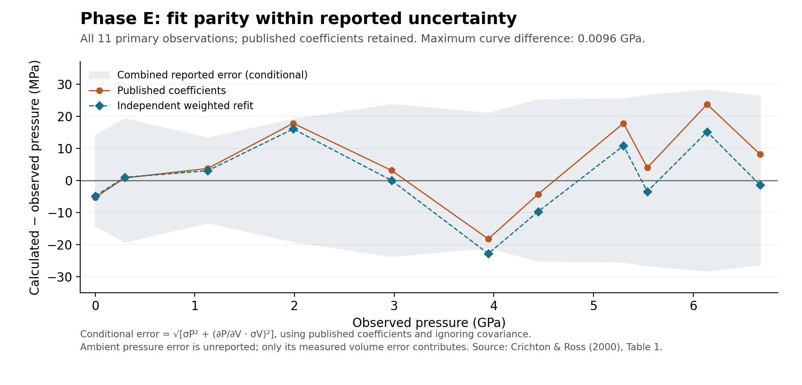

# Fe-bearing phase E: Crichton and Ross (2000)

Audit and integration date: 2026-10-16. G06/C11. The executable material is
bundled at `peritheos/data/materials/phase_e_fe0072.eosmat` and available through
`get_material("phase_e_fe0072")`. No common runtime changes are needed.

**Outcome: the published physical volume EOS is successfully recovered,
with parity within reported uncertainty.** The small differences between
the independent refit and published central coefficients are documented
below. They are not evidence of a failed fit recovery. Availability of the
authors' exact fitting implementation is a separate provenance assessment.

## Primary sources and recovery

- Crichton and Ross (2000), *Equation of state of phase E*, Mineralogical
  Magazine 64, 561–567, [DOI](https://doi.org/10.1180/002646100549427).
  The complete seven-page publication-of-record PDF was recovered from the
  [journal archive mirror](https://triage19.com/products/MM/MM064P0561.pdf).
  Table 1 was checked against the rendered page 562; results and fit choices
  were read on pages 563–564. The Cambridge article metadata lists no
  supplementary materials. Its citation PDF link returned access HTML here.
- Kudoh et al. (1993), *Phase E: A high pressure hydrous silicate with unique
  crystal chemistry*, Physics and Chemistry of Minerals 19, 357–360,
  [DOI](https://doi.org/10.1007/BF00202972). All four pages of the
  [author-hosted scan](https://hazen.carnegiescience.edu/sites/default/files/156-PhaseE-PCM.pdf)
  were visually inspected. The author's publications index links an obsolete
  `sites/hazen.gl.ciw.edu` path; the `sites/default/files` path works.
- Shieh et al. (2000), American Mineralogist 85, 765–769,
  [DOI](https://doi.org/10.2138/am-2000-5-616),
  [full article](https://triage19.com/products/AM/AM085P0765.pdf).
  Figure 1 on page 766 supplies the eight indexed phase E reflections used
  for the explicitly limited diffraction fallback.
- Angel et al. (1997), Journal of Applied Crystallography 30, 461–466,
  [DOI](https://doi.org/10.1107/S0021889897000861),
  [author-hosted paper](https://www.rossangel.com/Download/1997_Angel_etal_quartz.pdf).
  Page 461 establishes the exact quartz standard cited by Crichton and Ross.
- Crichton (2000), *Equations of State of Dense Hydrous Silicates*,
  [UCL PhD thesis](https://discovery.ucl.ac.uk/id/eprint/10123954/1/Equations_of_state_of_dense_hy.pdf),
  Section 2.11 and Chapter 6. Printed pages 45 and 138 were checked visually.
  Equation 2.31 explicitly defines pressure-residual weighted least squares
  divided by n−m and states that pressure and propagated volume errors
  contribute to the weights. It does not supply the exact effective-error
  implementation or weight-iteration trace.

The material-specific source manifest stores each PDF URL, byte length,
SHA-256 and inspected locations. PDFs and article figures are not
redistributed. All eleven Table 1 rows are transcribed in the CSV and embedded
as typed observations in the standalone bundled card. The manifest retains
the original parenthetical-error strings, the axial coefficients, the two
original structure tables' site models and the fallback hkl identities.

## Sample and volume identity

The sample is **Mg1.96(7)Fe0.072(5)Si1.04(5)H3.7(8)O6**, synthesized at
18 GPa and 1150 °C, with superhydrous phase B also produced. It is not an
ideal Mg endmember. EMPA measured the major-element composition; the
analytical deficit from 100% was attributed to water. Hydrogen was not
measured directly. The paper attributes its large H error to electron-beam
damage and reports 18.7 wt% H2O. Fe valence and its site distribution are
unresolved. The central formula need not close charge exactly; do not alter
H or assign Fe valence to force closure.

Use the conventional **hexagonal axes of trigonal R-3m, No. 166**:
a=b=2.9655(2) Å, c=13.8703(5) Å, angles 90°,90°,120°. The empirical formula
is normalized to six oxygens per conventional cell, so Z=1 on this basis.
This is an explicit conventional-cell assumption, not an independently
measured absolute site population or an assertion of integer stoichiometry.
Do not use Z=3 by treating the O6 formula as a primitive-cell formula.

The ambient observation is P=0.0001 GPa and V=105.633(16) ų. The cell
computed from printed a,c is 105.636096 ų; its 0.00310 ų difference is
consistent with rounding of a,c. Every table row passes a conservative
printed-digit rounding check. Retain the original observed V; do not replace
it with a value recomputed from rounded edges.

Room temperature is not numerically specified. The card follows the existing
298 K nominal exchange convention and marks it `assumed_room_temperature`.
It does not assert a numerical measured temperature range.

## Physical volume EOS and numerical validation

The source freely refines all three physical volume parameters:

| Parameter | Published value | Location |
|---|---:|---|
| V0 | 105.627(7) ų/conventional cell | p. 563, Results |
| K0 = KT | 92.9(7) GPa | p. 563 |
| K0′ | 7.3(2) | p. 563 |

There are no fixed volume parameters. Preserve the published parenthetical
errors; a confidence level and coefficient covariance matrix are not given.
The source's normalized-pressure discussion maps to standard BM3:

\[
f=\tfrac12[(V_0/V)^{2/3}-1],\qquad
P=3K_0 f(1+2f)^{5/2}[1+\tfrac32(K_0'-4)f].
\]

The Python reproduction evaluates this strain expression independently of
Peritheos and then compares it with the native evaluator. The primary table
is an independent benchmark, not model-generated observations.

- With the **published** coefficients, maximum |Pcalc−Pobs| is
  **0.0236971 GPa**, consistent with the source's **0.02 GPa** at its
  0.01 GPa printed precision (tolerance 0.005 GPa).
- With effective pressure variance
  `sigma_P² + (dP/dV sigma_V)²`, published coefficients give
  **χ²/(11−3) = 0.4016866**, consistent with printed χw²=0.4.
  This is a conditional statistic: covariance and the exact effective-error
  implementation are unavailable. The author's thesis confirms the reduced
  n−m normalization. It is not proof of the original code.
- Native and independent BM3 agree to less than 5×10⁻¹³ GPa in the
  table checks. Python and Rust load, evaluate, invert and preserve metadata.

The independent refits remain **diagnostic outputs**, separate from the
unchanged published record:

| Diagnostic objective | V0 (ų) | K0 (GPa) | K0′ |
|---|---:|---:|---:|
| Unweighted pressure residuals, all 11 rows | 105.625055 | 93.132670 | 7.148176 |
| Iterated effective-variance weights, all 11 | 105.627524 | 92.814510 | 7.277217 |
| Direct effective-variance minimization, all 11 | 105.627504 | 92.811973 | 7.279092 |
| Iterated weights, ambient row omitted (sensitivity only) | 105.617459 | 93.497016 | 7.063718 |

All three complete-table fits agree with each published coefficient within
its reported error. This establishes **fit parity within reported uncertainty**
under the stated weighting assumptions. With the iterated weighted refit,
the largest coefficient shift is 0.123 times its published error width;
the largest pressure difference between the curves is about 0.0096 GPa
over the measured volume interval. The differences at each measured volume
are also smaller than the combined reported observation errors. Published
coefficients remain authoritative and are retained unchanged.



The shaded observation-error band combines reported P and propagated V
errors assuming no covariance. It is not a coefficient-confidence band.
The ambient pressure has no reported esd; it stays null
in the source data. Complete-table weighted fits omit only its pressure
variance contribution and retain its measured volume error. They assume
uncorrelated coordinates. Omitting the ambient row moves V0 and K0′ outside
their reported error widths, so the ambient convention is material.
The iterated fit has χ²/dof≈0.33975; do not claim it exactly reproduces the
published central coefficients or χw². These small numerical differences
are reported alongside successful recovery within uncertainty. No new
parameter errors or covariances are asserted.

The exact original implementation remains incompletely documented: original
unrounded observations, software/version, effective-error implementation, weight iteration,
ambient-pressure error handling, coordinate covariance and coefficient
covariance are not supplied. This provenance limitation does not negate
fit parity or prevent acceptance of the published record. In the numerical
report, the separate `exact_author_workflow_reproduction` assessment is
explicitly marked `provenance_only`. No author was contacted.

The thesis Table 6.1 is preserved separately in the manifest, including all
eleven rows. Its ambient a is 2.9654(2), the 3.944 GPa a is 2.9295(2), the
6.671 GPa a is 2.9091(3), and the 0.296 GPa pressure esd is 0.004 GPa;
the journal prints 2.9655(2), 2.9296(2), 2.9090(3) and 0.003 GPa,
respectively. The journal version remains authoritative for this record;
no hybrid table is constructed. The thesis repeats the published BM3 result
and also reports a BM2 comparison with free V0=105.57(3) ų, K0=101.5(8)
GPa, K0′ fixed to 4, and χw²=7.3. That poorer lower-order fit is supporting
context only. No extra unrounded P–V or paired quartz measurements were
recovered from the thesis chapter.

## Pressure scale and missing raw inputs

Quantitative pressures use quartz volumes with **Angel et al. (1997)**.
The record links the exact bundled standard, `alpha_quartz_angel_1997_bm3_1`.
That primary standard reports BM3 V0=112.981(2) ų, K0=37.12(9) GPa,
K0′=5.99(4). Ruby was present only for approximate pressure measurement;
its scale and shifts are not reported. The pressure medium was 4:1
methanol:ethanol, with single-crystal measurements in a modified BGI DAC.
The ruby chip is retained under `pressure_calibration.auxiliary_checks`,
separate from the quantitative quartz method in `methods`.

All ten reported nonambient pressure esds and all a,c,V esds are retained.
The paper does **not** publish paired quartz volumes, quartz cell errors,
ruby wavelengths, or the original reflection-setting angles. The pressure
scale is bibliographically resolved but observation-level recalculation is
`missing_calibrant_observations`. Never invert tabulated P to manufacture
quartz observations. No calibration registry changes are needed.

Minimum inputs for a future exact-fit replay are the original unrounded
phase E P–V/error table and fit settings/code. Independent pressure
recalculation additionally needs paired quartz volumes/errors and their
reference-cell convention. These optional provenance gaps are recorded in
the [dataset-request page](../dataset-requests.md). They do not block accepted
fit parity or database use, and no author outreach has been made.

## Diffraction fallback and structural limitations

Kudoh Table 1 refines Mg1 (multiplicity 3), Mg2 (3), Si (6) and O (6) at
(0,0,z), with partially occupied cation sites and no located hydrogen.
Its two Fe-free samples differ from the EOS material. Their complete
reported coordinates, occupancies and B factors are retained in the manifest
for audit, **not copied into the target card**.

There is also a printed inconsistency: sample 1 Table 1 gives
Mg=3(0.664+0.013)=2.031 while the paper prints Mg2.08Si1.16H3.20O6.
Sample 2 gives Mg=2.169 and Si=1.014, consistent with its rounded formula.
Both versions of sample 1 remain recorded without choosing a correction.
The authors also caution that absolute contents require absolute X-ray
intensities or accurate density, and that their average sites do not describe
simultaneous local Mg/Si occupation: neighboring vacancies and cations are
coupled over short distances. An ideal fully occupied structure would be
scientifically misleading here.

The card therefore supplies a **position-only peak fallback**. The eight
E-labeled reflections in Shieh Figure 1 are 003, 101, 012, 104, 015, 110,
018 and 021; Au peaks/fluorescence are excluded. Their hkl identities are
transferred as phase topology from that different, Fe-free sample. Their
d spacings are calculated from the **target** Crichton–Ross measured cell:

\[
d_{hkl}^{-2}=\frac{4(h^2+hk+k^2)}{3a^2}+\frac{l^2}{c^2}.
\]

All satisfy the original rhombohedral condition −h+k+l=3n, independently
reported by Kudoh on page 357. Marker intensity 1 is a uniform display
choice, not a measured or calculated intensity. This supports phase-specific
indexing and reference peak positions; it does not support quantitative
intensity simulation, hydrogen-site inference, diffuse-scattering simulation
or a refined Fe occupancy model. Volume-only pressure scaling is approximate
because the physical EOS does not encode anisotropic lattice compression.

Purevjav et al. (2020), [DOI](https://doi.org/10.1107/S2052252520003036),
was checked as an authoritative later hydrogen-site lead. Its deuterated
100 K sample is compositionally different; its sites are not assigned to the
Crichton–Ross material. Official CIF/HKL access returned 403 here; primary
HTML structural results suffice to establish the composition mismatch.

## Axial and thermal results held apart

The BM3 fits to a³ and c³ are retained in the manifest, including printed
a0=2.965(2) Å, Ka=94.8(6) GPa, Ka′=6.9(2), c0=13.870(31) Å,
Kc=89.1(10) GPa and Kc′=7.9(4). They are effective axial
parameterizations, not additional physical volume EOS records. The printed
quadratic coefficients/errors are also retained. The page 565 quoted linear
compressibilities do not equal either 1/(3Kaxis) or the zero-pressure
derivatives of those quadratics; no executable inference uses them.

Wang et al. (2022), [DOI](https://doi.org/10.1029/2022JB025274), provides
a source-owned thermal BM3 treatment and Table S1 for
**Mg2.22(1)Si1.27(2)H2.48(1)O6**, up to 22.6 GPa and 900 K.
Sections 2 and 3.1 of the author-hosted paper were checked. This is a distinct
Fe-free composition; it cannot extend this material. Thermal implementation
and Table S1 recovery are deferred to a separate material audit.

## Reproduction and integration

```sh
uv run python scripts/reproduce_phase_e_crichton_ross_2000.py --check
uv run --group docs python scripts/reproduce_phase_e_crichton_ross_2000.py --check --plot
uv run pytest -q tests/test_phase_e_crichton_ross_2000.py -W error
cargo test -p peritheos --test phase_e_crichton_ross_2000 --locked
```

The reproduction accepts `--card PATH` after integration and optionally
`--source-dir PATH` to verify downloaded PDFs against the manifest hashes.
Expected local PDF names are `crichton-ross-2000.pdf`, `kudoh-1993.pdf`,
`shieh-2000.pdf`, `angel-1997.pdf`, `wang-2022.pdf` and `crichton-thesis.pdf`.
Generated numerical results are in
`docs/data/phase-e-crichton-ross-2000-reproduction.json`.

The [integration note](phase-e-integration.md) records the catalog and shared-ledger
updates. The record is `parity` in the common refit ledger and its source is
`Reproduced` in the paper investigation ledger. Source licensing remains unspecified; CC0
applies only to contributor-held transcription/normalization/metadata rights,
as specified in the material-specific dataset licence note.
