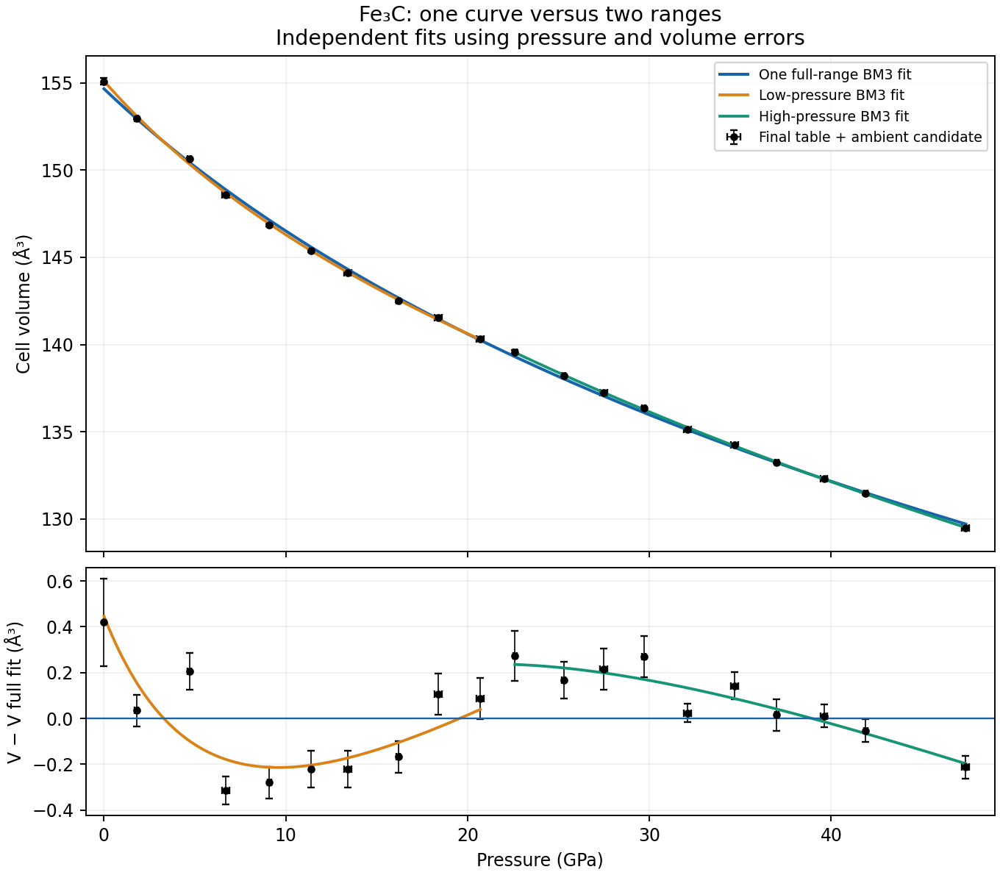
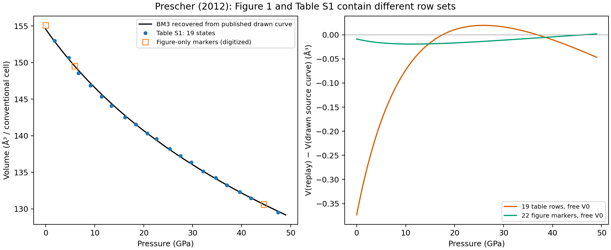

# Current Studio snapshot: numbered p1-p19 primary dataset

Conditional coefficient parity compares K0 and K0_prime at the published printed precision, with adopted V0=154.5678863704812 A^3 per conventional Fe3C cell (Z=4) held fixed. Published K0=161 +/-2 GPa and K0_prime=5.9 +/-0.2 are retained unchanged. V0 is adopted from the published calculated full-range curve, not a printed source coefficient or the ambient measurement. Its uncertainty and the original fixed/free V0 convention are unrecovered. Numerical coefficient agreement does not establish uncertainty agreement, author-workflow reproduction or physical validation.

The primary experimental dataset is all 19 numbered p1-p19 points from final Table S1, with published ruby pressures and reported widths, spanning 1.8-47.4 GPa at nominal 293 K. The recorded comparison uses equal pressure weights with V0 fixed and K0/K0_prime free. It gives K0=160.994011 +/-2.532193 GPa and K0_prime=5.919478 +/-0.240867, displayed as 161 +/-3 and 5.9 +/-0.2 at the paper precision. The K0 uncertainty is not reproduced: 2.532193 GPa rounds to 3, not the published 2 GPa. Covariance is inverse(J^T J)*SSE/(19-2), conditional on exact V0 and exact input volumes. Source coordinate widths are preserved but are not the weights in this comparison; source confidence and calibration covariance are unknown. The 22 digitized Figure 1 markers remain separate supplementary evidence, not the primary dataset. No ambient or p20-p22 point is added. For p16, the final source volume is 133.25 A^3, not the alternate SHELX cell 133.58 A^3. Published split fits remain audit-only.

The comparison below describes the preceding 22-marker snapshot and is retained as historical evidence. The current numeric comparison is in `prescher-2012-numbered-full-range-fit.md`.

---

# Prescher (2012): recovery of the three Fe3C BM3 fits

Investigated 30 October 2026. Source:
[Prescher et al., Physical Review B 85, 140402(R)](https://doi.org/10.1103/PhysRevB.85.140402),
Figure 1, pages 140402-2–3, and final supplementary Table S1.

## Database integration: full range only

The public catalog now offers only the **full-range Prescher (2012) BM3**
record, `cementite_prescher_2012_full_range_bm3`. Published coefficients and
errors remain **K0=161 ± 2 GPa, K0′=5.9 ± 0.2**. V0=154.5678863704812 ų
is explicitly adopted from the published calculated curve, rather than
reported as an original measured or printed reference volume. It is distinct
from the ambient graph marker near 155.087 ų.

The recorded reconstruction fits all **22 digitized Figure 1 markers** with
that adopted V0 held fixed and equal pressure weights. It gives
**K0=160.75743 ± 2.35336 GPa, K0′=5.94213 ± 0.21984**: both coefficients and
both formal error values agree at the paper's printed precision. Source and
comparison values are displayed at the same paper precision, while all
unrounded values and covariance remain available in evidence.

This is **conditional numerical parity**, with parameter-agreement scope.
Residual-based one-sigma comparison errors condition on exact V0; they do not
recover the source confidence convention, V0 uncertainty, original fit inputs,
weighting or author workflow. Published source errors keep unspecified
confidence. No new default or physical-validation claim is made.

The **19-row final Table S1** and **all 22 graph markers** remain public,
separate, complete datasets for users to explore and refit. Their source
values and distinctions are unchanged. The published split coefficients,
working-cell dataset and all split-fit investigations are preserved in
[`prescher-2012-retired-splits.json`](https://github.com/CPrescher/peritheos/blob/main/peritheos/data/research/cementite/prescher-2012-retired-splits.json)
and the research reports below, outside the public EOS choices. This follows
the user's selection of a single full-range representation; it does not
rewrite the publication or claim that the split analyses never existed.

The [database comparison](../reconstruction-reports/cementite.md) records the
fixed-V0 protocol and formal error agreement. The repository-only mapping and
replay is `scripts.prescher_2012_catalog`. The installed public API is:

```python
from peritheos import get_eos_record

eos = get_eos_record("cementite_prescher_2012_full_range_bm3")
volume_a3 = eos.volume(20.0)  # 293 K; conventional-cell ų
```

## Historical split assessments: audit evidence only

**Both split fits achieve parameter parity for K0 and K0′ at the published
printed precision under the recorded diagnostic assumptions.** Uncertainty
agreement is a separate comparison. The unreproduced low-pressure K0 error
does not downgrade this central-parameter assessment. This uses the existing
[`parameter_agreement` scope](../eos-labels.md#qualified-results-and-comparison-scope),
not an assessment of the complete author workflow.

| Published split fit | Coefficient | Published value ± error | Conditional replay, before rounding | Uncertainty comparison |
| --- | --- | ---: | ---: | --- |
| Low pressure | K0 (GPa) | 145 ± **3** | 144.7616 ± **3.67049** | **Not reproduced: replay error rounds to 4** |
| Low pressure | K0′ | 8.5 ± 0.7 | 8.49439 ± 0.681180 | Matches printed precision |
| High pressure | K0 (GPa) | 172 ± 1 | 171.79199 ± 1.105979 | Matches printed precision |
| High pressure | K0′ | 5.1 ± 0.1 | 5.053596 ± 0.0893425 | Matches printed precision |

All four **central coefficients** round to their published values. The table
shows the source and replay errors explicitly, so the one uncertainty mismatch
is immediately visible. “Not reproduced” does not establish that the published
3 GPa error is incorrect; its original calculation remains unknown.

The low replay includes the 22.6 GPa row and assumes absolute 0.2 GPa pressure
errors. The high replay uses the archived own/SHELX cell family with absolute
0.1 GPa pressure errors, including its non-final p16 volume. Both hold the
full-curve graph-derived V0 fixed. These conditions remain attached to the
parity rating; they are not recovered author settings or a single shared
source protocol. Author-workflow reproduction and scientific recommendation
remain separate from parameter parity. Published values are unchanged.

The numerical report records `status: parity`, `scope: parameter_agreement`,
the two compared coefficients and these qualifications for each split fit.
Its stricter four-quantity recovery flags are preserved separately: the low
case still fails that stronger test because of error(K0).

## Archived starting cell recovered

An additional search of the mounted network archive recovered a numeric
starting-cell entry, including its stored error. The source is
`/Volumes/personal_folder/Projects/Iron Carbides/Fe3C/ESRF single crystal/Fe3C starting/Fe3C_S1_data_crystal.ini`,
section `Mother of all lattices`, lines 6–8, with a recorded modification time
of 14 February 2011, 17:16:15. The exact transcription and source checksum are
preserved in
[`prescher-2012-starting-cell.json`](https://github.com/CPrescher/peritheos/blob/main/peritheos/data/research/cementite/prescher-2012-starting-cell.json).

| Quantity | Stored value |
| --- | ---: |
| a (Å) | 4.5177842 |
| b (Å) | 5.0858456 |
| c (Å) | 6.7553513 |
| α, β, γ (degrees) | 90, 90, 90 |
| Cell volume (ų) | **155.2160381** |
| Stored volume error (ų) | **0.1388118** |

The axis product agrees with the stored volume within 0.000001 ų. The
companion CrysAlis P4P export stores 155.2160 ų with unconstrained angles.
The INI error convention, confidence level and covariance are unknown; its
`number of reflections=0` field is retained without interpreting it as an
independent final refinement or as evidence that no raw observations exist.
The folder name suggests the starting/ambient sample, but the INI does not
explicitly state pressure or temperature.

Another processing folder contains an earlier cell near 155.1117 ų and a
later export near 163.3820 ų. Its first raw frame is byte-identical to the
first raw frame in `Fe3C starting`; these are processing alternatives, not
independently established ambient observations. No original EOS fit project,
optimizer starting vector, final fitted V0 or fixed/shared/refined V0
constraint was recovered. The starting-cell volume is 0.64815 ų above the
adopted graph-derived V0 and 0.12892 ų above the digitized ambient marker.
It cannot be substituted for either quantity without establishing its role
in the original fit. The catalog and Studio parameterizations remain unchanged.

### Other ambient candidates and the origin of adopted V0

A subsequent check of 113 archived diffraction processing logs recovered
**155.08(19) ų** in
`ESRF single crystal/Fe3C_S1_data/log/REDLOGWed-May-04-11-41-52-2011.txt`,
lines 702–710. It follows `UB fit with 148 obs out of 148` and lists both
unconstrained and orthogonalized cells. This is a stronger candidate for the
numeric source of the Figure 1 ambient marker, digitized as 155.08712 ų,
than the previously highlighted 155.21604 ų INI entry. The matching figure
point is evidence for the association, not proof; the log does not explicitly
attach a pressure or temperature to the cell fit. Its reported error is
preserved as printed, with no recovered confidence convention.

The February log in `Fe3C starting` also backs its 155.22(14) ų value with
**183 observations** (lines 1755–1763). Thus the INI's separate zero-reflection
field does not mean this was merely an arbitrary starting guess. The May
processing history additionally records 155.0(2) ų with 145 observations and
155.1(2) ų with 154 observations. These related reductions share raw-data
provenance; they are not independent ambient measurements.

Two workbooks contain explicit nominal-zero rows: `APS single crystal/eos.xls`,
`Sheet1!B1=0`, has `I1=155.390053644` ų; the XLSX version contains the same
axes/product formula. `ESRF single crystal/Fe3C_up_p19.XLS`,
`Fe3C_up_p19!A2=p0`, `B2=0`, has `I2=163.40230309104` ų. The APS series is
separate from the final ESRF fits, and the ESRF p0 volume is markedly different
from the published ambient marker. Neither has an established original-fit role.
Source excerpts, hashes and cell locations are preserved in
[`prescher-2012-ambient-candidates.json`](https://github.com/CPrescher/peritheos/blob/main/peritheos/data/research/cementite/prescher-2012-ambient-candidates.json).

The **adopted EOS V0=154.5678863704812 ų** comes from fitting BM3 to the
**247 extracted vertices of the published full-range calculated curve**.
It does not come from any of these ambient rows and was not printed as a
coefficient. A fitted EOS zero-pressure intercept can differ from an ambient
observation because the curve is fit to the compression series. The original
split-fit reference volumes and their constraints remain unconfirmed.

### Split-fit diagnostic with the recovered starting volume

At the user's request, both existing conditional split protocols were rerun
with **V0 fixed at 155.2160381 ų**. The observations, pressure selections and
assumed absolute pressure sigmas were unchanged. This changes the reference
volume, not merely the numerical optimizer's starting guess.

| Split | Published K0 ± error (GPa) | Previous fixed V0: K0 ± error | Starting-cell V0: K0 ± error | Published K0′ ± error | Starting-cell V0: K0′ ± error |
| --- | ---: | ---: | ---: | ---: | ---: |
| Low, Table S1 through 22.6 GPa | 145 ± 3 | 144.76159 ± 3.67049 | **122.50226 ± 3.47448** | 8.5 ± 0.7 | **11.24016 ± 0.81274** |
| High, working own/SHELX cells | 172 ± 1 | 171.79199 ± 1.10598 | **159.84437 ± 1.09036** | 5.1 ± 0.1 | **5.50729 ± 0.09535** |

These errors condition on fixed V0 and the earlier assumed absolute
sigma_P=0.2 GPa (low) or 0.1 GPa (high); volume errors are omitted. Source
confidence conventions remain unknown. The low K0 error now rounds to the
published 3 GPa, but both central coefficients fail printed precision and
the K0′ error rounds to 0.8 rather than 0.7. Both high-pressure errors still
match printed precision, while both central coefficients fail. Thus the
recovered starting-cell volume does **not** improve joint recovery of the
published coefficients and errors.

Two controls give the same conclusion: strict P<22 GPa final-table rows give
K0=123.69214 ± 3.86659 GPa and K0′=10.89985 ± 0.92938; using final-table
high-pressure volumes gives 159.35658 ± 1.09186 GPa and 5.51166 ± 0.09563.
Varying fixed V0 by the stored ±0.1388118 ų width also fails central-parameter
parity: K0 spans 118.09–127.04 GPa (low) and 157.40–162.33 GPa (high) under
the previous protocols. This is a sensitivity interval, not a confidence
interval or propagation of an established V0 standard deviation.

Using 155.2160381 ų only as the initial guess with V0 free gives low
V0=155.36144 ų, K0=117.88297 GPa, K0′=11.90609 and high V0=152.17466 ų,
K0=224.84892 GPa, K0′=3.36902. These optima also fail publication parity.
The fixed-V0 solutions and covariances were independently checked using
linear weighted least squares in K0 and K0(K0′−4); free-V0 solutions were
checked with the independent three-term BM3 pressure polynomial.

Reproduce this diagnostic from the repository with
`python -m scripts.check_prescher_2012_starting_volume`. All 14 cases, exact
inputs, checksums, rounding comparisons, conditional covariance matrices,
residual-scaled error alternatives and software versions are retained in
[`prescher-2012-starting-volume-split-check.json`](../data/prescher-2012-starting-volume-split-check.json).
No source coefficient, adopted catalog V0, previous recovery report or Studio
classification was changed.

### Requested repeat with V0=155.08 ų

Fixing V0 at the subsequently recovered 155.08 ų log value, with all other
settings unchanged, gives:

| Split and input selection | K0 ± conditional error (GPa) | K0′ ± conditional error | Matches printed central coefficients / errors |
| --- | ---: | ---: | --- |
| Low, previous protocol through 22.6 GPa | **126.94620 ± 3.51363** | **10.63463 ± 0.78174** | Neither / neither |
| High, previous protocol with working own/SHELX cells | **162.27902 ± 1.09358** | **5.41184 ± 0.09404** | Neither / both |
| Low, strict final-table P<22 GPa | 128.36869 ± 3.91228 | 10.24641 ± 0.89285 | Neither / neither |
| High, final-table P>=22 GPa | 161.78336 ± 1.09512 | 5.41625 ± 0.09432 | Neither / both |

The central coefficients are closer to publication than in the 155.21604 ų
trial, but substantially further away than with the adopted graph-derived
154.56789 ų. The low K0 error is closer numerically to the published 3 GPa
than in the adopted-V0 replay, but still rounds to 4; its K0′ error rounds to
0.8 rather than 0.7. The high errors retain printed agreement. Thus 155.08 ų
does not recover the published split-fit coefficient/error sets.

Errors again condition on exact fixed V0, assumed absolute pressure sigmas
0.2/0.1 GPa and omitted volume errors. The log's printed volume error 0.19 ų
is not propagated or assumed to be an established Gaussian standard deviation.
The numerical results and covariance matrices pass the same independent
weighted-linear BM3 checks. The previous 14 cases are preserved alongside the
four new trials in
[`prescher-2012-ambient-volume-split-check.json`](../data/prescher-2012-ambient-volume-split-check.json).
Reproduce with `python -m scripts.check_prescher_2012_starting_volume --v0 155.08 --output docs/data/prescher-2012-ambient-volume-split-check.json`.
The database and Studio remain unchanged.

### Requested free-V0 split fits including the ambient candidate

Both ranges were fitted independently with V0, K0 and K0′ free. The primary
inputs are final Table S1 rows split strictly at 22 GPa: rows 1–9 plus the
recovered 155.08 ų candidate assigned P=0 for the low fit (10 observations),
and rows 10–19 for the high fit (10 observations). The ambient point is a
fit observation, not a fixed V0 constraint. Its P=0 assignment is the requested
ambient interpretation, rather than pressure metadata recovered from the log.

| Parameter | Published low | Free-V0 low with ambient | Published high | Free-V0 high |
| --- | ---: | ---: | ---: | ---: |
| V0 (ų) | Not printed | **155.14882 ± 0.19480** | Not printed | **153.68360 ± 1.03513** |
| K0 (GPa) | 145 ± 3 | **125.97684 ± 7.71257** | 172 ± 1 | **189.03804 ± 21.98980** |
| K0′ | 8.5 ± 0.7 | **10.57693 ± 1.29026** | 5.1 ± 0.1 | **4.44066 ± 0.73522** |

The objective is equal-weight pressure residuals. Quoted errors are
conditional linearized one-sigma estimates from residual scatter,
`covariance = inverse(JᵀJ) × SSE/(N−3)`, with seven residual degrees of freedom
per fit. They are not propagation of the tabulated coordinate errors or the
ambient log's printed ±0.19 ų. Source confidence/weighting remain unknown.
The low V0 error's numerical similarity to the log's volume error is not a
claim that one was propagated from the other.

Neither central coefficient pair nor the numerical printed error pairs is
recovered. High-pressure extrapolation is poorly constrained: correlation
between V0 and K0 is −0.99681 and between K0 and K0′ is −0.99535. Overlap with
the large refit errors does not constitute printed parameter parity.

Keeping the earlier conditional row selections as separate controls also
does not recover publication parity. Including 22.6 GPa in the low fit gives
V0=155.17836 ± 0.19097 ų, K0=123.70622 ± 7.05849 GPa and
K0′=11.07421 ± 1.14957. The high working-cell fit gives
V0=152.17466 ± 1.42298 ų, K0=224.84894 ± 36.64513 GPa and
K0′=3.36902 ± 1.04347.

The four cases, input values/checksums, full covariance/correlation matrices,
residuals and separate errors under the prior assumed uniform pressure
sigmas are retained in
[`prescher-2012-free-volume-split-check.json`](../data/prescher-2012-free-volume-split-check.json).
Run `python -m scripts.check_prescher_2012_free_volume_splits`. Independent
pressure-polynomial solutions verify the optima; complex-step derivatives
verify the covariance matrices. No catalog or Studio values were changed.

### Free-V0 fits using both pressure and volume errors

At the user's request, errors in both coordinates were included in the two
free-V0 split fits and a full-range fit. All three use final Table S1 rows;
the 155.08(19) ų ambient candidate is included in the low and full fits.
Its pressure is held at 0 GPa as an explicit diagnostic constraint because
no pressure error is recovered; its volume remains an uncertain observation,
so V0 is free. The full fit has **20 observations: 19 table rows plus ambient**.
The two other figure-only markers lack recovered numeric coordinate errors
and are not added to this weighted fit.

The objective minimizes the sum of squared normalized corrections in both
P and V, using the individual tabulated errors. A latent volume is fitted for
each table row; the ambient contribution is `((V0−155.08)/0.19)²`. Errors are
conditionally interpreted as independent absolute one-sigma widths. This
interpretation is not established by the original pressure-error definition
(before/after ruby differences), source confidence or calibration covariance.

| Range | Refit V0 ± error (ų) | Published K0 ± error (GPa) | Refit K0 ± error (GPa) | Published K0′ ± error | Refit K0′ ± error |
| --- | ---: | ---: | ---: | ---: | ---: |
| Low, P<22 GPa plus ambient | **155.10733 ± 0.14531** | 145 ± 3 | **129.85522 ± 6.56921** | 8.5 ± 0.7 | **9.75351 ± 1.13200** |
| High, P>=22 GPa | **153.67938 ± 1.58755** | 172 ± 1 | **188.63683 ± 33.81903** | 5.1 ± 0.1 | **4.47140 ± 1.14097** |
| Full, all table rows plus ambient | **154.66060 ± 0.10243** | 161 ± 2 | **155.86611 ± 3.05212** | 5.9 ± 0.2 | **6.30780 ± 0.21648** |

These primary conditional errors use the coefficient block of the full
inverse normal matrix, including latent-volume nuisance parameters, without
residual-variance scaling. The reduced chi squares are 1.51489, 0.48022 and
3.55093 for low, high and full, with 7, 7 and 17 residual degrees of freedom.
Scaling covariance by those factors instead gives errors on (V0, K0, K0′)
of (0.17885 ų, 8.08544 GPa, 1.39328), (1.10014 ų, 23.43598 GPa, 0.79067)
and (0.19302 ų, 5.75139 GPa, 0.40793), respectively. The two conventions are
kept separate; neither reproduces the published complete results.

No central K pair matches published printed precision. With the unscaled
input-error covariance, only the full-range K0′ error rounds to its published
value. Including 22.6 GPa in the low fit as a separate row-selection control
gives V0=155.13808 ± 0.14377 ų, K0=127.19843 ± 6.06021 GPa and
K0′=10.35098 ± 1.02510, which also fails printed agreement.

Reproduce with `python -m scripts.check_prescher_2012_coordinate_errors`.
The [numerical report](../data/prescher-2012-coordinate-error-fits.json) retains
input arrays/checksums, covariance/correlation, latent-volume corrections,
residuals, both error conventions and the separate 22.6 GPa control. An
independent ODRPACK calculation fits inverse V(P), fixing only the ambient
pressure, and agrees in central parameters, objective and covariance.
Synthetic known-EOS, global error-scaling and free-V0 checks test the fitting
and uncertainty semantics. Catalog and Studio values remain unchanged.

#### Full range without the ambient observation

The requested repeat omits the ambient candidate and fits only the 19 final
Table S1 rows (1.8–47.4 GPa). All three EOS parameters remain free. Individual
pressure and volume errors enter the same joint-coordinate objective and
absolute-error covariance convention as above; no pressure coordinate is fixed.

| Parameter | Published full range | With ambient | Without ambient |
| --- | ---: | ---: | ---: |
| V0 (ų) | Not printed | 154.66060 ± 0.10243 | **154.48775 ± 0.11678** |
| K0 (GPa) | 161 ± 2 | 155.86611 ± 3.05212 | **160.53550 ± 3.46985** |
| K0′ | 5.9 ± 0.2 | 6.30780 ± 0.21648 | **6.03174 ± 0.22887** |

Removing the ambient point moves both central K coefficients closer to
publication. K0 rounds to the published 161 and error(K0′) rounds to 0.2;
K0′ rounds to 6.0 instead of 5.9 and error(K0) rounds to 3 instead of 2.
Thus complete printed recovery is still not achieved. The extrapolated V0
is compatible with the graph-derived 154.56789 ų under its conditional error;
this does not recover an originally published V0 or establish which points
the authors actually included.

Weighted SSE is 53.44371 with 16 residual degrees of freedom (reduced chi
square 3.34023). Residual-variance scaling instead gives errors of 0.21344 ų,
6.34160 GPa and 0.41828 on (V0, K0, K0′). These alternatives remain separate.
The [complete numerical report](../data/prescher-2012-full-without-ambient.json)
retains the source rows, errors, latent-volume corrections, covariance,
correlation and independent ODRPACK verification. Reproduce with
`python -m scripts.check_prescher_2012_coordinate_errors --without-ambient`.
Earlier diagnostic reports, catalog coefficients and Studio are unchanged.

#### One curve versus two ranges

The predicted volumes differ little even when extrapolated K0/K0′ differ
substantially. Over the actual observed low and high domains, the weighted
full curve differs from the corresponding split curve by at most 0.44673 ų
(0.2880%, at ambient) and 0.23567 ų (0.1689%, at 22.6 GPa), respectively.
Thus a single full-range curve is a possible simplified representation if
that approximation is acceptable for the intended calculation. These bounds
compare the present fitted curves; they are not bounds on experimental truth.

At the assumed experimental error scale, the curvature differences still
matter: the single fit has weighted SSE=60.36574 with 17 residual degrees of
freedom (reduced chi square 3.55093), while the independent split fits together
have SSE=13.96582 with 14 degrees of freedom (combined reduced chi square
0.99756). Splitting adds three EOS parameters, with no continuity constraint.
The residual pattern is systematic, so equal experimental precision cannot
be claimed for the simpler curve merely because its volume differences are
small. Error confidence and calibration covariance remain unconfirmed.

A catalog can retain all three published parameterizations for provenance
while presenting a full-range entry as the primary practical representation;
the split records need not be mandatory for every calculation. This does not
select a new default or promote the present diagnostic refits into source
replacements. The quantitative comparison is preserved in
[`prescher-2012-full-vs-split-comparison.json`](../data/prescher-2012-full-vs-split-comparison.json).



Error bars show the stored coordinate widths separately; the fit objective
includes both coordinates. The plotted curves are the present independent
diagnostic refits, not the three unchanged published-coefficient catalog records.

## Full-range fit to all 22 plotted markers, including ambient, with V0 free

The requested graph-only fit uses all **22 markers** from Figure 1, including
the nominal P=0 marker near 155.08712 ų and the two other figure-only states.
No Table S1 coordinate or calculated-curve vertex is substituted. All three
BM3 parameters are free and pressure residuals have equal weights.

| Parameter | Published full range | All 22 graph markers, free V0 |
| --- | ---: | ---: |
| V0 (ų) | Not printed | **154.55921 ± 0.20430** |
| K0 (GPa) | 161 ± 2 | **160.96832 ± 5.52639** |
| K0′ | 5.9 ± 0.2 | **5.93103 ± 0.34487** |

Both central K coefficients match the published printed precision. Neither
formal error does: the K0 error rounds to 6 rather than 2 GPa, and the K0′
error rounds to 0.3 rather than 0.2. These are **conditional residual-based
one-sigma errors**, using `inverse(JᵀJ) × SSE/19`; they are not recovery of
the original experimental uncertainty calculation. The graphical coordinates
share calibration/digitization errors, and original numeric coordinate
errors are not available for every marker. Consequently this numerical
error comparison does not change the catalog's earlier finding that
experimental uncertainty reproduction from graph-only inputs is not assessed.

The nominal ambient marker digitizes to 0.001862 GPa. Its coordinates are
preserved in the primary fit; a separate exact-P=0 control leaves the
central printed-match conclusion unchanged. The fit has 19 residual degrees
of freedom and pressure RMSE=0.33623 GPa. Its coefficients exactly reproduce
the previously preserved all-22-marker recovery, now with the residual-based
error comparison made explicit.

The [focused numerical report](../data/prescher-2012-all-graph-points-fit.json)
preserves all marker coordinates, source hash, covariance/correlation,
residuals, 95% conditional intervals, printed comparisons and the exact-zero
control. Independent pressure-polynomial and complex-step covariance checks
agree. Reproduce the primary result using `scripts.recover_prescher_2012_fe3c`
(`subsets.full_range.fits.figure_equal_pressure_free_V0` in its report).
No catalog or Studio values are changed.

### The same graph-point fit with V0 fixed

With **V0 fixed at the curve-derived 154.5678863704812 ų**, the same 22
graph markers and equal pressure weights give:

| Parameter | Published full range | Graph fit, curve-derived V0 fixed |
| --- | ---: | ---: |
| K0 (GPa) | 161 ± 2 | **160.75743 ± 2.35336** |
| K0′ | 5.9 ± 0.2 | **5.94213 ± 0.21984** |

**All four numbers match the published printed precision.** This result was
already present in the original recovery report at
`subsets.full_range.fits.figure_equal_pressure_curve_V0_fixed`. Statements
that graph-point error values do not match must be scoped to the free-V0
case above; they do not apply to this conditional fixed-V0 numerical result.

The two formal errors condition on exact V0, with residual covariance scaled
by SSE/(22−2). They omit uncertainty in the reconstructed V0 and do not recover
the original experimental errors or author covariance calculation. Fixing V0
removes its parameter covariance from the fit, explaining why the K errors
are smaller than in the free-V0 case. The original fixed/free convention
remains unconfirmed, so this is conditional printed numerical agreement,
not author-workflow reproduction.

Fixing V0 instead at the **ambient graph marker volume 155.08711984 ų** gives
K0=148.44765 ± 2.61190 GPa and K0′=6.63112 ± 0.27149; none of these four
numbers matches published precision. Thus the two possible meanings of
"V0 from the graph" must remain explicit.

The [focused fixed-V0 comparison](../data/prescher-2012-all-graph-points-fixed-v0.json)
preserves both cases, point coordinates, covariance, source checksums and
printed comparisons. Independent linear BM3 coefficients/covariance agree,
and the curve-fixed result is identical to the previously saved result.
Reproduce via `scripts.recover_prescher_2012_fe3c` and its fixed-V0 report key
above. No catalog or Studio values were changed.

## What explains the full-range discrepancy

**Figure 1 contains 22 P–V markers; Table S1 contains 19 states.** The earlier
replay used the table alone. Extracting the vector drawing reveals three
additional markers, at approximately:

| Pressure (GPa) | Cell volume (ų) | Evidence |
| ---: | ---: | --- |
| 0.00 | 155.09 | Figure-only ambient marker |
| 5.93 | 149.51 | Figure-only compression marker |
| 44.53 | 130.61 | Figure-only compression marker |

These are digitized graphic coordinates, **not recovered original numeric
measurements**. Their experimental uncertainties remain unknown. The ambient
marker is distinct from the model's extrapolated V0. In particular, it is not
the 163.4023 ų p0 cell in the earlier ESRF workbook.

With all three BM3 parameters free and equal pressure residuals:

| Input set | V0 (ų) | K0 (GPa) | K0′ |
| --- | ---: | ---: | ---: |
| 19 Table S1 states | 154.19436 | 170.2761 | 5.44801 |
| Same 19 states + digitized ambient marker | 154.54899 | 161.3573 | 5.90421 |
| Same 19 states + all three figure-only markers | 154.55704 | 161.1436 | 5.91831 |
| All 22 digitized Figure 1 markers | 154.55921 | 160.9683 | 5.93103 |
| Published full-range pair | Unprinted | 161(2) | 5.9(2) |

The ambient marker alone changes the reconstructed central pair to values that
round to the published pair. This is a demonstrated row-set effect, without
tuning V0, masks or weights. It explains the previous full-range coefficient
non-parity under equal pressure weights. It does not establish which rows,
weights or constraints actually entered the authors' fit.

The **drawn model curve** supplies separate parameterization evidence. Fitting
its extracted vertices gives approximately **V0=154.568 ų, K0=161.40 GPa,
K0′=5.891**. Inverting BM3 and minimizing volume residuals instead gives
V0=154.567 ų, K0=161.43 GPa, K0′=5.889. The K coefficients round to those
printed in Figure 1. Thus the full-range published curve can be approximately
recovered even though V0 was not printed. This is recovery of a calculated
curve; its vertices are not independent experimental benchmarks or fit inputs.



## Independent equation and fitting audit

The replay implements directly in NumPy/SciPy

\[
P(V)=\frac{3K_0}{2}(\eta^7-\eta^5)
\left[1+\frac34(K_0'-4)(\eta^2-1)\right],\qquad
\eta=(V_0/V)^{1/3}.
\]

Pressure and K0 use GPa; V and V0 use conventional-cell ų; the reference
pressure is zero. A consistent cell-to-formula volume conversion leaves K0
and K0′ unchanged. There is no offset pressure or alternative EOS family.

The final supplement's P/V tokens match the canonical 19-row transcription.
Products of the printed orthorhombic lattice lengths differ from printed cell
volumes by at most 0.030 ų, consistent with the rounding of the lengths. No
printed volumes were replaced with those products.

Direct pressure evaluations agree with Peritheos' native BM3 to 1e-10 GPa
on the tested states. Direct SciPy pressure least squares and latent-volume
errors-in-variables fits agree with the existing API for all three subsets,
including their conditional covariance. The pressure-only optimum was also
computed independently by linear least squares in the three powers V^-3,
V^-7/3 and V^-5/3, followed by recovery of the physical zero-pressure root.
It agrees with nonlinear fitting. Three widely separated starting vectors
converge to the same table-only solutions. The observed mismatch is therefore
not explained by an error in the tested BM3 expression or an initial-value
failure of the current optimizer.

Residual direction does matter. Three-free-parameter fits to the 19 table
rows give:

| Selection | Equal pressure residuals: K0 / K0′ | Equal volume residuals: K0 / K0′ |
| --- | ---: | ---: |
| Full range | 170.28 / 5.448 | 159.03 / 6.199 |
| Below 22 GPa | 121.25 / 11.255 | 128.83 / 10.043 |
| 22–47 GPa | 189.04 / 4.441 | 188.30 / 4.469 |

The replay also retains pressure-width, volume-width and coordinate-width
objectives separately. None is identified as the author protocol. Pressure
widths in the paper are before/after-reading differences, not established
independent Gaussian standard deviations.

## What can be recovered for the split fits

The drawn full-range curve provides an evidence-based candidate shared V0.
Holding its recovered V0=154.56789 ų fixed while fitting **the 19 table
rows** with equal pressure residuals gives:

| Selection | Published K0 / K0′ | Conditional replay K0 / K0′ | Within both printed source widths? |
| --- | ---: | ---: | --- |
| Full range | 161 / 5.9 | 160.994 / 5.9195 | Yes |
| Below 22 GPa, 9 rows | 145 / 8.5 | 147.179 / 7.9372 | Yes |
| 22–47 GPa, 10 rows | 172 / 5.1 | 171.266 / 5.0581 | Yes |

This shows why freeing V0 independently in short pressure intervals can
produce different K coefficients. For the high-pressure table subset the free
V0 fit is 153.6836 ų with K0=189.04 GPa; its conditional standard error on
V0 is about 1.04 ų. Extrapolated reference parameters are poorly constrained
by that interval. Missing printed V0 does not prevent fitting; the unknown
choice to share, fix or independently refine it changes the question fitted.

**This is conditional coefficient agreement, not recovery of all three original
fits.** Using all 22 digitized markers with that same fixed V0 gives
149.16 / 7.592 below 22 GPa and 170.08 / 5.165 above 22 GPa; those pairs do
not both meet the printed-width comparison. The extra markers therefore cannot
simply be assumed to enter every source fit. No arbitrary row exclusions or
V0 optimization against the printed coefficient pairs were used.

The source's quoted errors are also unresolved:

| Selection | Printed widths K0 / K0′ | Residual-scaled errors, 19 rows, shared fixed V0 | Errors with three free parameters |
| --- | ---: | ---: | ---: |
| Full | 2 / 0.2 | 2.53 / 0.241 | 6.77 / 0.379 |
| Below 22 | 3 / 0.7 | 5.28 / 0.999 | 13.23 / 2.106 |
| Above 22 | 1 / 0.1 | 1.68 / 0.136 | 21.99 / 0.735 |

The fixed-V0 errors condition on V0 as exact and omit its uncertainty. They are
not marginal errors for a shared V0 estimated from the same data. For 22
digitized markers the full-range fixed-V0 errors are 2.35 and 0.220, whereas
the three-free-parameter errors are 5.53 and 0.345. The former round to the
printed widths, but this coincidence does not establish the source calculation.

The report preserves inverse normal matrices, residual-scaled covariance,
correlations, n−k degrees of freedom and conditional 95% intervals. Changing
a covariance scaling or confidence convention changes reported errors, not
the optimum central coefficients. SciPy's documented
[curve_fit covariance convention](https://docs.scipy.org/doc/scipy/reference/generated/scipy.optimize.curve_fit.html)
and MATLAB's [nlparci default 95% intervals](https://www.mathworks.com/help/stats/nlparci.html)
must not be conflated with the paper's unspecified parentheses convention.
Neither documentation identifies the authors' historical routine.

## Restored MATLAB and workbook evidence

The user's recollection of SciPy or MATLAB prompted a focused script and saved
workspace investigation. The restored `Fe3C new calc` directory contains:

- `run.m`: lines 10–12 define a straight-line model and use `lsqcurvefit` on
  pressure versus Mössbauer central shift. Later lines fit a second line and
  derive a second-order Doppler velocity contribution.
- `run.asv`: an earlier backup of the same central-shift analysis.
- `data.mat`: only `P`, `CS`, `CS_error`, each 33×1; pressure spans 0–88 GPa.
  It contains no volumes, BM3 coefficients, fitting options or covariance.
- `debye calc/run.m` and `debye.m`: a Debye integral/velocity calculation with
  Td=470 K. These contain no EOS fit.

These files confirm MATLAB `lsqcurvefit` use for **spectroscopy** in this
project. They do not identify the EOS routine. No Python scripts are present
in the restored subset. Original file hashes and inspected lines/variable
metadata are preserved in
`peritheos/data/research/cementite/prescher-2012-workflow-search.json`.

The four EOS/diffraction workbooks and two Origin projects match their earlier
recorded checksums. BIFF8 formula extraction recovers 28 APS formulas
(volume products and error propagation) and seven early ESRF formulas
(volume products and axial ratios), including shared-formula definitions.
There is no BM3 fitting formula in those decoded cells. Stored source values
and formulas are preserved without recalculation. The older BIFF2
`Fe3C_HP.XLS` was scanned through exact end of file and contains no formula
records. The two other restored ESRF workbooks contain
atomic-coordinate/displacement data, with no formula records.

The subsequently restored `Debye Calc/` directory adds six scripts/backups,
`cv_calculations.mat`, and `CS_diff.xls`. The scripts calculate Debye integrals,
central-shift differences and heat capacities. The saved workspace contains
Debye temperatures and heat-capacity arrays, plus an anonymous integrand
function handle recording **MATLAB R2009a**. Its saved function-workspace bytes
were inspected; there are no pressure-volume data or BM3 coefficient vectors.
This identifies a MATLAB version for the heat-capacity work only. Seven
`CS_diff.xls` formulas scale central-shift differences, with no EOS formula.

The original restored manuscript files were also inspected beyond the earlier
text conversions. Across 21 DOC files, the OLE stream directories contain no
embedded-object storage trees and their streams contain no nested OLE-file
signatures. Fourteen distinct JPEG figures were extracted and visually
inspected: spectra, hyperfine fields, central shifts, derived velocities and
heat capacity, with no diffraction EOS plot. One compressed WMF was recovered;
not every drawing record has been semantically decoded. Source hashes,
stream metadata and picture hashes are retained locally in
`output/prescher-2012-fe3c-recovery-2026-10-30/doc-stream-evidence.json`.
Readable occurrences of EOS titles refer to the Scott/Vocadlo literature,
not saved BM3 fit results. The inspected March 2011 final manuscript is the
earlier spectroscopy version. Its name does not establish that it contains
the final 2012 diffraction analysis.

The restored scripts and objects therefore do not establish the EOS routine,
objective, constraints or parameter-error calculation. The precise remaining
gap is the original **diffraction EOS fitting code/output and its input
selection**, rather than missing access to the already inspected Debye or
central-shift calculations.

## Complete external archive check

The user additionally supplied
`/Volumes/personal_folder/Projects/Iron Carbides/Fe3C`.
A complete filename inventory contains **15,939 files**. All 30 previously
inspected source files, including the 24 manuscripts, match their earlier
checksums; the 12 restored MATLAB files/workspaces also match. The new
`single crystal/` directory is present but empty. The archive was read
without alteration; raw diffraction images were not copied or processed.

The complete inventory contains 18 MATLAB scripts/backups/workspaces and no
Python files. The six additional files are two `plot_results.m`, two
`scaleline.m`, and two `test.mat` files in the selected-spectrum folders.
Their code plots stacked spectra against velocity; the workspaces contain
255/256-row spectral arrays, not EOS observations or coefficients.

Two SigmaPlot notebooks in `ESRF single crystal/Anastasia/` were also copied
locally and inspected as compound documents: `Fe3C_HP.JNB` and
`Fe3C_HP_up-to-p19.JNB`. Their metadata identifies SigmaPlot 6.0 and February
2011 saves. Each notebook declares one data worksheet and one graph page.
Recovered plot labels describe pressure versus lattice lengths and axial
ratios. No fit-report entry or readable BM3 definition was recovered. This
is a scoped inspection of stored structure/labels, not exhaustive semantic
decoding of the proprietary binary worksheet.

Cell tags were extracted from 176 ESRF CIF/CIF_OD files. None has a stored
volume within 0.08 ų of the three figure-only marker volumes. The starting
CIFs store zero placeholders; they cannot supply the ambient observation.
The `p1_own` SHELX CIF gives 152.97(10) ų, close to the final table's
152.98(7), and remains separately identifiable as a working reduction.
No measurements were reconstructed from zero placeholders or substituted
into the published table.

The workflow evidence JSON now includes the external archive's selected-file
hashes, MATLAB variable inventories, SigmaPlot stream structure and readable
labels, and the CIF inspection scope. Complete local path/CIF manifests and
read-only inspection helpers are under the dated output folder. These checks
still leave the original final diffraction EOS code/output and its input
selection unresolved; they do not establish that the missing workflow never
existed.

## Follow-up: matching the split coefficients and reported errors

The follow-up uses a stricter question than error-bar overlap: **K0, K0′,
error(K0), and error(K0′) must all round to the four printed quantities**.
Positive nearest rounding is tested at the printed digit positions. This
cannot recover unprinted digits or establish the authors' rounding rule.

### Low-pressure central pair: the 22.6 GPa row matters

Keeping V0 fixed to the drawn full-range curve gives:

| Table S1 selection | K0 (GPa) | K0′ | Residual-scaled error(K0) | Residual-scaled error(K0′) |
| --- | ---: | ---: | ---: | ---: |
| P < 22 GPa: rows 1–9 | 147.1792 | 7.93724 | 5.2789 | 0.9988 |
| P < 24 GPa: rows 1–10, including 22.6 GPa | **144.7616** | **8.49439** | **4.7494** | **0.8814** |
| Published low pair/errors | **145** | **8.5** | **3** | **0.7** |

The second row recovers both central coefficients at printed precision.
Using V0=154.55921 ų from the free full-range 22-marker fit instead gives
145.0782 / 8.45994, which also rounds to 145 / 8.5. This is a repeatable
result under two independently obtained full-range reference volumes.

**The source's selection remains ambiguous.** The body says below 22 GPa,
whereas Figure 1's caption/inset marks a change near 24 GPa. The successful
central replay includes the 22.6 GPa state. It does not reproduce a literal
P < 22 GPa selection, and its errors round to 5 and 0.9, not 3 and 0.7.
Thus exact low-pressure recovery is still incomplete.

Treating the inset's 0.2 GPa width as an **absolute one-sigma pressure error**
provides a closer four-quantity candidate on those same ten table rows:
K0=144.7616 ± 3.67049 GPa, K0′=8.49439 ± 0.681180. This rounds to
**145(4), 8.5(7)**. Three quantities match, but error(K0) rounds to 4 rather
than the published 3. This absolute-error interpretation is unconfirmed and
uses a different assumed sigma from the high-pressure candidate below.
It is not a single recovered protocol explaining both source fits.

### The strain inset has a different row set and error display

A separate vector extraction recovers **19 square markers** and their
horizontal/vertical bars from the f–F inset. The main P–V panel has 22 markers.
The extra ambient, approximately 5.93 GPa and approximately 44.53 GPa states
in the main panel are absent from the inset.

For each inset point, converting its vertical half-width by

\[
\Delta P_{\mathrm{equiv}}=3f(1+2f)^{5/2}\Delta F
\]

gives 0.197–0.205 GPa, consistent with an almost uniform **0.2 GPa plotted
pressure width**, rather than Table S1's alternating 0.1/0.2 GPa widths.
This inversion describes the graphic if the F width represents pressure
uncertainty alone. It does not establish Gaussian sigmas, the confidence level,
or the errors actually used in the fits. The horizontal bars are approximately
constant in f; their covariance with F is not supplied.

Reconstructed inset pressures for the third and sixth states are about
6.803 and 13.498 GPa. These agree with the earlier Origin table's 6.8 and
13.5, rather than final Table S1's 6.7 and 13.4. Digitization limits remain
explicit. Together with the earlier volume differences, this demonstrates
why the plot and final table cannot automatically be treated as identical
input versions. The ten stored Origin states were replayed separately;
they do not recover the low-pressure four-number result either.

Weighted/unweighted F(f) line fits, fits with both plotted coordinate widths,
and both 22 and 24 GPa boundaries were checked. None recovers all four
printed split-fit quantities. These remain conditional tests, especially
because f and F are not generally independent coordinates. The gray inset
polyline was also extracted; it is a three-vertex slope guide, not an
identified saved pair of exact BM3 fit curves.

### High-pressure four-number candidate from archived SHELX cells

The consistent `p1`–`p19` **own/shelx CIF family** supplies another identifiable
working reduction. Its cell tokens and file hashes are preserved in
`peritheos/data/research/cementite/prescher-2012-own-shelx-cells.json`.
Pressure pairing for this diagnostic is taken from Table S1 by run number;
no saved author EOS input file establishing that pairing was found.

For the ten rows at P >= 22 GPa, V0=154.567886 ų fixed, equal pressure
weights, and **absolute independent pressure sigmas of 0.1 GPa**, the result is:

| Quantity | Candidate | Printed result |
| --- | ---: | ---: |
| K0 (GPa) | 171.79199 | 172 |
| K0′ | 5.053596 | 5.1 |
| error(K0), from unscaled weighted inverse normal matrix | 1.105979 | 1 |
| error(K0′), same covariance | 0.0893425 | 0.1 |

**All four quantities match the printed digits in this conditional case.**
The 0.1 GPa hypothesis could correspond to interpreting the inset's 0.2 GPa
bars as two-sigma, but their confidence convention is unreported. This is a
source-motivated hypothesis, not recovered author evidence for that meaning.
Volume errors are omitted in this objective.

Two qualifications prevent calling it the original high-pressure fit:

1. The archived p16 CIF stores **133.58 ų** (and a=4.2890 Å), whereas Table S1
   gives **133.25 ų** (a=4.2783 Å). The archived value is retained literally.
   It predicts F≈189.29 GPa at 37 GPa, whereas the inset marker is near
   185.51 GPa, closer to the final table's reduction. Thus this whole archived
   cell series is not established as the source inset's numerical series.
2. The reported errors depend on keeping the assumed pressure sigma absolute.
   Reduced chi-square is about **9.44** under that assumption. Scaling covariance
   by residual variance instead gives errors **3.399 and 0.2746**, which fail
   the printed error comparison. Graph-derived V0 has finite precision as well;
   a match at printed precision does not identify an exact source V0.

This candidate narrows the provenance/protocol question: the high-pressure
numbers can arise from a consistent archived reduction and an explicit
absolute-error convention. It does not establish that these were the
published fit's inputs or statistical treatment, and it is not a replacement
EOS or a validation of its experimental errors.

### Historical SciPy covariance check

The [SciPy 0.10.1 source implementation](https://github.com/scipy/scipy/blob/v0.10.1/scipy/optimize/minpack.py)
for `curve_fit` always multiplies its inverse-normal-matrix covariance by
SSE/(N−k). Its signature has no `absolute_sigma` argument. Consequently,
ordinary historical `curve_fit` semantics give 4.749/0.881 for the low
candidate and 3.399/0.275 for the archived high candidate. These errors do
not reproduce the publication. Modern `absolute_sigma=True` therefore
cannot be presented as the authors' ordinary 2012 `curve_fit` call.

An author could have used `leastsq`'s unscaled matrix with explicit error
normalization, another routine, or manual covariance handling. None was
recovered. The replay implements the historical covariance formula using
current MINPACK, rather than claiming to run an original 2012 executable.
The user’s SciPy/MATLAB recollection remains compatible with these possibilities,
but is not enough to choose one.

### Can final-table rounding explain the remaining errors?

An optimistic rounding sensitivity check allows each printed pressure to vary
within ±0.05 GPa and each volume within ±0.005 ų. It minimizes distance from
the BM3 curve to those rectangles while K0/K0′ remain in their published
rounding bins and V0 remains fixed to the drawn full-range curve. It does
not infer or save synthetic original observations.

For the low ten-row selection, the best rectangle-distance SSE is about
0.3555 GPa². Using the nominal-coordinate information matrix gives optimistic
error-floor estimates of **3.87 GPa and 0.715**. The K0 error still cannot
round to 3 in this calculation. This is a numerical sensitivity estimate,
not a rigorous bound over every possible covariance or V0 convention.
It indicates that final-table rounding alone is insufficient for the low
error mismatch under the closest central-value protocol.

For the high ten-row selection the corresponding optimistic errors are
about **1.15 and 0.093**, with coefficients in the published rounding bins.
Thus input rounding can be sufficient for a four-number high-pressure
match in this feasibility calculation. It neither identifies the original
unrounded inputs nor demonstrates that rounding caused the discrepancy.

### Scope and result of the finite protocol checks

The retained replay has 348 explicitly identified cases: final table,
matched/all main-figure markers, the earlier ten-state Origin reduction and
the own/SHELX cell family; 22/24 GPa selections; free V0 or the three
independently obtained full-range V0 references; pressure/volume/coordinate
objectives; and applicable absolute/residual-scaled one-sigma, two-sigma and
95% t-interval error conventions. Related-author 2015 effective-variance
weighting is included as a lead, without assigning it to 2012. Twelve inset
line-fit cases are retained separately. One unbounded inverse-volume trial
fails its numerical root bracket; that failure is recorded and does not
establish that its objective has no optimum.

Only the high-pressure archived-CIF case above matches all four quantities.
No tested low-pressure case does. These are source-motivated finite comparisons,
not a search over arbitrary masks, adjustable error factors or reference
volumes chosen to hit the printed numbers. The original low-fit row selection,
original numerical inputs and covariance calculation remain the decisive
unresolved evidence. Neither split fit has an established author-workflow
reproduction.

The repository-only command is:

```sh
uv run python -m scripts.recover_prescher_2012_fe3c_splits
```

[All split-fit numerical comparisons](../data/prescher-2012-fe3c-split-recovery.json)
retain explicit assumptions and the four separate printed-digit flags.
The source-table and earlier reconstruction files remain unchanged.

## Reproducibility and disposition

The repository-only replay is:

```sh
uv run python -m scripts.recover_prescher_2012_fe3c --plot
```

It reads the preserved table and separate vector evidence, writes
[the complete numerical comparisons](../data/prescher-2012-fe3c-recovery.json),
and imports no Peritheos fitting code. Optional PDF re-extraction uses
`--extract-pdf PATH`; it requires pdfplumber, checks the source checksum and
asserts the inspected page geometry. It neither overwrites Table S1 nor reads
the private archive. The local archive inspection helper is retained under
`output/prescher-2012-fe3c-recovery-2026-10-30/`.

The full-range central K pair and approximate published curve are now
recovered from source graphics. The low-pressure central pair now matches printed precision when the
22.6 GPa row is included, while its errors remain unresolved. A high-pressure
working-CIF/absolute-error candidate matches all four printed quantities,
subject to the explicit input-version and covariance limitations above. Actual
author inputs, constraints and uncertainty calculations remain unconfirmed.
Exact original numerical inputs for the three figure-only states, any fit
selection/weighting, and the original coefficient/covariance output would
resolve these remaining ambiguities. No published coefficient or measured
row was changed, no replacement EOS was registered, and no author-workflow
reproduction or experimental validation is claimed.
