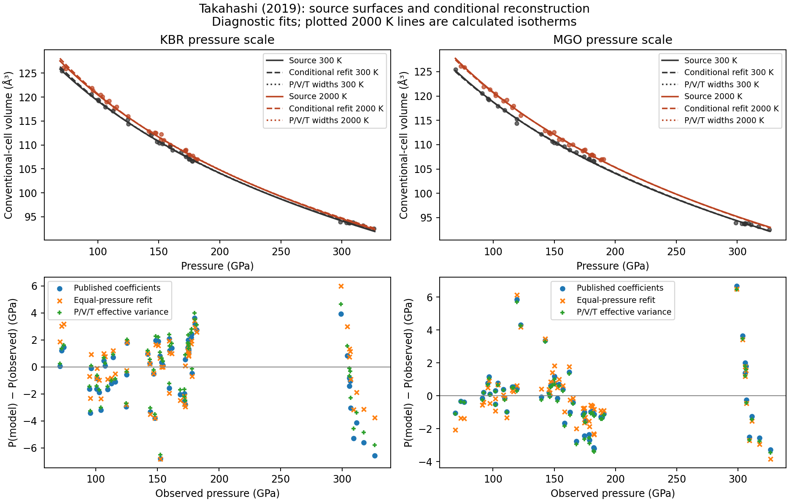

# Takahashi (2019) Fe3C: why the equal-weight audit missed coefficient parity

Investigated 30 October 2026. This is a scoped source investigation, with
diagnostic fits kept separate from published parameterizations and observations.

**The large coefficient mismatch is demonstrably sensitive to the audit's
equal-pressure objective. Both pressure-scale variants recover conditional
central-value parity using the reported coordinate-error widths, all 60 rows,
and the published EOS. For KBr, a standard effective-variance calculation also
recovers all five central values and all five reported error widths at printed
precision.** No source-data correction, recalibration, excluded state, extra
parameter, or replacement EOS is needed for that result.

For MgO, central values fall within their printed source widths, but the exact
printed values and uncertainties are not recovered. The original author code,
objective, coordinate-error covariance and confidence conventions remain
unavailable. The KBr agreement is strong numerical evidence for a compatible
protocol; it is not documentary recovery of that protocol.

The [complete numerical report](../data/takahashi-2019-parity.json) retains every
coefficient/error, covariance and correlation matrix, diagnostic selection,
solver outcome, row residual, source checksum and workbook inspection result.
The existing equal-pressure report remains a historical result for its stated
objective. Both current catalog assessments and audit-ledger entries are now
**parity** at `parameter_agreement` scope, using the coordinate-width replay.
Earlier equal-pressure entries are retained under
`previous_equal_pressure_reconstruction`. Published coefficients and source
arrays were not changed. This investigation does not add a replacement or
establish an experimental recommendation.

## Source authority and transcription

The authority is [Takahashi et al., Minerals 9, 744 (2019)](https://doi.org/10.3390/min9120744),
Section 3.2, Equations 1–6, Tables 1–2, Figures 2–3, and the
[official supplementary ZIP](https://mdpi-res.com/d_attachment/minerals/minerals-09-00744/article_deploy/minerals-09-00744-s001.zip).
The ZIP contains one XLSX, `minerals-630318-supplementary.xlsx`.
Its sole worksheet is Table S1. The recovered local files match the existing
source-manifest hashes; the numerical report records the actual bytes audited.

Direct inspection of the workbook's OOXML found no stored formulas or fitting
code. It identifies Microsoft Excel and modification on 29 November 2019,
without an author/fitting-method annotation. All preserved raw cell values and
number formats match the workbook. CSV central values, pressure/temperature
widths, Fe3C volume widths and calibrant volume widths also match. In particular,
P5 is stored as 121.3 but displayed with `0.00`; Q5 `(8)` means **0.08 ų**.
It is not 0.8 ų. Changing that error is unnecessary and would corrupt a correct
transcription.

There are 30 room-temperature and 30 heated states. Fifty rows have paired KBr
and MgO reductions; the last ten have shared pyrite-SiO2 pressures. These are
two reductions of the same observations. Each fit uses its own E/H pressure
column with K as fallback only for the ten SiO2 rows. Article Section 2.2 and
Figure 2 explicitly support this calibration mixture. KBr is Dewaele et al.
(2012), MgO is Kono et al. (2010), and pyrite-SiO2 is Kuwayama et al. (2011).
Their original marker volumes and errors are preserved. This audit does not
re-reduce pressures or establish exact calibrant-registry equivalence.

The 2600 K row is retained despite the prose's 2450 K maximum. Room-temperature
T widths remain missing; the P/V/T diagnostic holds those temperatures at 300 K
and only permits latent T adjustments for the 30 heated states. It does not
invent room-temperature temperature errors.

## Equations and normalization

Equation 1 is BM3 with conventional-cell volume. Equations 2–4 add
gamma/V times E(V,T)−E(V,300 K), with the Debye integral evaluated using the
same volume-dependent Debye temperature in both energy terms. Equations 5–6
give gamma=gamma0(V/V0)^q and theta=theta0 exp[(gamma0−gamma)/q].
The fixed theta0=314 K is explicitly identified in Table 2's footnote as adopted
from Litasov et al. The thermal reference is 300 K. The five fitted quantities
named in the text are V0, K0, K0′, gamma0 and q. Neither V0 nor K0′ is described
as fixed. The source does **not** explicitly specify simultaneous fitting:
the paragraph first describes a 300 K fit, then names five fitted quantities.
Fitting order is therefore an unresolved protocol detail. The earlier replay's
docstring asserting source-specified simultaneous fitting has been corrected.

Fe3C has four atoms per formula. The conventional cementite cell contains four
formulas (16 atoms). Z=4 is not an additional number printed in these six
equations; it is the crystallographic normalization needed to apply a
per-formula molar Debye energy to the tabulated conventional-cell volume. The
axes, tabulated densities and cell volumes independently support that basis.
With Z=4, V_molar[m³/mol]=V_cell[ų]×10⁻³⁰×N_A/4. In Peritheos's J/bar
volume convention, the conversion is N_A×10⁻²⁵/4. Alternatively, a per-cell
energy with n=16 and a per-cell molar volume is equivalent. Mixing n=4 with a
per-cell volume without dividing by Z is not equivalent.

The independent evaluator uses SI volumes and 32-point Gauss–Legendre
quadrature, without calling Peritheos for pressure or fitting. Adaptive SciPy
quadrature checks give agreement below 10⁻¹⁰ GPa. Native and Python Peritheos
pressures agree with the independent evaluator over every measured state to
below 8×10⁻¹³ GPa. No error was demonstrated in the BM3 sign, reference-energy
subtraction, Debye/gamma laws, atom normalization, or pressure-column fallback.

## Objectives and coefficient comparisons

The historical audit minimizes Σ[P_model(V_i,T_i)−P_i]². Independent direct
SciPy least squares reproduces it. Four physically distinct starts converge
to the same minimum; the largest native/direct difference is only 0.0034 GPa
in K0, negligible compared with the source discrepancy. Covariance below is
inverse-normal covariance multiplied by SSE/(60−5) for this equal-weight fit.

The effective-variance diagnostic uses the printed widths as independent
coordinate-error scales and repeatedly updates

\[
s_i^2=s_{P,i}^2+
  \left(\frac{\partial P}{\partial V}s_{V,i}\right)^2+
  \left(\frac{\partial P}{\partial T}s_{T,i}\right)^2.
\]

It solves weighted pressure least squares with these weights fixed during each
inner solve, then updates the derivatives until convergence. There is no
adjustable multiplier, error floor, covariance, or chosen weight exponent.
Unscaled inverse-normal errors below assume the widths are absolute errors;
this is a diagnostic assumption about their meaning, not a recovered source
confidence convention. The residual-scaled alternative is retained in JSON.

| KBr coefficient | Published | Equal-pressure replay ± residual-scaled error | Effective P/V/T variance ± unscaled error |
| --- | ---: | ---: | ---: |
| V0 (ų/cell) | 148.8 ± 1.0 | 152.0098 ± 2.2431 | 148.8328 ± 1.0221 |
| K0 (GPa) | 311.1 ± 17.1 | 266.3518 ± 26.9054 | 311.1479 ± 17.0811 |
| K0′ | 3.40 ± 0.10 | 3.65668 ± 0.14385 | 3.40440 ± 0.09867 |
| gamma0 | 1.06 ± 0.42 | 0.99463 ± 0.64559 | 1.05994 ± 0.41953 |
| q | 1.92 ± 1.73 | 1.49856 ± 2.20664 | 1.92209 ± 1.73481 |

**Every KBr central value and error rounds to the source's printed value.**
Residual scaling would instead give errors 0.7737, 12.9299, 0.07469, 0.31757,
1.31320: it does not reproduce the source widths. Thus the KBr result supports
both coordinate-error weighting and unscaled covariance as a compatible
explanation. It does not establish which software the authors used.

| MgO coefficient | Published | Equal-pressure replay ± residual-scaled error | Effective P/V/T variance ± unscaled error |
| --- | ---: | ---: | ---: |
| V0 (ų/cell) | 147.3 ± 1.0 | 145.7364 ± 1.2052 | 147.3608 ± 0.8118 |
| K0 (GPa) | 323 ± 16.6 | 350.9669 ± 20.9923 | 321.4874 ± 14.3477 |
| K0′ | 3.43 ± 0.09 | 3.28940 ± 0.09548 | 3.43809 ± 0.08587 |
| gamma0 | 1.37 ± 0.33 | 1.43920 ± 0.43184 | 1.36610 ± 0.29535 |
| q | 0.98 ± 1.01 | 1.32987 ± 1.18159 | 0.94042 ± 0.90851 |

All MgO central differences are within their source widths, but the printed
values and errors are not recovered exactly. The K0 difference is −1.5126 GPa
and its error is 14.3477 rather than 16.6 GPa. Source central-value parity does
not mean uncertainty reproduction. Residual scaling further changes those
errors to 0.5952, 10.5194, 0.06296, 0.21654 and 0.66610.

The dedicated parity criterion is unchanged: **every free central coefficient
must fall within its own printed source width**. It is a numerical screen,
not a formal statistical confidence test. Both weighted replays pass. Both
equal-pressure replays fail for V0/K0/K0′. Unknown source covariance cannot be
used to convert that statement into a statistical rejection of the publication.

An independent exact errors-in-variables calculation also fits latent V and
heated-state T, minimizing the sum of squared normalized P/V/T adjustments.
It gives KBr [148.8423, 310.6918, 3.40875, 1.06222, 1.87381] and MgO
[147.3266, 321.9400, 3.43713, 1.37340, 0.95601]. Both pass central-value
parity. Their different central values show that a specific first-order
weighting approximation matters even after the error inputs are specified.

## Curves, residuals and leverage

| Variant | Published pressure RMS | Equal-pressure RMS | Effective P/V/T RMS | Maximum source/equal-weight ΔV at observed P,T |
| --- | ---: | ---: | ---: | ---: |
| KBr | 2.4753 GPa | 2.2226 GPa | 2.3920 GPa | 0.4744 ų (0.375%) |
| MgO | 1.9654 GPa | 1.9064 GPa | 1.9810 GPa | 0.2381 ų (0.189%) |

RMS always means the unweighted descriptive pressure residual on the original
60 states, regardless of the fitting objective. Weighted fitting need not
minimize that number. The maximum source/effective-variance curve differences
at those states are only 0.7781 GPa / 0.06252 ų for KBr and 0.2012 GPa /
0.02558 ų for MgO. Source/equal-pressure pressure differences reach 2.8298
and 1.0398 GPa, respectively.

The equal-pressure Jacobian is poorly conditioned even after physical parameter
scaling: condition numbers are approximately 3558 (KBr) and 2469 (MgO).
Correlations V0/K0 are −0.9958/−0.9931; K0/K0′ are −0.9903/−0.9883;
gamma0/q are +0.9870/+0.9827. V0 and K0 are extrapolated far outside the
measured compressed volumes, not independent ambient measurements.
This permits substantial coefficient shifts with small changes of the sampled
surface. The coefficients' printed source widths are not a measure of the
curves' pointwise separation.

The ten high-pressure SiO2 rows have source-curve RMS residuals of 3.8548 GPa
(KBr) and 3.0356 GPa (MgO). Their pressure widths span 0.5–10.8 GPa;
paired-row widths span 0.1–5.8 GPa for KBr and 0.3–2.5 GPa for MgO.
Giving every row identical pressure weight discards this heterogeneity. This
and the correlated coefficients explain why equal-weight coefficients can move
so much while reproducing similar measured-state curves.



The comparison figure is generated at
`output/takahashi-2019-parity-2026-10-30/comparison.png` and copied above for
the standalone documentation.
Points retain their actual temperatures; 2000 K lines are calculated isotherms,
including extrapolation outside the measured heated-state coverage. They do
not imply observations at 2000 K and 300 GPa.

## Bounded alternative explanations

| Diagnostic hypothesis | KBr | MgO | What it establishes |
| --- | --- | --- | --- |
| Pressure widths alone | Central parity | K0′ misses its source width | Pressure-error heterogeneity matters, but is insufficient for both variants |
| Equal volume residuals | Fails parity | Central parity | Residual direction materially changes the minimum |
| Volume residuals / printed V widths | Central parity | Central parity | A second simple coordinate-error objective explains the large mismatch |
| Exact P/V and P/V/T coordinate fits | Central parity | Central parity | Result is not unique to effective-variance linearization |
| Omit 2600 K, equal pressure | Fails parity | Fails parity | This source/prose inconsistency does not explain the original mismatch |
| Omit 2600 K, effective P/V/T | Central parity; poorer exact rounding | Central parity, still not exact | No support for excluding this row to recover an author mask |
| Only paired 50 rows, equal pressure | Fails parity | Fails parity | Removing the high-pressure anchor changes the cold coefficients drastically |
| Three specified cold-then-hot fits | Fails full parity | Fails full parity | These particular sequential objectives do not recover the full source fit |

The sequential diagnostics use cold equal-pressure, cold equal-volume, or cold
pressure-width fits, followed by equal-pressure thermal fitting. They do not
rule out every possible sequential error model. The source fitting order
remains unknown. None of these masks is promoted as an author selection.

Twenty-four deterministic perturbation replays within tabulation rounding
intervals leave the equal-pressure KBr K0 at 265.73–266.84 GPa and MgO K0 at
350.27–351.53 GPa. That sampled precision effect is far too small to bridge
the original K0 differences. It is a sensitivity sample, not a proof bounding
every possible unrounded dataset. Published coefficients are themselves
rounded: a first-order worst-case sum of half-rounding effects reaches about
0.98/1.43 GPa in pressure for KBr/MgO. That limits claims of exact surface
equality based on printed coefficients.

## Source-equation checkpoints and remaining evidence gaps

At 329 GPa, 5000 K the published source equations give 12.83554 g/cm³ for KBr
and 12.64058 for MgO. The former agrees with Section 4's 12.83±0.67; the latter
agrees with the earlier manual Figure 3a reading 12.64 within its 0.04 g/cm³
graphical bound. The KBr 329 GPa/6000 K and 364 GPa/5000–6000 K calculations
give 12.80078, 13.22382 and 13.19128, respectively, within the printed broad
widths but not at exact printed central rounding. Figure 3's actual legend
assigns dotted curves to 5000 K and dashed curves to 300 K, contrary to the
caption's order; visual inspection confirms the heated branches have lower
density. These are extrapolated calculated source results, not measured core
states, coefficient recovery, or full-surface experimental validation.

No implementation or transcription defect was demonstrated. The previous
assumption that five parameters were explicitly stated to be fitted
simultaneously was unsupported. More consequentially, the equal-pressure
audit was a conditional reconstruction that ignored the supplied coordinate
widths. Its failure cannot support a claim that neither published variant can
reach numerical coefficient parity. Both can, and the KBr values and errors
are reproduced at printed precision with a simple, untuned standard method.

For exact MgO reproduction and documentary author-workflow reproduction, the
remaining inputs are specific: the original fit input arrays and included row
IDs at their original precision; pressure/volume/temperature covariance and
confidence meanings; whether effective variance, latent coordinates or another
defined objective was used; simultaneous/sequential parameter constraints;
the stopping settings; and the covariance/error scaling convention. The
original fitting project or code/output would resolve several together.
The official workbook has no such project or fit formulas. Targeted public
searches by title/DOI, coefficients and authors plus code/GitHub did not recover
author fitting code or an explanatory correction. MDPI's supplement landing
page was inaccessible through the browser tool; its official ZIP was already
available and inspected. No author outreach was performed.

## Reproduction and verification

Repository maintenance commands, using the existing development environment:

```bash
.venv/bin/python -m scripts.audit_takahashi_2019
.venv/bin/pytest -q -W error tests/test_takahashi_2019_audit.py
.venv/bin/ruff check scripts/audit_takahashi_2019.py tests/test_takahashi_2019_audit.py scripts/reproduce_cementite.py
```

The seven Takahashi-specific tests pass, including workbook values/precision, independent
quadrature and both Peritheos evaluation paths, inversion, and actual replay
of the coordinate-width parity result. A regression also requires KBr's five
central values and five unscaled errors to round to the source values, and
checks the live replay against both updated catalog assessments and ledger rows.
These are numerical/source checks, not experimental validation. No shared
fitting code or pressure reduction was changed. The follow-up updates only the
two Takahashi records' reproduction metadata and corresponding audit entries
and reports, with uncertainty and workflow qualifications retained. Nothing
was committed, pushed, released or deployed.
