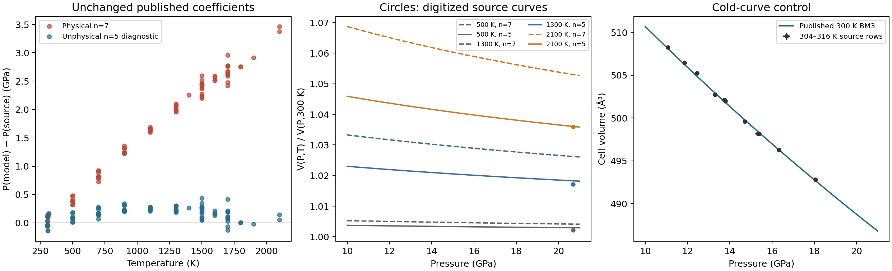

# Katsura (2009) wadsleyite: calibration versus thermal-model audit

Investigated and re-reviewed 30 October 2026. **Under the standard source-supported
MGD interpretation, the printed coefficients do not reproduce the hot observations
or Figure 2.** Changing the observations' pressure calibration alone cannot
reconcile the same interpreted parameterization with the paper's own curves on
their stated pressure axis. The original 2009 implementation has not been
recovered. An undocumented convention, coefficient/reporting problem, or another
unrecovered implementation detail remains possible; no particular author mistake
or original numerical atom count is established.

This completes the investigation of the available evidence. The original EOS,
all 85 observations, uncertainties and existing deferred recommendation hold
are preserved. No replacement/refit is registered. In particular, the
attractive **n=5 diagnostic is not a permissible Mg2SiO4 normalization** and
does not fully reproduce the source curves.

## Primary evidence and source checks

The authority is Katsura et al., *Geophysical Research Letters* **36**, L11307,
[doi:10.1029/2009GL038107](https://doi.org/10.1029/2009GL038107).
The final five-page article in the local Zotero library and the publisher's
full-text page were inspected. The Table 1 page and Figure 2 page were
rendered and visually reviewed. All **85 rows**, including every printed
pressure/volume error, were independently extracted from the final PDF and
compared with the existing CSV: **no mismatches**. The measured recovered-cell
V0=538.49(2) ų is the table's normalization. Near-ambient rows are at 304–316 K;
there are 11 such rows and 74 heated rows. Marginal coverage is 11.07–20.07 GPa
and 304–2100 K, not a rectangular stability domain.

The [source-check manifest](../data/wadsleyite-katsura-2009-source-checks.json)
retains PDF filenames/checksums, attachment keys, all original table tokens,
and the Figure 2 raster checksum, axis calibration and reading coordinates.
The original CSV SHA-256 remains
`b0fba67929425c9f1c4c51137453b8a114d754cfd6ecd31280ebe89671538310`.
Publisher PDFs and the extracted source raster stay outside the packaged
data; the numerical readings are attributed to the primary publication.

The short wadsleyite article delegates experimental and EOS methods to
[Katsura (2004) ringwoodite](https://doi.org/10.1029/2004JB003094), paragraphs
8–11 and 20, and the two 2009 companion studies. The final
[2009 forsterite paper](https://doi.org/10.1016/j.pepi.2008.08.002), journal
p. 89, Equations 3–6, was directly rendered and inspected for the thermal laws.
The publisher page and the author's publication/research pages were also
checked for corrections. The correction identified there concerns bridgmanite,
not this wadsleyite paper; no wadsleyite correction was located. This bounded
search does not establish the absence of private or unindexed corrections.

## Independent calculation and mapping tests

The source coefficients are unchanged: V0=538.49 ų/cell, K0=169.2 GPa,
K0′=4.1, theta0=814 K, gamma0=1.64, q=1.5 and Tr=300 K. Wadsleyite has
Z=8 Mg2SiO4 formula units per conventional cell and seven atoms per formula.
The independent calculation uses SI molar volumes, BM3 and

```text
gamma(x) = gamma0*x^q,                        x = V/V0
theta(x) = theta0*exp[(gamma0-gamma(x))/q]
E(theta,T) = 9*n*R*T*(T/theta)^3 * integral[0,theta/T] u^3/(exp(u)-1) du
P(V,T) = P_BM3(V,300) + gamma(x)*(E(theta,T)-E(theta,300))/Vm
Vm = V_cell * 1e-30 * N_A / Z                [m³/mol formula units]
```

Pressure is converted from Pa to GPa. Ninety-six-point Gauss–Legendre
quadrature is checked against independent adaptive integration. The independent
SI result agrees with the library's native pressure evaluator and its Python
thermal path to better than **2.2×10⁻¹⁰ GPa** over all rows. Using 56 atoms per
mole of whole cells with the corresponding whole-cell molar volume gives the
same pressure as seven atoms per formula unit. There is no missing factor of
eight in the library's cell conversion. Zero-point energy cancels at fixed
volume under the 300 K subtraction.

| Evaluation of unchanged source coefficients | Pressure RMS on all 85 rows (GPa) | Interpretation |
|---|---:|---|
| Physical n=7, integrated gamma–theta law | 1.894432 | Standard consistent mapping; reproduces the existing discrepancy |
| Physical n=7, direct variable-exponent theta law | 1.898266 | This alternate Debye law does not explain the discrepancy |
| Physical n=7, Tr=298 K sensitivity | 1.902232 | A 2 K reference shift does not explain it |
| Physical n=7, cold-reference gamma notation | 1.561824 | Source-notation sensitivity remains far from agreement |
| **Unphysical n=5**, integrated law | 0.198701 | Normalization diagnostic only; not a correction or accepted model |

The cited forsterite Equation 4 writes gamma using V(P,300), while the
temperature law refers to gamma(V). To test this ambiguity, the
"cold-reference" row evaluates gamma and theta at the BM3 volume at the same
pressure and solves the resulting **implicit pressure equation**; its thermal
denominator remains the actual molar volume. This is a separately identified
interpretation, not a new adopted EOS. It does not remove the discrepancy.

Residuals mean P(model) minus the printed source pressure. For physical n=7,
all **74 heated residuals are positive**, ranging from +0.320 to +3.464 GPa;
their RMS is 2.030 GPa. The 11 near-ambient rows instead have RMS 0.0983 GPa.
Treating those near-ambient rows as the reported room-temperature cold stage,
with V0 and K0 fixed, gives **K0′=4.10756**, inside the printed 4.1(1).
Retaining their actual 304–316 K temperatures with the published thermal model
gives 4.04770. This supports the cold convention and localizes the large
disagreement to the thermal contribution; it does not independently validate
the pressure standard.

At unchanged source coefficients, a least-squares projection onto one thermal
amplitude factor gives 0.690602, equivalent numerically to n=4.83421. This
quantifies a normalization-like signature. It is **not** a recovered atom count,
author setting, parameter uncertainty or recommended replacement. The fixed
n=5 check is motivated by that signature and the same source family's prior
[ringwoodite normalization diagnostic](../literature-reproductions.md#ringwoodite-katsura-2004);
neither is silently installed in the catalog.

## A calibration-independent source-output check

Figure 2 presents **calculated thermal curves**, not additional measured
observations. Nine source-curve readings, 500–2100 K, were taken at one clean
raster column corresponding to P≈20.694 GPa, avoiding symbols and labels.
Axis calibration, line centers and a conservative **±0.0003** reading bound in
V(P,T)/V(P,300) are retained in the manifest. This bound includes graphical
precision; it is not a statistical measurement error. These nine readings
share the same graphical calibration and are not nine independent experiments.

At 2100 K, the source curve gives **1.03591**, whereas the consistent n=7
parameterization gives **1.05303** at the same pressure. The difference,
0.01712 in the ratio, is more than 50 times the reading bound. The n=5
diagnostic gives 1.03605 there, but its maximum disagreement across the nine
readings is **0.001223**, still above the graphical bound. It therefore does
not reproduce the complete source calculation.

The paper also gives an approximate mean ambient expansivity between 293 and
973 K of **2.7×10⁻⁵ K⁻¹**, associated with its separate high-temperature
Birch–Murnaghan fit. Integrating the physical n=7 MGD surface gives
4.047×10⁻⁵ K⁻¹; n=5 gives 2.824×10⁻⁵ K⁻¹. **This cross-model comparison is
not a decisive MGD benchmark:** HTBM and MGD need not agree exactly when
extrapolated to ambient pressure. The whole-paper re-review strengthens this
qualification; these numbers do not independently establish an MGD reporting
error and are not needed for the Table 1/Figure 2 finding.

The Figure 2 curve check does not recalibrate an experimental pressure column.
Thus a calibrant change alone does not reconcile the interpreted EOS with those
curves on their stated axes. An additional experimental pressure-reduction
problem remains possible, but is not established.



## What is known about calibration and original fitting

The 2009 text inherits its experimental procedure from the 2004 study, whose
paragraph 11 explicitly uses **MgO with Matsui, Parker and Leslie (2000)**,
[doi:10.2138/am-2000-2-308](https://doi.org/10.2138/am-2000-2-308), at the
thermocouple temperature. The cited 2009 forsterite method independently
corroborates this reduction. This is inherited-method evidence, not an explicit
calibration statement in the short wadsleyite article or recovery of its code.
No paired measured MgO cells, raw calibrant diffraction, detailed reducer
settings or source run identities were recovered. **No observation-level
pressure recalculation is performed.** Inverting a calibrant EOS from the
printed pressure would reconstruct its output, not recover a measurement.

Paragraphs 5 and 9 also explicitly identify **Inoue (2004) ambient-pressure
expansion data** as joint thermal-fit inputs,
[doi:10.1016/j.pepi.2003.07.021](https://doi.org/10.1016/j.pepi.2003.07.021).
Those numerical input rows, their normalization and relative weighting were
not recovered. The publisher preview was accessible, its full-text route
returned 403, the local Zotero title search found no matching item, and
OpenAlex listed no open full-text location. Targeted title/DOI and author-site
searches did not locate a usable numerical deposit. This records the access
limits, not a claim that the observations never existed. The missing rows are
not synthesized from a reported expansion coefficient.

Consequently the old generic 85-row errors-in-variables comparison is not a
replay of the authors' complete fit. The new all-85 equal-pressure diagnostic,
fixing the printed cold coefficients, theta0 and n=7, gives gamma0=1.17083,
q=2.14370 and RMS 0.13887 GPa; the heated-74 subset gives similar values.
These are conditional high-pressure-only diagnostics, not source-workflow
parity. Their local RSS/dof-scaled covariance is in the numerical report and
omits calibration, fixed-input, predictor and shared-data covariance. Source
parameter confidence and exact weights remain unspecified. The old comparison
is preserved; different constraints and objectives explain why its diagnostic
coefficients differ from these new ones.

## Disposition and reproducibility

**Completed investigation; original published EOS still not reproduced.**
Keep the existing deferred catalog hold and source coefficients unchanged.
The evidence narrows the issue to source thermal-model/normalization consistency,
rather than a native/Python implementation difference, ordinary volume-basis
conversion, the tested Debye-law ambiguity, or a small reference-temperature
shift. It does not recover the authors' complete historical calculation or
identify a particular erroneous or undocumented step.
No additional fitting or replacement-model construction is needed to complete
this finding.

Reopening requires an authoritative pressure/thermal calculator or saved
fit project specifying atom/mole normalization, reference subtraction,
gamma/theta volume arguments, coefficient precision and the Figure 2 calculation.
The exact Inoue joint inputs and regression objective/weights are needed for
full fit replay. Measured MgO cells and the actual reducer would allow the
separate calibration test.

**Contact status (reported 1 November 2026):** Clemens reports that he sent
the email to Tomoo Katsura; a reply is awaited. The exact message text and
attachments sent are not recorded here. The investigation remains complete
pending new evidence, with the existing scientific disposition unchanged.

The [full numerical report](../data/wadsleyite-katsura-2009-audit.json) includes
every row residual, diagnostic constraint/objective, conditional covariance,
source-output reading and implementation comparison. Repository maintenance:

```sh
python -m scripts.audit_katsura_2009_wadsleyite
python -m scripts.audit_katsura_2009_wadsleyite --source-pdf /path/to/final-article.pdf
python -m scripts.audit_katsura_2009_wadsleyite --write \
  --plot docs/literature-reproductions/figures/wadsleyite-katsura-2009-audit.png
pytest tests/test_katsura_2009_wadsleyite_audit.py -q -W error
```

Numerical replay uses bundled factual source tokens/readings. The optional PDF
check requires Poppler and the exact source PDF. These are checkout maintenance
tools, not installed-package APIs. Tests cover source preservation, independent
Debye quadrature, the classical limit, reference subtraction, consistent
formula/cell scaling, native/Python agreement, cold-stage recovery and the
independent source-curve discrepancy. Passing them establishes those checks,
not physical validation of a pressure standard.

## Whole-paper re-review before author contact

All five pages of the final article were rendered and read again, including
the abstract, methods, full Table 1, figures/captions, discussion, geophysical
calculation and references. The following distinctions are essential:

| Input or result | Verified value / source | Role in this calculation |
|---|---|---|
| theta0 | 814 K, fixed; abstract and paragraph 5 | Correct MGD input |
| gamma0 | 1.64(2); abstract and paragraph 9 | Correct printed MGD input |
| q | 1.5(1); abstract and paragraph 9 | Correct printed MGD input |
| V0 | 538.49(2) ų; paragraph 6 | Recovered-sample cell volume used to normalize Table 1 |
| KT0 | 169.2(9) GPa; paragraph 8 | Fixed isothermal input; not the separately quoted KS0=170.9(9) GPa |
| KT0′ | 4.1(1); paragraph 8 | Cold-stage fit input |
| n=7 and Z=8 | Chemical atom count and conventional-cell contents | Physically consistent conversion; the short article does not explicitly print the numeric n used in the authors' program |
| 300 K thermal subtraction | Explicit in the cited 2009 forsterite methods, Equations 3–6 | Source-supported convention, not recovery of the original wadsleyite program |
| alpha(T), dKT/dT and deltaT | Separate HTBM/Anderson–Grüneisen results | Not extra coefficients to insert into the MGD equation; not mandatory exact MGD benchmarks |

There is no transcription change to theta0, gamma0 or q between the abstract
and the main text. Both use the values already evaluated. The Table 1
temperatures are explicitly kelvin; the normalized sample volumes are not
molar, atomic or zero-kelvin reference volumes. The traces of water described
in paragraph 7 are explicitly neglected by the authors, not a changed sample
composition adopted in this calculation.

The equations selected from the cited forsterite method include the 300 K
energy subtraction, power-law gamma and integrated theta law. Its V(P,300)
notation ambiguity was already tested separately above. Exact numerical
agreement between our two implementations cannot by itself settle that
historical source-mapping question.

### Check against a separately deposited author implementation

The publicly deposited **2022** MATLAB program
[`Katsura Geotherm calculation v2.m`](https://doi.org/10.5281/zenodo.5903286),
version 1.1.0, contains `MGD_EOS_RJ`, `ThermalEnergy` and `BM3`. Its phase
arrays explicitly set wadsleyite n=7, Z=8 and theta0=814 K, and its pressure
routine uses the same actual-volume gamma, integrated theta, molar-volume
division and 300 K energy subtraction as our standard calculation.

The pressure/energy routines were **translated literally into Python**,
including their polynomial Debye approximation and R=8.314472. The full MATLAB
program was not executed. Supplying the **2009 coefficients**, rather than the
different fit vector stored in the 2022 program, gives **1.894446 GPa RMS** on
the 85 original rows. Its maximum pressure difference from this audit's exact
Debye quadrature is **0.000107 GPa**, including the gas-constant difference.
The comparison uses the pinned source-file
checksum and reads the polynomial coefficients directly from that file.

This is independent support for the standard equation mapping and rules out
the Debye quadrature/approximation as the multi-GPa cause under these inputs.
**It is not the 2009 Figure 2 code and does not establish the 2009 author
workflow or numeric atom normalization.** The later paper also revises
temperatures, pressure calibration and fitted parameters; those later results
are not substituted into the 2009 record.

### Worked state and independent Figure 2 normalization

For Table 1 row 82 (2100 K, 20.07 GPa, V/V0=0.9399), a fresh direct adaptive
integration gives:

| Quantity | Value |
|---|---:|
| Measured cell volume | 506.126751 ų |
| Molar volume per Mg2SiO4 formula unit | 38.09958 cm³/mol |
| gamma at this volume | 1.494398 |
| theta at this volume | 896.975 K |
| Cold BM3 pressure | 11.90979 GPa |
| Standard n=7 thermal increment | 11.62402 GPa |
| Total model pressure | 23.53380 GPa |
| Thermal increment needed to equal the printed row | 8.16021 GPa |

Direct adaptive integration of all 85 rows agrees with the Gauss–Legendre
calculation within 1.3×10⁻¹³ GPa. Varying V0, K0, K0′, gamma0 and q by each
reported error width at the 32 corners of that parameter box gives 23.215–23.855
GPa at this worked state. This is a corner sensitivity, not a rigorous interval
bound or confidence interval; it shows that these simple printed-width changes
do not reproduce 20.07 GPa in the evaluated cases.

As a check on the plotted quantity, the two original 2100 K sample volumes,
divided by the published cold BM3 volume at their 20.07 GPa pressure, give
**1.035808 and 1.036248**. These lie where the two open circles appear in
Figure 2. This check does not use the MGD thermal model and supports our
interpretation of the figure's volume normalization and temperature labels.

The detailed re-review evidence is retained in
`output/wadsleyite-katsura-2009-audit-2026-10-30/whole-paper-review.json`.
The supported author question remains: **which exact evaluation prescription
and inputs generated the 2009 Figure 2 curves?** The result is a reproducible
failure to recover that calculation under the checked conventions, not a
100% claim that the publication or a particular parameter is wrong.
