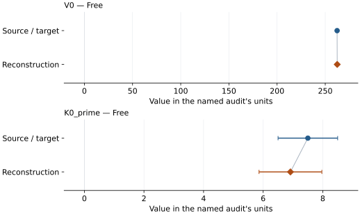
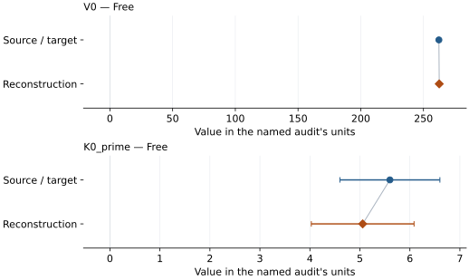
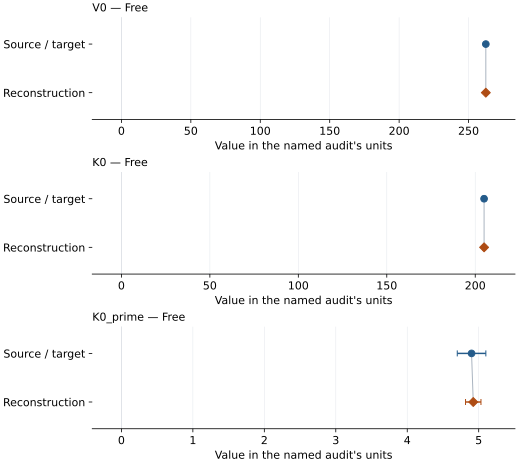
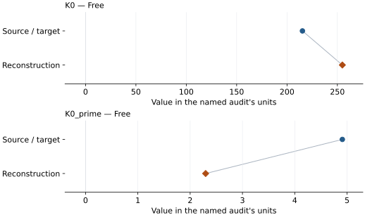
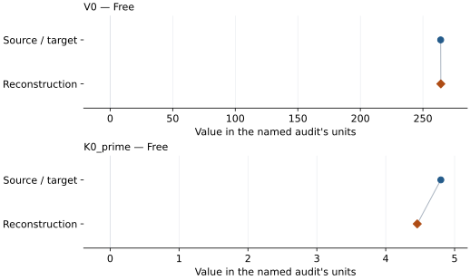
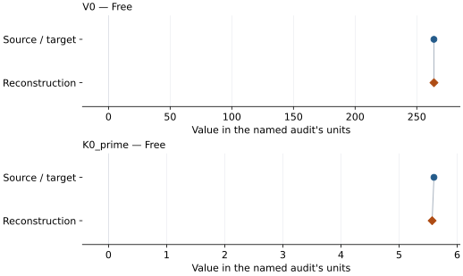
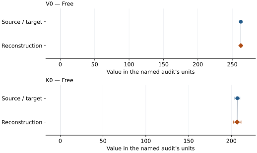

# Akimotoite: EOS reconstruction reports

<!-- Generated by scripts.generate_reconstruction_reports; edit EOSMAT instead. -->

[All reconstruction reports](index.md) · [Material and EOS parameters](../material-summaries/akimotoite.md)

These reports explain the assessments already stored in EOSMAT. Generating
this page does not refit observations, change classifications or replace source coefficients.

Use [scientific label definitions](../eos-labels.md) to distinguish coefficient
agreement, source verification, author-workflow reproduction and recommendation for use.

| EOS record | Recorded outcome | Coefficient comparison |
| --- | --- | --- |
| [Karki and Wentzcovitch (2002), static LDA BM4](#record-akimotoite_karki_2002_static_bm4_1) | Complete independent refit unavailable | No numeric coefficient pair recorded |
| [Karki and Wentzcovitch (2002), 300 K QHA BM4](#record-akimotoite_karki_2002_300k_bm4_2) | Complete independent refit unavailable | No numeric coefficient pair recorded |
| [Karki and Wentzcovitch (2002), 1000 K QHA BM4](#record-akimotoite_karki_2002_1000k_bm4_3) | Complete independent refit unavailable | No numeric coefficient pair recorded |
| [Karki and Wentzcovitch (2002), 2000 K QHA BM4](#record-akimotoite_karki_2002_2000k_bm4_4) | Complete independent refit unavailable | No numeric coefficient pair recorded |
| [Reynard et al. (1996), BM3, ruby pressure scale](#record-akimotoite_reynard_1996_bm3_ruby_2) | Coefficient parity achieved | Graph and table |
| [Reynard et al. (1996), preferred BM3, ice-VII pressure scale](#record-akimotoite_reynard_1996_bm3_ice_vii_3) | Coefficient parity achieved | Graph and table |
| [Siersch et al. (2021), BM3](#record-akimotoite_siersch_2021_bm3_1) | Coefficient parity achieved | Graph and table |
| [Dorogokupets et al. (2015), 298 K generalized Rydberg-Stacey](#record-akimotoite_dorogokupets_2015_298k_rydberg_stacey) | Parity not achieved for this comparison | Graph and table |
| [Wang et al. (2004), T0133 Au-scale BM3](#record-akimotoite_wang_2004_t0133_bm3) | Numerically similar, with qualifications | Graph and table |
| [Wang et al. (2004), preferred T0150 NaCl-scale BM3](#record-akimotoite_wang_2004_t0150_bm3) | Numerically similar, with qualifications | Graph and table |
| [Zhou et al. (2014), 300 K isothermal BM3](#record-akimotoite_zhou_2014_300k_bm3) | Numerically similar, with qualifications | Graph and table |

## Karki and Wentzcovitch (2002), static LDA BM4

Record: `akimotoite_karki_2002_static_bm4_1` · Model: `BM4`

**Outcome: Complete independent refit unavailable.**

**Scope:** Comparison with the source parameterization.
**Comparison basis:** Complete BM4 coefficients are tabulated, but the underlying free-energy-volume grid is shown only graphically and is not deposited.

[Stored EOS coefficients and source](../material-summaries/akimotoite.md#record-akimotoite_karki_2002_static_bm4_1)

### What this result establishes

**Separate source-review status:** primary\_source\_validated.
**Usage recommendation:** See the stored EOS qualifications; no recommendation is inferred here.

- This named numerical assessment alone does not establish author-workflow reproduction, physical accuracy or recommendation for use.
- No reconstructed coefficient table is recorded for this assessment; no missing values have been inferred.

### Data and reconstruction method

- **Dataset identifiers:** None declared
- **Fixed parameters:** None declared

Unspecified selections, weights, fixed values or error conventions remain unknown; they have not been inferred for this report.

### Why no coefficient graph is shown

No numeric source/reconstruction pair is recorded for this assessment. A graph would require information that is not available here; no values or observations have been invented.

### Detailed evidence and existing plots

- [Record-by-record numerical ledger](../primary-eos-refits.md#records).
- [Source-audit reports](../source-audits.md).

Observation curves and residual plots are provided by the supporting reports where available. Their absence is not filled by a reconstructed curve presented as measured data.

[Machine-readable comparison ledger](https://github.com/CPrescher/peritheos/blob/main/docs/data/primary-eos-refits.json) — look up `akimotoite_karki_2002_static_bm4_1`.
[Complete native EOSMAT file](https://github.com/CPrescher/peritheos/blob/main/peritheos/data/materials/akimotoite.eosmat).

## Karki and Wentzcovitch (2002), 300 K QHA BM4

Record: `akimotoite_karki_2002_300k_bm4_2` · Model: `BM4`

**Outcome: Complete independent refit unavailable.**

**Scope:** Comparison with the source parameterization.
**Comparison basis:** The fitted coefficients and curve are published, but the numerical free-energy-volume grid is unavailable.

[Stored EOS coefficients and source](../material-summaries/akimotoite.md#record-akimotoite_karki_2002_300k_bm4_2)

### What this result establishes

**Separate source-review status:** primary\_source\_validated.
**Usage recommendation:** See the stored EOS qualifications; no recommendation is inferred here.

- This named numerical assessment alone does not establish author-workflow reproduction, physical accuracy or recommendation for use.
- No reconstructed coefficient table is recorded for this assessment; no missing values have been inferred.

### Data and reconstruction method

- **Dataset identifiers:** None declared
- **Fixed parameters:** None declared

Unspecified selections, weights, fixed values or error conventions remain unknown; they have not been inferred for this report.

### Why no coefficient graph is shown

No numeric source/reconstruction pair is recorded for this assessment. A graph would require information that is not available here; no values or observations have been invented.

### Detailed evidence and existing plots

- [Record-by-record numerical ledger](../primary-eos-refits.md#records).
- [Source-audit reports](../source-audits.md).

Observation curves and residual plots are provided by the supporting reports where available. Their absence is not filled by a reconstructed curve presented as measured data.

[Machine-readable comparison ledger](https://github.com/CPrescher/peritheos/blob/main/docs/data/primary-eos-refits.json) — look up `akimotoite_karki_2002_300k_bm4_2`.
[Complete native EOSMAT file](https://github.com/CPrescher/peritheos/blob/main/peritheos/data/materials/akimotoite.eosmat).

## Karki and Wentzcovitch (2002), 1000 K QHA BM4

Record: `akimotoite_karki_2002_1000k_bm4_3` · Model: `BM4`

**Outcome: Complete independent refit unavailable.**

**Scope:** Comparison with the source parameterization.
**Comparison basis:** The fitted coefficients and plotted curve are published, but the numerical free-energy-volume grid is unavailable.

[Stored EOS coefficients and source](../material-summaries/akimotoite.md#record-akimotoite_karki_2002_1000k_bm4_3)

### What this result establishes

**Separate source-review status:** primary\_source\_validated.
**Usage recommendation:** See the stored EOS qualifications; no recommendation is inferred here.

- This named numerical assessment alone does not establish author-workflow reproduction, physical accuracy or recommendation for use.
- No reconstructed coefficient table is recorded for this assessment; no missing values have been inferred.

### Data and reconstruction method

- **Dataset identifiers:** None declared
- **Fixed parameters:** None declared

Unspecified selections, weights, fixed values or error conventions remain unknown; they have not been inferred for this report.

### Why no coefficient graph is shown

No numeric source/reconstruction pair is recorded for this assessment. A graph would require information that is not available here; no values or observations have been invented.

### Detailed evidence and existing plots

- [Record-by-record numerical ledger](../primary-eos-refits.md#records).
- [Source-audit reports](../source-audits.md).

Observation curves and residual plots are provided by the supporting reports where available. Their absence is not filled by a reconstructed curve presented as measured data.

[Machine-readable comparison ledger](https://github.com/CPrescher/peritheos/blob/main/docs/data/primary-eos-refits.json) — look up `akimotoite_karki_2002_1000k_bm4_3`.
[Complete native EOSMAT file](https://github.com/CPrescher/peritheos/blob/main/peritheos/data/materials/akimotoite.eosmat).

## Karki and Wentzcovitch (2002), 2000 K QHA BM4

Record: `akimotoite_karki_2002_2000k_bm4_4` · Model: `BM4`

**Outcome: Complete independent refit unavailable.**

**Scope:** Comparison with the source parameterization.
**Comparison basis:** The fitted coefficients and plotted curve are published, but the numerical free-energy-volume grid is unavailable.

[Stored EOS coefficients and source](../material-summaries/akimotoite.md#record-akimotoite_karki_2002_2000k_bm4_4)

### What this result establishes

**Separate source-review status:** primary\_source\_validated.
**Usage recommendation:** See the stored EOS qualifications; no recommendation is inferred here.

- This named numerical assessment alone does not establish author-workflow reproduction, physical accuracy or recommendation for use.
- No reconstructed coefficient table is recorded for this assessment; no missing values have been inferred.

### Data and reconstruction method

- **Dataset identifiers:** None declared
- **Fixed parameters:** None declared

Unspecified selections, weights, fixed values or error conventions remain unknown; they have not been inferred for this report.

### Why no coefficient graph is shown

No numeric source/reconstruction pair is recorded for this assessment. A graph would require information that is not available here; no values or observations have been invented.

### Detailed evidence and existing plots

- [Record-by-record numerical ledger](../primary-eos-refits.md#records).
- [Source-audit reports](../source-audits.md).

Observation curves and residual plots are provided by the supporting reports where available. Their absence is not filled by a reconstructed curve presented as measured data.

[Machine-readable comparison ledger](https://github.com/CPrescher/peritheos/blob/main/docs/data/primary-eos-refits.json) — look up `akimotoite_karki_2002_2000k_bm4_4`.
[Complete native EOSMAT file](https://github.com/CPrescher/peritheos/blob/main/peritheos/data/materials/akimotoite.eosmat).

## Reynard et al. (1996), BM3, ruby pressure scale

Record: `akimotoite_reynard_1996_bm3_ruby_2` · Model: `BM3`

**Outcome: Coefficient parity achieved.**

**Scope:** Comparison with the source parameterization.
**Comparison basis:** Every compared free coefficient meets both the recorded combined-two-sigma comparison and parameter-specific numerical similarity screen. Error conventions and fit qualifications remain applicable.

[Stored EOS coefficients and source](../material-summaries/akimotoite.md#record-akimotoite_reynard_1996_bm3_ruby_2)

### What this result establishes

**Separate source-review status:** primary\_source\_validated.
**Usage recommendation:** See the stored EOS qualifications; no recommendation is inferred here.

- Direct Table 1 reproduction of the ruby-pressure fit with K0 fixed at the source-adopted 212 GPa. The source says its parameter uncertainties account for pressure and volume errors, but it does not publish the exact objective or covariance. Ruby brackets are fluorescence-line-width estimates rather than stated one-sigma errors and are absent at the two ambient anchors, so the reproducible Peritheos fit uses all 16 rows, unweighted pressure residuals, and the reported one-sigma volume errors.
- This named numerical assessment alone does not establish author-workflow reproduction, physical accuracy or recommendation for use.

### Data and reconstruction method

- **Dataset identifiers:** akimotoite\_reynard\_1996\_table1\_compression
- **Observations:** 16
- **Fit kind:** isothermal\_pv
- **Selection:** all rows
- **Objective:** errors\_in\_variables
- **Absolute sigma:** True
- **Free parameters:** V0; K0\_prime
- **Fixed parameters:** K0

Unspecified selections, weights, fixed values or error conventions remain unknown; they have not been inferred for this report.

### Source versus reconstruction

This is a **coefficient comparison**, not an observation or residual plot.
Each panel uses its coefficient's audit units and includes zero. Markers show
stored central values only. Error widths are retained in the table below;
no confidence interval or uncertainty band is inferred. Fixed/adopted values are constraints.

| Parameter | Source / target | Source error | Reconstruction | Reconstruction error | Fit role |
| --- | --- | --- | --- | --- | --- |
| V0 | 262.3 | 0.4 | 262.4214204039353 | 0.4489783454543883 | Free |
| K0\_prime | 7.5 | 1.0 | 6.9155114755402725 | 1.0539104640910595 | Free |

Values and reported errors are copied without rounding or conversion from the named audit. Missing errors mean unknown, not zero. Parameter names and volume conventions follow that audit; error widths do not imply a confidence convention.

Recorded diagnostics, covariance and additional protocol

- **Columns:**
    - **Pressure:** ruby\_pressure\_gpa
    - **Temperature:** Not specified
    - **Volume:** unit\_cell\_volume\_a3
- **Observed pressure range gpa:** \[0.0, 27.8\]
- **Observed temperature range k:** Not specified
- **Observed volume range:** \[239.13, 262.45\]
- **Degrees of freedom:** 14
- **Solver success:** True
- **Solver message:** \`ftol\` termination condition is satisfied.
- **Rmse gpa:** 0.37775121285160607
- **Published rmse gpa:** 0.6335359430776666
- **Reduced chi square:** 0.2579036675887712

### Detailed evidence and existing plots

- [Record-by-record numerical ledger](../primary-eos-refits.md#records).
- [Source-audit reports](../source-audits.md).

Observation curves and residual plots are provided by the supporting reports where available. Their absence is not filled by a reconstructed curve presented as measured data.

[Machine-readable comparison ledger](https://github.com/CPrescher/peritheos/blob/main/docs/data/primary-eos-refits.json) — look up `akimotoite_reynard_1996_bm3_ruby_2`.
[Complete native EOSMAT file](https://github.com/CPrescher/peritheos/blob/main/peritheos/data/materials/akimotoite.eosmat).

## Reynard et al. (1996), preferred BM3, ice-VII pressure scale

Record: `akimotoite_reynard_1996_bm3_ice_vii_3` · Model: `BM3`

**Outcome: Coefficient parity achieved.**

**Scope:** Comparison with the source parameterization.
**Comparison basis:** Every compared free coefficient meets both the recorded combined-two-sigma comparison and parameter-specific numerical similarity screen. Error conventions and fit qualifications remain applicable.

[Stored EOS coefficients and source](../material-summaries/akimotoite.md#record-akimotoite_reynard_1996_bm3_ice_vii_3)

### What this result establishes

**Separate source-review status:** primary\_source\_validated.
**Usage recommendation:** See the stored EOS qualifications; no recommendation is inferred here.

- Direct Table 1 reproduction of the authors' preferred ice-VII-pressure fit with K0 fixed at the source-adopted 212 GPa. Table 1 prints 12 finite-pressure Pi values and Figure 3f supplies two zero-pressure ambient anchors. The source does not publish its exact objective or covariance; ice-pressure brackets are maximum-gradient estimates rather than stated one-sigma errors and are absent at the two ambient anchors, so the reproducible Peritheos fit uses unweighted pressure residuals and the reported one-sigma volume errors.
- This named numerical assessment alone does not establish author-workflow reproduction, physical accuracy or recommendation for use.

### Data and reconstruction method

- **Dataset identifiers:** akimotoite\_reynard\_1996\_table1\_compression
- **Observations:** 14
- **Fit kind:** isothermal\_pv
- **Selection:** all rows
- **Objective:** errors\_in\_variables
- **Absolute sigma:** True
- **Free parameters:** V0; K0\_prime
- **Fixed parameters:** K0

Unspecified selections, weights, fixed values or error conventions remain unknown; they have not been inferred for this report.

### Source versus reconstruction

This is a **coefficient comparison**, not an observation or residual plot.
Each panel uses its coefficient's audit units and includes zero. Markers show
stored central values only. Error widths are retained in the table below;
no confidence interval or uncertainty band is inferred. Fixed/adopted values are constraints.

| Parameter | Source / target | Source error | Reconstruction | Reconstruction error | Fit role |
| --- | --- | --- | --- | --- | --- |
| V0 | 262.3 | 0.4 | 262.5800918920929 | 0.5173624514301168 | Free |
| K0\_prime | 5.6 | 1.0 | 5.055863026030038 | 1.02741367446667 | Free |

Values and reported errors are copied without rounding or conversion from the named audit. Missing errors mean unknown, not zero. Parameter names and volume conventions follow that audit; error widths do not imply a confidence convention.

Recorded diagnostics, covariance and additional protocol

- **Columns:**
    - **Pressure:** ice\_vii\_pressure\_gpa
    - **Temperature:** Not specified
    - **Volume:** unit\_cell\_volume\_a3
- **Observed pressure range gpa:** \[0.0, 25.2\]
- **Observed temperature range k:** Not specified
- **Observed volume range:** \[239.13, 262.45\]
- **Degrees of freedom:** 12
- **Solver success:** True
- **Solver message:** \`ftol\` termination condition is satisfied.
- **Rmse gpa:** 0.35695092387892463
- **Published rmse gpa:** 0.7487276925948315
- **Reduced chi square:** 0.2845940744839172

### Detailed evidence and existing plots

- [Record-by-record numerical ledger](../primary-eos-refits.md#records).
- [Source-audit reports](../source-audits.md).

Observation curves and residual plots are provided by the supporting reports where available. Their absence is not filled by a reconstructed curve presented as measured data.

[Machine-readable comparison ledger](https://github.com/CPrescher/peritheos/blob/main/docs/data/primary-eos-refits.json) — look up `akimotoite_reynard_1996_bm3_ice_vii_3`.
[Complete native EOSMAT file](https://github.com/CPrescher/peritheos/blob/main/peritheos/data/materials/akimotoite.eosmat).

## Siersch et al. (2021), BM3

Record: `akimotoite_siersch_2021_bm3_1` · Model: `BM3`

**Outcome: Coefficient parity achieved.**

**Scope:** Comparison with the source parameterization.
**Comparison basis:** Every compared free coefficient meets both the recorded combined-two-sigma comparison and parameter-specific numerical similarity screen. Error conventions and fit qualifications remain applicable.

[Stored EOS coefficients and source](../material-summaries/akimotoite.md#record-akimotoite_siersch_2021_bm3_1)

### What this result establishes

**Separate source-review status:** primary\_source\_validated.
**Usage recommendation:** See the stored EOS qualifications; no recommendation is inferred here.

- This named numerical assessment alone does not establish author-workflow reproduction, physical accuracy or recommendation for use.

### Data and reconstruction method

- **Dataset identifiers:** akimotoite\_siersch\_2021\_table2\_compression
- **Observations:** 54
- **Fit kind:** isothermal\_pv
- **Selection:** all rows
- **Objective:** errors\_in\_variables
- **Absolute sigma:** True
- **Free parameters:** V0; K0; K0\_prime
- **Fixed parameters:** None declared

Unspecified selections, weights, fixed values or error conventions remain unknown; they have not been inferred for this report.

### Source versus reconstruction

This is a **coefficient comparison**, not an observation or residual plot.
Each panel uses its coefficient's audit units and includes zero. Markers show
stored central values only. Error widths are retained in the table below;
no confidence interval or uncertainty band is inferred. Fixed/adopted values are constraints.

| Parameter | Source / target | Source error | Reconstruction | Reconstruction error | Fit role |
| --- | --- | --- | --- | --- | --- |
| V0 | 262.43 | 0.02 | 262.4259132876488 | 0.015020694953473327 | Free |
| K0 | 205.0 | 1.0 | 205.00895738531347 | 0.8758535920577113 | Free |
| K0\_prime | 4.9 | 0.2 | 4.923631578425784 | 0.1080137074338277 | Free |

Values and reported errors are copied without rounding or conversion from the named audit. Missing errors mean unknown, not zero. Parameter names and volume conventions follow that audit; error widths do not imply a confidence convention.

Recorded diagnostics, covariance and additional protocol

- **Columns:**
    - **Pressure:** pressure\_gpa
    - **Temperature:** Not specified
    - **Volume:** unit\_cell\_volume\_a3
- **Observed pressure range gpa:** \[0.0001, 24.86\]
- **Observed temperature range k:** Not specified
- **Observed volume range:** \[238.38, 262.42\]
- **Degrees of freedom:** 51
- **Solver success:** True
- **Solver message:** Both \`ftol\` and \`xtol\` termination conditions are satisfied.
- **Rmse gpa:** 0.0738523546772139
- **Published rmse gpa:** 0.1569853972850426
- **Reduced chi square:** 2.010177381814707

### Detailed evidence and existing plots

- [Record-by-record numerical ledger](../primary-eos-refits.md#records).
- [Source-audit reports](../source-audits.md).

Observation curves and residual plots are provided by the supporting reports where available. Their absence is not filled by a reconstructed curve presented as measured data.

[Machine-readable comparison ledger](https://github.com/CPrescher/peritheos/blob/main/docs/data/primary-eos-refits.json) — look up `akimotoite_siersch_2021_bm3_1`.
[Complete native EOSMAT file](https://github.com/CPrescher/peritheos/blob/main/peritheos/data/materials/akimotoite.eosmat).

## Dorogokupets et al. (2015), 298 K generalized Rydberg-Stacey

Record: `akimotoite_dorogokupets_2015_298k_rydberg_stacey` · Model: `RydbergStacey`

**Outcome: Parity not achieved for this comparison.**

**Scope:** Comparison with the source parameterization.
**Comparison basis:** Only a partial 298 K slice of the source's joint thermoelastic objective is recoverable, and that transparent slice does not reproduce the published coefficient pair.

[Stored EOS coefficients and source](../material-summaries/akimotoite.md#record-akimotoite_dorogokupets_2015_298k_rydberg_stacey)

### What this result establishes

**Separate source-review status:** primary\_source\_validated.
**Usage recommendation:** See the stored EOS qualifications; no recommendation is inferred here.

- The same Reynard observations have ruby and preferred ice-VII pressure assignments; Dorogokupets et al. do not identify which original coordinate they used. Both non-independent alternatives miss exact parity. The Wang P-V-T and Zhou KS tables are now complete, and an unweighted Zhou regression closely reproduces Zhou's own rounded elastic coefficients. What remains unavailable is the 2015 joint residual construction, covariance, phase-specific fixed/free mask, and the Ashida thermal inputs. Published coefficients are retained.
- This named numerical assessment alone does not establish author-workflow reproduction, physical accuracy or recommendation for use.

### Data and reconstruction method

- **Dataset identifiers:** dorogokupets\_2015\_akimotoite\_298k\_reconstruction
- **Observations:** 39
- **Fit kind:** partial\_298k\_rydberg\_stacey\_diagnostic
- **Selection:** recoverable 298 K literature slice
- **Objective:** unweighted pressure residuals
- **Free parameters:** K0; K0\_prime
- **Fixed parameters:** V0; K\_infinity\_prime

Unspecified selections, weights, fixed values or error conventions remain unknown; they have not been inferred for this report.

### Source versus reconstruction

This is a **coefficient comparison**, not an observation or residual plot.
Each panel uses its coefficient's audit units and includes zero. Markers show
stored central values only. Error widths are retained in the table below;
no confidence interval or uncertainty band is inferred. Fixed/adopted values are constraints.

| Parameter | Source / target | Source error | Reconstruction | Reconstruction error | Fit role |
| --- | --- | --- | --- | --- | --- |
| K0 | 215.3 | Not specified | 254.92768974032103 | Not specified | Free |
| K0\_prime | 4.91 | Not specified | 2.296140025430574 | Not specified | Free |

Values and reported errors are copied without rounding or conversion from the named audit. Missing errors mean unknown, not zero. Parameter names and volume conventions follow that audit; error widths do not imply a confidence convention.

Recorded diagnostics, covariance and additional protocol

- **Observed pressure range gpa:** \[-0.05, 27.8\]
- **Solver success:** True
- **Solver message:** dedicated Dorogokupets (2015) slice fit completed
- **Rmse gpa:** 0.8443919169328162
- **Published rmse gpa:** 1.3720558660562725

### Detailed evidence and existing plots

- [Earlier detailed record investigation](../primary-eos-refits.md#investigation-akimotoite_dorogokupets_2015_298k_rydberg_stacey).
- [Supporting source report: dorogokupets-2015-mgsio3-refit](../literature-reproductions/dorogokupets-2015-mgsio3-refit.md).
- [Record-by-record numerical ledger](../primary-eos-refits.md#records).
- [Source-audit reports](../source-audits.md).

Observation curves and residual plots are provided by the supporting reports where available. Their absence is not filled by a reconstructed curve presented as measured data.

[Machine-readable comparison ledger](https://github.com/CPrescher/peritheos/blob/main/docs/data/primary-eos-refits.json) — look up `akimotoite_dorogokupets_2015_298k_rydberg_stacey`.
[Complete native EOSMAT file](https://github.com/CPrescher/peritheos/blob/main/peritheos/data/materials/akimotoite.eosmat).

## Wang et al. (2004), T0133 Au-scale BM3

Record: `akimotoite_wang_2004_t0133_bm3` · Model: `BM3`

**Outcome: Numerically similar, with qualifications.**

**Scope:** Comparison with the source parameterization.
**Comparison basis:** Every compared free coefficient meets either the recorded combined-two-sigma comparison or parameter-specific numerical similarity screen; the audit does not classify the complete comparison as parity.

[Stored EOS coefficients and source](../material-summaries/akimotoite.md#record-akimotoite_wang_2004_t0133_bm3)

### What this result establishes

**Separate source-review status:** primary\_source\_validated.
**Usage recommendation:** See the stored EOS qualifications; no recommendation is inferred here.

- All free coefficients agree within the printed source errors. Exact optimizer, weighting, covariance and confidence convention are not recovered; common-ledger classification is similar, not strict statistical parity.
- This named numerical assessment alone does not establish author-workflow reproduction, physical accuracy or recommendation for use.

### Data and reconstruction method

- **Dataset identifiers:** akimotoite\_wang\_2004\_tables1\_2\_pvt
- **Observations:** 13
- **Fit kind:** original\_scale\_source\_constrained\_bm3
- **Selection:** All 298 K rows in Table 1, run T0133 (Au)
- **Objective:** unweighted pressure residuals
- **Free parameters:** V0; K0\_prime
- **Fixed parameters:** K0
- **Fixed values:**
    - **K0:** 210

Unspecified selections, weights, fixed values or error conventions remain unknown; they have not been inferred for this report.

### Source versus reconstruction

This is a **coefficient comparison**, not an observation or residual plot.
Each panel uses its coefficient's audit units and includes zero. Markers show
stored central values only. Error widths are retained in the table below;
no confidence interval or uncertainty band is inferred. Fixed/adopted values are constraints.

| Parameter | Source / target | Source error | Reconstruction | Reconstruction error | Fit role |
| --- | --- | --- | --- | --- | --- |
| V0 | 264.2 | 0.2 | 264.32402461766293 | Not specified | Free |
| K0\_prime | 4.8 | 0.5 | 4.457703040602613 | Not specified | Free |

Values and reported errors are copied without rounding or conversion from the named audit. Missing errors mean unknown, not zero. Parameter names and volume conventions follow that audit; error widths do not imply a confidence convention.

Recorded diagnostics, covariance and additional protocol

- **Observed pressure range gpa:** \[0.0, 16.2\]
- **Observed temperature range k:** \[298.0, 298.0\]
- **Solver success:** True
- **Rmse gpa:** 0.23949576218615048
- **Published rmse gpa:** 0.24798686381479146
- **Stages:** None declared

### Detailed evidence and existing plots

- [Earlier detailed record investigation](../primary-eos-refits.md#investigation-akimotoite_wang_2004_t0133_bm3).
- [Record-by-record numerical ledger](../primary-eos-refits.md#records).
- [Source-audit reports](../source-audits.md).

Observation curves and residual plots are provided by the supporting reports where available. Their absence is not filled by a reconstructed curve presented as measured data.

[Machine-readable comparison ledger](https://github.com/CPrescher/peritheos/blob/main/docs/data/primary-eos-refits.json) — look up `akimotoite_wang_2004_t0133_bm3`.
[Complete native EOSMAT file](https://github.com/CPrescher/peritheos/blob/main/peritheos/data/materials/akimotoite.eosmat).

## Wang et al. (2004), preferred T0150 NaCl-scale BM3

Record: `akimotoite_wang_2004_t0150_bm3` · Model: `BM3`

**Outcome: Numerically similar, with qualifications.**

**Scope:** Comparison with the source parameterization.
**Comparison basis:** Every compared free coefficient meets either the recorded combined-two-sigma comparison or parameter-specific numerical similarity screen; the audit does not classify the complete comparison as parity.

[Stored EOS coefficients and source](../material-summaries/akimotoite.md#record-akimotoite_wang_2004_t0150_bm3)

### What this result establishes

**Separate source-review status:** primary\_source\_validated.
**Usage recommendation:** See the stored EOS qualifications; no recommendation is inferred here.

- All free coefficients agree within the printed source errors. Exact optimizer, weighting, covariance and confidence convention are not recovered; common-ledger classification is similar, not strict statistical parity.
- This named numerical assessment alone does not establish author-workflow reproduction, physical accuracy or recommendation for use.

### Data and reconstruction method

- **Dataset identifiers:** akimotoite\_wang\_2004\_tables1\_2\_pvt
- **Observations:** 10
- **Fit kind:** original\_scale\_source\_constrained\_bm3
- **Selection:** All 298 K rows in Table 2, run T0150 (NaCl)
- **Objective:** unweighted pressure residuals
- **Free parameters:** V0; K0\_prime
- **Fixed parameters:** K0
- **Fixed values:**
    - **K0:** 210

Unspecified selections, weights, fixed values or error conventions remain unknown; they have not been inferred for this report.

### Source versus reconstruction

This is a **coefficient comparison**, not an observation or residual plot.
Each panel uses its coefficient's audit units and includes zero. Markers show
stored central values only. Error widths are retained in the table below;
no confidence interval or uncertainty band is inferred. Fixed/adopted values are constraints.

| Parameter | Source / target | Source error | Reconstruction | Reconstruction error | Fit role |
| --- | --- | --- | --- | --- | --- |
| V0 | 263.9 | 0.2 | 263.92988199814727 | Not specified | Free |
| K0\_prime | 5.6 | 0.8 | 5.568904317198652 | Not specified | Free |

Values and reported errors are copied without rounding or conversion from the named audit. Missing errors mean unknown, not zero. Parameter names and volume conventions follow that audit; error widths do not imply a confidence convention.

Recorded diagnostics, covariance and additional protocol

- **Observed pressure range gpa:** \[-0.05, 17.044\]
- **Observed temperature range k:** \[298.0, 298.0\]
- **Solver success:** True
- **Rmse gpa:** 0.3471859235046197
- **Published rmse gpa:** 0.3479117607818186
- **Stages:** None declared

### Detailed evidence and existing plots

- [Earlier detailed record investigation](../primary-eos-refits.md#investigation-akimotoite_wang_2004_t0150_bm3).
- [Record-by-record numerical ledger](../primary-eos-refits.md#records).
- [Source-audit reports](../source-audits.md).

Observation curves and residual plots are provided by the supporting reports where available. Their absence is not filled by a reconstructed curve presented as measured data.

[Machine-readable comparison ledger](https://github.com/CPrescher/peritheos/blob/main/docs/data/primary-eos-refits.json) — look up `akimotoite_wang_2004_t0150_bm3`.
[Complete native EOSMAT file](https://github.com/CPrescher/peritheos/blob/main/peritheos/data/materials/akimotoite.eosmat).

## Zhou et al. (2014), 300 K isothermal BM3

Record: `akimotoite_zhou_2014_300k_bm3` · Model: `BM3`

**Outcome: Numerically similar, with qualifications.**

**Scope:** Comparison with the source parameterization.
**Comparison basis:** Every compared free coefficient meets either the recorded combined-two-sigma comparison or parameter-specific numerical similarity screen; the audit does not classify the complete comparison as parity.

[Stored EOS coefficients and source](../material-summaries/akimotoite.md#record-akimotoite_zhou_2014_300k_bm3)

### What this result establishes

**Separate source-review status:** primary\_source\_validated.
**Usage recommendation:** See the stored EOS qualifications; no recommendation is inferred here.

- All free coefficients agree within the printed source errors. Exact optimizer, weighting, covariance and confidence convention are not recovered; common-ledger classification is similar, not strict statistical parity.
- This named numerical assessment alone does not establish author-workflow reproduction, physical accuracy or recommendation for use.

### Data and reconstruction method

- **Dataset identifiers:** akimotoite\_zhou\_2014\_table1\_elasticity
- **Observations:** 17
- **Fit kind:** original\_scale\_source\_constrained\_bm3
- **Selection:** All 17 akimotoite 300 K density rows, including three ambient density-only rows; V=6\*M/(N\_A\*rho), M=100.387 g/mol
- **Objective:** unweighted pressure residuals
- **Free parameters:** V0; K0
- **Fixed parameters:** K0\_prime
- **Fixed values:**
    - **K0 prime:** 4.6

Unspecified selections, weights, fixed values or error conventions remain unknown; they have not been inferred for this report.

### Source versus reconstruction

This is a **coefficient comparison**, not an observation or residual plot.
Each panel uses its coefficient's audit units and includes zero. Markers show
stored central values only. Error widths are retained in the table below;
no confidence interval or uncertainty band is inferred. Fixed/adopted values are constraints.

| Parameter | Source / target | Source error | Reconstruction | Reconstruction error | Fit role |
| --- | --- | --- | --- | --- | --- |
| V0 | 262.45 | 0.26 | 262.40916545730124 | Not specified | Free |
| K0 | 207 | 3 | 206.7705205901484 | Not specified | Free |

Values and reported errors are copied without rounding or conversion from the named audit. Missing errors mean unknown, not zero. Parameter names and volume conventions follow that audit; error widths do not imply a confidence convention.

Recorded diagnostics, covariance and additional protocol

- **Observed pressure range gpa:** \[0.0, 25.02\]
- **Observed temperature range k:** \[300.0, 300.0\]
- **Solver success:** True
- **Rmse gpa:** 0.4974197054778039
- **Published rmse gpa:** 0.5012548583091279
- **Stages:** None declared

### Detailed evidence and existing plots

- [Earlier detailed record investigation](../primary-eos-refits.md#investigation-akimotoite_zhou_2014_300k_bm3).
- [Record-by-record numerical ledger](../primary-eos-refits.md#records).
- [Source-audit reports](../source-audits.md).

Observation curves and residual plots are provided by the supporting reports where available. Their absence is not filled by a reconstructed curve presented as measured data.

[Machine-readable comparison ledger](https://github.com/CPrescher/peritheos/blob/main/docs/data/primary-eos-refits.json) — look up `akimotoite_zhou_2014_300k_bm3`.
[Complete native EOSMAT file](https://github.com/CPrescher/peritheos/blob/main/peritheos/data/materials/akimotoite.eosmat).
