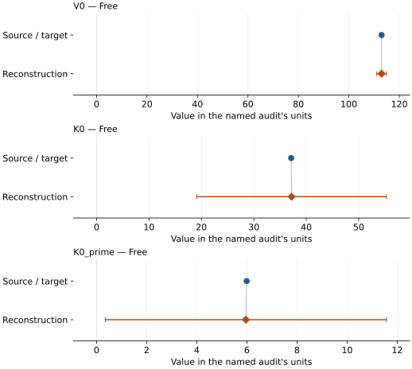

# Alpha quartz: EOS reconstruction reports

<!-- Generated by scripts.generate_reconstruction_reports; edit EOSMAT instead. -->

[All reconstruction reports](index.md) · [Material and EOS parameters](../material-summaries/alpha_quartz.md)

These reports explain the assessments already stored in EOSMAT. Generating
this page does not refit observations, change classifications or replace source coefficients.

Use [scientific label definitions](../eos-labels.md) to distinguish coefficient
agreement, source verification, author-workflow reproduction and recommendation for use.

| EOS record | Recorded outcome | Coefficient comparison |
| --- | --- | --- |
| [Angel et al. (1997), single-crystal BM3](#record-alpha_quartz_angel_1997_bm3_1) | Coefficient parity achieved | Graph and table |
| [Driver et al. (2010), QMC 300 K Vinet](#record-alpha_quartz_driver_2010_qmc_300k_vinet) | Complete independent refit unavailable | No numeric coefficient pair recorded |

## Angel et al. (1997), single-crystal BM3

Record: `alpha_quartz_angel_1997_bm3_1` · Model: `BM3`

**Outcome: Coefficient parity achieved.**

**Scope:** Comparison with the source parameterization.
**Comparison basis:** Every compared free coefficient meets both the recorded combined-two-sigma comparison and parameter-specific numerical similarity screen. Error conventions and fit qualifications remain applicable.

[Stored EOS coefficients and source](../material-summaries/alpha_quartz.md#record-alpha_quartz_angel_1997_bm3_1)

### What this result establishes

**Separate source-review status:** primary\_source\_validated.
**Usage recommendation:** See the stored EOS qualifications; no recommendation is inferred here.

- This named numerical assessment alone does not establish author-workflow reproduction, physical accuracy or recommendation for use.

### Data and reconstruction method

- **Dataset identifiers:** alpha\_quartz\_angel\_1997\_table1\_compression
- **Observations:** 23
- **Fit kind:** isothermal\_pv
- **Selection:** all rows
- **Objective:** errors\_in\_variables
- **Absolute sigma:** True
- **Free parameters:** V0; K0; K0\_prime
- **Fixed parameters:** None declared

Unspecified selections, weights, fixed values or error conventions remain unknown; they have not been inferred for this report.

### Source versus reconstruction

This is a **coefficient comparison**, not an observation or residual plot.
Each panel uses its coefficient's audit units and includes zero. Markers show
stored central values only. Error widths are retained in the table below;
no confidence interval or uncertainty band is inferred. Fixed/adopted values are constraints.

| Parameter | Source / target | Source error | Reconstruction | Reconstruction error | Fit role |
| --- | --- | --- | --- | --- | --- |
| V0 | 112.981 | 0.002 | 112.97156243085406 | 1.918255336614653 | Free |
| K0 | 37.12 | 0.09 | 37.20107673901708 | 18.085913257669695 | Free |
| K0\_prime | 5.99 | 0.04 | 5.957886249199415 | 5.610450371451321 | Free |

Values and reported errors are copied without rounding or conversion from the named audit. Missing errors mean unknown, not zero. Parameter names and volume conventions follow that audit; error widths do not imply a confidence convention.

Recorded diagnostics, covariance and additional protocol

- **Columns:**
    - **Pressure:** pressure\_gpa
    - **Temperature:** Not specified
    - **Volume:** unit\_cell\_volume\_a3
- **Observed pressure range gpa:** \[0.0001, 8.905\]
- **Observed temperature range k:** Not specified
- **Observed volume range:** \[96.989, 112.981\]
- **Degrees of freedom:** 20
- **Solver success:** True
- **Solver message:** \`ftol\` termination condition is satisfied.
- **Rmse gpa:** 0.013178421482088917
- **Published rmse gpa:** 0.013584537045929873
- **Reduced chi square:** 0.00019973736531579177

### Detailed evidence and existing plots

- [Related illustrated report explicitly naming this EOS: phase-e-crichton-ross-2000](../literature-reproductions/phase-e-crichton-ross-2000.md).
- [Record-by-record numerical ledger](../primary-eos-refits.md#records).
- [Source-audit reports](../source-audits.md).

Observation curves and residual plots are provided by the supporting reports where available. Their absence is not filled by a reconstructed curve presented as measured data.

[Machine-readable comparison ledger](https://github.com/CPrescher/peritheos/blob/main/docs/data/primary-eos-refits.json) — look up `alpha_quartz_angel_1997_bm3_1`.
[Complete native EOSMAT file](https://github.com/CPrescher/peritheos/blob/main/peritheos/data/materials/alpha_quartz.eosmat).

## Driver et al. (2010), QMC 300 K Vinet

Record: `alpha_quartz_driver_2010_qmc_300k_vinet` · Model: `Vinet`

**Outcome: Complete independent refit unavailable.**

**Scope:** Comparison with the source parameterization.
**Comparison basis:** The source describes approximately six volumes spanning +/-10% and plots the statistical envelope, but does not tabulate the individual QMC energies or pressures.

[Stored EOS coefficients and source](../material-summaries/alpha_quartz.md#record-alpha_quartz_driver_2010_qmc_300k_vinet)

### What this result establishes

**Separate source-review status:** primary\_source\_validated.
**Usage recommendation:** See the stored EOS qualifications; no recommendation is inferred here.

- This named numerical assessment alone does not establish author-workflow reproduction, physical accuracy or recommendation for use.
- No reconstructed coefficient table is recorded for this assessment; no missing values have been inferred.

### Data and reconstruction method

- **Dataset identifiers:** None declared
- **Fixed parameters:** None declared

Unspecified selections, weights, fixed values or error conventions remain unknown; they have not been inferred for this report.

### Why no coefficient graph is shown

No numeric source/reconstruction pair is recorded for this assessment. A graph would require information that is not available here; no values or observations have been invented.

### Detailed evidence and existing plots

- [Record-by-record numerical ledger](../primary-eos-refits.md#records).
- [Source-audit reports](../source-audits.md).

Observation curves and residual plots are provided by the supporting reports where available. Their absence is not filled by a reconstructed curve presented as measured data.

[Machine-readable comparison ledger](https://github.com/CPrescher/peritheos/blob/main/docs/data/primary-eos-refits.json) — look up `alpha_quartz_driver_2010_qmc_300k_vinet`.
[Complete native EOSMAT file](https://github.com/CPrescher/peritheos/blob/main/peritheos/data/materials/alpha_quartz.eosmat).
