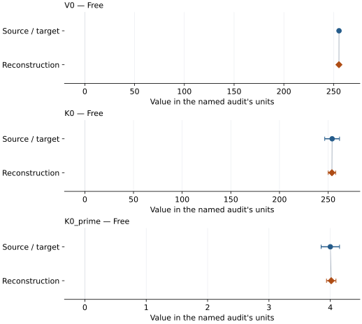
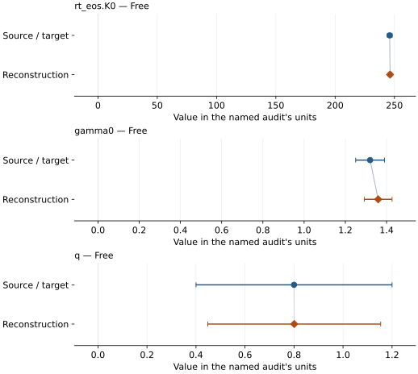

# Alumina: EOS reconstruction reports

<!-- Generated by scripts.generate_reconstruction_reports; edit EOSMAT instead. -->

[All reconstruction reports](index.md) · [Material and EOS parameters](../material-summaries/alumina.md)

These reports explain the assessments already stored in EOSMAT. Generating
this page does not refit observations, change classifications or replace source coefficients.

Use [scientific label definitions](../eos-labels.md) to distinguish coefficient
agreement, source verification, author-workflow reproduction and recommendation for use.

| EOS record | Recorded outcome | Coefficient comparison |
| --- | --- | --- |
| [Dewaele and Torrent (2013), Vinet](#record-alumina_dewaele_2013_vinet_1) | Coefficient parity achieved | Graph and table |
| [Shi et al. (2022), selected BM3-MGD corundum model 3](#record-alumina_shi_2022_bm3_mgd_2) | Coefficient parity achieved | Graph and table |

## Dewaele and Torrent (2013), Vinet

Record: `alumina_dewaele_2013_vinet_1` · Model: `Vinet`

**Outcome: Coefficient parity achieved.**

**Scope:** Comparison with the source parameterization.
**Comparison basis:** Every compared free coefficient meets both the recorded combined-two-sigma comparison and parameter-specific numerical similarity screen. Error conventions and fit qualifications remain applicable.

[Stored EOS coefficients and source](../material-summaries/alumina.md#record-alumina_dewaele_2013_vinet_1)

### What this result establishes

**Separate source-review status:** primary\_source\_validated.
**Usage recommendation:** See the stored EOS qualifications; no recommendation is inferred here.

- This named numerical assessment alone does not establish author-workflow reproduction, physical accuracy or recommendation for use.

### Data and reconstruction method

- **Dataset identifiers:** alumina\_dewaele\_2013\_table1\_compression
- **Observations:** 53
- **Fit kind:** isothermal\_pv
- **Selection:** all rows
- **Objective:** pressure\_residuals
- **Absolute sigma:** True
- **Free parameters:** V0; K0; K0\_prime
- **Fixed parameters:** None declared

Unspecified selections, weights, fixed values or error conventions remain unknown; they have not been inferred for this report.

### Source versus reconstruction

This is a **coefficient comparison**, not an observation or residual plot.
Each panel uses its coefficient's audit units and includes zero. Markers show
stored central values only. Error widths are retained in the table below;
no confidence interval or uncertainty band is inferred. Fixed/adopted values are constraints.

| Parameter | Source / target | Source error | Reconstruction | Reconstruction error | Fit role |
| --- | --- | --- | --- | --- | --- |
| V0 | 255.45 | 0.52 | 255.38611857923496 | 0.26047429631887364 | Free |
| K0 | 254.1 | 7.6 | 253.88378504976112 | 3.850341736411413 | Free |
| K0\_prime | 4.0 | 0.15 | 4.014881596821605 | 0.07730707256336111 | Free |

Values and reported errors are copied without rounding or conversion from the named audit. Missing errors mean unknown, not zero. Parameter names and volume conventions follow that audit; error widths do not imply a confidence convention.

Recorded diagnostics, covariance and additional protocol

- **Columns:**
    - **Pressure:** pressure\_gpa
    - **Temperature:** Not specified
    - **Volume:** a\_a
- **Observed pressure range gpa:** \[0.56, 165.0\]
- **Observed temperature range k:** Not specified
- **Observed volume range:** \[182.02811563595682, 254.67256738120184\]
- **Degrees of freedom:** 50
- **Solver success:** True
- **Solver message:** \`ftol\` termination condition is satisfied.
- **Rmse gpa:** 0.8012203256389328
- **Published rmse gpa:** 0.8050847963563869
- **Reduced chi square:** 0.6804712508299748

### Detailed evidence and existing plots

- [Record-by-record numerical ledger](../primary-eos-refits.md#records).
- [Source-audit reports](../source-audits.md).

Observation curves and residual plots are provided by the supporting reports where available. Their absence is not filled by a reconstructed curve presented as measured data.

[Machine-readable comparison ledger](https://github.com/CPrescher/peritheos/blob/main/docs/data/primary-eos-refits.json) — look up `alumina_dewaele_2013_vinet_1`.
[Complete native EOSMAT file](https://github.com/CPrescher/peritheos/blob/main/peritheos/data/materials/alumina.eosmat).

## Shi et al. (2022), selected BM3-MGD corundum model 3

Record: `alumina_shi_2022_bm3_mgd_2` · Model: `BM3`

**Outcome: Coefficient parity achieved.**

**Scope:** Comparison with the source parameterization.
**Comparison basis:** Every compared free coefficient meets both the recorded combined-two-sigma comparison and parameter-specific numerical similarity screen. Error conventions and fit qualifications remain applicable.

[Stored EOS coefficients and source](../material-summaries/alumina.md#record-alumina_shi_2022_bm3_mgd_2)

### What this result establishes

**Separate source-review status:** primary\_source\_validated.
**Usage recommendation:** See the stored EOS qualifications; no recommendation is inferred here.

- This named numerical assessment alone does not establish author-workflow reproduction, physical accuracy or recommendation for use.

### Data and reconstruction method

- **Dataset identifiers:** alumina\_shi\_2022\_table\_s1\_pvt
- **Observations:** 75
- **Fit kind:** joint\_pvt
- **Selection:** all rows
- **Objective:** pressure\_residuals
- **Absolute sigma:** True
- **Free parameters:** rt\_eos.K0; gamma0; q
- **Fixed parameters:** V0; K0\_prime; Tr; theta0; n

Unspecified selections, weights, fixed values or error conventions remain unknown; they have not been inferred for this report.

### Source versus reconstruction

This is a **coefficient comparison**, not an observation or residual plot.
Each panel uses its coefficient's audit units and includes zero. Markers show
stored central values only. Error widths are retained in the table below;
no confidence interval or uncertainty band is inferred. Fixed/adopted values are constraints.

| Parameter | Source / target | Source error | Reconstruction | Reconstruction error | Fit role |
| --- | --- | --- | --- | --- | --- |
| rt\_eos.K0 | 246.0 | 2.0 | 246.3082843723331 | 1.3330685974032892 | Free |
| gamma0 | 1.32 | 0.07 | 1.3593137833873294 | 0.06725423003798052 | Free |
| q | 0.8 | 0.4 | 0.8008671555208751 | 0.3526999039312283 | Free |

Values and reported errors are copied without rounding or conversion from the named audit. Missing errors mean unknown, not zero. Parameter names and volume conventions follow that audit; error widths do not imply a confidence convention.

Recorded diagnostics, covariance and additional protocol

- **Columns:**
    - **Pressure:** pressure\_gpa
    - **Temperature:** temperature\_k
    - **Volume:** volume\_a3
- **Observed pressure range gpa:** \[0.0, 97.7\]
- **Observed temperature range k:** \[300.0, 2980.0\]
- **Observed volume range:** \[203.2, 255.1\]
- **Degrees of freedom:** 72
- **Solver success:** True
- **Solver message:** \`ftol\` termination condition is satisfied.
- **Rmse gpa:** 1.1913871994289138
- **Published rmse gpa:** 1.2330494551575306
- **Reduced chi square:** 1.4785452697531987

### Detailed evidence and existing plots

- [Record-by-record numerical ledger](../primary-eos-refits.md#records).
- [Source-audit reports](../source-audits.md).

Observation curves and residual plots are provided by the supporting reports where available. Their absence is not filled by a reconstructed curve presented as measured data.

[Machine-readable comparison ledger](https://github.com/CPrescher/peritheos/blob/main/docs/data/primary-eos-refits.json) — look up `alumina_shi_2022_bm3_mgd_2`.
[Complete native EOSMAT file](https://github.com/CPrescher/peritheos/blob/main/peritheos/data/materials/alumina.eosmat).
