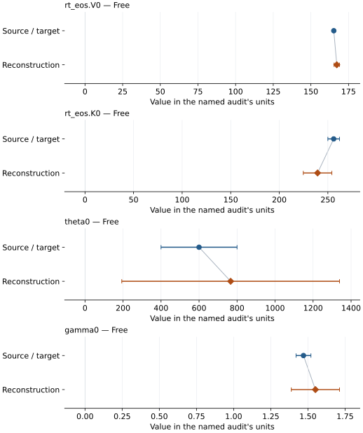

# Rh2O3(II)-type alumina: EOS reconstruction reports

<!-- Generated by scripts.generate_reconstruction_reports; edit EOSMAT instead. -->

[All reconstruction reports](index.md) · [Material and EOS parameters](../material-summaries/alumina_rh2o3_ii.md)

These reports explain the assessments already stored in EOSMAT. Generating
this page does not refit observations, change classifications or replace source coefficients.

Use [scientific label definitions](../eos-labels.md) to distinguish coefficient
agreement, source verification, author-workflow reproduction and recommendation for use.

| EOS record | Recorded outcome | Coefficient comparison |
| --- | --- | --- |
| [Shi et al. (2022), selected BM3-MGD model 2](#record-alumina_rh2o3_ii_shi_2022_bm3_mgd_1) | Numerically similar, with qualifications | Graph and table |

## Shi et al. (2022), selected BM3-MGD model 2

Record: `alumina_rh2o3_ii_shi_2022_bm3_mgd_1` · Model: `BM3`

**Outcome: Numerically similar, with qualifications.**

**Scope:** Comparison with the source parameterization.
**Comparison basis:** Every compared free coefficient meets either the recorded combined-two-sigma comparison or parameter-specific numerical similarity screen; the audit does not classify the complete comparison as parity.

[Stored EOS coefficients and source](../material-summaries/alumina_rh2o3_ii.md#record-alumina_rh2o3_ii_shi_2022_bm3_mgd_1)

### What this result establishes

**Separate source-review status:** primary\_source\_validated.
**Usage recommendation:** See the stored EOS qualifications; no recommendation is inferred here.

- This named numerical assessment alone does not establish author-workflow reproduction, physical accuracy or recommendation for use.

### Data and reconstruction method

- **Dataset identifiers:** alumina\_rh2o3\_ii\_shi\_2022\_table\_s2\_pvt
- **Observations:** 75
- **Fit kind:** joint\_pvt
- **Selection:** all rows
- **Objective:** errors\_in\_variables
- **Absolute sigma:** True
- **Free parameters:** rt\_eos.V0; rt\_eos.K0; theta0; gamma0
- **Fixed parameters:** K0\_prime; Tr; q; n

Unspecified selections, weights, fixed values or error conventions remain unknown; they have not been inferred for this report.

### Source versus reconstruction

This is a **coefficient comparison**, not an observation or residual plot.
Each panel uses its coefficient's audit units and includes zero. Markers show
stored central values only. Error widths are retained in the table below;
no confidence interval or uncertainty band is inferred. Fixed/adopted values are constraints.

| Parameter | Source / target | Source error | Reconstruction | Reconstruction error | Fit role |
| --- | --- | --- | --- | --- | --- |
| rt\_eos.V0 | 165.2 | 0.7 | 167.19400527415326 | 1.8127107951351986 | Free |
| rt\_eos.K0 | 256.0 | 6.0 | 239.41531321837596 | 14.703300185409736 | Free |
| theta0 | 600.0 | 200.0 | 766.2592031228312 | 572.846246963602 | Free |
| gamma0 | 1.47 | 0.05 | 1.550212367349021 | 0.16220313626055743 | Free |

Values and reported errors are copied without rounding or conversion from the named audit. Missing errors mean unknown, not zero. Parameter names and volume conventions follow that audit; error widths do not imply a confidence convention.

Recorded diagnostics, covariance and additional protocol

- **Columns:**
    - **Pressure:** pressure\_gpa
    - **Temperature:** temperature\_k
    - **Volume:** volume\_a3
- **Observed pressure range gpa:** \[96.5, 156.7\]
- **Observed temperature range k:** \[300.0, 3670.0\]
- **Observed volume range:** \[123.3, 132.4\]
- **Degrees of freedom:** 71
- **Solver success:** True
- **Solver message:** Both \`ftol\` and \`xtol\` termination conditions are satisfied.
- **Rmse gpa:** 0.8659771664003755
- **Published rmse gpa:** 1.1433652954894855
- **Reduced chi square:** 0.15196005581308814

### Detailed evidence and existing plots

- [Earlier detailed record investigation](../primary-eos-refits.md#investigation-alumina_rh2o3_ii_shi_2022_bm3_mgd_1).
- [Record-by-record numerical ledger](../primary-eos-refits.md#records).
- [Source-audit reports](../source-audits.md).

Observation curves and residual plots are provided by the supporting reports where available. Their absence is not filled by a reconstructed curve presented as measured data.

[Machine-readable comparison ledger](https://github.com/CPrescher/peritheos/blob/main/docs/data/primary-eos-refits.json) — look up `alumina_rh2o3_ii_shi_2022_bm3_mgd_1`.
[Complete native EOSMAT file](https://github.com/CPrescher/peritheos/blob/main/peritheos/data/materials/alumina_rh2o3_ii.eosmat).
