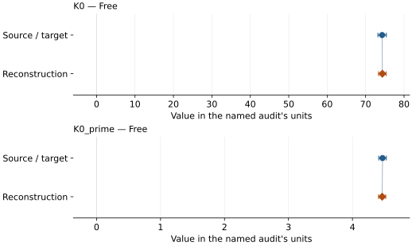
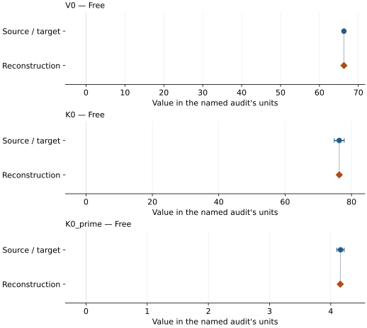
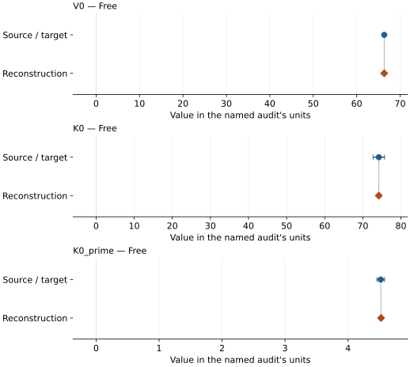
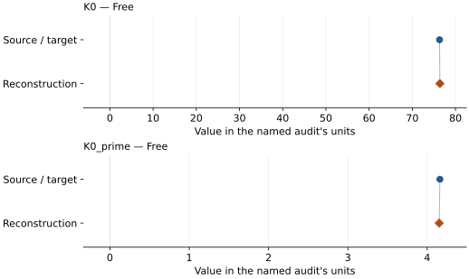

# Aluminum: EOS reconstruction reports

<!-- Generated by scripts.generate_reconstruction_reports; edit EOSMAT instead. -->

[All reconstruction reports](index.md) · [Material and EOS parameters](../material-summaries/aluminum.md)

These reports explain the assessments already stored in EOSMAT. Generating
this page does not refit observations, change classifications or replace source coefficients.

Use [scientific label definitions](../eos-labels.md) to distinguish coefficient
agreement, source verification, author-workflow reproduction and recommendation for use.

| EOS record | Recorded outcome | Coefficient comparison |
| --- | --- | --- |
| [Dewaele et al. (2004), revised-ruby Vinet](#record-aluminum_dewaele_2004_vinet_1) | Coefficient parity achieved | Graph and table |
| [Sokolova et al. (2013), Holzapfel thermal model (2016 workbook)](#record-aluminum_sokolova_2013_holzapfel_2) | Source calculation reconstructed | No numeric coefficient pair recorded |
| [Dewaele (2019), Al MAO-scale Vinet](#record-aluminum_dewaele_2019_mao_vinet) | Numerically similar, with qualifications | Graph and table |
| [Dewaele (2019), Al DOR-scale Vinet](#record-aluminum_dewaele_2019_dor_vinet) | Numerically similar, with qualifications | Graph and table |
| [Dewaele et al. (2004), Al mao ruby Vinet](#record-aluminum_dewaele_2004_mao_ruby_vinet) | Coefficient parity achieved | Graph and table |

## Dewaele et al. (2004), revised-ruby Vinet

Record: `aluminum_dewaele_2004_vinet_1` · Model: `Vinet`

**Outcome: Coefficient parity achieved.**

**Scope:** Comparison with the source parameterization.
**Comparison basis:** Every compared free coefficient meets both the recorded combined-two-sigma comparison and parameter-specific numerical similarity screen. Error conventions and fit qualifications remain applicable.

[Stored EOS coefficients and source](../material-summaries/aluminum.md#record-aluminum_dewaele_2004_vinet_1)

### What this result establishes

**Separate source-review status:** primary\_source\_validated.
**Usage recommendation:** See the stored EOS qualifications; no recommendation is inferred here.

- This named numerical assessment alone does not establish author-workflow reproduction, physical accuracy or recommendation for use.

### Data and reconstruction method

- **Dataset identifiers:** aluminum\_dewaele\_2004\_table1\_compression
- **Observations:** 40
- **Fit kind:** isothermal\_pv
- **Selection:** all rows
- **Objective:** errors\_in\_variables
- **Absolute sigma:** True
- **Free parameters:** K0; K0\_prime
- **Fixed parameters:** V0

Unspecified selections, weights, fixed values or error conventions remain unknown; they have not been inferred for this report.

### Source versus reconstruction

This is a **coefficient comparison**, not an observation or residual plot.
Each panel uses its coefficient's audit units and includes zero. Markers show
stored central values only. Error widths are retained in the table below;
no confidence interval or uncertainty band is inferred. Fixed/adopted values are constraints.

| Parameter | Source / target | Source error | Reconstruction | Reconstruction error | Fit role |
| --- | --- | --- | --- | --- | --- |
| K0 | 74.3 | 1.1 | 74.34716988493747 | 0.9874527687963068 | Free |
| K0\_prime | 4.47 | 0.06 | 4.464061818626343 | 0.05640938603112191 | Free |

Values and reported errors are copied without rounding or conversion from the named audit. Missing errors mean unknown, not zero. Parameter names and volume conventions follow that audit; error widths do not imply a confidence convention.

Recorded diagnostics, covariance and additional protocol

- **Columns:**
    - **Pressure:** ruby\_pressure\_revised\_gpa
    - **Temperature:** Not specified
    - **Volume:** atomic\_volume\_a3
- **Observed pressure range gpa:** \[0.0, 153.0\]
- **Observed temperature range k:** Not specified
- **Observed volume range:** \[36.544, 66.244\]
- **Degrees of freedom:** 38
- **Solver success:** True
- **Solver message:** Both \`ftol\` and \`xtol\` termination conditions are satisfied.
- **Rmse gpa:** 0.4329142658683102
- **Published rmse gpa:** 0.4904183561845775
- **Reduced chi square:** 0.22152927371889403

### Detailed evidence and existing plots

- [Record-by-record numerical ledger](../primary-eos-refits.md#records).
- [Source-audit reports](../source-audits.md).

Observation curves and residual plots are provided by the supporting reports where available. Their absence is not filled by a reconstructed curve presented as measured data.

[Machine-readable comparison ledger](https://github.com/CPrescher/peritheos/blob/main/docs/data/primary-eos-refits.json) — look up `aluminum_dewaele_2004_vinet_1`.
[Complete native EOSMAT file](https://github.com/CPrescher/peritheos/blob/main/peritheos/data/materials/aluminum.eosmat).

## Sokolova et al. (2013), Holzapfel thermal model (2016 workbook)

Record: `aluminum_sokolova_2013_holzapfel_2` · Model: `Holzapfel`

**Outcome: Source calculation reconstructed.**

**Scope:** Reconstruction of a source equation or calculation.
**Comparison basis:** All eleven machine-readable comparison series enter one shared Equation (20) objective against the mean Table 2 Holzapfel and Table 3 Vinet isotherm. Table 4 is retained as a post-calibration closure test. The calculation cannot recover the eleven EOS parameter sets independently because the source omits complete thermochemical/ultrasonic rows, weights, and covariance.

[Stored EOS coefficients and source](../material-summaries/aluminum.md#record-aluminum_sokolova_2013_holzapfel_2)

### What this result establishes

**Separate source-review status:** primary\_source\_validated.
**Usage recommendation:** See the stored EOS qualifications; no recommendation is inferred here.

- This named numerical assessment alone does not establish author-workflow reproduction, physical accuracy or recommendation for use.
- No reconstructed coefficient table is recorded for this assessment; no missing values have been inferred.

### Data and reconstruction method

- **Dataset identifiers:** aluminum\_dewaele\_2004\_table1\_compression
- **Observations:** 40
- **Fit kind:** coupled\_eleven\_marker\_ruby\_cross\_calibration
- **Objective:** minimize the sum over markers of the mean squared residual between Equation (20) and the pointwise mean of the Table 2 Holzapfel and Table 3 Vinet pressures, so each of the eleven markers has equal total weight
- **Fixed parameters:** n; Z; n

Unspecified selections, weights, fixed values or error conventions remain unknown; they have not been inferred for this report.

### Why no coefficient graph is shown

No numeric source/reconstruction pair is recorded for this assessment. A graph would require information that is not available here; no values or observations have been invented.

Recorded diagnostics, covariance and additional protocol

- **Rmse gpa:** 0.6336532455704277
- **Published rmse gpa:** 0.8395799484761981
- **Comparison scope:** shared\_ruby\_calibration
- **Published ruby parameters:**
    - **A gpa:** 1870.0
    - **M:** 6.0
- **Sensitivity fit ruby parameters:**
    - **A gpa:** 1869.3837840502665
    - **M:** 6.10334763359135

### Detailed evidence and existing plots

- [Record-by-record numerical ledger](../primary-eos-refits.md#records).
- [Source-audit reports](../source-audits.md).

Observation curves and residual plots are provided by the supporting reports where available. Their absence is not filled by a reconstructed curve presented as measured data.

[Machine-readable comparison ledger](https://github.com/CPrescher/peritheos/blob/main/docs/data/primary-eos-refits.json) — look up `aluminum_sokolova_2013_holzapfel_2`.
[Complete native EOSMAT file](https://github.com/CPrescher/peritheos/blob/main/peritheos/data/materials/aluminum.eosmat).

## Dewaele (2019), Al MAO-scale Vinet

Record: `aluminum_dewaele_2019_mao_vinet` · Model: `Vinet`

**Outcome: Numerically similar, with qualifications.**

**Scope:** Comparison with the source parameterization.
**Comparison basis:** Every compared free coefficient meets either the recorded combined-two-sigma comparison or parameter-specific numerical similarity screen; the audit does not classify the complete comparison as parity.

[Stored EOS coefficients and source](../material-summaries/aluminum.md#record-aluminum_dewaele_2019_mao_vinet)

### What this result establishes

**Separate source-review status:** primary\_source\_validated.
**Usage recommendation:** See the stored EOS qualifications; no recommendation is inferred here.

- Complete source rows for this material are bundled and the dedicated two-ruby-scale refit recovers every coefficient within the published 95% interval. The common ledger classifies the result as similar, not strict parity, because the dedicated audit does not infer a refit covariance from rounded source rows.
- This named numerical assessment alone does not establish author-workflow reproduction, physical accuracy or recommendation for use.

### Data and reconstruction method

- **Dataset identifiers:** aluminum\_dewaele\_2004\_table1\_compression
- **Observations:** 40
- **Fit kind:** static\_vinet\_with\_explicit\_ruby\_scale\_conversion
- **Selection:** complete
- **Objective:** unweighted pressure residuals
- **Free parameters:** V0; K0; K0\_prime
- **Fixed parameters:** None declared

Unspecified selections, weights, fixed values or error conventions remain unknown; they have not been inferred for this report.

### Source versus reconstruction

This is a **coefficient comparison**, not an observation or residual plot.
Each panel uses its coefficient's audit units and includes zero. Markers show
stored central values only. Error widths are retained in the table below;
no confidence interval or uncertainty band is inferred. Fixed/adopted values are constraints.

| Parameter | Source / target | Source error | Reconstruction | Reconstruction error | Fit role |
| --- | --- | --- | --- | --- | --- |
| V0 | 66.292 | 0.076 | 66.29073075240322 | Not specified | Free |
| K0 | 76.32 | 1.5 | 76.32431816083778 | Not specified | Free |
| K0\_prime | 4.16 | 0.06 | 4.155059164004822 | Not specified | Free |

Values and reported errors are copied without rounding or conversion from the named audit. Missing errors mean unknown, not zero. Parameter names and volume conventions follow that audit; error widths do not imply a confidence convention.

Recorded diagnostics, covariance and additional protocol

- **Observed pressure range gpa:** \[0.0, 144.3\]
- **Solver success:** True
- **Solver message:** dedicated Dewaele (2019) refit completed
- **Rmse gpa:** 0.41106325836339985

### Detailed evidence and existing plots

- [Earlier detailed record investigation](../primary-eos-refits.md#investigation-aluminum_dewaele_2019_mao_vinet).
- [Record-by-record numerical ledger](../primary-eos-refits.md#records).
- [Source-audit reports](../source-audits.md).

Observation curves and residual plots are provided by the supporting reports where available. Their absence is not filled by a reconstructed curve presented as measured data.

[Machine-readable comparison ledger](https://github.com/CPrescher/peritheos/blob/main/docs/data/primary-eos-refits.json) — look up `aluminum_dewaele_2019_mao_vinet`.
[Complete native EOSMAT file](https://github.com/CPrescher/peritheos/blob/main/peritheos/data/materials/aluminum.eosmat).

## Dewaele (2019), Al DOR-scale Vinet

Record: `aluminum_dewaele_2019_dor_vinet` · Model: `Vinet`

**Outcome: Numerically similar, with qualifications.**

**Scope:** Comparison with the source parameterization.
**Comparison basis:** Every compared free coefficient meets either the recorded combined-two-sigma comparison or parameter-specific numerical similarity screen; the audit does not classify the complete comparison as parity.

[Stored EOS coefficients and source](../material-summaries/aluminum.md#record-aluminum_dewaele_2019_dor_vinet)

### What this result establishes

**Separate source-review status:** primary\_source\_validated.
**Usage recommendation:** See the stored EOS qualifications; no recommendation is inferred here.

- Complete source rows for this material are bundled and the dedicated two-ruby-scale refit recovers every coefficient within the published 95% interval. The common ledger classifies the result as similar, not strict parity, because the dedicated audit does not infer a refit covariance from rounded source rows.
- This named numerical assessment alone does not establish author-workflow reproduction, physical accuracy or recommendation for use.

### Data and reconstruction method

- **Dataset identifiers:** aluminum\_dewaele\_2004\_table1\_compression
- **Observations:** 40
- **Fit kind:** static\_vinet\_with\_explicit\_ruby\_scale\_conversion
- **Selection:** complete
- **Objective:** unweighted pressure residuals
- **Free parameters:** V0; K0; K0\_prime
- **Fixed parameters:** None declared

Unspecified selections, weights, fixed values or error conventions remain unknown; they have not been inferred for this report.

### Source versus reconstruction

This is a **coefficient comparison**, not an observation or residual plot.
Each panel uses its coefficient's audit units and includes zero. Markers show
stored central values only. Error widths are retained in the table below;
no confidence interval or uncertainty band is inferred. Fixed/adopted values are constraints.

| Parameter | Source / target | Source error | Reconstruction | Reconstruction error | Fit role |
| --- | --- | --- | --- | --- | --- |
| V0 | 66.336 | 0.076 | 66.33693407794202 | Not specified | Free |
| K0 | 74.2 | 1.5 | 74.18775549900253 | Not specified | Free |
| K0\_prime | 4.52 | 0.06 | 4.524361881039528 | Not specified | Free |

Values and reported errors are copied without rounding or conversion from the named audit. Missing errors mean unknown, not zero. Parameter names and volume conventions follow that audit; error widths do not imply a confidence convention.

Recorded diagnostics, covariance and additional protocol

- **Observed pressure range gpa:** \[0.0, 155.2907483824007\]
- **Solver success:** True
- **Solver message:** dedicated Dewaele (2019) refit completed
- **Rmse gpa:** 0.42936624659177325

### Detailed evidence and existing plots

- [Earlier detailed record investigation](../primary-eos-refits.md#investigation-aluminum_dewaele_2019_dor_vinet).
- [Record-by-record numerical ledger](../primary-eos-refits.md#records).
- [Source-audit reports](../source-audits.md).

Observation curves and residual plots are provided by the supporting reports where available. Their absence is not filled by a reconstructed curve presented as measured data.

[Machine-readable comparison ledger](https://github.com/CPrescher/peritheos/blob/main/docs/data/primary-eos-refits.json) — look up `aluminum_dewaele_2019_dor_vinet`.
[Complete native EOSMAT file](https://github.com/CPrescher/peritheos/blob/main/peritheos/data/materials/aluminum.eosmat).

## Dewaele et al. (2004), Al mao ruby Vinet

Record: `aluminum_dewaele_2004_mao_ruby_vinet` · Model: `Vinet`

**Outcome: Coefficient parity achieved.**

**Scope:** Comparison with the source parameterization.
**Comparison basis:** Every compared free coefficient meets both the recorded combined-two-sigma comparison and parameter-specific numerical similarity screen. Error conventions and fit qualifications remain applicable.

[Stored EOS coefficients and source](../material-summaries/aluminum.md#record-aluminum_dewaele_2004_mao_ruby_vinet)

### What this result establishes

**Separate source-review status:** primary\_source\_validated.
**Usage recommendation:** See the stored EOS qualifications; no recommendation is inferred here.

- This named numerical assessment alone does not establish author-workflow reproduction, physical accuracy or recommendation for use.

### Data and reconstruction method

- **Dataset identifiers:** aluminum\_dewaele\_2004\_table1\_compression
- **Observations:** 40
- **Fit kind:** isothermal\_pv
- **Selection:** all rows
- **Objective:** errors\_in\_variables
- **Absolute sigma:** True
- **Free parameters:** K0; K0\_prime
- **Fixed parameters:** V0

Unspecified selections, weights, fixed values or error conventions remain unknown; they have not been inferred for this report.

### Source versus reconstruction

This is a **coefficient comparison**, not an observation or residual plot.
Each panel uses its coefficient's audit units and includes zero. Markers show
stored central values only. Error widths are retained in the table below;
no confidence interval or uncertainty band is inferred. Fixed/adopted values are constraints.

| Parameter | Source / target | Source error | Reconstruction | Reconstruction error | Fit role |
| --- | --- | --- | --- | --- | --- |
| K0 | 76.3 | 1.1 | 76.38315516036998 | 1.032449824215295 | Free |
| K0\_prime | 4.16 | 0.05 | 4.151179331434396 | 0.05750982823544787 | Free |

Values and reported errors are copied without rounding or conversion from the named audit. Missing errors mean unknown, not zero. Parameter names and volume conventions follow that audit; error widths do not imply a confidence convention.

Recorded diagnostics, covariance and additional protocol

- **Columns:**
    - **Pressure:** ruby\_pressure\_classical\_gpa
    - **Temperature:** Not specified
    - **Volume:** atomic\_volume\_a3
- **Observed pressure range gpa:** \[0.0, 144.3\]
- **Observed temperature range k:** Not specified
- **Observed volume range:** \[36.544, 66.244\]
- **Degrees of freedom:** 38
- **Solver success:** True
- **Solver message:** Both \`ftol\` and \`xtol\` termination conditions are satisfied.
- **Rmse gpa:** 0.3734627802397852
- **Published rmse gpa:** 0.41661470034930054
- **Reduced chi square:** 0.161115223781409

### Detailed evidence and existing plots

- [Record-by-record numerical ledger](../primary-eos-refits.md#records).
- [Source-audit reports](../source-audits.md).

Observation curves and residual plots are provided by the supporting reports where available. Their absence is not filled by a reconstructed curve presented as measured data.

[Machine-readable comparison ledger](https://github.com/CPrescher/peritheos/blob/main/docs/data/primary-eos-refits.json) — look up `aluminum_dewaele_2004_mao_ruby_vinet`.
[Complete native EOSMAT file](https://github.com/CPrescher/peritheos/blob/main/peritheos/data/materials/aluminum.eosmat).
