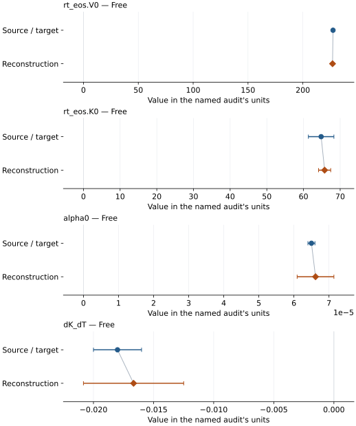

# Aragonite: EOS reconstruction reports

<!-- Generated by scripts.generate_reconstruction_reports; edit EOSMAT instead. -->

[All reconstruction reports](index.md) · [Material and EOS parameters](../material-summaries/aragonite.md)

These reports explain the assessments already stored in EOSMAT. Generating
this page does not refit observations, change classifications or replace source coefficients.

Use [scientific label definitions](../eos-labels.md) to distinguish coefficient
agreement, source verification, author-workflow reproduction and recommendation for use.

| EOS record | Recorded outcome | Coefficient comparison |
| --- | --- | --- |
| [Martinez et al. (1996), staged P-V-T BM2](#record-aragonite_martinez_1996_bm2_2) | Coefficient parity achieved | Graph and table |

## Martinez et al. (1996), staged P-V-T BM2

Record: `aragonite_martinez_1996_bm2_2` · Model: `BM2`

**Outcome: Coefficient parity achieved.**

**Scope:** Comparison with the source parameterization.
**Comparison basis:** Every compared free coefficient meets both the recorded combined-two-sigma comparison and parameter-specific numerical similarity screen. Error conventions and fit qualifications remain applicable.

[Stored EOS coefficients and source](../material-summaries/aragonite.md#record-aragonite_martinez_1996_bm2_2)

### What this result establishes

**Separate source-review status:** primary\_source\_validated.
**Usage recommendation:** See the stored EOS qualifications; no recommendation is inferred here.

- This named numerical assessment alone does not establish author-workflow reproduction, physical accuracy or recommendation for use.

### Data and reconstruction method

- **Dataset identifiers:** aragonite\_martinez\_1996\_table3\_pvt
- **Observations:** 64
- **Fit kind:** staged\_bm2\_isotherms
- **Selection:** eight staged isotherms from 298 to 973 K
- **Objective:** unweighted pressure residuals followed by linear regressions
- **Absolute sigma:** False
- **Free parameters:** rt\_eos.V0; rt\_eos.K0; alpha0; dK\_dT
- **Fixed parameters:** Tr

Unspecified selections, weights, fixed values or error conventions remain unknown; they have not been inferred for this report.

### Source versus reconstruction

This is a **coefficient comparison**, not an observation or residual plot.
Each panel uses its coefficient's audit units and includes zero. Markers show
stored central values only. Error widths are retained in the table below;
no confidence interval or uncertainty band is inferred. Fixed/adopted values are constraints.

| Parameter | Source / target | Source error | Reconstruction | Reconstruction error | Fit role |
| --- | --- | --- | --- | --- | --- |
| rt\_eos.V0 | 227.5 | 0.8 | 227.0509188911685 | 0.46287683892679543 | Free |
| rt\_eos.K0 | 64.81 | 3.48 | 65.7594847830113 | 1.6574642736217322 | Free |
| alpha0 | 6.5e-05 | 1e-06 | 6.616277302577296e-05 | 5.239895204479933e-06 | Free |
| dK\_dT | -0.018 | 0.002 | -0.01666478438939185 | 0.004169185507704645 | Free |

Values and reported errors are copied without rounding or conversion from the named audit. Missing errors mean unknown, not zero. Parameter names and volume conventions follow that audit; error widths do not imply a confidence convention.

Recorded diagnostics, covariance and additional protocol

- **Columns:**
    - **Pressure:** pressure\_gpa
    - **Temperature:** temperature\_k
    - **Volume:** volume\_a3
- **Solver success:** True
- **Solver message:** eight isotherm fits and two linear regressions completed
- **Rmse gpa:** 0.20549596467076306
- **Published rmse gpa:** 0.2591892383500495
- **Reduced chi square:** Not specified

### Detailed evidence and existing plots

- [Record-by-record numerical ledger](../primary-eos-refits.md#records).
- [Source-audit reports](../source-audits.md).

Observation curves and residual plots are provided by the supporting reports where available. Their absence is not filled by a reconstructed curve presented as measured data.

[Machine-readable comparison ledger](https://github.com/CPrescher/peritheos/blob/main/docs/data/primary-eos-refits.json) — look up `aragonite_martinez_1996_bm2_2`.
[Complete native EOSMAT file](https://github.com/CPrescher/peritheos/blob/main/peritheos/data/materials/aragonite.eosmat).
