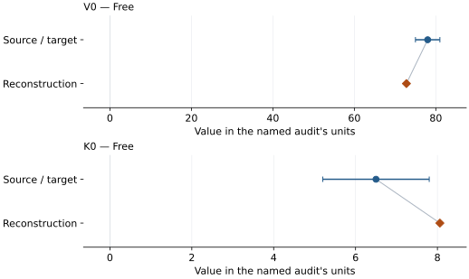

# Argon (hcp): EOS reconstruction reports

<!-- Generated by scripts.generate_reconstruction_reports; edit EOSMAT instead. -->

[All reconstruction reports](index.md) · [Material and EOS parameters](../material-summaries/argon_hcp.md)

These reports explain the assessments already stored in EOSMAT. Generating
this page does not refit observations, change classifications or replace source coefficients.

Use [scientific label definitions](../eos-labels.md) to distinguish coefficient
agreement, source verification, author-workflow reproduction and recommendation for use.

| EOS record | Recorded outcome | Coefficient comparison |
| --- | --- | --- |
| [Wittlinger et al. (1997), hcp argon](#record-argon_hcp_wittlinger_1997_bm2_1) | Complete independent refit unavailable | Graph and table |

## Wittlinger et al. (1997), hcp argon

Record: `argon_hcp_wittlinger_1997_bm2_1` · Model: `BM2`

**Outcome: Complete independent refit unavailable.**

**Scope:** Comparison with the source parameterization.
**Comparison basis:** NOT REPRODUCED: the available digitization does not establish a source-faithful reproduction of the published fit. Original observations, regression settings and covariance are unavailable; the shared fitted V0 normalization limits independent coefficient recovery. The numerical fits below are diagnostics only. Broad error-bar overlap is not successful reproduction. Comparison uses atomic volume: hcp cell/2 and fcc cell/4. Different phases are compared, not identified. Nine digitized points have large volume errors and share the fitted 78 A^3 normalization; unknown covariance limits coefficient inference. No replacement EOS is promoted from this diagnostic. Original article could not be reopened without institutional access on 2026-09-24; source transcription relies on the existing primary-source audit.

[Stored EOS coefficients and source](../material-summaries/argon_hcp.md#record-argon_hcp_wittlinger_1997_bm2_1)

### What this result establishes

**Separate source-review status:** primary\_source\_validated.
**Usage recommendation:** NOT REPRODUCED: the published fit could not be independently reproduced from the available evidence. Digitized-data refits are diagnostic only; broad error-bar overlap does not establish reproduction. Historical hcp compression only; prefer the separate Dewaele (2021) fcc thermal EOS for fcc argon. Do not extrapolate this BM2 fit beyond 8.5 GPa as a pressure standard.

- Usage recommendation: NOT REPRODUCED: the published fit could not be independently reproduced from the available evidence. Digitized-data refits are diagnostic only; broad error-bar overlap does not establish reproduction. Historical hcp compression only; prefer the separate Dewaele (2021) fcc thermal EOS for fcc argon. Do not extrapolate this BM2 fit beyond 8.5 GPa as a pressure standard.
- This named numerical assessment alone does not establish author-workflow reproduction, physical accuracy or recommendation for use.

### Data and reconstruction method

- **Dataset identifiers:** argon\_hcp\_wittlinger\_1997\_figure3\_digitized
- **Observations:** 9
- **Fit kind:** digitized\_bm2\_errors\_in\_variables
- **Selection:** All nine experimental markers; fitted ambient marker excluded
- **Objective:** P and V residuals with digitization uncertainty combined with plotted volume error
- **Free parameters:** V0; K0
- **Fixed parameters:** None declared

Unspecified selections, weights, fixed values or error conventions remain unknown; they have not been inferred for this report.

### Source versus reconstruction

This is a **coefficient comparison**, not an observation or residual plot.
Each panel uses its coefficient's audit units and includes zero. Markers show
stored central values only. Error widths are retained in the table below;
no confidence interval or uncertainty band is inferred. Fixed/adopted values are constraints.

| Parameter | Source / target | Source error | Reconstruction | Reconstruction error | Fit role |
| --- | --- | --- | --- | --- | --- |
| V0 | 78.0 | 3.0 | 72.78172096898437 | Not specified | Free |
| K0 | 6.5 | 1.3 | 8.060302736427957 | Not specified | Free |

Values and reported errors are copied without rounding or conversion from the named audit. Missing errors mean unknown, not zero. Parameter names and volume conventions follow that audit; error widths do not imply a confidence convention.

Recorded diagnostics, covariance and additional protocol

- **Solver success:** True
- **Rmse gpa:** 0.4510113341777895
- **Published rmse gpa:** 0.7722620448085159
- **Reduced chi square:** 0.20254793447243688

### Detailed evidence and existing plots

- [Record-by-record numerical ledger](../primary-eos-refits.md#records).
- [Source-audit reports](../source-audits.md).

Observation curves and residual plots are provided by the supporting reports where available. Their absence is not filled by a reconstructed curve presented as measured data.

[Machine-readable comparison ledger](https://github.com/CPrescher/peritheos/blob/main/docs/data/primary-eos-refits.json) — look up `argon_hcp_wittlinger_1997_bm2_1`.
[Complete native EOSMAT file](https://github.com/CPrescher/peritheos/blob/main/peritheos/data/materials/argon_hcp.eosmat).
