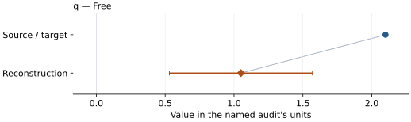
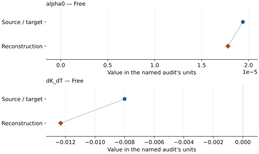
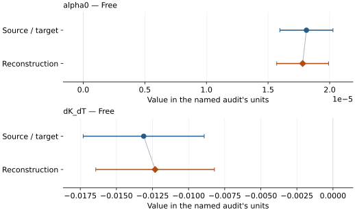

# B4C: EOS reconstruction reports

<!-- Generated by scripts.generate_reconstruction_reports; edit EOSMAT instead. -->

[All reconstruction reports](index.md) · [Material and EOS parameters](../material-summaries/b4c.md)

These reports explain the assessments already stored in EOSMAT. Generating
this page does not refit observations, change classifications or replace source coefficients.

Use [scientific label definitions](../eos-labels.md) to distinguish coefficient
agreement, source verification, author-workflow reproduction and recommendation for use.

| EOS record | Recorded outcome | Coefficient comparison |
| --- | --- | --- |
| [Somayazulu et al. (2023), BM3 + MGD](#record-b4c_somayazulu_2023_bm3_1) | Parity not achieved for this comparison | Graph and table |
| [Somayazulu et al. (2023), BM3 + Berman thermal reference state](#record-b4c_somayazulu_2023_berman_2) | Numerically similar, with qualifications | Graph and table |
| [Somayazulu et al. (2023), BM3 + Berman public-data refit](#record-b4c_somayazulu_2023_berman_refit) | Coefficient parity achieved | Graph and table |

## Somayazulu et al. (2023), BM3 + MGD

Record: `b4c_somayazulu_2023_bm3_1` · Model: `BM3`

**Outcome: Parity not achieved for this comparison.**

**Scope:** Comparison with the source parameterization.
**Comparison basis:** The recorded parameter reconstruction did not meet the audit's agreement criterion; the parameter comparisons retain the actual reconstructed values.

[Stored EOS coefficients and source](../material-summaries/b4c.md#record-b4c_somayazulu_2023_bm3_1)

### What this result establishes

**Separate source-review status:** primary\_source\_validated.
**Usage recommendation:** See the stored EOS qualifications; no recommendation is inferred here.

- This named numerical assessment alone does not establish author-workflow reproduction, physical accuracy or recommendation for use.

### Data and reconstruction method

- **Dataset identifiers:** b4c\_somayazulu\_2023\_table4\_pvt
- **Observations:** 41
- **Fit kind:** joint\_pvt
- **Selection:** 41 heated rows
- **Objective:** errors\_in\_variables
- **Absolute sigma:** True
- **Free parameters:** q
- **Fixed parameters:** V0; K0; K0\_prime; Tr; theta0; gamma0; n

Unspecified selections, weights, fixed values or error conventions remain unknown; they have not been inferred for this report.

### Source versus reconstruction

This is a **coefficient comparison**, not an observation or residual plot.
Each panel uses its coefficient's audit units and includes zero. Markers show
stored central values only. Error widths are retained in the table below;
no confidence interval or uncertainty band is inferred. Fixed/adopted values are constraints.

| Parameter | Source / target | Source error | Reconstruction | Reconstruction error | Fit role |
| --- | --- | --- | --- | --- | --- |
| q | 2.1 | Not specified | 1.049907085876978 | 0.519450728953149 | Free |

Values and reported errors are copied without rounding or conversion from the named audit. Missing errors mean unknown, not zero. Parameter names and volume conventions follow that audit; error widths do not imply a confidence convention.

Recorded diagnostics, covariance and additional protocol

- **Columns:**
    - **Pressure:** pressure\_gpa
    - **Temperature:** temperature\_k
    - **Volume:** volume\_a3
- **Observed pressure range gpa:** \[9.0, 49.4\]
- **Observed temperature range k:** \[1027.0, 2500.0\]
- **Observed volume range:** \[282.0, 320.0\]
- **Degrees of freedom:** 40
- **Solver success:** True
- **Solver message:** Both \`ftol\` and \`xtol\` termination conditions are satisfied.
- **Rmse gpa:** 1.1759335107150188
- **Published rmse gpa:** 1.3869131808668502
- **Reduced chi square:** 0.7670211979012587

### Detailed evidence and existing plots

- [Earlier detailed record investigation](../primary-eos-refits.md#investigation-b4c_somayazulu_2023_bm3_1).
- [Record-by-record numerical ledger](../primary-eos-refits.md#records).
- [Source-audit reports](../source-audits.md).

Observation curves and residual plots are provided by the supporting reports where available. Their absence is not filled by a reconstructed curve presented as measured data.

[Machine-readable comparison ledger](https://github.com/CPrescher/peritheos/blob/main/docs/data/primary-eos-refits.json) — look up `b4c_somayazulu_2023_bm3_1`.
[Complete native EOSMAT file](https://github.com/CPrescher/peritheos/blob/main/peritheos/data/materials/b4c.eosmat).

## Somayazulu et al. (2023), BM3 + Berman thermal reference state

Record: `b4c_somayazulu_2023_berman_2` · Model: `BM3`

**Outcome: Numerically similar, with qualifications.**

**Scope:** Comparison with the source parameterization.
**Comparison basis:** Every compared free coefficient meets either the recorded combined-two-sigma comparison or parameter-specific numerical similarity screen; the audit does not classify the complete comparison as parity.

[Stored EOS coefficients and source](../material-summaries/b4c.md#record-b4c_somayazulu_2023_berman_2)

### What this result establishes

**Separate source-review status:** primary\_source\_validated.
**Usage recommendation:** See the stored EOS qualifications; no recommendation is inferred here.

- This named numerical assessment alone does not establish author-workflow reproduction, physical accuracy or recommendation for use.

### Data and reconstruction method

- **Dataset identifiers:** b4c\_somayazulu\_2023\_table4\_pvt
- **Observations:** 41
- **Fit kind:** joint\_pvt
- **Selection:** 41 heated rows
- **Objective:** errors\_in\_variables
- **Absolute sigma:** True
- **Free parameters:** alpha0; dK\_dT
- **Fixed parameters:** V0; K0; K0\_prime; Tr; alpha1

Unspecified selections, weights, fixed values or error conventions remain unknown; they have not been inferred for this report.

### Source versus reconstruction

This is a **coefficient comparison**, not an observation or residual plot.
Each panel uses its coefficient's audit units and includes zero. Markers show
stored central values only. Error widths are retained in the table below;
no confidence interval or uncertainty band is inferred. Fixed/adopted values are constraints.

| Parameter | Source / target | Source error | Reconstruction | Reconstruction error | Fit role |
| --- | --- | --- | --- | --- | --- |
| alpha0 | 1.94e-05 | 1.6e-06 | 1.780734391266201e-05 | 2.1050303188941096e-06 | Free |
| dK\_dT | -0.008 | 0.003 | -0.012319391073918846 | 0.004109187809509253 | Free |

Values and reported errors are copied without rounding or conversion from the named audit. Missing errors mean unknown, not zero. Parameter names and volume conventions follow that audit; error widths do not imply a confidence convention.

Recorded diagnostics, covariance and additional protocol

- **Columns:**
    - **Pressure:** pressure\_gpa
    - **Temperature:** temperature\_k
    - **Volume:** volume\_a3
- **Observed pressure range gpa:** \[9.0, 49.4\]
- **Observed temperature range k:** \[1027.0, 2500.0\]
- **Observed volume range:** \[282.0, 320.0\]
- **Degrees of freedom:** 39
- **Solver success:** True
- **Solver message:** \`xtol\` termination condition is satisfied.
- **Rmse gpa:** 1.3648520258233532
- **Published rmse gpa:** 2.136498259147437
- **Reduced chi square:** 1.0387873919166093

### Detailed evidence and existing plots

- [Earlier detailed record investigation](../primary-eos-refits.md#investigation-b4c_somayazulu_2023_berman_2).
- [Record-by-record numerical ledger](../primary-eos-refits.md#records).
- [Source-audit reports](../source-audits.md).

Observation curves and residual plots are provided by the supporting reports where available. Their absence is not filled by a reconstructed curve presented as measured data.

[Machine-readable comparison ledger](https://github.com/CPrescher/peritheos/blob/main/docs/data/primary-eos-refits.json) — look up `b4c_somayazulu_2023_berman_2`.
[Complete native EOSMAT file](https://github.com/CPrescher/peritheos/blob/main/peritheos/data/materials/b4c.eosmat).

## Somayazulu et al. (2023), BM3 + Berman public-data refit

Record: `b4c_somayazulu_2023_berman_refit` · Model: `BM3`

**Outcome: Coefficient parity achieved.**

**Scope:** Reproduction of a stored independent Peritheos refit.
**Comparison basis:** Every compared free coefficient meets both the recorded combined-two-sigma comparison and parameter-specific numerical similarity screen. Error conventions and fit qualifications remain applicable.

[Stored EOS coefficients and source](../material-summaries/b4c.md#record-b4c_somayazulu_2023_berman_refit)

### What this result establishes

**Separate source-review status:** primary\_source\_validated.
**Usage recommendation:** See the stored EOS qualifications; no recommendation is inferred here.

- This comparison concerns the stored independent Peritheos refit, not recovery of the original publication's coefficients or author workflow.

### Data and reconstruction method

The source/target column below is the stored **Peritheos refit**. Agreement with it does not reproduce the original publication's coefficients.

- **Dataset identifiers:** b4c\_somayazulu\_2023\_table4\_pvt
- **Observations:** 41
- **Fit kind:** joint\_pvt
- **Selection:** 41 heated rows
- **Objective:** errors\_in\_variables
- **Absolute sigma:** True
- **Free parameters:** alpha0; dK\_dT
- **Fixed parameters:** V0; K0; K0\_prime; Tr; alpha1

Unspecified selections, weights, fixed values or error conventions remain unknown; they have not been inferred for this report.

### Source versus reconstruction

This is a **coefficient comparison**, not an observation or residual plot.
Each panel uses its coefficient's audit units and includes zero. Markers show
stored central values only. Error widths are retained in the table below;
no confidence interval or uncertainty band is inferred. Fixed/adopted values are constraints.

| Parameter | Source / target | Source error | Reconstruction | Reconstruction error | Fit role |
| --- | --- | --- | --- | --- | --- |
| alpha0 | 1.8112e-05 | 2.1554e-06 | 1.7806906808863976e-05 | 2.105023377647503e-06 | Free |
| dK\_dT | -0.01311 | 0.00419 | -0.01231848485201816 | 0.004109227420153722 | Free |

Values and reported errors are copied without rounding or conversion from the named audit. Missing errors mean unknown, not zero. Parameter names and volume conventions follow that audit; error widths do not imply a confidence convention.

Recorded diagnostics, covariance and additional protocol

- **Columns:**
    - **Pressure:** pressure\_gpa
    - **Temperature:** temperature\_k
    - **Volume:** volume\_a3
- **Observed pressure range gpa:** \[9.0, 49.4\]
- **Observed temperature range k:** \[1027.0, 2500.0\]
- **Observed volume range:** \[282.0, 320.0\]
- **Degrees of freedom:** 39
- **Solver success:** True
- **Solver message:** \`xtol\` termination condition is satisfied.
- **Rmse gpa:** 1.3648574391553514
- **Published rmse gpa:** 1.4739481878671772
- **Reduced chi square:** 1.0387873862338832

### Detailed evidence and existing plots

- [Record-by-record numerical ledger](../primary-eos-refits.md#records).
- [Source-audit reports](../source-audits.md).

Observation curves and residual plots are provided by the supporting reports where available. Their absence is not filled by a reconstructed curve presented as measured data.

[Machine-readable comparison ledger](https://github.com/CPrescher/peritheos/blob/main/docs/data/primary-eos-refits.json) — look up `b4c_somayazulu_2023_berman_refit`.
[Complete native EOSMAT file](https://github.com/CPrescher/peritheos/blob/main/peritheos/data/materials/b4c.eosmat).
