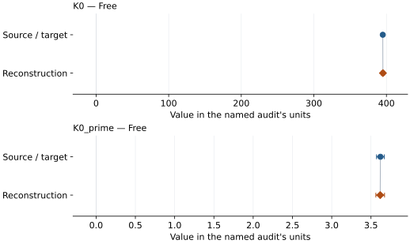
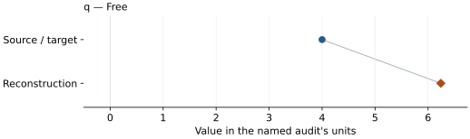

# Boron Nitride: EOS reconstruction reports

<!-- Generated by scripts.generate_reconstruction_reports; edit EOSMAT instead. -->

[All reconstruction reports](index.md) · [Material and EOS parameters](../material-summaries/boron_nitride.md)

These reports explain the assessments already stored in EOSMAT. Generating
this page does not refit observations, change classifications or replace source coefficients.

Use [scientific label definitions](../eos-labels.md) to distinguish coefficient
agreement, source verification, author-workflow reproduction and recommendation for use.

| EOS record | Recorded outcome | Coefficient comparison |
| --- | --- | --- |
| [Datchi et al. (2007), Vinet](#record-boron_nitride_datchi_2007_vinet_1) | Coefficient parity achieved | Graph and table |
| [Datchi et al. (2007), 0 K Vinet + MGD](#record-boron_nitride_datchi_2007_vinet_mgd_2) | Numerically similar, with qualifications | Graph and table |

## Datchi et al. (2007), Vinet

Record: `boron_nitride_datchi_2007_vinet_1` · Model: `Vinet`

**Outcome: Coefficient parity achieved.**

**Scope:** Comparison with the source parameterization.
**Comparison basis:** Every compared free coefficient meets both the recorded combined-two-sigma comparison and parameter-specific numerical similarity screen. Error conventions and fit qualifications remain applicable.

[Stored EOS coefficients and source](../material-summaries/boron_nitride.md#record-boron_nitride_datchi_2007_vinet_1)

### What this result establishes

**Separate source-review status:** primary\_source\_validated.
**Usage recommendation:** See the stored EOS qualifications; no recommendation is inferred here.

- This named numerical assessment alone does not establish author-workflow reproduction, physical accuracy or recommendation for use.

### Data and reconstruction method

- **Dataset identifiers:** cubic\_boron\_nitride\_datchi\_2007\_table4\_pvt
- **Observations:** 38
- **Fit kind:** isothermal\_pv
- **Selection:** all rows; reference-T rows
- **Objective:** pressure\_residuals
- **Absolute sigma:** True
- **Free parameters:** K0; K0\_prime
- **Fixed parameters:** V0

Unspecified selections, weights, fixed values or error conventions remain unknown; they have not been inferred for this report.

### Source versus reconstruction

This is a **coefficient comparison**, not an observation or residual plot.
Each panel uses its coefficient's audit units and includes zero. Markers show
stored central values only. Error widths are retained in the table below;
no confidence interval or uncertainty band is inferred. Fixed/adopted values are constraints.

| Parameter | Source / target | Source error | Reconstruction | Reconstruction error | Fit role |
| --- | --- | --- | --- | --- | --- |
| K0 | 395.0 | 2.0 | 395.16184460219006 | 2.2606899728837178 | Free |
| K0\_prime | 3.62 | 0.05 | 3.6171261603911873 | 0.05542308451761129 | Free |

Values and reported errors are copied without rounding or conversion from the named audit. Missing errors mean unknown, not zero. Parameter names and volume conventions follow that audit; error widths do not imply a confidence convention.

Recorded diagnostics, covariance and additional protocol

- **Columns:**
    - **Pressure:** pressure\_gpa
    - **Temperature:** temperature\_k
    - **Volume:** atomic\_volume\_a3
- **Observed pressure range gpa:** \[0.0, 162.5\]
- **Observed temperature range k:** \[295.0, 295.0\]
- **Observed volume range:** \[36.424, 47.256\]
- **Degrees of freedom:** 36
- **Solver success:** True
- **Solver message:** Both \`ftol\` and \`xtol\` termination conditions are satisfied.
- **Rmse gpa:** 0.5848254609210809
- **Published rmse gpa:** 0.5849199630636431
- **Reduced chi square:** 0.3610219763938633

### Detailed evidence and existing plots

- [Record-by-record numerical ledger](../primary-eos-refits.md#records).
- [Source-audit reports](../source-audits.md).

Observation curves and residual plots are provided by the supporting reports where available. Their absence is not filled by a reconstructed curve presented as measured data.

[Machine-readable comparison ledger](https://github.com/CPrescher/peritheos/blob/main/docs/data/primary-eos-refits.json) — look up `boron_nitride_datchi_2007_vinet_1`.
[Complete native EOSMAT file](https://github.com/CPrescher/peritheos/blob/main/peritheos/data/materials/boron_nitride.eosmat).

## Datchi et al. (2007), 0 K Vinet + MGD

Record: `boron_nitride_datchi_2007_vinet_mgd_2` · Model: `Vinet`

**Outcome: Numerically similar, with qualifications.**

**Scope:** Comparison with the source parameterization.
**Comparison basis:** Every compared free coefficient meets either the recorded combined-two-sigma comparison or parameter-specific numerical similarity screen; the audit does not classify the complete comparison as parity.

[Stored EOS coefficients and source](../material-summaries/boron_nitride.md#record-boron_nitride_datchi_2007_vinet_mgd_2)

### What this result establishes

**Separate source-review status:** primary\_source\_validated.
**Usage recommendation:** See the stored EOS qualifications; no recommendation is inferred here.

- This named numerical assessment alone does not establish author-workflow reproduction, physical accuracy or recommendation for use.

### Data and reconstruction method

- **Dataset identifiers:** cubic\_boron\_nitride\_datchi\_2007\_table4\_pvt
- **Observations:** 66
- **Fit kind:** joint\_pvt
- **Selection:** all rows
- **Objective:** pressure\_residuals
- **Absolute sigma:** True
- **Free parameters:** q
- **Fixed parameters:** V0; K0; K0\_prime; Tr; theta0; gamma0; n

Unspecified selections, weights, fixed values or error conventions remain unknown; they have not been inferred for this report.

### Source versus reconstruction

This is a **coefficient comparison**, not an observation or residual plot.
Each panel uses its coefficient's audit units and includes zero. Markers show
stored central values only. Error widths are retained in the table below;
no confidence interval or uncertainty band is inferred. Fixed/adopted values are constraints.

| Parameter | Source / target | Source error | Reconstruction | Reconstruction error | Fit role |
| --- | --- | --- | --- | --- | --- |
| q | 4.0 | 1.5 | 6.241100607705336 | 1.9742155371367653 | Free |

Values and reported errors are copied without rounding or conversion from the named audit. Missing errors mean unknown, not zero. Parameter names and volume conventions follow that audit; error widths do not imply a confidence convention.

Recorded diagnostics, covariance and additional protocol

- **Columns:**
    - **Pressure:** pressure\_gpa
    - **Temperature:** temperature\_k
    - **Volume:** atomic\_volume\_a3
- **Observed pressure range gpa:** \[0.0, 162.5\]
- **Observed temperature range k:** \[295.0, 948.0\]
- **Observed volume range:** \[36.424, 47.616\]
- **Degrees of freedom:** 65
- **Solver success:** True
- **Solver message:** \`ftol\` termination condition is satisfied.
- **Rmse gpa:** 0.5921916786848203
- **Published rmse gpa:** 0.588949793133316
- **Reduced chi square:** 0.35608623021590763

### Detailed evidence and existing plots

- [Earlier detailed record investigation](../primary-eos-refits.md#investigation-boron_nitride_datchi_2007_vinet_mgd_2).
- [Record-by-record numerical ledger](../primary-eos-refits.md#records).
- [Source-audit reports](../source-audits.md).

Observation curves and residual plots are provided by the supporting reports where available. Their absence is not filled by a reconstructed curve presented as measured data.

[Machine-readable comparison ledger](https://github.com/CPrescher/peritheos/blob/main/docs/data/primary-eos-refits.json) — look up `boron_nitride_datchi_2007_vinet_mgd_2`.
[Complete native EOSMAT file](https://github.com/CPrescher/peritheos/blob/main/peritheos/data/materials/boron_nitride.eosmat).
