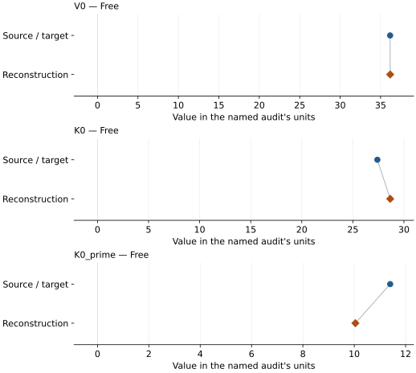

# Boron nitride (hexagonal): EOS reconstruction reports

<!-- Generated by scripts.generate_reconstruction_reports; edit EOSMAT instead. -->

[All reconstruction reports](index.md) · [Material and EOS parameters](../material-summaries/boron_nitride_hexagonal.md)

These reports explain the assessments already stored in EOSMAT. Generating
this page does not refit observations, change classifications or replace source coefficients.

Use [scientific label definitions](../eos-labels.md) to distinguish coefficient
agreement, source verification, author-workflow reproduction and recommendation for use.

| EOS record | Recorded outcome | Coefficient comparison |
| --- | --- | --- |
| [Muhammad et al. (2024), helium-medium BM3](#record-boron_nitride_hexagonal_muhammad_2024_bm3_1) | Coefficient parity achieved | Graph and table |

## Muhammad et al. (2024), helium-medium BM3

Record: `boron_nitride_hexagonal_muhammad_2024_bm3_1` · Model: `BM3`

**Outcome: Coefficient parity achieved.**

**Scope:** Comparison with the source parameterization.
**Comparison basis:** Every compared free coefficient meets both the recorded combined-two-sigma comparison and parameter-specific numerical similarity screen. Error conventions and fit qualifications remain applicable.

[Stored EOS coefficients and source](../material-summaries/boron_nitride_hexagonal.md#record-boron_nitride_hexagonal_muhammad_2024_bm3_1)

### What this result establishes

**Separate source-review status:** primary\_source\_validated.
**Usage recommendation:** See the stored EOS qualifications; no recommendation is inferred here.

- This named numerical assessment alone does not establish author-workflow reproduction, physical accuracy or recommendation for use.

### Data and reconstruction method

- **Dataset identifiers:** boron\_nitride\_hexagonal\_muhammad\_2024\_figure5c\_digitized
- **Observations:** 36
- **Fit kind:** isothermal\_pv
- **Selection:** all rows
- **Objective:** pressure\_residuals
- **Absolute sigma:** True
- **Free parameters:** V0; K0; K0\_prime
- **Fixed parameters:** None declared

Unspecified selections, weights, fixed values or error conventions remain unknown; they have not been inferred for this report.

### Source versus reconstruction

This is a **coefficient comparison**, not an observation or residual plot.
Each panel uses its coefficient's audit units and includes zero. Markers show
stored central values only. Error widths are retained in the table below;
no confidence interval or uncertainty band is inferred. Fixed/adopted values are constraints.

| Parameter | Source / target | Source error | Reconstruction | Reconstruction error | Fit role |
| --- | --- | --- | --- | --- | --- |
| V0 | 36.18 | 0.06 | 36.18537459744647 | 0.03381533585709163 | Free |
| K0 | 27.4 | 0.9 | 28.654603098547643 | 0.8659190294253547 | Free |
| K0\_prime | 11.4 | 0.8 | 10.045119272001996 | 0.4088877517871809 | Free |

Values and reported errors are copied without rounding or conversion from the named audit. Missing errors mean unknown, not zero. Parameter names and volume conventions follow that audit; error widths do not imply a confidence convention.

Recorded diagnostics, covariance and additional protocol

- **Columns:**
    - **Pressure:** pressure\_gpa
    - **Temperature:** Not specified
    - **Volume:** volume\_a3\_conventional\_cell
- **Observed pressure range gpa:** \[0.1825, 9.4175\]
- **Observed temperature range k:** Not specified
- **Observed volume range:** \[30.826266, 35.974552\]
- **Degrees of freedom:** 33
- **Solver success:** True
- **Solver message:** \`ftol\` termination condition is satisfied.
- **Rmse gpa:** 0.056695121627116415
- **Published rmse gpa:** 0.10273873260883355
- **Reduced chi square:** 1.4026197016640831

### Detailed evidence and existing plots

- [Record-by-record numerical ledger](../primary-eos-refits.md#records).
- [Source-audit reports](../source-audits.md).

Observation curves and residual plots are provided by the supporting reports where available. Their absence is not filled by a reconstructed curve presented as measured data.

[Machine-readable comparison ledger](https://github.com/CPrescher/peritheos/blob/main/docs/data/primary-eos-refits.json) — look up `boron_nitride_hexagonal_muhammad_2024_bm3_1`.
[Complete native EOSMAT file](https://github.com/CPrescher/peritheos/blob/main/peritheos/data/materials/boron_nitride_hexagonal.eosmat).
