# Bridgmanite: EOS reconstruction reports

<!-- Generated by scripts.generate_reconstruction_reports; edit EOSMAT instead. -->

[All reconstruction reports](index.md) · [Material and EOS parameters](../material-summaries/bridgmanite.md)

These reports explain the assessments already stored in EOSMAT. Generating
this page does not refit observations, change classifications or replace source coefficients.

Use [scientific label definitions](../eos-labels.md) to distinguish coefficient
agreement, source verification, author-workflow reproduction and recommendation for use.

| EOS record | Recorded outcome | Coefficient comparison |
| --- | --- | --- |
| [Tange et al. (2012), mantle-range BM3-MGD](#record-bridgmanite_tange_2012_bm3_1) | Numerically similar, with qualifications | Graph and table |
| [Tange et al. (2012), mantle-range Vinet-MGD](#record-bridgmanite_tange_2012_vinet_2) | Numerically similar, with qualifications | Graph and table |
| [Vanpeteghem et al. (2006), low-pressure single-crystal BM2](#record-bridgmanite_vanpeteghem_2006_bm2_3) | Coefficient parity achieved | Graph and table |
| [Saxena et al. (1999), 300 K BM3 slice](#record-bridgmanite_saxena_1999_bm3_4) | Numerically similar, with qualifications | Graph and table |
| [Katsura et al. (2009), preferred 300 K BM3](#record-bridgmanite_katsura_2009_bm3) | Numerically similar, with qualifications | Graph and table |
| [Katsura et al. (2009), K0-fixed 300 K BM3 sensitivity fit](#record-bridgmanite_katsura_2009_bm3_k0_fixed) | Coefficient parity achieved | Graph and table |
| [Wolf et al. (2015), reanalyzed Fe-free bridgmanite Vinet-MGD](#record-bridgmanite_wolf_2015_vinet_mgd_4) | Coefficient parity achieved | Graph and table |
| [Criniti et al. (2021), primary absolute-pressure BM3](#record-bridgmanite_criniti_2021_absolute_bm3) | Coefficient parity achieved | Graph and table |
| [Fiquet et al. (2000), post-heating 298 K BM3](#record-bridgmanite_fiquet_2000_bm3_1) | Coefficient parity achieved | Graph and table |
| [Metsue and Tsuchiya (2012), pure MgSiO3 static BM3 control](#record-bridgmanite_metsue_2012_static_bm3_1) | Complete independent refit unavailable | No numeric coefficient pair recorded |
| [Akber-Knutson et al. (2005), pure-MgSiO3 static GGA BM3](#record-bridgmanite_akber_knutson_2005_gga_bm3) | Complete independent refit unavailable | No numeric coefficient pair recorded |
| [Zhang and Wentzcovitch (2022), PHQ-LDA 300 K BM3](#record-bridgmanite_zhang_wentzcovitch_2022_phq_lda_300k_bm3) | Complete independent refit unavailable | No numeric coefficient pair recorded |
| [Zhang and Wentzcovitch (2022), PHQ-PBE 300 K BM3](#record-bridgmanite_zhang_wentzcovitch_2022_phq_pbe_300k_bm3) | Complete independent refit unavailable | No numeric coefficient pair recorded |
| [Mao et al. (1991), MgSiO3 K0'=4 fit](#record-bridgmanite_mao_1991_bm2_1) | Coefficient parity achieved | Graph and table |
| [Holland et al. (2013), mpv modified Tait](#record-bridgmanite_holland_2013_mpv_modified_tait) | Complete independent refit unavailable | No numeric coefficient pair recorded |
| [Li and Zeng (2009), GGA BM3](#record-bridgmanite_li_zeng_2009_gga_bm3) | Complete independent refit unavailable | No numeric coefficient pair recorded |
| [Li and Zeng (2009), GGA Vinet sensitivity](#record-bridgmanite_li_zeng_2009_gga_vinet) | Complete independent refit unavailable | No numeric coefficient pair recorded |
| [Li and Zeng (2009), GGA natural-strain-3 sensitivity](#record-bridgmanite_li_zeng_2009_gga_natural_strain3) | Complete independent refit unavailable | No numeric coefficient pair recorded |
| [Kiefer et al. (2002), MgSiO3 GGA BM3](#record-bridgmanite_kiefer_2002_gga_bm3) | Complete independent refit unavailable | No numeric coefficient pair recorded |
| [Deng et al. (2006), LDA third-order Birch fit](#record-bridgmanite_deng_2006_lda_bm3) | Complete independent refit unavailable | No numeric coefficient pair recorded |
| [Wu et al. (2013), MgSiO3 GGA BM3](#record-bridgmanite_wu_2013_gga_bm3) | Complete independent refit unavailable | No numeric coefficient pair recorded |
| [Liu et al. (2011), static GGA BM3](#record-bridgmanite_liu_2011_gga_static_bm3) | Complete independent refit unavailable | No numeric coefficient pair recorded |
| [Dorogokupets et al. (2015), 298 K generalized Rydberg-Stacey](#record-bridgmanite_dorogokupets_2015_298k_rydberg_stacey) | Parity not achieved for this comparison | Graph and table |
| [Hamahata et al. (2000), 300 K MD BM3](#record-bridgmanite_hamahata_2000_md_300k_bm3) | Complete independent refit unavailable | No numeric coefficient pair recorded |

## Tange et al. (2012), mantle-range BM3-MGD

Record: `bridgmanite_tange_2012_bm3_1` · Model: `BM3`

**Outcome: Numerically similar, with qualifications.**

**Scope:** Comparison with the source parameterization.
**Comparison basis:** Every compared free coefficient meets either the recorded combined-two-sigma comparison or parameter-specific numerical similarity screen; the audit does not classify the complete comparison as parity.

[Stored EOS coefficients and source](../material-summaries/bridgmanite.md#record-bridgmanite_tange_2012_bm3_1)

### What this result establishes

**Separate source-review status:** primary\_source\_validated.
**Usage recommendation:** See the stored EOS qualifications; no recommendation is inferred here.

- This named numerical assessment alone does not establish author-workflow reproduction, physical accuracy or recommendation for use.

### Data and reconstruction method

- **Dataset identifiers:** bridgmanite\_tange\_2012\_table1\_pvt
- **Observations:** 42
- **Fit kind:** joint\_pvt
- **Selection:** all rows
- **Objective:** errors\_in\_variables
- **Absolute sigma:** True
- **Free parameters:** rt\_eos.K0; rt\_eos.K0\_prime; theta0; gamma0; q
- **Fixed parameters:** V0

Unspecified selections, weights, fixed values or error conventions remain unknown; they have not been inferred for this report.

### Source versus reconstruction

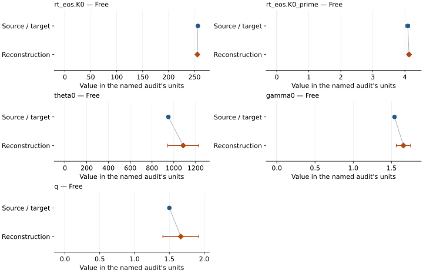

This is a **coefficient comparison**, not an observation or residual plot.
Each panel uses its coefficient's audit units and includes zero. Markers show
stored central values only. Error widths are retained in the table below;
no confidence interval or uncertainty band is inferred. Fixed/adopted values are constraints.

| Parameter | Source / target | Source error | Reconstruction | Reconstruction error | Fit role |
| --- | --- | --- | --- | --- | --- |
| rt\_eos.K0 | 256.7 | 1.5 | 255.63610330719632 | 1.2227734355407835 | Free |
| rt\_eos.K0\_prime | 4.09 | 0.06 | 4.12967726760114 | 0.04673558073372059 | Free |
| theta0 | 950.0 | Not specified | 1086.2748429366031 | 142.3372117417155 | Free |
| gamma0 | 1.54 | Not specified | 1.656240872686995 | 0.09333637945441978 | Free |
| q | 1.5 | Not specified | 1.664036179285288 | 0.2576471653327304 | Free |

Values and reported errors are copied without rounding or conversion from the named audit. Missing errors mean unknown, not zero. Parameter names and volume conventions follow that audit; error widths do not imply a confidence convention.

Recorded diagnostics, covariance and additional protocol

- **Columns:**
    - **Pressure:** pressure\_bm3\_gpa
    - **Temperature:** temperature\_k
    - **Volume:** unit\_cell\_volume\_a3
- **Observed pressure range gpa:** \[27.855, 108.3\]
- **Observed temperature range k:** \[300.0, 2430.0\]
- **Observed volume range:** \[128.1, 150.26\]
- **Degrees of freedom:** 37
- **Solver success:** True
- **Solver message:** Both \`ftol\` and \`xtol\` termination conditions are satisfied.
- **Rmse gpa:** 0.14546196922271423
- **Published rmse gpa:** 0.29288359405650327
- **Reduced chi square:** 0.8343143632916399

### Detailed evidence and existing plots

- [Earlier detailed record investigation](../primary-eos-refits.md#investigation-bridgmanite_tange_2012_bm3_1).
- [Record-by-record numerical ledger](../primary-eos-refits.md#records).
- [Source-audit reports](../source-audits.md).

Observation curves and residual plots are provided by the supporting reports where available. Their absence is not filled by a reconstructed curve presented as measured data.

[Machine-readable comparison ledger](https://github.com/CPrescher/peritheos/blob/main/docs/data/primary-eos-refits.json) — look up `bridgmanite_tange_2012_bm3_1`.
[Complete native EOSMAT file](https://github.com/CPrescher/peritheos/blob/main/peritheos/data/materials/bridgmanite.eosmat).

## Tange et al. (2012), mantle-range Vinet-MGD

Record: `bridgmanite_tange_2012_vinet_2` · Model: `Vinet`

**Outcome: Numerically similar, with qualifications.**

**Scope:** Comparison with the source parameterization.
**Comparison basis:** Every compared free coefficient meets either the recorded combined-two-sigma comparison or parameter-specific numerical similarity screen; the audit does not classify the complete comparison as parity.

[Stored EOS coefficients and source](../material-summaries/bridgmanite.md#record-bridgmanite_tange_2012_vinet_2)

### What this result establishes

**Separate source-review status:** primary\_source\_validated.
**Usage recommendation:** See the stored EOS qualifications; no recommendation is inferred here.

- This named numerical assessment alone does not establish author-workflow reproduction, physical accuracy or recommendation for use.

### Data and reconstruction method

- **Dataset identifiers:** bridgmanite\_tange\_2012\_table1\_pvt
- **Observations:** 42
- **Fit kind:** joint\_pvt
- **Selection:** all rows
- **Objective:** errors\_in\_variables
- **Absolute sigma:** True
- **Free parameters:** rt\_eos.K0; rt\_eos.K0\_prime; theta0; gamma0; q
- **Fixed parameters:** V0

Unspecified selections, weights, fixed values or error conventions remain unknown; they have not been inferred for this report.

### Source versus reconstruction

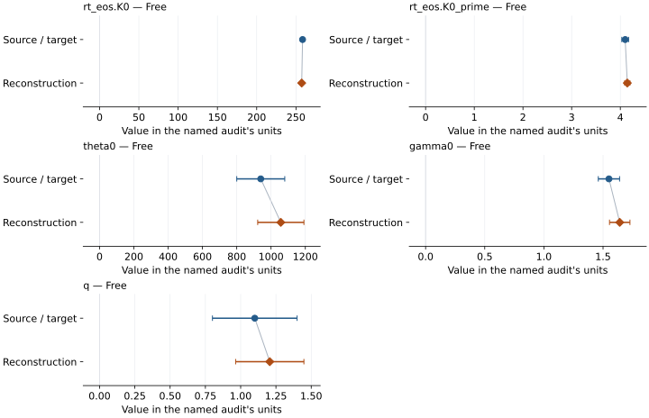

This is a **coefficient comparison**, not an observation or residual plot.
Each panel uses its coefficient's audit units and includes zero. Markers show
stored central values only. Error widths are retained in the table below;
no confidence interval or uncertainty band is inferred. Fixed/adopted values are constraints.

| Parameter | Source / target | Source error | Reconstruction | Reconstruction error | Fit role |
| --- | --- | --- | --- | --- | --- |
| rt\_eos.K0 | 258.4 | 1.7 | 257.2985406658008 | 1.3091539261690839 | Free |
| rt\_eos.K0\_prime | 4.1 | 0.07 | 4.143447741632316 | 0.054324666204031966 | Free |
| theta0 | 940.0 | Not specified | 1056.9221699968332 | 134.7340535372431 | Free |
| gamma0 | 1.55 | Not specified | 1.6411659546684216 | 0.08636308988288818 | Free |
| q | 1.1 | Not specified | 1.2063128272580372 | 0.2419367925321258 | Free |

Values and reported errors are copied without rounding or conversion from the named audit. Missing errors mean unknown, not zero. Parameter names and volume conventions follow that audit; error widths do not imply a confidence convention.

Recorded diagnostics, covariance and additional protocol

- **Columns:**
    - **Pressure:** pressure\_vinet\_gpa
    - **Temperature:** temperature\_k
    - **Volume:** unit\_cell\_volume\_a3
- **Observed pressure range gpa:** \[27.966, 108.5\]
- **Observed temperature range k:** \[300.0, 2430.0\]
- **Observed volume range:** \[128.1, 150.26\]
- **Degrees of freedom:** 37
- **Solver success:** True
- **Solver message:** Both \`ftol\` and \`xtol\` termination conditions are satisfied.
- **Rmse gpa:** 0.14848743433412506
- **Published rmse gpa:** 0.2993188690148455
- **Reduced chi square:** 0.9008642312013324

### Detailed evidence and existing plots

- [Earlier detailed record investigation](../primary-eos-refits.md#investigation-bridgmanite_tange_2012_vinet_2).
- [Record-by-record numerical ledger](../primary-eos-refits.md#records).
- [Source-audit reports](../source-audits.md).

Observation curves and residual plots are provided by the supporting reports where available. Their absence is not filled by a reconstructed curve presented as measured data.

[Machine-readable comparison ledger](https://github.com/CPrescher/peritheos/blob/main/docs/data/primary-eos-refits.json) — look up `bridgmanite_tange_2012_vinet_2`.
[Complete native EOSMAT file](https://github.com/CPrescher/peritheos/blob/main/peritheos/data/materials/bridgmanite.eosmat).

## Vanpeteghem et al. (2006), low-pressure single-crystal BM2

Record: `bridgmanite_vanpeteghem_2006_bm2_3` · Model: `BM2`

**Outcome: Coefficient parity achieved.**

**Scope:** Comparison with the source parameterization.
**Comparison basis:** Every compared free coefficient meets both the recorded combined-two-sigma comparison and parameter-specific numerical similarity screen. Error conventions and fit qualifications remain applicable.

[Stored EOS coefficients and source](../material-summaries/bridgmanite.md#record-bridgmanite_vanpeteghem_2006_bm2_3)

### What this result establishes

**Separate source-review status:** primary\_source\_validated.
**Usage recommendation:** See the stored EOS qualifications; no recommendation is inferred here.

- This named numerical assessment alone does not establish author-workflow reproduction, physical accuracy or recommendation for use.

### Data and reconstruction method

- **Dataset identifiers:** bridgmanite\_vanpeteghem\_2006\_table1\_compression
- **Observations:** 12
- **Fit kind:** isothermal\_pv
- **Selection:** all rows
- **Objective:** errors\_in\_variables
- **Absolute sigma:** True
- **Free parameters:** V0; K0
- **Fixed parameters:** None declared

Unspecified selections, weights, fixed values or error conventions remain unknown; they have not been inferred for this report.

### Source versus reconstruction

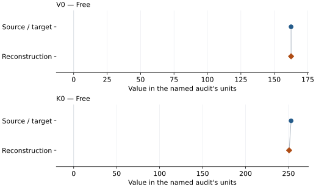

This is a **coefficient comparison**, not an observation or residual plot.
Each panel uses its coefficient's audit units and includes zero. Markers show
stored central values only. Error widths are retained in the table below;
no confidence interval or uncertainty band is inferred. Fixed/adopted values are constraints.

| Parameter | Source / target | Source error | Reconstruction | Reconstruction error | Fit role |
| --- | --- | --- | --- | --- | --- |
| V0 | 162.51 | 0.02 | 162.52993303517428 | 0.014010927229666304 | Free |
| K0 | 253.0 | 1.0 | 250.70955473325915 | 1.0065564576926984 | Free |

Values and reported errors are copied without rounding or conversion from the named audit. Missing errors mean unknown, not zero. Parameter names and volume conventions follow that audit; error widths do not imply a confidence convention.

Recorded diagnostics, covariance and additional protocol

- **Columns:**
    - **Pressure:** pressure\_gpa
    - **Temperature:** Not specified
    - **Volume:** unit\_cell\_volume\_a3
- **Observed pressure range gpa:** \[0.01, 10.04\]
- **Observed temperature range k:** Not specified
- **Observed volume range:** \[156.56, 162.57\]
- **Degrees of freedom:** 10
- **Solver success:** True
- **Solver message:** Both \`ftol\` and \`xtol\` termination conditions are satisfied.
- **Rmse gpa:** 0.025969754420952482
- **Published rmse gpa:** 0.06029576675571027
- **Reduced chi square:** 1.703161700524592

### Detailed evidence and existing plots

- [Record-by-record numerical ledger](../primary-eos-refits.md#records).
- [Source-audit reports](../source-audits.md).

Observation curves and residual plots are provided by the supporting reports where available. Their absence is not filled by a reconstructed curve presented as measured data.

[Machine-readable comparison ledger](https://github.com/CPrescher/peritheos/blob/main/docs/data/primary-eos-refits.json) — look up `bridgmanite_vanpeteghem_2006_bm2_3`.
[Complete native EOSMAT file](https://github.com/CPrescher/peritheos/blob/main/peritheos/data/materials/bridgmanite.eosmat).

## Saxena et al. (1999), 300 K BM3 slice

Record: `bridgmanite_saxena_1999_bm3_4` · Model: `BM3`

**Outcome: Numerically similar, with qualifications.**

**Scope:** Comparison with the source parameterization.
**Comparison basis:** Every compared free coefficient meets either the recorded combined-two-sigma comparison or parameter-specific numerical similarity screen; the audit does not classify the complete comparison as parity.

[Stored EOS coefficients and source](../material-summaries/bridgmanite.md#record-bridgmanite_saxena_1999_bm3_4)

### What this result establishes

**Separate source-review status:** primary\_source\_validated.
**Usage recommendation:** See the stored EOS qualifications; no recommendation is inferred here.

- This named numerical assessment alone does not establish author-workflow reproduction, physical accuracy or recommendation for use.

### Data and reconstruction method

- **Dataset identifiers:** bridgmanite\_saxena\_1999\_table1\_pvt
- **Observations:** 10
- **Fit kind:** isothermal\_pv
- **Selection:** all rows; reference-T rows
- **Objective:** errors\_in\_variables
- **Absolute sigma:** True
- **Free parameters:** V0; K0
- **Fixed parameters:** K0\_prime

Unspecified selections, weights, fixed values or error conventions remain unknown; they have not been inferred for this report.

### Source versus reconstruction

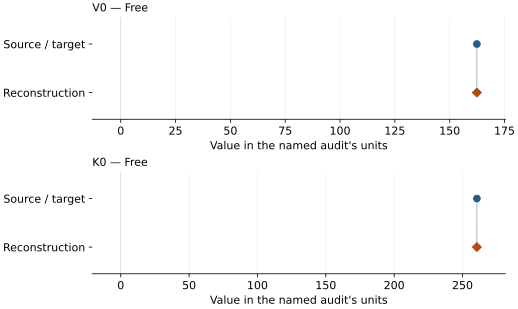

This is a **coefficient comparison**, not an observation or residual plot.
Each panel uses its coefficient's audit units and includes zero. Markers show
stored central values only. Error widths are retained in the table below;
no confidence interval or uncertainty band is inferred. Fixed/adopted values are constraints.

| Parameter | Source / target | Source error | Reconstruction | Reconstruction error | Fit role |
| --- | --- | --- | --- | --- | --- |
| V0 | 162.4007 | Not specified | 162.3833955128058 | 0.9678803105396369 | Free |
| K0 | 260.51 | Not specified | 260.5052137003601 | 11.54296789060183 | Free |

Values and reported errors are copied without rounding or conversion from the named audit. Missing errors mean unknown, not zero. Parameter names and volume conventions follow that audit; error widths do not imply a confidence convention.

Recorded diagnostics, covariance and additional protocol

- **Columns:**
    - **Pressure:** pressure\_gpa
    - **Temperature:** temperature\_k
    - **Volume:** molar\_volume\_cm3\_mol
- **Observed pressure range gpa:** \[36.2, 82.5\]
- **Observed temperature range k:** \[300.0, 300.0\]
- **Observed volume range:** \[131.82023330852866, 145.2905262214429\]
- **Degrees of freedom:** 8
- **Solver success:** True
- **Solver message:** Both \`ftol\` and \`xtol\` termination conditions are satisfied.
- **Rmse gpa:** 0.007035690135033842
- **Published rmse gpa:** 0.06179618857537843
- **Reduced chi square:** 9.326487189620008e-05

### Detailed evidence and existing plots

- [Earlier detailed record investigation](../primary-eos-refits.md#investigation-bridgmanite_saxena_1999_bm3_4).
- [Record-by-record numerical ledger](../primary-eos-refits.md#records).
- [Source-audit reports](../source-audits.md).

Observation curves and residual plots are provided by the supporting reports where available. Their absence is not filled by a reconstructed curve presented as measured data.

[Machine-readable comparison ledger](https://github.com/CPrescher/peritheos/blob/main/docs/data/primary-eos-refits.json) — look up `bridgmanite_saxena_1999_bm3_4`.
[Complete native EOSMAT file](https://github.com/CPrescher/peritheos/blob/main/peritheos/data/materials/bridgmanite.eosmat).

## Katsura et al. (2009), preferred 300 K BM3

Record: `bridgmanite_katsura_2009_bm3` · Model: `BM3`

**Outcome: Numerically similar, with qualifications.**

**Scope:** Comparison with the source parameterization.
**Comparison basis:** Every compared free coefficient meets either the recorded combined-two-sigma comparison or parameter-specific numerical similarity screen; the audit does not classify the complete comparison as parity.

[Stored EOS coefficients and source](../material-summaries/bridgmanite.md#record-bridgmanite_katsura_2009_bm3)

### What this result establishes

**Separate source-review status:** primary\_source\_validated.
**Usage recommendation:** See the stored EOS qualifications; no recommendation is inferred here.

- This named numerical assessment alone does not establish author-workflow reproduction, physical accuracy or recommendation for use.

### Data and reconstruction method

- **Dataset identifiers:** bridgmanite\_katsura\_2009\_corrected\_table1\_pvt
- **Observations:** 7
- **Fit kind:** isothermal\_pv
- **Selection:** all rows; reference-T rows
- **Objective:** errors\_in\_variables
- **Absolute sigma:** True
- **Free parameters:** K0; K0\_prime
- **Fixed parameters:** V0

Unspecified selections, weights, fixed values or error conventions remain unknown; they have not been inferred for this report.

### Source versus reconstruction

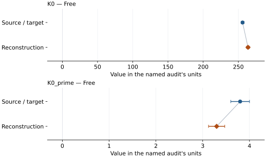

This is a **coefficient comparison**, not an observation or residual plot.
Each panel uses its coefficient's audit units and includes zero. Markers show
stored central values only. Error widths are retained in the table below;
no confidence interval or uncertainty band is inferred. Fixed/adopted values are constraints.

| Parameter | Source / target | Source error | Reconstruction | Reconstruction error | Fit role |
| --- | --- | --- | --- | --- | --- |
| K0 | 256.0 | 2.0 | 263.72699210482887 | 2.1036410524110387 | Free |
| K0\_prime | 3.8 | 0.2 | 3.2980699633457764 | 0.17354107840256552 | Free |

Values and reported errors are copied without rounding or conversion from the named audit. Missing errors mean unknown, not zero. Parameter names and volume conventions follow that audit; error widths do not imply a confidence convention.

Recorded diagnostics, covariance and additional protocol

- **Columns:**
    - **Pressure:** pressure\_gpa
    - **Temperature:** temperature\_k
    - **Volume:** bridgmanite\_v\_v0
- **Observed pressure range gpa:** \[18.9, 48.2\]
- **Observed temperature range k:** \[300.0, 305.0\]
- **Observed volume range:** \[140.59345149893778, 152.3988845365594\]
- **Degrees of freedom:** 5
- **Solver success:** True
- **Solver message:** Both \`ftol\` and \`xtol\` termination conditions are satisfied.
- **Rmse gpa:** 0.20777312724021518
- **Published rmse gpa:** 0.2985707120224261
- **Reduced chi square:** 4.508706240542179

### Detailed evidence and existing plots

- [Earlier detailed record investigation](../primary-eos-refits.md#investigation-bridgmanite_katsura_2009_bm3).
- [Record-by-record numerical ledger](../primary-eos-refits.md#records).
- [Source-audit reports](../source-audits.md).

Observation curves and residual plots are provided by the supporting reports where available. Their absence is not filled by a reconstructed curve presented as measured data.

[Machine-readable comparison ledger](https://github.com/CPrescher/peritheos/blob/main/docs/data/primary-eos-refits.json) — look up `bridgmanite_katsura_2009_bm3`.
[Complete native EOSMAT file](https://github.com/CPrescher/peritheos/blob/main/peritheos/data/materials/bridgmanite.eosmat).

## Katsura et al. (2009), K0-fixed 300 K BM3 sensitivity fit

Record: `bridgmanite_katsura_2009_bm3_k0_fixed` · Model: `BM3`

**Outcome: Coefficient parity achieved.**

**Scope:** Comparison with the source parameterization.
**Comparison basis:** Every compared free coefficient meets both the recorded combined-two-sigma comparison and parameter-specific numerical similarity screen. Error conventions and fit qualifications remain applicable.

[Stored EOS coefficients and source](../material-summaries/bridgmanite.md#record-bridgmanite_katsura_2009_bm3_k0_fixed)

### What this result establishes

**Separate source-review status:** primary\_source\_validated.
**Usage recommendation:** See the stored EOS qualifications; no recommendation is inferred here.

- This named numerical assessment alone does not establish author-workflow reproduction, physical accuracy or recommendation for use.

### Data and reconstruction method

- **Dataset identifiers:** bridgmanite\_katsura\_2009\_corrected\_table1\_pvt
- **Observations:** 7
- **Fit kind:** isothermal\_pv
- **Selection:** all rows; reference-T rows
- **Objective:** errors\_in\_variables
- **Absolute sigma:** True
- **Free parameters:** K0\_prime
- **Fixed parameters:** V0; K0

Unspecified selections, weights, fixed values or error conventions remain unknown; they have not been inferred for this report.

### Source versus reconstruction

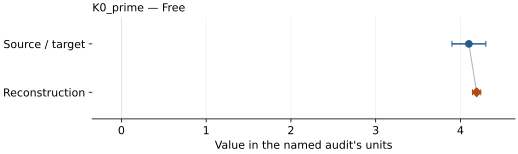

This is a **coefficient comparison**, not an observation or residual plot.
Each panel uses its coefficient's audit units and includes zero. Markers show
stored central values only. Error widths are retained in the table below;
no confidence interval or uncertainty band is inferred. Fixed/adopted values are constraints.

| Parameter | Source / target | Source error | Reconstruction | Reconstruction error | Fit role |
| --- | --- | --- | --- | --- | --- |
| K0\_prime | 4.1 | 0.2 | 4.191064992452868 | 0.04852180550600162 | Free |

Values and reported errors are copied without rounding or conversion from the named audit. Missing errors mean unknown, not zero. Parameter names and volume conventions follow that audit; error widths do not imply a confidence convention.

Recorded diagnostics, covariance and additional protocol

- **Columns:**
    - **Pressure:** pressure\_gpa
    - **Temperature:** temperature\_k
    - **Volume:** bridgmanite\_v\_v0
- **Observed pressure range gpa:** \[18.9, 48.2\]
- **Observed temperature range k:** \[300.0, 305.0\]
- **Observed volume range:** \[140.59345149893778, 152.3988845365594\]
- **Degrees of freedom:** 6
- **Solver success:** True
- **Solver message:** Both \`ftol\` and \`xtol\` termination conditions are satisfied.
- **Rmse gpa:** 0.41244693877264843
- **Published rmse gpa:** 0.4189783268347747
- **Reduced chi square:** 8.00984344072586

### Detailed evidence and existing plots

- [Record-by-record numerical ledger](../primary-eos-refits.md#records).
- [Source-audit reports](../source-audits.md).

Observation curves and residual plots are provided by the supporting reports where available. Their absence is not filled by a reconstructed curve presented as measured data.

[Machine-readable comparison ledger](https://github.com/CPrescher/peritheos/blob/main/docs/data/primary-eos-refits.json) — look up `bridgmanite_katsura_2009_bm3_k0_fixed`.
[Complete native EOSMAT file](https://github.com/CPrescher/peritheos/blob/main/peritheos/data/materials/bridgmanite.eosmat).

## Wolf et al. (2015), reanalyzed Fe-free bridgmanite Vinet-MGD

Record: `bridgmanite_wolf_2015_vinet_mgd_4` · Model: `Vinet`

**Outcome: Coefficient parity achieved.**

**Scope:** Comparison with the source parameterization.
**Comparison basis:** Every compared free coefficient meets both the recorded combined-two-sigma comparison and parameter-specific numerical similarity screen. Error conventions and fit qualifications remain applicable.

[Stored EOS coefficients and source](../material-summaries/bridgmanite.md#record-bridgmanite_wolf_2015_vinet_mgd_4)

### What this result establishes

**Separate source-review status:** primary\_source\_validated.
**Usage recommendation:** See the stored EOS qualifications; no recommendation is inferred here.

- This named numerical assessment alone does not establish author-workflow reproduction, physical accuracy or recommendation for use.

### Data and reconstruction method

- **Dataset identifiers:** bridgmanite\_wolf\_2015\_table2\_pvt
- **Observations:** 42
- **Fit kind:** joint\_pvt
- **Selection:** all rows
- **Objective:** errors\_in\_variables
- **Absolute sigma:** True
- **Free parameters:** rt\_eos.V0; rt\_eos.K0; rt\_eos.K0\_prime; gamma0; q
- **Fixed parameters:** Tr; theta0; n

Unspecified selections, weights, fixed values or error conventions remain unknown; they have not been inferred for this report.

### Source versus reconstruction

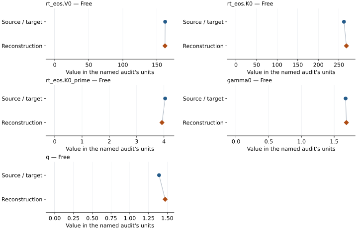

This is a **coefficient comparison**, not an observation or residual plot.
Each panel uses its coefficient's audit units and includes zero. Markers show
stored central values only. Error widths are retained in the table below;
no confidence interval or uncertainty band is inferred. Fixed/adopted values are constraints.

| Parameter | Source / target | Source error | Reconstruction | Reconstruction error | Fit role |
| --- | --- | --- | --- | --- | --- |
| rt\_eos.V0 | 162.12 | 0.13 | 161.88477479078992 | 0.21420963994351946 | Free |
| rt\_eos.K0 | 262.3 | 3.2 | 268.2177787729877 | 5.419993377852128 | Free |
| rt\_eos.K0\_prime | 4.044 | 0.075 | 3.927017300036262 | 0.11940820073575169 | Free |
| gamma0 | 1.675 | 0.045 | 1.6865775004026424 | 0.059762565727720214 | Free |
| q | 1.39 | 0.16 | 1.4713155780043 | 0.2139118547284508 | Free |

Values and reported errors are copied without rounding or conversion from the named audit. Missing errors mean unknown, not zero. Parameter names and volume conventions follow that audit; error widths do not imply a confidence convention.

Recorded diagnostics, covariance and additional protocol

- **Columns:**
    - **Pressure:** pressure\_gpa
    - **Temperature:** temperature\_k
    - **Volume:** bridgmanite\_unit\_cell\_volume\_a3
- **Observed pressure range gpa:** \[27.96, 108.51\]
- **Observed temperature range k:** \[300.0, 2430.0\]
- **Observed volume range:** \[128.1, 150.26\]
- **Degrees of freedom:** 37
- **Solver success:** True
- **Solver message:** Both \`ftol\` and \`xtol\` termination conditions are satisfied.
- **Rmse gpa:** 0.18256917829299024
- **Published rmse gpa:** 0.3027410708205382
- **Reduced chi square:** 0.5826646312273345

### Detailed evidence and existing plots

- [Record-by-record numerical ledger](../primary-eos-refits.md#records).
- [Source-audit reports](../source-audits.md).

Observation curves and residual plots are provided by the supporting reports where available. Their absence is not filled by a reconstructed curve presented as measured data.

[Machine-readable comparison ledger](https://github.com/CPrescher/peritheos/blob/main/docs/data/primary-eos-refits.json) — look up `bridgmanite_wolf_2015_vinet_mgd_4`.
[Complete native EOSMAT file](https://github.com/CPrescher/peritheos/blob/main/peritheos/data/materials/bridgmanite.eosmat).

## Criniti et al. (2021), primary absolute-pressure BM3

Record: `bridgmanite_criniti_2021_absolute_bm3` · Model: `BM3`

**Outcome: Coefficient parity achieved.**

**Scope:** Comparison with the source parameterization.
**Comparison basis:** Every compared free coefficient meets both the recorded combined-two-sigma comparison and parameter-specific numerical similarity screen. Error conventions and fit qualifications remain applicable.

[Stored EOS coefficients and source](../material-summaries/bridgmanite.md#record-bridgmanite_criniti_2021_absolute_bm3)

### What this result establishes

**Separate source-review status:** primary\_source\_validated.
**Usage recommendation:** See the stored EOS qualifications; no recommendation is inferred here.

- This named numerical assessment alone does not establish author-workflow reproduction, physical accuracy or recommendation for use.

### Data and reconstruction method

- **Dataset identifiers:** bridgmanite\_criniti\_2021\_table1\_density
- **Observations:** 14
- **Fit kind:** isothermal\_pv
- **Selection:** all rows
- **Objective:** errors\_in\_variables
- **Absolute sigma:** True
- **Free parameters:** K0; K0\_prime
- **Fixed parameters:** V0

Unspecified selections, weights, fixed values or error conventions remain unknown; they have not been inferred for this report.

### Source versus reconstruction

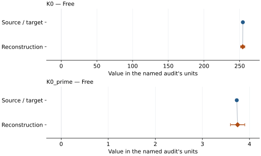

This is a **coefficient comparison**, not an observation or residual plot.
Each panel uses its coefficient's audit units and includes zero. Markers show
stored central values only. Error widths are retained in the table below;
no confidence interval or uncertainty band is inferred. Fixed/adopted values are constraints.

| Parameter | Source / target | Source error | Reconstruction | Reconstruction error | Fit role |
| --- | --- | --- | --- | --- | --- |
| K0 | 254.5 | 0.4 | 254.26813669744593 | 2.93452853420738 | Free |
| K0\_prime | 3.73 | 0.02 | 3.74772534340329 | 0.15275230295639503 | Free |

Values and reported errors are copied without rounding or conversion from the named audit. Missing errors mean unknown, not zero. Parameter names and volume conventions follow that audit; error widths do not imply a confidence convention.

Recorded diagnostics, covariance and additional protocol

- **Columns:**
    - **Pressure:** pressure\_gpa
    - **Temperature:** Not specified
    - **Volume:** volume\_a3\_conventional\_cell
- **Observed pressure range gpa:** \[0.0001, 78.8\]
- **Observed temperature range k:** Not specified
- **Observed volume range:** \[131.776574, 162.453274\]
- **Degrees of freedom:** 12
- **Solver success:** True
- **Solver message:** Both \`ftol\` and \`xtol\` termination conditions are satisfied.
- **Rmse gpa:** 0.007864808530279974
- **Published rmse gpa:** 0.06587481778903671
- **Reduced chi square:** 0.002412093370982601

### Detailed evidence and existing plots

- [Record-by-record numerical ledger](../primary-eos-refits.md#records).
- [Source-audit reports](../source-audits.md).

Observation curves and residual plots are provided by the supporting reports where available. Their absence is not filled by a reconstructed curve presented as measured data.

[Machine-readable comparison ledger](https://github.com/CPrescher/peritheos/blob/main/docs/data/primary-eos-refits.json) — look up `bridgmanite_criniti_2021_absolute_bm3`.
[Complete native EOSMAT file](https://github.com/CPrescher/peritheos/blob/main/peritheos/data/materials/bridgmanite.eosmat).

## Fiquet et al. (2000), post-heating 298 K BM3

Record: `bridgmanite_fiquet_2000_bm3_1` · Model: `BM3`

**Outcome: Coefficient parity achieved.**

**Scope:** Comparison with the source parameterization.
**Comparison basis:** Every compared free coefficient meets both the recorded combined-two-sigma comparison and parameter-specific numerical similarity screen. Error conventions and fit qualifications remain applicable.

[Stored EOS coefficients and source](../material-summaries/bridgmanite.md#record-bridgmanite_fiquet_2000_bm3_1)

### What this result establishes

**Separate source-review status:** primary\_source\_validated.
**Usage recommendation:** See the stored EOS qualifications; no recommendation is inferred here.

- This named numerical assessment alone does not establish author-workflow reproduction, physical accuracy or recommendation for use.

### Data and reconstruction method

- **Dataset identifiers:** bridgmanite\_fiquet\_2000\_table1\_298k\_pv
- **Observations:** 25
- **Fit kind:** isothermal\_pv
- **Selection:** all rows; reference-T rows
- **Objective:** errors\_in\_variables
- **Absolute sigma:** True
- **Free parameters:** V0; K0; K0\_prime
- **Fixed parameters:** None declared

Unspecified selections, weights, fixed values or error conventions remain unknown; they have not been inferred for this report.

### Source versus reconstruction

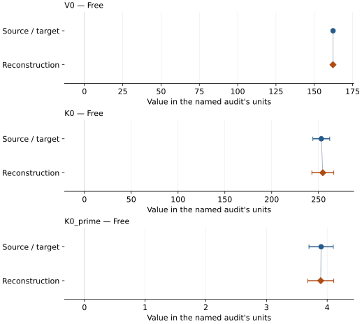

This is a **coefficient comparison**, not an observation or residual plot.
Each panel uses its coefficient's audit units and includes zero. Markers show
stored central values only. Error widths are retained in the table below;
no confidence interval or uncertainty band is inferred. Fixed/adopted values are constraints.

| Parameter | Source / target | Source error | Reconstruction | Reconstruction error | Fit role |
| --- | --- | --- | --- | --- | --- |
| V0 | 162.27 | 0.01 | 162.2068809474657 | 0.5263134925283031 | Free |
| K0 | 253.0 | 9.0 | 254.61118516251946 | 11.71402405767663 | Free |
| K0\_prime | 3.9 | 0.2 | 3.893302709983108 | 0.21519736763701536 | Free |

Values and reported errors are copied without rounding or conversion from the named audit. Missing errors mean unknown, not zero. Parameter names and volume conventions follow that audit; error widths do not imply a confidence convention.

Recorded diagnostics, covariance and additional protocol

- **Columns:**
    - **Pressure:** pressure\_gpa
    - **Temperature:** temperature\_k
    - **Volume:** cell\_volume\_a3
- **Observed pressure range gpa:** \[29.5, 90.57\]
- **Observed temperature range k:** \[298.0, 298.0\]
- **Observed volume range:** \[129.292, 147.178\]
- **Degrees of freedom:** 22
- **Solver success:** True
- **Solver message:** \`ftol\` termination condition is satisfied.
- **Rmse gpa:** 0.6384057327070228
- **Published rmse gpa:** 0.7070408617293515
- **Reduced chi square:** 5.50071179561345

### Detailed evidence and existing plots

- [Record-by-record numerical ledger](../primary-eos-refits.md#records).
- [Source-audit reports](../source-audits.md).

Observation curves and residual plots are provided by the supporting reports where available. Their absence is not filled by a reconstructed curve presented as measured data.

[Machine-readable comparison ledger](https://github.com/CPrescher/peritheos/blob/main/docs/data/primary-eos-refits.json) — look up `bridgmanite_fiquet_2000_bm3_1`.
[Complete native EOSMAT file](https://github.com/CPrescher/peritheos/blob/main/peritheos/data/materials/bridgmanite.eosmat).

## Metsue and Tsuchiya (2012), pure MgSiO3 static BM3 control

Record: `bridgmanite_metsue_2012_static_bm3_1` · Model: `BM3`

**Outcome: Complete independent refit unavailable.**

**Scope:** Comparison with the source parameterization.
**Comparison basis:** The coefficients and six calculation pressures are stated; row-wise calculated P-V values are not tabulated.

[Stored EOS coefficients and source](../material-summaries/bridgmanite.md#record-bridgmanite_metsue_2012_static_bm3_1)

### What this result establishes

**Separate source-review status:** primary\_source\_validated.
**Usage recommendation:** See the stored EOS qualifications; no recommendation is inferred here.

- This named numerical assessment alone does not establish author-workflow reproduction, physical accuracy or recommendation for use.
- No reconstructed coefficient table is recorded for this assessment; no missing values have been inferred.

### Data and reconstruction method

- **Dataset identifiers:** None declared
- **Fixed parameters:** K0\_prime

Unspecified selections, weights, fixed values or error conventions remain unknown; they have not been inferred for this report.

### Why no coefficient graph is shown

No numeric source/reconstruction pair is recorded for this assessment. A graph would require information that is not available here; no values or observations have been invented.

### Detailed evidence and existing plots

- [Record-by-record numerical ledger](../primary-eos-refits.md#records).
- [Source-audit reports](../source-audits.md).

Observation curves and residual plots are provided by the supporting reports where available. Their absence is not filled by a reconstructed curve presented as measured data.

[Machine-readable comparison ledger](https://github.com/CPrescher/peritheos/blob/main/docs/data/primary-eos-refits.json) — look up `bridgmanite_metsue_2012_static_bm3_1`.
[Complete native EOSMAT file](https://github.com/CPrescher/peritheos/blob/main/peritheos/data/materials/bridgmanite.eosmat).

## Akber-Knutson et al. (2005), pure-MgSiO3 static GGA BM3

Record: `bridgmanite_akber_knutson_2005_gga_bm3` · Model: `BM3`

**Outcome: Complete independent refit unavailable.**

**Scope:** Comparison with the source parameterization.
**Comparison basis:** The E(V) rows, weights, residuals, and covariance are not tabulated.

[Stored EOS coefficients and source](../material-summaries/bridgmanite.md#record-bridgmanite_akber_knutson_2005_gga_bm3)

### What this result establishes

**Separate source-review status:** primary\_source\_validated.
**Usage recommendation:** See the stored EOS qualifications; no recommendation is inferred here.

- This named numerical assessment alone does not establish author-workflow reproduction, physical accuracy or recommendation for use.
- No reconstructed coefficient table is recorded for this assessment; no missing values have been inferred.

### Data and reconstruction method

- **Dataset identifiers:** None declared
- **Fixed parameters:** None declared

Unspecified selections, weights, fixed values or error conventions remain unknown; they have not been inferred for this report.

### Why no coefficient graph is shown

No numeric source/reconstruction pair is recorded for this assessment. A graph would require information that is not available here; no values or observations have been invented.

### Detailed evidence and existing plots

- [Record-by-record numerical ledger](../primary-eos-refits.md#records).
- [Source-audit reports](../source-audits.md).

Observation curves and residual plots are provided by the supporting reports where available. Their absence is not filled by a reconstructed curve presented as measured data.

[Machine-readable comparison ledger](https://github.com/CPrescher/peritheos/blob/main/docs/data/primary-eos-refits.json) — look up `bridgmanite_akber_knutson_2005_gga_bm3`.
[Complete native EOSMAT file](https://github.com/CPrescher/peritheos/blob/main/peritheos/data/materials/bridgmanite.eosmat).

## Zhang and Wentzcovitch (2022), PHQ-LDA 300 K BM3

Record: `bridgmanite_zhang_wentzcovitch_2022_phq_lda_300k_bm3` · Model: `BM3`

**Outcome: Complete independent refit unavailable.**

**Scope:** Comparison with the source parameterization.
**Comparison basis:** Five F(V) states per temperature are described and the curves are plotted, but numerical free-energy rows, weights, residuals, and covariance are not deposited.

[Stored EOS coefficients and source](../material-summaries/bridgmanite.md#record-bridgmanite_zhang_wentzcovitch_2022_phq_lda_300k_bm3)

### What this result establishes

**Separate source-review status:** primary\_source\_validated.
**Usage recommendation:** See the stored EOS qualifications; no recommendation is inferred here.

- This named numerical assessment alone does not establish author-workflow reproduction, physical accuracy or recommendation for use.
- No reconstructed coefficient table is recorded for this assessment; no missing values have been inferred.

### Data and reconstruction method

- **Dataset identifiers:** None declared
- **Fixed parameters:** None declared

Unspecified selections, weights, fixed values or error conventions remain unknown; they have not been inferred for this report.

### Why no coefficient graph is shown

No numeric source/reconstruction pair is recorded for this assessment. A graph would require information that is not available here; no values or observations have been invented.

### Detailed evidence and existing plots

- [Record-by-record numerical ledger](../primary-eos-refits.md#records).
- [Source-audit reports](../source-audits.md).

Observation curves and residual plots are provided by the supporting reports where available. Their absence is not filled by a reconstructed curve presented as measured data.

[Machine-readable comparison ledger](https://github.com/CPrescher/peritheos/blob/main/docs/data/primary-eos-refits.json) — look up `bridgmanite_zhang_wentzcovitch_2022_phq_lda_300k_bm3`.
[Complete native EOSMAT file](https://github.com/CPrescher/peritheos/blob/main/peritheos/data/materials/bridgmanite.eosmat).

## Zhang and Wentzcovitch (2022), PHQ-PBE 300 K BM3

Record: `bridgmanite_zhang_wentzcovitch_2022_phq_pbe_300k_bm3` · Model: `BM3`

**Outcome: Complete independent refit unavailable.**

**Scope:** Comparison with the source parameterization.
**Comparison basis:** Five F(V) states per temperature are described and the curves are plotted, but numerical free-energy rows, weights, residuals, and covariance are not deposited.

[Stored EOS coefficients and source](../material-summaries/bridgmanite.md#record-bridgmanite_zhang_wentzcovitch_2022_phq_pbe_300k_bm3)

### What this result establishes

**Separate source-review status:** primary\_source\_validated.
**Usage recommendation:** See the stored EOS qualifications; no recommendation is inferred here.

- This named numerical assessment alone does not establish author-workflow reproduction, physical accuracy or recommendation for use.
- No reconstructed coefficient table is recorded for this assessment; no missing values have been inferred.

### Data and reconstruction method

- **Dataset identifiers:** None declared
- **Fixed parameters:** None declared

Unspecified selections, weights, fixed values or error conventions remain unknown; they have not been inferred for this report.

### Why no coefficient graph is shown

No numeric source/reconstruction pair is recorded for this assessment. A graph would require information that is not available here; no values or observations have been invented.

### Detailed evidence and existing plots

- [Record-by-record numerical ledger](../primary-eos-refits.md#records).
- [Source-audit reports](../source-audits.md).

Observation curves and residual plots are provided by the supporting reports where available. Their absence is not filled by a reconstructed curve presented as measured data.

[Machine-readable comparison ledger](https://github.com/CPrescher/peritheos/blob/main/docs/data/primary-eos-refits.json) — look up `bridgmanite_zhang_wentzcovitch_2022_phq_pbe_300k_bm3`.
[Complete native EOSMAT file](https://github.com/CPrescher/peritheos/blob/main/peritheos/data/materials/bridgmanite.eosmat).

## Mao et al. (1991), MgSiO3 K0'=4 fit

Record: `bridgmanite_mao_1991_bm2_1` · Model: `BM3`

**Outcome: Coefficient parity achieved.**

**Scope:** Comparison with the source parameterization.
**Comparison basis:** Every compared free coefficient meets both the recorded combined-two-sigma comparison and parameter-specific numerical similarity screen. Error conventions and fit qualifications remain applicable.

[Stored EOS coefficients and source](../material-summaries/bridgmanite.md#record-bridgmanite_mao_1991_bm2_1)

### What this result establishes

**Separate source-review status:** primary\_source\_validated.
**Usage recommendation:** See the stored EOS qualifications; no recommendation is inferred here.

- Direct final-article reproduction. Mao et al. explicitly fitted only the Fe10 data with K0-prime fixed at 4; Table 1 supplies the fixed Fe10 V0=162.79 A3. The paper does not state weights, and unweighted pressure residuals recover K0=260.80 GPa from the rounded table. MgSiO3 and Fe20 inherit this indistinguishable compression curve with their separately measured composition-specific ambient volumes.
- This named numerical assessment alone does not establish author-workflow reproduction, physical accuracy or recommendation for use.

### Data and reconstruction method

- **Dataset identifiers:** mao\_1991\_tables2\_3\_bridgmanite\_pv
- **Observations:** 9
- **Fit kind:** shared\_bm2\_fe10\_pressure\_residuals
- **Selection:** fit\_included=1: all nine 300 K Fe10 rows in final-article Table 2
- **Objective:** unweighted pressure residuals
- **Absolute sigma:** False
- **Free parameters:** K0
- **Fixed parameters:** V0; K0\_prime

Unspecified selections, weights, fixed values or error conventions remain unknown; they have not been inferred for this report.

### Source versus reconstruction

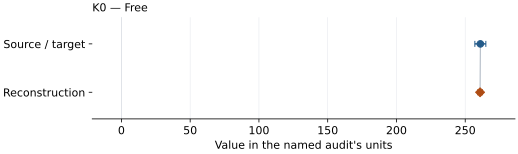

This is a **coefficient comparison**, not an observation or residual plot.
Each panel uses its coefficient's audit units and includes zero. Markers show
stored central values only. Error widths are retained in the table below;
no confidence interval or uncertainty band is inferred. Fixed/adopted values are constraints.

| Parameter | Source / target | Source error | Reconstruction | Reconstruction error | Fit role |
| --- | --- | --- | --- | --- | --- |
| K0 | 261.0 | 4.0 | 260.7999230336436 | 1.7340729995198663 | Free |

Values and reported errors are copied without rounding or conversion from the named audit. Missing errors mean unknown, not zero. Parameter names and volume conventions follow that audit; error widths do not imply a confidence convention.

Recorded diagnostics, covariance and additional protocol

- **Columns:**
    - **Pressure:** pressure\_gpa
    - **Volume:** volume\_a3
- **Observed pressure range gpa:** \[1.4, 26.0\]
- **Degrees of freedom:** 8
- **Solver success:** True
- **Solver message:** analytic one-parameter least-squares solution
- **Rmse gpa:** 0.28526073698634036

### Detailed evidence and existing plots

- [Record-by-record numerical ledger](../primary-eos-refits.md#records).
- [Source-audit reports](../source-audits.md).

Observation curves and residual plots are provided by the supporting reports where available. Their absence is not filled by a reconstructed curve presented as measured data.

[Machine-readable comparison ledger](https://github.com/CPrescher/peritheos/blob/main/docs/data/primary-eos-refits.json) — look up `bridgmanite_mao_1991_bm2_1`.
[Complete native EOSMAT file](https://github.com/CPrescher/peritheos/blob/main/peritheos/data/materials/bridgmanite.eosmat).

## Holland et al. (2013), mpv modified Tait

Record: `bridgmanite_holland_2013_mpv_modified_tait` · Model: `ModifiedTait`

**Outcome: Complete independent refit unavailable.**

**Scope:** Comparison with the source parameterization.
**Comparison basis:** The official tc-ds62 mpv block provides V0, K0, K0', and K0'' without model-family conversion.

[Stored EOS coefficients and source](../material-summaries/bridgmanite.md#record-bridgmanite_holland_2013_mpv_modified_tait)

### What this result establishes

**Separate source-review status:** primary\_source\_validated.
**Usage recommendation:** See the stored EOS qualifications; no recommendation is inferred here.

- This named numerical assessment alone does not establish author-workflow reproduction, physical accuracy or recommendation for use.
- No reconstructed coefficient table is recorded for this assessment; no missing values have been inferred.

### Data and reconstruction method

- **Dataset identifiers:** None declared
- **Fixed parameters:** None declared

Unspecified selections, weights, fixed values or error conventions remain unknown; they have not been inferred for this report.

### Why no coefficient graph is shown

No numeric source/reconstruction pair is recorded for this assessment. A graph would require information that is not available here; no values or observations have been invented.

### Detailed evidence and existing plots

- [Record-by-record numerical ledger](../primary-eos-refits.md#records).
- [Source-audit reports](../source-audits.md).

Observation curves and residual plots are provided by the supporting reports where available. Their absence is not filled by a reconstructed curve presented as measured data.

[Machine-readable comparison ledger](https://github.com/CPrescher/peritheos/blob/main/docs/data/primary-eos-refits.json) — look up `bridgmanite_holland_2013_mpv_modified_tait`.
[Complete native EOSMAT file](https://github.com/CPrescher/peritheos/blob/main/peritheos/data/materials/bridgmanite.eosmat).

## Li and Zeng (2009), GGA BM3

Record: `bridgmanite_li_zeng_2009_gga_bm3` · Model: `BM3`

**Outcome: Complete independent refit unavailable.**

**Scope:** Comparison with the source parameterization.
**Comparison basis:** Figure 1 plots E(V), but the individual energy grid is not tabulated.

[Stored EOS coefficients and source](../material-summaries/bridgmanite.md#record-bridgmanite_li_zeng_2009_gga_bm3)

### What this result establishes

**Separate source-review status:** primary\_source\_validated.
**Usage recommendation:** See the stored EOS qualifications; no recommendation is inferred here.

- This named numerical assessment alone does not establish author-workflow reproduction, physical accuracy or recommendation for use.
- No reconstructed coefficient table is recorded for this assessment; no missing values have been inferred.

### Data and reconstruction method

- **Dataset identifiers:** None declared
- **Fixed parameters:** None declared

Unspecified selections, weights, fixed values or error conventions remain unknown; they have not been inferred for this report.

### Why no coefficient graph is shown

No numeric source/reconstruction pair is recorded for this assessment. A graph would require information that is not available here; no values or observations have been invented.

### Detailed evidence and existing plots

- [Record-by-record numerical ledger](../primary-eos-refits.md#records).
- [Source-audit reports](../source-audits.md).

Observation curves and residual plots are provided by the supporting reports where available. Their absence is not filled by a reconstructed curve presented as measured data.

[Machine-readable comparison ledger](https://github.com/CPrescher/peritheos/blob/main/docs/data/primary-eos-refits.json) — look up `bridgmanite_li_zeng_2009_gga_bm3`.
[Complete native EOSMAT file](https://github.com/CPrescher/peritheos/blob/main/peritheos/data/materials/bridgmanite.eosmat).

## Li and Zeng (2009), GGA Vinet sensitivity

Record: `bridgmanite_li_zeng_2009_gga_vinet` · Model: `Vinet`

**Outcome: Complete independent refit unavailable.**

**Scope:** Comparison with the source parameterization.
**Comparison basis:** Figure 1 plots E(V), but the individual energy grid is not tabulated.

[Stored EOS coefficients and source](../material-summaries/bridgmanite.md#record-bridgmanite_li_zeng_2009_gga_vinet)

### What this result establishes

**Separate source-review status:** primary\_source\_validated.
**Usage recommendation:** See the stored EOS qualifications; no recommendation is inferred here.

- This named numerical assessment alone does not establish author-workflow reproduction, physical accuracy or recommendation for use.
- No reconstructed coefficient table is recorded for this assessment; no missing values have been inferred.

### Data and reconstruction method

- **Dataset identifiers:** None declared
- **Fixed parameters:** None declared

Unspecified selections, weights, fixed values or error conventions remain unknown; they have not been inferred for this report.

### Why no coefficient graph is shown

No numeric source/reconstruction pair is recorded for this assessment. A graph would require information that is not available here; no values or observations have been invented.

### Detailed evidence and existing plots

- [Record-by-record numerical ledger](../primary-eos-refits.md#records).
- [Source-audit reports](../source-audits.md).

Observation curves and residual plots are provided by the supporting reports where available. Their absence is not filled by a reconstructed curve presented as measured data.

[Machine-readable comparison ledger](https://github.com/CPrescher/peritheos/blob/main/docs/data/primary-eos-refits.json) — look up `bridgmanite_li_zeng_2009_gga_vinet`.
[Complete native EOSMAT file](https://github.com/CPrescher/peritheos/blob/main/peritheos/data/materials/bridgmanite.eosmat).

## Li and Zeng (2009), GGA natural-strain-3 sensitivity

Record: `bridgmanite_li_zeng_2009_gga_natural_strain3` · Model: `NaturalStrain3`

**Outcome: Complete independent refit unavailable.**

**Scope:** Comparison with the source parameterization.
**Comparison basis:** Figure 1 plots E(V), but the individual energy grid is not tabulated.

[Stored EOS coefficients and source](../material-summaries/bridgmanite.md#record-bridgmanite_li_zeng_2009_gga_natural_strain3)

### What this result establishes

**Separate source-review status:** primary\_source\_validated.
**Usage recommendation:** See the stored EOS qualifications; no recommendation is inferred here.

- This named numerical assessment alone does not establish author-workflow reproduction, physical accuracy or recommendation for use.
- No reconstructed coefficient table is recorded for this assessment; no missing values have been inferred.

### Data and reconstruction method

- **Dataset identifiers:** None declared
- **Fixed parameters:** None declared

Unspecified selections, weights, fixed values or error conventions remain unknown; they have not been inferred for this report.

### Why no coefficient graph is shown

No numeric source/reconstruction pair is recorded for this assessment. A graph would require information that is not available here; no values or observations have been invented.

### Detailed evidence and existing plots

- [Record-by-record numerical ledger](../primary-eos-refits.md#records).
- [Source-audit reports](../source-audits.md).

Observation curves and residual plots are provided by the supporting reports where available. Their absence is not filled by a reconstructed curve presented as measured data.

[Machine-readable comparison ledger](https://github.com/CPrescher/peritheos/blob/main/docs/data/primary-eos-refits.json) — look up `bridgmanite_li_zeng_2009_gga_natural_strain3`.
[Complete native EOSMAT file](https://github.com/CPrescher/peritheos/blob/main/peritheos/data/materials/bridgmanite.eosmat).

## Kiefer et al. (2002), MgSiO3 GGA BM3

Record: `bridgmanite_kiefer_2002_gga_bm3` · Model: `BM3`

**Outcome: Complete independent refit unavailable.**

**Scope:** Comparison with the source parameterization.
**Comparison basis:** Complete coefficients are printed, but the underlying energy-volume grid is not tabulated.

[Stored EOS coefficients and source](../material-summaries/bridgmanite.md#record-bridgmanite_kiefer_2002_gga_bm3)

### What this result establishes

**Separate source-review status:** primary\_source\_validated.
**Usage recommendation:** See the stored EOS qualifications; no recommendation is inferred here.

- This named numerical assessment alone does not establish author-workflow reproduction, physical accuracy or recommendation for use.
- No reconstructed coefficient table is recorded for this assessment; no missing values have been inferred.

### Data and reconstruction method

- **Dataset identifiers:** None declared
- **Fixed parameters:** None declared

Unspecified selections, weights, fixed values or error conventions remain unknown; they have not been inferred for this report.

### Why no coefficient graph is shown

No numeric source/reconstruction pair is recorded for this assessment. A graph would require information that is not available here; no values or observations have been invented.

### Detailed evidence and existing plots

- [Record-by-record numerical ledger](../primary-eos-refits.md#records).
- [Source-audit reports](../source-audits.md).

Observation curves and residual plots are provided by the supporting reports where available. Their absence is not filled by a reconstructed curve presented as measured data.

[Machine-readable comparison ledger](https://github.com/CPrescher/peritheos/blob/main/docs/data/primary-eos-refits.json) — look up `bridgmanite_kiefer_2002_gga_bm3`.
[Complete native EOSMAT file](https://github.com/CPrescher/peritheos/blob/main/peritheos/data/materials/bridgmanite.eosmat).

## Deng et al. (2006), LDA third-order Birch fit

Record: `bridgmanite_deng_2006_lda_bm3` · Model: `BM3`

**Outcome: Complete independent refit unavailable.**

**Scope:** Comparison with the source parameterization.
**Comparison basis:** Calculations were performed every 10 GPa through 120 GPa, but their numerical volume grid is plotted rather than tabulated.

[Stored EOS coefficients and source](../material-summaries/bridgmanite.md#record-bridgmanite_deng_2006_lda_bm3)

### What this result establishes

**Separate source-review status:** primary\_source\_validated.
**Usage recommendation:** See the stored EOS qualifications; no recommendation is inferred here.

- This named numerical assessment alone does not establish author-workflow reproduction, physical accuracy or recommendation for use.
- No reconstructed coefficient table is recorded for this assessment; no missing values have been inferred.

### Data and reconstruction method

- **Dataset identifiers:** None declared
- **Fixed parameters:** K0\_prime

Unspecified selections, weights, fixed values or error conventions remain unknown; they have not been inferred for this report.

### Why no coefficient graph is shown

No numeric source/reconstruction pair is recorded for this assessment. A graph would require information that is not available here; no values or observations have been invented.

### Detailed evidence and existing plots

- [Record-by-record numerical ledger](../primary-eos-refits.md#records).
- [Source-audit reports](../source-audits.md).

Observation curves and residual plots are provided by the supporting reports where available. Their absence is not filled by a reconstructed curve presented as measured data.

[Machine-readable comparison ledger](https://github.com/CPrescher/peritheos/blob/main/docs/data/primary-eos-refits.json) — look up `bridgmanite_deng_2006_lda_bm3`.
[Complete native EOSMAT file](https://github.com/CPrescher/peritheos/blob/main/peritheos/data/materials/bridgmanite.eosmat).

## Wu et al. (2013), MgSiO3 GGA BM3

Record: `bridgmanite_wu_2013_gga_bm3` · Model: `BM3`

**Outcome: Complete independent refit unavailable.**

**Scope:** Comparison with the source parameterization.
**Comparison basis:** Pressure-dependent calculations are plotted, but the numerical P-V grid is not tabulated.

[Stored EOS coefficients and source](../material-summaries/bridgmanite.md#record-bridgmanite_wu_2013_gga_bm3)

### What this result establishes

**Separate source-review status:** primary\_source\_validated.
**Usage recommendation:** See the stored EOS qualifications; no recommendation is inferred here.

- This named numerical assessment alone does not establish author-workflow reproduction, physical accuracy or recommendation for use.
- No reconstructed coefficient table is recorded for this assessment; no missing values have been inferred.

### Data and reconstruction method

- **Dataset identifiers:** None declared
- **Fixed parameters:** None declared

Unspecified selections, weights, fixed values or error conventions remain unknown; they have not been inferred for this report.

### Why no coefficient graph is shown

No numeric source/reconstruction pair is recorded for this assessment. A graph would require information that is not available here; no values or observations have been invented.

### Detailed evidence and existing plots

- [Record-by-record numerical ledger](../primary-eos-refits.md#records).
- [Source-audit reports](../source-audits.md).

Observation curves and residual plots are provided by the supporting reports where available. Their absence is not filled by a reconstructed curve presented as measured data.

[Machine-readable comparison ledger](https://github.com/CPrescher/peritheos/blob/main/docs/data/primary-eos-refits.json) — look up `bridgmanite_wu_2013_gga_bm3`.
[Complete native EOSMAT file](https://github.com/CPrescher/peritheos/blob/main/peritheos/data/materials/bridgmanite.eosmat).

## Liu et al. (2011), static GGA BM3

Record: `bridgmanite_liu_2011_gga_static_bm3` · Model: `BM3`

**Outcome: Complete independent refit unavailable.**

**Scope:** Comparison with the source parameterization.
**Comparison basis:** The calculated 0-150 GPa volume series is plotted in Figure 1 but not tabulated; Table I provides the complete fitted coefficients.

[Stored EOS coefficients and source](../material-summaries/bridgmanite.md#record-bridgmanite_liu_2011_gga_static_bm3)

### What this result establishes

**Separate source-review status:** primary\_source\_validated.
**Usage recommendation:** See the stored EOS qualifications; no recommendation is inferred here.

- This named numerical assessment alone does not establish author-workflow reproduction, physical accuracy or recommendation for use.
- No reconstructed coefficient table is recorded for this assessment; no missing values have been inferred.

### Data and reconstruction method

- **Dataset identifiers:** None declared
- **Fixed parameters:** None declared

Unspecified selections, weights, fixed values or error conventions remain unknown; they have not been inferred for this report.

### Why no coefficient graph is shown

No numeric source/reconstruction pair is recorded for this assessment. A graph would require information that is not available here; no values or observations have been invented.

### Detailed evidence and existing plots

- [Record-by-record numerical ledger](../primary-eos-refits.md#records).
- [Source-audit reports](../source-audits.md).

Observation curves and residual plots are provided by the supporting reports where available. Their absence is not filled by a reconstructed curve presented as measured data.

[Machine-readable comparison ledger](https://github.com/CPrescher/peritheos/blob/main/docs/data/primary-eos-refits.json) — look up `bridgmanite_liu_2011_gga_static_bm3`.
[Complete native EOSMAT file](https://github.com/CPrescher/peritheos/blob/main/peritheos/data/materials/bridgmanite.eosmat).

## Dorogokupets et al. (2015), 298 K generalized Rydberg-Stacey

Record: `bridgmanite_dorogokupets_2015_298k_rydberg_stacey` · Model: `RydbergStacey`

**Outcome: Parity not achieved for this comparison.**

**Scope:** Comparison with the source parameterization.
**Comparison basis:** Only a partial 298 K slice of the source's joint thermoelastic objective is recoverable, and that transparent slice does not reproduce the published coefficient pair.

[Stored EOS coefficients and source](../material-summaries/bridgmanite.md#record-bridgmanite_dorogokupets_2015_298k_rydberg_stacey)

### What this result establishes

**Separate source-review status:** primary\_source\_validated.
**Usage recommendation:** See the stored EOS qualifications; no recommendation is inferred here.

- This is a partial room-temperature diagnostic, not a reproduction of the joint thermoelastic objective. The paper states no point-weighting rule or covariance, and at least one source pressure-coordinate choice or joint-fit constraint remains unresolved. Published coefficients are therefore retained.
- This named numerical assessment alone does not establish author-workflow reproduction, physical accuracy or recommendation for use.

### Data and reconstruction method

- **Dataset identifiers:** dorogokupets\_2015\_bridgmanite\_298k\_reconstruction
- **Observations:** 19
- **Fit kind:** partial\_298k\_rydberg\_stacey\_diagnostic
- **Selection:** recoverable 298 K literature slice
- **Objective:** unweighted pressure residuals
- **Free parameters:** K0; K0\_prime
- **Fixed parameters:** V0; K\_infinity\_prime

Unspecified selections, weights, fixed values or error conventions remain unknown; they have not been inferred for this report.

### Source versus reconstruction

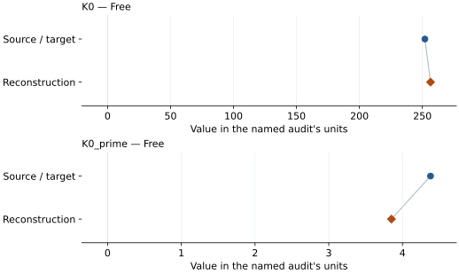

This is a **coefficient comparison**, not an observation or residual plot.
Each panel uses its coefficient's audit units and includes zero. Markers show
stored central values only. Error widths are retained in the table below;
no confidence interval or uncertainty band is inferred. Fixed/adopted values are constraints.

| Parameter | Source / target | Source error | Reconstruction | Reconstruction error | Fit role |
| --- | --- | --- | --- | --- | --- |
| K0 | 252.0 | Not specified | 256.4434912812934 | Not specified | Free |
| K0\_prime | 4.38 | Not specified | 3.850175971321591 | Not specified | Free |

Values and reported errors are copied without rounding or conversion from the named audit. Missing errors mean unknown, not zero. Parameter names and volume conventions follow that audit; error widths do not imply a confidence convention.

Recorded diagnostics, covariance and additional protocol

- **Observed pressure range gpa:** \[18.953355640520773, 95.41648812348971\]
- **Solver success:** True
- **Solver message:** dedicated Dorogokupets (2015) slice fit completed
- **Rmse gpa:** 0.3017704120453951
- **Published rmse gpa:** 1.5784185420909207

### Detailed evidence and existing plots

- [Earlier detailed record investigation](../primary-eos-refits.md#investigation-bridgmanite_dorogokupets_2015_298k_rydberg_stacey).
- [Supporting source report: dorogokupets-2015-mgsio3-refit](../literature-reproductions/dorogokupets-2015-mgsio3-refit.md).
- [Record-by-record numerical ledger](../primary-eos-refits.md#records).
- [Source-audit reports](../source-audits.md).

Observation curves and residual plots are provided by the supporting reports where available. Their absence is not filled by a reconstructed curve presented as measured data.

[Machine-readable comparison ledger](https://github.com/CPrescher/peritheos/blob/main/docs/data/primary-eos-refits.json) — look up `bridgmanite_dorogokupets_2015_298k_rydberg_stacey`.
[Complete native EOSMAT file](https://github.com/CPrescher/peritheos/blob/main/peritheos/data/materials/bridgmanite.eosmat).

## Hamahata et al. (2000), 300 K MD BM3

Record: `bridgmanite_hamahata_2000_md_300k_bm3` · Model: `BM3`

**Outcome: Complete independent refit unavailable.**

**Scope:** Comparison with the source parameterization.
**Comparison basis:** The complete fit coefficients are printed; the simulated 300 K volumes are plotted but not tabulated, so no pseudo-observations were digitized.

[Stored EOS coefficients and source](../material-summaries/bridgmanite.md#record-bridgmanite_hamahata_2000_md_300k_bm3)

### What this result establishes

**Separate source-review status:** primary\_source\_validated.
**Usage recommendation:** See the stored EOS qualifications; no recommendation is inferred here.

- This named numerical assessment alone does not establish author-workflow reproduction, physical accuracy or recommendation for use.
- No reconstructed coefficient table is recorded for this assessment; no missing values have been inferred.

### Data and reconstruction method

- **Dataset identifiers:** None declared
- **Fixed parameters:** None declared

Unspecified selections, weights, fixed values or error conventions remain unknown; they have not been inferred for this report.

### Why no coefficient graph is shown

No numeric source/reconstruction pair is recorded for this assessment. A graph would require information that is not available here; no values or observations have been invented.

### Detailed evidence and existing plots

- [Record-by-record numerical ledger](../primary-eos-refits.md#records).
- [Source-audit reports](../source-audits.md).

Observation curves and residual plots are provided by the supporting reports where available. Their absence is not filled by a reconstructed curve presented as measured data.

[Machine-readable comparison ledger](https://github.com/CPrescher/peritheos/blob/main/docs/data/primary-eos-refits.json) — look up `bridgmanite_hamahata_2000_md_300k_bm3`.
[Complete native EOSMAT file](https://github.com/CPrescher/peritheos/blob/main/peritheos/data/materials/bridgmanite.eosmat).
