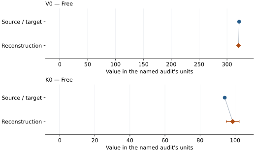

# Natural Fe-bearing dolomite: EOS reconstruction reports

<!-- Generated by scripts.generate_reconstruction_reports; edit EOSMAT instead. -->

[All reconstruction reports](index.md) · [Material and EOS parameters](../material-summaries/ca0988mg0918fe0078mn0016c2o6_dolomite.md)

These reports explain the assessments already stored in EOSMAT. Generating
this page does not refit observations, change classifications or replace source coefficients.

Use [scientific label definitions](../eos-labels.md) to distinguish coefficient
agreement, source verification, author-workflow reproduction and recommendation for use.

| EOS record | Recorded outcome | Coefficient comparison |
| --- | --- | --- |
| [Mao et al. (2011), natural Fe-dolomite 300 K BM3](#record-ca0988mg0918fe0078mn0016c2o6_dolomite_mao_2011_bm3_1) | Coefficient parity achieved | Graph and table |

## Mao et al. (2011), natural Fe-dolomite 300 K BM3

Record: `ca0988mg0918fe0078mn0016c2o6_dolomite_mao_2011_bm3_1` · Model: `BM3`

**Outcome: Coefficient parity achieved.**

**Scope:** Comparison with the source parameterization.
**Comparison basis:** Every compared free coefficient meets both the recorded combined-two-sigma comparison and parameter-specific numerical similarity screen. Error conventions and fit qualifications remain applicable.

[Stored EOS coefficients and source](../material-summaries/ca0988mg0918fe0078mn0016c2o6_dolomite.md#record-ca0988mg0918fe0078mn0016c2o6_dolomite_mao_2011_bm3_1)

### What this result establishes

**Separate source-review status:** primary\_source\_validated.
**Usage recommendation:** See the stored EOS qualifications; no recommendation is inferred here.

- This named numerical assessment alone does not establish author-workflow reproduction, physical accuracy or recommendation for use.

### Data and reconstruction method

- **Dataset identifiers:** ca0988mg0918fe0078mn0016c2o6\_mao\_2011\_figure3\_fe\_dolomite\_digitized
- **Observations:** 7
- **Fit kind:** isothermal\_pv
- **Selection:** all rows
- **Objective:** pressure\_residuals
- **Absolute sigma:** True
- **Free parameters:** V0; K0
- **Fixed parameters:** K0\_prime

Unspecified selections, weights, fixed values or error conventions remain unknown; they have not been inferred for this report.

### Source versus reconstruction

This is a **coefficient comparison**, not an observation or residual plot.
Each panel uses its coefficient's audit units and includes zero. Markers show
stored central values only. Error widths are retained in the table below;
no confidence interval or uncertainty band is inferred. Fixed/adopted values are constraints.

| Parameter | Source / target | Source error | Reconstruction | Reconstruction error | Fit role |
| --- | --- | --- | --- | --- | --- |
| V0 | 321.77 | 0.06 | 320.6463493487316 | 0.8803807365064472 | Free |
| K0 | 94.1 | 0.4 | 98.63544274692276 | 3.6991988672757525 | Free |

Values and reported errors are copied without rounding or conversion from the named audit. Missing errors mean unknown, not zero. Parameter names and volume conventions follow that audit; error widths do not imply a confidence convention.

Recorded diagnostics, covariance and additional protocol

- **Columns:**
    - **Pressure:** pressure\_gpa
    - **Temperature:** Not specified
    - **Volume:** volume\_a3\_conventional\_cell
- **Observed pressure range gpa:** \[0.155039, 16.27907\]
- **Observed temperature range k:** Not specified
- **Observed volume range:** \[281.960784, 321.176471\]
- **Degrees of freedom:** 5
- **Solver success:** True
- **Solver message:** Both \`ftol\` and \`xtol\` termination conditions are satisfied.
- **Rmse gpa:** 0.3479429468281554
- **Published rmse gpa:** 0.3991598271609795
- **Reduced chi square:** 0.1694900119464448

### Detailed evidence and existing plots

- [Record-by-record numerical ledger](../primary-eos-refits.md#records).
- [Source-audit reports](../source-audits.md).

Observation curves and residual plots are provided by the supporting reports where available. Their absence is not filled by a reconstructed curve presented as measured data.

[Machine-readable comparison ledger](https://github.com/CPrescher/peritheos/blob/main/docs/data/primary-eos-refits.json) — look up `ca0988mg0918fe0078mn0016c2o6_dolomite_mao_2011_bm3_1`.
[Complete native EOSMAT file](https://github.com/CPrescher/peritheos/blob/main/peritheos/data/materials/ca0988mg0918fe0078mn0016c2o6_dolomite.eosmat).
