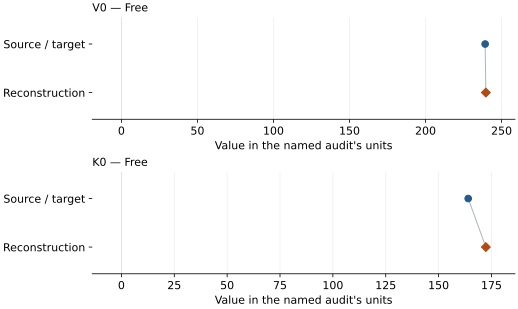
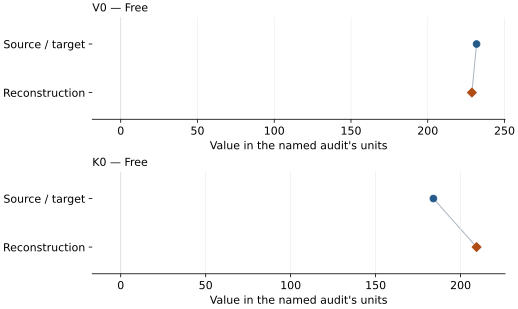

# Natural Fe-bearing dolomite-III: EOS reconstruction reports

<!-- Generated by scripts.generate_reconstruction_reports; edit EOSMAT instead. -->

[All reconstruction reports](index.md) · [Material and EOS parameters](../material-summaries/ca0988mg0918fe0078mn0016c2o6_dolomite_iii.md)

These reports explain the assessments already stored in EOSMAT. Generating
this page does not refit observations, change classifications or replace source coefficients.

Use [scientific label definitions](../eos-labels.md) to distinguish coefficient
agreement, source verification, author-workflow reproduction and recommendation for use.

| EOS record | Recorded outcome | Coefficient comparison |
| --- | --- | --- |
| [Mao et al. (2011), dolomite-III high-spin branch BM3](#record-ca0988mg0918fe0078mn0016c2o6_dolomite_iii_mao_2011_bm3_high_spin_1) | Coefficient parity achieved | Graph and table |
| [Mao et al. (2011), dolomite-III low-spin branch BM3](#record-ca0988mg0918fe0078mn0016c2o6_dolomite_iii_mao_2011_bm3_low_spin_2) | Numerically similar, with qualifications | Graph and table |

## Mao et al. (2011), dolomite-III high-spin branch BM3

Record: `ca0988mg0918fe0078mn0016c2o6_dolomite_iii_mao_2011_bm3_high_spin_1` · Model: `BM3`

**Outcome: Coefficient parity achieved.**

**Scope:** Comparison with the source parameterization.
**Comparison basis:** Every compared free coefficient meets both the recorded combined-two-sigma comparison and parameter-specific numerical similarity screen. Error conventions and fit qualifications remain applicable.

[Stored EOS coefficients and source](../material-summaries/ca0988mg0918fe0078mn0016c2o6_dolomite_iii.md#record-ca0988mg0918fe0078mn0016c2o6_dolomite_iii_mao_2011_bm3_high_spin_1)

### What this result establishes

**Separate source-review status:** primary\_source\_validated.
**Usage recommendation:** See the stored EOS qualifications; no recommendation is inferred here.

- This named numerical assessment alone does not establish author-workflow reproduction, physical accuracy or recommendation for use.

### Data and reconstruction method

- **Dataset identifiers:** ca0988mg0918fe0078mn0016c2o6\_mao\_2011\_figure3\_dolomite\_iii\_digitized
- **Observations:** 7
- **Fit kind:** isothermal\_pv
- **Selection:** high\_spin\_fit\_included=1
- **Objective:** pressure\_residuals
- **Absolute sigma:** True
- **Free parameters:** V0; K0
- **Fixed parameters:** K0\_prime

Unspecified selections, weights, fixed values or error conventions remain unknown; they have not been inferred for this report.

### Source versus reconstruction

This is a **coefficient comparison**, not an observation or residual plot.
Each panel uses its coefficient's audit units and includes zero. Markers show
stored central values only. Error widths are retained in the table below;
no confidence interval or uncertainty band is inferred. Fixed/adopted values are constraints.

| Parameter | Source / target | Source error | Reconstruction | Reconstruction error | Fit role |
| --- | --- | --- | --- | --- | --- |
| V0 | 239.2 | 1.5 | 239.66589306646065 | 4.829648480016263 | Free |
| K0 | 164.0 | 8.0 | 172.34398572048195 | 27.421246199205157 | Free |

Values and reported errors are copied without rounding or conversion from the named audit. Missing errors mean unknown, not zero. Parameter names and volume conventions follow that audit; error widths do not imply a confidence convention.

Recorded diagnostics, covariance and additional protocol

- **Columns:**
    - **Pressure:** pressure\_gpa
    - **Temperature:** Not specified
    - **Volume:** volume\_a3\_conventional\_cell
- **Observed pressure range gpa:** \[28.363636, 50.181818\]
- **Observed temperature range k:** Not specified
- **Observed volume range:** \[197.55814, 210.813953\]
- **Degrees of freedom:** 5
- **Solver success:** True
- **Solver message:** Both \`ftol\` and \`xtol\` termination conditions are satisfied.
- **Rmse gpa:** 1.4655788533671394
- **Published rmse gpa:** 2.9550573964278923
- **Reduced chi square:** 3.007089925611715

### Detailed evidence and existing plots

- [Record-by-record numerical ledger](../primary-eos-refits.md#records).
- [Source-audit reports](../source-audits.md).

Observation curves and residual plots are provided by the supporting reports where available. Their absence is not filled by a reconstructed curve presented as measured data.

[Machine-readable comparison ledger](https://github.com/CPrescher/peritheos/blob/main/docs/data/primary-eos-refits.json) — look up `ca0988mg0918fe0078mn0016c2o6_dolomite_iii_mao_2011_bm3_high_spin_1`.
[Complete native EOSMAT file](https://github.com/CPrescher/peritheos/blob/main/peritheos/data/materials/ca0988mg0918fe0078mn0016c2o6_dolomite_iii.eosmat).

## Mao et al. (2011), dolomite-III low-spin branch BM3

Record: `ca0988mg0918fe0078mn0016c2o6_dolomite_iii_mao_2011_bm3_low_spin_2` · Model: `BM3`

**Outcome: Numerically similar, with qualifications.**

**Scope:** Comparison with the source parameterization.
**Comparison basis:** Every compared free coefficient meets either the recorded combined-two-sigma comparison or parameter-specific numerical similarity screen; the audit does not classify the complete comparison as parity.

[Stored EOS coefficients and source](../material-summaries/ca0988mg0918fe0078mn0016c2o6_dolomite_iii.md#record-ca0988mg0918fe0078mn0016c2o6_dolomite_iii_mao_2011_bm3_low_spin_2)

### What this result establishes

**Separate source-review status:** primary\_source\_validated.
**Usage recommendation:** See the stored EOS qualifications; no recommendation is inferred here.

- This named numerical assessment alone does not establish author-workflow reproduction, physical accuracy or recommendation for use.

### Data and reconstruction method

- **Dataset identifiers:** ca0988mg0918fe0078mn0016c2o6\_mao\_2011\_figure3\_dolomite\_iii\_digitized
- **Observations:** 18
- **Fit kind:** isothermal\_pv
- **Selection:** low\_spin\_fit\_included=1
- **Objective:** pressure\_residuals
- **Absolute sigma:** True
- **Free parameters:** V0; K0
- **Fixed parameters:** K0\_prime

Unspecified selections, weights, fixed values or error conventions remain unknown; they have not been inferred for this report.

### Source versus reconstruction

This is a **coefficient comparison**, not an observation or residual plot.
Each panel uses its coefficient's audit units and includes zero. Markers show
stored central values only. Error widths are retained in the table below;
no confidence interval or uncertainty band is inferred. Fixed/adopted values are constraints.

| Parameter | Source / target | Source error | Reconstruction | Reconstruction error | Fit role |
| --- | --- | --- | --- | --- | --- |
| V0 | 231.8 | 0.7 | 228.73882632422394 | 1.2091056864545087 | Free |
| K0 | 184.0 | 4.0 | 209.40441994613167 | 7.4655053400739595 | Free |

Values and reported errors are copied without rounding or conversion from the named audit. Missing errors mean unknown, not zero. Parameter names and volume conventions follow that audit; error widths do not imply a confidence convention.

Recorded diagnostics, covariance and additional protocol

- **Columns:**
    - **Pressure:** pressure\_gpa
    - **Temperature:** Not specified
    - **Volume:** volume\_a3\_conventional\_cell
- **Observed pressure range gpa:** \[46.181818, 84.242424\]
- **Observed temperature range k:** Not specified
- **Observed volume range:** \[179.069767, 194.418605\]
- **Degrees of freedom:** 16
- **Solver success:** True
- **Solver message:** Both \`ftol\` and \`xtol\` termination conditions are satisfied.
- **Rmse gpa:** 0.8586015012491195
- **Published rmse gpa:** 2.9152095406831338
- **Reduced chi square:** 0.8293461051906469

### Detailed evidence and existing plots

- [Earlier detailed record investigation](../primary-eos-refits.md#investigation-ca0988mg0918fe0078mn0016c2o6_dolomite_iii_mao_2011_bm3_low_spin_2).
- [Record-by-record numerical ledger](../primary-eos-refits.md#records).
- [Source-audit reports](../source-audits.md).

Observation curves and residual plots are provided by the supporting reports where available. Their absence is not filled by a reconstructed curve presented as measured data.

[Machine-readable comparison ledger](https://github.com/CPrescher/peritheos/blob/main/docs/data/primary-eos-refits.json) — look up `ca0988mg0918fe0078mn0016c2o6_dolomite_iii_mao_2011_bm3_low_spin_2`.
[Complete native EOSMAT file](https://github.com/CPrescher/peritheos/blob/main/peritheos/data/materials/ca0988mg0918fe0078mn0016c2o6_dolomite_iii.eosmat).
