# Ca-perovskite: EOS reconstruction reports

<!-- Generated by scripts.generate_reconstruction_reports; edit EOSMAT instead. -->

[All reconstruction reports](index.md) · [Material and EOS parameters](../material-summaries/ca_perovskite.md)

These reports explain the assessments already stored in EOSMAT. Generating
this page does not refit observations, change classifications or replace source coefficients.

Use [scientific label definitions](../eos-labels.md) to distinguish coefficient
agreement, source verification, author-workflow reproduction and recommendation for use.

| EOS record | Recorded outcome | Coefficient comparison |
| --- | --- | --- |
| [Mao et al. (1989), cubic CaSiO3 BM3](#record-ca_perovskite_mao_1989_bm3_2) | Coefficient parity achieved | Graph and table |
| [Caracas et al. (2005), static cubic Pm-3m BM3](#record-ca_perovskite_caracas_2005_bm3_3) | Complete independent refit unavailable | No numeric coefficient pair recorded |
| [Kawai and Tsuchiya (2014), cubic CaSiO3 Vinet-MGD](#record-ca_perovskite_kawai_2014_vinet_mgd_3) | Complete independent refit unavailable | No numeric coefficient pair recorded |
| [Shim et al. (2000), DAC-only cubic CaSiO3 BM3-MGD alternative](#record-ca_perovskite_shim_2000_dac_only_bm3_mgd_4) | Numerically similar, with qualifications | Graph and table |
| [Shim et al. (2000), cubic CaSiO3 BM3](#record-ca_perovskite_shim_2000_bm3_1) | Numerically similar, with qualifications | Graph and table |
| [Noguchi et al. (2013), cubic CaSiO3 700 K BM2-MGD](#record-ca_perovskite_noguchi_2013_bm2_mgd_1) | Coefficient parity achieved | Graph and table |
| [Sun et al. (2016), cubic CaSiO3 BM3-MGD](#record-ca_perovskite_sun_2016_bm3_3) | Coefficient parity achieved | Graph and table |
| [Wang et al. (1996), preferred room-temperature BM3](#record-ca_perovskite_wang_1996_preferred_bm3) | Coefficient parity achieved | Graph and table |
| [Wang et al. (1996), equal-weight Mao-data BM3 reanalysis](#record-ca_perovskite_wang_1996_mao_equal_weight_bm3) | Coefficient parity achieved | Graph and table |
| [Wang et al. (1996), pressure-weighted all-Mao-data BM3 sensitivity](#record-ca_perovskite_wang_1996_mao_pressure_weighted_all_bm3) | Coefficient parity achieved | Graph and table |
| [Wang et al. (1996), pressure-weighted Mao-data BM3 excluding sub-1-GPa points](#record-ca_perovskite_wang_1996_mao_pressure_weighted_no_sub1gpa_bm3) | Coefficient parity achieved | Graph and table |
| [Chizmeshya et al. (1996), LAPW(7) static BM3](#record-ca_perovskite_chizmeshya_1996_lapw7_static_bm3) | Complete independent refit unavailable | No numeric coefficient pair recorded |
| [Chizmeshya et al. (1996), LAPW(8) static BM3](#record-ca_perovskite_chizmeshya_1996_lapw8_static_bm3) | Complete independent refit unavailable | No numeric coefficient pair recorded |
| [Chizmeshya et al. (1996), LAPW(9) static BM3](#record-ca_perovskite_chizmeshya_1996_lapw9_static_bm3) | Complete independent refit unavailable | No numeric coefficient pair recorded |
| [Chizmeshya et al. (1996), thermally corrected LAPW(9) BM3 with K0'=4](#record-ca_perovskite_chizmeshya_1996_lapw9_300k_kp4_bm3) | Complete independent refit unavailable | No numeric coefficient pair recorded |
| [Chizmeshya et al. (1996), preferred thermally corrected LAPW(9) 300 K BM3](#record-ca_perovskite_chizmeshya_1996_lapw9_300k_bm3) | Complete independent refit unavailable | No numeric coefficient pair recorded |
| [Holland et al. (2013), cpv modified Tait](#record-ca_perovskite_holland_2013_cpv_modified_tait) | Complete independent refit unavailable | No numeric coefficient pair recorded |
| [Akber-Knutson et al. (2002), VIBC Pnma 300 K BM3](#record-ca_perovskite_akber_knutson_2002_vibc_pnma_300k_bm3) | Complete independent refit unavailable | No numeric coefficient pair recorded |
| [Akber-Knutson et al. (2002), VIBC Pm3m 300 K BM3](#record-ca_perovskite_akber_knutson_2002_vibc_pm3m_300k_bm3) | Complete independent refit unavailable | No numeric coefficient pair recorded |
| [Akber-Knutson et al. (2002), VIB Pm3m 300 K BM3](#record-ca_perovskite_akber_knutson_2002_vib_pm3m_300k_bm3) | Complete independent refit unavailable | No numeric coefficient pair recorded |
| [Sherman (1993), extended-basis static BM3](#record-ca_perovskite_sherman_1993_basis_b_static_bm3) | Complete independent refit unavailable | No numeric coefficient pair recorded |
| [Wang and Weidner (1994), room-temperature BM2](#record-ca_perovskite_wang_weidner_1994_bm2) | Coefficient parity achieved | Graph and table |
| [Caracas et al. (2005), static cubic Pm-3m BM4](#record-ca_perovskite_caracas_2005_bm4_4) | Complete independent refit unavailable | No numeric coefficient pair recorded |
| [Liu et al. (2007), cubic CaSiO3 static LDA BM3](#record-ca_perovskite_liu_2007_lda_static_bm3) | Complete independent refit unavailable | No numeric coefficient pair recorded |
| [Joint Sun (2016) + Gréaux (2019) data, cubic CaSiO3 BM3-MGD (Fu 2023)](#record-ca_perovskite_fu_2023_bm3_mgd_refit) | Parity not achieved for this comparison | Graph and table |
| [Karki and Crain (1998), static cubic CaSiO3 BM3](#record-ca_perovskite_karki_crain_1998_static_bm3) | Complete independent refit unavailable | No numeric coefficient pair recorded |
| [Ono (2013), cubic CaSiO3 BM3 plus logarithmic-volume thermal pressure](#record-ca_perovskite_ono_2013_bm3_log_thermal) | Complete independent refit unavailable | No numeric coefficient pair recorded |
| [Peritheos unweighted joint fit to Sun (2016) + Gréaux (2019) cubic CaSiO3 data](#record-ca_perovskite_fu_2023_candidate_data_unweighted_bm3_mgd_refit) | Coefficient parity achieved | Graph and table |
| [Peritheos refit of Wang (1996), BM3 + linear thermal pressure (64 points)](#record-ca_perovskite_wang_1996_unweighted_bm3_linear_thermal_refit) | Coefficient parity achieved | Graph and table |

## Mao et al. (1989), cubic CaSiO3 BM3

Record: `ca_perovskite_mao_1989_bm3_2` · Model: `BM3`

**Outcome: Coefficient parity achieved.**

**Scope:** Comparison with the source parameterization.
**Comparison basis:** Every compared free coefficient meets both the recorded combined-two-sigma comparison and parameter-specific numerical similarity screen. Error conventions and fit qualifications remain applicable.

[Stored EOS coefficients and source](../material-summaries/ca_perovskite.md#record-ca_perovskite_mao_1989_bm3_2)

### What this result establishes

**Separate source-review status:** primary\_source\_validated.
**Usage recommendation:** See the stored EOS qualifications; no recommendation is inferred here.

- This named numerical assessment alone does not establish author-workflow reproduction, physical accuracy or recommendation for use.

### Data and reconstruction method

- **Dataset identifiers:** ca\_perovskite\_mao\_1989\_table1\_compression
- **Observations:** 46
- **Fit kind:** isothermal\_pv
- **Selection:** all rows
- **Objective:** errors\_in\_variables
- **Absolute sigma:** True
- **Free parameters:** V0; K0
- **Fixed parameters:** K0\_prime

Unspecified selections, weights, fixed values or error conventions remain unknown; they have not been inferred for this report.

### Source versus reconstruction

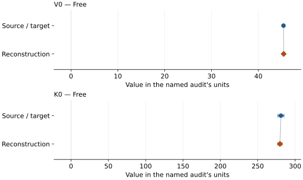

This is a **coefficient comparison**, not an observation or residual plot.
Each panel uses its coefficient's audit units and includes zero. Markers show
stored central values only. Error widths are retained in the table below;
no confidence interval or uncertainty band is inferred. Fixed/adopted values are constraints.

| Parameter | Source / target | Source error | Reconstruction | Reconstruction error | Fit role |
| --- | --- | --- | --- | --- | --- |
| V0 | 45.37 | 0.08 | 45.402465465391444 | 0.05019853733512753 | Free |
| K0 | 281.0 | 4.0 | 279.7107743211814 | 2.9423758404234612 | Free |

Values and reported errors are copied without rounding or conversion from the named audit. Missing errors mean unknown, not zero. Parameter names and volume conventions follow that audit; error widths do not imply a confidence convention.

Recorded diagnostics, covariance and additional protocol

- **Columns:**
    - **Pressure:** pressure\_gpa
    - **Temperature:** Not specified
    - **Volume:** unit\_cell\_volume\_a3
- **Observed pressure range gpa:** \[0.0, 134.0\]
- **Observed temperature range k:** Not specified
- **Observed volume range:** \[34.61, 45.27\]
- **Degrees of freedom:** 44
- **Solver success:** True
- **Solver message:** Both \`ftol\` and \`xtol\` termination conditions are satisfied.
- **Rmse gpa:** 0.5641134431856654
- **Published rmse gpa:** 1.8756529772853359
- **Reduced chi square:** 0.8694524171774595

### Detailed evidence and existing plots

- [Record-by-record numerical ledger](../primary-eos-refits.md#records).
- [Source-audit reports](../source-audits.md).

Observation curves and residual plots are provided by the supporting reports where available. Their absence is not filled by a reconstructed curve presented as measured data.

[Machine-readable comparison ledger](https://github.com/CPrescher/peritheos/blob/main/docs/data/primary-eos-refits.json) — look up `ca_perovskite_mao_1989_bm3_2`.
[Complete native EOSMAT file](https://github.com/CPrescher/peritheos/blob/main/peritheos/data/materials/ca_perovskite.eosmat).

## Caracas et al. (2005), static cubic Pm-3m BM3

Record: `ca_perovskite_caracas_2005_bm3_3` · Model: `BM3`

**Outcome: Complete independent refit unavailable.**

**Scope:** Comparison with the source parameterization.
**Comparison basis:** The article publishes fitted EOS coefficients and relative energies but not the first-principles E(V) observations, fit weights, residuals, or covariance. No supporting-information or official data attachment is listed on the publisher article page or the UCL deposit, so an independent coefficient refit is not possible.

[Stored EOS coefficients and source](../material-summaries/ca_perovskite.md#record-ca_perovskite_caracas_2005_bm3_3)

### What this result establishes

**Separate source-review status:** primary\_source\_validated.
**Usage recommendation:** See the stored EOS qualifications; no recommendation is inferred here.

- This named numerical assessment alone does not establish author-workflow reproduction, physical accuracy or recommendation for use.
- No reconstructed coefficient table is recorded for this assessment; no missing values have been inferred.

### Data and reconstruction method

- **Dataset identifiers:** None declared
- **Fixed parameters:** None declared

Unspecified selections, weights, fixed values or error conventions remain unknown; they have not been inferred for this report.

### Why no coefficient graph is shown

No numeric source/reconstruction pair is recorded for this assessment. A graph would require information that is not available here; no values or observations have been invented.

### Detailed evidence and existing plots

- [Record-by-record numerical ledger](../primary-eos-refits.md#records).
- [Source-audit reports](../source-audits.md).

Observation curves and residual plots are provided by the supporting reports where available. Their absence is not filled by a reconstructed curve presented as measured data.

[Machine-readable comparison ledger](https://github.com/CPrescher/peritheos/blob/main/docs/data/primary-eos-refits.json) — look up `ca_perovskite_caracas_2005_bm3_3`.
[Complete native EOSMAT file](https://github.com/CPrescher/peritheos/blob/main/peritheos/data/materials/ca_perovskite.eosmat).

## Kawai and Tsuchiya (2014), cubic CaSiO3 Vinet-MGD

Record: `ca_perovskite_kawai_2014_vinet_mgd_3` · Model: `Vinet`

**Outcome: Complete independent refit unavailable.**

**Scope:** Comparison with the source parameterization.
**Comparison basis:** The publisher page exposes no supporting-information or data file, and the article plots but does not tabulate the underlying FPMD P-V-T stress averages. A direct refit is therefore impossible. All 60 printed Table 1 fitted-isotherm benchmark states are bundled separately for numerical reproduction; they are model values, not primary observations.

[Stored EOS coefficients and source](../material-summaries/ca_perovskite.md#record-ca_perovskite_kawai_2014_vinet_mgd_3)

### What this result establishes

**Separate source-review status:** primary\_source\_validated.
**Usage recommendation:** See the stored EOS qualifications; no recommendation is inferred here.

- This named numerical assessment alone does not establish author-workflow reproduction, physical accuracy or recommendation for use.
- No reconstructed coefficient table is recorded for this assessment; no missing values have been inferred.

### Data and reconstruction method

- **Dataset identifiers:** None declared
- **Fixed parameters:** Tr; theta0; n

Unspecified selections, weights, fixed values or error conventions remain unknown; they have not been inferred for this report.

### Why no coefficient graph is shown

No numeric source/reconstruction pair is recorded for this assessment. A graph would require information that is not available here; no values or observations have been invented.

### Detailed evidence and existing plots

- [Record-by-record numerical ledger](../primary-eos-refits.md#records).
- [Source-audit reports](../source-audits.md).

Observation curves and residual plots are provided by the supporting reports where available. Their absence is not filled by a reconstructed curve presented as measured data.

[Machine-readable comparison ledger](https://github.com/CPrescher/peritheos/blob/main/docs/data/primary-eos-refits.json) — look up `ca_perovskite_kawai_2014_vinet_mgd_3`.
[Complete native EOSMAT file](https://github.com/CPrescher/peritheos/blob/main/peritheos/data/materials/ca_perovskite.eosmat).

## Shim et al. (2000), DAC-only cubic CaSiO3 BM3-MGD alternative

Record: `ca_perovskite_shim_2000_dac_only_bm3_mgd_4` · Model: `BM3`

**Outcome: Numerically similar, with qualifications.**

**Scope:** Comparison with the source parameterization.
**Comparison basis:** Every compared free coefficient meets either the recorded combined-two-sigma comparison or parameter-specific numerical similarity screen; the audit does not classify the complete comparison as parity.

[Stored EOS coefficients and source](../material-summaries/ca_perovskite.md#record-ca_perovskite_shim_2000_dac_only_bm3_mgd_4)

### What this result establishes

**Separate source-review status:** primary\_source\_validated.
**Usage recommendation:** See the stored EOS qualifications; no recommendation is inferred here.

- This named numerical assessment alone does not establish author-workflow reproduction, physical accuracy or recommendation for use.

### Data and reconstruction method

- **Dataset identifiers:** ca\_perovskite\_shim\_2000\_jgr\_table1\_dac\_pvt
- **Observations:** 34
- **Fit kind:** joint\_pvt
- **Selection:** all rows
- **Objective:** errors\_in\_variables
- **Absolute sigma:** True
- **Free parameters:** gamma0; q
- **Fixed parameters:** V0; K0; K0\_prime; Tr; theta0; n

Unspecified selections, weights, fixed values or error conventions remain unknown; they have not been inferred for this report.

### Source versus reconstruction

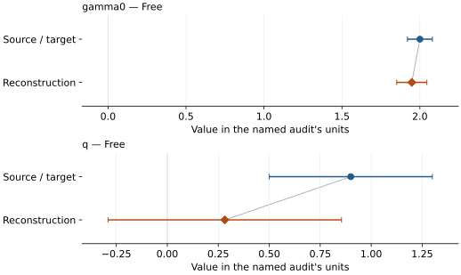

This is a **coefficient comparison**, not an observation or residual plot.
Each panel uses its coefficient's audit units and includes zero. Markers show
stored central values only. Error widths are retained in the table below;
no confidence interval or uncertainty band is inferred. Fixed/adopted values are constraints.

| Parameter | Source / target | Source error | Reconstruction | Reconstruction error | Fit role |
| --- | --- | --- | --- | --- | --- |
| gamma0 | 2.0 | 0.08 | 1.9478818934444488 | 0.09675480717029565 | Free |
| q | 0.9 | 0.4 | 0.2820605138457005 | 0.5724762993632172 | Free |

Values and reported errors are copied without rounding or conversion from the named audit. Missing errors mean unknown, not zero. Parameter names and volume conventions follow that audit; error widths do not imply a confidence convention.

Recorded diagnostics, covariance and additional protocol

- **Columns:**
    - **Pressure:** pressure\_gpa
    - **Temperature:** temperature\_k
    - **Volume:** volume\_a3
- **Observed pressure range gpa:** \[20.6, 68.5\]
- **Observed temperature range k:** \[1272.0, 2380.0\]
- **Observed volume range:** \[38.058, 43.662\]
- **Degrees of freedom:** 32
- **Solver success:** True
- **Solver message:** Both \`ftol\` and \`xtol\` termination conditions are satisfied.
- **Rmse gpa:** 0.784334389404185
- **Published rmse gpa:** 1.051944029956092
- **Reduced chi square:** 0.7554333624305222

### Detailed evidence and existing plots

- [Earlier detailed record investigation](../primary-eos-refits.md#investigation-ca_perovskite_shim_2000_dac_only_bm3_mgd_4).
- [Record-by-record numerical ledger](../primary-eos-refits.md#records).
- [Source-audit reports](../source-audits.md).

Observation curves and residual plots are provided by the supporting reports where available. Their absence is not filled by a reconstructed curve presented as measured data.

[Machine-readable comparison ledger](https://github.com/CPrescher/peritheos/blob/main/docs/data/primary-eos-refits.json) — look up `ca_perovskite_shim_2000_dac_only_bm3_mgd_4`.
[Complete native EOSMAT file](https://github.com/CPrescher/peritheos/blob/main/peritheos/data/materials/ca_perovskite.eosmat).

## Shim et al. (2000), cubic CaSiO3 BM3

Record: `ca_perovskite_shim_2000_bm3_1` · Model: `BM3`

**Outcome: Numerically similar, with qualifications.**

**Scope:** Comparison with the source parameterization.
**Comparison basis:** Every compared free coefficient meets either the recorded combined-two-sigma comparison or parameter-specific numerical similarity screen; the audit does not classify the complete comparison as parity.

[Stored EOS coefficients and source](../material-summaries/ca_perovskite.md#record-ca_perovskite_shim_2000_bm3_1)

### What this result establishes

**Separate source-review status:** primary\_source\_validated.
**Usage recommendation:** See the stored EOS qualifications; no recommendation is inferred here.

- This named numerical assessment alone does not establish author-workflow reproduction, physical accuracy or recommendation for use.

### Data and reconstruction method

- **Dataset identifiers:** ca\_perovskite\_shim\_2000\_table1\_pv
- **Observations:** 10
- **Fit kind:** isothermal\_pv
- **Selection:** all rows
- **Objective:** errors\_in\_variables
- **Absolute sigma:** True
- **Free parameters:** K0; K0\_prime
- **Fixed parameters:** V0

Unspecified selections, weights, fixed values or error conventions remain unknown; they have not been inferred for this report.

### Source versus reconstruction

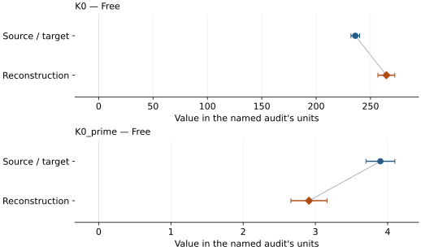

This is a **coefficient comparison**, not an observation or residual plot.
Each panel uses its coefficient's audit units and includes zero. Markers show
stored central values only. Error widths are retained in the table below;
no confidence interval or uncertainty band is inferred. Fixed/adopted values are constraints.

| Parameter | Source / target | Source error | Reconstruction | Reconstruction error | Fit role |
| --- | --- | --- | --- | --- | --- |
| K0 | 236.0 | 4.0 | 264.57545231692313 | 7.797140727759285 | Free |
| K0\_prime | 3.9 | 0.2 | 2.910682779825168 | 0.2499148818351242 | Free |

Values and reported errors are copied without rounding or conversion from the named audit. Missing errors mean unknown, not zero. Parameter names and volume conventions follow that audit; error widths do not imply a confidence convention.

Recorded diagnostics, covariance and additional protocol

- **Columns:**
    - **Pressure:** pressure\_gpa
    - **Temperature:** Not specified
    - **Volume:** volume\_a3
- **Observed pressure range gpa:** \[16.8, 105.2\]
- **Observed temperature range k:** Not specified
- **Observed volume range:** \[35.3, 43.167\]
- **Degrees of freedom:** 8
- **Solver success:** True
- **Solver message:** \`ftol\` termination condition is satisfied.
- **Rmse gpa:** 3.214219313510587
- **Published rmse gpa:** 2.5082949424727166
- **Reduced chi square:** 4.379924009548925

### Detailed evidence and existing plots

- [Earlier detailed record investigation](../primary-eos-refits.md#investigation-ca_perovskite_shim_2000_bm3_1).
- [Record-by-record numerical ledger](../primary-eos-refits.md#records).
- [Source-audit reports](../source-audits.md).

Observation curves and residual plots are provided by the supporting reports where available. Their absence is not filled by a reconstructed curve presented as measured data.

[Machine-readable comparison ledger](https://github.com/CPrescher/peritheos/blob/main/docs/data/primary-eos-refits.json) — look up `ca_perovskite_shim_2000_bm3_1`.
[Complete native EOSMAT file](https://github.com/CPrescher/peritheos/blob/main/peritheos/data/materials/ca_perovskite.eosmat).

## Noguchi et al. (2013), cubic CaSiO3 700 K BM2-MGD

Record: `ca_perovskite_noguchi_2013_bm2_mgd_1` · Model: `BM2`

**Outcome: Coefficient parity achieved.**

**Scope:** Comparison with the source parameterization.
**Comparison basis:** Every compared free coefficient meets both the recorded combined-two-sigma comparison and parameter-specific numerical similarity screen. Error conventions and fit qualifications remain applicable.

[Stored EOS coefficients and source](../material-summaries/ca_perovskite.md#record-ca_perovskite_noguchi_2013_bm2_mgd_1)

### What this result establishes

**Separate source-review status:** primary\_source\_validated.
**Usage recommendation:** See the stored EOS qualifications; no recommendation is inferred here.

- The source does not state weights, fitting software, covariance, or the confidence convention for its printed errors. Unweighted pressure residuals are a transparent reproducibility diagnostic; their recovery of both coefficients and error magnitudes for all four source models is strong evidence for, but not proof of, the authors' exact numerical objective.
- This named numerical assessment alone does not establish author-workflow reproduction, physical accuracy or recommendation for use.

### Data and reconstruction method

- **Dataset identifiers:** ca\_perovskite\_noguchi\_2013\_table1\_pvt
- **Observations:** 51
- **Fit kind:** staged\_bm2\_then\_mie\_gruneisen\_debye
- **Selection:** 9 accepted external-heating rows for the 700 K BM2 stage; all 42 high-temperature rows for the thermal stage; source orders 12, 14, and 20 excluded only as directed by Table 1 footnote e
- **Objective:** unweighted pressure residuals
- **Free parameters:** V0; K0; theta0; gamma0; q
- **Fixed parameters:** Tr; n

Unspecified selections, weights, fixed values or error conventions remain unknown; they have not been inferred for this report.

### Source versus reconstruction

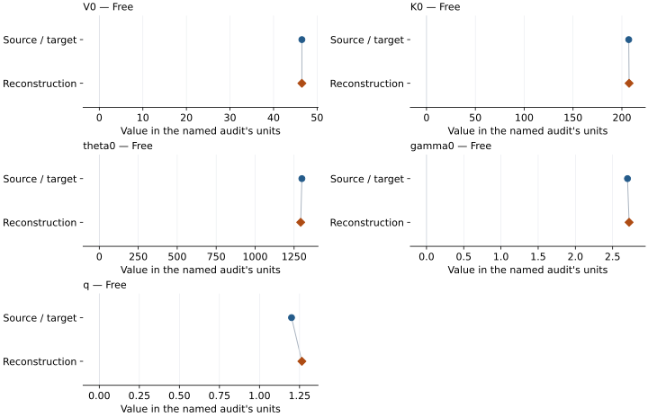

This is a **coefficient comparison**, not an observation or residual plot.
Each panel uses its coefficient's audit units and includes zero. Markers show
stored central values only. Error widths are retained in the table below;
no confidence interval or uncertainty band is inferred. Fixed/adopted values are constraints.

| Parameter | Source / target | Source error | Reconstruction | Reconstruction error | Fit role |
| --- | --- | --- | --- | --- | --- |
| V0 | 46.5 | 0.1 | 46.50048586668539 | 0.13398519158841543 | Free |
| K0 | 207.0 | 4.0 | 207.3687833523278 | 3.5380270383564323 | Free |
| theta0 | 1300.0 | 500.0 | 1292.4153082753091 | 528.8820462907312 | Free |
| gamma0 | 2.7 | 0.3 | 2.721488582796061 | 0.2982323710764867 | Free |
| q | 1.2 | 0.8 | 1.2646275685423243 | 0.778550678260963 | Free |

Values and reported errors are copied without rounding or conversion from the named audit. Missing errors mean unknown, not zero. Parameter names and volume conventions follow that audit; error widths do not imply a confidence convention.

Recorded diagnostics, covariance and additional protocol

- **Observed pressure range gpa:** \[51.3, 127.2\]
- **Solver success:** True
- **Solver message:** dedicated Noguchi (2013) staged refit completed
- **Rmse gpa:** 1.220993276619583
- **Published rmse gpa:** 1.2227650669472376
- **Stages:**
    - **Free parameters:** V0; K0
    - **Name:** 700 K BM2 reference isotherm
    - **Observations:** 9
    - **Rmse gpa:** 0.47280910545413796
    - **Free parameters:** theta0; gamma0; q
    - **Name:** high-temperature MGD pressure
    - **Observations:** 42
    - **Rmse gpa:** 1.220993276619583

### Detailed evidence and existing plots

- [Record-by-record numerical ledger](../primary-eos-refits.md#records).
- [Source-audit reports](../source-audits.md).

Observation curves and residual plots are provided by the supporting reports where available. Their absence is not filled by a reconstructed curve presented as measured data.

[Machine-readable comparison ledger](https://github.com/CPrescher/peritheos/blob/main/docs/data/primary-eos-refits.json) — look up `ca_perovskite_noguchi_2013_bm2_mgd_1`.
[Complete native EOSMAT file](https://github.com/CPrescher/peritheos/blob/main/peritheos/data/materials/ca_perovskite.eosmat).

## Sun et al. (2016), cubic CaSiO3 BM3-MGD

Record: `ca_perovskite_sun_2016_bm3_3` · Model: `BM3`

**Outcome: Coefficient parity achieved.**

**Scope:** Comparison with the source parameterization.
**Comparison basis:** Every compared free coefficient meets both the recorded combined-two-sigma comparison and parameter-specific numerical similarity screen. Error conventions and fit qualifications remain applicable.

[Stored EOS coefficients and source](../material-summaries/ca_perovskite.md#record-ca_perovskite_sun_2016_bm3_3)

### What this result establishes

**Separate source-review status:** primary\_source\_validated.
**Usage recommendation:** Retain the published cubic thermal EOS and all 144 printed observations for qualified comparison within the reported high-temperature range. The 300 K cubic branch is an extrapolated reference. Do not replace observations, uncertainties or the Pt pressure scale from the separately supplied workbook without resolved row correspondence and calibration.

- Usage recommendation: Retain the published cubic thermal EOS and all 144 printed observations for qualified comparison within the reported high-temperature range. The 300 K cubic branch is an extrapolated reference. Do not replace observations, uncertainties or the Pt pressure scale from the separately supplied workbook without resolved row correspondence and calibration.
- This named numerical assessment alone does not establish author-workflow reproduction, physical accuracy or recommendation for use.

### Data and reconstruction method

- **Dataset identifiers:** ca\_perovskite\_sun\_2016\_table1\_pvt
- **Observations:** 144
- **Fit kind:** joint\_pvt
- **Selection:** all rows
- **Objective:** pressure\_residuals
- **Absolute sigma:** False
- **Free parameters:** rt\_eos.V0; rt\_eos.K0; gamma0; q
- **Fixed parameters:** K0\_prime; Tr; theta0; n

Unspecified selections, weights, fixed values or error conventions remain unknown; they have not been inferred for this report.

### Source versus reconstruction

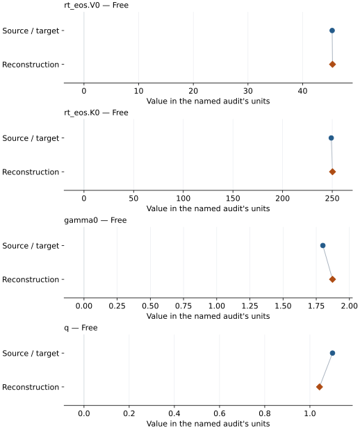

This is a **coefficient comparison**, not an observation or residual plot.
Each panel uses its coefficient's audit units and includes zero. Markers show
stored central values only. Error widths are retained in the table below;
no confidence interval or uncertainty band is inferred. Fixed/adopted values are constraints.

| Parameter | Source / target | Source error | Reconstruction | Reconstruction error | Fit role |
| --- | --- | --- | --- | --- | --- |
| rt\_eos.V0 | 45.4 | 0.1 | 45.463168587926575 | 0.1277745721104774 | Free |
| rt\_eos.K0 | 249.0 | 4.0 | 250.26459751521313 | 4.463302399867036 | Free |
| gamma0 | 1.8 | 0.2 | 1.8726436269720355 | 0.16101573271598724 | Free |
| q | 1.1 | 0.4 | 1.042544820174631 | 0.40454195750774424 | Free |

Values and reported errors are copied without rounding or conversion from the named audit. Missing errors mean unknown, not zero. Parameter names and volume conventions follow that audit; error widths do not imply a confidence convention.

Recorded diagnostics, covariance and additional protocol

- **Columns:**
    - **Pressure:** pressure\_gpa
    - **Temperature:** temperature\_k
    - **Volume:** volume\_a3\_per\_formula\_unit
- **Observed pressure range gpa:** \[21.2, 151.8\]
- **Observed temperature range k:** \[1200.0, 2600.0\]
- **Observed volume range:** \[33.6, 43.2\]
- **Degrees of freedom:** 140
- **Solver success:** True
- **Solver message:** \`ftol\` termination condition is satisfied.
- **Rmse gpa:** 0.9360485935657562
- **Published rmse gpa:** 1.8498176800487898
- **Reduced chi square:** 0.9012208829311853

### Detailed evidence and existing plots

- [Record-by-record numerical ledger](../primary-eos-refits.md#records).
- [Source-audit reports](../source-audits.md).

Observation curves and residual plots are provided by the supporting reports where available. Their absence is not filled by a reconstructed curve presented as measured data.

[Machine-readable comparison ledger](https://github.com/CPrescher/peritheos/blob/main/docs/data/primary-eos-refits.json) — look up `ca_perovskite_sun_2016_bm3_3`.
[Complete native EOSMAT file](https://github.com/CPrescher/peritheos/blob/main/peritheos/data/materials/ca_perovskite.eosmat).

## Wang et al. (1996), preferred room-temperature BM3

Record: `ca_perovskite_wang_1996_preferred_bm3` · Model: `BM3`

**Outcome: Coefficient parity achieved.**

**Scope:** Comparison with the source parameterization.
**Comparison basis:** Every compared free coefficient meets both the recorded combined-two-sigma comparison and parameter-specific numerical similarity screen. Error conventions and fit qualifications remain applicable.

[Stored EOS coefficients and source](../material-summaries/ca_perovskite.md#record-ca_perovskite_wang_1996_preferred_bm3)

### What this result establishes

**Separate source-review status:** primary\_source\_validated.
**Usage recommendation:** See the stored EOS qualifications; no recommendation is inferred here.

- This named numerical assessment alone does not establish author-workflow reproduction, physical accuracy or recommendation for use.

### Data and reconstruction method

- **Dataset identifiers:** ca\_perovskite\_wang\_1996\_table1\_room\_temperature
- **Observations:** 13
- **Fit kind:** isothermal\_pv
- **Selection:** all rows; reference-T rows
- **Objective:** errors\_in\_variables
- **Absolute sigma:** True
- **Free parameters:** V0; K0
- **Fixed parameters:** K0\_prime

Unspecified selections, weights, fixed values or error conventions remain unknown; they have not been inferred for this report.

### Source versus reconstruction

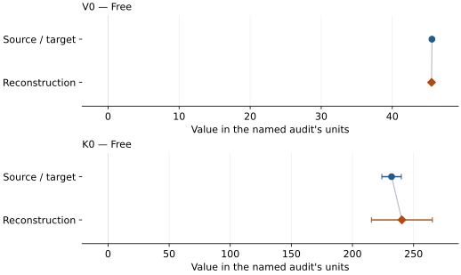

This is a **coefficient comparison**, not an observation or residual plot.
Each panel uses its coefficient's audit units and includes zero. Markers show
stored central values only. Error widths are retained in the table below;
no confidence interval or uncertainty band is inferred. Fixed/adopted values are constraints.

| Parameter | Source / target | Source error | Reconstruction | Reconstruction error | Fit role |
| --- | --- | --- | --- | --- | --- |
| V0 | 45.58 | 0.04 | 45.52418069065807 | 0.11729656034602479 | Free |
| K0 | 232.0 | 8.0 | 240.43368959584757 | 24.95342367843372 | Free |

Values and reported errors are copied without rounding or conversion from the named audit. Missing errors mean unknown, not zero. Parameter names and volume conventions follow that audit; error widths do not imply a confidence convention.

Recorded diagnostics, covariance and additional protocol

- **Columns:**
    - **Pressure:** pressure\_gpa
    - **Temperature:** temperature\_k
    - **Volume:** volume\_a3
- **Observed pressure range gpa:** \[0.59, 9.63\]
- **Observed temperature range k:** \[301.0, 304.0\]
- **Observed volume range:** \[43.87, 45.39\]
- **Degrees of freedom:** 11
- **Solver success:** True
- **Solver message:** Both \`ftol\` and \`xtol\` termination conditions are satisfied.
- **Rmse gpa:** 0.39829748691070793
- **Published rmse gpa:** 0.43840552273153216
- **Reduced chi square:** 0.19506935398595182

### Detailed evidence and existing plots

- [Supporting source report: wang-1996-casio3](../literature-reproductions/wang-1996-casio3.md).
- [Record-by-record numerical ledger](../primary-eos-refits.md#records).
- [Source-audit reports](../source-audits.md).

Observation curves and residual plots are provided by the supporting reports where available. Their absence is not filled by a reconstructed curve presented as measured data.

[Machine-readable comparison ledger](https://github.com/CPrescher/peritheos/blob/main/docs/data/primary-eos-refits.json) — look up `ca_perovskite_wang_1996_preferred_bm3`.
[Complete native EOSMAT file](https://github.com/CPrescher/peritheos/blob/main/peritheos/data/materials/ca_perovskite.eosmat).

## Wang et al. (1996), equal-weight Mao-data BM3 reanalysis

Record: `ca_perovskite_wang_1996_mao_equal_weight_bm3` · Model: `BM3`

**Outcome: Coefficient parity achieved.**

**Scope:** Comparison with the source parameterization.
**Comparison basis:** Every compared free coefficient meets both the recorded combined-two-sigma comparison and parameter-specific numerical similarity screen. Error conventions and fit qualifications remain applicable.

[Stored EOS coefficients and source](../material-summaries/ca_perovskite.md#record-ca_perovskite_wang_1996_mao_equal_weight_bm3)

### What this result establishes

**Separate source-review status:** primary\_source\_validated.
**Usage recommendation:** See the stored EOS qualifications; no recommendation is inferred here.

- This named numerical assessment alone does not establish author-workflow reproduction, physical accuracy or recommendation for use.

### Data and reconstruction method

- **Dataset identifiers:** ca\_perovskite\_mao\_1989\_table1\_compression
- **Observations:** 46
- **Fit kind:** isothermal\_pv
- **Selection:** all rows
- **Objective:** errors\_in\_variables
- **Absolute sigma:** True
- **Free parameters:** V0; K0; K0\_prime
- **Fixed parameters:** None declared

Unspecified selections, weights, fixed values or error conventions remain unknown; they have not been inferred for this report.

### Source versus reconstruction

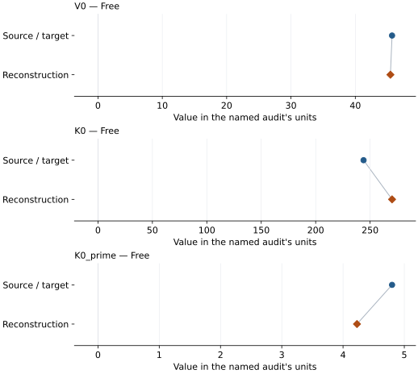

This is a **coefficient comparison**, not an observation or residual plot.
Each panel uses its coefficient's audit units and includes zero. Markers show
stored central values only. Error widths are retained in the table below;
no confidence interval or uncertainty band is inferred. Fixed/adopted values are constraints.

| Parameter | Source / target | Source error | Reconstruction | Reconstruction error | Fit role |
| --- | --- | --- | --- | --- | --- |
| V0 | 45.71 | 0.12 | 45.45535089374095 | 0.07016200084419652 | Free |
| K0 | 244.0 | 12.0 | 270.17847212312597 | 8.891945718109472 | Free |
| K0\_prime | 4.8 | 0.3 | 4.227354911497727 | 0.20623071420837175 | Free |

Values and reported errors are copied without rounding or conversion from the named audit. Missing errors mean unknown, not zero. Parameter names and volume conventions follow that audit; error widths do not imply a confidence convention.

Recorded diagnostics, covariance and additional protocol

- **Columns:**
    - **Pressure:** pressure\_gpa
    - **Temperature:** Not specified
    - **Volume:** unit\_cell\_volume\_a3
- **Observed pressure range gpa:** \[0.0, 134.0\]
- **Observed temperature range k:** Not specified
- **Observed volume range:** \[34.61, 45.27\]
- **Degrees of freedom:** 43
- **Solver success:** True
- **Solver message:** Both \`ftol\` and \`xtol\` termination conditions are satisfied.
- **Rmse gpa:** 0.5814071594341608
- **Published rmse gpa:** 1.7770532468441504
- **Reduced chi square:** 0.8583687326486715

### Detailed evidence and existing plots

- [Supporting source report: wang-1996-casio3](../literature-reproductions/wang-1996-casio3.md).
- [Record-by-record numerical ledger](../primary-eos-refits.md#records).
- [Source-audit reports](../source-audits.md).

Observation curves and residual plots are provided by the supporting reports where available. Their absence is not filled by a reconstructed curve presented as measured data.

[Machine-readable comparison ledger](https://github.com/CPrescher/peritheos/blob/main/docs/data/primary-eos-refits.json) — look up `ca_perovskite_wang_1996_mao_equal_weight_bm3`.
[Complete native EOSMAT file](https://github.com/CPrescher/peritheos/blob/main/peritheos/data/materials/ca_perovskite.eosmat).

## Wang et al. (1996), pressure-weighted all-Mao-data BM3 sensitivity

Record: `ca_perovskite_wang_1996_mao_pressure_weighted_all_bm3` · Model: `BM3`

**Outcome: Coefficient parity achieved.**

**Scope:** Comparison with the source parameterization.
**Comparison basis:** Every compared free coefficient meets both the recorded combined-two-sigma comparison and parameter-specific numerical similarity screen. Error conventions and fit qualifications remain applicable.

[Stored EOS coefficients and source](../material-summaries/ca_perovskite.md#record-ca_perovskite_wang_1996_mao_pressure_weighted_all_bm3)

### What this result establishes

**Separate source-review status:** primary\_source\_validated.
**Usage recommendation:** See the stored EOS qualifications; no recommendation is inferred here.

- This named numerical assessment alone does not establish author-workflow reproduction, physical accuracy or recommendation for use.

### Data and reconstruction method

- **Dataset identifiers:** ca\_perovskite\_mao\_1989\_table1\_compression
- **Observations:** 46
- **Fit kind:** isothermal\_pv
- **Selection:** all rows
- **Objective:** errors\_in\_variables
- **Absolute sigma:** True
- **Free parameters:** V0; K0; K0\_prime
- **Fixed parameters:** None declared

Unspecified selections, weights, fixed values or error conventions remain unknown; they have not been inferred for this report.

### Source versus reconstruction

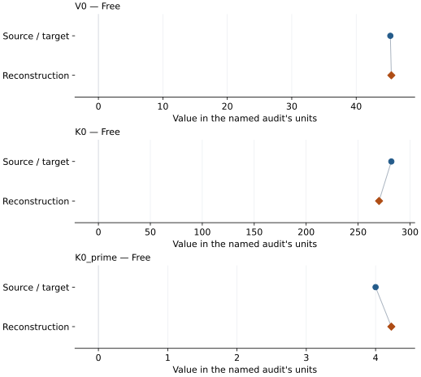

This is a **coefficient comparison**, not an observation or residual plot.
Each panel uses its coefficient's audit units and includes zero. Markers show
stored central values only. Error widths are retained in the table below;
no confidence interval or uncertainty band is inferred. Fixed/adopted values are constraints.

| Parameter | Source / target | Source error | Reconstruction | Reconstruction error | Fit role |
| --- | --- | --- | --- | --- | --- |
| V0 | 45.3 | 0.5 | 45.455350595301724 | 0.07016198626300284 | Free |
| K0 | 282.0 | 8.0 | 270.17851013128995 | 8.891945197094715 | Free |
| K0\_prime | 4.0 | 0.2 | 4.227354201645646 | 0.20623066585034047 | Free |

Values and reported errors are copied without rounding or conversion from the named audit. Missing errors mean unknown, not zero. Parameter names and volume conventions follow that audit; error widths do not imply a confidence convention.

Recorded diagnostics, covariance and additional protocol

- **Columns:**
    - **Pressure:** pressure\_gpa
    - **Temperature:** Not specified
    - **Volume:** unit\_cell\_volume\_a3
- **Observed pressure range gpa:** \[0.0, 134.0\]
- **Observed temperature range k:** Not specified
- **Observed volume range:** \[34.61, 45.27\]
- **Degrees of freedom:** 43
- **Solver success:** True
- **Solver message:** Both \`ftol\` and \`xtol\` termination conditions are satisfied.
- **Rmse gpa:** 0.5814067148113788
- **Published rmse gpa:** 1.9879300619890288
- **Reduced chi square:** 0.8583687326479956

### Detailed evidence and existing plots

- [Supporting source report: wang-1996-casio3](../literature-reproductions/wang-1996-casio3.md).
- [Record-by-record numerical ledger](../primary-eos-refits.md#records).
- [Source-audit reports](../source-audits.md).

Observation curves and residual plots are provided by the supporting reports where available. Their absence is not filled by a reconstructed curve presented as measured data.

[Machine-readable comparison ledger](https://github.com/CPrescher/peritheos/blob/main/docs/data/primary-eos-refits.json) — look up `ca_perovskite_wang_1996_mao_pressure_weighted_all_bm3`.
[Complete native EOSMAT file](https://github.com/CPrescher/peritheos/blob/main/peritheos/data/materials/ca_perovskite.eosmat).

## Wang et al. (1996), pressure-weighted Mao-data BM3 excluding sub-1-GPa points

Record: `ca_perovskite_wang_1996_mao_pressure_weighted_no_sub1gpa_bm3` · Model: `BM3`

**Outcome: Coefficient parity achieved.**

**Scope:** Comparison with the source parameterization.
**Comparison basis:** Every compared free coefficient meets both the recorded combined-two-sigma comparison and parameter-specific numerical similarity screen. Error conventions and fit qualifications remain applicable.

[Stored EOS coefficients and source](../material-summaries/ca_perovskite.md#record-ca_perovskite_wang_1996_mao_pressure_weighted_no_sub1gpa_bm3)

### What this result establishes

**Separate source-review status:** primary\_source\_validated.
**Usage recommendation:** See the stored EOS qualifications; no recommendation is inferred here.

- This named numerical assessment alone does not establish author-workflow reproduction, physical accuracy or recommendation for use.

### Data and reconstruction method

- **Dataset identifiers:** ca\_perovskite\_mao\_1989\_table1\_compression
- **Observations:** 46
- **Fit kind:** isothermal\_pv
- **Selection:** all rows
- **Objective:** errors\_in\_variables
- **Absolute sigma:** True
- **Free parameters:** V0; K0; K0\_prime
- **Fixed parameters:** None declared

Unspecified selections, weights, fixed values or error conventions remain unknown; they have not been inferred for this report.

### Source versus reconstruction

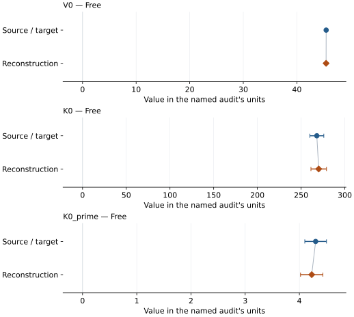

This is a **coefficient comparison**, not an observation or residual plot.
Each panel uses its coefficient's audit units and includes zero. Markers show
stored central values only. Error widths are retained in the table below;
no confidence interval or uncertainty band is inferred. Fixed/adopted values are constraints.

| Parameter | Source / target | Source error | Reconstruction | Reconstruction error | Fit role |
| --- | --- | --- | --- | --- | --- |
| V0 | 45.47 | 0.06 | 45.45535149501671 | 0.07016203050258164 | Free |
| K0 | 268.0 | 8.0 | 270.17839089899985 | 8.891946510663265 | Free |
| K0\_prime | 4.3 | 0.2 | 4.2273565235112205 | 0.2062308116966158 | Free |

Values and reported errors are copied without rounding or conversion from the named audit. Missing errors mean unknown, not zero. Parameter names and volume conventions follow that audit; error widths do not imply a confidence convention.

Recorded diagnostics, covariance and additional protocol

- **Columns:**
    - **Pressure:** pressure\_gpa
    - **Temperature:** Not specified
    - **Volume:** unit\_cell\_volume\_a3
- **Observed pressure range gpa:** \[0.0, 134.0\]
- **Observed temperature range k:** Not specified
- **Observed volume range:** \[34.61, 45.27\]
- **Degrees of freedom:** 43
- **Solver success:** True
- **Solver message:** \`ftol\` termination condition is satisfied.
- **Rmse gpa:** 0.5814079054150388
- **Published rmse gpa:** 1.7765513194200104
- **Reduced chi square:** 0.8583687326549201

### Detailed evidence and existing plots

- [Supporting source report: wang-1996-casio3](../literature-reproductions/wang-1996-casio3.md).
- [Record-by-record numerical ledger](../primary-eos-refits.md#records).
- [Source-audit reports](../source-audits.md).

Observation curves and residual plots are provided by the supporting reports where available. Their absence is not filled by a reconstructed curve presented as measured data.

[Machine-readable comparison ledger](https://github.com/CPrescher/peritheos/blob/main/docs/data/primary-eos-refits.json) — look up `ca_perovskite_wang_1996_mao_pressure_weighted_no_sub1gpa_bm3`.
[Complete native EOSMAT file](https://github.com/CPrescher/peritheos/blob/main/peritheos/data/materials/ca_perovskite.eosmat).

## Chizmeshya et al. (1996), LAPW(7) static BM3

Record: `ca_perovskite_chizmeshya_1996_lapw7_static_bm3` · Model: `BM3`

**Outcome: Complete independent refit unavailable.**

**Scope:** Comparison with the source parameterization.
**Comparison basis:** Coefficients are tabulated; energy-volume points and weights are unavailable.

[Stored EOS coefficients and source](../material-summaries/ca_perovskite.md#record-ca_perovskite_chizmeshya_1996_lapw7_static_bm3)

### What this result establishes

**Separate source-review status:** primary\_source\_validated.
**Usage recommendation:** See the stored EOS qualifications; no recommendation is inferred here.

- This named numerical assessment alone does not establish author-workflow reproduction, physical accuracy or recommendation for use.
- No reconstructed coefficient table is recorded for this assessment; no missing values have been inferred.

### Data and reconstruction method

- **Dataset identifiers:** None declared
- **Fixed parameters:** None declared

Unspecified selections, weights, fixed values or error conventions remain unknown; they have not been inferred for this report.

### Why no coefficient graph is shown

No numeric source/reconstruction pair is recorded for this assessment. A graph would require information that is not available here; no values or observations have been invented.

### Detailed evidence and existing plots

- [Record-by-record numerical ledger](../primary-eos-refits.md#records).
- [Source-audit reports](../source-audits.md).

Observation curves and residual plots are provided by the supporting reports where available. Their absence is not filled by a reconstructed curve presented as measured data.

[Machine-readable comparison ledger](https://github.com/CPrescher/peritheos/blob/main/docs/data/primary-eos-refits.json) — look up `ca_perovskite_chizmeshya_1996_lapw7_static_bm3`.
[Complete native EOSMAT file](https://github.com/CPrescher/peritheos/blob/main/peritheos/data/materials/ca_perovskite.eosmat).

## Chizmeshya et al. (1996), LAPW(8) static BM3

Record: `ca_perovskite_chizmeshya_1996_lapw8_static_bm3` · Model: `BM3`

**Outcome: Complete independent refit unavailable.**

**Scope:** Comparison with the source parameterization.
**Comparison basis:** No E-V grid is published.

[Stored EOS coefficients and source](../material-summaries/ca_perovskite.md#record-ca_perovskite_chizmeshya_1996_lapw8_static_bm3)

### What this result establishes

**Separate source-review status:** primary\_source\_validated.
**Usage recommendation:** See the stored EOS qualifications; no recommendation is inferred here.

- This named numerical assessment alone does not establish author-workflow reproduction, physical accuracy or recommendation for use.
- No reconstructed coefficient table is recorded for this assessment; no missing values have been inferred.

### Data and reconstruction method

- **Dataset identifiers:** None declared
- **Fixed parameters:** None declared

Unspecified selections, weights, fixed values or error conventions remain unknown; they have not been inferred for this report.

### Why no coefficient graph is shown

No numeric source/reconstruction pair is recorded for this assessment. A graph would require information that is not available here; no values or observations have been invented.

### Detailed evidence and existing plots

- [Record-by-record numerical ledger](../primary-eos-refits.md#records).
- [Source-audit reports](../source-audits.md).

Observation curves and residual plots are provided by the supporting reports where available. Their absence is not filled by a reconstructed curve presented as measured data.

[Machine-readable comparison ledger](https://github.com/CPrescher/peritheos/blob/main/docs/data/primary-eos-refits.json) — look up `ca_perovskite_chizmeshya_1996_lapw8_static_bm3`.
[Complete native EOSMAT file](https://github.com/CPrescher/peritheos/blob/main/peritheos/data/materials/ca_perovskite.eosmat).

## Chizmeshya et al. (1996), LAPW(9) static BM3

Record: `ca_perovskite_chizmeshya_1996_lapw9_static_bm3` · Model: `BM3`

**Outcome: Complete independent refit unavailable.**

**Scope:** Comparison with the source parameterization.
**Comparison basis:** No E-V grid is published.

[Stored EOS coefficients and source](../material-summaries/ca_perovskite.md#record-ca_perovskite_chizmeshya_1996_lapw9_static_bm3)

### What this result establishes

**Separate source-review status:** primary\_source\_validated.
**Usage recommendation:** See the stored EOS qualifications; no recommendation is inferred here.

- This named numerical assessment alone does not establish author-workflow reproduction, physical accuracy or recommendation for use.
- No reconstructed coefficient table is recorded for this assessment; no missing values have been inferred.

### Data and reconstruction method

- **Dataset identifiers:** None declared
- **Fixed parameters:** None declared

Unspecified selections, weights, fixed values or error conventions remain unknown; they have not been inferred for this report.

### Why no coefficient graph is shown

No numeric source/reconstruction pair is recorded for this assessment. A graph would require information that is not available here; no values or observations have been invented.

### Detailed evidence and existing plots

- [Record-by-record numerical ledger](../primary-eos-refits.md#records).
- [Source-audit reports](../source-audits.md).

Observation curves and residual plots are provided by the supporting reports where available. Their absence is not filled by a reconstructed curve presented as measured data.

[Machine-readable comparison ledger](https://github.com/CPrescher/peritheos/blob/main/docs/data/primary-eos-refits.json) — look up `ca_perovskite_chizmeshya_1996_lapw9_static_bm3`.
[Complete native EOSMAT file](https://github.com/CPrescher/peritheos/blob/main/peritheos/data/materials/ca_perovskite.eosmat).

## Chizmeshya et al. (1996), thermally corrected LAPW(9) BM3 with K0'=4

Record: `ca_perovskite_chizmeshya_1996_lapw9_300k_kp4_bm3` · Model: `BM3`

**Outcome: Complete independent refit unavailable.**

**Scope:** Comparison with the source parameterization.
**Comparison basis:** Thermally corrected E-V points are not published.

[Stored EOS coefficients and source](../material-summaries/ca_perovskite.md#record-ca_perovskite_chizmeshya_1996_lapw9_300k_kp4_bm3)

### What this result establishes

**Separate source-review status:** primary\_source\_validated.
**Usage recommendation:** See the stored EOS qualifications; no recommendation is inferred here.

- This named numerical assessment alone does not establish author-workflow reproduction, physical accuracy or recommendation for use.
- No reconstructed coefficient table is recorded for this assessment; no missing values have been inferred.

### Data and reconstruction method

- **Dataset identifiers:** None declared
- **Fixed parameters:** K0\_prime

Unspecified selections, weights, fixed values or error conventions remain unknown; they have not been inferred for this report.

### Why no coefficient graph is shown

No numeric source/reconstruction pair is recorded for this assessment. A graph would require information that is not available here; no values or observations have been invented.

### Detailed evidence and existing plots

- [Record-by-record numerical ledger](../primary-eos-refits.md#records).
- [Source-audit reports](../source-audits.md).

Observation curves and residual plots are provided by the supporting reports where available. Their absence is not filled by a reconstructed curve presented as measured data.

[Machine-readable comparison ledger](https://github.com/CPrescher/peritheos/blob/main/docs/data/primary-eos-refits.json) — look up `ca_perovskite_chizmeshya_1996_lapw9_300k_kp4_bm3`.
[Complete native EOSMAT file](https://github.com/CPrescher/peritheos/blob/main/peritheos/data/materials/ca_perovskite.eosmat).

## Chizmeshya et al. (1996), preferred thermally corrected LAPW(9) 300 K BM3

Record: `ca_perovskite_chizmeshya_1996_lapw9_300k_bm3` · Model: `BM3`

**Outcome: Complete independent refit unavailable.**

**Scope:** Comparison with the source parameterization.
**Comparison basis:** The coefficients are complete but the corrected E-V grid is not published.

[Stored EOS coefficients and source](../material-summaries/ca_perovskite.md#record-ca_perovskite_chizmeshya_1996_lapw9_300k_bm3)

### What this result establishes

**Separate source-review status:** primary\_source\_validated.
**Usage recommendation:** See the stored EOS qualifications; no recommendation is inferred here.

- This named numerical assessment alone does not establish author-workflow reproduction, physical accuracy or recommendation for use.
- No reconstructed coefficient table is recorded for this assessment; no missing values have been inferred.

### Data and reconstruction method

- **Dataset identifiers:** None declared
- **Fixed parameters:** None declared

Unspecified selections, weights, fixed values or error conventions remain unknown; they have not been inferred for this report.

### Why no coefficient graph is shown

No numeric source/reconstruction pair is recorded for this assessment. A graph would require information that is not available here; no values or observations have been invented.

### Detailed evidence and existing plots

- [Record-by-record numerical ledger](../primary-eos-refits.md#records).
- [Source-audit reports](../source-audits.md).

Observation curves and residual plots are provided by the supporting reports where available. Their absence is not filled by a reconstructed curve presented as measured data.

[Machine-readable comparison ledger](https://github.com/CPrescher/peritheos/blob/main/docs/data/primary-eos-refits.json) — look up `ca_perovskite_chizmeshya_1996_lapw9_300k_bm3`.
[Complete native EOSMAT file](https://github.com/CPrescher/peritheos/blob/main/peritheos/data/materials/ca_perovskite.eosmat).

## Holland et al. (2013), cpv modified Tait

Record: `ca_perovskite_holland_2013_cpv_modified_tait` · Model: `ModifiedTait`

**Outcome: Complete independent refit unavailable.**

**Scope:** Comparison with the source parameterization.
**Comparison basis:** The official tc-ds62 cpv block provides all four coefficients.

[Stored EOS coefficients and source](../material-summaries/ca_perovskite.md#record-ca_perovskite_holland_2013_cpv_modified_tait)

### What this result establishes

**Separate source-review status:** primary\_source\_validated.
**Usage recommendation:** See the stored EOS qualifications; no recommendation is inferred here.

- This named numerical assessment alone does not establish author-workflow reproduction, physical accuracy or recommendation for use.
- No reconstructed coefficient table is recorded for this assessment; no missing values have been inferred.

### Data and reconstruction method

- **Dataset identifiers:** None declared
- **Fixed parameters:** None declared

Unspecified selections, weights, fixed values or error conventions remain unknown; they have not been inferred for this report.

### Why no coefficient graph is shown

No numeric source/reconstruction pair is recorded for this assessment. A graph would require information that is not available here; no values or observations have been invented.

### Detailed evidence and existing plots

- [Record-by-record numerical ledger](../primary-eos-refits.md#records).
- [Source-audit reports](../source-audits.md).

Observation curves and residual plots are provided by the supporting reports where available. Their absence is not filled by a reconstructed curve presented as measured data.

[Machine-readable comparison ledger](https://github.com/CPrescher/peritheos/blob/main/docs/data/primary-eos-refits.json) — look up `ca_perovskite_holland_2013_cpv_modified_tait`.
[Complete native EOSMAT file](https://github.com/CPrescher/peritheos/blob/main/peritheos/data/materials/ca_perovskite.eosmat).

## Akber-Knutson et al. (2002), VIBC Pnma 300 K BM3

Record: `ca_perovskite_akber_knutson_2002_vibc_pnma_300k_bm3` · Model: `BM3`

**Outcome: Complete independent refit unavailable.**

**Scope:** Comparison with the source parameterization.
**Comparison basis:** The paper does not tabulate the calculated energy-volume grid.

[Stored EOS coefficients and source](../material-summaries/ca_perovskite.md#record-ca_perovskite_akber_knutson_2002_vibc_pnma_300k_bm3)

### What this result establishes

**Separate source-review status:** primary\_source\_validated.
**Usage recommendation:** See the stored EOS qualifications; no recommendation is inferred here.

- This named numerical assessment alone does not establish author-workflow reproduction, physical accuracy or recommendation for use.
- No reconstructed coefficient table is recorded for this assessment; no missing values have been inferred.

### Data and reconstruction method

- **Dataset identifiers:** None declared
- **Fixed parameters:** None declared

Unspecified selections, weights, fixed values or error conventions remain unknown; they have not been inferred for this report.

### Why no coefficient graph is shown

No numeric source/reconstruction pair is recorded for this assessment. A graph would require information that is not available here; no values or observations have been invented.

### Detailed evidence and existing plots

- [Record-by-record numerical ledger](../primary-eos-refits.md#records).
- [Source-audit reports](../source-audits.md).

Observation curves and residual plots are provided by the supporting reports where available. Their absence is not filled by a reconstructed curve presented as measured data.

[Machine-readable comparison ledger](https://github.com/CPrescher/peritheos/blob/main/docs/data/primary-eos-refits.json) — look up `ca_perovskite_akber_knutson_2002_vibc_pnma_300k_bm3`.
[Complete native EOSMAT file](https://github.com/CPrescher/peritheos/blob/main/peritheos/data/materials/ca_perovskite.eosmat).

## Akber-Knutson et al. (2002), VIBC Pm3m 300 K BM3

Record: `ca_perovskite_akber_knutson_2002_vibc_pm3m_300k_bm3` · Model: `BM3`

**Outcome: Complete independent refit unavailable.**

**Scope:** Comparison with the source parameterization.
**Comparison basis:** The paper does not tabulate the calculated energy-volume grid.

[Stored EOS coefficients and source](../material-summaries/ca_perovskite.md#record-ca_perovskite_akber_knutson_2002_vibc_pm3m_300k_bm3)

### What this result establishes

**Separate source-review status:** primary\_source\_validated.
**Usage recommendation:** See the stored EOS qualifications; no recommendation is inferred here.

- This named numerical assessment alone does not establish author-workflow reproduction, physical accuracy or recommendation for use.
- No reconstructed coefficient table is recorded for this assessment; no missing values have been inferred.

### Data and reconstruction method

- **Dataset identifiers:** None declared
- **Fixed parameters:** None declared

Unspecified selections, weights, fixed values or error conventions remain unknown; they have not been inferred for this report.

### Why no coefficient graph is shown

No numeric source/reconstruction pair is recorded for this assessment. A graph would require information that is not available here; no values or observations have been invented.

### Detailed evidence and existing plots

- [Record-by-record numerical ledger](../primary-eos-refits.md#records).
- [Source-audit reports](../source-audits.md).

Observation curves and residual plots are provided by the supporting reports where available. Their absence is not filled by a reconstructed curve presented as measured data.

[Machine-readable comparison ledger](https://github.com/CPrescher/peritheos/blob/main/docs/data/primary-eos-refits.json) — look up `ca_perovskite_akber_knutson_2002_vibc_pm3m_300k_bm3`.
[Complete native EOSMAT file](https://github.com/CPrescher/peritheos/blob/main/peritheos/data/materials/ca_perovskite.eosmat).

## Akber-Knutson et al. (2002), VIB Pm3m 300 K BM3

Record: `ca_perovskite_akber_knutson_2002_vib_pm3m_300k_bm3` · Model: `BM3`

**Outcome: Complete independent refit unavailable.**

**Scope:** Comparison with the source parameterization.
**Comparison basis:** The paper does not tabulate the calculated energy-volume grid.

[Stored EOS coefficients and source](../material-summaries/ca_perovskite.md#record-ca_perovskite_akber_knutson_2002_vib_pm3m_300k_bm3)

### What this result establishes

**Separate source-review status:** primary\_source\_validated.
**Usage recommendation:** See the stored EOS qualifications; no recommendation is inferred here.

- This named numerical assessment alone does not establish author-workflow reproduction, physical accuracy or recommendation for use.
- No reconstructed coefficient table is recorded for this assessment; no missing values have been inferred.

### Data and reconstruction method

- **Dataset identifiers:** None declared
- **Fixed parameters:** None declared

Unspecified selections, weights, fixed values or error conventions remain unknown; they have not been inferred for this report.

### Why no coefficient graph is shown

No numeric source/reconstruction pair is recorded for this assessment. A graph would require information that is not available here; no values or observations have been invented.

### Detailed evidence and existing plots

- [Record-by-record numerical ledger](../primary-eos-refits.md#records).
- [Source-audit reports](../source-audits.md).

Observation curves and residual plots are provided by the supporting reports where available. Their absence is not filled by a reconstructed curve presented as measured data.

[Machine-readable comparison ledger](https://github.com/CPrescher/peritheos/blob/main/docs/data/primary-eos-refits.json) — look up `ca_perovskite_akber_knutson_2002_vib_pm3m_300k_bm3`.
[Complete native EOSMAT file](https://github.com/CPrescher/peritheos/blob/main/peritheos/data/materials/ca_perovskite.eosmat).

## Sherman (1993), extended-basis static BM3

Record: `ca_perovskite_sherman_1993_basis_b_static_bm3` · Model: `BM3`

**Outcome: Complete independent refit unavailable.**

**Scope:** Comparison with the source parameterization.
**Comparison basis:** The complete calculated E-V grid and weighting are not tabulated.

[Stored EOS coefficients and source](../material-summaries/ca_perovskite.md#record-ca_perovskite_sherman_1993_basis_b_static_bm3)

### What this result establishes

**Separate source-review status:** primary\_source\_validated.
**Usage recommendation:** See the stored EOS qualifications; no recommendation is inferred here.

- This named numerical assessment alone does not establish author-workflow reproduction, physical accuracy or recommendation for use.
- No reconstructed coefficient table is recorded for this assessment; no missing values have been inferred.

### Data and reconstruction method

- **Dataset identifiers:** None declared
- **Fixed parameters:** None declared

Unspecified selections, weights, fixed values or error conventions remain unknown; they have not been inferred for this report.

### Why no coefficient graph is shown

No numeric source/reconstruction pair is recorded for this assessment. A graph would require information that is not available here; no values or observations have been invented.

### Detailed evidence and existing plots

- [Record-by-record numerical ledger](../primary-eos-refits.md#records).
- [Source-audit reports](../source-audits.md).

Observation curves and residual plots are provided by the supporting reports where available. Their absence is not filled by a reconstructed curve presented as measured data.

[Machine-readable comparison ledger](https://github.com/CPrescher/peritheos/blob/main/docs/data/primary-eos-refits.json) — look up `ca_perovskite_sherman_1993_basis_b_static_bm3`.
[Complete native EOSMAT file](https://github.com/CPrescher/peritheos/blob/main/peritheos/data/materials/ca_perovskite.eosmat).

## Wang and Weidner (1994), room-temperature BM2

Record: `ca_perovskite_wang_weidner_1994_bm2` · Model: `BM2`

**Outcome: Coefficient parity achieved.**

**Scope:** Comparison with the source parameterization.
**Comparison basis:** Every compared free coefficient meets both the recorded combined-two-sigma comparison and parameter-specific numerical similarity screen. Error conventions and fit qualifications remain applicable.

[Stored EOS coefficients and source](../material-summaries/ca_perovskite.md#record-ca_perovskite_wang_weidner_1994_bm2)

### What this result establishes

**Separate source-review status:** primary\_source\_validated.
**Usage recommendation:** See the stored EOS qualifications; no recommendation is inferred here.

- Complete plot-scope check: Wang and Weidner state that the BM2 used only the four room-temperature Figure 3 points above 2.0 GPa and fixed K0'=4. All four marker centers are bundled and an unweighted pressure-residual refit recovers V0 and K0 within the published uncertainties. This is not a numerical-table reproduction: the source does not publish the four P-V rows, residual coordinate, weights, covariance, or confidence convention. See the \[dedicated Wang-Weidner reproduction\](literature-reproductions/wang-weidner-1994-casio3.md).
- This named numerical assessment alone does not establish author-workflow reproduction, physical accuracy or recommendation for use.

### Data and reconstruction method

- **Dataset identifiers:** ca\_perovskite\_wang\_weidner\_1994\_figure3\_digitized
- **Observations:** 4
- **Fit kind:** isothermal\_pv
- **Selection:** all rows
- **Objective:** pressure\_residuals
- **Absolute sigma:** True
- **Free parameters:** V0; K0
- **Fixed parameters:** None declared

Unspecified selections, weights, fixed values or error conventions remain unknown; they have not been inferred for this report.

### Source versus reconstruction

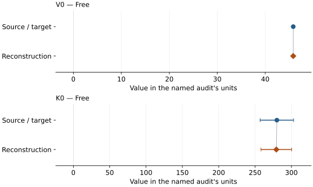

This is a **coefficient comparison**, not an observation or residual plot.
Each panel uses its coefficient's audit units and includes zero. Markers show
stored central values only. Error widths are retained in the table below;
no confidence interval or uncertainty band is inferred. Fixed/adopted values are constraints.

| Parameter | Source / target | Source error | Reconstruction | Reconstruction error | Fit role |
| --- | --- | --- | --- | --- | --- |
| V0 | 45.83 | 0.07 | 45.832161458634076 | 0.06979296964086522 | Free |
| K0 | 280.0 | 23.0 | 279.27071644884944 | 21.13232889952234 | Free |

Values and reported errors are copied without rounding or conversion from the named audit. Missing errors mean unknown, not zero. Parameter names and volume conventions follow that audit; error widths do not imply a confidence convention.

Recorded diagnostics, covariance and additional protocol

- **Columns:**
    - **Pressure:** pressure\_gpa
    - **Temperature:** Not specified
    - **Volume:** volume\_a3\_per\_formula\_unit
- **Observed pressure range gpa:** \[2.74, 9.24\]
- **Observed temperature range k:** Not specified
- **Observed volume range:** \[44.419, 45.341\]
- **Degrees of freedom:** 2
- **Solver success:** True
- **Solver message:** Both \`ftol\` and \`xtol\` termination conditions are satisfied.
- **Rmse gpa:** 0.24167623264192153
- **Published rmse gpa:** 0.24174859756680378
- **Reduced chi square:** 0.11681480284798437

### Detailed evidence and existing plots

- [Supporting source report: wang-weidner-1994-casio3](../literature-reproductions/wang-weidner-1994-casio3.md).
- [Record-by-record numerical ledger](../primary-eos-refits.md#records).
- [Source-audit reports](../source-audits.md).

Observation curves and residual plots are provided by the supporting reports where available. Their absence is not filled by a reconstructed curve presented as measured data.

[Machine-readable comparison ledger](https://github.com/CPrescher/peritheos/blob/main/docs/data/primary-eos-refits.json) — look up `ca_perovskite_wang_weidner_1994_bm2`.
[Complete native EOSMAT file](https://github.com/CPrescher/peritheos/blob/main/peritheos/data/materials/ca_perovskite.eosmat).

## Caracas et al. (2005), static cubic Pm-3m BM4

Record: `ca_perovskite_caracas_2005_bm4_4` · Model: `BM4`

**Outcome: Complete independent refit unavailable.**

**Scope:** Comparison with the source parameterization.
**Comparison basis:** Complete coefficients and density checkpoints are published; the underlying E(V) grid is not.

[Stored EOS coefficients and source](../material-summaries/ca_perovskite.md#record-ca_perovskite_caracas_2005_bm4_4)

### What this result establishes

**Separate source-review status:** primary\_source\_validated.
**Usage recommendation:** See the stored EOS qualifications; no recommendation is inferred here.

- This named numerical assessment alone does not establish author-workflow reproduction, physical accuracy or recommendation for use.
- No reconstructed coefficient table is recorded for this assessment; no missing values have been inferred.

### Data and reconstruction method

- **Dataset identifiers:** None declared
- **Fixed parameters:** None declared

Unspecified selections, weights, fixed values or error conventions remain unknown; they have not been inferred for this report.

### Why no coefficient graph is shown

No numeric source/reconstruction pair is recorded for this assessment. A graph would require information that is not available here; no values or observations have been invented.

### Detailed evidence and existing plots

- [Record-by-record numerical ledger](../primary-eos-refits.md#records).
- [Source-audit reports](../source-audits.md).

Observation curves and residual plots are provided by the supporting reports where available. Their absence is not filled by a reconstructed curve presented as measured data.

[Machine-readable comparison ledger](https://github.com/CPrescher/peritheos/blob/main/docs/data/primary-eos-refits.json) — look up `ca_perovskite_caracas_2005_bm4_4`.
[Complete native EOSMAT file](https://github.com/CPrescher/peritheos/blob/main/peritheos/data/materials/ca_perovskite.eosmat).

## Liu et al. (2007), cubic CaSiO3 static LDA BM3

Record: `ca_perovskite_liu_2007_lda_static_bm3` · Model: `BM3`

**Outcome: Complete independent refit unavailable.**

**Scope:** Comparison with the source parameterization.
**Comparison basis:** The source plots its calculated EOS but does not tabulate the energy-volume grid.

[Stored EOS coefficients and source](../material-summaries/ca_perovskite.md#record-ca_perovskite_liu_2007_lda_static_bm3)

### What this result establishes

**Separate source-review status:** primary\_source\_validated.
**Usage recommendation:** See the stored EOS qualifications; no recommendation is inferred here.

- This named numerical assessment alone does not establish author-workflow reproduction, physical accuracy or recommendation for use.
- No reconstructed coefficient table is recorded for this assessment; no missing values have been inferred.

### Data and reconstruction method

- **Dataset identifiers:** None declared
- **Fixed parameters:** None declared

Unspecified selections, weights, fixed values or error conventions remain unknown; they have not been inferred for this report.

### Why no coefficient graph is shown

No numeric source/reconstruction pair is recorded for this assessment. A graph would require information that is not available here; no values or observations have been invented.

### Detailed evidence and existing plots

- [Record-by-record numerical ledger](../primary-eos-refits.md#records).
- [Source-audit reports](../source-audits.md).

Observation curves and residual plots are provided by the supporting reports where available. Their absence is not filled by a reconstructed curve presented as measured data.

[Machine-readable comparison ledger](https://github.com/CPrescher/peritheos/blob/main/docs/data/primary-eos-refits.json) — look up `ca_perovskite_liu_2007_lda_static_bm3`.
[Complete native EOSMAT file](https://github.com/CPrescher/peritheos/blob/main/peritheos/data/materials/ca_perovskite.eosmat).

## Joint Sun (2016) + Gréaux (2019) data, cubic CaSiO3 BM3-MGD (Fu 2023)

Record: `ca_perovskite_fu_2023_bm3_mgd_refit` · Model: `BM3`

**Outcome: Parity not achieved for this comparison.**

**Scope:** Comparison with the source parameterization.
**Comparison basis:** The complete candidate observation rows were recovered from the author-hosted Sun PDF and official Gréaux XLSX and are now bundled as attributed numerical transcriptions. Fu et al. publish neither an objective, row/output weights, covariance, nor code. Four explicit weighting diagnostics, including propagated P-V uncertainty, all converge away from Table S3, especially for gamma0 and q; this is therefore a completed non-parity audit, not an exact reconstruction of an undisclosed fit protocol. Kawai-Tsuchiya and Li curves are analytical comparisons, while Thomson is explicitly excluded. Not recommended for scientific predictions or pressure calibration. Retained only for explicit diagnostic inspection. The published thermal parameterization retains an unresolved high-temperature discrepancy against the reconstructed source observations; source normalization checks do not reconcile it.

[Stored EOS coefficients and source](../material-summaries/ca_perovskite.md#record-ca_perovskite_fu_2023_bm3_mgd_refit)

### What this result establishes

**Separate source-review status:** not\_reproduced.
**Usage recommendation:** not\_recommended\_for\_quantitative\_use

- Not recommended for scientific predictions or pressure calibration. Retained only for explicit diagnostic inspection. The published thermal parameterization retains an unresolved high-temperature discrepancy against the reconstructed source observations; source normalization checks do not reconcile it.
- Usage recommendation: not\_recommended\_for\_quantitative\_use
- This named numerical assessment alone does not establish author-workflow reproduction, physical accuracy or recommendation for use.

### Data and reconstruction method

- **Dataset identifiers:** fu-2023-casio3-refit-audit.json
- **Observations:** 174
- **Fit kind:** joint\_bm3\_mgd\_finite\_strain\_pressure\_bulk\_shear
- **Selection:** 140 Sun Table 1 P-V-T rows at 1200-2200 K plus 34 cubic Gréaux Figure 3b P-Vp-Vs-density rows
- **Objective:** unweighted absolute pressure, KS, and shear residuals in GPa
- **Absolute sigma:** False
- **Free parameters:** rt\_eos.V0; rt\_eos.K0; mu0; mu0\_prime; gamma0; q; eta\_s0
- **Fixed parameters:** K0\_prime; Tr; n

Unspecified selections, weights, fixed values or error conventions remain unknown; they have not been inferred for this report.

### Source versus reconstruction

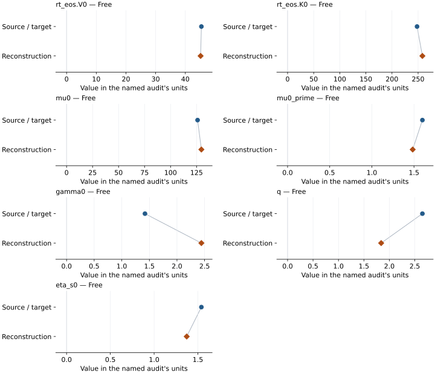

This is a **coefficient comparison**, not an observation or residual plot.
Each panel uses its coefficient's audit units and includes zero. Markers show
stored central values only. Error widths are retained in the table below;
no confidence interval or uncertainty band is inferred. Fixed/adopted values are constraints.

| Parameter | Source / target | Source error | Reconstruction | Reconstruction error | Fit role |
| --- | --- | --- | --- | --- | --- |
| rt\_eos.V0 | 45.4 | Not specified | 45.13462466128785 | Not specified | Free |
| rt\_eos.K0 | 248.0 | Not specified | 258.2712189512558 | Not specified | Free |
| mu0 | 126.0 | Not specified | 129.6615691954936 | Not specified | Free |
| mu0\_prime | 1.6 | Not specified | 1.4847900483588843 | Not specified | Free |
| gamma0 | 1.42 | Not specified | 2.4419606043407156 | Not specified | Free |
| q | 2.65 | Not specified | 1.8394636082638287 | Not specified | Free |
| eta\_s0 | 1.54 | Not specified | 1.3723637880190716 | Not specified | Free |

Values and reported errors are copied without rounding or conversion from the named audit. Missing errors mean unknown, not zero. Parameter names and volume conventions follow that audit; error widths do not imply a confidence convention.

Recorded diagnostics, covariance and additional protocol

- **Observed pressure range gpa:** \[12.05, 151.8\]
- **Observed temperature range k:** \[700.0, 2200.0\]
- **Observed volume range:** \[33.6, 44.09251814319802\]
- **Solver success:** True
- **Solver message:** \`ftol\` termination condition is satisfied.

### Detailed evidence and existing plots

- [Earlier detailed record investigation](../primary-eos-refits.md#investigation-ca_perovskite_fu_2023_bm3_mgd_refit).
- [Supporting source report: eos-recommendation-dispositions-2026-10-17](../research/eos-recommendation-dispositions-2026-10-17.md).
- [Record-by-record numerical ledger](../primary-eos-refits.md#records).
- [Source-audit reports](../source-audits.md).

Observation curves and residual plots are provided by the supporting reports where available. Their absence is not filled by a reconstructed curve presented as measured data.

[Machine-readable comparison ledger](https://github.com/CPrescher/peritheos/blob/main/docs/data/primary-eos-refits.json) — look up `ca_perovskite_fu_2023_bm3_mgd_refit`.
[Complete native EOSMAT file](https://github.com/CPrescher/peritheos/blob/main/peritheos/data/materials/ca_perovskite.eosmat).

## Karki and Crain (1998), static cubic CaSiO3 BM3

Record: `ca_perovskite_karki_crain_1998_static_bm3` · Model: `BM3`

**Outcome: Complete independent refit unavailable.**

**Scope:** Comparison with the source parameterization.
**Comparison basis:** The source reports the complete EOS coefficients and plotted calculated curves but no reusable energy-volume table or fit covariance.

[Stored EOS coefficients and source](../material-summaries/ca_perovskite.md#record-ca_perovskite_karki_crain_1998_static_bm3)

### What this result establishes

**Separate source-review status:** primary\_source\_validated.
**Usage recommendation:** See the stored EOS qualifications; no recommendation is inferred here.

- This named numerical assessment alone does not establish author-workflow reproduction, physical accuracy or recommendation for use.
- No reconstructed coefficient table is recorded for this assessment; no missing values have been inferred.

### Data and reconstruction method

- **Dataset identifiers:** None declared
- **Fixed parameters:** None declared

Unspecified selections, weights, fixed values or error conventions remain unknown; they have not been inferred for this report.

### Why no coefficient graph is shown

No numeric source/reconstruction pair is recorded for this assessment. A graph would require information that is not available here; no values or observations have been invented.

### Detailed evidence and existing plots

- [Record-by-record numerical ledger](../primary-eos-refits.md#records).
- [Source-audit reports](../source-audits.md).

Observation curves and residual plots are provided by the supporting reports where available. Their absence is not filled by a reconstructed curve presented as measured data.

[Machine-readable comparison ledger](https://github.com/CPrescher/peritheos/blob/main/docs/data/primary-eos-refits.json) — look up `ca_perovskite_karki_crain_1998_static_bm3`.
[Complete native EOSMAT file](https://github.com/CPrescher/peritheos/blob/main/peritheos/data/materials/ca_perovskite.eosmat).

## Ono (2013), cubic CaSiO3 BM3 plus logarithmic-volume thermal pressure

Record: `ca_perovskite_ono_2013_bm3_log_thermal` · Model: `BM3`

**Outcome: Complete independent refit unavailable.**

**Scope:** Comparison with the source parameterization.
**Comparison basis:** The article states that 27 high-temperature AIMD states were fitted but does not tabulate their P-V-T values, fit weights, residual statistic, or covariance.

[Stored EOS coefficients and source](../material-summaries/ca_perovskite.md#record-ca_perovskite_ono_2013_bm3_log_thermal)

### What this result establishes

**Separate source-review status:** primary\_source\_validated.
**Usage recommendation:** See the stored EOS qualifications; no recommendation is inferred here.

- This named numerical assessment alone does not establish author-workflow reproduction, physical accuracy or recommendation for use.
- No reconstructed coefficient table is recorded for this assessment; no missing values have been inferred.

### Data and reconstruction method

- **Dataset identifiers:** None declared
- **Fixed parameters:** V0; K0; K0\_prime; Tr

Unspecified selections, weights, fixed values or error conventions remain unknown; they have not been inferred for this report.

### Why no coefficient graph is shown

No numeric source/reconstruction pair is recorded for this assessment. A graph would require information that is not available here; no values or observations have been invented.

### Detailed evidence and existing plots

- [Record-by-record numerical ledger](../primary-eos-refits.md#records).
- [Source-audit reports](../source-audits.md).

Observation curves and residual plots are provided by the supporting reports where available. Their absence is not filled by a reconstructed curve presented as measured data.

[Machine-readable comparison ledger](https://github.com/CPrescher/peritheos/blob/main/docs/data/primary-eos-refits.json) — look up `ca_perovskite_ono_2013_bm3_log_thermal`.
[Complete native EOSMAT file](https://github.com/CPrescher/peritheos/blob/main/peritheos/data/materials/ca_perovskite.eosmat).

## Peritheos unweighted joint fit to Sun (2016) + Gréaux (2019) cubic CaSiO3 data

Record: `ca_perovskite_fu_2023_candidate_data_unweighted_bm3_mgd_refit` · Model: `BM3`

**Outcome: Coefficient parity achieved.**

**Scope:** Reproduction of a stored independent Peritheos refit.
**Comparison basis:** This opt-in EOS record stores the pressure-producing subset of the audited unweighted seven-parameter joint fit. Parity here verifies the stored coefficients against the audit artifact; it does not imply parity with Fu Table S3 or knowledge of Fu's unpublished weights.

[Stored EOS coefficients and source](../material-summaries/ca_perovskite.md#record-ca_perovskite_fu_2023_candidate_data_unweighted_bm3_mgd_refit)

### What this result establishes

**Separate source-review status:** primary\_source\_validated.
**Usage recommendation:** Opt-in independent comparison using unit weight for every scalar pressure, bulk-modulus and shear-modulus residual in GPa. Retain the candidate selection, pressure-scale and measurement-error qualifications. Do not present it as a correction to or reproduction of Fu's original fit; its residual-scaled errors do not establish source measurement covariance.

- This comparison concerns the stored independent Peritheos refit, not recovery of the original publication's coefficients or author workflow.
- Usage recommendation: Opt-in independent comparison using unit weight for every scalar pressure, bulk-modulus and shear-modulus residual in GPa. Retain the candidate selection, pressure-scale and measurement-error qualifications. Do not present it as a correction to or reproduction of Fu's original fit; its residual-scaled errors do not establish source measurement covariance.

### Data and reconstruction method

The source/target column below is the stored **Peritheos refit**. Agreement with it does not reproduce the original publication's coefficients.

- **Dataset identifiers:** fu-2023-casio3-refit-audit.json
- **Observations:** 174
- **Fit kind:** joint\_bm3\_mgd\_finite\_strain\_pressure\_bulk\_shear
- **Selection:** Sun Table 1 rows at 1200-2200 K plus all cubic Gréaux Figure 3b rows
- **Objective:** unweighted absolute pressure, KS, and shear residuals in GPa
- **Absolute sigma:** False
- **Free parameters:** V0; K0; mu0; mu0\_prime; gamma0; q; eta\_s0
- **Fixed parameters:** K0\_prime; Tr; theta0; n

Unspecified selections, weights, fixed values or error conventions remain unknown; they have not been inferred for this report.

### Source versus reconstruction

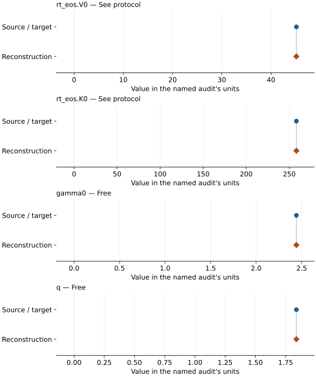

This is a **coefficient comparison**, not an observation or residual plot.
Each panel uses its coefficient's audit units and includes zero. Markers show
stored central values only. Error widths are retained in the table below;
no confidence interval or uncertainty band is inferred. Fixed/adopted values are constraints.

| Parameter | Source / target | Source error | Reconstruction | Reconstruction error | Fit role |
| --- | --- | --- | --- | --- | --- |
| rt\_eos.V0 | 45.13462466128785 | Not specified | 45.13462466128785 | Not specified | See protocol |
| rt\_eos.K0 | 258.2712189512558 | Not specified | 258.2712189512558 | Not specified | See protocol |
| gamma0 | 2.4419606043407156 | Not specified | 2.4419606043407156 | Not specified | Free |
| q | 1.8394636082638287 | Not specified | 1.8394636082638287 | Not specified | Free |

Values and reported errors are copied without rounding or conversion from the named audit. Missing errors mean unknown, not zero. Parameter names and volume conventions follow that audit; error widths do not imply a confidence convention.

Recorded diagnostics, covariance and additional protocol

- **Observed pressure range gpa:** \[12.05, 151.8\]
- **Observed temperature range k:** \[700.0, 2200.0\]
- **Observed volume range:** \[33.6, 44.09251814319802\]
- **Solver success:** True
- **Solver message:** \`ftol\` termination condition is satisfied.

### Detailed evidence and existing plots

- [Record-by-record numerical ledger](../primary-eos-refits.md#records).
- [Source-audit reports](../source-audits.md).

Observation curves and residual plots are provided by the supporting reports where available. Their absence is not filled by a reconstructed curve presented as measured data.

[Machine-readable comparison ledger](https://github.com/CPrescher/peritheos/blob/main/docs/data/primary-eos-refits.json) — look up `ca_perovskite_fu_2023_candidate_data_unweighted_bm3_mgd_refit`.
[Complete native EOSMAT file](https://github.com/CPrescher/peritheos/blob/main/peritheos/data/materials/ca_perovskite.eosmat).

## Peritheos refit of Wang (1996), BM3 + linear thermal pressure (64 points)

Record: `ca_perovskite_wang_1996_unweighted_bm3_linear_thermal_refit` · Model: `BM3`

**Outcome: Coefficient parity achieved.**

**Scope:** Reproduction of a stored independent Peritheos refit.
**Comparison basis:** Reproduction of the registered Peritheos refit's stored coefficients under its declared protocol.

[Stored EOS coefficients and source](../material-summaries/ca_perovskite.md#record-ca_perovskite_wang_1996_unweighted_bm3_linear_thermal_refit)

### What this result establishes

**Separate source-review status:** primary\_source\_validated.
**Usage recommendation:** Optional comparison within sampled coverage; range bounds describe an observation envelope, not complete P–T coverage. Preserve the source pressure-scale and weighting qualifications. Do not extrapolate to ambient stability or present as Wang's published thermal coefficients.

- This comparison concerns the stored independent Peritheos refit, not recovery of the original publication's coefficients or author workflow.
- Independent Peritheos BM3 + linear thermal-pressure refit to 64 experimental Table 1 states. The two source-flagged sub-2-GPa amorphizing states are excluded. Equal pressure weights are an analyst choice, not recovered Wang weights. Conditional residual-scaled standard errors omit coordinate uncertainties, correlations, pressure-scale systematics and fixed-parameter uncertainty. This is not a reproduction of the published thermal fit or validation as a pressure standard.
- Usage recommendation: Optional comparison within sampled coverage; range bounds describe an observation envelope, not complete P–T coverage. Preserve the source pressure-scale and weighting qualifications. Do not extrapolate to ambient stability or present as Wang's published thermal coefficients.
- Original publication reproduction status: not\_reproduced

### Data and reconstruction method

The source/target column below is the stored **Peritheos refit**. Agreement with it does not reproduce the original publication's coefficients.

- **Dataset identifiers:** ca\_perovskite\_wang\_1996\_selected64\_thermal\_refit
- **Observations:** 64
- **Fit kind:** selected\_bm3\_linear\_thermal\_pressure
- **Objective:** equal pressure weights
- **Absolute sigma:** False
- **Fixed parameters:** K0\_prime; Tr

Unspecified selections, weights, fixed values or error conventions remain unknown; they have not been inferred for this report.

### Source versus reconstruction

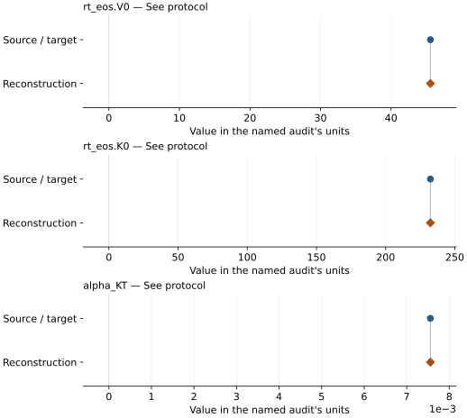

This is a **coefficient comparison**, not an observation or residual plot.
Each panel uses its coefficient's audit units and includes zero. Markers show
stored central values only. Error widths are retained in the table below;
no confidence interval or uncertainty band is inferred. Fixed/adopted values are constraints.

| Parameter | Source / target | Source error | Reconstruction | Reconstruction error | Fit role |
| --- | --- | --- | --- | --- | --- |
| rt\_eos.V0 | 45.57782732594936 | Not specified | 45.57782732594936 | 0.04312590406770611 | See protocol |
| rt\_eos.K0 | 232.34947188174428 | Not specified | 232.34947188174428 | 7.413360745829351 | See protocol |
| alpha\_KT | 0.007557237418777561 | Not specified | 0.007557237418777561 | 0.0001502197868388134 | See protocol |

Values and reported errors are copied without rounding or conversion from the named audit. Missing errors mean unknown, not zero. Parameter names and volume conventions follow that audit; error widths do not imply a confidence convention.

Recorded diagnostics, covariance and additional protocol

- **Solver success:** True
- **Rmse gpa:** 0.3562013701977093

### Detailed evidence and existing plots

- [Record-by-record numerical ledger](../primary-eos-refits.md#records).
- [Source-audit reports](../source-audits.md).

Observation curves and residual plots are provided by the supporting reports where available. Their absence is not filled by a reconstructed curve presented as measured data.

[Machine-readable comparison ledger](https://github.com/CPrescher/peritheos/blob/main/docs/data/primary-eos-refits.json) — look up `ca_perovskite_wang_1996_unweighted_bm3_linear_thermal_refit`.
[Complete native EOSMAT file](https://github.com/CPrescher/peritheos/blob/main/peritheos/data/materials/ca_perovskite.eosmat).
