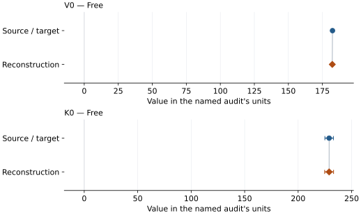
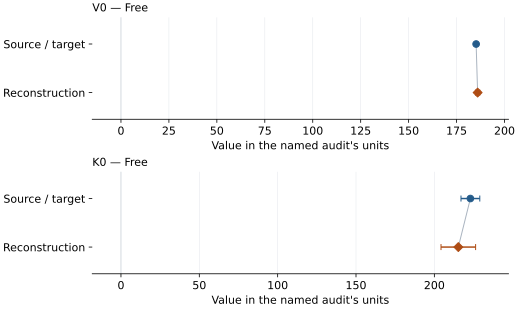

# Tetragonal CaSiO3 perovskite (davemaoite): EOS reconstruction reports

<!-- Generated by scripts.generate_reconstruction_reports; edit EOSMAT instead. -->

[All reconstruction reports](index.md) · [Material and EOS parameters](../material-summaries/ca_perovskite_tetragonal.md)

These reports explain the assessments already stored in EOSMAT. Generating
this page does not refit observations, change classifications or replace source coefficients.

Use [scientific label definitions](../eos-labels.md) to distinguish coefficient
agreement, source verification, author-workflow reproduction and recommendation for use.

| EOS record | Recorded outcome | Coefficient comparison |
| --- | --- | --- |
| [Sun et al. (2022), 300 K tetragonal CaSiO3 BM3 (K0' fixed)](#record-ca_perovskite_tetragonal_sun_2022_bm3_1) | Coefficient parity achieved | Graph and table |
| [Sagatova et al. (2021), tetragonal CaSiO3 LDA 300 K Vinet](#record-ca_perovskite_tetragonal_sagatova_2021_lda_300k_vinet) | Complete independent refit unavailable | No numeric coefficient pair recorded |
| [Sagatova et al. (2021), tetragonal CaSiO3 GGA 300 K Vinet](#record-ca_perovskite_tetragonal_sagatova_2021_gga_300k_vinet) | Complete independent refit unavailable | No numeric coefficient pair recorded |
| [Caracas et al. (2005), static I4/mcm BM3](#record-ca_perovskite_tetragonal_caracas_2005_bm3_1) | Complete independent refit unavailable | No numeric coefficient pair recorded |
| [Caracas et al. (2005), static I4/mcm BM4](#record-ca_perovskite_tetragonal_caracas_2005_bm4_2) | Complete independent refit unavailable | No numeric coefficient pair recorded |
| [Chen et al. (2018), 300 K Ne-medium Vinet](#record-ca_perovskite_tetragonal_chen_2018_vinet) | Numerically similar, with qualifications | Graph and table |

## Sun et al. (2022), 300 K tetragonal CaSiO3 BM3 (K0' fixed)

Record: `ca_perovskite_tetragonal_sun_2022_bm3_1` · Model: `BM3`

**Outcome: Coefficient parity achieved.**

**Scope:** Comparison with the source parameterization.
**Comparison basis:** Every compared free coefficient meets both the recorded combined-two-sigma comparison and parameter-specific numerical similarity screen. Error conventions and fit qualifications remain applicable.

[Stored EOS coefficients and source](../material-summaries/ca_perovskite_tetragonal.md#record-ca_perovskite_tetragonal_sun_2022_bm3_1)

### What this result establishes

**Separate source-review status:** primary\_source\_validated.
**Usage recommendation:** See the stored EOS qualifications; no recommendation is inferred here.

- This named numerical assessment alone does not establish author-workflow reproduction, physical accuracy or recommendation for use.

### Data and reconstruction method

- **Dataset identifiers:** ca\_perovskite\_tetragonal\_sun\_2022\_table1\_pv
- **Observations:** 23
- **Fit kind:** isothermal\_pv
- **Selection:** all rows
- **Objective:** pressure\_residuals
- **Absolute sigma:** False
- **Free parameters:** V0; K0
- **Fixed parameters:** K0\_prime

Unspecified selections, weights, fixed values or error conventions remain unknown; they have not been inferred for this report.

### Source versus reconstruction

This is a **coefficient comparison**, not an observation or residual plot.
Each panel uses its coefficient's audit units and includes zero. Markers show
stored central values only. Error widths are retained in the table below;
no confidence interval or uncertainty band is inferred. Fixed/adopted values are constraints.

| Parameter | Source / target | Source error | Reconstruction | Reconstruction error | Fit role |
| --- | --- | --- | --- | --- | --- |
| V0 | 182.4 | 0.8 | 182.24804798749565 | 0.6317092825607095 | Free |
| K0 | 229.0 | 4.0 | 228.98385840298772 | 4.159115567561618 | Free |

Values and reported errors are copied without rounding or conversion from the named audit. Missing errors mean unknown, not zero. Parameter names and volume conventions follow that audit; error widths do not imply a confidence convention.

Recorded diagnostics, covariance and additional protocol

- **Columns:**
    - **Pressure:** pressure\_gpa
    - **Temperature:** Not specified
    - **Volume:** volume\_a3\_conventional\_cell
- **Observed pressure range gpa:** \[21.5, 199.2\]
- **Observed temperature range k:** Not specified
- **Observed volume range:** \[123.1, 167.0\]
- **Degrees of freedom:** 21
- **Solver success:** True
- **Solver message:** Both \`ftol\` and \`xtol\` termination conditions are satisfied.
- **Rmse gpa:** 1.9329913971206174
- **Published rmse gpa:** 2.0046588369459113
- **Reduced chi square:** 4.092308669089204

### Detailed evidence and existing plots

- [Record-by-record numerical ledger](../primary-eos-refits.md#records).
- [Source-audit reports](../source-audits.md).

Observation curves and residual plots are provided by the supporting reports where available. Their absence is not filled by a reconstructed curve presented as measured data.

[Machine-readable comparison ledger](https://github.com/CPrescher/peritheos/blob/main/docs/data/primary-eos-refits.json) — look up `ca_perovskite_tetragonal_sun_2022_bm3_1`.
[Complete native EOSMAT file](https://github.com/CPrescher/peritheos/blob/main/peritheos/data/materials/ca_perovskite_tetragonal.eosmat).

## Sagatova et al. (2021), tetragonal CaSiO3 LDA 300 K Vinet

Record: `ca_perovskite_tetragonal_sagatova_2021_lda_300k_vinet` · Model: `Vinet`

**Outcome: Complete independent refit unavailable.**

**Scope:** Comparison with the source parameterization.
**Comparison basis:** The 300 and 2000 K P-V curves are plotted in Figure 7, but calculated P-V points are not tabulated.

[Stored EOS coefficients and source](../material-summaries/ca_perovskite_tetragonal.md#record-ca_perovskite_tetragonal_sagatova_2021_lda_300k_vinet)

### What this result establishes

**Separate source-review status:** primary\_source\_validated.
**Usage recommendation:** See the stored EOS qualifications; no recommendation is inferred here.

- This named numerical assessment alone does not establish author-workflow reproduction, physical accuracy or recommendation for use.
- No reconstructed coefficient table is recorded for this assessment; no missing values have been inferred.

### Data and reconstruction method

- **Dataset identifiers:** None declared
- **Fixed parameters:** None declared

Unspecified selections, weights, fixed values or error conventions remain unknown; they have not been inferred for this report.

### Why no coefficient graph is shown

No numeric source/reconstruction pair is recorded for this assessment. A graph would require information that is not available here; no values or observations have been invented.

### Detailed evidence and existing plots

- [Record-by-record numerical ledger](../primary-eos-refits.md#records).
- [Source-audit reports](../source-audits.md).

Observation curves and residual plots are provided by the supporting reports where available. Their absence is not filled by a reconstructed curve presented as measured data.

[Machine-readable comparison ledger](https://github.com/CPrescher/peritheos/blob/main/docs/data/primary-eos-refits.json) — look up `ca_perovskite_tetragonal_sagatova_2021_lda_300k_vinet`.
[Complete native EOSMAT file](https://github.com/CPrescher/peritheos/blob/main/peritheos/data/materials/ca_perovskite_tetragonal.eosmat).

## Sagatova et al. (2021), tetragonal CaSiO3 GGA 300 K Vinet

Record: `ca_perovskite_tetragonal_sagatova_2021_gga_300k_vinet` · Model: `Vinet`

**Outcome: Complete independent refit unavailable.**

**Scope:** Comparison with the source parameterization.
**Comparison basis:** The 300 and 2000 K P-V curves are plotted in Figure 7, but calculated P-V points are not tabulated.

[Stored EOS coefficients and source](../material-summaries/ca_perovskite_tetragonal.md#record-ca_perovskite_tetragonal_sagatova_2021_gga_300k_vinet)

### What this result establishes

**Separate source-review status:** primary\_source\_validated.
**Usage recommendation:** See the stored EOS qualifications; no recommendation is inferred here.

- This named numerical assessment alone does not establish author-workflow reproduction, physical accuracy or recommendation for use.
- No reconstructed coefficient table is recorded for this assessment; no missing values have been inferred.

### Data and reconstruction method

- **Dataset identifiers:** None declared
- **Fixed parameters:** None declared

Unspecified selections, weights, fixed values or error conventions remain unknown; they have not been inferred for this report.

### Why no coefficient graph is shown

No numeric source/reconstruction pair is recorded for this assessment. A graph would require information that is not available here; no values or observations have been invented.

### Detailed evidence and existing plots

- [Record-by-record numerical ledger](../primary-eos-refits.md#records).
- [Source-audit reports](../source-audits.md).

Observation curves and residual plots are provided by the supporting reports where available. Their absence is not filled by a reconstructed curve presented as measured data.

[Machine-readable comparison ledger](https://github.com/CPrescher/peritheos/blob/main/docs/data/primary-eos-refits.json) — look up `ca_perovskite_tetragonal_sagatova_2021_gga_300k_vinet`.
[Complete native EOSMAT file](https://github.com/CPrescher/peritheos/blob/main/peritheos/data/materials/ca_perovskite_tetragonal.eosmat).

## Caracas et al. (2005), static I4/mcm BM3

Record: `ca_perovskite_tetragonal_caracas_2005_bm3_1` · Model: `BM3`

**Outcome: Complete independent refit unavailable.**

**Scope:** Comparison with the source parameterization.
**Comparison basis:** Complete coefficients and density checkpoints are published; the underlying E(V) grid is not.

[Stored EOS coefficients and source](../material-summaries/ca_perovskite_tetragonal.md#record-ca_perovskite_tetragonal_caracas_2005_bm3_1)

### What this result establishes

**Separate source-review status:** primary\_source\_validated.
**Usage recommendation:** See the stored EOS qualifications; no recommendation is inferred here.

- This named numerical assessment alone does not establish author-workflow reproduction, physical accuracy or recommendation for use.
- No reconstructed coefficient table is recorded for this assessment; no missing values have been inferred.

### Data and reconstruction method

- **Dataset identifiers:** None declared
- **Fixed parameters:** None declared

Unspecified selections, weights, fixed values or error conventions remain unknown; they have not been inferred for this report.

### Why no coefficient graph is shown

No numeric source/reconstruction pair is recorded for this assessment. A graph would require information that is not available here; no values or observations have been invented.

### Detailed evidence and existing plots

- [Record-by-record numerical ledger](../primary-eos-refits.md#records).
- [Source-audit reports](../source-audits.md).

Observation curves and residual plots are provided by the supporting reports where available. Their absence is not filled by a reconstructed curve presented as measured data.

[Machine-readable comparison ledger](https://github.com/CPrescher/peritheos/blob/main/docs/data/primary-eos-refits.json) — look up `ca_perovskite_tetragonal_caracas_2005_bm3_1`.
[Complete native EOSMAT file](https://github.com/CPrescher/peritheos/blob/main/peritheos/data/materials/ca_perovskite_tetragonal.eosmat).

## Caracas et al. (2005), static I4/mcm BM4

Record: `ca_perovskite_tetragonal_caracas_2005_bm4_2` · Model: `BM4`

**Outcome: Complete independent refit unavailable.**

**Scope:** Comparison with the source parameterization.
**Comparison basis:** Complete coefficients and density checkpoints are published; the underlying E(V) grid is not.

[Stored EOS coefficients and source](../material-summaries/ca_perovskite_tetragonal.md#record-ca_perovskite_tetragonal_caracas_2005_bm4_2)

### What this result establishes

**Separate source-review status:** primary\_source\_validated.
**Usage recommendation:** See the stored EOS qualifications; no recommendation is inferred here.

- This named numerical assessment alone does not establish author-workflow reproduction, physical accuracy or recommendation for use.
- No reconstructed coefficient table is recorded for this assessment; no missing values have been inferred.

### Data and reconstruction method

- **Dataset identifiers:** None declared
- **Fixed parameters:** None declared

Unspecified selections, weights, fixed values or error conventions remain unknown; they have not been inferred for this report.

### Why no coefficient graph is shown

No numeric source/reconstruction pair is recorded for this assessment. A graph would require information that is not available here; no values or observations have been invented.

### Detailed evidence and existing plots

- [Record-by-record numerical ledger](../primary-eos-refits.md#records).
- [Source-audit reports](../source-audits.md).

Observation curves and residual plots are provided by the supporting reports where available. Their absence is not filled by a reconstructed curve presented as measured data.

[Machine-readable comparison ledger](https://github.com/CPrescher/peritheos/blob/main/docs/data/primary-eos-refits.json) — look up `ca_perovskite_tetragonal_caracas_2005_bm4_2`.
[Complete native EOSMAT file](https://github.com/CPrescher/peritheos/blob/main/peritheos/data/materials/ca_perovskite_tetragonal.eosmat).

## Chen et al. (2018), 300 K Ne-medium Vinet

Record: `ca_perovskite_tetragonal_chen_2018_vinet` · Model: `Vinet`

**Outcome: Numerically similar, with qualifications.**

**Scope:** Comparison with the source parameterization.
**Comparison basis:** Every compared free coefficient meets either the recorded combined-two-sigma comparison or parameter-specific numerical similarity screen; the audit does not classify the complete comparison as parity.

[Stored EOS coefficients and source](../material-summaries/ca_perovskite_tetragonal.md#record-ca_perovskite_tetragonal_chen_2018_vinet)

### What this result establishes

**Separate source-review status:** primary\_source\_validated.
**Usage recommendation:** Use the unchanged published 300 K Vinet parameterization for qualified comparison in its measured 28.824-62.477 GPa range. V0 is an extrapolation and K0' is fixed at 4. Retain the reported 2-sigma lattice and parameter errors without inventing pressure errors or source weights. P4/mmm refinements are parallel structural diagnostics, not additional independent fit observations.

- Complete source-scope table check with unresolved fitting details: all seven I4/mcm Table 1 rows are used, K0-prime is fixed at 4, and the reported Ye et al. Pt pressures are retained. The source does not publish pressure uncertainties, residual direction, weights, fit software, unrounded inputs, or covariance. The generic fit therefore uses an errors-in-variables objective with one-sigma volume errors propagated from the table's two-sigma lattice errors; the dedicated reproduction also reports unweighted pressure- and volume-residual sensitivity fits. Those diagnostics do not define a replacement EOS, and the classification is capped at similar because statistical parity cannot be established without the source weighting and pressure-error model.
- Usage recommendation: Use the unchanged published 300 K Vinet parameterization for qualified comparison in its measured 28.824-62.477 GPa range. V0 is an extrapolation and K0' is fixed at 4. Retain the reported 2-sigma lattice and parameter errors without inventing pressure errors or source weights. P4/mmm refinements are parallel structural diagnostics, not additional independent fit observations.
- This named numerical assessment alone does not establish author-workflow reproduction, physical accuracy or recommendation for use.

### Data and reconstruction method

- **Dataset identifiers:** ca\_perovskite\_tetragonal\_chen\_2018\_table1\_compression
- **Observations:** 7
- **Fit kind:** isothermal\_pv
- **Selection:** all rows
- **Objective:** errors\_in\_variables
- **Absolute sigma:** True
- **Free parameters:** V0; K0
- **Fixed parameters:** K0\_prime

Unspecified selections, weights, fixed values or error conventions remain unknown; they have not been inferred for this report.

### Source versus reconstruction

This is a **coefficient comparison**, not an observation or residual plot.
Each panel uses its coefficient's audit units and includes zero. Markers show
stored central values only. Error widths are retained in the table below;
no confidence interval or uncertainty band is inferred. Fixed/adopted values are constraints.

| Parameter | Source / target | Source error | Reconstruction | Reconstruction error | Fit role |
| --- | --- | --- | --- | --- | --- |
| V0 | 185.2 | 0.4 | 185.97809898471897 | 1.1326450488251734 | Free |
| K0 | 223.0 | 6.0 | 215.29164716721533 | 11.039289818525774 | Free |

Values and reported errors are copied without rounding or conversion from the named audit. Missing errors mean unknown, not zero. Parameter names and volume conventions follow that audit; error widths do not imply a confidence convention.

Recorded diagnostics, covariance and additional protocol

- **Columns:**
    - **Pressure:** pressure\_pt\_ye\_gpa
    - **Temperature:** Not specified
    - **Volume:** i4mcm\_volume\_a3\_conventional\_cell
- **Observed pressure range gpa:** \[28.824, 62.477\]
- **Observed temperature range k:** Not specified
- **Observed volume range:** \[152.681825099475, 166.585082642432\]
- **Degrees of freedom:** 5
- **Solver success:** True
- **Solver message:** Both \`ftol\` and \`xtol\` termination conditions are satisfied.
- **Rmse gpa:** 0.6341793610514413
- **Published rmse gpa:** 0.6885283944326519
- **Reduced chi square:** 0.5633471320594612

### Detailed evidence and existing plots

- [Earlier detailed record investigation](../primary-eos-refits.md#investigation-ca_perovskite_tetragonal_chen_2018_vinet).
- [Record-by-record numerical ledger](../primary-eos-refits.md#records).
- [Source-audit reports](../source-audits.md).

Observation curves and residual plots are provided by the supporting reports where available. Their absence is not filled by a reconstructed curve presented as measured data.

[Machine-readable comparison ledger](https://github.com/CPrescher/peritheos/blob/main/docs/data/primary-eos-refits.json) — look up `ca_perovskite_tetragonal_chen_2018_vinet`.
[Complete native EOSMAT file](https://github.com/CPrescher/peritheos/blob/main/peritheos/data/materials/ca_perovskite_tetragonal.eosmat).
