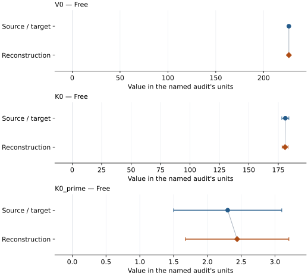
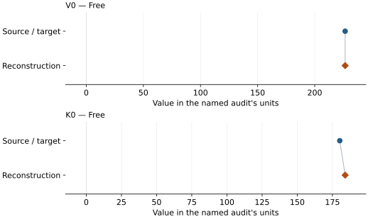

# CaIrO3 post-perovskite: EOS reconstruction reports

<!-- Generated by scripts.generate_reconstruction_reports; edit EOSMAT instead. -->

[All reconstruction reports](index.md) · [Material and EOS parameters](../material-summaries/cairo3_post_perovskite.md)

These reports explain the assessments already stored in EOSMAT. Generating
this page does not refit observations, change classifications or replace source coefficients.

Use [scientific label definitions](../eos-labels.md) to distinguish coefficient
agreement, source verification, author-workflow reproduction and recommendation for use.

| EOS record | Recorded outcome | Coefficient comparison |
| --- | --- | --- |
| [Boffa Ballaran et al. (2007), CaIrO3 post-perovskite BM3](#record-cairo3_post_perovskite_boffa_ballaran_2007_bm3_1) | Coefficient parity achieved | Graph and table |
| [Martin et al. (2007), room-temperature BM2](#record-cairo3_post_perovskite_martin_2007_bm2) | Coefficient parity achieved | Graph and table |

## Boffa Ballaran et al. (2007), CaIrO3 post-perovskite BM3

Record: `cairo3_post_perovskite_boffa_ballaran_2007_bm3_1` · Model: `BM3`

**Outcome: Coefficient parity achieved.**

**Scope:** Comparison with the source parameterization.
**Comparison basis:** Every compared free coefficient meets both the recorded combined-two-sigma comparison and parameter-specific numerical similarity screen. Error conventions and fit qualifications remain applicable.

[Stored EOS coefficients and source](../material-summaries/cairo3_post_perovskite.md#record-cairo3_post_perovskite_boffa_ballaran_2007_bm3_1)

### What this result establishes

**Separate source-review status:** primary\_source\_validated.
**Usage recommendation:** See the stored EOS qualifications; no recommendation is inferred here.

- This named numerical assessment alone does not establish author-workflow reproduction, physical accuracy or recommendation for use.

### Data and reconstruction method

- **Dataset identifiers:** cairo3\_post\_perovskite\_boffa\_ballaran\_2007\_table1\_compression
- **Observations:** 11
- **Fit kind:** isothermal\_pv
- **Selection:** all rows
- **Objective:** errors\_in\_variables
- **Absolute sigma:** True
- **Free parameters:** V0; K0; K0\_prime
- **Fixed parameters:** None declared

Unspecified selections, weights, fixed values or error conventions remain unknown; they have not been inferred for this report.

### Source versus reconstruction

This is a **coefficient comparison**, not an observation or residual plot.
Each panel uses its coefficient's audit units and includes zero. Markers show
stored central values only. Error widths are retained in the table below;
no confidence interval or uncertainty band is inferred. Fixed/adopted values are constraints.

| Parameter | Source / target | Source error | Reconstruction | Reconstruction error | Fit role |
| --- | --- | --- | --- | --- | --- |
| V0 | 226.38 | 0.01 | 226.3777213365444 | 0.011925866007670649 | Free |
| K0 | 181.0 | 3.0 | 180.75626081227668 | 2.53109820437119 | Free |
| K0\_prime | 2.3 | 0.8 | 2.4397863633345556 | 0.7654095311885648 | Free |

Values and reported errors are copied without rounding or conversion from the named audit. Missing errors mean unknown, not zero. Parameter names and volume conventions follow that audit; error widths do not imply a confidence convention.

Recorded diagnostics, covariance and additional protocol

- **Columns:**
    - **Pressure:** pressure\_gpa
    - **Temperature:** Not specified
    - **Volume:** volume\_a3
- **Observed pressure range gpa:** \[0.0001, 7.79\]
- **Observed temperature range k:** Not specified
- **Observed volume range:** \[217.28, 226.376\]
- **Degrees of freedom:** 8
- **Solver success:** True
- **Solver message:** Both \`ftol\` and \`xtol\` termination conditions are satisfied.
- **Rmse gpa:** 0.025386928350339906
- **Published rmse gpa:** 0.02632624666901072
- **Reduced chi square:** 0.36581007156364914

### Detailed evidence and existing plots

- [Record-by-record numerical ledger](../primary-eos-refits.md#records).
- [Source-audit reports](../source-audits.md).

Observation curves and residual plots are provided by the supporting reports where available. Their absence is not filled by a reconstructed curve presented as measured data.

[Machine-readable comparison ledger](https://github.com/CPrescher/peritheos/blob/main/docs/data/primary-eos-refits.json) — look up `cairo3_post_perovskite_boffa_ballaran_2007_bm3_1`.
[Complete native EOSMAT file](https://github.com/CPrescher/peritheos/blob/main/peritheos/data/materials/cairo3_post_perovskite.eosmat).

## Martin et al. (2007), room-temperature BM2

Record: `cairo3_post_perovskite_martin_2007_bm2` · Model: `BM3`

**Outcome: Coefficient parity achieved.**

**Scope:** Comparison with the source parameterization.
**Comparison basis:** Every compared free coefficient meets both the recorded combined-two-sigma comparison and parameter-specific numerical similarity screen. Error conventions and fit qualifications remain applicable.

[Stored EOS coefficients and source](../material-summaries/cairo3_post_perovskite.md#record-cairo3_post_perovskite_martin_2007_bm2)

### What this result establishes

**Separate source-review status:** primary\_source\_validated.
**Usage recommendation:** See the stored EOS qualifications; no recommendation is inferred here.

- This named numerical assessment alone does not establish author-workflow reproduction, physical accuracy or recommendation for use.

### Data and reconstruction method

- **Dataset identifiers:** cairo3\_martin\_2007\_table1a\_compression
- **Observations:** 15
- **Fit kind:** isothermal\_pv
- **Selection:** all rows
- **Objective:** errors\_in\_variables
- **Absolute sigma:** True
- **Free parameters:** V0; K0
- **Fixed parameters:** K0\_prime

Unspecified selections, weights, fixed values or error conventions remain unknown; they have not been inferred for this report.

### Source versus reconstruction

This is a **coefficient comparison**, not an observation or residual plot.
Each panel uses its coefficient's audit units and includes zero. Markers show
stored central values only. Error widths are retained in the table below;
no confidence interval or uncertainty band is inferred. Fixed/adopted values are constraints.

| Parameter | Source / target | Source error | Reconstruction | Reconstruction error | Fit role |
| --- | --- | --- | --- | --- | --- |
| V0 | 226.632 | 0.045 | 226.5992891892828 | 0.01409121111570518 | Free |
| K0 | 180.2 | 2.8 | 184.03826735513832 | 0.9860554458340353 | Free |

Values and reported errors are copied without rounding or conversion from the named audit. Missing errors mean unknown, not zero. Parameter names and volume conventions follow that audit; error widths do not imply a confidence convention.

Recorded diagnostics, covariance and additional protocol

- **Columns:**
    - **Pressure:** pressure\_gpa
    - **Temperature:** Not specified
    - **Volume:** unit\_cell\_volume\_a3
- **Observed pressure range gpa:** \[0.3, 29.0\]
- **Observed temperature range k:** Not specified
- **Observed volume range:** \[200.92, 226.203\]
- **Degrees of freedom:** 13
- **Solver success:** True
- **Solver message:** Both \`ftol\` and \`xtol\` termination conditions are satisfied.
- **Rmse gpa:** 0.5599392099935964
- **Published rmse gpa:** 0.5757951488404711
- **Reduced chi square:** 3.6409063559035366

### Detailed evidence and existing plots

- [Record-by-record numerical ledger](../primary-eos-refits.md#records).
- [Source-audit reports](../source-audits.md).

Observation curves and residual plots are provided by the supporting reports where available. Their absence is not filled by a reconstructed curve presented as measured data.

[Machine-readable comparison ledger](https://github.com/CPrescher/peritheos/blob/main/docs/data/primary-eos-refits.json) — look up `cairo3_post_perovskite_martin_2007_bm2`.
[Complete native EOSMAT file](https://github.com/CPrescher/peritheos/blob/main/peritheos/data/materials/cairo3_post_perovskite.eosmat).
