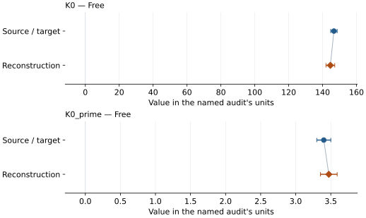
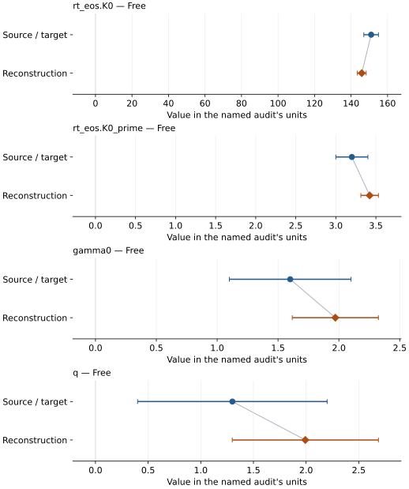

# Calcium carbonate (post-aragonite Pmmn): EOS reconstruction reports

<!-- Generated by scripts.generate_reconstruction_reports; edit EOSMAT instead. -->

[All reconstruction reports](index.md) · [Material and EOS parameters](../material-summaries/calcium_carbonate_post_aragonite.md)

These reports explain the assessments already stored in EOSMAT. Generating
this page does not refit observations, change classifications or replace source coefficients.

Use [scientific label definitions](../eos-labels.md) to distinguish coefficient
agreement, source verification, author-workflow reproduction and recommendation for use.

| EOS record | Recorded outcome | Coefficient comparison |
| --- | --- | --- |
| [Lv et al. (2020), 300 K BM3](#record-calcium_carbonate_post_aragonite_lv_2020_bm3_1) | Coefficient parity achieved | Graph and table |
| [Lv et al. (2020), BM3-MGD](#record-calcium_carbonate_post_aragonite_lv_2020_bm3_2) | Numerically similar, with qualifications | Graph and table |

## Lv et al. (2020), 300 K BM3

Record: `calcium_carbonate_post_aragonite_lv_2020_bm3_1` · Model: `BM3`

**Outcome: Coefficient parity achieved.**

**Scope:** Comparison with the source parameterization.
**Comparison basis:** Every compared free coefficient meets both the recorded combined-two-sigma comparison and parameter-specific numerical similarity screen. Error conventions and fit qualifications remain applicable.

[Stored EOS coefficients and source](../material-summaries/calcium_carbonate_post_aragonite.md#record-calcium_carbonate_post_aragonite_lv_2020_bm3_1)

### What this result establishes

**Separate source-review status:** primary\_source\_validated.
**Usage recommendation:** See the stored EOS qualifications; no recommendation is inferred here.

- This named numerical assessment alone does not establish author-workflow reproduction, physical accuracy or recommendation for use.

### Data and reconstruction method

- **Dataset identifiers:** calcium\_carbonate\_post\_aragonite\_lv\_2020\_supplementary\_table\_pvt
- **Observations:** 9
- **Fit kind:** isothermal\_pv
- **Selection:** all rows; reference-T rows
- **Objective:** errors\_in\_variables
- **Absolute sigma:** True
- **Free parameters:** K0; K0\_prime
- **Fixed parameters:** V0

Unspecified selections, weights, fixed values or error conventions remain unknown; they have not been inferred for this report.

### Source versus reconstruction

This is a **coefficient comparison**, not an observation or residual plot.
Each panel uses its coefficient's audit units and includes zero. Markers show
stored central values only. Error widths are retained in the table below;
no confidence interval or uncertainty band is inferred. Fixed/adopted values are constraints.

| Parameter | Source / target | Source error | Reconstruction | Reconstruction error | Fit role |
| --- | --- | --- | --- | --- | --- |
| K0 | 146.7 | 1.9 | 144.5929609338873 | 2.586747610266589 | Free |
| K0\_prime | 3.4 | 0.1 | 3.4716122358570867 | 0.11888904427946788 | Free |

Values and reported errors are copied without rounding or conversion from the named audit. Missing errors mean unknown, not zero. Parameter names and volume conventions follow that audit; error widths do not imply a confidence convention.

Recorded diagnostics, covariance and additional protocol

- **Columns:**
    - **Pressure:** pressure\_gpa
    - **Temperature:** temperature\_k
    - **Volume:** unit\_cell\_volume\_a3
- **Observed pressure range gpa:** \[49.9, 67.5\]
- **Observed temperature range k:** \[298.0, 298.0\]
- **Observed volume range:** \[73.36, 77.55\]
- **Degrees of freedom:** 7
- **Solver success:** True
- **Solver message:** \`ftol\` termination condition is satisfied.
- **Rmse gpa:** 0.06174187449610127
- **Published rmse gpa:** 0.23539926066074293
- **Reduced chi square:** 0.6275147397495696

### Detailed evidence and existing plots

- [Record-by-record numerical ledger](../primary-eos-refits.md#records).
- [Source-audit reports](../source-audits.md).

Observation curves and residual plots are provided by the supporting reports where available. Their absence is not filled by a reconstructed curve presented as measured data.

[Machine-readable comparison ledger](https://github.com/CPrescher/peritheos/blob/main/docs/data/primary-eos-refits.json) — look up `calcium_carbonate_post_aragonite_lv_2020_bm3_1`.
[Complete native EOSMAT file](https://github.com/CPrescher/peritheos/blob/main/peritheos/data/materials/calcium_carbonate_post_aragonite.eosmat).

## Lv et al. (2020), BM3-MGD

Record: `calcium_carbonate_post_aragonite_lv_2020_bm3_2` · Model: `BM3`

**Outcome: Numerically similar, with qualifications.**

**Scope:** Comparison with the source parameterization.
**Comparison basis:** Every compared free coefficient meets either the recorded combined-two-sigma comparison or parameter-specific numerical similarity screen; the audit does not classify the complete comparison as parity.

[Stored EOS coefficients and source](../material-summaries/calcium_carbonate_post_aragonite.md#record-calcium_carbonate_post_aragonite_lv_2020_bm3_2)

### What this result establishes

**Separate source-review status:** primary\_source\_validated.
**Usage recommendation:** See the stored EOS qualifications; no recommendation is inferred here.

- This named numerical assessment alone does not establish author-workflow reproduction, physical accuracy or recommendation for use.

### Data and reconstruction method

- **Dataset identifiers:** calcium\_carbonate\_post\_aragonite\_lv\_2020\_supplementary\_table\_pvt
- **Observations:** 131
- **Fit kind:** joint\_pvt
- **Selection:** all rows
- **Objective:** errors\_in\_variables
- **Absolute sigma:** True
- **Free parameters:** rt\_eos.K0; rt\_eos.K0\_prime; gamma0; q
- **Fixed parameters:** V0; Tr; theta0; n

Unspecified selections, weights, fixed values or error conventions remain unknown; they have not been inferred for this report.

### Source versus reconstruction

This is a **coefficient comparison**, not an observation or residual plot.
Each panel uses its coefficient's audit units and includes zero. Markers show
stored central values only. Error widths are retained in the table below;
no confidence interval or uncertainty band is inferred. Fixed/adopted values are constraints.

| Parameter | Source / target | Source error | Reconstruction | Reconstruction error | Fit role |
| --- | --- | --- | --- | --- | --- |
| rt\_eos.K0 | 151.0 | 4.0 | 145.86922539169947 | 2.4239535716869662 | Free |
| rt\_eos.K0\_prime | 3.2 | 0.2 | 3.4221699921801916 | 0.10972862838417025 | Free |
| gamma0 | 1.6 | 0.5 | 1.9709866972164265 | 0.3541053047096985 | Free |
| q | 1.3 | 0.9 | 1.9929012405528448 | 0.694145219843853 | Free |

Values and reported errors are copied without rounding or conversion from the named audit. Missing errors mean unknown, not zero. Parameter names and volume conventions follow that audit; error widths do not imply a confidence convention.

Recorded diagnostics, covariance and additional protocol

- **Columns:**
    - **Pressure:** pressure\_gpa
    - **Temperature:** temperature\_k
    - **Volume:** unit\_cell\_volume\_a3
- **Observed pressure range gpa:** \[49.9, 75.0\]
- **Observed temperature range k:** \[298.0, 2160.0\]
- **Observed volume range:** \[73.36, 78.49\]
- **Degrees of freedom:** 127
- **Solver success:** True
- **Solver message:** \`ftol\` termination condition is satisfied.
- **Rmse gpa:** 0.5272073115307907
- **Published rmse gpa:** 0.6064708499687894
- **Reduced chi square:** 0.9552103532874094

### Detailed evidence and existing plots

- [Earlier detailed record investigation](../primary-eos-refits.md#investigation-calcium_carbonate_post_aragonite_lv_2020_bm3_2).
- [Record-by-record numerical ledger](../primary-eos-refits.md#records).
- [Source-audit reports](../source-audits.md).

Observation curves and residual plots are provided by the supporting reports where available. Their absence is not filled by a reconstructed curve presented as measured data.

[Machine-readable comparison ledger](https://github.com/CPrescher/peritheos/blob/main/docs/data/primary-eos-refits.json) — look up `calcium_carbonate_post_aragonite_lv_2020_bm3_2`.
[Complete native EOSMAT file](https://github.com/CPrescher/peritheos/blob/main/peritheos/data/materials/calcium_carbonate_post_aragonite.eosmat).
