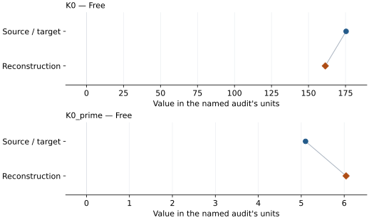
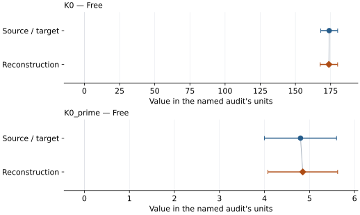

# Cementite: EOS reconstruction reports

<!-- Generated by scripts.generate_reconstruction_reports; edit EOSMAT instead. -->

[All reconstruction reports](index.md) · [Material and EOS parameters](../material-summaries/cementite.md)

These reports explain the assessments already stored in EOSMAT. Generating
this page does not refit observations, change classifications or replace source coefficients.

Use [scientific label definitions](../eos-labels.md) to distinguish coefficient
agreement, source verification, author-workflow reproduction and recommendation for use.

| EOS record | Recorded outcome | Coefficient comparison |
| --- | --- | --- |
| [Scott et al. (2001), cementite BM3](#record-cementite_scott_2001_bm3_1) | Coefficient parity achieved | Graph and table |
| [Li et al. (2002), 300 K BM3](#record-cementite_li_2002_bm3) | Coefficient parity achieved | Graph and table |

## Scott et al. (2001), cementite BM3

Record: `cementite_scott_2001_bm3_1` · Model: `BM3`

**Outcome: Coefficient parity achieved.**

**Scope:** Comparison with the source parameterization.
**Comparison basis:** Every compared free coefficient meets both the recorded combined-two-sigma comparison and parameter-specific numerical similarity screen. Error conventions and fit qualifications remain applicable.

[Stored EOS coefficients and source](../material-summaries/cementite.md#record-cementite_scott_2001_bm3_1)

### What this result establishes

**Separate source-review status:** primary\_source\_validated.
**Usage recommendation:** See the stored EOS qualifications; no recommendation is inferred here.

- This named numerical assessment alone does not establish author-workflow reproduction, physical accuracy or recommendation for use.

### Data and reconstruction method

- **Dataset identifiers:** cementite\_scott\_2001\_figure3\_digitized
- **Observations:** 21
- **Fit kind:** isothermal\_pv
- **Selection:** all rows
- **Objective:** pressure\_residuals
- **Absolute sigma:** True
- **Free parameters:** K0; K0\_prime
- **Fixed parameters:** V0

Unspecified selections, weights, fixed values or error conventions remain unknown; they have not been inferred for this report.

### Source versus reconstruction

This is a **coefficient comparison**, not an observation or residual plot.
Each panel uses its coefficient's audit units and includes zero. Markers show
stored central values only. Error widths are retained in the table below;
no confidence interval or uncertainty band is inferred. Fixed/adopted values are constraints.

| Parameter | Source / target | Source error | Reconstruction | Reconstruction error | Fit role |
| --- | --- | --- | --- | --- | --- |
| K0 | 175.4 | 3.5 | 161.34142422435633 | 8.597975012312647 | Free |
| K0\_prime | 5.1 | 0.3 | 6.044124284317963 | 0.6355732779493145 | Free |

Values and reported errors are copied without rounding or conversion from the named audit. Missing errors mean unknown, not zero. Parameter names and volume conventions follow that audit; error widths do not imply a confidence convention.

Recorded diagnostics, covariance and additional protocol

- **Columns:**
    - **Pressure:** pressure\_gpa
    - **Temperature:** Not specified
    - **Volume:** volume\_ratio
- **Observed pressure range gpa:** \[0.0, 72.7536\]
- **Observed temperature range k:** Not specified
- **Observed volume range:** \[123.42564485999999, 155.26\]
- **Degrees of freedom:** 19
- **Solver success:** True
- **Solver message:** \`ftol\` termination condition is satisfied.
- **Rmse gpa:** 1.5518138830669295
- **Published rmse gpa:** 1.6574243208273791
- **Reduced chi square:** 2.6616133095402374

### Detailed evidence and existing plots

- [Record-by-record numerical ledger](../primary-eos-refits.md#records).
- [Source-audit reports](../source-audits.md).

Observation curves and residual plots are provided by the supporting reports where available. Their absence is not filled by a reconstructed curve presented as measured data.

[Machine-readable comparison ledger](https://github.com/CPrescher/peritheos/blob/main/docs/data/primary-eos-refits.json) — look up `cementite_scott_2001_bm3_1`.
[Complete native EOSMAT file](https://github.com/CPrescher/peritheos/blob/main/peritheos/data/materials/cementite.eosmat).

## Li et al. (2002), 300 K BM3

Record: `cementite_li_2002_bm3` · Model: `BM3`

**Outcome: Coefficient parity achieved.**

**Scope:** Comparison with the source parameterization.
**Comparison basis:** Agreement within the source's reported parameter error widths; this is not an inferred confidence convention.

[Stored EOS coefficients and source](../material-summaries/cementite.md#record-cementite_li_2002_bm3)

### What this result establishes

**Separate source-review status:** primary\_source\_validated.
**Usage recommendation:** See the stored EOS qualifications; no recommendation is inferred here.

- Conditional parameter parity compares K0 and K0\_prime within the printed source error widths using all 12 nonambient Table 1 observations. Measured V0=155.28(11) A^3 per conventional Pnma Fe3C cell (Z=4) is fixed as in the source, not independently recovered by the fit. Published errors have unspecified confidence. The diagnostic effective-variance objective treats printed pressure and volume widths as if independent standard errors; its unscaled inverse-JtJ covariance is conditional. Original residual direction, weights, covariance, confidence convention and fit project are unavailable. Fixed-V0 uncertainty and shared calibration errors are not propagated. Original ruby wavelengths and separate ruby/neon pressure arrays are missing, so the pressure averaging cannot be replayed. Original-scale published coefficients and observations are preserved; Litasov (2013) recalibrated comparison coefficients are not substituted. This is not author-workflow reproduction, magnetic-phase validation or a recommendation for extrapolation.
- This named numerical assessment alone does not establish author-workflow reproduction, physical accuracy or recommendation for use.

### Data and reconstruction method

- **Dataset identifiers:** cementite\_li\_2002\_table1
- **Observations:** 12
- **Fit kind:** isothermal\_pv
- **Selection:** Table 1 rows 3-14; reference-card row 1 excluded; measured ambient row 2 supplies fixed V0 only
- **Objective:** effective\_variance\_pressure\_residuals
- **Weighting:** rP/sqrt(sP^2+(dP/dV\*sV)^2), parameter-dependent, with printed widths conditionally treated as independent standard errors; no log-variance term
- **Absolute sigma:** True
- **Free parameters:** K0; K0\_prime
- **Fixed parameters:** V0
- **Fixed values:**
    - **V0:** 155.28

Unspecified selections, weights, fixed values or error conventions remain unknown; they have not been inferred for this report.

### Source versus reconstruction

This is a **coefficient comparison**, not an observation or residual plot.
Each panel uses its coefficient's audit units and includes zero. Markers show
stored central values only. Error widths are retained in the table below;
no confidence interval or uncertainty band is inferred. Fixed/adopted values are constraints.

| Parameter | Source / target | Source error | Reconstruction | Reconstruction error | Fit role |
| --- | --- | --- | --- | --- | --- |
| K0 | 174.0 | 6.0 | 173.78786000842143 | 6.196330577290803 | Free |
| K0\_prime | 4.8 | 0.8 | 4.849721552821546 | 0.7749329344923127 | Free |

Values and reported errors are copied without rounding or conversion from the named audit. Missing errors mean unknown, not zero. Parameter names and volume conventions follow that audit; error widths do not imply a confidence convention.

Recorded diagnostics, covariance and additional protocol

- **Columns:**
    - **Pressure:** pressure\_gpa
    - **Volume:** volume\_a3
    - **Temperature:** Not specified
- **Observed pressure range gpa:** \[2.5, 30.5\]
- **Observed temperature range k:** \[300, 300\]
- **Observed volume range:** \[136.68, 153.04\]
- **Degrees of freedom:** 10
- **Solver success:** True
- **Rmse gpa:** 0.2574168421103657
- **Published rmse gpa:** 0.2633934456555272
- **Rmse volume a3:** 0.14124864978937224
- **Reduced chi square:** Not specified
- **Parameter covariance:** \[\[38.394512623068984, -4.4669606200047935\], \[-4.466960620004794, 0.600521052960867\]\]
- **Covariance convention:** Conditional unscaled inverse JtJ for the declared effective-variance residual; source confidence and shared covariance unknown, fixed-V0 uncertainty unpropagated
- **Comparison scope:** parameter\_agreement
- **Reproduction report:** docs/literature-reproductions/li-2002-fe3c.md

### Detailed evidence and existing plots

- [Supporting source report: li-2002-fe3c](../literature-reproductions/li-2002-fe3c.md).
- [Record-by-record numerical ledger](../primary-eos-refits.md#records).
- [Source-audit reports](../source-audits.md).

Observation curves and residual plots are provided by the supporting reports where available. Their absence is not filled by a reconstructed curve presented as measured data.

[Machine-readable comparison ledger](https://github.com/CPrescher/peritheos/blob/main/docs/data/primary-eos-refits.json) — look up `cementite_li_2002_bm3`.
[Complete native EOSMAT file](https://github.com/CPrescher/peritheos/blob/main/peritheos/data/materials/cementite.eosmat).
