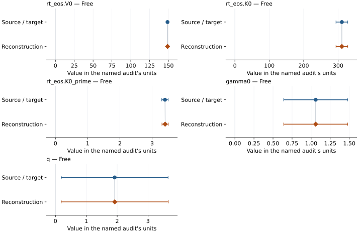
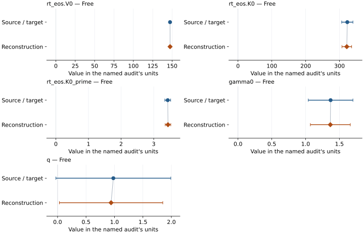

# Cementite, nonmagnetic: EOS reconstruction reports

<!-- Generated by scripts.generate_reconstruction_reports; edit EOSMAT instead. -->

[All reconstruction reports](index.md) · [Material and EOS parameters](../material-summaries/cementite_nonmagnetic.md)

These reports explain the assessments already stored in EOSMAT. Generating
this page does not refit observations, change classifications or replace source coefficients.

Use [scientific label definitions](../eos-labels.md) to distinguish coefficient
agreement, source verification, author-workflow reproduction and recommendation for use.

| EOS record | Recorded outcome | Coefficient comparison |
| --- | --- | --- |
| [Takahashi et al. (2019), nonmagnetic Fe3C, KBr pressure scale, BM3 + MGD](#record-cementite_nonmagnetic_takahashi_2019_kbr_bm3_mgd) | Coefficient parity achieved | Graph and table |
| [Takahashi et al. (2019), nonmagnetic Fe3C, MgO pressure scale, BM3 + MGD](#record-cementite_nonmagnetic_takahashi_2019_mgo_bm3_mgd) | Coefficient parity achieved | Graph and table |

## Takahashi et al. (2019), nonmagnetic Fe3C, KBr pressure scale, BM3 + MGD

Record: `cementite_nonmagnetic_takahashi_2019_kbr_bm3_mgd` · Model: `BM3`

**Outcome: Coefficient parity achieved.**

**Scope:** Comparison with the source parameterization.
**Comparison basis:** Conditional parameter\_agreement: every free central coefficient lies within its own printed source error width under the all-60-row P/V/T effective-variance replay. Uncertainty reproduction is assessed separately; source confidence is unknown and author workflow is unconfirmed.

[Stored EOS coefficients and source](../material-summaries/cementite_nonmagnetic.md#record-cementite_nonmagnetic_takahashi_2019_kbr_bm3_mgd)

### What this result establishes

**Separate source-review status:** primary\_source\_validated.
**Usage recommendation:** See the stored EOS qualifications; no recommendation is inferred here.

- All 60 Table S1 rows, including the 2600 K row and ten shared SiO2-marker rows. Conditional simultaneous five-parameter effective-variance replay uses printed independent P/V/T widths; missing 300 K temperature widths leave those temperatures fixed. Unscaled inverse-normal covariance treats the widths as absolute errors; their source confidence and covariance are unconfirmed. KBr reproduces all five central values and all five error widths at published printed precision. The original author objective, weights, fitting order and exact input selection remain unconfirmed; original\_author\_workflow\_parity=False. No formal combined-two-sigma inference, experimental validation or change in recommendation follows. Published coefficients and errors remain intact; the earlier equal-pressure reconstruction is retained separately. Source-equation density checkpoints concern extrapolated calculated states, not measured core conditions.
- This named numerical assessment alone does not establish author-workflow reproduction, physical accuracy or recommendation for use.

### Data and reconstruction method

- **Dataset identifiers:** cementite\_takahashi\_2019\_table\_s1
- **Observations:** 60
- **Fit kind:** joint\_pvt
- **Selection:** all 60 Table S1 rows, including 2600 K row and ten SiO2-marker rows
- **Objective:** iteratively\_reweighted\_pressure\_residuals
- **Weighting:** Effective variance: sP^2 + (dP/dV\*sV)^2 + (dP/dT\*sT)^2 from printed widths; freeze during each solve, update to convergence. Missing 300 K T widths leave T fixed.
- **Absolute sigma:** True
- **Free parameters:** rt\_eos.V0; rt\_eos.K0; rt\_eos.K0\_prime; gamma0; q
- **Fixed parameters:** Tr; theta0; n
- **Fixed values:**
    - **Tr:** 300
    - **Theta0:** 314
    - **N:** 4

Unspecified selections, weights, fixed values or error conventions remain unknown; they have not been inferred for this report.

### Source versus reconstruction

This is a **coefficient comparison**, not an observation or residual plot.
Each panel uses its coefficient's audit units and includes zero. Markers show
stored central values only. Error widths are retained in the table below;
no confidence interval or uncertainty band is inferred. Fixed/adopted values are constraints.

| Parameter | Source / target | Source error | Reconstruction | Reconstruction error | Fit role |
| --- | --- | --- | --- | --- | --- |
| rt\_eos.V0 | 148.8 | 1.0 | 148.83277631128846 | 1.0221452226031977 | Free |
| rt\_eos.K0 | 311.1 | 17.1 | 311.1479132138111 | 17.08110826696227 | Free |
| rt\_eos.K0\_prime | 3.4 | 0.1 | 3.4043961929677358 | 0.09867288497596867 | Free |
| gamma0 | 1.06 | 0.42 | 1.0599364358630734 | 0.4195250395794209 | Free |
| q | 1.92 | 1.73 | 1.9220875247576399 | 1.7348122051278916 | Free |

Values and reported errors are copied without rounding or conversion from the named audit. Missing errors mean unknown, not zero. Parameter names and volume conventions follow that audit; error widths do not imply a confidence convention.

Recorded diagnostics, covariance and additional protocol

- **Columns:**
    - **Pressure:** pressure\_kbr\_gpa\|pressure\_sio2\_gpa
    - **Volume:** volume\_a3
    - **Temperature:** temperature\_k
- **Observed pressure range gpa:** \[70.8, 326.4\]
- **Observed temperature range k:** \[300, 2600\]
- **Observed volume range:** \[92.5, 126.09\]
- **Degrees of freedom:** 55
- **Solver success:** True
- **Solver message:** \`ftol\` termination condition is satisfied.
- **Rmse gpa:** 2.391991045958338
- **Published rmse gpa:** 2.4753104338816434
- **Reduced chi square:** 0.573002358766646
- **Parameter covariance:** \[\[1.0447808560905405, -17.309506295636883, 0.0954499487969002, -0.2704453328949287, -1.1881496846523085\], \[-17.309506295636883, 291.76425962768684, -1.6471064132309483, 4.320796990715951, 19.491662503203464\], \[0.0954499487969002, -1.6471064132309483, 0.009736338229480744, -0.021876939728861, -0.10151669480280001\], \[-0.2704453328949287, 4.320796990715951, -0.021876939728861, 0.17600125883411466, 0.7126106983105858\], \[-1.1881496846523085, 19.491662503203464, -0.10151669480280001, 0.7126106983105858, 3.0095733870606978\]\]
- **Covariance convention:** Unscaled inverse normal matrix at final frozen effective-variance weights, in free\_parameters order with V0 in conventional-cell A3. Printed coordinate widths are assumed absolute independent errors; source confidence and covariance are unconfirmed.
- **Reproduction report:** docs/literature-reproductions/takahashi-2019-parity.md

### Detailed evidence and existing plots

- [Supporting source report: cementite](../literature-reproductions/cementite.md).
- [Supporting source report: takahashi-2019-parity](../literature-reproductions/takahashi-2019-parity.md).
- [Record-by-record numerical ledger](../primary-eos-refits.md#records).
- [Source-audit reports](../source-audits.md).

Observation curves and residual plots are provided by the supporting reports where available. Their absence is not filled by a reconstructed curve presented as measured data.

[Machine-readable comparison ledger](https://github.com/CPrescher/peritheos/blob/main/docs/data/primary-eos-refits.json) — look up `cementite_nonmagnetic_takahashi_2019_kbr_bm3_mgd`.
[Complete native EOSMAT file](https://github.com/CPrescher/peritheos/blob/main/peritheos/data/materials/cementite_nonmagnetic.eosmat).

## Takahashi et al. (2019), nonmagnetic Fe3C, MgO pressure scale, BM3 + MGD

Record: `cementite_nonmagnetic_takahashi_2019_mgo_bm3_mgd` · Model: `BM3`

**Outcome: Coefficient parity achieved.**

**Scope:** Comparison with the source parameterization.
**Comparison basis:** Conditional parameter\_agreement: every free central coefficient lies within its own printed source error width under the all-60-row P/V/T effective-variance replay. Uncertainty reproduction is assessed separately; source confidence is unknown and author workflow is unconfirmed.

[Stored EOS coefficients and source](../material-summaries/cementite_nonmagnetic.md#record-cementite_nonmagnetic_takahashi_2019_mgo_bm3_mgd)

### What this result establishes

**Separate source-review status:** primary\_source\_validated.
**Usage recommendation:** See the stored EOS qualifications; no recommendation is inferred here.

- All 60 Table S1 rows, including the 2600 K row and ten shared SiO2-marker rows. Conditional simultaneous five-parameter effective-variance replay uses printed independent P/V/T widths; missing 300 K temperature widths leave those temperatures fixed. Unscaled inverse-normal covariance treats the widths as absolute errors; their source confidence and covariance are unconfirmed. MgO central values all lie within printed source widths, but exact printed coefficients and uncertainties are not reproduced. The original author objective, weights, fitting order and exact input selection remain unconfirmed; original\_author\_workflow\_parity=False. No formal combined-two-sigma inference, experimental validation or change in recommendation follows. Published coefficients and errors remain intact; the earlier equal-pressure reconstruction is retained separately. Source-equation density checkpoints concern extrapolated calculated states, not measured core conditions.
- This named numerical assessment alone does not establish author-workflow reproduction, physical accuracy or recommendation for use.

### Data and reconstruction method

- **Dataset identifiers:** cementite\_takahashi\_2019\_table\_s1
- **Observations:** 60
- **Fit kind:** joint\_pvt
- **Selection:** all 60 Table S1 rows, including 2600 K row and ten SiO2-marker rows
- **Objective:** iteratively\_reweighted\_pressure\_residuals
- **Weighting:** Effective variance: sP^2 + (dP/dV\*sV)^2 + (dP/dT\*sT)^2 from printed widths; freeze during each solve, update to convergence. Missing 300 K T widths leave T fixed.
- **Absolute sigma:** True
- **Free parameters:** rt\_eos.V0; rt\_eos.K0; rt\_eos.K0\_prime; gamma0; q
- **Fixed parameters:** Tr; theta0; n
- **Fixed values:**
    - **Tr:** 300
    - **Theta0:** 314
    - **N:** 4

Unspecified selections, weights, fixed values or error conventions remain unknown; they have not been inferred for this report.

### Source versus reconstruction

This is a **coefficient comparison**, not an observation or residual plot.
Each panel uses its coefficient's audit units and includes zero. Markers show
stored central values only. Error widths are retained in the table below;
no confidence interval or uncertainty band is inferred. Fixed/adopted values are constraints.

| Parameter | Source / target | Source error | Reconstruction | Reconstruction error | Fit role |
| --- | --- | --- | --- | --- | --- |
| rt\_eos.V0 | 147.3 | 1.0 | 147.36080039547164 | 0.8118285504116703 | Free |
| rt\_eos.K0 | 323.0 | 16.6 | 321.4874162717781 | 14.347683441064028 | Free |
| rt\_eos.K0\_prime | 3.43 | 0.09 | 3.438092266537533 | 0.08587177804900412 | Free |
| gamma0 | 1.37 | 0.33 | 1.3661038396016805 | 0.29534688141187926 | Free |
| q | 0.98 | 1.01 | 0.940421216458602 | 0.9085093812253474 | Free |

Values and reported errors are copied without rounding or conversion from the named audit. Missing errors mean unknown, not zero. Parameter names and volume conventions follow that audit; error widths do not imply a confidence convention.

Recorded diagnostics, covariance and additional protocol

- **Columns:**
    - **Pressure:** pressure\_mgo\_gpa\|pressure\_sio2\_gpa
    - **Volume:** volume\_a3
    - **Temperature:** temperature\_k
- **Observed pressure range gpa:** \[69.3, 326.4\]
- **Observed temperature range k:** \[300, 2600\]
- **Observed volume range:** \[92.5, 126.09\]
- **Degrees of freedom:** 55
- **Solver success:** True
- **Solver message:** \`ftol\` termination condition is satisfied.
- **Rmse gpa:** 1.9809872127727486
- **Published rmse gpa:** 1.9654236493519575
- **Reduced chi square:** 0.5375476812725855
- **Parameter covariance:** \[\[0.659065595263514, -11.553980846228999, 0.06536921169491364, -0.144686013308201, -0.46775433093665375\], \[-11.553980846228999, 205.8560201249829, -1.196484209574366, 2.428932825992708, 8.001530833763427\], \[0.06536921169491364, -1.196484209574366, 0.007373962265297425, -0.012375351949583932, -0.04147373853474685\], \[-0.144686013308201, 2.428932825992708, -0.012375351949583932, 0.08722978035972268, 0.262451364840956\], \[-0.46775433093665375, 8.001530833763427, -0.04147373853474685, 0.262451364840956, 0.8253892957744636\]\]
- **Covariance convention:** Unscaled inverse normal matrix at final frozen effective-variance weights, in free\_parameters order with V0 in conventional-cell A3. Printed coordinate widths are assumed absolute independent errors; source confidence and covariance are unconfirmed.
- **Reproduction report:** docs/literature-reproductions/takahashi-2019-parity.md

### Detailed evidence and existing plots

- [Supporting source report: cementite](../literature-reproductions/cementite.md).
- [Supporting source report: takahashi-2019-parity](../literature-reproductions/takahashi-2019-parity.md).
- [Record-by-record numerical ledger](../primary-eos-refits.md#records).
- [Source-audit reports](../source-audits.md).

Observation curves and residual plots are provided by the supporting reports where available. Their absence is not filled by a reconstructed curve presented as measured data.

[Machine-readable comparison ledger](https://github.com/CPrescher/peritheos/blob/main/docs/data/primary-eos-refits.json) — look up `cementite_nonmagnetic_takahashi_2019_mgo_bm3_mgd`.
[Complete native EOSMAT file](https://github.com/CPrescher/peritheos/blob/main/peritheos/data/materials/cementite_nonmagnetic.eosmat).
