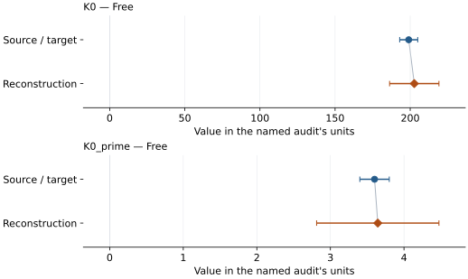
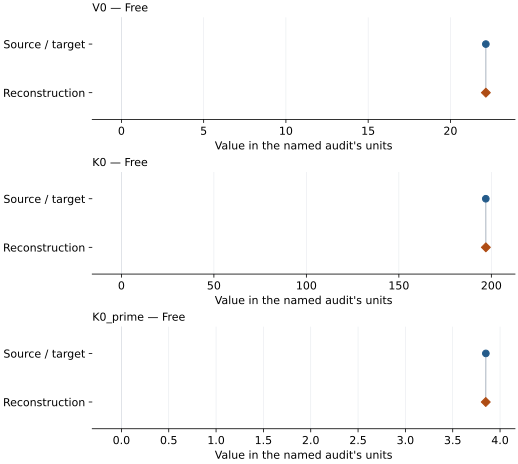
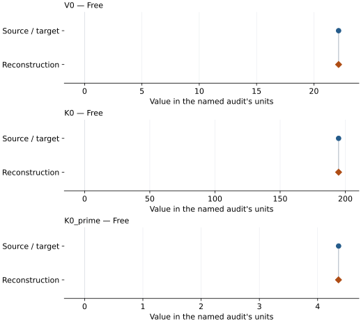

# Cobalt: EOS reconstruction reports

<!-- Generated by scripts.generate_reconstruction_reports; edit EOSMAT instead. -->

[All reconstruction reports](index.md) · [Material and EOS parameters](../material-summaries/cobalt_hcp.md)

These reports explain the assessments already stored in EOSMAT. Generating
this page does not refit observations, change classifications or replace source coefficients.

Use [scientific label definitions](../eos-labels.md) to distinguish coefficient
agreement, source verification, author-workflow reproduction and recommendation for use.

| EOS record | Recorded outcome | Coefficient comparison |
| --- | --- | --- |
| [Fujihisa and Takemura (1996), hcp Vinet](#record-cobalt_hcp_fujihisa_1996_vinet_1) | Coefficient parity achieved | Graph and table |
| [Dewaele (2019), Co MAO-scale Vinet](#record-cobalt_hcp_dewaele_2019_mao_vinet) | Numerically similar, with qualifications | Graph and table |
| [Dewaele (2019), Co DOR-scale Vinet](#record-cobalt_hcp_dewaele_2019_dor_vinet) | Numerically similar, with qualifications | Graph and table |

## Fujihisa and Takemura (1996), hcp Vinet

Record: `cobalt_hcp_fujihisa_1996_vinet_1` · Model: `Vinet`

**Outcome: Coefficient parity achieved.**

**Scope:** Comparison with the source parameterization.
**Comparison basis:** Every compared free coefficient meets both the recorded combined-two-sigma comparison and parameter-specific numerical similarity screen. Error conventions and fit qualifications remain applicable.

[Stored EOS coefficients and source](../material-summaries/cobalt_hcp.md#record-cobalt_hcp_fujihisa_1996_vinet_1)

### What this result establishes

**Separate source-review status:** primary\_source\_validated.
**Usage recommendation:** See the stored EOS qualifications; no recommendation is inferred here.

- This named numerical assessment alone does not establish author-workflow reproduction, physical accuracy or recommendation for use.

### Data and reconstruction method

- **Dataset identifiers:** cobalt\_hcp\_fujihisa\_1996\_figure3\_digitized
- **Observations:** 8
- **Fit kind:** isothermal\_pv
- **Selection:** all rows
- **Objective:** errors\_in\_variables
- **Absolute sigma:** True
- **Free parameters:** K0; K0\_prime
- **Fixed parameters:** V0

Unspecified selections, weights, fixed values or error conventions remain unknown; they have not been inferred for this report.

### Source versus reconstruction

This is a **coefficient comparison**, not an observation or residual plot.
Each panel uses its coefficient's audit units and includes zero. Markers show
stored central values only. Error widths are retained in the table below;
no confidence interval or uncertainty band is inferred. Fixed/adopted values are constraints.

| Parameter | Source / target | Source error | Reconstruction | Reconstruction error | Fit role |
| --- | --- | --- | --- | --- | --- |
| K0 | 199.0 | 6.0 | 202.7072716900071 | 16.42416297027183 | Free |
| K0\_prime | 3.6 | 0.2 | 3.643827879405484 | 0.8314273882369375 | Free |

Values and reported errors are copied without rounding or conversion from the named audit. Missing errors mean unknown, not zero. Parameter names and volume conventions follow that audit; error widths do not imply a confidence convention.

Recorded diagnostics, covariance and additional protocol

- **Columns:**
    - **Pressure:** pressure\_gpa
    - **Temperature:** Not specified
    - **Volume:** volume\_ratio
- **Observed pressure range gpa:** \[24.0204, 79.046\]
- **Observed temperature range k:** Not specified
- **Observed volume range:** \[17.4857730975, 20.327386761\]
- **Degrees of freedom:** 6
- **Solver success:** True
- **Solver message:** \`ftol\` termination condition is satisfied.
- **Rmse gpa:** 0.10721362874914021
- **Published rmse gpa:** 1.3905285846088389
- **Reduced chi square:** 0.11816657360477413

### Detailed evidence and existing plots

- [Record-by-record numerical ledger](../primary-eos-refits.md#records).
- [Source-audit reports](../source-audits.md).

Observation curves and residual plots are provided by the supporting reports where available. Their absence is not filled by a reconstructed curve presented as measured data.

[Machine-readable comparison ledger](https://github.com/CPrescher/peritheos/blob/main/docs/data/primary-eos-refits.json) — look up `cobalt_hcp_fujihisa_1996_vinet_1`.
[Complete native EOSMAT file](https://github.com/CPrescher/peritheos/blob/main/peritheos/data/materials/cobalt_hcp.eosmat).

## Dewaele (2019), Co MAO-scale Vinet

Record: `cobalt_hcp_dewaele_2019_mao_vinet` · Model: `Vinet`

**Outcome: Numerically similar, with qualifications.**

**Scope:** Comparison with the source parameterization.
**Comparison basis:** Every compared free coefficient meets either the recorded combined-two-sigma comparison or parameter-specific numerical similarity screen; the audit does not classify the complete comparison as parity.

[Stored EOS coefficients and source](../material-summaries/cobalt_hcp.md#record-cobalt_hcp_dewaele_2019_mao_vinet)

### What this result establishes

**Separate source-review status:** primary\_source\_validated.
**Usage recommendation:** See the stored EOS qualifications; no recommendation is inferred here.

- Complete source rows for this material are bundled and the dedicated two-ruby-scale refit recovers every coefficient within the published 95% interval. The common ledger classifies the result as similar, not strict parity, because the dedicated audit does not infer a refit covariance from rounded source rows.
- This named numerical assessment alone does not establish author-workflow reproduction, physical accuracy or recommendation for use.

### Data and reconstruction method

- **Dataset identifiers:** cobalt\_dewaele\_2008\_table2\_compression
- **Observations:** 25
- **Fit kind:** static\_vinet\_with\_explicit\_ruby\_scale\_conversion
- **Selection:** complete
- **Objective:** unweighted pressure residuals
- **Free parameters:** V0; K0; K0\_prime
- **Fixed parameters:** None declared

Unspecified selections, weights, fixed values or error conventions remain unknown; they have not been inferred for this report.

### Source versus reconstruction

This is a **coefficient comparison**, not an observation or residual plot.
Each panel uses its coefficient's audit units and includes zero. Markers show
stored central values only. Error widths are retained in the table below;
no confidence interval or uncertainty band is inferred. Fixed/adopted values are constraints.

| Parameter | Source / target | Source error | Reconstruction | Reconstruction error | Fit role |
| --- | --- | --- | --- | --- | --- |
| V0 | 22.154 | 0.024 | 22.154211831423616 | Not specified | Free |
| K0 | 197.0 | 3.2 | 197.02818238040842 | Not specified | Free |
| K0\_prime | 3.85 | 0.2 | 3.849071457165032 | Not specified | Free |

Values and reported errors are copied without rounding or conversion from the named audit. Missing errors mean unknown, not zero. Parameter names and volume conventions follow that audit; error widths do not imply a confidence convention.

Recorded diagnostics, covariance and additional protocol

- **Observed pressure range gpa:** \[0.0, 63.4\]
- **Solver success:** True
- **Solver message:** dedicated Dewaele (2019) refit completed
- **Rmse gpa:** 0.2542280308833028

### Detailed evidence and existing plots

- [Earlier detailed record investigation](../primary-eos-refits.md#investigation-cobalt_hcp_dewaele_2019_mao_vinet).
- [Record-by-record numerical ledger](../primary-eos-refits.md#records).
- [Source-audit reports](../source-audits.md).

Observation curves and residual plots are provided by the supporting reports where available. Their absence is not filled by a reconstructed curve presented as measured data.

[Machine-readable comparison ledger](https://github.com/CPrescher/peritheos/blob/main/docs/data/primary-eos-refits.json) — look up `cobalt_hcp_dewaele_2019_mao_vinet`.
[Complete native EOSMAT file](https://github.com/CPrescher/peritheos/blob/main/peritheos/data/materials/cobalt_hcp.eosmat).

## Dewaele (2019), Co DOR-scale Vinet

Record: `cobalt_hcp_dewaele_2019_dor_vinet` · Model: `Vinet`

**Outcome: Numerically similar, with qualifications.**

**Scope:** Comparison with the source parameterization.
**Comparison basis:** Every compared free coefficient meets either the recorded combined-two-sigma comparison or parameter-specific numerical similarity screen; the audit does not classify the complete comparison as parity.

[Stored EOS coefficients and source](../material-summaries/cobalt_hcp.md#record-cobalt_hcp_dewaele_2019_dor_vinet)

### What this result establishes

**Separate source-review status:** primary\_source\_validated.
**Usage recommendation:** See the stored EOS qualifications; no recommendation is inferred here.

- Complete source rows for this material are bundled and the dedicated two-ruby-scale refit recovers every coefficient within the published 95% interval. The common ledger classifies the result as similar, not strict parity, because the dedicated audit does not infer a refit covariance from rounded source rows.
- This named numerical assessment alone does not establish author-workflow reproduction, physical accuracy or recommendation for use.

### Data and reconstruction method

- **Dataset identifiers:** cobalt\_dewaele\_2008\_table2\_compression
- **Observations:** 25
- **Fit kind:** static\_vinet\_with\_explicit\_ruby\_scale\_conversion
- **Selection:** complete
- **Objective:** unweighted pressure residuals
- **Free parameters:** V0; K0; K0\_prime
- **Fixed parameters:** None declared

Unspecified selections, weights, fixed values or error conventions remain unknown; they have not been inferred for this report.

### Source versus reconstruction

This is a **coefficient comparison**, not an observation or residual plot.
Each panel uses its coefficient's audit units and includes zero. Markers show
stored central values only. Error widths are retained in the table below;
no confidence interval or uncertainty band is inferred. Fixed/adopted values are constraints.

| Parameter | Source / target | Source error | Reconstruction | Reconstruction error | Fit role |
| --- | --- | --- | --- | --- | --- |
| V0 | 22.154 | 0.024 | 22.153725569761363 | Not specified | Free |
| K0 | 194.85 | 3.2 | 194.84630408858632 | Not specified | Free |
| K0\_prime | 4.36 | 0.2 | 4.358418631337993 | Not specified | Free |

Values and reported errors are copied without rounding or conversion from the named audit. Missing errors mean unknown, not zero. Parameter names and volume conventions follow that audit; error widths do not imply a confidence convention.

Recorded diagnostics, covariance and additional protocol

- **Observed pressure range gpa:** \[0.0, 66.09908878096965\]
- **Solver success:** True
- **Solver message:** dedicated Dewaele (2019) refit completed
- **Rmse gpa:** 0.26584864078177023

### Detailed evidence and existing plots

- [Earlier detailed record investigation](../primary-eos-refits.md#investigation-cobalt_hcp_dewaele_2019_dor_vinet).
- [Record-by-record numerical ledger](../primary-eos-refits.md#records).
- [Source-audit reports](../source-audits.md).

Observation curves and residual plots are provided by the supporting reports where available. Their absence is not filled by a reconstructed curve presented as measured data.

[Machine-readable comparison ledger](https://github.com/CPrescher/peritheos/blob/main/docs/data/primary-eos-refits.json) — look up `cobalt_hcp_dewaele_2019_dor_vinet`.
[Complete native EOSMAT file](https://github.com/CPrescher/peritheos/blob/main/peritheos/data/materials/cobalt_hcp.eosmat).
