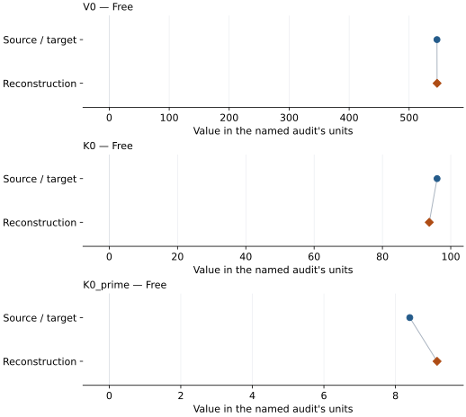
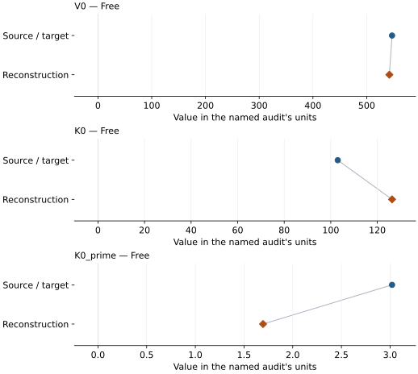

# Coesite: EOS reconstruction reports

<!-- Generated by scripts.generate_reconstruction_reports; edit EOSMAT instead. -->

[All reconstruction reports](index.md) · [Material and EOS parameters](../material-summaries/coesite.md)

These reports explain the assessments already stored in EOSMAT. Generating
this page does not refit observations, change classifications or replace source coefficients.

Use [scientific label definitions](../eos-labels.md) to distinguish coefficient
agreement, source verification, author-workflow reproduction and recommendation for use.

| EOS record | Recorded outcome | Coefficient comparison |
| --- | --- | --- |
| [data from JCPDS and Levien and Prewitt, 1981](#record-coesite_levien_1981_bm3_1) | Numerically similar, with qualifications | Graph and table |
| [Bykova et al. (2018), combined coesite-I/II/III 300 K BM3](#record-coesite_i_iii_bykova_2018_300k_bm3) | Parity not achieved for this comparison | Graph and table |

## data from JCPDS and Levien and Prewitt, 1981

Record: `coesite_levien_1981_bm3_1` · Model: `BM3`

**Outcome: Numerically similar, with qualifications.**

**Scope:** Comparison with the source parameterization.
**Comparison basis:** Every compared free coefficient meets either the recorded combined-two-sigma comparison or parameter-specific numerical similarity screen; the audit does not classify the complete comparison as parity.

[Stored EOS coefficients and source](../material-summaries/coesite.md#record-coesite_levien_1981_bm3_1)

### What this result establishes

**Separate source-review status:** primary\_source\_validated.
**Usage recommendation:** See the stored EOS qualifications; no recommendation is inferred here.

- This named numerical assessment alone does not establish author-workflow reproduction, physical accuracy or recommendation for use.

### Data and reconstruction method

- **Dataset identifiers:** coesite\_levien\_1981\_table7\_pv
- **Observations:** 9
- **Fit kind:** isothermal\_pv
- **Selection:** all rows
- **Objective:** errors\_in\_variables
- **Absolute sigma:** True
- **Free parameters:** V0; K0; K0\_prime
- **Fixed parameters:** None declared

Unspecified selections, weights, fixed values or error conventions remain unknown; they have not been inferred for this report.

### Source versus reconstruction

This is a **coefficient comparison**, not an observation or residual plot.
Each panel uses its coefficient's audit units and includes zero. Markers show
stored central values only. Error widths are retained in the table below;
no confidence interval or uncertainty band is inferred. Fixed/adopted values are constraints.

| Parameter | Source / target | Source error | Reconstruction | Reconstruction error | Fit role |
| --- | --- | --- | --- | --- | --- |
| V0 | 546.4414 | Not specified | 546.5964858387507 | 5.822449033638128 | Free |
| K0 | 96.0 | 3.0 | 93.71378327889249 | 87.98300095945046 | Free |
| K0\_prime | 8.4 | 1.9 | 9.1627406043609 | 40.05716604483446 | Free |

Values and reported errors are copied without rounding or conversion from the named audit. Missing errors mean unknown, not zero. Parameter names and volume conventions follow that audit; error widths do not imply a confidence convention.

Recorded diagnostics, covariance and additional protocol

- **Columns:**
    - **Pressure:** pressure\_kbar
    - **Temperature:** Not specified
    - **Volume:** volume\_a3
- **Observed pressure range gpa:** \[0.0001, 5.19\]
- **Observed temperature range k:** Not specified
- **Observed volume range:** \[522.59, 546.46\]
- **Degrees of freedom:** 6
- **Solver success:** True
- **Solver message:** Both \`ftol\` and \`xtol\` termination conditions are satisfied.
- **Rmse gpa:** 0.05640961475040628
- **Published rmse gpa:** 0.05759570610686654
- **Reduced chi square:** 0.004780579200274352

### Detailed evidence and existing plots

- [Earlier detailed record investigation](../primary-eos-refits.md#investigation-coesite_levien_1981_bm3_1).
- [Record-by-record numerical ledger](../primary-eos-refits.md#records).
- [Source-audit reports](../source-audits.md).

Observation curves and residual plots are provided by the supporting reports where available. Their absence is not filled by a reconstructed curve presented as measured data.

[Machine-readable comparison ledger](https://github.com/CPrescher/peritheos/blob/main/docs/data/primary-eos-refits.json) — look up `coesite_levien_1981_bm3_1`.
[Complete native EOSMAT file](https://github.com/CPrescher/peritheos/blob/main/peritheos/data/materials/coesite.eosmat).

## Bykova et al. (2018), combined coesite-I/II/III 300 K BM3

Record: `coesite_i_iii_bykova_2018_300k_bm3` · Model: `BM3`

**Outcome: Parity not achieved for this comparison.**

**Scope:** Comparison with the source parameterization.
**Comparison basis:** Conditional partial reproduction. The 24 exact bundled rows are the complete numerical subset recovered from Bykova et al. Supplementary Table 2 and the exact table in their cited Cernok et al. diffraction work. Several current-study coesite-I points used by the source remain plot-only, and the source does not report its objective or weights. The unweighted pressure-residual diagnostic therefore tests the documented phase selection without claiming recovery of the unavailable full fit.

[Stored EOS coefficients and source](../material-summaries/coesite.md#record-coesite_i_iii_bykova_2018_300k_bm3)

### What this result establishes

**Separate source-review status:** primary\_source\_validated.
**Usage recommendation:** See the stored EOS qualifications; no recommendation is inferred here.

- This named numerical assessment alone does not establish author-workflow reproduction, physical accuracy or recommendation for use.

### Data and reconstruction method

- **Dataset identifiers:** coesite\_i\_ii\_cernok\_2014\_table1\_pv; coesite\_ii\_iii\_bykova\_2018\_table2\_pv
- **Observations:** 24
- **Fit kind:** isothermal\_pv
- **Selection:** all rows
- **Objective:** pressure\_residuals
- **Absolute sigma:** True
- **Free parameters:** V0; K0; K0\_prime
- **Fixed parameters:** None declared

Unspecified selections, weights, fixed values or error conventions remain unknown; they have not been inferred for this report.

### Source versus reconstruction

This is a **coefficient comparison**, not an observation or residual plot.
Each panel uses its coefficient's audit units and includes zero. Markers show
stored central values only. Error widths are retained in the table below;
no confidence interval or uncertainty band is inferred. Fixed/adopted values are constraints.

| Parameter | Source / target | Source error | Reconstruction | Reconstruction error | Fit role |
| --- | --- | --- | --- | --- | --- |
| V0 | 547.2 | 0.16 | 542.2160145294428 | 2.5725077130329166 | Free |
| K0 | 103.0 | 2.0 | 126.32781341412414 | 7.542236025710828 | Free |
| K0\_prime | 3.02 | 0.15 | 1.6951442857040346 | 0.26037357376244485 | Free |

Values and reported errors are copied without rounding or conversion from the named audit. Missing errors mean unknown, not zero. Parameter names and volume conventions follow that audit; error widths do not imply a confidence convention.

Recorded diagnostics, covariance and additional protocol

- **Columns:**
    - **Pressure:** pressure\_gpa
    - **Temperature:** Not specified
    - **Volume:** volume\_a3\_conventional\_cell
- **Observed pressure range gpa:** \[2.42, 36.9\]
- **Observed temperature range k:** Not specified
- **Observed volume range:** \[418.4, 534.1\]
- **Degrees of freedom:** 21
- **Solver success:** True
- **Solver message:** \`ftol\` termination condition is satisfied.
- **Rmse gpa:** 0.6967701888903175
- **Published rmse gpa:** 1.2698145840663828
- **Reduced chi square:** 0.5548442241442844

### Detailed evidence and existing plots

- [Earlier detailed record investigation](../primary-eos-refits.md#investigation-coesite_i_iii_bykova_2018_300k_bm3).
- [Record-by-record numerical ledger](../primary-eos-refits.md#records).
- [Source-audit reports](../source-audits.md).

Observation curves and residual plots are provided by the supporting reports where available. Their absence is not filled by a reconstructed curve presented as measured data.

[Machine-readable comparison ledger](https://github.com/CPrescher/peritheos/blob/main/docs/data/primary-eos-refits.json) — look up `coesite_i_iii_bykova_2018_300k_bm3`.
[Complete native EOSMAT file](https://github.com/CPrescher/peritheos/blob/main/peritheos/data/materials/coesite.eosmat).
