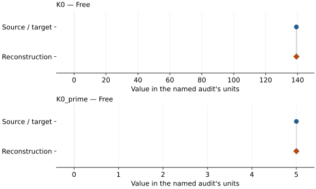

# Copper historical compression isotherm (AIP Handbook 1972): EOS reconstruction reports

<!-- Generated by scripts.generate_reconstruction_reports; edit EOSMAT instead. -->

[All reconstruction reports](index.md) · [Material and EOS parameters](../material-summaries/cu_handbook_1972_legacy.md)

These reports explain the assessments already stored in EOSMAT. Generating
this page does not refit observations, change classifications or replace source coefficients.

Use [scientific label definitions](../eos-labels.md) to distinguish coefficient
agreement, source verification, author-workflow reproduction and recommendation for use.

| EOS record | Recorded outcome | Coefficient comparison |
| --- | --- | --- |
| [AIP Handbook Cu low-pressure Vinet m=8 refit](#record-cu_sun_2010_low_vn_refit) | Numerically similar, with qualifications | Graph and table |

## AIP Handbook Cu low-pressure Vinet m=8 refit

Record: `cu_sun_2010_low_vn_refit` · Model: `Vinet`

**Outcome: Numerically similar, with qualifications.**

**Scope:** Reproduction of a stored independent Peritheos refit.
**Comparison basis:** Every compared free coefficient meets either the recorded combined-two-sigma comparison or parameter-specific numerical similarity screen; the audit does not classify the complete comparison as parity.

[Stored EOS coefficients and source](../material-summaries/cu_handbook_1972_legacy.md#record-cu_sun_2010_low_vn_refit)

### What this result establishes

**Separate source-review status:** primary\_source\_validated.
**Usage recommendation:** See the stored EOS qualifications; no recommendation is inferred here.

- This comparison concerns the stored independent Peritheos refit, not recovery of the original publication's coefficients or author workflow.

### Data and reconstruction method

The source/target column below is the stored **Peritheos refit**. Agreement with it does not reproduce the original publication's coefficients.

- **Dataset identifiers:** aip\_handbook\_table4d12\_cu
- **Observations:** 25
- **Fit kind:** isothermal\_pv
- **Selection:** all rows
- **Objective:** eighth\_power\_pressure\_residuals
- **Absolute sigma:** True
- **Free parameters:** K0; K0\_prime
- **Fixed parameters:** V0

Unspecified selections, weights, fixed values or error conventions remain unknown; they have not been inferred for this report.

### Source versus reconstruction

This is a **coefficient comparison**, not an observation or residual plot.
Each panel uses its coefficient's audit units and includes zero. Markers show
stored central values only. Error widths are retained in the table below;
no confidence interval or uncertainty band is inferred. Fixed/adopted values are constraints.

| Parameter | Source / target | Source error | Reconstruction | Reconstruction error | Fit role |
| --- | --- | --- | --- | --- | --- |
| K0 | 139.23431084 | Not specified | 139.23431092638697 | Not specified | Free |
| K0\_prime | 5.00112704 | Not specified | 5.001127035941476 | Not specified | Free |

Values and reported errors are copied without rounding or conversion from the named audit. Missing errors mean unknown, not zero. Parameter names and volume conventions follow that audit; error widths do not imply a confidence convention.

Recorded diagnostics, covariance and additional protocol

- **Columns:**
    - **Pressure:** pressure\_gpa
    - **Temperature:** Not specified
    - **Volume:** v\_over\_v0
- **Observed pressure range gpa:** \[1.5, 34.0\]
- **Observed temperature range k:** Not specified
- **Observed volume range:** \[10.03071040803769, 11.6965881083125\]
- **Degrees of freedom:** 23
- **Solver success:** True
- **Solver message:** Optimization terminated successfully.
- **Rmse gpa:** 0.07015421358068172
- **Published rmse gpa:** 0.07015421226530144
- **Reduced chi square:** Not specified

### Detailed evidence and existing plots

- [Earlier detailed record investigation](../primary-eos-refits.md#investigation-cu_sun_2010_low_vn_refit).
- [Record-by-record numerical ledger](../primary-eos-refits.md#records).
- [Source-audit reports](../source-audits.md).

Observation curves and residual plots are provided by the supporting reports where available. Their absence is not filled by a reconstructed curve presented as measured data.

[Machine-readable comparison ledger](https://github.com/CPrescher/peritheos/blob/main/docs/data/primary-eos-refits.json) — look up `cu_sun_2010_low_vn_refit`.
[Complete native EOSMAT file](https://github.com/CPrescher/peritheos/blob/main/peritheos/data/materials/cu_handbook_1972_legacy.eosmat).
