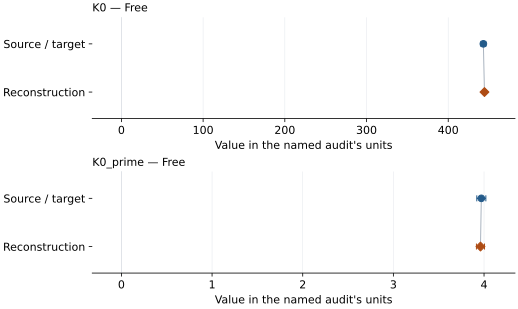
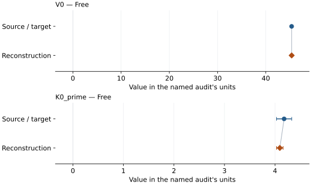
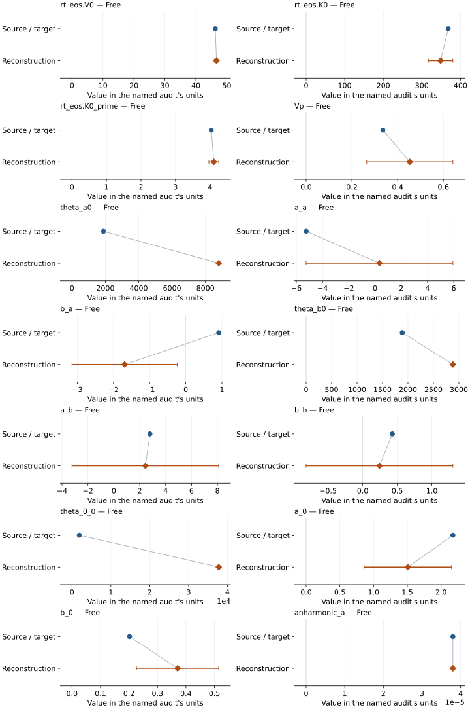
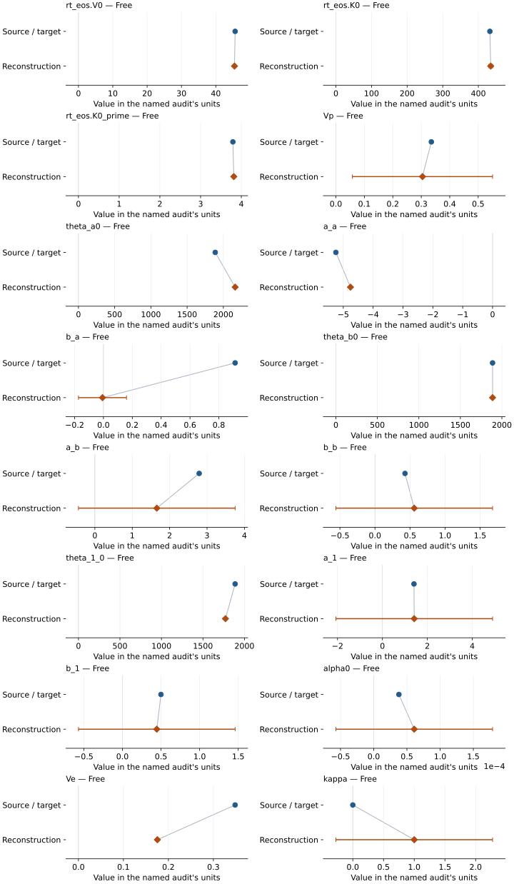

# Diamond: EOS reconstruction reports

<!-- Generated by scripts.generate_reconstruction_reports; edit EOSMAT instead. -->

[All reconstruction reports](index.md) · [Material and EOS parameters](../material-summaries/diamond.md)

These reports explain the assessments already stored in EOSMAT. Generating
this page does not refit observations, change classifications or replace source coefficients.

Use [scientific label definitions](../eos-labels.md) to distinguish coefficient
agreement, source verification, author-workflow reproduction and recommendation for use.

| EOS record | Recorded outcome | Coefficient comparison |
| --- | --- | --- |
| [Occelli data on the H2005 scale (Datchi et al. 2007)](#record-diamond_datchi_2007_vinet_1) | Numerically similar, with qualifications | Graph and table |
| [Dewaele et al. (2008), 298 K neon-medium Vinet](#record-diamond_dewaele_2008_vinet_2) | Coefficient parity achieved | Graph and table |
| [Sokolova et al. (2013), Holzapfel thermal model (2016 workbook)](#record-diamond_sokolova_2013_holzapfel_3) | Source calculation reconstructed | No numeric coefficient pair recorded |
| [Correa et al. (2008), logarithmic-moment double-Debye Helmholtz](#record-diamond_correa_2008_double_debye_log_moment_5) | Parity not achieved for this comparison | Graph and table |
| [Benedict et al. (2014), Vinet double-Debye Helmholtz](#record-diamond_benedict_2014_double_debye_4) | Parity not achieved for this comparison | Graph and table |
| [Diamond (Correa thermal model, Dewaele 298 K Vinet anchor)](#record-diamond_correa_2008_dewaele_anchored) | Source calculation reconstructed | No numeric coefficient pair recorded |
| [Diamond (Benedict thermal model, Dewaele 298 K Vinet anchor)](#record-diamond_benedict_2014_dewaele_anchored) | Source calculation reconstructed | No numeric coefficient pair recorded |

## Occelli data on the H2005 scale (Datchi et al. 2007)

Record: `diamond_datchi_2007_vinet_1` · Model: `Vinet`

**Outcome: Numerically similar, with qualifications.**

**Scope:** Comparison with the source parameterization.
**Comparison basis:** Every compared free coefficient meets either the recorded combined-two-sigma comparison or parameter-specific numerical similarity screen; the audit does not classify the complete comparison as parity.

[Stored EOS coefficients and source](../material-summaries/diamond.md#record-diamond_datchi_2007_vinet_1)

### What this result establishes

**Separate source-review status:** primary\_source\_validated.
**Usage recommendation:** See the stored EOS qualifications; no recommendation is inferred here.

- Conditional figure-level reproduction. The same run-2/equal-volume hypothesis approaches the independently printed MXB1986 and H2005 Table II coefficients and the H2005 chi-square, but Datchi et al. do not publish exclusions or weights and Occelli et al. do not print numerical rows. All 24 markers and all-marker sensitivity fits remain visible in the diagnostic. No refit covariance or parameter errors are inferred from the digitized points.
- This named numerical assessment alone does not establish author-workflow reproduction, physical accuracy or recommendation for use.

### Data and reconstruction method

- **Dataset identifiers:** diamond\_occelli\_2003\_figure2\_digitized
- **Observations:** 14
- **Fit kind:** static\_vinet\_with\_explicit\_ruby\_scale\_conversion
- **Selection:** Occelli Figure 2 run-2 open circles only (14/24 markers); best-supported but source-unconfirmed Table II selection hypothesis
- **Objective:** equal volume residuals; equivalent point estimates from the published constant 0.003 cm^3/mol volume uncertainty
- **Absolute sigma:** Not specified
- **Free parameters:** K0; K0\_prime
- **Fixed parameters:** V0

Unspecified selections, weights, fixed values or error conventions remain unknown; they have not been inferred for this report.

### Source versus reconstruction

This is a **coefficient comparison**, not an observation or residual plot.
Each panel uses its coefficient's audit units and includes zero. Markers show
stored central values only. Error widths are retained in the table below;
no confidence interval or uncertainty band is inferred. Fixed/adopted values are constraints.

| Parameter | Source / target | Source error | Reconstruction | Reconstruction error | Fit role |
| --- | --- | --- | --- | --- | --- |
| K0 | 443.0 | 3.0 | 444.3462890944917 | Not specified | Free |
| K0\_prime | 3.97 | 0.05 | 3.960700438665756 | Not specified | Free |

Values and reported errors are copied without rounding or conversion from the named audit. Missing errors mean unknown, not zero. Parameter names and volume conventions follow that audit; error widths do not imply a confidence convention.

Recorded diagnostics, covariance and additional protocol

- **Observed pressure range gpa:** \[13.227651913, 154.97533874678942\]
- **Solver success:** True
- **Solver message:** \`gtol\` termination condition is satisfied.
- **Rmse gpa:** 0.2775872734356574

### Detailed evidence and existing plots

- [Earlier detailed record investigation](../primary-eos-refits.md#investigation-diamond_datchi_2007_vinet_1).
- [Record-by-record numerical ledger](../primary-eos-refits.md#records).
- [Source-audit reports](../source-audits.md).

Observation curves and residual plots are provided by the supporting reports where available. Their absence is not filled by a reconstructed curve presented as measured data.

[Machine-readable comparison ledger](https://github.com/CPrescher/peritheos/blob/main/docs/data/primary-eos-refits.json) — look up `diamond_datchi_2007_vinet_1`.
[Complete native EOSMAT file](https://github.com/CPrescher/peritheos/blob/main/peritheos/data/materials/diamond.eosmat).

## Dewaele et al. (2008), 298 K neon-medium Vinet

Record: `diamond_dewaele_2008_vinet_2` · Model: `Vinet`

**Outcome: Coefficient parity achieved.**

**Scope:** Comparison with the source parameterization.
**Comparison basis:** Every compared free coefficient meets both the recorded combined-two-sigma comparison and parameter-specific numerical similarity screen. Error conventions and fit qualifications remain applicable.

[Stored EOS coefficients and source](../material-summaries/diamond.md#record-diamond_dewaele_2008_vinet_2)

### What this result establishes

**Separate source-review status:** primary\_source\_validated.
**Usage recommendation:** See the stored EOS qualifications; no recommendation is inferred here.

- This named numerical assessment alone does not establish author-workflow reproduction, physical accuracy or recommendation for use.

### Data and reconstruction method

- **Dataset identifiers:** diamond\_dewaele\_2008\_table1\_pvt
- **Observations:** 23
- **Fit kind:** isothermal\_pv
- **Selection:** all rows; reference-T rows
- **Objective:** pressure\_residuals
- **Absolute sigma:** True
- **Free parameters:** V0; K0\_prime
- **Fixed parameters:** K0

Unspecified selections, weights, fixed values or error conventions remain unknown; they have not been inferred for this report.

### Source versus reconstruction

This is a **coefficient comparison**, not an observation or residual plot.
Each panel uses its coefficient's audit units and includes zero. Markers show
stored central values only. Error widths are retained in the table below;
no confidence interval or uncertainty band is inferred. Fixed/adopted values are constraints.

| Parameter | Source / target | Source error | Reconstruction | Reconstruction error | Fit role |
| --- | --- | --- | --- | --- | --- |
| V0 | 45.3544 | 0.0128 | 45.35739773988821 | 0.005958461183877768 | Free |
| K0\_prime | 4.18 | 0.15 | 4.094736716425615 | 0.0654791063011287 | Free |

Values and reported errors are copied without rounding or conversion from the named audit. Missing errors mean unknown, not zero. Parameter names and volume conventions follow that audit; error widths do not imply a confidence convention.

Recorded diagnostics, covariance and additional protocol

- **Columns:**
    - **Pressure:** pressure\_h05\_gpa
    - **Temperature:** temperature\_k
    - **Volume:** lattice\_a\_angstrom
- **Observed pressure range gpa:** \[0.0, 57.6\]
- **Observed temperature range k:** \[298.0, 298.0\]
- **Observed volume range:** \[40.83196326287499, 45.36941878829601\]
- **Degrees of freedom:** 21
- **Solver success:** True
- **Solver message:** Both \`ftol\` and \`xtol\` termination conditions are satisfied.
- **Rmse gpa:** 0.2312840795693689
- **Published rmse gpa:** 0.24196655068724385
- **Reduced chi square:** 0.05858683264913113

### Detailed evidence and existing plots

- [Record-by-record numerical ledger](../primary-eos-refits.md#records).
- [Source-audit reports](../source-audits.md).

Observation curves and residual plots are provided by the supporting reports where available. Their absence is not filled by a reconstructed curve presented as measured data.

[Machine-readable comparison ledger](https://github.com/CPrescher/peritheos/blob/main/docs/data/primary-eos-refits.json) — look up `diamond_dewaele_2008_vinet_2`.
[Complete native EOSMAT file](https://github.com/CPrescher/peritheos/blob/main/peritheos/data/materials/diamond.eosmat).

## Sokolova et al. (2013), Holzapfel thermal model (2016 workbook)

Record: `diamond_sokolova_2013_holzapfel_3` · Model: `Holzapfel`

**Outcome: Source calculation reconstructed.**

**Scope:** Reconstruction of a source equation or calculation.
**Comparison basis:** All eleven machine-readable comparison series enter one shared Equation (20) objective against the mean Table 2 Holzapfel and Table 3 Vinet isotherm. Table 4 is retained as a post-calibration closure test. The calculation cannot recover the eleven EOS parameter sets independently because the source omits complete thermochemical/ultrasonic rows, weights, and covariance.

[Stored EOS coefficients and source](../material-summaries/diamond.md#record-diamond_sokolova_2013_holzapfel_3)

### What this result establishes

**Separate source-review status:** primary\_source\_validated.
**Usage recommendation:** See the stored EOS qualifications; no recommendation is inferred here.

- This named numerical assessment alone does not establish author-workflow reproduction, physical accuracy or recommendation for use.
- No reconstructed coefficient table is recorded for this assessment; no missing values have been inferred.

### Data and reconstruction method

- **Dataset identifiers:** diamond\_dewaele\_2008\_table1\_pvt
- **Observations:** 12
- **Fit kind:** coupled\_eleven\_marker\_ruby\_cross\_calibration
- **Objective:** minimize the sum over markers of the mean squared residual between Equation (20) and the pointwise mean of the Table 2 Holzapfel and Table 3 Vinet pressures, so each of the eleven markers has equal total weight
- **Fixed parameters:** n; Z; n

Unspecified selections, weights, fixed values or error conventions remain unknown; they have not been inferred for this report.

### Why no coefficient graph is shown

No numeric source/reconstruction pair is recorded for this assessment. A graph would require information that is not available here; no values or observations have been invented.

Recorded diagnostics, covariance and additional protocol

- **Rmse gpa:** 0.34050399388283104
- **Published rmse gpa:** 0.3292803038925985
- **Comparison scope:** shared\_ruby\_calibration
- **Published ruby parameters:**
    - **A gpa:** 1870.0
    - **M:** 6.0
- **Sensitivity fit ruby parameters:**
    - **A gpa:** 1869.3837840502665
    - **M:** 6.10334763359135

### Detailed evidence and existing plots

- [Record-by-record numerical ledger](../primary-eos-refits.md#records).
- [Source-audit reports](../source-audits.md).

Observation curves and residual plots are provided by the supporting reports where available. Their absence is not filled by a reconstructed curve presented as measured data.

[Machine-readable comparison ledger](https://github.com/CPrescher/peritheos/blob/main/docs/data/primary-eos-refits.json) — look up `diamond_sokolova_2013_holzapfel_3`.
[Complete native EOSMAT file](https://github.com/CPrescher/peritheos/blob/main/peritheos/data/materials/diamond.eosmat).

## Correa et al. (2008), logarithmic-moment double-Debye Helmholtz

Record: `diamond_correa_2008_double_debye_log_moment_5` · Model: `Vinet`

**Outcome: Parity not achieved for this comparison.**

**Scope:** Comparison with the source parameterization.
**Comparison basis:** The recorded parameter reconstruction did not meet the audit's agreement criterion; the parameter comparisons retain the actual reconstructed values.

[Stored EOS coefficients and source](../material-summaries/diamond.md#record-diamond_correa_2008_double_debye_log_moment_5)

### What this result establishes

**Separate source-review status:** primary\_source\_validated.
**Usage recommendation:** See the stored EOS qualifications; no recommendation is inferred here.

- This named numerical assessment alone does not establish author-workflow reproduction, physical accuracy or recommendation for use.

### Data and reconstruction method

- **Dataset identifiers:** diamond\_correa\_2008\_figure8\_dft\_md\_vector\_digitized
- **Observations:** 57
- **Fit kind:** joint\_pvt
- **Selection:** all rows
- **Objective:** pressure\_residuals
- **Absolute sigma:** True
- **Free parameters:** rt\_eos.V0; rt\_eos.K0; rt\_eos.K0\_prime; Vp; theta\_a0; a\_a; b\_a; theta\_b0; a\_b; b\_b; theta\_0\_0; a\_0; b\_0; anharmonic\_a
- **Fixed parameters:** None declared

Unspecified selections, weights, fixed values or error conventions remain unknown; they have not been inferred for this report.

### Source versus reconstruction

This is a **coefficient comparison**, not an observation or residual plot.
Each panel uses its coefficient's audit units and includes zero. Markers show
stored central values only. Error widths are retained in the table below;
no confidence interval or uncertainty band is inferred. Fixed/adopted values are constraints.

| Parameter | Source / target | Source error | Reconstruction | Reconstruction error | Fit role |
| --- | --- | --- | --- | --- | --- |
| rt\_eos.V0 | 46.28 | Not specified | 46.67568341560049 | 0.7247320237314758 | Free |
| rt\_eos.K0 | 368.2 | Not specified | 348.6296511470743 | 31.750486487424126 | Free |
| rt\_eos.K0\_prime | 4.038 | Not specified | 4.112767509943601 | 0.1424364145584015 | Free |
| Vp | 0.3354934617396 | Not specified | 0.4531579639616889 | 0.18839276010015268 | Free |
| theta\_a0 | 1887.8 | Not specified | 8800.192275922882 | 0.0021508652211605734 | Free |
| a\_a | -5.247303452269356 | Not specified | 0.34052997825744297 | 5.594051377296249 | Free |
| b\_a | 0.913 | Not specified | -1.69049108424988 | 1.4573942664613533 | Free |
| theta\_b0 | 1887.8 | Not specified | 2882.0765942252824 | 0.0046442298091012415 | Free |
| a\_b | 2.7897056328520624 | Not specified | 2.436799666969396 | 5.666031630082069 | Free |
| b\_b | 0.429 | Not specified | 0.24330607028691742 | 1.0605496759066428 | Free |
| theta\_0\_0 | 1887.8 | Not specified | 37756.0 | 0.00015922406457022603 | Free |
| a\_0 | 2.175306177997739 | Not specified | 1.5076531531149437 | 0.6482705375044794 | Free |
| b\_0 | 0.202 | Not specified | 0.3707658731740606 | 0.1443761186444315 | Free |
| anharmonic\_a | 3.8e-05 | Not specified | 3.8e-05 | 0.0 | Free |

Values and reported errors are copied without rounding or conversion from the named audit. Missing errors mean unknown, not zero. Parameter names and volume conventions follow that audit; error widths do not imply a confidence convention.

Recorded diagnostics, covariance and additional protocol

- **Columns:**
    - **Pressure:** pressure\_gpa
    - **Temperature:** temperature\_k
    - **Volume:** volume\_a3\_per\_atom
- **Observed pressure range gpa:** \[169.148156, 740.079232\]
- **Observed temperature range k:** \[488.002376, 9887.43671\]
- **Observed volume range:** \[25.68, 35.44\]
- **Degrees of freedom:** 43
- **Solver success:** True
- **Solver message:** \`xtol\` termination condition is satisfied.
- **Rmse gpa:** 1.0849336136496166
- **Published rmse gpa:** 1.7908921936844253
- **Reduced chi square:** 1.5603166028727558

### Detailed evidence and existing plots

- [Earlier detailed record investigation](../primary-eos-refits.md#investigation-diamond_correa_2008_double_debye_log_moment_5).
- [Record-by-record numerical ledger](../primary-eos-refits.md#records).
- [Source-audit reports](../source-audits.md).

Observation curves and residual plots are provided by the supporting reports where available. Their absence is not filled by a reconstructed curve presented as measured data.

[Machine-readable comparison ledger](https://github.com/CPrescher/peritheos/blob/main/docs/data/primary-eos-refits.json) — look up `diamond_correa_2008_double_debye_log_moment_5`.
[Complete native EOSMAT file](https://github.com/CPrescher/peritheos/blob/main/peritheos/data/materials/diamond.eosmat).

## Benedict et al. (2014), Vinet double-Debye Helmholtz

Record: `diamond_benedict_2014_double_debye_4` · Model: `Vinet`

**Outcome: Parity not achieved for this comparison.**

**Scope:** Comparison with the source parameterization.
**Comparison basis:** The recorded parameter reconstruction did not meet the audit's agreement criterion; the parameter comparisons retain the actual reconstructed values.

[Stored EOS coefficients and source](../material-summaries/diamond.md#record-diamond_benedict_2014_double_debye_4)

### What this result establishes

**Separate source-review status:** primary\_source\_validated.
**Usage recommendation:** See the stored EOS qualifications; no recommendation is inferred here.

- This named numerical assessment alone does not establish author-workflow reproduction, physical accuracy or recommendation for use.

### Data and reconstruction method

- **Dataset identifiers:** diamond\_benedict\_2014\_supplement\_solid\_dft\_md
- **Observations:** 96
- **Fit kind:** joint\_pvt
- **Selection:** all rows
- **Objective:** pressure\_residuals
- **Absolute sigma:** True
- **Free parameters:** rt\_eos.V0; rt\_eos.K0; rt\_eos.K0\_prime; Vp; theta\_a0; a\_a; b\_a; theta\_b0; a\_b; b\_b; theta\_1\_0; a\_1; b\_1; alpha0; Ve; kappa
- **Fixed parameters:** None declared

Unspecified selections, weights, fixed values or error conventions remain unknown; they have not been inferred for this report.

### Source versus reconstruction

This is a **coefficient comparison**, not an observation or residual plot.
Each panel uses its coefficient's audit units and includes zero. Markers show
stored central values only. Error widths are retained in the table below;
no confidence interval or uncertainty band is inferred. Fixed/adopted values are constraints.

| Parameter | Source / target | Source error | Reconstruction | Reconstruction error | Fit role |
| --- | --- | --- | --- | --- | --- |
| rt\_eos.V0 | 45.6272 | Not specified | 45.43830640995942 | 0.16427642472030632 | Free |
| rt\_eos.K0 | 432.4 | Not specified | 434.7686402071058 | 5.161777205753291 | Free |
| rt\_eos.K0\_prime | 3.793 | Not specified | 3.8153628918557647 | 0.03265526034489446 | Free |
| Vp | 0.3354934617396 | Not specified | 0.30427335355480856 | 0.24629048467406486 | Free |
| theta\_a0 | 1887.8 | Not specified | 2162.5684216252175 | 3.7279485700375514e-07 | Free |
| a\_a | -5.247303452269356 | Not specified | -4.759027255600479 | 0.017461243041600946 | Free |
| b\_a | 0.913 | Not specified | -0.006774897358384057 | 0.1665931912876218 | Free |
| theta\_b0 | 1887.8 | Not specified | 1887.9776140426209 | 2.880109814737486e-05 | Free |
| a\_b | 2.7897056328520624 | Not specified | 1.656209330531414 | 2.0953990760522867 | Free |
| b\_b | 0.429 | Not specified | 0.5605710451121859 | 1.11806921712187 | Free |
| theta\_1\_0 | 1887.8 | Not specified | 1770.9397043826275 | 4.341827958631915e-05 | Free |
| a\_1 | 1.4048160508290741 | Not specified | 1.415784740358922 | 3.4888735844594683 | Free |
| b\_1 | 0.499 | Not specified | 0.44506407104242596 | 1.014718409154025 | Free |
| alpha0 | 3.79e-05 | Not specified | 6.099236905331258e-05 | 0.00011799979328728626 | Free |
| Ve | 0.348380842966 | Not specified | 0.17547488477721068 | 3.125993114650048e-07 | Free |
| kappa | 0.0 | Not specified | 1.0 | 1.275694309879621 | Free |

Values and reported errors are copied without rounding or conversion from the named audit. Missing errors mean unknown, not zero. Parameter names and volume conventions follow that audit; error widths do not imply a confidence convention.

Recorded diagnostics, covariance and additional protocol

- **Columns:**
    - **Pressure:** pressure\_gpa
    - **Temperature:** temperature\_k
    - **Volume:** volume\_a3\_per\_atom
- **Observed pressure range gpa:** \[40.476915, 871.127814\]
- **Observed temperature range k:** \[2000.0, 9000.0\]
- **Observed volume range:** \[24.54661864, 43.12243824\]
- **Degrees of freedom:** 80
- **Solver success:** True
- **Solver message:** \`xtol\` termination condition is satisfied.
- **Rmse gpa:** 0.9415488724060389
- **Published rmse gpa:** 3.177925436805747
- **Reduced chi square:** 1.0638171349549002

### Detailed evidence and existing plots

- [Earlier detailed record investigation](../primary-eos-refits.md#investigation-diamond_benedict_2014_double_debye_4).
- [Record-by-record numerical ledger](../primary-eos-refits.md#records).
- [Source-audit reports](../source-audits.md).

Observation curves and residual plots are provided by the supporting reports where available. Their absence is not filled by a reconstructed curve presented as measured data.

[Machine-readable comparison ledger](https://github.com/CPrescher/peritheos/blob/main/docs/data/primary-eos-refits.json) — look up `diamond_benedict_2014_double_debye_4`.
[Complete native EOSMAT file](https://github.com/CPrescher/peritheos/blob/main/peritheos/data/materials/diamond.eosmat).

## Diamond (Correa thermal model, Dewaele 298 K Vinet anchor)

Record: `diamond_correa_2008_dewaele_anchored` · Model: `Vinet`

**Outcome: Source calculation reconstructed.**

**Scope:** Reconstruction of a source equation or calculation.
**Comparison basis:** Exact source-equation reconstruction with no composite coefficient optimization: the Dewaele reference isotherm is independently refitted, the published theory branch is tested against its source checkpoints, and the complete composed pressure and energy-increment identities are verified.

[Stored EOS coefficients and source](../material-summaries/diamond.md#record-diamond_correa_2008_dewaele_anchored)

### What this result establishes

**Separate source-review status:** primary\_source\_validated.
**Usage recommendation:** See the stored EOS qualifications; no recommendation is inferred here.

- This named numerical assessment alone does not establish author-workflow reproduction, physical accuracy or recommendation for use.
- No reconstructed coefficient table is recorded for this assessment; no missing values have been inferred.

### Data and reconstruction method

- **Dataset identifiers:** diamond\_dewaele\_2008\_table1\_pvt; diamond\_correa\_2008\_figure8\_dft\_md\_vector\_digitized
- **Observations:** 80
- **Fixed parameters:** None declared

Unspecified selections, weights, fixed values or error conventions remain unknown; they have not been inferred for this report.

### Why no coefficient graph is shown

No numeric source/reconstruction pair is recorded for this assessment. A graph would require information that is not available here; no values or observations have been invented.

Recorded diagnostics, covariance and additional protocol

- **Reconstruction kind:** derived\_reference\_isotherm\_composition

### Detailed evidence and existing plots

- [Earlier detailed record investigation](../primary-eos-refits.md#investigation-diamond_correa_2008_dewaele_anchored).
- [Record-by-record numerical ledger](../primary-eos-refits.md#records).
- [Source-audit reports](../source-audits.md).

Observation curves and residual plots are provided by the supporting reports where available. Their absence is not filled by a reconstructed curve presented as measured data.

[Machine-readable comparison ledger](https://github.com/CPrescher/peritheos/blob/main/docs/data/primary-eos-refits.json) — look up `diamond_correa_2008_dewaele_anchored`.
[Complete native EOSMAT file](https://github.com/CPrescher/peritheos/blob/main/peritheos/data/materials/diamond.eosmat).

## Diamond (Benedict thermal model, Dewaele 298 K Vinet anchor)

Record: `diamond_benedict_2014_dewaele_anchored` · Model: `Vinet`

**Outcome: Source calculation reconstructed.**

**Scope:** Reconstruction of a source equation or calculation.
**Comparison basis:** Exact source-equation reconstruction with no composite coefficient optimization: the Dewaele reference isotherm is independently refitted, the published theory branch is tested against its source checkpoints, and the complete composed pressure and energy-increment identities are verified.

[Stored EOS coefficients and source](../material-summaries/diamond.md#record-diamond_benedict_2014_dewaele_anchored)

### What this result establishes

**Separate source-review status:** primary\_source\_validated.
**Usage recommendation:** See the stored EOS qualifications; no recommendation is inferred here.

- This named numerical assessment alone does not establish author-workflow reproduction, physical accuracy or recommendation for use.
- No reconstructed coefficient table is recorded for this assessment; no missing values have been inferred.

### Data and reconstruction method

- **Dataset identifiers:** diamond\_dewaele\_2008\_table1\_pvt; diamond\_benedict\_2014\_supplement\_solid\_dft\_md
- **Observations:** 119
- **Fixed parameters:** None declared

Unspecified selections, weights, fixed values or error conventions remain unknown; they have not been inferred for this report.

### Why no coefficient graph is shown

No numeric source/reconstruction pair is recorded for this assessment. A graph would require information that is not available here; no values or observations have been invented.

Recorded diagnostics, covariance and additional protocol

- **Reconstruction kind:** derived\_reference\_isotherm\_composition

### Detailed evidence and existing plots

- [Earlier detailed record investigation](../primary-eos-refits.md#investigation-diamond_benedict_2014_dewaele_anchored).
- [Record-by-record numerical ledger](../primary-eos-refits.md#records).
- [Source-audit reports](../source-audits.md).

Observation curves and residual plots are provided by the supporting reports where available. Their absence is not filled by a reconstructed curve presented as measured data.

[Machine-readable comparison ledger](https://github.com/CPrescher/peritheos/blob/main/docs/data/primary-eos-refits.json) — look up `diamond_benedict_2014_dewaele_anchored`.
[Complete native EOSMAT file](https://github.com/CPrescher/peritheos/blob/main/peritheos/data/materials/diamond.eosmat).
