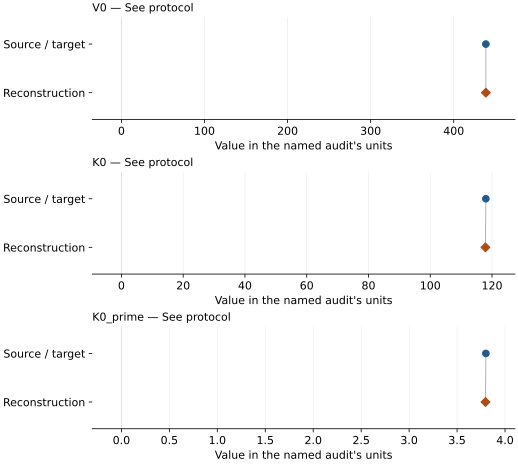
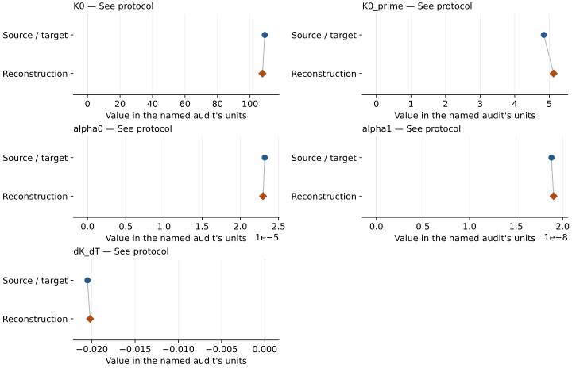

# Diopside: EOS reconstruction reports

<!-- Generated by scripts.generate_reconstruction_reports; edit EOSMAT instead. -->

[All reconstruction reports](index.md) · [Material and EOS parameters](../material-summaries/diopside.md)

These reports explain the assessments already stored in EOSMAT. Generating
this page does not refit observations, change classifications or replace source coefficients.

Use [scientific label definitions](../eos-labels.md) to distinguish coefficient
agreement, source verification, author-workflow reproduction and recommendation for use.

| EOS record | Recorded outcome | Coefficient comparison |
| --- | --- | --- |
| [Thompson and Downs (2008), room-temperature BM3](#record-diopside_thompson_2008_bm3) | Coefficient parity achieved | Graph and table |
| [Zhao et al. (1998), published thermal BM3](#record-diopside_zhao_1998_thermal_bm3) | Coefficient parity achieved | Graph and table |

## Thompson and Downs (2008), room-temperature BM3

Record: `diopside_thompson_2008_bm3` · Model: `BM3`

**Outcome: Coefficient parity achieved.**

**Scope:** Comparison with the source parameterization.
**Comparison basis:** Agreement within the source's reported parameter error widths; this is not an inferred confidence convention.

[Stored EOS coefficients and source](../material-summaries/diopside.md#record-diopside_thompson_2008_bm3)

### What this result establishes

**Separate source-review status:** primary\_source\_validated.
**Usage recommendation:** See the stored EOS qualifications; no recommendation is inferred here.

- Conditional parameter parity within reported error widths on all 14 printed rows using effective P/V variance. Source confidence and exact author weights/covariance are not recovered; no combined-two-sigma or original-author workflow parity is asserted.
- This named numerical assessment alone does not establish author-workflow reproduction, physical accuracy or recommendation for use.

### Data and reconstruction method

- **Dataset identifiers:** diopside\_thompson\_2008\_table1
- **Observations:** 14
- **Fit kind:** effective\_variance\_pv
- **Fixed parameters:** None declared

Unspecified selections, weights, fixed values or error conventions remain unknown; they have not been inferred for this report.

### Source versus reconstruction

This is a **coefficient comparison**, not an observation or residual plot.
Each panel uses its coefficient's audit units and includes zero. Markers show
stored central values only. Error widths are retained in the table below;
no confidence interval or uncertainty band is inferred. Fixed/adopted values are constraints.

| Parameter | Source / target | Source error | Reconstruction | Reconstruction error | Fit role |
| --- | --- | --- | --- | --- | --- |
| V0 | 438.66 | 0.02 | 438.6553948430803 | Not specified | See protocol |
| K0 | 118.0 | 1.0 | 117.8641776706991 | Not specified | See protocol |
| K0\_prime | 3.8 | 0.3 | 3.7962907042955125 | Not specified | See protocol |

Values and reported errors are copied without rounding or conversion from the named audit. Missing errors mean unknown, not zero. Parameter names and volume conventions follow that audit; error widths do not imply a confidence convention.

Recorded diagnostics, covariance and additional protocol

- **Solver success:** True
- **Rmse gpa:** 0.03658693276345292
- **Published rmse gpa:** 0.03739721229323705
- **Reproduction report:** docs/data/diopside-reproduction.json

### Detailed evidence and existing plots

- [Supporting source report: diopside](../literature-reproductions/diopside.md).
- [Record-by-record numerical ledger](../primary-eos-refits.md#records).
- [Source-audit reports](../source-audits.md).

Observation curves and residual plots are provided by the supporting reports where available. Their absence is not filled by a reconstructed curve presented as measured data.

[Machine-readable comparison ledger](https://github.com/CPrescher/peritheos/blob/main/docs/data/primary-eos-refits.json) — look up `diopside_thompson_2008_bm3`.
[Complete native EOSMAT file](https://github.com/CPrescher/peritheos/blob/main/peritheos/data/materials/diopside.eosmat).

## Zhao et al. (1998), published thermal BM3

Record: `diopside_zhao_1998_thermal_bm3` · Model: `BM3`

**Outcome: Coefficient parity achieved.**

**Scope:** Comparison with the source parameterization.
**Comparison basis:** Agreement within the source's reported parameter error widths; this is not an inferred confidence convention.

[Stored EOS coefficients and source](../material-summaries/diopside.md#record-diopside_zhao_1998_thermal_bm3)

### What this result establishes

**Separate source-review status:** primary\_source\_validated.
**Usage recommendation:** See the stored EOS qualifications; no recommendation is inferred here.

- Conditional parameter parity within reported error widths using the separate corrected analysis dataset: row 15 pressure is the rounded Figure 2 reading 4.58 GPa, not the printed 6.95 GPa. Its +/-0.05 GPa graphical bound is not a statistical error. All 32 rows, including the repeated ambient row, are retained; V0 and Tr are fixed. Original source tables and published coefficients are preserved. Exact original fit inputs, selection, weighting and covariance remain unrecovered.
- This named numerical assessment alone does not establish author-workflow reproduction, physical accuracy or recommendation for use.

### Data and reconstruction method

- **Dataset identifiers:** diopside\_zhao\_1998\_table1\_corrected\_pvt
- **Observations:** 32
- **Fit kind:** graph\_corroborated\_corrected\_pvt
- **Fixed parameters:** Tr

Unspecified selections, weights, fixed values or error conventions remain unknown; they have not been inferred for this report.

### Source versus reconstruction

This is a **coefficient comparison**, not an observation or residual plot.
Each panel uses its coefficient's audit units and includes zero. Markers show
stored central values only. Error widths are retained in the table below;
no confidence interval or uncertainty band is inferred. Fixed/adopted values are constraints.

| Parameter | Source / target | Source error | Reconstruction | Reconstruction error | Fit role |
| --- | --- | --- | --- | --- | --- |
| K0 | 109.1 | 4.0 | 107.72466440881215 | Not specified | See protocol |
| K0\_prime | 4.84 | 0.6 | 5.122488565130115 | Not specified | See protocol |
| alpha0 | 2.32e-05 | 5e-07 | 2.2972456391882284e-05 | Not specified | See protocol |
| alpha1 | 1.88e-08 | 7e-10 | 1.902591653883834e-08 | Not specified | See protocol |
| dK\_dT | -0.0205 | 0.0004 | -0.020207621644568515 | Not specified | See protocol |

Values and reported errors are copied without rounding or conversion from the named audit. Missing errors mean unknown, not zero. Parameter names and volume conventions follow that audit; error widths do not imply a confidence convention.

Recorded diagnostics, covariance and additional protocol

- **Solver success:** True
- **Rmse gpa:** 0.057920259389445686
- **Published rmse gpa:** 0.06455854469786602
- **Reproduction report:** docs/data/diopside-plot-check.json

### Detailed evidence and existing plots

- [Supporting source report: diopside](../literature-reproductions/diopside.md).
- [Record-by-record numerical ledger](../primary-eos-refits.md#records).
- [Source-audit reports](../source-audits.md).

Observation curves and residual plots are provided by the supporting reports where available. Their absence is not filled by a reconstructed curve presented as measured data.

[Machine-readable comparison ledger](https://github.com/CPrescher/peritheos/blob/main/docs/data/primary-eos-refits.json) — look up `diopside_zhao_1998_thermal_bm3`.
[Complete native EOSMAT file](https://github.com/CPrescher/peritheos/blob/main/peritheos/data/materials/diopside.eosmat).
