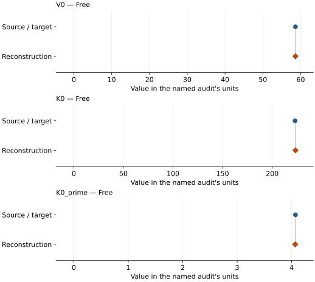

# Epsilon-FeOOH, hydrogen-centered low-spin phase: EOS reconstruction reports

<!-- Generated by scripts.generate_reconstruction_reports; edit EOSMAT instead. -->

[All reconstruction reports](index.md) · [Material and EOS parameters](../material-summaries/e_feooh_hc_low_spin.md)

These reports explain the assessments already stored in EOSMAT. Generating
this page does not refit observations, change classifications or replace source coefficients.

Use [scientific label definitions](../eos-labels.md) to distinguish coefficient
agreement, source verification, author-workflow reproduction and recommendation for use.

| EOS record | Recorded outcome | Coefficient comparison |
| --- | --- | --- |
| [Thompson et al. (2017), hydrogen-centered low-spin FM BM3](#record-e_feooh_hc_low_spin_thompson_2017_bm3_1) | Coefficient parity achieved | Graph and table |

## Thompson et al. (2017), hydrogen-centered low-spin FM BM3

Record: `e_feooh_hc_low_spin_thompson_2017_bm3_1` · Model: `BM3`

**Outcome: Coefficient parity achieved.**

**Scope:** Comparison with the source parameterization.
**Comparison basis:** Every compared free coefficient meets both the recorded combined-two-sigma comparison and parameter-specific numerical similarity screen. Error conventions and fit qualifications remain applicable.

[Stored EOS coefficients and source](../material-summaries/e_feooh_hc_low_spin.md#record-e_feooh_hc_low_spin_thompson_2017_bm3_1)

### What this result establishes

**Separate source-review status:** primary\_source\_validated.
**Usage recommendation:** See the stored EOS qualifications; no recommendation is inferred here.

- This named numerical assessment alone does not establish author-workflow reproduction, physical accuracy or recommendation for use.

### Data and reconstruction method

- **Dataset identifiers:** epsilon\_feooh\_thompson\_2017\_supplement\_table\_s1
- **Observations:** 12
- **Fit kind:** isothermal\_pv
- **Selection:** 12 hydrogen-centered rows at 30-140 GPa; HOC/transition rows excluded by the source fit protocol
- **Objective:** pressure\_residuals
- **Absolute sigma:** True
- **Free parameters:** V0; K0; K0\_prime
- **Fixed parameters:** None declared

Unspecified selections, weights, fixed values or error conventions remain unknown; they have not been inferred for this report.

### Source versus reconstruction

This is a **coefficient comparison**, not an observation or residual plot.
Each panel uses its coefficient's audit units and includes zero. Markers show
stored central values only. Error widths are retained in the table below;
no confidence interval or uncertainty band is inferred. Fixed/adopted values are constraints.

| Parameter | Source / target | Source error | Reconstruction | Reconstruction error | Fit role |
| --- | --- | --- | --- | --- | --- |
| V0 | 58.62 | 0.05 | 58.612018832577284 | 0.06210522074790147 | Free |
| K0 | 223.0 | 2.0 | 223.41826498267838 | 2.5871453534956586 | Free |
| K0\_prime | 4.07 | 0.03 | 4.066535392676584 | 0.037065851740301234 | Free |

Values and reported errors are copied without rounding or conversion from the named audit. Missing errors mean unknown, not zero. Parameter names and volume conventions follow that audit; error widths do not imply a confidence convention.

Recorded diagnostics, covariance and additional protocol

- **Columns:**
    - **Pressure:** pressure\_gpa
    - **Temperature:** Not specified
    - **Volume:** unit\_cell\_volume\_a3
- **Observed pressure range gpa:** \[30.01, 139.99\]
- **Observed temperature range k:** Not specified
- **Observed volume range:** \[42.4, 52.64\]
- **Degrees of freedom:** 9
- **Solver success:** True
- **Solver message:** \`ftol\` termination condition is satisfied.
- **Rmse gpa:** 0.09518132012614243
- **Published rmse gpa:** 0.10819370267206042
- **Reduced chi square:** 0.012079311601273606

### Detailed evidence and existing plots

- [Record-by-record numerical ledger](../primary-eos-refits.md#records).
- [Source-audit reports](../source-audits.md).

Observation curves and residual plots are provided by the supporting reports where available. Their absence is not filled by a reconstructed curve presented as measured data.

[Machine-readable comparison ledger](https://github.com/CPrescher/peritheos/blob/main/docs/data/primary-eos-refits.json) — look up `e_feooh_hc_low_spin_thompson_2017_bm3_1`.
[Complete native EOSMAT file](https://github.com/CPrescher/peritheos/blob/main/peritheos/data/materials/e_feooh_hc_low_spin.eosmat).
