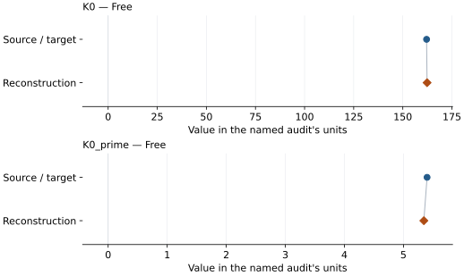

# Fe: EOS reconstruction reports

<!-- Generated by scripts.generate_reconstruction_reports; edit EOSMAT instead. -->

[All reconstruction reports](index.md) · [Material and EOS parameters](../material-summaries/fe.md)

These reports explain the assessments already stored in EOSMAT. Generating
this page does not refit observations, change classifications or replace source coefficients.

Use [scientific label definitions](../eos-labels.md) to distinguish coefficient
agreement, source verification, author-workflow reproduction and recommendation for use.

| EOS record | Recorded outcome | Coefficient comparison |
| --- | --- | --- |
| [Shen and Smith (2026), Cu-referenced Vinet](#record-fe_shen_2026_vinet_1) | Coefficient parity achieved | Graph and table |

## Shen and Smith (2026), Cu-referenced Vinet

Record: `fe_shen_2026_vinet_1` · Model: `Vinet`

**Outcome: Coefficient parity achieved.**

**Scope:** Comparison with the source parameterization.
**Comparison basis:** Every compared free coefficient meets both the recorded combined-two-sigma comparison and parameter-specific numerical similarity screen. Error conventions and fit qualifications remain applicable.

[Stored EOS coefficients and source](../material-summaries/fe.md#record-fe_shen_2026_vinet_1)

### What this result establishes

**Separate source-review status:** primary\_source\_validated.
**Usage recommendation:** See the stored EOS qualifications; no recommendation is inferred here.

- Direct reconstruction from source observations: each Table S1 phase volume is paired with its simultaneous Cu volume, pressure is evaluated from Fratanduono et al.'s analytic third-order 298 K Vinet fit, and K0 and K0\_prime are fitted with Shen and Smith's fixed V0 and stated run selection. The source publishes no pressure weights, residual covariance, or weighting protocol, so the reproduction uses unweighted pressure residuals and does not infer any of them.
- This named numerical assessment alone does not establish author-workflow reproduction, physical accuracy or recommendation for use.

### Data and reconstruction method

- **Dataset identifiers:** shen\_smith\_2026\_table\_s1\_simultaneous\_volumes
- **Observations:** 42
- **Fit kind:** fixed\_v0\_vinet\_with\_reconstructed\_cu\_pressure
- **Selection:** bcc-Fe; DAC-1 and DAC-2
- **Objective:** unweighted\_pressure\_residuals
- **Absolute sigma:** False
- **Free parameters:** K0; K0\_prime
- **Fixed parameters:** V0

Unspecified selections, weights, fixed values or error conventions remain unknown; they have not been inferred for this report.

### Source versus reconstruction

This is a **coefficient comparison**, not an observation or residual plot.
Each panel uses its coefficient's audit units and includes zero. Markers show
stored central values only. Error widths are retained in the table below;
no confidence interval or uncertainty band is inferred. Fixed/adopted values are constraints.

| Parameter | Source / target | Source error | Reconstruction | Reconstruction error | Fit role |
| --- | --- | --- | --- | --- | --- |
| K0 | 162.1 | 2.5 | 162.3514810441337 | 2.4913739665854386 | Free |
| K0\_prime | 5.4 | 0.5 | 5.345415186411802 | 0.4926613969210368 | Free |

Values and reported errors are copied without rounding or conversion from the named audit. Missing errors mean unknown, not zero. Parameter names and volume conventions follow that audit; error widths do not imply a confidence convention.

Recorded diagnostics, covariance and additional protocol

- **Columns:**
    - **Pressure:** Fratanduono-2020 298 K Cu pressure reconstructed per run
    - **Temperature:** Not specified
    - **Volume:** unit\_cell\_volume\_a3
- **Observed pressure range gpa:** \[2.786190605963631, 15.735215643013111\]
- **Observed temperature range k:** Not specified
- **Observed volume range:** \[21.72444, 23.12581\]
- **Degrees of freedom:** 40
- **Solver success:** True
- **Solver message:** \`ftol\` termination condition is satisfied.
- **Rmse gpa:** 0.21506885344816878
- **Published rmse gpa:** 0.21510416076590483
- **Reduced chi square:** 0.04856734230968539
- **Pressure reconstruction:**
    - **Density0 g cm3:** 8.939
    - **DOI:** 10.1103/PhysRevLett.124.015701
    - **Model:** vinet\_3
    - **Pairing:** Each phase volume uses the single Cu volume with the same experiment and run number; both source-labeled Pt first/last measurements are retained when the run is selected.
    - **Parameters:**
        - **K0 gpa:** 133.6
        - **Beta:** 2.06
        - **Eta:** 6.29
        - **Psi:** 1.65
    - **Reference:** Fratanduono et al. (2020)
    - **Reference eos record:** copper\_fratanduono\_2020\_vinet3\_298k
    - **Reference unit cell volume a3:** 47.218085048721
    - **Source locations:** main article Table I, 298 K isotherm row; Supplemental Material Eq. (2), Section S4

### Detailed evidence and existing plots

- [Record-by-record numerical ledger](../primary-eos-refits.md#records).
- [Source-audit reports](../source-audits.md).

Observation curves and residual plots are provided by the supporting reports where available. Their absence is not filled by a reconstructed curve presented as measured data.

[Machine-readable comparison ledger](https://github.com/CPrescher/peritheos/blob/main/docs/data/primary-eos-refits.json) — look up `fe_shen_2026_vinet_1`.
[Complete native EOSMAT file](https://github.com/CPrescher/peritheos/blob/main/peritheos/data/materials/fe.eosmat).
