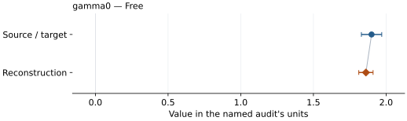

# Fe–16 wt% Si (D03): EOS reconstruction reports

<!-- Generated by scripts.generate_reconstruction_reports; edit EOSMAT instead. -->

[All reconstruction reports](index.md) · [Material and EOS parameters](../material-summaries/fe073si027_d03.md)

These reports explain the assessments already stored in EOSMAT. Generating
this page does not refit observations, change classifications or replace source coefficients.

Use [scientific label definitions](../eos-labels.md) to distinguish coefficient
agreement, source verification, author-workflow reproduction and recommendation for use.

| EOS record | Recorded outcome | Coefficient comparison |
| --- | --- | --- |
| [Fischer et al. (2014), Fe0.73Si0.27 d03 VINET + MGD](#record-fe073si027_d03_fischer_2014_vinet_1) | Coefficient parity achieved | Graph and table |

## Fischer et al. (2014), Fe0.73Si0.27 d03 VINET + MGD

Record: `fe073si027_d03_fischer_2014_vinet_1` · Model: `Vinet`

**Outcome: Coefficient parity achieved.**

**Scope:** Comparison with the source parameterization.
**Comparison basis:** Every compared free coefficient meets both the recorded combined-two-sigma comparison and parameter-specific numerical similarity screen. Error conventions and fit qualifications remain applicable.

[Stored EOS coefficients and source](../material-summaries/fe073si027_d03.md#record-fe073si027_d03_fischer_2014_vinet_1)

### What this result establishes

**Separate source-review status:** primary\_source\_validated.
**Usage recommendation:** See the stored EOS qualifications; no recommendation is inferred here.

- Complete single-phase source rows with published fixed choices. Unweighted pressure residuals and residual-scaled refit errors are diagnostics: source weights, coefficient confidence and covariance are unspecified. Parity denotes the ledger's numerical/combined-error criterion, not recovery of the authors' regression covariance. The Fe-16Si entry checks the 66-row thermal stage; the independent script also refits its 32-row static stage. See the \[Fischer audit\](literature-reproductions/fischer-2014-fesi.md).
- This named numerical assessment alone does not establish author-workflow reproduction, physical accuracy or recommendation for use.

### Data and reconstruction method

- **Dataset identifiers:** fischer\_2012\_table\_s2\_pvt
- **Observations:** 66
- **Fit kind:** joint\_pvt
- **Selection:** 66 D03 observations above 300 K; source-staged gamma0 fit with the published 300 K coefficients fixed. The independent Fischer script also refits the 32-row static stage.
- **Objective:** pressure\_residuals
- **Absolute sigma:** False
- **Free parameters:** gamma0
- **Fixed parameters:** V0; K0; K0\_prime; Tr; theta0; q; n

Unspecified selections, weights, fixed values or error conventions remain unknown; they have not been inferred for this report.

### Source versus reconstruction

This is a **coefficient comparison**, not an observation or residual plot.
Each panel uses its coefficient's audit units and includes zero. Markers show
stored central values only. Error widths are retained in the table below;
no confidence interval or uncertainty band is inferred. Fixed/adopted values are constraints.

| Parameter | Source / target | Source error | Reconstruction | Reconstruction error | Fit role |
| --- | --- | --- | --- | --- | --- |
| gamma0 | 1.9 | 0.07 | 1.8612195021760454 | 0.04918490127830141 | Free |

Values and reported errors are copied without rounding or conversion from the named audit. Missing errors mean unknown, not zero. Parameter names and volume conventions follow that audit; error widths do not imply a confidence convention.

Recorded diagnostics, covariance and additional protocol

- **Columns:**
    - **Pressure:** pressure\_gpa
    - **Temperature:** temperature\_k
    - **Volume:** d03\_volume\_a3
- **Observed pressure range gpa:** \[15.620572398802592, 63.03555479484396\]
- **Observed temperature range k:** \[1176.73, 2395.535\]
- **Observed volume range:** \[149.64600574235195, 178.9170725232182\]
- **Degrees of freedom:** 65
- **Solver success:** True
- **Solver message:** \`ftol\` termination condition is satisfied.
- **Rmse gpa:** 2.0723557131081476
- **Published rmse gpa:** 2.082229788298462
- **Reduced chi square:** 4.360729866292779

### Detailed evidence and existing plots

- [Supporting source report: fischer-2014-fesi](../literature-reproductions/fischer-2014-fesi.md).
- [Record-by-record numerical ledger](../primary-eos-refits.md#records).
- [Source-audit reports](../source-audits.md).

Observation curves and residual plots are provided by the supporting reports where available. Their absence is not filled by a reconstructed curve presented as measured data.

[Machine-readable comparison ledger](https://github.com/CPrescher/peritheos/blob/main/docs/data/primary-eos-refits.json) — look up `fe073si027_d03_fischer_2014_vinet_1`.
[Complete native EOSMAT file](https://github.com/CPrescher/peritheos/blob/main/peritheos/data/materials/fe073si027_d03.eosmat).
