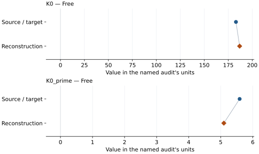
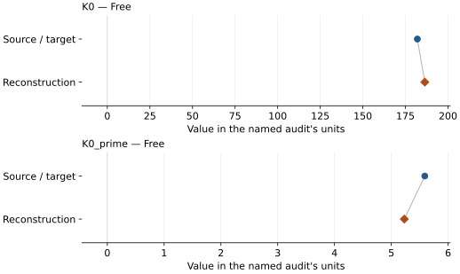

# Fe–9 wt% Si (d03): EOS reconstruction reports

<!-- Generated by scripts.generate_reconstruction_reports; edit EOSMAT instead. -->

[All reconstruction reports](index.md) · [Material and EOS parameters](../material-summaries/fe084si016_d03.md)

These reports explain the assessments already stored in EOSMAT. Generating
this page does not refit observations, change classifications or replace source coefficients.

Use [scientific label definitions](../eos-labels.md) to distinguish coefficient
agreement, source verification, author-workflow reproduction and recommendation for use.

| EOS record | Recorded outcome | Coefficient comparison |
| --- | --- | --- |
| [Fischer et al. (2014), Fe0.84Si0.16 d03 BM3 at 300 K](#record-fe084si016_d03_fischer_2014_bm3_1) | Coefficient parity achieved | Graph and table |
| [Fischer et al. (2014), Fe0.84Si0.16 d03 VINET at 300 K](#record-fe084si016_d03_fischer_2014_vinet_2) | Coefficient parity achieved | Graph and table |

## Fischer et al. (2014), Fe0.84Si0.16 d03 BM3 at 300 K

Record: `fe084si016_d03_fischer_2014_bm3_1` · Model: `BM3`

**Outcome: Coefficient parity achieved.**

**Scope:** Comparison with the source parameterization.
**Comparison basis:** Every compared free coefficient meets both the recorded combined-two-sigma comparison and parameter-specific numerical similarity screen. Error conventions and fit qualifications remain applicable.

[Stored EOS coefficients and source](../material-summaries/fe084si016_d03.md#record-fe084si016_d03_fischer_2014_bm3_1)

### What this result establishes

**Separate source-review status:** primary\_source\_validated.
**Usage recommendation:** See the stored EOS qualifications; no recommendation is inferred here.

- Complete single-phase source rows with published fixed choices. Unweighted pressure residuals and residual-scaled refit errors are diagnostics: source weights, coefficient confidence and covariance are unspecified. Parity denotes the ledger's numerical/combined-error criterion, not recovery of the authors' regression covariance. The Fe-16Si entry checks the 66-row thermal stage; the independent script also refits its 32-row static stage. See the \[Fischer audit\](literature-reproductions/fischer-2014-fesi.md).
- This named numerical assessment alone does not establish author-workflow reproduction, physical accuracy or recommendation for use.

### Data and reconstruction method

- **Dataset identifiers:** fischer\_2014\_table\_s1\_pvt
- **Observations:** 15
- **Fit kind:** isothermal\_pv
- **Selection:** phase=D03; reference-T rows
- **Objective:** pressure\_residuals
- **Absolute sigma:** False
- **Free parameters:** K0; K0\_prime
- **Fixed parameters:** V0

Unspecified selections, weights, fixed values or error conventions remain unknown; they have not been inferred for this report.

### Source versus reconstruction

This is a **coefficient comparison**, not an observation or residual plot.
Each panel uses its coefficient's audit units and includes zero. Markers show
stored central values only. Error widths are retained in the table below;
no confidence interval or uncertainty band is inferred. Fixed/adopted values are constraints.

| Parameter | Source / target | Source error | Reconstruction | Reconstruction error | Fit role |
| --- | --- | --- | --- | --- | --- |
| K0 | 183.0 | 4.0 | 186.84133583232995 | 5.4851803198186175 | Free |
| K0\_prime | 5.59 | 0.51 | 5.097657190177022 | 0.6136071778763995 | Free |

Values and reported errors are copied without rounding or conversion from the named audit. Missing errors mean unknown, not zero. Parameter names and volume conventions follow that audit; error widths do not imply a confidence convention.

Recorded diagnostics, covariance and additional protocol

- **Columns:**
    - **Pressure:** pressure\_gpa
    - **Temperature:** temperature\_k
    - **Volume:** d03\_volume\_a3
- **Observed pressure range gpa:** \[0.0, 28.788509683548785\]
- **Observed temperature range k:** \[300.0, 300.0\]
- **Observed volume range:** \[165.1911845494451, 184.93845051496552\]
- **Degrees of freedom:** 13
- **Solver success:** True
- **Solver message:** Both \`ftol\` and \`xtol\` termination conditions are satisfied.
- **Rmse gpa:** 0.360421308833802
- **Published rmse gpa:** 0.3710009939263081
- **Reduced chi square:** 0.14988867676323564

### Detailed evidence and existing plots

- [Supporting source report: fischer-2014-fesi](../literature-reproductions/fischer-2014-fesi.md).
- [Record-by-record numerical ledger](../primary-eos-refits.md#records).
- [Source-audit reports](../source-audits.md).

Observation curves and residual plots are provided by the supporting reports where available. Their absence is not filled by a reconstructed curve presented as measured data.

[Machine-readable comparison ledger](https://github.com/CPrescher/peritheos/blob/main/docs/data/primary-eos-refits.json) — look up `fe084si016_d03_fischer_2014_bm3_1`.
[Complete native EOSMAT file](https://github.com/CPrescher/peritheos/blob/main/peritheos/data/materials/fe084si016_d03.eosmat).

## Fischer et al. (2014), Fe0.84Si0.16 d03 VINET at 300 K

Record: `fe084si016_d03_fischer_2014_vinet_2` · Model: `Vinet`

**Outcome: Coefficient parity achieved.**

**Scope:** Comparison with the source parameterization.
**Comparison basis:** Every compared free coefficient meets both the recorded combined-two-sigma comparison and parameter-specific numerical similarity screen. Error conventions and fit qualifications remain applicable.

[Stored EOS coefficients and source](../material-summaries/fe084si016_d03.md#record-fe084si016_d03_fischer_2014_vinet_2)

### What this result establishes

**Separate source-review status:** primary\_source\_validated.
**Usage recommendation:** See the stored EOS qualifications; no recommendation is inferred here.

- Complete single-phase source rows with published fixed choices. Unweighted pressure residuals and residual-scaled refit errors are diagnostics: source weights, coefficient confidence and covariance are unspecified. Parity denotes the ledger's numerical/combined-error criterion, not recovery of the authors' regression covariance. The Fe-16Si entry checks the 66-row thermal stage; the independent script also refits its 32-row static stage. See the \[Fischer audit\](literature-reproductions/fischer-2014-fesi.md).
- This named numerical assessment alone does not establish author-workflow reproduction, physical accuracy or recommendation for use.

### Data and reconstruction method

- **Dataset identifiers:** fischer\_2014\_table\_s1\_pvt
- **Observations:** 15
- **Fit kind:** isothermal\_pv
- **Selection:** phase=D03; reference-T rows
- **Objective:** pressure\_residuals
- **Absolute sigma:** False
- **Free parameters:** K0; K0\_prime
- **Fixed parameters:** V0

Unspecified selections, weights, fixed values or error conventions remain unknown; they have not been inferred for this report.

### Source versus reconstruction

This is a **coefficient comparison**, not an observation or residual plot.
Each panel uses its coefficient's audit units and includes zero. Markers show
stored central values only. Error widths are retained in the table below;
no confidence interval or uncertainty band is inferred. Fixed/adopted values are constraints.

| Parameter | Source / target | Source error | Reconstruction | Reconstruction error | Fit role |
| --- | --- | --- | --- | --- | --- |
| K0 | 182.0 | 3.9 | 186.37314919021395 | 5.447983917335764 | Free |
| K0\_prime | 5.59 | 0.51 | 5.22834077652448 | 0.6078383324917596 | Free |

Values and reported errors are copied without rounding or conversion from the named audit. Missing errors mean unknown, not zero. Parameter names and volume conventions follow that audit; error widths do not imply a confidence convention.

Recorded diagnostics, covariance and additional protocol

- **Columns:**
    - **Pressure:** pressure\_gpa
    - **Temperature:** temperature\_k
    - **Volume:** d03\_volume\_a3
- **Observed pressure range gpa:** \[0.0, 28.788509683548785\]
- **Observed temperature range k:** \[300.0, 300.0\]
- **Observed volume range:** \[165.1911845494451, 184.93845051496552\]
- **Degrees of freedom:** 13
- **Solver success:** True
- **Solver message:** Both \`ftol\` and \`xtol\` termination conditions are satisfied.
- **Rmse gpa:** 0.36004142282455165
- **Published rmse gpa:** 0.38513411554333776
- **Reduced chi square:** 0.149572876326378

### Detailed evidence and existing plots

- [Supporting source report: fischer-2014-fesi](../literature-reproductions/fischer-2014-fesi.md).
- [Record-by-record numerical ledger](../primary-eos-refits.md#records).
- [Source-audit reports](../source-audits.md).

Observation curves and residual plots are provided by the supporting reports where available. Their absence is not filled by a reconstructed curve presented as measured data.

[Machine-readable comparison ledger](https://github.com/CPrescher/peritheos/blob/main/docs/data/primary-eos-refits.json) — look up `fe084si016_d03_fischer_2014_vinet_2`.
[Complete native EOSMAT file](https://github.com/CPrescher/peritheos/blob/main/peritheos/data/materials/fe084si016_d03.eosmat).
