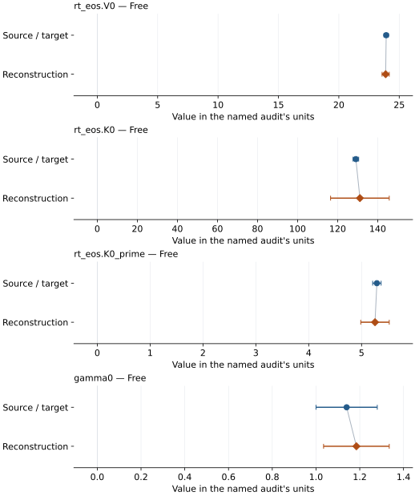
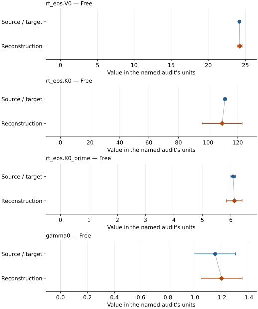

# Fe–9 wt% Si (hcp): EOS reconstruction reports

<!-- Generated by scripts.generate_reconstruction_reports; edit EOSMAT instead. -->

[All reconstruction reports](index.md) · [Material and EOS parameters](../material-summaries/fe084si016_hcp.md)

These reports explain the assessments already stored in EOSMAT. Generating
this page does not refit observations, change classifications or replace source coefficients.

Use [scientific label definitions](../eos-labels.md) to distinguish coefficient
agreement, source verification, author-workflow reproduction and recommendation for use.

| EOS record | Recorded outcome | Coefficient comparison |
| --- | --- | --- |
| [Fischer et al. (2014), Fe0.84Si0.16 hcp BM3 + MGD](#record-fe084si016_hcp_fischer_2014_bm3_1) | Coefficient parity achieved | Graph and table |
| [Fischer et al. (2014), Fe0.84Si0.16 hcp VINET + MGD](#record-fe084si016_hcp_fischer_2014_vinet_2) | Coefficient parity achieved | Graph and table |

## Fischer et al. (2014), Fe0.84Si0.16 hcp BM3 + MGD

Record: `fe084si016_hcp_fischer_2014_bm3_1` · Model: `BM3`

**Outcome: Coefficient parity achieved.**

**Scope:** Comparison with the source parameterization.
**Comparison basis:** Every compared free coefficient meets both the recorded combined-two-sigma comparison and parameter-specific numerical similarity screen. Error conventions and fit qualifications remain applicable.

[Stored EOS coefficients and source](../material-summaries/fe084si016_hcp.md#record-fe084si016_hcp_fischer_2014_bm3_1)

### What this result establishes

**Separate source-review status:** primary\_source\_validated.
**Usage recommendation:** See the stored EOS qualifications; no recommendation is inferred here.

- Complete single-phase source rows with published fixed choices. Unweighted pressure residuals and residual-scaled refit errors are diagnostics: source weights, coefficient confidence and covariance are unspecified. Parity denotes the ledger's numerical/combined-error criterion, not recovery of the authors' regression covariance. The Fe-16Si entry checks the 66-row thermal stage; the independent script also refits its 32-row static stage. See the \[Fischer audit\](literature-reproductions/fischer-2014-fesi.md).
- This named numerical assessment alone does not establish author-workflow reproduction, physical accuracy or recommendation for use.

### Data and reconstruction method

- **Dataset identifiers:** fischer\_2014\_table\_s1\_pvt
- **Observations:** 76
- **Fit kind:** joint\_pvt
- **Selection:** phase=hcp
- **Objective:** pressure\_residuals
- **Absolute sigma:** False
- **Free parameters:** rt\_eos.V0; rt\_eos.K0; rt\_eos.K0\_prime; gamma0
- **Fixed parameters:** Tr; theta0; q; n

Unspecified selections, weights, fixed values or error conventions remain unknown; they have not been inferred for this report.

### Source versus reconstruction

This is a **coefficient comparison**, not an observation or residual plot.
Each panel uses its coefficient's audit units and includes zero. Markers show
stored central values only. Error widths are retained in the table below;
no confidence interval or uncertainty band is inferred. Fixed/adopted values are constraints.

| Parameter | Source / target | Source error | Reconstruction | Reconstruction error | Fit role |
| --- | --- | --- | --- | --- | --- |
| rt\_eos.V0 | 23.921725801706437 | 0.17933821925477544 | 23.877799732461103 | 0.29640929957744455 | Free |
| rt\_eos.K0 | 129.1 | 1.4 | 131.1223222591529 | 14.641112194006409 | Free |
| rt\_eos.K0\_prime | 5.29 | 0.08 | 5.254359871574407 | 0.2693800928158629 | Free |
| gamma0 | 1.14 | 0.14 | 1.1846549216904039 | 0.15009376867056062 | Free |

Values and reported errors are copied without rounding or conversion from the named audit. Missing errors mean unknown, not zero. Parameter names and volume conventions follow that audit; error widths do not imply a confidence convention.

Recorded diagnostics, covariance and additional protocol

- **Columns:**
    - **Pressure:** pressure\_gpa
    - **Temperature:** temperature\_k
    - **Volume:** hcp\_volume\_a3
- **Observed pressure range gpa:** \[46.46991151576709, 197.0644255148494\]
- **Observed temperature range k:** \[1128.7150000000001, 2566.255\]
- **Observed volume range:** \[15.242475553688518, 19.650928459386936\]
- **Degrees of freedom:** 72
- **Solver success:** True
- **Solver message:** \`ftol\` termination condition is satisfied.
- **Rmse gpa:** 1.353860642273373
- **Published rmse gpa:** 1.3644500996350781
- **Reduced chi square:** 1.9347685630689186

### Detailed evidence and existing plots

- [Supporting source report: fischer-2014-fesi](../literature-reproductions/fischer-2014-fesi.md).
- [Record-by-record numerical ledger](../primary-eos-refits.md#records).
- [Source-audit reports](../source-audits.md).

Observation curves and residual plots are provided by the supporting reports where available. Their absence is not filled by a reconstructed curve presented as measured data.

[Machine-readable comparison ledger](https://github.com/CPrescher/peritheos/blob/main/docs/data/primary-eos-refits.json) — look up `fe084si016_hcp_fischer_2014_bm3_1`.
[Complete native EOSMAT file](https://github.com/CPrescher/peritheos/blob/main/peritheos/data/materials/fe084si016_hcp.eosmat).

## Fischer et al. (2014), Fe0.84Si0.16 hcp VINET + MGD

Record: `fe084si016_hcp_fischer_2014_vinet_2` · Model: `Vinet`

**Outcome: Coefficient parity achieved.**

**Scope:** Comparison with the source parameterization.
**Comparison basis:** Every compared free coefficient meets both the recorded combined-two-sigma comparison and parameter-specific numerical similarity screen. Error conventions and fit qualifications remain applicable.

[Stored EOS coefficients and source](../material-summaries/fe084si016_hcp.md#record-fe084si016_hcp_fischer_2014_vinet_2)

### What this result establishes

**Separate source-review status:** primary\_source\_validated.
**Usage recommendation:** See the stored EOS qualifications; no recommendation is inferred here.

- Complete single-phase source rows with published fixed choices. Unweighted pressure residuals and residual-scaled refit errors are diagnostics: source weights, coefficient confidence and covariance are unspecified. Parity denotes the ledger's numerical/combined-error criterion, not recovery of the authors' regression covariance. The Fe-16Si entry checks the 66-row thermal stage; the independent script also refits its 32-row static stage. See the \[Fischer audit\](literature-reproductions/fischer-2014-fesi.md).
- This named numerical assessment alone does not establish author-workflow reproduction, physical accuracy or recommendation for use.

### Data and reconstruction method

- **Dataset identifiers:** fischer\_2014\_table\_s1\_pvt
- **Observations:** 76
- **Fit kind:** joint\_pvt
- **Selection:** phase=hcp
- **Objective:** pressure\_residuals
- **Absolute sigma:** False
- **Free parameters:** rt\_eos.V0; rt\_eos.K0; rt\_eos.K0\_prime; gamma0
- **Fixed parameters:** Tr; theta0; q; n

Unspecified selections, weights, fixed values or error conventions remain unknown; they have not been inferred for this report.

### Source versus reconstruction

This is a **coefficient comparison**, not an observation or residual plot.
Each panel uses its coefficient's audit units and includes zero. Markers show
stored central values only. Error widths are retained in the table below;
no confidence interval or uncertainty band is inferred. Fixed/adopted values are constraints.

| Parameter | Source / target | Source error | Reconstruction | Reconstruction error | Fit role |
| --- | --- | --- | --- | --- | --- |
| rt\_eos.V0 | 24.187412052454253 | 0.08302695335869234 | 24.22943692257538 | 0.33293807509812645 | Free |
| rt\_eos.K0 | 111.4 | 1.2 | 109.52134882742749 | 13.511642518280398 | Free |
| rt\_eos.K0\_prime | 6.08 | 0.08 | 6.124474609084446 | 0.27279937825655115 | Free |
| gamma0 | 1.15 | 0.15 | 1.19757940302062 | 0.15251652052914422 | Free |

Values and reported errors are copied without rounding or conversion from the named audit. Missing errors mean unknown, not zero. Parameter names and volume conventions follow that audit; error widths do not imply a confidence convention.

Recorded diagnostics, covariance and additional protocol

- **Columns:**
    - **Pressure:** pressure\_gpa
    - **Temperature:** temperature\_k
    - **Volume:** hcp\_volume\_a3
- **Observed pressure range gpa:** \[46.46991151576709, 197.0644255148494\]
- **Observed temperature range k:** \[1128.7150000000001, 2566.255\]
- **Observed volume range:** \[15.242475553688518, 19.650928459386936\]
- **Degrees of freedom:** 72
- **Solver success:** True
- **Solver message:** \`ftol\` termination condition is satisfied.
- **Rmse gpa:** 1.355083352265737
- **Published rmse gpa:** 1.3839029983369042
- **Reduced chi square:** 1.938264830009289

### Detailed evidence and existing plots

- [Supporting source report: fischer-2014-fesi](../literature-reproductions/fischer-2014-fesi.md).
- [Record-by-record numerical ledger](../primary-eos-refits.md#records).
- [Source-audit reports](../source-audits.md).

Observation curves and residual plots are provided by the supporting reports where available. Their absence is not filled by a reconstructed curve presented as measured data.

[Machine-readable comparison ledger](https://github.com/CPrescher/peritheos/blob/main/docs/data/primary-eos-refits.json) — look up `fe084si016_hcp_fischer_2014_vinet_2`.
[Complete native EOSMAT file](https://github.com/CPrescher/peritheos/blob/main/peritheos/data/materials/fe084si016_hcp.eosmat).
