# Fe0.9Ni0.1 alloy (hcp): EOS reconstruction reports

<!-- Generated by scripts.generate_reconstruction_reports; edit EOSMAT instead. -->

[All reconstruction reports](index.md) · [Material and EOS parameters](../material-summaries/fe09ni01_hcp.md)

These reports explain the assessments already stored in EOSMAT. Generating
this page does not refit observations, change classifications or replace source coefficients.

Use [scientific label definitions](../eos-labels.md) to distinguish coefficient
agreement, source verification, author-workflow reproduction and recommendation for use.

| EOS record | Recorded outcome | Coefficient comparison |
| --- | --- | --- |
| [Sakai et al. (2014), p1\_bm3](#record-fe09ni01_hcp_sakai_2014_p1_bm3) | Parity not achieved for this comparison | Graph and table |
| [Sakai et al. (2014), p1\_vinet](#record-fe09ni01_hcp_sakai_2014_p1_vinet) | Parity not achieved for this comparison | Graph and table |
| [Sakai et al. (2014), p1\_v0\_mao\_bm3](#record-fe09ni01_hcp_sakai_2014_p1_v0_mao_bm3) | Parity not achieved for this comparison | Graph and table |
| [Sakai et al. (2014), p1\_v0\_mao\_vinet](#record-fe09ni01_hcp_sakai_2014_p1_v0_mao_vinet) | Parity not achieved for this comparison | Graph and table |
| [Sakai et al. (2014), p1\_v0\_dewaele\_bm3](#record-fe09ni01_hcp_sakai_2014_p1_v0_dewaele_bm3) | Parity not achieved for this comparison | Graph and table |
| [Sakai et al. (2014), p1\_v0\_dewaele\_vinet](#record-fe09ni01_hcp_sakai_2014_p1_v0_dewaele_vinet) | Parity not achieved for this comparison | Graph and table |
| [Sakai et al. (2014), p2\_bm3](#record-fe09ni01_hcp_sakai_2014_p2_bm3) | Complete independent refit unavailable | No numeric coefficient pair recorded |
| [Sakai et al. (2014), p2\_vinet](#record-fe09ni01_hcp_sakai_2014_p2_vinet) | Complete independent refit unavailable | No numeric coefficient pair recorded |
| [Sakai et al. (2014), p3\_bm3](#record-fe09ni01_hcp_sakai_2014_p3_bm3) | Complete independent refit unavailable | No numeric coefficient pair recorded |
| [Sakai et al. (2014), p3\_vinet](#record-fe09ni01_hcp_sakai_2014_p3_vinet) | Complete independent refit unavailable | No numeric coefficient pair recorded |
| [Sakai et al. (2014), p4\_bm3](#record-fe09ni01_hcp_sakai_2014_p4_bm3) | Parity not achieved for this comparison | Graph and table |
| [Sakai et al. (2014), p4\_vinet](#record-fe09ni01_hcp_sakai_2014_p4_vinet) | Parity not achieved for this comparison | Graph and table |
| [Sakai et al. (2014), p5\_bm3](#record-fe09ni01_hcp_sakai_2014_p5_bm3) | Parity not achieved for this comparison | Graph and table |
| [Sakai et al. (2014), p5\_vinet](#record-fe09ni01_hcp_sakai_2014_p5_vinet) | Numerically similar, with qualifications | Graph and table |
| [Sakai et al. (2014), p6\_bm3](#record-fe09ni01_hcp_sakai_2014_p6_bm3) | Parity not achieved for this comparison | Graph and table |
| [Sakai et al. (2014), p6\_vinet](#record-fe09ni01_hcp_sakai_2014_p6_vinet) | Parity not achieved for this comparison | Graph and table |
| [Sakai et al. (2014), Fe0.9Ni0.1 type1 thermal EOS (P4 + P7)](#record-fe09ni01_hcp_sakai_2014_type1_thermal) | Parity not achieved for this comparison | Graph and table |
| [Sakai et al. (2014), Fe0.9Ni0.1 type2 thermal EOS (P4 + P7)](#record-fe09ni01_hcp_sakai_2014_type2_thermal) | Parity not achieved for this comparison | Graph and table |
| [Sakai et al. (2014), Fe0.9Ni0.1 type4\_1 thermal EOS (P4 + P7)](#record-fe09ni01_hcp_sakai_2014_type4_1_thermal) | Parity not achieved for this comparison | Graph and table |
| [Sakai et al. (2014), Fe0.9Ni0.1 type4\_2 thermal EOS (P4 + P7)](#record-fe09ni01_hcp_sakai_2014_type4_2_thermal) | Parity not achieved for this comparison | Graph and table |
| [Sakai et al. (2014), Fe0.9Ni0.1 type4\_3 thermal EOS (P4 + P7)](#record-fe09ni01_hcp_sakai_2014_type4_3_thermal) | Parity not achieved for this comparison | Graph and table |

## Sakai et al. (2014), p1\_bm3

Record: `fe09ni01_hcp_sakai_2014_p1_bm3` · Model: `BM3`

**Outcome: Parity not achieved for this comparison.**

**Scope:** Comparison with the source parameterization.
**Comparison basis:** Conditional independent refit; matching within printed errors is similarity, not reproduction of the original statistical procedure. V0 preliminary g-G fit not repeated.

[Stored EOS coefficients and source](../material-summaries/fe09ni01_hcp.md#record-fe09ni01_hcp_sakai_2014_p1_bm3)

### What this result establishes

**Separate source-review status:** primary\_source\_validated.
**Usage recommendation:** See the stored EOS qualifications; no recommendation is inferred here.

- This named numerical assessment alone does not establish author-workflow reproduction, physical accuracy or recommendation for use.

### Data and reconstruction method

- **Dataset identifiers:** sakai\_2014\_table2\_pvt
- **Observations:** 45
- **Objective:** Unweighted vertical pressure residuals; conditional on published reference/fixed coefficients. Source weights and covariance are not given.
- **Weighting:** unweighted; published coefficient constraints retained
- **Free parameters:** K0; K0\_prime
- **Fixed parameters:** V0

Unspecified selections, weights, fixed values or error conventions remain unknown; they have not been inferred for this report.

### Source versus reconstruction

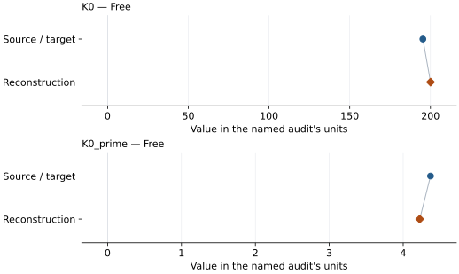

This is a **coefficient comparison**, not an observation or residual plot.
Each panel uses its coefficient's audit units and includes zero. Markers show
stored central values only. Error widths are retained in the table below;
no confidence interval or uncertainty band is inferred. Fixed/adopted values are constraints.

| Parameter | Source / target | Source error | Reconstruction | Reconstruction error | Fit role |
| --- | --- | --- | --- | --- | --- |
| K0 | 195.3 | 1.6 | 200.0343783266108 | Not specified | Free |
| K0\_prime | 4.37 | 0.05 | 4.2243284230188465 | Not specified | Free |

Values and reported errors are copied without rounding or conversion from the named audit. Missing errors mean unknown, not zero. Parameter names and volume conventions follow that audit; error widths do not imply a confidence convention.

Recorded diagnostics, covariance and additional protocol

- **Tied parameters:**
- **Solver success:** True
- **Rmse gpa:** 1.606401520793189
- **Published rmse gpa:** 2.210908056547755
- **Published pressure rmse gpa:** 2.210908056547755
- **Refitted pressure rmse gpa:** 1.606401520793189
- **Rmse shock velocity km s:** Not specified
- **Parameter covariance:** Not specified

### Detailed evidence and existing plots

- [Earlier detailed record investigation](../primary-eos-refits.md#investigation-fe09ni01_hcp_sakai_2014_p1_bm3).
- [Record-by-record numerical ledger](../primary-eos-refits.md#records).
- [Source-audit reports](../source-audits.md).

Observation curves and residual plots are provided by the supporting reports where available. Their absence is not filled by a reconstructed curve presented as measured data.

[Machine-readable comparison ledger](https://github.com/CPrescher/peritheos/blob/main/docs/data/primary-eos-refits.json) — look up `fe09ni01_hcp_sakai_2014_p1_bm3`.
[Complete native EOSMAT file](https://github.com/CPrescher/peritheos/blob/main/peritheos/data/materials/fe09ni01_hcp.eosmat).

## Sakai et al. (2014), p1\_vinet

Record: `fe09ni01_hcp_sakai_2014_p1_vinet` · Model: `Vinet`

**Outcome: Parity not achieved for this comparison.**

**Scope:** Comparison with the source parameterization.
**Comparison basis:** Conditional independent refit; matching within printed errors is similarity, not reproduction of the original statistical procedure. V0 preliminary g-G fit not repeated.

[Stored EOS coefficients and source](../material-summaries/fe09ni01_hcp.md#record-fe09ni01_hcp_sakai_2014_p1_vinet)

### What this result establishes

**Separate source-review status:** primary\_source\_validated.
**Usage recommendation:** See the stored EOS qualifications; no recommendation is inferred here.

- This named numerical assessment alone does not establish author-workflow reproduction, physical accuracy or recommendation for use.

### Data and reconstruction method

- **Dataset identifiers:** sakai\_2014\_table2\_pvt
- **Observations:** 45
- **Objective:** Unweighted vertical pressure residuals; conditional on published reference/fixed coefficients. Source weights and covariance are not given.
- **Weighting:** unweighted; published coefficient constraints retained
- **Free parameters:** K0; K0\_prime
- **Fixed parameters:** V0

Unspecified selections, weights, fixed values or error conventions remain unknown; they have not been inferred for this report.

### Source versus reconstruction

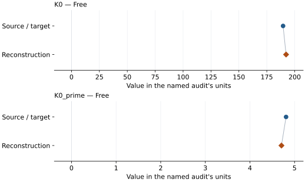

This is a **coefficient comparison**, not an observation or residual plot.
Each panel uses its coefficient's audit units and includes zero. Markers show
stored central values only. Error widths are retained in the table below;
no confidence interval or uncertainty band is inferred. Fixed/adopted values are constraints.

| Parameter | Source / target | Source error | Reconstruction | Reconstruction error | Fit role |
| --- | --- | --- | --- | --- | --- |
| K0 | 189.6 | 1.7 | 192.27435509720192 | Not specified | Free |
| K0\_prime | 4.81 | 0.06 | 4.706556611960647 | Not specified | Free |

Values and reported errors are copied without rounding or conversion from the named audit. Missing errors mean unknown, not zero. Parameter names and volume conventions follow that audit; error widths do not imply a confidence convention.

Recorded diagnostics, covariance and additional protocol

- **Tied parameters:**
- **Solver success:** True
- **Rmse gpa:** 1.7062383521313806
- **Published rmse gpa:** 1.972609141767631
- **Published pressure rmse gpa:** 1.972609141767631
- **Refitted pressure rmse gpa:** 1.7062383521313806
- **Rmse shock velocity km s:** Not specified
- **Parameter covariance:** Not specified

### Detailed evidence and existing plots

- [Earlier detailed record investigation](../primary-eos-refits.md#investigation-fe09ni01_hcp_sakai_2014_p1_vinet).
- [Record-by-record numerical ledger](../primary-eos-refits.md#records).
- [Source-audit reports](../source-audits.md).

Observation curves and residual plots are provided by the supporting reports where available. Their absence is not filled by a reconstructed curve presented as measured data.

[Machine-readable comparison ledger](https://github.com/CPrescher/peritheos/blob/main/docs/data/primary-eos-refits.json) — look up `fe09ni01_hcp_sakai_2014_p1_vinet`.
[Complete native EOSMAT file](https://github.com/CPrescher/peritheos/blob/main/peritheos/data/materials/fe09ni01_hcp.eosmat).

## Sakai et al. (2014), p1\_v0\_mao\_bm3

Record: `fe09ni01_hcp_sakai_2014_p1_v0_mao_bm3` · Model: `BM3`

**Outcome: Parity not achieved for this comparison.**

**Scope:** Comparison with the source parameterization.
**Comparison basis:** Conditional independent refit; matching within printed errors is similarity, not reproduction of the original statistical procedure. V0 preliminary g-G fit not repeated.

[Stored EOS coefficients and source](../material-summaries/fe09ni01_hcp.md#record-fe09ni01_hcp_sakai_2014_p1_v0_mao_bm3)

### What this result establishes

**Separate source-review status:** primary\_source\_validated.
**Usage recommendation:** See the stored EOS qualifications; no recommendation is inferred here.

- This named numerical assessment alone does not establish author-workflow reproduction, physical accuracy or recommendation for use.

### Data and reconstruction method

- **Dataset identifiers:** sakai\_2014\_table2\_pvt
- **Observations:** 45
- **Objective:** Unweighted vertical pressure residuals; conditional on published reference/fixed coefficients. Source weights and covariance are not given.
- **Weighting:** unweighted; published coefficient constraints retained
- **Free parameters:** K0; K0\_prime
- **Fixed parameters:** V0

Unspecified selections, weights, fixed values or error conventions remain unknown; they have not been inferred for this report.

### Source versus reconstruction

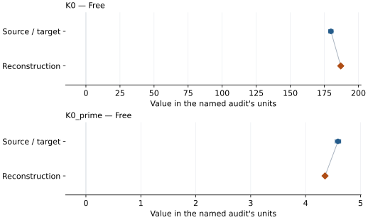

This is a **coefficient comparison**, not an observation or residual plot.
Each panel uses its coefficient's audit units and includes zero. Markers show
stored central values only. Error widths are retained in the table below;
no confidence interval or uncertainty band is inferred. Fixed/adopted values are constraints.

| Parameter | Source / target | Source error | Reconstruction | Reconstruction error | Fit role |
| --- | --- | --- | --- | --- | --- |
| K0 | 179.8 | 1.6 | 187.0329689879698 | Not specified | Free |
| K0\_prime | 4.59 | 0.05 | 4.353887510008359 | Not specified | Free |

Values and reported errors are copied without rounding or conversion from the named audit. Missing errors mean unknown, not zero. Parameter names and volume conventions follow that audit; error widths do not imply a confidence convention.

Recorded diagnostics, covariance and additional protocol

- **Tied parameters:**
- **Solver success:** True
- **Rmse gpa:** 1.6199964199966193
- **Published rmse gpa:** 2.7538171899931974
- **Published pressure rmse gpa:** 2.7538171899931974
- **Refitted pressure rmse gpa:** 1.6199964199966193
- **Rmse shock velocity km s:** Not specified
- **Parameter covariance:** Not specified

### Detailed evidence and existing plots

- [Earlier detailed record investigation](../primary-eos-refits.md#investigation-fe09ni01_hcp_sakai_2014_p1_v0_mao_bm3).
- [Record-by-record numerical ledger](../primary-eos-refits.md#records).
- [Source-audit reports](../source-audits.md).

Observation curves and residual plots are provided by the supporting reports where available. Their absence is not filled by a reconstructed curve presented as measured data.

[Machine-readable comparison ledger](https://github.com/CPrescher/peritheos/blob/main/docs/data/primary-eos-refits.json) — look up `fe09ni01_hcp_sakai_2014_p1_v0_mao_bm3`.
[Complete native EOSMAT file](https://github.com/CPrescher/peritheos/blob/main/peritheos/data/materials/fe09ni01_hcp.eosmat).

## Sakai et al. (2014), p1\_v0\_mao\_vinet

Record: `fe09ni01_hcp_sakai_2014_p1_v0_mao_vinet` · Model: `Vinet`

**Outcome: Parity not achieved for this comparison.**

**Scope:** Comparison with the source parameterization.
**Comparison basis:** Conditional independent refit; matching within printed errors is similarity, not reproduction of the original statistical procedure. V0 preliminary g-G fit not repeated.

[Stored EOS coefficients and source](../material-summaries/fe09ni01_hcp.md#record-fe09ni01_hcp_sakai_2014_p1_v0_mao_vinet)

### What this result establishes

**Separate source-review status:** primary\_source\_validated.
**Usage recommendation:** See the stored EOS qualifications; no recommendation is inferred here.

- This named numerical assessment alone does not establish author-workflow reproduction, physical accuracy or recommendation for use.

### Data and reconstruction method

- **Dataset identifiers:** sakai\_2014\_table2\_pvt
- **Observations:** 45
- **Objective:** Unweighted vertical pressure residuals; conditional on published reference/fixed coefficients. Source weights and covariance are not given.
- **Weighting:** unweighted; published coefficient constraints retained
- **Free parameters:** K0; K0\_prime
- **Fixed parameters:** V0

Unspecified selections, weights, fixed values or error conventions remain unknown; they have not been inferred for this report.

### Source versus reconstruction

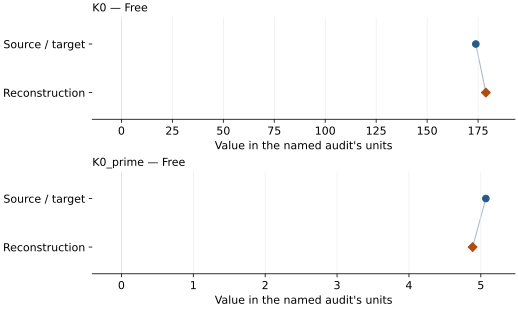

This is a **coefficient comparison**, not an observation or residual plot.
Each panel uses its coefficient's audit units and includes zero. Markers show
stored central values only. Error widths are retained in the table below;
no confidence interval or uncertainty band is inferred. Fixed/adopted values are constraints.

| Parameter | Source / target | Source error | Reconstruction | Reconstruction error | Fit role |
| --- | --- | --- | --- | --- | --- |
| K0 | 173.9 | 1.6 | 178.82057566405422 | Not specified | Free |
| K0\_prime | 5.07 | 0.06 | 4.885879076106027 | Not specified | Free |

Values and reported errors are copied without rounding or conversion from the named audit. Missing errors mean unknown, not zero. Parameter names and volume conventions follow that audit; error widths do not imply a confidence convention.

Recorded diagnostics, covariance and additional protocol

- **Tied parameters:**
- **Solver success:** True
- **Rmse gpa:** 1.653409509846668
- **Published rmse gpa:** 2.2197830754151466
- **Published pressure rmse gpa:** 2.2197830754151466
- **Refitted pressure rmse gpa:** 1.653409509846668
- **Rmse shock velocity km s:** Not specified
- **Parameter covariance:** Not specified

### Detailed evidence and existing plots

- [Earlier detailed record investigation](../primary-eos-refits.md#investigation-fe09ni01_hcp_sakai_2014_p1_v0_mao_vinet).
- [Record-by-record numerical ledger](../primary-eos-refits.md#records).
- [Source-audit reports](../source-audits.md).

Observation curves and residual plots are provided by the supporting reports where available. Their absence is not filled by a reconstructed curve presented as measured data.

[Machine-readable comparison ledger](https://github.com/CPrescher/peritheos/blob/main/docs/data/primary-eos-refits.json) — look up `fe09ni01_hcp_sakai_2014_p1_v0_mao_vinet`.
[Complete native EOSMAT file](https://github.com/CPrescher/peritheos/blob/main/peritheos/data/materials/fe09ni01_hcp.eosmat).

## Sakai et al. (2014), p1\_v0\_dewaele\_bm3

Record: `fe09ni01_hcp_sakai_2014_p1_v0_dewaele_bm3` · Model: `BM3`

**Outcome: Parity not achieved for this comparison.**

**Scope:** Comparison with the source parameterization.
**Comparison basis:** Conditional independent refit; matching within printed errors is similarity, not reproduction of the original statistical procedure. V0 preliminary g-G fit not repeated.

[Stored EOS coefficients and source](../material-summaries/fe09ni01_hcp.md#record-fe09ni01_hcp_sakai_2014_p1_v0_dewaele_bm3)

### What this result establishes

**Separate source-review status:** primary\_source\_validated.
**Usage recommendation:** See the stored EOS qualifications; no recommendation is inferred here.

- This named numerical assessment alone does not establish author-workflow reproduction, physical accuracy or recommendation for use.

### Data and reconstruction method

- **Dataset identifiers:** sakai\_2014\_table2\_pvt
- **Observations:** 45
- **Objective:** Unweighted vertical pressure residuals; conditional on published reference/fixed coefficients. Source weights and covariance are not given.
- **Weighting:** unweighted; published coefficient constraints retained
- **Free parameters:** V0; K0\_prime
- **Fixed parameters:** K0

Unspecified selections, weights, fixed values or error conventions remain unknown; they have not been inferred for this report.

### Source versus reconstruction

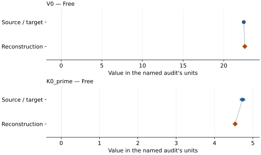

This is a **coefficient comparison**, not an observation or residual plot.
Each panel uses its coefficient's audit units and includes zero. Markers show
stored central values only. Error widths are retained in the table below;
no confidence interval or uncertainty band is inferred. Fixed/adopted values are constraints.

| Parameter | Source / target | Source error | Reconstruction | Reconstruction error | Fit role |
| --- | --- | --- | --- | --- | --- |
| V0 | 22.468 | Not specified | 22.59086269559718 | Not specified | Free |
| K0\_prime | 4.73 | 0.06 | 4.537970473756033 | Not specified | Free |

Values and reported errors are copied without rounding or conversion from the named audit. Missing errors mean unknown, not zero. Parameter names and volume conventions follow that audit; error widths do not imply a confidence convention.

Recorded diagnostics, covariance and additional protocol

- **Tied parameters:**
- **Solver success:** True
- **Rmse gpa:** 1.7349314547623915
- **Published rmse gpa:** 3.1922874500456198
- **Published pressure rmse gpa:** 3.1922874500456198
- **Refitted pressure rmse gpa:** 1.7349314547623915
- **Rmse shock velocity km s:** Not specified
- **Parameter covariance:** Not specified

### Detailed evidence and existing plots

- [Earlier detailed record investigation](../primary-eos-refits.md#investigation-fe09ni01_hcp_sakai_2014_p1_v0_dewaele_bm3).
- [Record-by-record numerical ledger](../primary-eos-refits.md#records).
- [Source-audit reports](../source-audits.md).

Observation curves and residual plots are provided by the supporting reports where available. Their absence is not filled by a reconstructed curve presented as measured data.

[Machine-readable comparison ledger](https://github.com/CPrescher/peritheos/blob/main/docs/data/primary-eos-refits.json) — look up `fe09ni01_hcp_sakai_2014_p1_v0_dewaele_bm3`.
[Complete native EOSMAT file](https://github.com/CPrescher/peritheos/blob/main/peritheos/data/materials/fe09ni01_hcp.eosmat).

## Sakai et al. (2014), p1\_v0\_dewaele\_vinet

Record: `fe09ni01_hcp_sakai_2014_p1_v0_dewaele_vinet` · Model: `Vinet`

**Outcome: Parity not achieved for this comparison.**

**Scope:** Comparison with the source parameterization.
**Comparison basis:** Conditional independent refit; matching within printed errors is similarity, not reproduction of the original statistical procedure. V0 preliminary g-G fit not repeated.

[Stored EOS coefficients and source](../material-summaries/fe09ni01_hcp.md#record-fe09ni01_hcp_sakai_2014_p1_v0_dewaele_vinet)

### What this result establishes

**Separate source-review status:** primary\_source\_validated.
**Usage recommendation:** See the stored EOS qualifications; no recommendation is inferred here.

- This named numerical assessment alone does not establish author-workflow reproduction, physical accuracy or recommendation for use.

### Data and reconstruction method

- **Dataset identifiers:** sakai\_2014\_table2\_pvt
- **Observations:** 45
- **Objective:** Unweighted vertical pressure residuals; conditional on published reference/fixed coefficients. Source weights and covariance are not given.
- **Weighting:** unweighted; published coefficient constraints retained
- **Free parameters:** V0; K0\_prime
- **Fixed parameters:** K0

Unspecified selections, weights, fixed values or error conventions remain unknown; they have not been inferred for this report.

### Source versus reconstruction

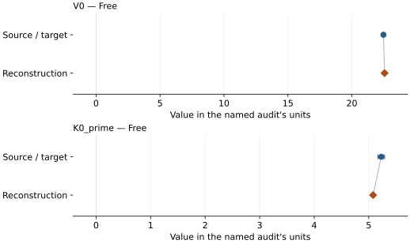

This is a **coefficient comparison**, not an observation or residual plot.
Each panel uses its coefficient's audit units and includes zero. Markers show
stored central values only. Error widths are retained in the table below;
no confidence interval or uncertainty band is inferred. Fixed/adopted values are constraints.

| Parameter | Source / target | Source error | Reconstruction | Reconstruction error | Fit role |
| --- | --- | --- | --- | --- | --- |
| V0 | 22.468 | Not specified | 22.5562203902947 | Not specified | Free |
| K0\_prime | 5.23 | 0.06 | 5.079133042342121 | Not specified | Free |

Values and reported errors are copied without rounding or conversion from the named audit. Missing errors mean unknown, not zero. Parameter names and volume conventions follow that audit; error widths do not imply a confidence convention.

Recorded diagnostics, covariance and additional protocol

- **Tied parameters:**
- **Solver success:** True
- **Rmse gpa:** 1.66732485758244
- **Published rmse gpa:** 2.612050295823673
- **Published pressure rmse gpa:** 2.612050295823673
- **Refitted pressure rmse gpa:** 1.66732485758244
- **Rmse shock velocity km s:** Not specified
- **Parameter covariance:** Not specified

### Detailed evidence and existing plots

- [Earlier detailed record investigation](../primary-eos-refits.md#investigation-fe09ni01_hcp_sakai_2014_p1_v0_dewaele_vinet).
- [Record-by-record numerical ledger](../primary-eos-refits.md#records).
- [Source-audit reports](../source-audits.md).

Observation curves and residual plots are provided by the supporting reports where available. Their absence is not filled by a reconstructed curve presented as measured data.

[Machine-readable comparison ledger](https://github.com/CPrescher/peritheos/blob/main/docs/data/primary-eos-refits.json) — look up `fe09ni01_hcp_sakai_2014_p1_v0_dewaele_vinet`.
[Complete native EOSMAT file](https://github.com/CPrescher/peritheos/blob/main/peritheos/data/materials/fe09ni01_hcp.eosmat).

## Sakai et al. (2014), p2\_bm3

Record: `fe09ni01_hcp_sakai_2014_p2_bm3` · Model: `BM3`

**Outcome: Complete independent refit unavailable.**

**Scope:** Comparison with the source parameterization.
**Comparison basis:** Table 2 does not tabulate P2 pressures. Complete scale re-reduction and source g-G V0 regression remain unavailable.

[Stored EOS coefficients and source](../material-summaries/fe09ni01_hcp.md#record-fe09ni01_hcp_sakai_2014_p2_bm3)

### What this result establishes

**Separate source-review status:** primary\_source\_validated.
**Usage recommendation:** See the stored EOS qualifications; no recommendation is inferred here.

- This named numerical assessment alone does not establish author-workflow reproduction, physical accuracy or recommendation for use.
- No reconstructed coefficient table is recorded for this assessment; no missing values have been inferred.

### Data and reconstruction method

- **Dataset identifiers:** sakai\_2014\_table2\_pvt
- **Observations:** 0
- **Weighting:** unweighted; published coefficient constraints retained
- **Free parameters:** None declared
- **Fixed parameters:** V0

Unspecified selections, weights, fixed values or error conventions remain unknown; they have not been inferred for this report.

### Why no coefficient graph is shown

No numeric source/reconstruction pair is recorded for this assessment. A graph would require information that is not available here; no values or observations have been invented.

Recorded diagnostics, covariance and additional protocol

- **Tied parameters:**
- **Rmse gpa:** Not specified
- **Published rmse gpa:** Not specified
- **Rmse shock velocity km s:** Not specified
- **Parameter covariance:** Not specified

### Detailed evidence and existing plots

- [Record-by-record numerical ledger](../primary-eos-refits.md#records).
- [Source-audit reports](../source-audits.md).

Observation curves and residual plots are provided by the supporting reports where available. Their absence is not filled by a reconstructed curve presented as measured data.

[Machine-readable comparison ledger](https://github.com/CPrescher/peritheos/blob/main/docs/data/primary-eos-refits.json) — look up `fe09ni01_hcp_sakai_2014_p2_bm3`.
[Complete native EOSMAT file](https://github.com/CPrescher/peritheos/blob/main/peritheos/data/materials/fe09ni01_hcp.eosmat).

## Sakai et al. (2014), p2\_vinet

Record: `fe09ni01_hcp_sakai_2014_p2_vinet` · Model: `Vinet`

**Outcome: Complete independent refit unavailable.**

**Scope:** Comparison with the source parameterization.
**Comparison basis:** Table 2 does not tabulate P2 pressures. Complete scale re-reduction and source g-G V0 regression remain unavailable.

[Stored EOS coefficients and source](../material-summaries/fe09ni01_hcp.md#record-fe09ni01_hcp_sakai_2014_p2_vinet)

### What this result establishes

**Separate source-review status:** primary\_source\_validated.
**Usage recommendation:** See the stored EOS qualifications; no recommendation is inferred here.

- This named numerical assessment alone does not establish author-workflow reproduction, physical accuracy or recommendation for use.
- No reconstructed coefficient table is recorded for this assessment; no missing values have been inferred.

### Data and reconstruction method

- **Dataset identifiers:** sakai\_2014\_table2\_pvt
- **Observations:** 0
- **Weighting:** unweighted; published coefficient constraints retained
- **Free parameters:** None declared
- **Fixed parameters:** V0

Unspecified selections, weights, fixed values or error conventions remain unknown; they have not been inferred for this report.

### Why no coefficient graph is shown

No numeric source/reconstruction pair is recorded for this assessment. A graph would require information that is not available here; no values or observations have been invented.

Recorded diagnostics, covariance and additional protocol

- **Tied parameters:**
- **Rmse gpa:** Not specified
- **Published rmse gpa:** Not specified
- **Rmse shock velocity km s:** Not specified
- **Parameter covariance:** Not specified

### Detailed evidence and existing plots

- [Record-by-record numerical ledger](../primary-eos-refits.md#records).
- [Source-audit reports](../source-audits.md).

Observation curves and residual plots are provided by the supporting reports where available. Their absence is not filled by a reconstructed curve presented as measured data.

[Machine-readable comparison ledger](https://github.com/CPrescher/peritheos/blob/main/docs/data/primary-eos-refits.json) — look up `fe09ni01_hcp_sakai_2014_p2_vinet`.
[Complete native EOSMAT file](https://github.com/CPrescher/peritheos/blob/main/peritheos/data/materials/fe09ni01_hcp.eosmat).

## Sakai et al. (2014), p3\_bm3

Record: `fe09ni01_hcp_sakai_2014_p3_bm3` · Model: `BM3`

**Outcome: Complete independent refit unavailable.**

**Scope:** Comparison with the source parameterization.
**Comparison basis:** Table 2 does not tabulate P3 pressures. Complete scale re-reduction and source g-G V0 regression remain unavailable.

[Stored EOS coefficients and source](../material-summaries/fe09ni01_hcp.md#record-fe09ni01_hcp_sakai_2014_p3_bm3)

### What this result establishes

**Separate source-review status:** primary\_source\_validated.
**Usage recommendation:** See the stored EOS qualifications; no recommendation is inferred here.

- This named numerical assessment alone does not establish author-workflow reproduction, physical accuracy or recommendation for use.
- No reconstructed coefficient table is recorded for this assessment; no missing values have been inferred.

### Data and reconstruction method

- **Dataset identifiers:** sakai\_2014\_table2\_pvt
- **Observations:** 0
- **Weighting:** unweighted; published coefficient constraints retained
- **Free parameters:** None declared
- **Fixed parameters:** V0

Unspecified selections, weights, fixed values or error conventions remain unknown; they have not been inferred for this report.

### Why no coefficient graph is shown

No numeric source/reconstruction pair is recorded for this assessment. A graph would require information that is not available here; no values or observations have been invented.

Recorded diagnostics, covariance and additional protocol

- **Tied parameters:**
- **Rmse gpa:** Not specified
- **Published rmse gpa:** Not specified
- **Rmse shock velocity km s:** Not specified
- **Parameter covariance:** Not specified

### Detailed evidence and existing plots

- [Record-by-record numerical ledger](../primary-eos-refits.md#records).
- [Source-audit reports](../source-audits.md).

Observation curves and residual plots are provided by the supporting reports where available. Their absence is not filled by a reconstructed curve presented as measured data.

[Machine-readable comparison ledger](https://github.com/CPrescher/peritheos/blob/main/docs/data/primary-eos-refits.json) — look up `fe09ni01_hcp_sakai_2014_p3_bm3`.
[Complete native EOSMAT file](https://github.com/CPrescher/peritheos/blob/main/peritheos/data/materials/fe09ni01_hcp.eosmat).

## Sakai et al. (2014), p3\_vinet

Record: `fe09ni01_hcp_sakai_2014_p3_vinet` · Model: `Vinet`

**Outcome: Complete independent refit unavailable.**

**Scope:** Comparison with the source parameterization.
**Comparison basis:** Table 2 does not tabulate P3 pressures. Complete scale re-reduction and source g-G V0 regression remain unavailable.

[Stored EOS coefficients and source](../material-summaries/fe09ni01_hcp.md#record-fe09ni01_hcp_sakai_2014_p3_vinet)

### What this result establishes

**Separate source-review status:** primary\_source\_validated.
**Usage recommendation:** See the stored EOS qualifications; no recommendation is inferred here.

- This named numerical assessment alone does not establish author-workflow reproduction, physical accuracy or recommendation for use.
- No reconstructed coefficient table is recorded for this assessment; no missing values have been inferred.

### Data and reconstruction method

- **Dataset identifiers:** sakai\_2014\_table2\_pvt
- **Observations:** 0
- **Weighting:** unweighted; published coefficient constraints retained
- **Free parameters:** None declared
- **Fixed parameters:** V0

Unspecified selections, weights, fixed values or error conventions remain unknown; they have not been inferred for this report.

### Why no coefficient graph is shown

No numeric source/reconstruction pair is recorded for this assessment. A graph would require information that is not available here; no values or observations have been invented.

Recorded diagnostics, covariance and additional protocol

- **Tied parameters:**
- **Rmse gpa:** Not specified
- **Published rmse gpa:** Not specified
- **Rmse shock velocity km s:** Not specified
- **Parameter covariance:** Not specified

### Detailed evidence and existing plots

- [Record-by-record numerical ledger](../primary-eos-refits.md#records).
- [Source-audit reports](../source-audits.md).

Observation curves and residual plots are provided by the supporting reports where available. Their absence is not filled by a reconstructed curve presented as measured data.

[Machine-readable comparison ledger](https://github.com/CPrescher/peritheos/blob/main/docs/data/primary-eos-refits.json) — look up `fe09ni01_hcp_sakai_2014_p3_vinet`.
[Complete native EOSMAT file](https://github.com/CPrescher/peritheos/blob/main/peritheos/data/materials/fe09ni01_hcp.eosmat).

## Sakai et al. (2014), p4\_bm3

Record: `fe09ni01_hcp_sakai_2014_p4_bm3` · Model: `BM3`

**Outcome: Parity not achieved for this comparison.**

**Scope:** Comparison with the source parameterization.
**Comparison basis:** Conditional independent refit; matching within printed errors is similarity, not reproduction of the original statistical procedure. V0 preliminary g-G fit not repeated.

[Stored EOS coefficients and source](../material-summaries/fe09ni01_hcp.md#record-fe09ni01_hcp_sakai_2014_p4_bm3)

### What this result establishes

**Separate source-review status:** primary\_source\_validated.
**Usage recommendation:** See the stored EOS qualifications; no recommendation is inferred here.

- This named numerical assessment alone does not establish author-workflow reproduction, physical accuracy or recommendation for use.

### Data and reconstruction method

- **Dataset identifiers:** sakai\_2014\_table2\_pvt
- **Observations:** 45
- **Objective:** Unweighted vertical pressure residuals; conditional on published reference/fixed coefficients. Source weights and covariance are not given.
- **Weighting:** unweighted; published coefficient constraints retained
- **Free parameters:** K0; K0\_prime
- **Fixed parameters:** V0

Unspecified selections, weights, fixed values or error conventions remain unknown; they have not been inferred for this report.

### Source versus reconstruction

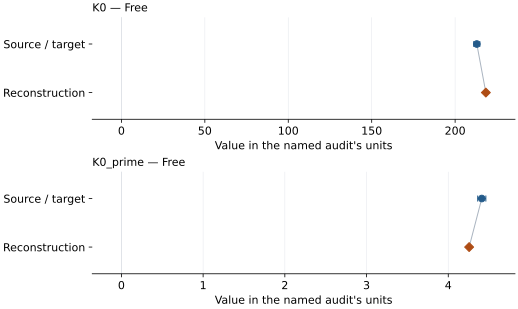

This is a **coefficient comparison**, not an observation or residual plot.
Each panel uses its coefficient's audit units and includes zero. Markers show
stored central values only. Error widths are retained in the table below;
no confidence interval or uncertainty band is inferred. Fixed/adopted values are constraints.

| Parameter | Source / target | Source error | Reconstruction | Reconstruction error | Fit role |
| --- | --- | --- | --- | --- | --- |
| K0 | 213.0 | 1.8 | 218.4138156274682 | Not specified | Free |
| K0\_prime | 4.41 | 0.05 | 4.255462850825763 | Not specified | Free |

Values and reported errors are copied without rounding or conversion from the named audit. Missing errors mean unknown, not zero. Parameter names and volume conventions follow that audit; error widths do not imply a confidence convention.

Recorded diagnostics, covariance and additional protocol

- **Tied parameters:**
- **Solver success:** True
- **Rmse gpa:** 1.667656628629867
- **Published rmse gpa:** 2.3447890411123287
- **Published pressure rmse gpa:** 2.3447890411123287
- **Refitted pressure rmse gpa:** 1.667656628629867
- **Rmse shock velocity km s:** Not specified
- **Parameter covariance:** Not specified

### Detailed evidence and existing plots

- [Earlier detailed record investigation](../primary-eos-refits.md#investigation-fe09ni01_hcp_sakai_2014_p4_bm3).
- [Record-by-record numerical ledger](../primary-eos-refits.md#records).
- [Source-audit reports](../source-audits.md).

Observation curves and residual plots are provided by the supporting reports where available. Their absence is not filled by a reconstructed curve presented as measured data.

[Machine-readable comparison ledger](https://github.com/CPrescher/peritheos/blob/main/docs/data/primary-eos-refits.json) — look up `fe09ni01_hcp_sakai_2014_p4_bm3`.
[Complete native EOSMAT file](https://github.com/CPrescher/peritheos/blob/main/peritheos/data/materials/fe09ni01_hcp.eosmat).

## Sakai et al. (2014), p4\_vinet

Record: `fe09ni01_hcp_sakai_2014_p4_vinet` · Model: `Vinet`

**Outcome: Parity not achieved for this comparison.**

**Scope:** Comparison with the source parameterization.
**Comparison basis:** Conditional independent refit; matching within printed errors is similarity, not reproduction of the original statistical procedure. V0 preliminary g-G fit not repeated.

[Stored EOS coefficients and source](../material-summaries/fe09ni01_hcp.md#record-fe09ni01_hcp_sakai_2014_p4_vinet)

### What this result establishes

**Separate source-review status:** primary\_source\_validated.
**Usage recommendation:** See the stored EOS qualifications; no recommendation is inferred here.

- This named numerical assessment alone does not establish author-workflow reproduction, physical accuracy or recommendation for use.

### Data and reconstruction method

- **Dataset identifiers:** sakai\_2014\_table2\_pvt
- **Observations:** 45
- **Objective:** Unweighted vertical pressure residuals; conditional on published reference/fixed coefficients. Source weights and covariance are not given.
- **Weighting:** unweighted; published coefficient constraints retained
- **Free parameters:** K0; K0\_prime
- **Fixed parameters:** V0

Unspecified selections, weights, fixed values or error conventions remain unknown; they have not been inferred for this report.

### Source versus reconstruction

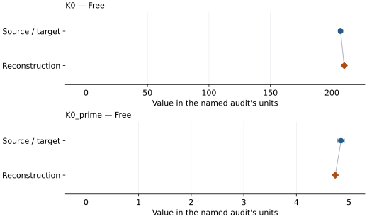

This is a **coefficient comparison**, not an observation or residual plot.
Each panel uses its coefficient's audit units and includes zero. Markers show
stored central values only. Error widths are retained in the table below;
no confidence interval or uncertainty band is inferred. Fixed/adopted values are constraints.

| Parameter | Source / target | Source error | Reconstruction | Reconstruction error | Fit role |
| --- | --- | --- | --- | --- | --- |
| K0 | 207.0 | 1.8 | 210.03586660274584 | Not specified | Free |
| K0\_prime | 4.85 | 0.06 | 4.739384266532654 | Not specified | Free |

Values and reported errors are copied without rounding or conversion from the named audit. Missing errors mean unknown, not zero. Parameter names and volume conventions follow that audit; error widths do not imply a confidence convention.

Recorded diagnostics, covariance and additional protocol

- **Tied parameters:**
- **Solver success:** True
- **Rmse gpa:** 1.7788197892068633
- **Published rmse gpa:** 2.117292921135934
- **Published pressure rmse gpa:** 2.117292921135934
- **Refitted pressure rmse gpa:** 1.7788197892068633
- **Rmse shock velocity km s:** Not specified
- **Parameter covariance:** Not specified

### Detailed evidence and existing plots

- [Earlier detailed record investigation](../primary-eos-refits.md#investigation-fe09ni01_hcp_sakai_2014_p4_vinet).
- [Record-by-record numerical ledger](../primary-eos-refits.md#records).
- [Source-audit reports](../source-audits.md).

Observation curves and residual plots are provided by the supporting reports where available. Their absence is not filled by a reconstructed curve presented as measured data.

[Machine-readable comparison ledger](https://github.com/CPrescher/peritheos/blob/main/docs/data/primary-eos-refits.json) — look up `fe09ni01_hcp_sakai_2014_p4_vinet`.
[Complete native EOSMAT file](https://github.com/CPrescher/peritheos/blob/main/peritheos/data/materials/fe09ni01_hcp.eosmat).

## Sakai et al. (2014), p5\_bm3

Record: `fe09ni01_hcp_sakai_2014_p5_bm3` · Model: `BM3`

**Outcome: Parity not achieved for this comparison.**

**Scope:** Comparison with the source parameterization.
**Comparison basis:** Conditional independent refit; matching within printed errors is similarity, not reproduction of the original statistical procedure. V0 preliminary g-G fit not repeated. P5 pressures independently reconstructed from the printed new NaCl-B2 BM3 coefficients and Table 2 NaCl volumes; B1 rows retain Brown (1999) pressures.

[Stored EOS coefficients and source](../material-summaries/fe09ni01_hcp.md#record-fe09ni01_hcp_sakai_2014_p5_bm3)

### What this result establishes

**Separate source-review status:** primary\_source\_validated.
**Usage recommendation:** See the stored EOS qualifications; no recommendation is inferred here.

- This named numerical assessment alone does not establish author-workflow reproduction, physical accuracy or recommendation for use.

### Data and reconstruction method

- **Dataset identifiers:** sakai\_2014\_table2\_pvt
- **Observations:** 45
- **Objective:** Unweighted vertical pressure residuals; conditional on published reference/fixed coefficients. Source weights and covariance are not given.
- **Weighting:** unweighted; published coefficient constraints retained
- **Free parameters:** K0; K0\_prime
- **Fixed parameters:** V0

Unspecified selections, weights, fixed values or error conventions remain unknown; they have not been inferred for this report.

### Source versus reconstruction

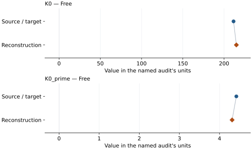

This is a **coefficient comparison**, not an observation or residual plot.
Each panel uses its coefficient's audit units and includes zero. Markers show
stored central values only. Error widths are retained in the table below;
no confidence interval or uncertainty band is inferred. Fixed/adopted values are constraints.

| Parameter | Source / target | Source error | Reconstruction | Reconstruction error | Fit role |
| --- | --- | --- | --- | --- | --- |
| K0 | 211.5 | 1.8 | 214.9151214647974 | Not specified | Free |
| K0\_prime | 4.42 | 0.05 | 4.3135447483778515 | Not specified | Free |

Values and reported errors are copied without rounding or conversion from the named audit. Missing errors mean unknown, not zero. Parameter names and volume conventions follow that audit; error widths do not imply a confidence convention.

Recorded diagnostics, covariance and additional protocol

- **Tied parameters:**
- **Solver success:** True
- **Rmse gpa:** 1.8347163432871763
- **Published rmse gpa:** 2.2515693718530896
- **Published pressure rmse gpa:** 2.2515693718530896
- **Refitted pressure rmse gpa:** 1.8347163432871763
- **Rmse shock velocity km s:** Not specified
- **Parameter covariance:** Not specified

### Detailed evidence and existing plots

- [Earlier detailed record investigation](../primary-eos-refits.md#investigation-fe09ni01_hcp_sakai_2014_p5_bm3).
- [Record-by-record numerical ledger](../primary-eos-refits.md#records).
- [Source-audit reports](../source-audits.md).

Observation curves and residual plots are provided by the supporting reports where available. Their absence is not filled by a reconstructed curve presented as measured data.

[Machine-readable comparison ledger](https://github.com/CPrescher/peritheos/blob/main/docs/data/primary-eos-refits.json) — look up `fe09ni01_hcp_sakai_2014_p5_bm3`.
[Complete native EOSMAT file](https://github.com/CPrescher/peritheos/blob/main/peritheos/data/materials/fe09ni01_hcp.eosmat).

## Sakai et al. (2014), p5\_vinet

Record: `fe09ni01_hcp_sakai_2014_p5_vinet` · Model: `Vinet`

**Outcome: Numerically similar, with qualifications.**

**Scope:** Comparison with the source parameterization.
**Comparison basis:** Every compared free coefficient meets either the recorded combined-two-sigma comparison or parameter-specific numerical similarity screen; the audit does not classify the complete comparison as parity.

[Stored EOS coefficients and source](../material-summaries/fe09ni01_hcp.md#record-fe09ni01_hcp_sakai_2014_p5_vinet)

### What this result establishes

**Separate source-review status:** primary\_source\_validated.
**Usage recommendation:** See the stored EOS qualifications; no recommendation is inferred here.

- Conditional independent refit; matching within printed errors is similarity, not reproduction of the original statistical procedure. V0 preliminary g-G fit not repeated. P5 pressures independently reconstructed from the printed new NaCl-B2 BM3 coefficients and Table 2 NaCl volumes; B1 rows retain Brown (1999) pressures.
- This named numerical assessment alone does not establish author-workflow reproduction, physical accuracy or recommendation for use.

### Data and reconstruction method

- **Dataset identifiers:** sakai\_2014\_table2\_pvt
- **Observations:** 45
- **Objective:** Unweighted vertical pressure residuals; conditional on published reference/fixed coefficients. Source weights and covariance are not given.
- **Weighting:** unweighted; published coefficient constraints retained
- **Free parameters:** K0; K0\_prime
- **Fixed parameters:** V0

Unspecified selections, weights, fixed values or error conventions remain unknown; they have not been inferred for this report.

### Source versus reconstruction

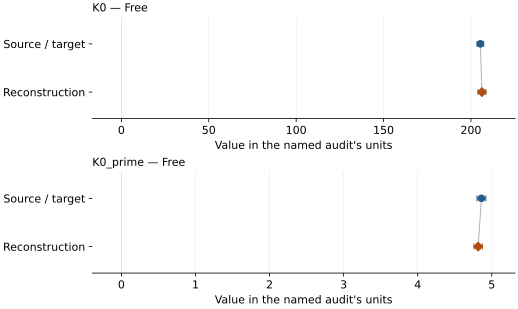

This is a **coefficient comparison**, not an observation or residual plot.
Each panel uses its coefficient's audit units and includes zero. Markers show
stored central values only. Error widths are retained in the table below;
no confidence interval or uncertainty band is inferred. Fixed/adopted values are constraints.

| Parameter | Source / target | Source error | Reconstruction | Reconstruction error | Fit role |
| --- | --- | --- | --- | --- | --- |
| K0 | 205.4 | 1.9 | 206.2987950920161 | Not specified | Free |
| K0\_prime | 4.86 | 0.06 | 4.816594627576633 | Not specified | Free |

Values and reported errors are copied without rounding or conversion from the named audit. Missing errors mean unknown, not zero. Parameter names and volume conventions follow that audit; error widths do not imply a confidence convention.

Recorded diagnostics, covariance and additional protocol

- **Tied parameters:**
- **Solver success:** True
- **Rmse gpa:** 1.9794522014797378
- **Published rmse gpa:** 2.085638180438255
- **Published pressure rmse gpa:** 2.085638180438255
- **Refitted pressure rmse gpa:** 1.9794522014797378
- **Rmse shock velocity km s:** Not specified
- **Parameter covariance:** Not specified

### Detailed evidence and existing plots

- [Earlier detailed record investigation](../primary-eos-refits.md#investigation-fe09ni01_hcp_sakai_2014_p5_vinet).
- [Record-by-record numerical ledger](../primary-eos-refits.md#records).
- [Source-audit reports](../source-audits.md).

Observation curves and residual plots are provided by the supporting reports where available. Their absence is not filled by a reconstructed curve presented as measured data.

[Machine-readable comparison ledger](https://github.com/CPrescher/peritheos/blob/main/docs/data/primary-eos-refits.json) — look up `fe09ni01_hcp_sakai_2014_p5_vinet`.
[Complete native EOSMAT file](https://github.com/CPrescher/peritheos/blob/main/peritheos/data/materials/fe09ni01_hcp.eosmat).

## Sakai et al. (2014), p6\_bm3

Record: `fe09ni01_hcp_sakai_2014_p6_bm3` · Model: `BM3`

**Outcome: Parity not achieved for this comparison.**

**Scope:** Comparison with the source parameterization.
**Comparison basis:** Conditional independent refit; matching within printed errors is similarity, not reproduction of the original statistical procedure. V0 preliminary g-G fit not repeated.

[Stored EOS coefficients and source](../material-summaries/fe09ni01_hcp.md#record-fe09ni01_hcp_sakai_2014_p6_bm3)

### What this result establishes

**Separate source-review status:** primary\_source\_validated.
**Usage recommendation:** See the stored EOS qualifications; no recommendation is inferred here.

- This named numerical assessment alone does not establish author-workflow reproduction, physical accuracy or recommendation for use.

### Data and reconstruction method

- **Dataset identifiers:** sakai\_2014\_table2\_pvt
- **Observations:** 45
- **Objective:** Unweighted vertical pressure residuals; conditional on published reference/fixed coefficients. Source weights and covariance are not given.
- **Weighting:** unweighted; published coefficient constraints retained
- **Free parameters:** K0; K0\_prime
- **Fixed parameters:** V0

Unspecified selections, weights, fixed values or error conventions remain unknown; they have not been inferred for this report.

### Source versus reconstruction

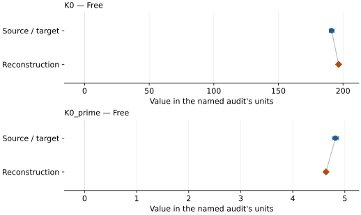

This is a **coefficient comparison**, not an observation or residual plot.
Each panel uses its coefficient's audit units and includes zero. Markers show
stored central values only. Error widths are retained in the table below;
no confidence interval or uncertainty band is inferred. Fixed/adopted values are constraints.

| Parameter | Source / target | Source error | Reconstruction | Reconstruction error | Fit role |
| --- | --- | --- | --- | --- | --- |
| K0 | 191.2 | 1.8 | 196.58930346809018 | Not specified | Free |
| K0\_prime | 4.82 | 0.06 | 4.638208630235569 | Not specified | Free |

Values and reported errors are copied without rounding or conversion from the named audit. Missing errors mean unknown, not zero. Parameter names and volume conventions follow that audit; error widths do not imply a confidence convention.

Recorded diagnostics, covariance and additional protocol

- **Tied parameters:**
- **Solver success:** True
- **Rmse gpa:** 1.7786202823007078
- **Published rmse gpa:** 2.489597189653668
- **Published pressure rmse gpa:** 2.489597189653668
- **Refitted pressure rmse gpa:** 1.7786202823007078
- **Rmse shock velocity km s:** Not specified
- **Parameter covariance:** Not specified

### Detailed evidence and existing plots

- [Earlier detailed record investigation](../primary-eos-refits.md#investigation-fe09ni01_hcp_sakai_2014_p6_bm3).
- [Record-by-record numerical ledger](../primary-eos-refits.md#records).
- [Source-audit reports](../source-audits.md).

Observation curves and residual plots are provided by the supporting reports where available. Their absence is not filled by a reconstructed curve presented as measured data.

[Machine-readable comparison ledger](https://github.com/CPrescher/peritheos/blob/main/docs/data/primary-eos-refits.json) — look up `fe09ni01_hcp_sakai_2014_p6_bm3`.
[Complete native EOSMAT file](https://github.com/CPrescher/peritheos/blob/main/peritheos/data/materials/fe09ni01_hcp.eosmat).

## Sakai et al. (2014), p6\_vinet

Record: `fe09ni01_hcp_sakai_2014_p6_vinet` · Model: `Vinet`

**Outcome: Parity not achieved for this comparison.**

**Scope:** Comparison with the source parameterization.
**Comparison basis:** Conditional independent refit; matching within printed errors is similarity, not reproduction of the original statistical procedure. V0 preliminary g-G fit not repeated.

[Stored EOS coefficients and source](../material-summaries/fe09ni01_hcp.md#record-fe09ni01_hcp_sakai_2014_p6_vinet)

### What this result establishes

**Separate source-review status:** primary\_source\_validated.
**Usage recommendation:** See the stored EOS qualifications; no recommendation is inferred here.

- This named numerical assessment alone does not establish author-workflow reproduction, physical accuracy or recommendation for use.

### Data and reconstruction method

- **Dataset identifiers:** sakai\_2014\_table2\_pvt
- **Observations:** 45
- **Objective:** Unweighted vertical pressure residuals; conditional on published reference/fixed coefficients. Source weights and covariance are not given.
- **Weighting:** unweighted; published coefficient constraints retained
- **Free parameters:** K0; K0\_prime
- **Fixed parameters:** V0

Unspecified selections, weights, fixed values or error conventions remain unknown; they have not been inferred for this report.

### Source versus reconstruction

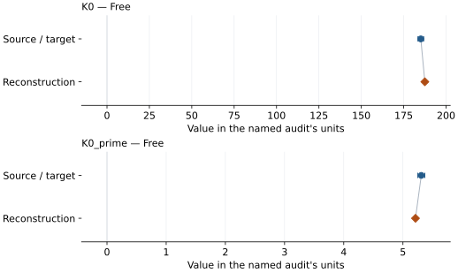

This is a **coefficient comparison**, not an observation or residual plot.
Each panel uses its coefficient's audit units and includes zero. Markers show
stored central values only. Error widths are retained in the table below;
no confidence interval or uncertainty band is inferred. Fixed/adopted values are constraints.

| Parameter | Source / target | Source error | Reconstruction | Reconstruction error | Fit role |
| --- | --- | --- | --- | --- | --- |
| K0 | 185.1 | 1.7 | 187.47744968957844 | Not specified | Free |
| K0\_prime | 5.31 | 0.06 | 5.211820018794027 | Not specified | Free |

Values and reported errors are copied without rounding or conversion from the named audit. Missing errors mean unknown, not zero. Parameter names and volume conventions follow that audit; error widths do not imply a confidence convention.

Recorded diagnostics, covariance and additional protocol

- **Tied parameters:**
- **Solver success:** True
- **Rmse gpa:** 1.9135004369802666
- **Published rmse gpa:** 2.200673940141978
- **Published pressure rmse gpa:** 2.200673940141978
- **Refitted pressure rmse gpa:** 1.9135004369802666
- **Rmse shock velocity km s:** Not specified
- **Parameter covariance:** Not specified

### Detailed evidence and existing plots

- [Earlier detailed record investigation](../primary-eos-refits.md#investigation-fe09ni01_hcp_sakai_2014_p6_vinet).
- [Record-by-record numerical ledger](../primary-eos-refits.md#records).
- [Source-audit reports](../source-audits.md).

Observation curves and residual plots are provided by the supporting reports where available. Their absence is not filled by a reconstructed curve presented as measured data.

[Machine-readable comparison ledger](https://github.com/CPrescher/peritheos/blob/main/docs/data/primary-eos-refits.json) — look up `fe09ni01_hcp_sakai_2014_p6_vinet`.
[Complete native EOSMAT file](https://github.com/CPrescher/peritheos/blob/main/peritheos/data/materials/fe09ni01_hcp.eosmat).

## Sakai et al. (2014), Fe0.9Ni0.1 type1 thermal EOS (P4 + P7)

Record: `fe09ni01_hcp_sakai_2014_type1_thermal` · Model: `BM3`

**Outcome: Parity not achieved for this comparison.**

**Scope:** Comparison with the source parameterization.
**Comparison basis:** Conditional independent refit; matching within printed errors is similarity, not reproduction of the original statistical procedure. V0 preliminary g-G fit not repeated.

[Stored EOS coefficients and source](../material-summaries/fe09ni01_hcp.md#record-fe09ni01_hcp_sakai_2014_type1_thermal)

### What this result establishes

**Separate source-review status:** not\_reproduced.
**Usage recommendation:** not\_recommended\_for\_quantitative\_use

- Conditional independent refit; matching within printed errors is similarity, not reproduction of the original statistical procedure. V0 preliminary g-G fit not repeated. Not recommended for scientific predictions or pressure calibration. Retained only for explicit diagnostic inspection. The 32 P7 hot observations give about 7.1 GPa pressure RMS with the published coefficients, versus about 1.1 GPa reported in Table 7; passing Table 8 checkpoints does not resolve that discrepancy.
- Not recommended for scientific predictions or pressure calibration. Retained only for explicit diagnostic inspection. The 32 P7 hot observations give about 7.1 GPa pressure RMS with the published coefficients, versus about 1.1 GPa reported in Table 7; passing Table 8 checkpoints does not resolve that discrepancy.
- Usage recommendation: not\_recommended\_for\_quantitative\_use
- This named numerical assessment alone does not establish author-workflow reproduction, physical accuracy or recommendation for use.

### Data and reconstruction method

- **Dataset identifiers:** sakai\_2014\_table2\_pvt
- **Observations:** 32
- **Objective:** Unweighted vertical pressure residuals; conditional on published reference/fixed coefficients. Source weights and covariance are not given.
- **Weighting:** unweighted; published coefficient constraints retained
- **Free parameters:** gamma0; theta0
- **Fixed parameters:** V0; K0; K0\_prime; Tr; beta; anharmonic\_a; anharmonic\_m; electronic\_e; electronic\_g; n

Unspecified selections, weights, fixed values or error conventions remain unknown; they have not been inferred for this report.

### Source versus reconstruction

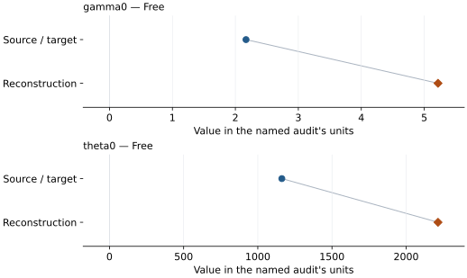

This is a **coefficient comparison**, not an observation or residual plot.
Each panel uses its coefficient's audit units and includes zero. Markers show
stored central values only. Error widths are retained in the table below;
no confidence interval or uncertainty band is inferred. Fixed/adopted values are constraints.

| Parameter | Source / target | Source error | Reconstruction | Reconstruction error | Fit role |
| --- | --- | --- | --- | --- | --- |
| gamma0 | 2.169 | 0.207 | 5.218611619598649 | Not specified | Free |
| theta0 | 1162 | 204 | 2214.815336047005 | Not specified | Free |

Values and reported errors are copied without rounding or conversion from the named audit. Missing errors mean unknown, not zero. Parameter names and volume conventions follow that audit; error widths do not imply a confidence convention.

Recorded diagnostics, covariance and additional protocol

- **Tied parameters:**
    - **Gamma inf:** gamma0
- **Solver success:** True
- **Rmse gpa:** 1.0512363614149685
- **Published rmse gpa:** 7.135102114330177
- **Published pressure rmse gpa:** 7.135102114330177
- **Refitted pressure rmse gpa:** 1.0512363614149685
- **Rmse shock velocity km s:** Not specified
- **Parameter covariance:** Not specified

### Detailed evidence and existing plots

- [Earlier detailed record investigation](../primary-eos-refits.md#investigation-fe09ni01_hcp_sakai_2014_type1_thermal).
- [Supporting source report: eos-recommendation-dispositions-2026-10-17](../research/eos-recommendation-dispositions-2026-10-17.md).
- [Record-by-record numerical ledger](../primary-eos-refits.md#records).
- [Source-audit reports](../source-audits.md).

Observation curves and residual plots are provided by the supporting reports where available. Their absence is not filled by a reconstructed curve presented as measured data.

[Machine-readable comparison ledger](https://github.com/CPrescher/peritheos/blob/main/docs/data/primary-eos-refits.json) — look up `fe09ni01_hcp_sakai_2014_type1_thermal`.
[Complete native EOSMAT file](https://github.com/CPrescher/peritheos/blob/main/peritheos/data/materials/fe09ni01_hcp.eosmat).

## Sakai et al. (2014), Fe0.9Ni0.1 type2 thermal EOS (P4 + P7)

Record: `fe09ni01_hcp_sakai_2014_type2_thermal` · Model: `BM3`

**Outcome: Parity not achieved for this comparison.**

**Scope:** Comparison with the source parameterization.
**Comparison basis:** Conditional independent refit; matching within printed errors is similarity, not reproduction of the original statistical procedure. V0 preliminary g-G fit not repeated.

[Stored EOS coefficients and source](../material-summaries/fe09ni01_hcp.md#record-fe09ni01_hcp_sakai_2014_type2_thermal)

### What this result establishes

**Separate source-review status:** not\_reproduced.
**Usage recommendation:** not\_recommended\_for\_quantitative\_use

- Conditional independent refit; matching within printed errors is similarity, not reproduction of the original statistical procedure. V0 preliminary g-G fit not repeated. Not recommended for scientific predictions or pressure calibration. Retained only for explicit diagnostic inspection. The 32 P7 hot observations give about 7.1 GPa pressure RMS with the published coefficients, versus about 1.1 GPa reported in Table 7; passing Table 8 checkpoints does not resolve that discrepancy.
- Not recommended for scientific predictions or pressure calibration. Retained only for explicit diagnostic inspection. The 32 P7 hot observations give about 7.1 GPa pressure RMS with the published coefficients, versus about 1.1 GPa reported in Table 7; passing Table 8 checkpoints does not resolve that discrepancy.
- Usage recommendation: not\_recommended\_for\_quantitative\_use
- This named numerical assessment alone does not establish author-workflow reproduction, physical accuracy or recommendation for use.

### Data and reconstruction method

- **Dataset identifiers:** sakai\_2014\_table2\_pvt
- **Observations:** 32
- **Objective:** Unweighted vertical pressure residuals; conditional on published reference/fixed coefficients. Source weights and covariance are not given.
- **Weighting:** unweighted; published coefficient constraints retained
- **Free parameters:** gamma0; beta; theta0
- **Fixed parameters:** V0; K0; K0\_prime; Tr; gamma\_inf; anharmonic\_a; anharmonic\_m; electronic\_e; electronic\_g; n

Unspecified selections, weights, fixed values or error conventions remain unknown; they have not been inferred for this report.

### Source versus reconstruction

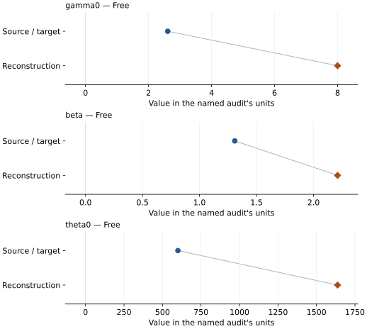

This is a **coefficient comparison**, not an observation or residual plot.
Each panel uses its coefficient's audit units and includes zero. Markers show
stored central values only. Error widths are retained in the table below;
no confidence interval or uncertainty band is inferred. Fixed/adopted values are constraints.

| Parameter | Source / target | Source error | Reconstruction | Reconstruction error | Fit role |
| --- | --- | --- | --- | --- | --- |
| gamma0 | 2.609 | 0.35 | 7.999999999999999 | Not specified | Free |
| beta | 1.309 | 0.679 | 2.2108417548372907 | Not specified | Free |
| theta0 | 600 | 474 | 1636.9776211198046 | Not specified | Free |

Values and reported errors are copied without rounding or conversion from the named audit. Missing errors mean unknown, not zero. Parameter names and volume conventions follow that audit; error widths do not imply a confidence convention.

Recorded diagnostics, covariance and additional protocol

- **Tied parameters:**
- **Solver success:** True
- **Rmse gpa:** 1.0453242461778438
- **Published rmse gpa:** 7.085117575780836
- **Published pressure rmse gpa:** 7.085117575780836
- **Refitted pressure rmse gpa:** 1.0453242461778438
- **Rmse shock velocity km s:** Not specified
- **Parameter covariance:** Not specified

### Detailed evidence and existing plots

- [Earlier detailed record investigation](../primary-eos-refits.md#investigation-fe09ni01_hcp_sakai_2014_type2_thermal).
- [Supporting source report: eos-recommendation-dispositions-2026-10-17](../research/eos-recommendation-dispositions-2026-10-17.md).
- [Record-by-record numerical ledger](../primary-eos-refits.md#records).
- [Source-audit reports](../source-audits.md).

Observation curves and residual plots are provided by the supporting reports where available. Their absence is not filled by a reconstructed curve presented as measured data.

[Machine-readable comparison ledger](https://github.com/CPrescher/peritheos/blob/main/docs/data/primary-eos-refits.json) — look up `fe09ni01_hcp_sakai_2014_type2_thermal`.
[Complete native EOSMAT file](https://github.com/CPrescher/peritheos/blob/main/peritheos/data/materials/fe09ni01_hcp.eosmat).

## Sakai et al. (2014), Fe0.9Ni0.1 type4\_1 thermal EOS (P4 + P7)

Record: `fe09ni01_hcp_sakai_2014_type4_1_thermal` · Model: `BM3`

**Outcome: Parity not achieved for this comparison.**

**Scope:** Comparison with the source parameterization.
**Comparison basis:** Conditional independent refit; matching within printed errors is similarity, not reproduction of the original statistical procedure. V0 preliminary g-G fit not repeated.

[Stored EOS coefficients and source](../material-summaries/fe09ni01_hcp.md#record-fe09ni01_hcp_sakai_2014_type4_1_thermal)

### What this result establishes

**Separate source-review status:** not\_reproduced.
**Usage recommendation:** not\_recommended\_for\_quantitative\_use

- Conditional independent refit; matching within printed errors is similarity, not reproduction of the original statistical procedure. V0 preliminary g-G fit not repeated. Not recommended for scientific predictions or pressure calibration. Retained only for explicit diagnostic inspection. The 32 P7 hot observations give about 7.1 GPa pressure RMS with the published coefficients, versus about 1.1 GPa reported in Table 7; passing Table 8 checkpoints does not resolve that discrepancy.
- Not recommended for scientific predictions or pressure calibration. Retained only for explicit diagnostic inspection. The 32 P7 hot observations give about 7.1 GPa pressure RMS with the published coefficients, versus about 1.1 GPa reported in Table 7; passing Table 8 checkpoints does not resolve that discrepancy.
- Usage recommendation: not\_recommended\_for\_quantitative\_use
- This named numerical assessment alone does not establish author-workflow reproduction, physical accuracy or recommendation for use.

### Data and reconstruction method

- **Dataset identifiers:** sakai\_2014\_table2\_pvt
- **Observations:** 32
- **Objective:** Unweighted vertical pressure residuals; conditional on published reference/fixed coefficients. Source weights and covariance are not given.
- **Weighting:** unweighted; published coefficient constraints retained
- **Free parameters:** gamma0; gamma\_inf; theta0
- **Fixed parameters:** V0; K0; K0\_prime; Tr; beta; anharmonic\_a; anharmonic\_m; electronic\_e; electronic\_g; n

Unspecified selections, weights, fixed values or error conventions remain unknown; they have not been inferred for this report.

### Source versus reconstruction

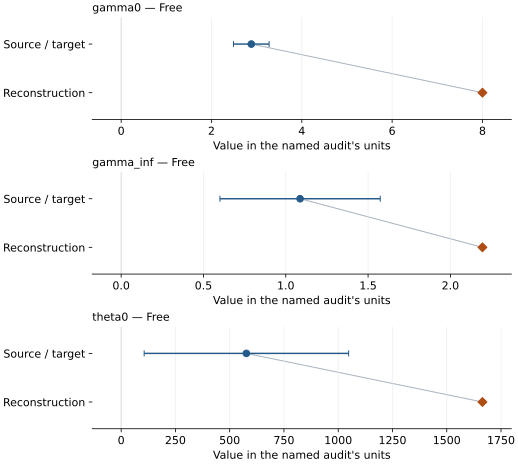

This is a **coefficient comparison**, not an observation or residual plot.
Each panel uses its coefficient's audit units and includes zero. Markers show
stored central values only. Error widths are retained in the table below;
no confidence interval or uncertainty band is inferred. Fixed/adopted values are constraints.

| Parameter | Source / target | Source error | Reconstruction | Reconstruction error | Fit role |
| --- | --- | --- | --- | --- | --- |
| gamma0 | 2.882 | 0.394 | 7.999999999999996 | Not specified | Free |
| gamma\_inf | 1.087 | 0.487 | 2.194773957257107 | Not specified | Free |
| theta0 | 577 | 471 | 1664.4773035616872 | Not specified | Free |

Values and reported errors are copied without rounding or conversion from the named audit. Missing errors mean unknown, not zero. Parameter names and volume conventions follow that audit; error widths do not imply a confidence convention.

Recorded diagnostics, covariance and additional protocol

- **Tied parameters:**
- **Solver success:** True
- **Rmse gpa:** 1.047994946666771
- **Published rmse gpa:** 7.088296341328164
- **Published pressure rmse gpa:** 7.088296341328164
- **Refitted pressure rmse gpa:** 1.047994946666771
- **Rmse shock velocity km s:** Not specified
- **Parameter covariance:** Not specified

### Detailed evidence and existing plots

- [Earlier detailed record investigation](../primary-eos-refits.md#investigation-fe09ni01_hcp_sakai_2014_type4_1_thermal).
- [Supporting source report: eos-recommendation-dispositions-2026-10-17](../research/eos-recommendation-dispositions-2026-10-17.md).
- [Record-by-record numerical ledger](../primary-eos-refits.md#records).
- [Source-audit reports](../source-audits.md).

Observation curves and residual plots are provided by the supporting reports where available. Their absence is not filled by a reconstructed curve presented as measured data.

[Machine-readable comparison ledger](https://github.com/CPrescher/peritheos/blob/main/docs/data/primary-eos-refits.json) — look up `fe09ni01_hcp_sakai_2014_type4_1_thermal`.
[Complete native EOSMAT file](https://github.com/CPrescher/peritheos/blob/main/peritheos/data/materials/fe09ni01_hcp.eosmat).

## Sakai et al. (2014), Fe0.9Ni0.1 type4\_2 thermal EOS (P4 + P7)

Record: `fe09ni01_hcp_sakai_2014_type4_2_thermal` · Model: `BM3`

**Outcome: Parity not achieved for this comparison.**

**Scope:** Comparison with the source parameterization.
**Comparison basis:** Conditional independent refit; matching within printed errors is similarity, not reproduction of the original statistical procedure. V0 preliminary g-G fit not repeated.

[Stored EOS coefficients and source](../material-summaries/fe09ni01_hcp.md#record-fe09ni01_hcp_sakai_2014_type4_2_thermal)

### What this result establishes

**Separate source-review status:** not\_reproduced.
**Usage recommendation:** not\_recommended\_for\_quantitative\_use

- Conditional independent refit; matching within printed errors is similarity, not reproduction of the original statistical procedure. V0 preliminary g-G fit not repeated. Not recommended for scientific predictions or pressure calibration. Retained only for explicit diagnostic inspection. The 32 P7 hot observations give about 7.1 GPa pressure RMS with the published coefficients, versus about 1.1 GPa reported in Table 7; passing Table 8 checkpoints does not resolve that discrepancy.
- Not recommended for scientific predictions or pressure calibration. Retained only for explicit diagnostic inspection. The 32 P7 hot observations give about 7.1 GPa pressure RMS with the published coefficients, versus about 1.1 GPa reported in Table 7; passing Table 8 checkpoints does not resolve that discrepancy.
- Usage recommendation: not\_recommended\_for\_quantitative\_use
- This named numerical assessment alone does not establish author-workflow reproduction, physical accuracy or recommendation for use.

### Data and reconstruction method

- **Dataset identifiers:** sakai\_2014\_table2\_pvt
- **Observations:** 32
- **Objective:** Unweighted vertical pressure residuals; conditional on published reference/fixed coefficients. Source weights and covariance are not given.
- **Weighting:** unweighted; published coefficient constraints retained
- **Free parameters:** gamma0; gamma\_inf
- **Fixed parameters:** V0; K0; K0\_prime; Tr; theta0; beta; anharmonic\_a; anharmonic\_m; electronic\_e; electronic\_g; n

Unspecified selections, weights, fixed values or error conventions remain unknown; they have not been inferred for this report.

### Source versus reconstruction

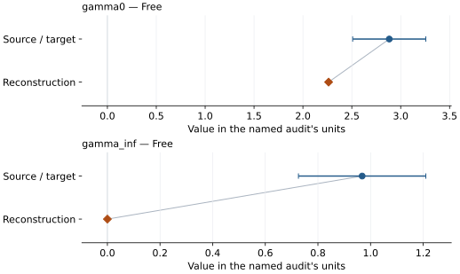

This is a **coefficient comparison**, not an observation or residual plot.
Each panel uses its coefficient's audit units and includes zero. Markers show
stored central values only. Error widths are retained in the table below;
no confidence interval or uncertainty band is inferred. Fixed/adopted values are constraints.

| Parameter | Source / target | Source error | Reconstruction | Reconstruction error | Fit role |
| --- | --- | --- | --- | --- | --- |
| gamma0 | 2.883 | 0.374 | 2.2626134930835686 | Not specified | Free |
| gamma\_inf | 0.968 | 0.242 | 8.521054711807216e-22 | Not specified | Free |

Values and reported errors are copied without rounding or conversion from the named audit. Missing errors mean unknown, not zero. Parameter names and volume conventions follow that audit; error widths do not imply a confidence convention.

Recorded diagnostics, covariance and additional protocol

- **Tied parameters:**
- **Solver success:** True
- **Rmse gpa:** 2.2581979489171067
- **Published rmse gpa:** 7.096364413848751
- **Published pressure rmse gpa:** 7.096364413848751
- **Refitted pressure rmse gpa:** 2.2581979489171067
- **Rmse shock velocity km s:** Not specified
- **Parameter covariance:** Not specified

### Detailed evidence and existing plots

- [Earlier detailed record investigation](../primary-eos-refits.md#investigation-fe09ni01_hcp_sakai_2014_type4_2_thermal).
- [Supporting source report: eos-recommendation-dispositions-2026-10-17](../research/eos-recommendation-dispositions-2026-10-17.md).
- [Record-by-record numerical ledger](../primary-eos-refits.md#records).
- [Source-audit reports](../source-audits.md).

Observation curves and residual plots are provided by the supporting reports where available. Their absence is not filled by a reconstructed curve presented as measured data.

[Machine-readable comparison ledger](https://github.com/CPrescher/peritheos/blob/main/docs/data/primary-eos-refits.json) — look up `fe09ni01_hcp_sakai_2014_type4_2_thermal`.
[Complete native EOSMAT file](https://github.com/CPrescher/peritheos/blob/main/peritheos/data/materials/fe09ni01_hcp.eosmat).

## Sakai et al. (2014), Fe0.9Ni0.1 type4\_3 thermal EOS (P4 + P7)

Record: `fe09ni01_hcp_sakai_2014_type4_3_thermal` · Model: `BM3`

**Outcome: Parity not achieved for this comparison.**

**Scope:** Comparison with the source parameterization.
**Comparison basis:** Conditional independent refit; matching within printed errors is similarity, not reproduction of the original statistical procedure. V0 preliminary g-G fit not repeated.

[Stored EOS coefficients and source](../material-summaries/fe09ni01_hcp.md#record-fe09ni01_hcp_sakai_2014_type4_3_thermal)

### What this result establishes

**Separate source-review status:** not\_reproduced.
**Usage recommendation:** not\_recommended\_for\_quantitative\_use

- Conditional independent refit; matching within printed errors is similarity, not reproduction of the original statistical procedure. V0 preliminary g-G fit not repeated. Not recommended for scientific predictions or pressure calibration. Retained only for explicit diagnostic inspection. The 32 P7 hot observations give about 7.1 GPa pressure RMS with the published coefficients, versus about 1.1 GPa reported in Table 7; passing Table 8 checkpoints does not resolve that discrepancy.
- Not recommended for scientific predictions or pressure calibration. Retained only for explicit diagnostic inspection. The 32 P7 hot observations give about 7.1 GPa pressure RMS with the published coefficients, versus about 1.1 GPa reported in Table 7; passing Table 8 checkpoints does not resolve that discrepancy.
- Usage recommendation: not\_recommended\_for\_quantitative\_use
- This named numerical assessment alone does not establish author-workflow reproduction, physical accuracy or recommendation for use.

### Data and reconstruction method

- **Dataset identifiers:** sakai\_2014\_table2\_pvt
- **Observations:** 32
- **Objective:** Unweighted vertical pressure residuals; conditional on published reference/fixed coefficients. Source weights and covariance are not given.
- **Weighting:** unweighted; published coefficient constraints retained
- **Free parameters:** beta
- **Fixed parameters:** V0; K0; K0\_prime; Tr; theta0; gamma0; gamma\_inf; anharmonic\_a; anharmonic\_m; electronic\_e; electronic\_g; n

Unspecified selections, weights, fixed values or error conventions remain unknown; they have not been inferred for this report.

### Source versus reconstruction

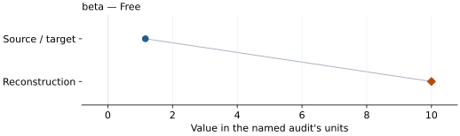

This is a **coefficient comparison**, not an observation or residual plot.
Each panel uses its coefficient's audit units and includes zero. Markers show
stored central values only. Error widths are retained in the table below;
no confidence interval or uncertainty band is inferred. Fixed/adopted values are constraints.

| Parameter | Source / target | Source error | Reconstruction | Reconstruction error | Fit role |
| --- | --- | --- | --- | --- | --- |
| beta | 1.161 | 0.237 | 9.999999999999998 | Not specified | Free |

Values and reported errors are copied without rounding or conversion from the named audit. Missing errors mean unknown, not zero. Parameter names and volume conventions follow that audit; error widths do not imply a confidence convention.

Recorded diagnostics, covariance and additional protocol

- **Tied parameters:**
- **Solver success:** True
- **Rmse gpa:** 4.6165012578403015
- **Published rmse gpa:** 7.214289792430111
- **Published pressure rmse gpa:** 7.214289792430111
- **Refitted pressure rmse gpa:** 4.6165012578403015
- **Rmse shock velocity km s:** Not specified
- **Parameter covariance:** Not specified

### Detailed evidence and existing plots

- [Earlier detailed record investigation](../primary-eos-refits.md#investigation-fe09ni01_hcp_sakai_2014_type4_3_thermal).
- [Supporting source report: eos-recommendation-dispositions-2026-10-17](../research/eos-recommendation-dispositions-2026-10-17.md).
- [Record-by-record numerical ledger](../primary-eos-refits.md#records).
- [Source-audit reports](../source-audits.md).

Observation curves and residual plots are provided by the supporting reports where available. Their absence is not filled by a reconstructed curve presented as measured data.

[Machine-readable comparison ledger](https://github.com/CPrescher/peritheos/blob/main/docs/data/primary-eos-refits.json) — look up `fe09ni01_hcp_sakai_2014_type4_3_thermal`.
[Complete native EOSMAT file](https://github.com/CPrescher/peritheos/blob/main/peritheos/data/materials/fe09ni01_hcp.eosmat).
