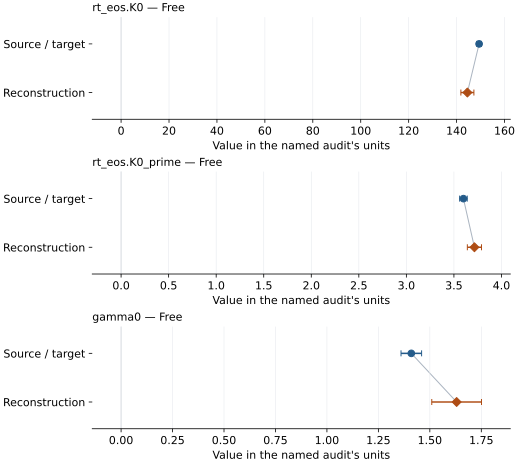
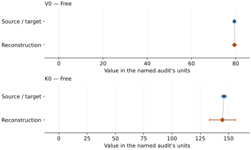
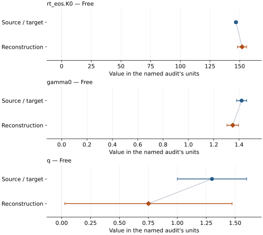

# FeO (B1): EOS reconstruction reports

<!-- Generated by scripts.generate_reconstruction_reports; edit EOSMAT instead. -->

[All reconstruction reports](index.md) · [Material and EOS parameters](../material-summaries/feo.md)

These reports explain the assessments already stored in EOSMAT. Generating
this page does not refit observations, change classifications or replace source coefficients.

Use [scientific label definitions](../eos-labels.md) to distinguish coefficient
agreement, source verification, author-workflow reproduction and recommendation for use.

| EOS record | Recorded outcome | Coefficient comparison |
| --- | --- | --- |
| [B1 iron-saturated FeO, Fischer et al. (2011)](#record-feo_fischer_2011_bm3_2) | Coefficient parity achieved | Graph and table |
| [Jacobsen et al. (2005), cubic Fe0.93O constrained BM3](#record-fe093o_b1_jacobsen_2005_bm3_1) | Coefficient parity achieved | Graph and table |
| [Leonov et al. (2017), FeO high-spin DFT+DMFT BM3](#record-feo_leonov_2017_hs_bm3_1) | Complete independent refit unavailable | No numeric coefficient pair recorded |
| [Holland et al. (2013), fper modified Tait](#record-feo_holland_2013_fper_modified_tait) | Complete independent refit unavailable | No numeric coefficient pair recorded |
| [Campbell et al. (2009), B1 FeO, 295 K BM3-Debye](#record-feo_campbell_2009_bm3_mgd) | Parity not achieved for this comparison | Graph and table |

## B1 iron-saturated FeO, Fischer et al. (2011)

Record: `feo_fischer_2011_bm3_2` · Model: `BM3`

**Outcome: Coefficient parity achieved.**

**Scope:** Comparison with the source parameterization.
**Comparison basis:** Every compared free coefficient meets both the recorded combined-two-sigma comparison and parameter-specific numerical similarity screen. Error conventions and fit qualifications remain applicable.

[Stored EOS coefficients and source](../material-summaries/feo.md#record-feo_fischer_2011_bm3_2)

### What this result establishes

**Separate source-review status:** primary\_source\_validated.
**Usage recommendation:** See the stored EOS qualifications; no recommendation is inferred here.

- Conditional current-study thermal reproduction: all 42 numerical B1 volumes in Fischer Supplementary Table S1 are evaluated at their reported, already 3%-corrected temperatures with Equation (1)'s integrated-Gruneisen Mie-Gruneisen-Debye model. V0, theta0, q, Tr, and n are held fixed exactly as the source specifies. Fischer's published global fit also includes Campbell, Ozawa, and Seagle rows. All identifiable source tables are now bundled, but Campbell's fcc-Fe calibration is retained only as deferred source evidence because of unresolved coefficient-refit discrepancies. It is not an executable calibration; Fischer's final combined row selection remains unresolved. The source also does not state its regression weights, residual variable, covariance, or optimizer; this result remains a current-study-only diagnostic rather than an exact global-fit reproduction. See the \[dedicated Fischer reproduction\](literature-reproductions/fischer-2011-feo.md).
- This named numerical assessment alone does not establish author-workflow reproduction, physical accuracy or recommendation for use.

### Data and reconstruction method

- **Dataset identifiers:** feo\_fischer\_2011\_table\_s1\_pvt
- **Observations:** 42
- **Fit kind:** joint\_pvt
- **Selection:** all 52 Table S1 rows; finite B1 volumes retain 42 phase-specific observations at their reported temperatures
- **Objective:** errors\_in\_variables
- **Absolute sigma:** True
- **Free parameters:** rt\_eos.K0; rt\_eos.K0\_prime; gamma0
- **Fixed parameters:** V0; Tr; theta0; q; n

Unspecified selections, weights, fixed values or error conventions remain unknown; they have not been inferred for this report.

### Source versus reconstruction

This is a **coefficient comparison**, not an observation or residual plot.
Each panel uses its coefficient's audit units and includes zero. Markers show
stored central values only. Error widths are retained in the table below;
no confidence interval or uncertainty band is inferred. Fixed/adopted values are constraints.

| Parameter | Source / target | Source error | Reconstruction | Reconstruction error | Fit role |
| --- | --- | --- | --- | --- | --- |
| rt\_eos.K0 | 149.4 | 1.0 | 144.50797247416534 | 2.7189032811967384 | Free |
| rt\_eos.K0\_prime | 3.6 | 0.04 | 3.715623572064788 | 0.07444449208676378 | Free |
| gamma0 | 1.41 | 0.05 | 1.6301956053980495 | 0.12081598701442424 | Free |

Values and reported errors are copied without rounding or conversion from the named audit. Missing errors mean unknown, not zero. Parameter names and volume conventions follow that audit; error widths do not imply a confidence convention.

Recorded diagnostics, covariance and additional protocol

- **Columns:**
    - **Pressure:** pressure\_gpa
    - **Temperature:** temperature\_k
    - **Volume:** b1\_feo\_molar\_volume\_cm3\_mol
- **Observed pressure range gpa:** \[95.2153318933, 155.982534269\]
- **Observed temperature range k:** \[1143.9, 3024.73\]
- **Observed volume range:** \[52.35477716465731, 59.60807743690136\]
- **Degrees of freedom:** 39
- **Solver success:** True
- **Solver message:** Both \`ftol\` and \`xtol\` termination conditions are satisfied.
- **Rmse gpa:** 3.3023324480369616
- **Published rmse gpa:** 3.319807086654516
- **Reduced chi square:** 4.525491264672904

### Detailed evidence and existing plots

- [Supporting source report: fischer-2011-feo](../literature-reproductions/fischer-2011-feo.md).
- [Record-by-record numerical ledger](../primary-eos-refits.md#records).
- [Source-audit reports](../source-audits.md).

Observation curves and residual plots are provided by the supporting reports where available. Their absence is not filled by a reconstructed curve presented as measured data.

[Machine-readable comparison ledger](https://github.com/CPrescher/peritheos/blob/main/docs/data/primary-eos-refits.json) — look up `feo_fischer_2011_bm3_2`.
[Complete native EOSMAT file](https://github.com/CPrescher/peritheos/blob/main/peritheos/data/materials/feo.eosmat).

## Jacobsen et al. (2005), cubic Fe0.93O constrained BM3

Record: `fe093o_b1_jacobsen_2005_bm3_1` · Model: `BM3`

**Outcome: Coefficient parity achieved.**

**Scope:** Comparison with the source parameterization.
**Comparison basis:** Every compared free coefficient meets both the recorded combined-two-sigma comparison and parameter-specific numerical similarity screen. Error conventions and fit qualifications remain applicable.

[Stored EOS coefficients and source](../material-summaries/feo.md#record-fe093o_b1_jacobsen_2005_bm3_1)

### What this result establishes

**Separate source-review status:** primary\_source\_validated.
**Usage recommendation:** See the stored EOS qualifications; no recommendation is inferred here.

- This named numerical assessment alone does not establish author-workflow reproduction, physical accuracy or recommendation for use.

### Data and reconstruction method

- **Dataset identifiers:** jacobsen\_2005\_table1\_compression
- **Observations:** 7
- **Fit kind:** isothermal\_pv
- **Selection:** fe093o\_b1\_fit\_included=1
- **Objective:** errors\_in\_variables
- **Absolute sigma:** True
- **Free parameters:** V0; K0
- **Fixed parameters:** K0\_prime

Unspecified selections, weights, fixed values or error conventions remain unknown; they have not been inferred for this report.

### Source versus reconstruction

This is a **coefficient comparison**, not an observation or residual plot.
Each panel uses its coefficient's audit units and includes zero. Markers show
stored central values only. Error widths are retained in the table below;
no confidence interval or uncertainty band is inferred. Fixed/adopted values are constraints.

| Parameter | Source / target | Source error | Reconstruction | Reconstruction error | Fit role |
| --- | --- | --- | --- | --- | --- |
| V0 | 79.41 | 0.04 | 79.43764935328304 | 0.4348013830455283 | Free |
| K0 | 146.0 | 2.0 | 144.54631340959483 | 11.507025908735983 | Free |

Values and reported errors are copied without rounding or conversion from the named audit. Missing errors mean unknown, not zero. Parameter names and volume conventions follow that audit; error widths do not imply a confidence convention.

Recorded diagnostics, covariance and additional protocol

- **Columns:**
    - **Pressure:** pressure\_gpa
    - **Temperature:** Not specified
    - **Volume:** fe093o\_b1\_derived\_volume\_a3
- **Observed pressure range gpa:** \[0.0, 22.8\]
- **Observed temperature range k:** Not specified
- **Observed volume range:** \[70.21498, 79.396112\]
- **Degrees of freedom:** 5
- **Solver success:** True
- **Solver message:** Both \`ftol\` and \`xtol\` termination conditions are satisfied.
- **Rmse gpa:** 0.08706907560791009
- **Published rmse gpa:** 0.11999826697901608
- **Reduced chi square:** 0.011099816093970271

### Detailed evidence and existing plots

- [Record-by-record numerical ledger](../primary-eos-refits.md#records).
- [Source-audit reports](../source-audits.md).

Observation curves and residual plots are provided by the supporting reports where available. Their absence is not filled by a reconstructed curve presented as measured data.

[Machine-readable comparison ledger](https://github.com/CPrescher/peritheos/blob/main/docs/data/primary-eos-refits.json) — look up `fe093o_b1_jacobsen_2005_bm3_1`.
[Complete native EOSMAT file](https://github.com/CPrescher/peritheos/blob/main/peritheos/data/materials/feo.eosmat).

## Leonov et al. (2017), FeO high-spin DFT+DMFT BM3

Record: `feo_leonov_2017_hs_bm3_1` · Model: `BM3`

**Outcome: Complete independent refit unavailable.**

**Scope:** Comparison with the source parameterization.
**Comparison basis:** Independent equation checkpoints verify transcription without claiming a refit.

[Stored EOS coefficients and source](../material-summaries/feo.md#record-feo_leonov_2017_hs_bm3_1)

### What this result establishes

**Separate source-review status:** primary\_source\_validated.
**Usage recommendation:** See the stored EOS qualifications; no recommendation is inferred here.

- This named numerical assessment alone does not establish author-workflow reproduction, physical accuracy or recommendation for use.
- No reconstructed coefficient table is recorded for this assessment; no missing values have been inferred.

### Data and reconstruction method

- **Dataset identifiers:** None declared
- **Fixed parameters:** K0\_prime

Unspecified selections, weights, fixed values or error conventions remain unknown; they have not been inferred for this report.

### Why no coefficient graph is shown

No numeric source/reconstruction pair is recorded for this assessment. A graph would require information that is not available here; no values or observations have been invented.

### Detailed evidence and existing plots

- [Record-by-record numerical ledger](../primary-eos-refits.md#records).
- [Source-audit reports](../source-audits.md).

Observation curves and residual plots are provided by the supporting reports where available. Their absence is not filled by a reconstructed curve presented as measured data.

[Machine-readable comparison ledger](https://github.com/CPrescher/peritheos/blob/main/docs/data/primary-eos-refits.json) — look up `feo_leonov_2017_hs_bm3_1`.
[Complete native EOSMAT file](https://github.com/CPrescher/peritheos/blob/main/peritheos/data/materials/feo.eosmat).

## Holland et al. (2013), fper modified Tait

Record: `feo_holland_2013_fper_modified_tait` · Model: `ModifiedTait`

**Outcome: Complete independent refit unavailable.**

**Scope:** Comparison with the source parameterization.
**Comparison basis:** The official tc-ds62 fper block provides all four coefficients.

[Stored EOS coefficients and source](../material-summaries/feo.md#record-feo_holland_2013_fper_modified_tait)

### What this result establishes

**Separate source-review status:** primary\_source\_validated.
**Usage recommendation:** See the stored EOS qualifications; no recommendation is inferred here.

- This named numerical assessment alone does not establish author-workflow reproduction, physical accuracy or recommendation for use.
- No reconstructed coefficient table is recorded for this assessment; no missing values have been inferred.

### Data and reconstruction method

- **Dataset identifiers:** None declared
- **Fixed parameters:** None declared

Unspecified selections, weights, fixed values or error conventions remain unknown; they have not been inferred for this report.

### Why no coefficient graph is shown

No numeric source/reconstruction pair is recorded for this assessment. A graph would require information that is not available here; no values or observations have been invented.

### Detailed evidence and existing plots

- [Record-by-record numerical ledger](../primary-eos-refits.md#records).
- [Source-audit reports](../source-audits.md).

Observation curves and residual plots are provided by the supporting reports where available. Their absence is not filled by a reconstructed curve presented as measured data.

[Machine-readable comparison ledger](https://github.com/CPrescher/peritheos/blob/main/docs/data/primary-eos-refits.json) — look up `feo_holland_2013_fper_modified_tait`.
[Complete native EOSMAT file](https://github.com/CPrescher/peritheos/blob/main/peritheos/data/materials/feo.eosmat).

## Campbell et al. (2009), B1 FeO, 295 K BM3-Debye

Record: `feo_campbell_2009_bm3_mgd` · Model: `BM3`

**Outcome: Parity not achieved for this comparison.**

**Scope:** Comparison with the source parameterization.
**Comparison basis:** Conditional reproduction, not an exact recovery of the unpublished regression protocol. Campbell specifies least squares but no residual variable, weights, covariance, or final row mask. The main diagnostic uses equal pressure-residual weights and simultaneous fitting of the three Table 1 free parameters. Fe/FeO main fits use current-study Table S2 only: Seagle contributes 81 recoverable V-T pairs but no individual pressures or NaCl observations. Separate sensitivities reconstruct 65 hcp-calibrated pressures using benchmark-checked Seagle (2006), compare its conflicting reference volumes, and optionally retain 16 unresolved rows as nominal-isobar estimates. A separate protocol audit adds 14 conditional fcc pressures from Funamori/Boehler/Basinski, leaving only two missing-iron-volume rows without individual pressures. The exact historical fcc reduction and combined regression remain unresolved. These are derived pressures, not original row-level pressure data. The published Fe/FeO records are deferred from the executable catalog because the combined-data mismatch remains unresolved. No refitted coefficients replace the source records. See literature-reproductions/campbell-2009-buffers.md.

[Stored EOS coefficients and source](../material-summaries/feo.md#record-feo_campbell_2009_bm3_mgd)

### What this result establishes

**Separate source-review status:** deferred.
**Usage recommendation:** See the stored EOS qualifications; no recommendation is inferred here.

- substantial combined-data coefficient-refit discrepancy
- exact Seagle pressure reduction used by Campbell
- author regression inputs, row selection and fitting procedure
- This named numerical assessment alone does not establish author-workflow reproduction, physical accuracy or recommendation for use.

### Data and reconstruction method

- **Dataset identifiers:** feo\_campbell\_2009\_table\_s2\_pvt
- **Observations:** 25
- **Fit kind:** conditional\_bm3\_mgd\_variable\_exponent
- **Selection:** All Table S2 rows for FeO; only its 15 explicitly fcc rows for Fe. For Ni/NiO, retain all 92 heated/MAP Table S3 rows (T&gt;295 K); exclude its nine 293-295 K quenched DAC rows from the main diagnostic. This exclusion follows the Section 2.2 stress warning but is an audit choice: the authors do not publish a regression row mask. All 101 rows are retained in the dataset and tested in a sensitivity refit.
- **Objective:** pressure\_residuals
- **Weighting:** unweighted
- **Free parameters:** rt\_eos.K0; gamma0; q
- **Fixed parameters:** V0; K0\_prime; Tr; theta0; n

Unspecified selections, weights, fixed values or error conventions remain unknown; they have not been inferred for this report.

### Source versus reconstruction

This is a **coefficient comparison**, not an observation or residual plot.
Each panel uses its coefficient's audit units and includes zero. Markers show
stored central values only. Error widths are retained in the table below;
no confidence interval or uncertainty band is inferred. Fixed/adopted values are constraints.

| Parameter | Source / target | Source error | Reconstruction | Reconstruction error | Fit role |
| --- | --- | --- | --- | --- | --- |
| rt\_eos.K0 | 146.9 | 1.3 | 152.01202845372052 | 3.9076006196699993 | Free |
| gamma0 | 1.42 | 0.04 | 1.3501486472636206 | 0.0458050170730508 | Free |
| q | 1.3 | 0.3 | 0.7508042230603151 | 0.7228255480427921 | Free |

Values and reported errors are copied without rounding or conversion from the named audit. Missing errors mean unknown, not zero. Parameter names and volume conventions follow that audit; error widths do not imply a confidence convention.

Recorded diagnostics, covariance and additional protocol

- **Observed pressure range gpa:** \[3.9954833425198, 57.5614962915957\]
- **Observed temperature range k:** \[873.0, 2096.29\]
- **Degrees of freedom:** 22
- **Solver success:** True
- **Solver message:** \`ftol\` termination condition is satisfied.
- **Rmse gpa:** 0.5149850342799355
- **Published rmse gpa:** 1.316064100606689
- **Reduced chi square:** 0.3013745290139844
- **Covariance:** \[\[15.269342602845363, -0.004944426585140988, 2.6918758626538852\], \[-0.004944426585125659, 0.002098099589062475, 0.007860913931569853\], \[2.691875862653968, 0.007860913931567126, 0.5224767729033628\]\]
- **Covariance convention:** Residual-scaled local inverse-Jacobian covariance; audit-only, not source errors.

### Detailed evidence and existing plots

- [Earlier detailed record investigation](../primary-eos-refits.md#investigation-feo_campbell_2009_bm3_mgd).
- [Supporting source report: campbell-2009-buffers](../literature-reproductions/campbell-2009-buffers.md).
- [Supporting source report: campbell-2009-mismatch](../literature-reproductions/campbell-2009-mismatch.md).
- [Record-by-record numerical ledger](../primary-eos-refits.md#records).
- [Source-audit reports](../source-audits.md).

Observation curves and residual plots are provided by the supporting reports where available. Their absence is not filled by a reconstructed curve presented as measured data.

[Machine-readable comparison ledger](https://github.com/CPrescher/peritheos/blob/main/docs/data/primary-eos-refits.json) — look up `feo_campbell_2009_bm3_mgd`.
[Complete native EOSMAT file](https://github.com/CPrescher/peritheos/blob/main/peritheos/data/materials/feo.eosmat).
