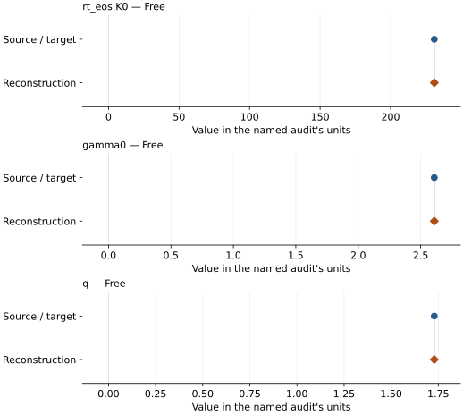
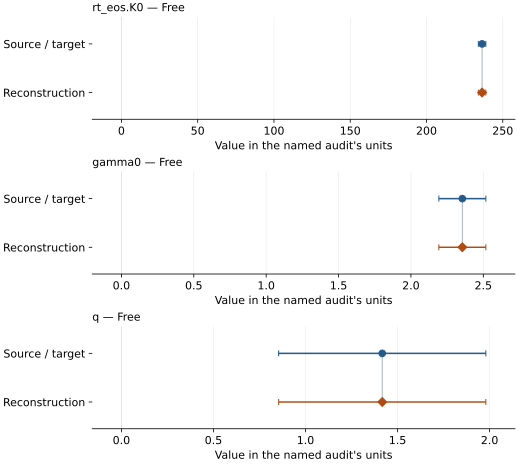

# FeSi (B2; Peritheos refits): EOS reconstruction reports

<!-- Generated by scripts.generate_reconstruction_reports; edit EOSMAT instead. -->

[All reconstruction reports](index.md) · [Material and EOS parameters](../material-summaries/fesi_b2.md)

These reports explain the assessments already stored in EOSMAT. Generating
this page does not refit observations, change classifications or replace source coefficients.

Use [scientific label definitions](../eos-labels.md) to distinguish coefficient
agreement, source verification, author-workflow reproduction and recommendation for use.

| EOS record | Recorded outcome | Coefficient comparison |
| --- | --- | --- |
| [Peritheos BM3 + MGD refit of Fischer et al. (2014) B2 FeSi data](#record-fesi_b2_fischer_2014_bm3_refit) | Coefficient parity achieved | Graph and table |
| [Peritheos VINET + MGD refit of Fischer et al. (2014) B2 FeSi data](#record-fesi_b2_fischer_2014_vinet_refit) | Coefficient parity achieved | Graph and table |

## Peritheos BM3 + MGD refit of Fischer et al. (2014) B2 FeSi data

Record: `fesi_b2_fischer_2014_bm3_refit` · Model: `BM3`

**Outcome: Coefficient parity achieved.**

**Scope:** Reproduction of a stored independent Peritheos refit.
**Comparison basis:** Every compared free coefficient meets both the recorded combined-two-sigma comparison and parameter-specific numerical similarity screen. Error conventions and fit qualifications remain applicable.

[Stored EOS coefficients and source](../material-summaries/fesi_b2.md#record-fesi_b2_fischer_2014_bm3_refit)

### What this result establishes

**Separate source-review status:** primary\_source\_validated.
**Usage recommendation:** See the stored EOS qualifications; no recommendation is inferred here.

- This comparison concerns the stored independent Peritheos refit, not recovery of the original publication's coefficients or author workflow.
- Stored Peritheos refit reproduction using all 114 single-phase B2 rows and physical n=2 per FeSi formula. Parity compares against independently fitted Peritheos coefficients, not Fischer's published B2 parameters, which remain withheld. Unweighted pressure residuals; V0, K0-prime and theta0 are conditional fixed assumptions. Full covariance, weighting/reference sensitivities and pressure-block holdouts are in the \[Fischer audit\](literature-reproductions/fischer-2014-fesi.md). No validated core extrapolation.

### Data and reconstruction method

The source/target column below is the stored **Peritheos refit**. Agreement with it does not reproduce the original publication's coefficients.

- **Dataset identifiers:** fischer\_2014\_table\_s2\_pvt
- **Observations:** 114
- **Fit kind:** joint\_pvt
- **Selection:** phase=B2
- **Objective:** pressure\_residuals
- **Absolute sigma:** False
- **Free parameters:** rt\_eos.K0; gamma0; q
- **Fixed parameters:** V0; K0\_prime; Tr; theta0; n

Unspecified selections, weights, fixed values or error conventions remain unknown; they have not been inferred for this report.

### Source versus reconstruction

This is a **coefficient comparison**, not an observation or residual plot.
Each panel uses its coefficient's audit units and includes zero. Markers show
stored central values only. Error widths are retained in the table below;
no confidence interval or uncertainty band is inferred. Fixed/adopted values are constraints.

| Parameter | Source / target | Source error | Reconstruction | Reconstruction error | Fit role |
| --- | --- | --- | --- | --- | --- |
| rt\_eos.K0 | 230.94775255642202 | 2.4268584467205403 | 230.947742824848 | 2.4268582974067376 | Free |
| gamma0 | 2.6091220070326373 | 0.18115449264527692 | 2.6091212431622255 | 0.18115435168338812 | Free |
| q | 1.7288261456502085 | 0.5662595175349323 | 1.7288234707444152 | 0.5662591910517519 | Free |

Values and reported errors are copied without rounding or conversion from the named audit. Missing errors mean unknown, not zero. Parameter names and volume conventions follow that audit; error widths do not imply a confidence convention.

Recorded diagnostics, covariance and additional protocol

- **Columns:**
    - **Pressure:** pressure\_gpa
    - **Temperature:** temperature\_k
    - **Volume:** b2\_volume\_a3
- **Observed pressure range gpa:** \[42.74768265572292, 146.9148894617161\]
- **Observed temperature range k:** \[1162.665, 3146.8\]
- **Observed volume range:** \[15.76544785701499, 19.474686763554654\]
- **Degrees of freedom:** 111
- **Solver success:** True
- **Solver message:** Both \`ftol\` and \`xtol\` termination conditions are satisfied.
- **Rmse gpa:** 2.4074742243352265
- **Published rmse gpa:** 2.4074742243354827
- **Reduced chi square:** 5.952578955455757

### Detailed evidence and existing plots

- [Supporting source report: fischer-2014-fesi](../literature-reproductions/fischer-2014-fesi.md).
- [Record-by-record numerical ledger](../primary-eos-refits.md#records).
- [Source-audit reports](../source-audits.md).

Observation curves and residual plots are provided by the supporting reports where available. Their absence is not filled by a reconstructed curve presented as measured data.

[Machine-readable comparison ledger](https://github.com/CPrescher/peritheos/blob/main/docs/data/primary-eos-refits.json) — look up `fesi_b2_fischer_2014_bm3_refit`.
[Complete native EOSMAT file](https://github.com/CPrescher/peritheos/blob/main/peritheos/data/materials/fesi_b2.eosmat).

## Peritheos VINET + MGD refit of Fischer et al. (2014) B2 FeSi data

Record: `fesi_b2_fischer_2014_vinet_refit` · Model: `Vinet`

**Outcome: Coefficient parity achieved.**

**Scope:** Reproduction of a stored independent Peritheos refit.
**Comparison basis:** Every compared free coefficient meets both the recorded combined-two-sigma comparison and parameter-specific numerical similarity screen. Error conventions and fit qualifications remain applicable.

[Stored EOS coefficients and source](../material-summaries/fesi_b2.md#record-fesi_b2_fischer_2014_vinet_refit)

### What this result establishes

**Separate source-review status:** primary\_source\_validated.
**Usage recommendation:** See the stored EOS qualifications; no recommendation is inferred here.

- This comparison concerns the stored independent Peritheos refit, not recovery of the original publication's coefficients or author workflow.
- Stored Peritheos refit reproduction using all 114 single-phase B2 rows and physical n=2 per FeSi formula. Parity compares against independently fitted Peritheos coefficients, not Fischer's published B2 parameters, which remain withheld. Unweighted pressure residuals; V0, K0-prime and theta0 are conditional fixed assumptions. Full covariance, weighting/reference sensitivities and pressure-block holdouts are in the \[Fischer audit\](literature-reproductions/fischer-2014-fesi.md). No validated core extrapolation.

### Data and reconstruction method

The source/target column below is the stored **Peritheos refit**. Agreement with it does not reproduce the original publication's coefficients.

- **Dataset identifiers:** fischer\_2014\_table\_s2\_pvt
- **Observations:** 114
- **Fit kind:** joint\_pvt
- **Selection:** phase=B2
- **Objective:** pressure\_residuals
- **Absolute sigma:** False
- **Free parameters:** rt\_eos.K0; gamma0; q
- **Fixed parameters:** V0; K0\_prime; Tr; theta0; n

Unspecified selections, weights, fixed values or error conventions remain unknown; they have not been inferred for this report.

### Source versus reconstruction

This is a **coefficient comparison**, not an observation or residual plot.
Each panel uses its coefficient's audit units and includes zero. Markers show
stored central values only. Error widths are retained in the table below;
no confidence interval or uncertainty band is inferred. Fixed/adopted values are constraints.

| Parameter | Source / target | Source error | Reconstruction | Reconstruction error | Fit role |
| --- | --- | --- | --- | --- | --- |
| rt\_eos.K0 | 236.43671934531218 | 2.4678083126749724 | 236.43672143491597 | 2.4678080246501195 | Free |
| gamma0 | 2.35511814564806 | 0.162344731624064 | 2.3551183247655927 | 0.1623447381773548 | Free |
| q | 1.416844024820081 | 0.5627379282018637 | 1.4168446596666489 | 0.5627378887661615 | Free |

Values and reported errors are copied without rounding or conversion from the named audit. Missing errors mean unknown, not zero. Parameter names and volume conventions follow that audit; error widths do not imply a confidence convention.

Recorded diagnostics, covariance and additional protocol

- **Columns:**
    - **Pressure:** pressure\_gpa
    - **Temperature:** temperature\_k
    - **Volume:** b2\_volume\_a3
- **Observed pressure range gpa:** \[42.74768265572292, 146.9148894617161\]
- **Observed temperature range k:** \[1162.665, 3146.8\]
- **Observed volume range:** \[15.76544785701499, 19.474686763554654\]
- **Degrees of freedom:** 111
- **Solver success:** True
- **Solver message:** Both \`ftol\` and \`xtol\` termination conditions are satisfied.
- **Rmse gpa:** 2.3591245828471794
- **Published rmse gpa:** 2.3591245828471874
- **Reduced chi square:** 5.7158868729991195

### Detailed evidence and existing plots

- [Supporting source report: fischer-2014-fesi](../literature-reproductions/fischer-2014-fesi.md).
- [Record-by-record numerical ledger](../primary-eos-refits.md#records).
- [Source-audit reports](../source-audits.md).

Observation curves and residual plots are provided by the supporting reports where available. Their absence is not filled by a reconstructed curve presented as measured data.

[Machine-readable comparison ledger](https://github.com/CPrescher/peritheos/blob/main/docs/data/primary-eos-refits.json) — look up `fesi_b2_fischer_2014_vinet_refit`.
[Complete native EOSMAT file](https://github.com/CPrescher/peritheos/blob/main/peritheos/data/materials/fesi_b2.eosmat).
