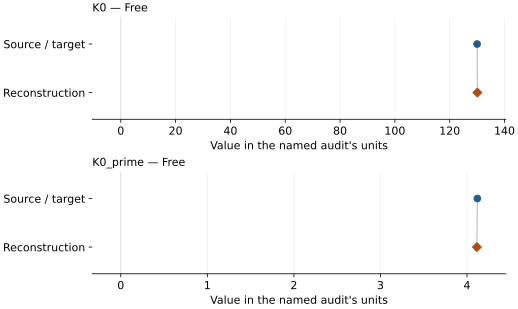
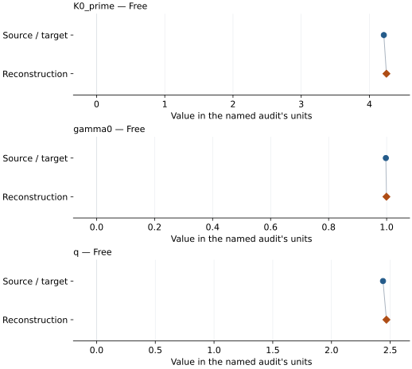
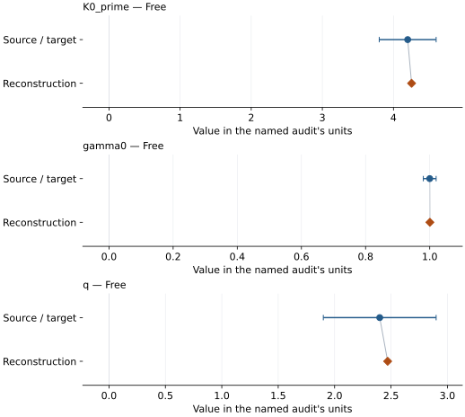

# Forsterite: EOS reconstruction reports

<!-- Generated by scripts.generate_reconstruction_reports; edit EOSMAT instead. -->

[All reconstruction reports](index.md) · [Material and EOS parameters](../material-summaries/forsterite.md)

These reports explain the assessments already stored in EOSMAT. Generating
this page does not refit observations, change classifications or replace source coefficients.

Use [scientific label definitions](../eos-labels.md) to distinguish coefficient
agreement, source verification, author-workflow reproduction and recommendation for use.

| EOS record | Recorded outcome | Coefficient comparison |
| --- | --- | --- |
| [Finkelstein et al. (2014), room-temperature BM3](#record-forsterite_finkelstein_2014_bm3_1) | Coefficient parity achieved | Graph and table |
| [Katsura (2022), author script full-precision BM3-MGD (recommended thermal option)](#record-forsterite_katsura_2022_author_script_bm3_mgd) | Coefficient parity achieved | Graph and table |
| [Katsura (2022), corrected forsterite BM3-MGD, final Table 2](#record-forsterite_katsura_2022_bm3_mgd) | Coefficient parity achieved | Graph and table |

## Finkelstein et al. (2014), room-temperature BM3

Record: `forsterite_finkelstein_2014_bm3_1` · Model: `BM3`

**Outcome: Coefficient parity achieved.**

**Scope:** Comparison with the source parameterization.
**Comparison basis:** Every compared free coefficient meets both the recorded combined-two-sigma comparison and parameter-specific numerical similarity screen. Error conventions and fit qualifications remain applicable.

[Stored EOS coefficients and source](../material-summaries/forsterite.md#record-forsterite_finkelstein_2014_bm3_1)

### What this result establishes

**Separate source-review status:** primary\_source\_validated.
**Usage recommendation:** See the stored EOS qualifications; no recommendation is inferred here.

- This named numerical assessment alone does not establish author-workflow reproduction, physical accuracy or recommendation for use.

### Data and reconstruction method

- **Dataset identifiers:** forsterite\_finkelstein\_2014\_table2\_compression
- **Observations:** 14
- **Fit kind:** isothermal\_pv
- **Selection:** phase=forsterite\_I, used\_in\_forsterite\_i\_eos\_fit=yes
- **Objective:** errors\_in\_variables
- **Absolute sigma:** True
- **Free parameters:** K0; K0\_prime
- **Fixed parameters:** V0

Unspecified selections, weights, fixed values or error conventions remain unknown; they have not been inferred for this report.

### Source versus reconstruction

This is a **coefficient comparison**, not an observation or residual plot.
Each panel uses its coefficient's audit units and includes zero. Markers show
stored central values only. Error widths are retained in the table below;
no confidence interval or uncertainty band is inferred. Fixed/adopted values are constraints.

| Parameter | Source / target | Source error | Reconstruction | Reconstruction error | Fit role |
| --- | --- | --- | --- | --- | --- |
| K0 | 130.0 | 0.9 | 130.09172243150562 | 6.4589727076486 | Free |
| K0\_prime | 4.12 | 0.07 | 4.114352835421328 | 0.47403545557767013 | Free |

Values and reported errors are copied without rounding or conversion from the named audit. Missing errors mean unknown, not zero. Parameter names and volume conventions follow that audit; error widths do not imply a confidence convention.

Recorded diagnostics, covariance and additional protocol

- **Columns:**
    - **Pressure:** pressure\_gpa
    - **Temperature:** Not specified
    - **Volume:** unit\_cell\_volume\_a3
- **Observed pressure range gpa:** \[0.0, 48.0\]
- **Observed temperature range k:** Not specified
- **Observed volume range:** \[230.6, 290.1\]
- **Degrees of freedom:** 12
- **Solver success:** True
- **Solver message:** Both \`ftol\` and \`xtol\` termination conditions are satisfied.
- **Rmse gpa:** 0.12802711386736998
- **Published rmse gpa:** 0.13231209345082623
- **Reduced chi square:** 0.019747225742570304

### Detailed evidence and existing plots

- [Record-by-record numerical ledger](../primary-eos-refits.md#records).
- [Source-audit reports](../source-audits.md).

Observation curves and residual plots are provided by the supporting reports where available. Their absence is not filled by a reconstructed curve presented as measured data.

[Machine-readable comparison ledger](https://github.com/CPrescher/peritheos/blob/main/docs/data/primary-eos-refits.json) — look up `forsterite_finkelstein_2014_bm3_1`.
[Complete native EOSMAT file](https://github.com/CPrescher/peritheos/blob/main/peritheos/data/materials/forsterite.eosmat).

## Katsura (2022), author script full-precision BM3-MGD (recommended thermal option)

Record: `forsterite_katsura_2022_author_script_bm3_mgd` · Model: `BM3`

**Outcome: Coefficient parity achieved.**

**Scope:** Comparison with the source parameterization.
**Comparison basis:** Agreement within the source's reported parameter error widths; this is not an inferred confidence convention.

[Stored EOS coefficients and source](../material-summaries/forsterite.md#record-forsterite_katsura_2022_author_script_bm3_mgd)

### What this result establishes

**Separate source-review status:** primary\_source\_validated.
**Usage recommendation:** See the stored EOS qualifications; no recommendation is inferred here.

- Katsura 2022 forsterite accepts conditional numerical parity within printed Table 2 parameter error widths. The full-precision theta0=760 K author-script vector is recommended; the theta0=768 K table alternative is retained. Table errors are a comparison scale only for the script vector; script-specific errors, covariance and exact bootstrap reproduction remain unavailable. Original 2009 combined-fit reproduction is a separate unresolved audit.
- Recommended thermal option: full-precision author-script coefficients, theta0=760 K. Conditional numerical parity within reported error widths; exact bootstrap reproduction unverified. See \[the source comparison\](literature-reproductions/forsterite-katsura-2022-refit-comparison.md).
- This named numerical assessment alone does not establish author-workflow reproduction, physical accuracy or recommendation for use.

### Data and reconstruction method

- **Dataset identifiers:** forsterite\_katsura\_2022\_olivine\_pvt
- **Observations:** 51
- **Fit kind:** reconstructed\_input\_conditional\_bm3\_mgd
- **Selection:** All 51 deposited observations; AD pressure, AN volume ratio, U temperature; M375006 retained.
- **Objective:** unweighted\_pressure\_residuals
- **Free parameters:** K0\_prime; gamma0; q
- **Fixed parameters:** V0; K0; Tr; theta0; n; Z

Unspecified selections, weights, fixed values or error conventions remain unknown; they have not been inferred for this report.

### Source versus reconstruction

This is a **coefficient comparison**, not an observation or residual plot.
Each panel uses its coefficient's audit units and includes zero. Markers show
stored central values only. Error widths are retained in the table below;
no confidence interval or uncertainty band is inferred. Fixed/adopted values are constraints.

| Parameter | Source / target | Source error | Reconstruction | Reconstruction error | Fit role |
| --- | --- | --- | --- | --- | --- |
| K0\_prime | 4.21116896988574 | Not specified | 4.249220999557795 | Not specified | Free |
| gamma0 | 0.997258584556838 | Not specified | 0.9992725760819935 | Not specified | Free |
| q | 2.43854091371459 | Not specified | 2.4677172154907185 | Not specified | Free |

Values and reported errors are copied without rounding or conversion from the named audit. Missing errors mean unknown, not zero. Parameter names and volume conventions follow that audit; error widths do not imply a confidence convention.

Recorded diagnostics, covariance and additional protocol

- **Solver success:** True
- **Rmse gpa:** 0.21282064917509597
- **Published rmse gpa:** 0.21300125575966772
- **Reproduction report:** docs/data/forsterite-katsura-2022-reproduction.json

### Detailed evidence and existing plots

- [Supporting source report: forsterite-katsura-2009-2022](../literature-reproductions/forsterite-katsura-2009-2022.md).
- [Supporting source report: forsterite-katsura-2022-refit-comparison](../literature-reproductions/forsterite-katsura-2022-refit-comparison.md).
- [Record-by-record numerical ledger](../primary-eos-refits.md#records).
- [Source-audit reports](../source-audits.md).

Observation curves and residual plots are provided by the supporting reports where available. Their absence is not filled by a reconstructed curve presented as measured data.

[Machine-readable comparison ledger](https://github.com/CPrescher/peritheos/blob/main/docs/data/primary-eos-refits.json) — look up `forsterite_katsura_2022_author_script_bm3_mgd`.
[Complete native EOSMAT file](https://github.com/CPrescher/peritheos/blob/main/peritheos/data/materials/forsterite.eosmat).

## Katsura (2022), corrected forsterite BM3-MGD, final Table 2

Record: `forsterite_katsura_2022_bm3_mgd` · Model: `BM3`

**Outcome: Coefficient parity achieved.**

**Scope:** Comparison with the source parameterization.
**Comparison basis:** Agreement within the source's reported parameter error widths; this is not an inferred confidence convention.

[Stored EOS coefficients and source](../material-summaries/forsterite.md#record-forsterite_katsura_2022_bm3_mgd)

### What this result establishes

**Separate source-review status:** primary\_source\_validated.
**Usage recommendation:** See the stored EOS qualifications; no recommendation is inferred here.

- Katsura 2022 forsterite accepts conditional numerical parity within printed Table 2 parameter error widths. The full-precision theta0=760 K author-script vector is recommended; the theta0=768 K table alternative is retained. Table errors are a comparison scale only for the script vector; script-specific errors, covariance and exact bootstrap reproduction remain unavailable. Original 2009 combined-fit reproduction is a separate unresolved audit.
- Printed Table 2 alternative, theta0=768 K. Conditional numerical parity within reported error widths; exact bootstrap reproduction unverified. See \[the source comparison\](literature-reproductions/forsterite-katsura-2022-refit-comparison.md).
- This named numerical assessment alone does not establish author-workflow reproduction, physical accuracy or recommendation for use.

### Data and reconstruction method

- **Dataset identifiers:** forsterite\_katsura\_2022\_olivine\_pvt
- **Observations:** 51
- **Fit kind:** reconstructed\_input\_conditional\_bm3\_mgd
- **Selection:** All 51 deposited observations; AD pressure, AN volume ratio, U temperature; M375006 retained.
- **Objective:** unweighted\_pressure\_residuals
- **Free parameters:** K0\_prime; gamma0; q
- **Fixed parameters:** V0; K0; Tr; theta0; n; Z

Unspecified selections, weights, fixed values or error conventions remain unknown; they have not been inferred for this report.

### Source versus reconstruction

This is a **coefficient comparison**, not an observation or residual plot.
Each panel uses its coefficient's audit units and includes zero. Markers show
stored central values only. Error widths are retained in the table below;
no confidence interval or uncertainty band is inferred. Fixed/adopted values are constraints.

| Parameter | Source / target | Source error | Reconstruction | Reconstruction error | Fit role |
| --- | --- | --- | --- | --- | --- |
| K0\_prime | 4.2 | 0.4 | 4.254577305953309 | Not specified | Free |
| gamma0 | 1.0 | 0.02 | 1.0005027491131544 | Not specified | Free |
| q | 2.4 | 0.5 | 2.4703460700134214 | Not specified | Free |

Values and reported errors are copied without rounding or conversion from the named audit. Missing errors mean unknown, not zero. Parameter names and volume conventions follow that audit; error widths do not imply a confidence convention.

Recorded diagnostics, covariance and additional protocol

- **Solver success:** True
- **Rmse gpa:** 0.21239522341551
- **Published rmse gpa:** 0.21249940044126006
- **Reproduction report:** docs/data/forsterite-katsura-2022-reproduction.json

### Detailed evidence and existing plots

- [Supporting source report: forsterite-katsura-2009-2022](../literature-reproductions/forsterite-katsura-2009-2022.md).
- [Supporting source report: forsterite-katsura-2022-refit-comparison](../literature-reproductions/forsterite-katsura-2022-refit-comparison.md).
- [Record-by-record numerical ledger](../primary-eos-refits.md#records).
- [Source-audit reports](../source-audits.md).

Observation curves and residual plots are provided by the supporting reports where available. Their absence is not filled by a reconstructed curve presented as measured data.

[Machine-readable comparison ledger](https://github.com/CPrescher/peritheos/blob/main/docs/data/primary-eos-refits.json) — look up `forsterite_katsura_2022_bm3_mgd`.
[Complete native EOSMAT file](https://github.com/CPrescher/peritheos/blob/main/peritheos/data/materials/forsterite.eosmat).
