# Gold: EOS reconstruction reports

<!-- Generated by scripts.generate_reconstruction_reports; edit EOSMAT instead. -->

[All reconstruction reports](index.md) · [Material and EOS parameters](../material-summaries/gold.md)

These reports explain the assessments already stored in EOSMAT. Generating
this page does not refit observations, change classifications or replace source coefficients.

Use [scientific label definitions](../eos-labels.md) to distinguish coefficient
agreement, source verification, author-workflow reproduction and recommendation for use.

| EOS record | Recorded outcome | Coefficient comparison |
| --- | --- | --- |
| [Sakai et al. (2025), Au generalized Rydberg-Stacey scale](#record-gold_sakai_2025_rydberg_stacey_1) | Complete independent refit unavailable | No numeric coefficient pair recorded |
| [Dewaele et al. (2004), revised-ruby Vinet](#record-gold_dewaele_2004_vinet_5) | Coefficient parity achieved | Graph and table |
| [Takemura and Dewaele (2008), Dorogokupets-ruby Vinet](#record-gold_takemura_2008_vinet_6) | Coefficient parity achieved | Graph and table |
| [Anderson et al. (1989), Au logarithmic-volume thermal EOS](#record-gold_anderson_1989_bm3_1) | Complete independent refit unavailable | No numeric coefficient pair recorded |
| [04-0784, Fei et al PNAS, 2007 \[Vinet\]](#record-gold_fei_2007_vinet_2) | Coefficient parity achieved | Graph and table |
| [Shen and Smith (2026), Cu-referenced Vinet](#record-gold_shen_2026_vinet_3) | Coefficient parity achieved | Graph and table |
| [Sokolova et al. (2013), Holzapfel thermal model (2016 workbook)](#record-gold_sokolova_2013_holzapfel_4) | Source calculation reconstructed | No numeric coefficient pair recorded |
| [Fratanduono et al. (2021), ramp-derived 298 K Vinet](#record-gold_fratanduono_2021_vinet_7) | Coefficient parity achieved | Graph and table |
| [Dewaele (2019), Au MAO-scale Vinet](#record-gold_dewaele_2019_mao_vinet) | Numerically similar, with qualifications | Graph and table |
| [Dewaele (2019), Au DOR-scale Vinet](#record-gold_dewaele_2019_dor_vinet) | Numerically similar, with qualifications | Graph and table |
| [Dewaele et al. (2004), Au mao ruby Vinet](#record-gold_dewaele_2004_mao_ruby_vinet) | Coefficient parity achieved | Graph and table |
| [Dorfman et al. (2012), Au K0-fixed Vinet](#record-gold_dorfman_2012_tange_mgo_k0_fixed_vinet) | Parity not achieved for this comparison | Graph and table |
| [Dorfman et al. (2012), Au K0-free Vinet](#record-gold_dorfman_2012_tange_mgo_k0_free_vinet) | Parity not achieved for this comparison | Graph and table |
| [Ye et al. (2017), Au Vinet 300 K co-compression fit](#record-gold_ye_2017_vinet_300k) | Coefficient parity achieved | Graph and table |
| [Zhu et al. (2025), Au internally consistent P-V-T EOS](#record-gold_zhu_2025_pvt) | Coefficient parity achieved | Graph and table |
| [Hirose et al. (2008), thermal BM3 fit #2 (preferred)](#record-gold_hirose_2008_bm3_fit2) | Numerically similar, with qualifications | Graph and table |
| [Hirose et al. (2008), thermal BM3 fit #1 (DAC only)](#record-gold_hirose_2008_bm3_fit1) | Numerically similar, with qualifications | Graph and table |
| [Hirose et al. (2008), 300 K BM3 on Speziale MgO scale](#record-gold_hirose_2008_bm3_300k) | Numerically similar, with qualifications | Graph and table |
| [Fei et al. (2004), gold BM3-MGD on Speziale MgO scale](#record-gold_fei_2004_bm3_mgd) | Complete independent refit unavailable | Graph and table |
| [Yokoo et al. (2009), Au fitted BM3 isotherm, 300 K](#record-gold_yokoo_2009_bm3_300k) | Complete independent refit unavailable | No numeric coefficient pair recorded |
| [Yokoo et al. (2009), Au fitted Vinet isotherm, 300 K](#record-gold_yokoo_2009_vinet_300k) | Complete independent refit unavailable | No numeric coefficient pair recorded |
| [Yokoo et al. (2009), Gold PVT — diagnostic Table III reconstruction](#record-gold_yokoo_2009_pvt_reconstruction) | Source calculation reconstructed | No numeric coefficient pair recorded |
| [Peritheos refit: Hirose (2008) + Fei (2004), Au on author-confirmed Speziale (2001) MgO](#record-gold_hirose_2008_fei_2004_speziale_2001_bm3_refit) | Coefficient parity achieved | Graph and table |

## Sakai et al. (2025), Au generalized Rydberg-Stacey scale

Record: `gold_sakai_2025_rydberg_stacey_1` · Model: `RydbergStacey`

**Outcome: Complete independent refit unavailable.**

**Scope:** Comparison with the source parameterization.
**Comparison basis:** The bundled grid is calculated from the reported coefficients. Raw simultaneous-volume observations exist in Tables S1-S8, but the multi-stage fit also incorporates earlier studies and does not publish one flat pressure-volume regression table or covariance.

[Stored EOS coefficients and source](../material-summaries/gold.md#record-gold_sakai_2025_rydberg_stacey_1)

### What this result establishes

**Separate source-review status:** primary\_source\_validated.
**Usage recommendation:** See the stored EOS qualifications; no recommendation is inferred here.

- This named numerical assessment alone does not establish author-workflow reproduction, physical accuracy or recommendation for use.
- No reconstructed coefficient table is recorded for this assessment; no missing values have been inferred.

### Data and reconstruction method

- **Dataset identifiers:** None declared
- **Fixed parameters:** V0; K0; K\_infinity\_prime

Unspecified selections, weights, fixed values or error conventions remain unknown; they have not been inferred for this report.

### Why no coefficient graph is shown

No numeric source/reconstruction pair is recorded for this assessment. A graph would require information that is not available here; no values or observations have been invented.

### Detailed evidence and existing plots

- [Record-by-record numerical ledger](../primary-eos-refits.md#records).
- [Source-audit reports](../source-audits.md).

Observation curves and residual plots are provided by the supporting reports where available. Their absence is not filled by a reconstructed curve presented as measured data.

[Machine-readable comparison ledger](https://github.com/CPrescher/peritheos/blob/main/docs/data/primary-eos-refits.json) — look up `gold_sakai_2025_rydberg_stacey_1`.
[Complete native EOSMAT file](https://github.com/CPrescher/peritheos/blob/main/peritheos/data/materials/gold.eosmat).

## Dewaele et al. (2004), revised-ruby Vinet

Record: `gold_dewaele_2004_vinet_5` · Model: `Vinet`

**Outcome: Coefficient parity achieved.**

**Scope:** Comparison with the source parameterization.
**Comparison basis:** Every compared free coefficient meets both the recorded combined-two-sigma comparison and parameter-specific numerical similarity screen. Error conventions and fit qualifications remain applicable.

[Stored EOS coefficients and source](../material-summaries/gold.md#record-gold_dewaele_2004_vinet_5)

### What this result establishes

**Separate source-review status:** primary\_source\_validated.
**Usage recommendation:** See the stored EOS qualifications; no recommendation is inferred here.

- This named numerical assessment alone does not establish author-workflow reproduction, physical accuracy or recommendation for use.

### Data and reconstruction method

- **Dataset identifiers:** gold\_dewaele\_2004\_table1\_compression
- **Observations:** 37
- **Fit kind:** isothermal\_pv
- **Selection:** all rows
- **Objective:** errors\_in\_variables
- **Absolute sigma:** True
- **Free parameters:** K0\_prime
- **Fixed parameters:** V0; K0

Unspecified selections, weights, fixed values or error conventions remain unknown; they have not been inferred for this report.

### Source versus reconstruction

This is a **coefficient comparison**, not an observation or residual plot.
Each panel uses its coefficient's audit units and includes zero. Markers show
stored central values only. Error widths are retained in the table below;
no confidence interval or uncertainty band is inferred. Fixed/adopted values are constraints.

| Parameter | Source / target | Source error | Reconstruction | Reconstruction error | Fit role |
| --- | --- | --- | --- | --- | --- |
| K0\_prime | 6.0 | 0.02 | 5.999042092841824 | 0.037467230325280015 | Free |

Values and reported errors are copied without rounding or conversion from the named audit. Missing errors mean unknown, not zero. Parameter names and volume conventions follow that audit; error widths do not imply a confidence convention.

Recorded diagnostics, covariance and additional protocol

- **Columns:**
    - **Pressure:** ruby\_pressure\_revised\_gpa
    - **Temperature:** Not specified
    - **Volume:** atomic\_volume\_a3
- **Observed pressure range gpa:** \[0.0, 93.6\]
- **Observed temperature range k:** Not specified
- **Observed volume range:** \[52.12, 67.864\]
- **Degrees of freedom:** 36
- **Solver success:** True
- **Solver message:** Both \`ftol\` and \`xtol\` termination conditions are satisfied.
- **Rmse gpa:** 0.2914160655214606
- **Published rmse gpa:** 0.32104169331744814
- **Reduced chi square:** 0.09586575721211826

### Detailed evidence and existing plots

- [Record-by-record numerical ledger](../primary-eos-refits.md#records).
- [Source-audit reports](../source-audits.md).

Observation curves and residual plots are provided by the supporting reports where available. Their absence is not filled by a reconstructed curve presented as measured data.

[Machine-readable comparison ledger](https://github.com/CPrescher/peritheos/blob/main/docs/data/primary-eos-refits.json) — look up `gold_dewaele_2004_vinet_5`.
[Complete native EOSMAT file](https://github.com/CPrescher/peritheos/blob/main/peritheos/data/materials/gold.eosmat).

## Takemura and Dewaele (2008), Dorogokupets-ruby Vinet

Record: `gold_takemura_2008_vinet_6` · Model: `Vinet`

**Outcome: Coefficient parity achieved.**

**Scope:** Comparison with the source parameterization.
**Comparison basis:** Agreement within the source's reported parameter error widths; this is not an inferred confidence convention.

[Stored EOS coefficients and source](../material-summaries/gold.md#record-gold_takemura_2008_vinet_6)

### What this result establishes

**Separate source-review status:** primary\_source\_validated.
**Usage recommendation:** See the stored EOS qualifications; no recommendation is inferred here.

- Conditional numerical parameter parity: all 86 observed Table III rows, with published V0/K0 fixed, recover K0-prime within the printed 0.1 width on both ruby coordinates under equal-pressure and equal-volume residual objectives. Original residual direction, weights, unrounded reductions, pointwise uncertainties, confidence convention and covariance are not recovered; no combined-two-sigma or exact author-fit claim. See the \[dedicated audit\](literature-reproductions/takemura-2008-gold.md).
- This named numerical assessment alone does not establish author-workflow reproduction, physical accuracy or recommendation for use.

### Data and reconstruction method

- **Dataset identifiers:** gold\_takemura\_2008\_table3\_compression
- **Observations:** 86
- **Fit kind:** isothermal\_pv
- **Selection:** all 86 observed rows; no exclusions
- **Objective:** equal\_pressure\_residuals
- **Absolute sigma:** False
- **Free parameters:** K0\_prime
- **Fixed parameters:** V0; K0

Unspecified selections, weights, fixed values or error conventions remain unknown; they have not been inferred for this report.

### Source versus reconstruction

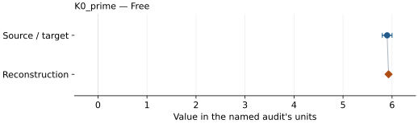

This is a **coefficient comparison**, not an observation or residual plot.
Each panel uses its coefficient's audit units and includes zero. Markers show
stored central values only. Error widths are retained in the table below;
no confidence interval or uncertainty band is inferred. Fixed/adopted values are constraints.

| Parameter | Source / target | Source error | Reconstruction | Reconstruction error | Fit role |
| --- | --- | --- | --- | --- | --- |
| K0\_prime | 5.9 | 0.1 | 5.928709512073656 | Not specified | Free |

Values and reported errors are copied without rounding or conversion from the named audit. Missing errors mean unknown, not zero. Parameter names and volume conventions follow that audit; error widths do not imply a confidence convention.

Recorded diagnostics, covariance and additional protocol

- **Columns:**
    - **Pressure:** ruby\_pressure\_dorogokupets\_gpa
    - **Temperature:** Not specified
    - **Volume:** lattice\_111\_angstrom
- **Observed pressure range gpa:** \[0.0, 130.8\]
- **Observed temperature range k:** Not specified
- **Observed volume range:** \[49.42682244009901, 67.95227543794302\]
- **Degrees of freedom:** 85
- **Solver success:** True
- **Solver message:** dedicated equal-pressure refit; volume/scale sensitivities archived
- **Rmse gpa:** 0.777872851511799
- **Published rmse gpa:** 0.7999477645481032
- **Reduced chi square:** Not specified
- **Reproduction report:** docs/data/takemura-2008-gold-reproduction.json

### Detailed evidence and existing plots

- [Supporting source report: takemura-2008-gold](../literature-reproductions/takemura-2008-gold.md).
- [Record-by-record numerical ledger](../primary-eos-refits.md#records).
- [Source-audit reports](../source-audits.md).

Observation curves and residual plots are provided by the supporting reports where available. Their absence is not filled by a reconstructed curve presented as measured data.

[Machine-readable comparison ledger](https://github.com/CPrescher/peritheos/blob/main/docs/data/primary-eos-refits.json) — look up `gold_takemura_2008_vinet_6`.
[Complete native EOSMAT file](https://github.com/CPrescher/peritheos/blob/main/peritheos/data/materials/gold.eosmat).

## Anderson et al. (1989), Au logarithmic-volume thermal EOS

Record: `gold_anderson_1989_bm3_1` · Model: `BM3`

**Outcome: Complete independent refit unavailable.**

**Scope:** Comparison with the source parameterization.
**Comparison basis:** Tables I-IV contain heterogeneous literature properties, separately regressed coefficients, and derived thermodynamic diagnostics, while Table V is output from Equation (29). The source performs staged smoothing, one-dimensional regressions, numerical integrations, and qualitative K0' trials; it does not define a global observation matrix, objective, weights, integration protocol, or covariance that could be reproduced as a direct EOS coefficient refit.

[Stored EOS coefficients and source](../material-summaries/gold.md#record-gold_anderson_1989_bm3_1)

### What this result establishes

**Separate source-review status:** primary\_source\_validated.
**Usage recommendation:** See the stored EOS qualifications; no recommendation is inferred here.

- This named numerical assessment alone does not establish author-workflow reproduction, physical accuracy or recommendation for use.
- No reconstructed coefficient table is recorded for this assessment; no missing values have been inferred.

### Data and reconstruction method

- **Dataset identifiers:** gold\_anderson\_1989\_table1\_thermodynamic\_inputs; gold\_anderson\_1989\_table2\_temperature\_derivatives; gold\_anderson\_1989\_table3\_bulk\_moduli; gold\_anderson\_1989\_table4\_anharmonic\_diagnostics; gold\_anderson\_1989\_table5\_pressure\_grid
- **Fixed parameters:** V0; K0; K0\_prime; Tr

Unspecified selections, weights, fixed values or error conventions remain unknown; they have not been inferred for this report.

### Why no coefficient graph is shown

No numeric source/reconstruction pair is recorded for this assessment. A graph would require information that is not available here; no values or observations have been invented.

### Detailed evidence and existing plots

- [Related illustrated report explicitly naming this EOS: brucite](../literature-reproductions/brucite.md).
- [Record-by-record numerical ledger](../primary-eos-refits.md#records).
- [Source-audit reports](../source-audits.md).

Observation curves and residual plots are provided by the supporting reports where available. Their absence is not filled by a reconstructed curve presented as measured data.

[Machine-readable comparison ledger](https://github.com/CPrescher/peritheos/blob/main/docs/data/primary-eos-refits.json) — look up `gold_anderson_1989_bm3_1`.
[Complete native EOSMAT file](https://github.com/CPrescher/peritheos/blob/main/peritheos/data/materials/gold.eosmat).

## 04-0784, Fei et al PNAS, 2007 \[Vinet\]

Record: `gold_fei_2007_vinet_2` · Model: `Vinet`

**Outcome: Coefficient parity achieved.**

**Scope:** Comparison with the source parameterization.
**Comparison basis:** Agreement within the source's reported parameter error widths; this is not an inferred confidence convention.

[Stored EOS coefficients and source](../material-summaries/gold.md#record-gold_fei_2007_vinet_2)

### What this result establishes

**Separate source-review status:** primary\_source\_validated.
**Usage recommendation:** See the stored EOS qualifications; no recommendation is inferred here.

- Conditional numerical parity: staged equal-pressure-weight replay of 37 revised-ruby cold observations followed by 28 reported-MgO hot observations reproduces K0-prime and q within printed parameter error widths. V0/K0/gamma0/theta0 are adopted and fixed. Source weights, exact MgO reduction and uncertainty confidence/covariance remain unresolved; no formal combined-two-sigma or source-exact author-fit claim.
- This named numerical assessment alone does not establish author-workflow reproduction, physical accuracy or recommendation for use.

### Data and reconstruction method

- **Dataset identifiers:** gold\_dewaele\_2004\_table1\_compression; gold\_fei\_2004\_table1; gold\_hirose\_2006\_table1
- **Observations:** 65
- **Fit kind:** staged\_vinet\_mgd\_conditional\_replay
- **Objective:** equal\_pressure\_residuals
- **Free parameters:** K0\_prime; q
- **Fixed parameters:** V0; K0; gamma0; theta0

Unspecified selections, weights, fixed values or error conventions remain unknown; they have not been inferred for this report.

### Source versus reconstruction

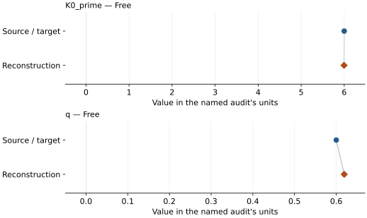

This is a **coefficient comparison**, not an observation or residual plot.
Each panel uses its coefficient's audit units and includes zero. Markers show
stored central values only. Error widths are retained in the table below;
no confidence interval or uncertainty band is inferred. Fixed/adopted values are constraints.

| Parameter | Source / target | Source error | Reconstruction | Reconstruction error | Fit role |
| --- | --- | --- | --- | --- | --- |
| K0\_prime | 6.0 | 0.02 | 5.995326273385395 | 0.01117901202935827 | Free |
| q | 0.6 | 0.3 | 0.6191486316881784 | 0.12507788930311625 | Free |

Values and reported errors are copied without rounding or conversion from the named audit. Missing errors mean unknown, not zero. Parameter names and volume conventions follow that audit; error widths do not imply a confidence convention.

Recorded diagnostics, covariance and additional protocol

- **Rmse gpa:** 0.7107262512275505
- **Published rmse gpa:** 0.7122682138770043
- **Reproduction report:** docs/data/fei-2007-gold-reproduction.json

### Detailed evidence and existing plots

- [Supporting source report: fei-2007-gold](../literature-reproductions/fei-2007-gold.md).
- [Record-by-record numerical ledger](../primary-eos-refits.md#records).
- [Source-audit reports](../source-audits.md).

Observation curves and residual plots are provided by the supporting reports where available. Their absence is not filled by a reconstructed curve presented as measured data.

[Machine-readable comparison ledger](https://github.com/CPrescher/peritheos/blob/main/docs/data/primary-eos-refits.json) — look up `gold_fei_2007_vinet_2`.
[Complete native EOSMAT file](https://github.com/CPrescher/peritheos/blob/main/peritheos/data/materials/gold.eosmat).

## Shen and Smith (2026), Cu-referenced Vinet

Record: `gold_shen_2026_vinet_3` · Model: `Vinet`

**Outcome: Coefficient parity achieved.**

**Scope:** Comparison with the source parameterization.
**Comparison basis:** Every compared free coefficient meets both the recorded combined-two-sigma comparison and parameter-specific numerical similarity screen. Error conventions and fit qualifications remain applicable.

[Stored EOS coefficients and source](../material-summaries/gold.md#record-gold_shen_2026_vinet_3)

### What this result establishes

**Separate source-review status:** primary\_source\_validated.
**Usage recommendation:** See the stored EOS qualifications; no recommendation is inferred here.

- Direct reconstruction from source observations: each Table S1 phase volume is paired with its simultaneous Cu volume, pressure is evaluated from Fratanduono et al.'s analytic third-order 298 K Vinet fit, and K0 and K0\_prime are fitted with Shen and Smith's fixed V0 and stated run selection. The source publishes no pressure weights, residual covariance, or weighting protocol, so the reproduction uses unweighted pressure residuals and does not infer any of them.
- This named numerical assessment alone does not establish author-workflow reproduction, physical accuracy or recommendation for use.

### Data and reconstruction method

- **Dataset identifiers:** shen\_smith\_2026\_table\_s1\_simultaneous\_volumes
- **Observations:** 228
- **Fit kind:** fixed\_v0\_vinet\_with\_reconstructed\_cu\_pressure
- **Selection:** Au; DAC-1
- **Objective:** unweighted\_pressure\_residuals
- **Absolute sigma:** False
- **Free parameters:** K0; K0\_prime
- **Fixed parameters:** V0

Unspecified selections, weights, fixed values or error conventions remain unknown; they have not been inferred for this report.

### Source versus reconstruction

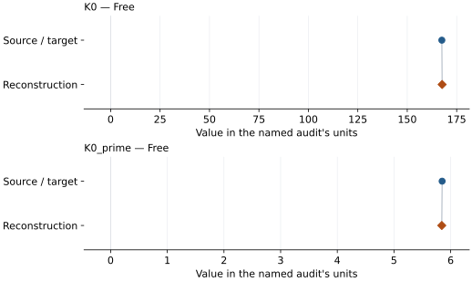

This is a **coefficient comparison**, not an observation or residual plot.
Each panel uses its coefficient's audit units and includes zero. Markers show
stored central values only. Error widths are retained in the table below;
no confidence interval or uncertainty band is inferred. Fixed/adopted values are constraints.

| Parameter | Source / target | Source error | Reconstruction | Reconstruction error | Fit role |
| --- | --- | --- | --- | --- | --- |
| K0 | 167.5 | 0.3 | 167.64150182431797 | 0.2915530235970454 | Free |
| K0\_prime | 5.85 | 0.01 | 5.843889939885668 | 0.013201109484799772 | Free |

Values and reported errors are copied without rounding or conversion from the named audit. Missing errors mean unknown, not zero. Parameter names and volume conventions follow that audit; error widths do not imply a confidence convention.

Recorded diagnostics, covariance and additional protocol

- **Columns:**
    - **Pressure:** Fratanduono-2020 298 K Cu pressure reconstructed per run
    - **Temperature:** Not specified
    - **Volume:** unit\_cell\_volume\_a3
- **Observed pressure range gpa:** \[3.908992349216304, 137.37695008018062\]
- **Observed temperature range k:** Not specified
- **Observed volume range:** \[48.81535, 66.28583\]
- **Degrees of freedom:** 226
- **Solver success:** True
- **Solver message:** \`ftol\` termination condition is satisfied.
- **Rmse gpa:** 0.33474789368557756
- **Reduced chi square:** 0.1130477996926558
- **Pressure reconstruction:**
    - **Density0 g cm3:** 8.939
    - **DOI:** 10.1103/PhysRevLett.124.015701
    - **Model:** vinet\_3
    - **Pairing:** Each phase volume uses the single Cu volume with the same experiment and run number; both source-labeled Pt first/last measurements are retained when the run is selected.
    - **Parameters:**
        - **K0 gpa:** 133.6
        - **Beta:** 2.06
        - **Eta:** 6.29
        - **Psi:** 1.65
    - **Reference:** Fratanduono et al. (2020)
    - **Reference eos record:** copper\_fratanduono\_2020\_vinet3\_298k
    - **Reference unit cell volume a3:** 47.218085048721
    - **Source locations:** main article Table I, 298 K isotherm row; Supplemental Material Eq. (2), Section S4

### Detailed evidence and existing plots

- [Record-by-record numerical ledger](../primary-eos-refits.md#records).
- [Source-audit reports](../source-audits.md).

Observation curves and residual plots are provided by the supporting reports where available. Their absence is not filled by a reconstructed curve presented as measured data.

[Machine-readable comparison ledger](https://github.com/CPrescher/peritheos/blob/main/docs/data/primary-eos-refits.json) — look up `gold_shen_2026_vinet_3`.
[Complete native EOSMAT file](https://github.com/CPrescher/peritheos/blob/main/peritheos/data/materials/gold.eosmat).

## Sokolova et al. (2013), Holzapfel thermal model (2016 workbook)

Record: `gold_sokolova_2013_holzapfel_4` · Model: `Holzapfel`

**Outcome: Source calculation reconstructed.**

**Scope:** Reconstruction of a source equation or calculation.
**Comparison basis:** All eleven machine-readable comparison series enter one shared Equation (20) objective against the mean Table 2 Holzapfel and Table 3 Vinet isotherm. Table 4 is retained as a post-calibration closure test. The calculation cannot recover the eleven EOS parameter sets independently because the source omits complete thermochemical/ultrasonic rows, weights, and covariance.

[Stored EOS coefficients and source](../material-summaries/gold.md#record-gold_sokolova_2013_holzapfel_4)

### What this result establishes

**Separate source-review status:** primary\_source\_validated.
**Usage recommendation:** See the stored EOS qualifications; no recommendation is inferred here.

- This named numerical assessment alone does not establish author-workflow reproduction, physical accuracy or recommendation for use.
- No reconstructed coefficient table is recorded for this assessment; no missing values have been inferred.

### Data and reconstruction method

- **Dataset identifiers:** gold\_dewaele\_2004\_table1\_compression
- **Observations:** 36
- **Fit kind:** coupled\_eleven\_marker\_ruby\_cross\_calibration
- **Objective:** minimize the sum over markers of the mean squared residual between Equation (20) and the pointwise mean of the Table 2 Holzapfel and Table 3 Vinet pressures, so each of the eleven markers has equal total weight
- **Fixed parameters:** n; Z; n

Unspecified selections, weights, fixed values or error conventions remain unknown; they have not been inferred for this report.

### Why no coefficient graph is shown

No numeric source/reconstruction pair is recorded for this assessment. A graph would require information that is not available here; no values or observations have been invented.

Recorded diagnostics, covariance and additional protocol

- **Rmse gpa:** 1.7825124933162952
- **Published rmse gpa:** 1.6701588200282793
- **Comparison scope:** shared\_ruby\_calibration
- **Published ruby parameters:**
    - **A gpa:** 1870.0
    - **M:** 6.0
- **Sensitivity fit ruby parameters:**
    - **A gpa:** 1869.3837840502665
    - **M:** 6.10334763359135

### Detailed evidence and existing plots

- [Record-by-record numerical ledger](../primary-eos-refits.md#records).
- [Source-audit reports](../source-audits.md).

Observation curves and residual plots are provided by the supporting reports where available. Their absence is not filled by a reconstructed curve presented as measured data.

[Machine-readable comparison ledger](https://github.com/CPrescher/peritheos/blob/main/docs/data/primary-eos-refits.json) — look up `gold_sokolova_2013_holzapfel_4`.
[Complete native EOSMAT file](https://github.com/CPrescher/peritheos/blob/main/peritheos/data/materials/gold.eosmat).

## Fratanduono et al. (2021), ramp-derived 298 K Vinet

Record: `gold_fratanduono_2021_vinet_7` · Model: `Vinet`

**Outcome: Coefficient parity achieved.**

**Scope:** Comparison with the source parameterization.
**Comparison basis:** Every compared free coefficient meets both the recorded combined-two-sigma comparison and parameter-specific numerical similarity screen. Error conventions and fit qualifications remain applicable.

[Stored EOS coefficients and source](../material-summaries/gold.md#record-gold_fratanduono_2021_vinet_7)

### What this result establishes

**Separate source-review status:** primary\_source\_validated.
**Usage recommendation:** See the stored EOS qualifications; no recommendation is inferred here.

- This named numerical assessment alone does not establish author-workflow reproduction, physical accuracy or recommendation for use.

### Data and reconstruction method

- **Dataset identifiers:** gold\_fratanduono\_2021\_table\_s3\_compression
- **Observations:** 119
- **Fit kind:** isothermal\_pv
- **Selection:** all rows
- **Objective:** pressure\_residuals
- **Absolute sigma:** True
- **Free parameters:** K0; K0\_prime
- **Fixed parameters:** V0

Unspecified selections, weights, fixed values or error conventions remain unknown; they have not been inferred for this report.

### Source versus reconstruction

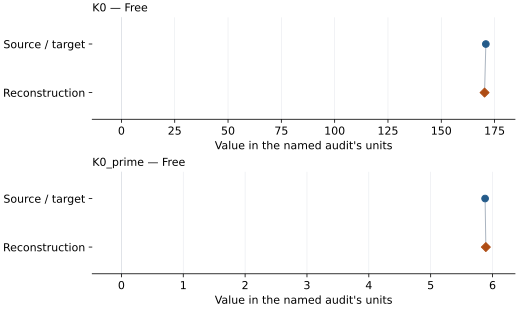

This is a **coefficient comparison**, not an observation or residual plot.
Each panel uses its coefficient's audit units and includes zero. Markers show
stored central values only. Error widths are retained in the table below;
no confidence interval or uncertainty band is inferred. Fixed/adopted values are constraints.

| Parameter | Source / target | Source error | Reconstruction | Reconstruction error | Fit role |
| --- | --- | --- | --- | --- | --- |
| K0 | 170.9 | 0.24 | 170.2984392496678 | 0.5864841090463982 | Free |
| K0\_prime | 5.88 | 0.005 | 5.892083792353126 | 0.011029134970246695 | Free |

Values and reported errors are copied without rounding or conversion from the named audit. Missing errors mean unknown, not zero. Parameter names and volume conventions follow that audit; error widths do not imply a confidence convention.

Recorded diagnostics, covariance and additional protocol

- **Columns:**
    - **Pressure:** isotherm\_298k\_pressure\_gpa
    - **Temperature:** Not specified
    - **Volume:** atomic\_volume\_a3
- **Observed pressure range gpa:** \[0.0, 1137.6\]
- **Observed temperature range k:** Not specified
- **Observed volume range:** \[30.48, 67.716\]
- **Degrees of freedom:** 117
- **Solver success:** True
- **Solver message:** Both \`ftol\` and \`xtol\` termination conditions are satisfied.
- **Rmse gpa:** 2.4252190979988573
- **Published rmse gpa:** 2.4401358758487475
- **Reduced chi square:** 5.982229342927423

### Detailed evidence and existing plots

- [Record-by-record numerical ledger](../primary-eos-refits.md#records).
- [Source-audit reports](../source-audits.md).

Observation curves and residual plots are provided by the supporting reports where available. Their absence is not filled by a reconstructed curve presented as measured data.

[Machine-readable comparison ledger](https://github.com/CPrescher/peritheos/blob/main/docs/data/primary-eos-refits.json) — look up `gold_fratanduono_2021_vinet_7`.
[Complete native EOSMAT file](https://github.com/CPrescher/peritheos/blob/main/peritheos/data/materials/gold.eosmat).

## Dewaele (2019), Au MAO-scale Vinet

Record: `gold_dewaele_2019_mao_vinet` · Model: `Vinet`

**Outcome: Numerically similar, with qualifications.**

**Scope:** Comparison with the source parameterization.
**Comparison basis:** Every compared free coefficient meets either the recorded combined-two-sigma comparison or parameter-specific numerical similarity screen; the audit does not classify the complete comparison as parity.

[Stored EOS coefficients and source](../material-summaries/gold.md#record-gold_dewaele_2019_mao_vinet)

### What this result establishes

**Separate source-review status:** primary\_source\_validated.
**Usage recommendation:** See the stored EOS qualifications; no recommendation is inferred here.

- Complete source rows for this material are bundled and the dedicated two-ruby-scale refit recovers every coefficient within the published 95% interval. The common ledger classifies the result as similar, not strict parity, because the dedicated audit does not infer a refit covariance from rounded source rows.
- This named numerical assessment alone does not establish author-workflow reproduction, physical accuracy or recommendation for use.

### Data and reconstruction method

- **Dataset identifiers:** gold\_takemura\_2008\_table3\_compression
- **Observations:** 86
- **Fit kind:** static\_vinet\_with\_explicit\_ruby\_scale\_conversion
- **Selection:** complete
- **Objective:** unweighted pressure residuals
- **Free parameters:** V0; K0; K0\_prime
- **Fixed parameters:** None declared

Unspecified selections, weights, fixed values or error conventions remain unknown; they have not been inferred for this report.

### Source versus reconstruction

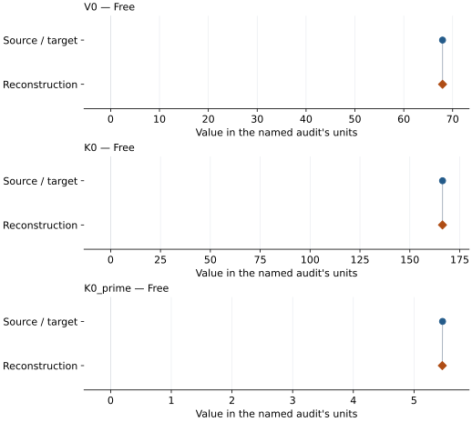

This is a **coefficient comparison**, not an observation or residual plot.
Each panel uses its coefficient's audit units and includes zero. Markers show
stored central values only. Error widths are retained in the table below;
no confidence interval or uncertainty band is inferred. Fixed/adopted values are constraints.

| Parameter | Source / target | Source error | Reconstruction | Reconstruction error | Fit role |
| --- | --- | --- | --- | --- | --- |
| V0 | 67.932 | 0.08 | 67.93265557205157 | Not specified | Free |
| K0 | 166.4 | 2.0 | 166.36665153722387 | Not specified | Free |
| K0\_prime | 5.47 | 0.06 | 5.466130301059161 | Not specified | Free |

Values and reported errors are copied without rounding or conversion from the named audit. Missing errors mean unknown, not zero. Parameter names and volume conventions follow that audit; error widths do not imply a confidence convention.

Recorded diagnostics, covariance and additional protocol

- **Observed pressure range gpa:** \[0.0, 122.29180492688037\]
- **Solver success:** True
- **Solver message:** dedicated Dewaele (2019) refit completed
- **Rmse gpa:** 0.7258715907845411

### Detailed evidence and existing plots

- [Earlier detailed record investigation](../primary-eos-refits.md#investigation-gold_dewaele_2019_mao_vinet).
- [Record-by-record numerical ledger](../primary-eos-refits.md#records).
- [Source-audit reports](../source-audits.md).

Observation curves and residual plots are provided by the supporting reports where available. Their absence is not filled by a reconstructed curve presented as measured data.

[Machine-readable comparison ledger](https://github.com/CPrescher/peritheos/blob/main/docs/data/primary-eos-refits.json) — look up `gold_dewaele_2019_mao_vinet`.
[Complete native EOSMAT file](https://github.com/CPrescher/peritheos/blob/main/peritheos/data/materials/gold.eosmat).

## Dewaele (2019), Au DOR-scale Vinet

Record: `gold_dewaele_2019_dor_vinet` · Model: `Vinet`

**Outcome: Numerically similar, with qualifications.**

**Scope:** Comparison with the source parameterization.
**Comparison basis:** Every compared free coefficient meets either the recorded combined-two-sigma comparison or parameter-specific numerical similarity screen; the audit does not classify the complete comparison as parity.

[Stored EOS coefficients and source](../material-summaries/gold.md#record-gold_dewaele_2019_dor_vinet)

### What this result establishes

**Separate source-review status:** primary\_source\_validated.
**Usage recommendation:** See the stored EOS qualifications; no recommendation is inferred here.

- Complete source rows for this material are bundled and the dedicated two-ruby-scale refit recovers every coefficient within the published 95% interval. The common ledger classifies the result as similar, not strict parity, because the dedicated audit does not infer a refit covariance from rounded source rows.
- This named numerical assessment alone does not establish author-workflow reproduction, physical accuracy or recommendation for use.

### Data and reconstruction method

- **Dataset identifiers:** gold\_takemura\_2008\_table3\_compression
- **Observations:** 86
- **Fit kind:** static\_vinet\_with\_explicit\_ruby\_scale\_conversion
- **Selection:** complete
- **Objective:** unweighted pressure residuals
- **Free parameters:** V0; K0; K0\_prime
- **Fixed parameters:** None declared

Unspecified selections, weights, fixed values or error conventions remain unknown; they have not been inferred for this report.

### Source versus reconstruction

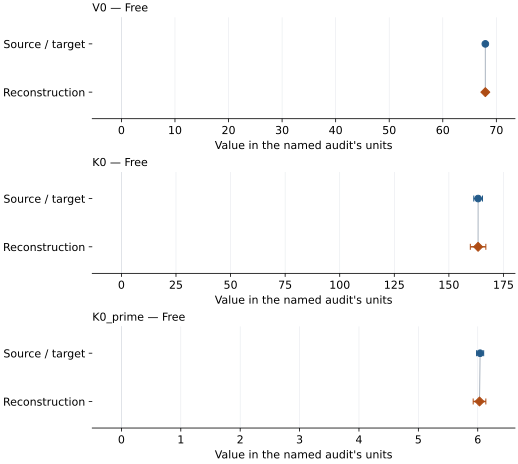

This is a **coefficient comparison**, not an observation or residual plot.
Each panel uses its coefficient's audit units and includes zero. Markers show
stored central values only. Error widths are retained in the table below;
no confidence interval or uncertainty band is inferred. Fixed/adopted values are constraints.

| Parameter | Source / target | Source error | Reconstruction | Reconstruction error | Fit role |
| --- | --- | --- | --- | --- | --- |
| V0 | 67.944 | 0.08 | 67.94312505523439 | Not specified | Free |
| K0 | 163.4 | 2.0 | 163.3770385791797 | Not specified | Free |
| K0\_prime | 6.04 | 0.06 | 6.0298208014166335 | Not specified | Free |

Values and reported errors are copied without rounding or conversion from the named audit. Missing errors mean unknown, not zero. Parameter names and volume conventions follow that audit; error widths do not imply a confidence convention.

Recorded diagnostics, covariance and additional protocol

- **Observed pressure range gpa:** \[0.0, 130.8\]
- **Solver success:** True
- **Solver message:** dedicated Dewaele (2019) refit completed
- **Rmse gpa:** 0.7730222728820225

### Detailed evidence and existing plots

- [Earlier detailed record investigation](../primary-eos-refits.md#investigation-gold_dewaele_2019_dor_vinet).
- [Record-by-record numerical ledger](../primary-eos-refits.md#records).
- [Source-audit reports](../source-audits.md).

Observation curves and residual plots are provided by the supporting reports where available. Their absence is not filled by a reconstructed curve presented as measured data.

[Machine-readable comparison ledger](https://github.com/CPrescher/peritheos/blob/main/docs/data/primary-eos-refits.json) — look up `gold_dewaele_2019_dor_vinet`.
[Complete native EOSMAT file](https://github.com/CPrescher/peritheos/blob/main/peritheos/data/materials/gold.eosmat).

## Dewaele et al. (2004), Au mao ruby Vinet

Record: `gold_dewaele_2004_mao_ruby_vinet` · Model: `Vinet`

**Outcome: Coefficient parity achieved.**

**Scope:** Comparison with the source parameterization.
**Comparison basis:** Every compared free coefficient meets both the recorded combined-two-sigma comparison and parameter-specific numerical similarity screen. Error conventions and fit qualifications remain applicable.

[Stored EOS coefficients and source](../material-summaries/gold.md#record-gold_dewaele_2004_mao_ruby_vinet)

### What this result establishes

**Separate source-review status:** primary\_source\_validated.
**Usage recommendation:** See the stored EOS qualifications; no recommendation is inferred here.

- This named numerical assessment alone does not establish author-workflow reproduction, physical accuracy or recommendation for use.

### Data and reconstruction method

- **Dataset identifiers:** gold\_dewaele\_2004\_table1\_compression
- **Observations:** 37
- **Fit kind:** isothermal\_pv
- **Selection:** all rows
- **Objective:** errors\_in\_variables
- **Absolute sigma:** True
- **Free parameters:** K0; K0\_prime
- **Fixed parameters:** V0

Unspecified selections, weights, fixed values or error conventions remain unknown; they have not been inferred for this report.

### Source versus reconstruction

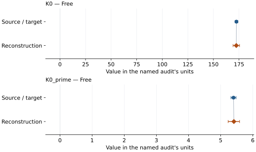

This is a **coefficient comparison**, not an observation or residual plot.
Each panel uses its coefficient's audit units and includes zero. Markers show
stored central values only. Error widths are retained in the table below;
no confidence interval or uncertainty band is inferred. Fixed/adopted values are constraints.

| Parameter | Source / target | Source error | Reconstruction | Reconstruction error | Fit role |
| --- | --- | --- | --- | --- | --- |
| K0 | 172.5 | 1.4 | 172.37746528206796 | 3.186572182097841 | Free |
| K0\_prime | 5.4 | 0.08 | 5.411095520590663 | 0.17730037584544642 | Free |

Values and reported errors are copied without rounding or conversion from the named audit. Missing errors mean unknown, not zero. Parameter names and volume conventions follow that audit; error widths do not imply a confidence convention.

Recorded diagnostics, covariance and additional protocol

- **Columns:**
    - **Pressure:** ruby\_pressure\_classical\_gpa
    - **Temperature:** Not specified
    - **Volume:** atomic\_volume\_a3
- **Observed pressure range gpa:** \[0.0, 90.0\]
- **Observed temperature range k:** Not specified
- **Observed volume range:** \[52.12, 67.864\]
- **Degrees of freedom:** 35
- **Solver success:** True
- **Solver message:** Both \`ftol\` and \`xtol\` termination conditions are satisfied.
- **Rmse gpa:** 0.2033594087067835
- **Published rmse gpa:** 0.22679437079140033
- **Reduced chi square:** 0.0484740711293025

### Detailed evidence and existing plots

- [Record-by-record numerical ledger](../primary-eos-refits.md#records).
- [Source-audit reports](../source-audits.md).

Observation curves and residual plots are provided by the supporting reports where available. Their absence is not filled by a reconstructed curve presented as measured data.

[Machine-readable comparison ledger](https://github.com/CPrescher/peritheos/blob/main/docs/data/primary-eos-refits.json) — look up `gold_dewaele_2004_mao_ruby_vinet`.
[Complete native EOSMAT file](https://github.com/CPrescher/peritheos/blob/main/peritheos/data/materials/gold.eosmat).

## Dorfman et al. (2012), Au K0-fixed Vinet

Record: `gold_dorfman_2012_tange_mgo_k0_fixed_vinet` · Model: `Vinet`

**Outcome: Parity not achieved for this comparison.**

**Scope:** Comparison with the source parameterization.
**Comparison basis:** Complete reproduction of the rows available in official auxiliary Tables S1-S6, using the source's coupled Equation (3) objective and fixed Tange MgO anchor. The fit converges to a lower objective but does not recover Table 2. Run AN012 is listed in article Table 1 yet absent from the auxiliary PDF; unrounded inputs, row-selection detail, fit code, and covariance are unavailable.

[Stored EOS coefficients and source](../material-summaries/gold.md#record-gold_dorfman_2012_tange_mgo_k0_fixed_vinet)

### What this result establishes

**Separate source-review status:** primary\_source\_validated.
**Usage recommendation:** See the stored EOS qualifications; no recommendation is inferred here.

- This named numerical assessment alone does not establish author-workflow reproduction, physical accuracy or recommendation for use.

### Data and reconstruction method

- **Dataset identifiers:** jgrb17272-sup-0002-txts01.pdf
- **Observations:** 165
- **Fit kind:** simultaneous\_cocompression\_vinet
- **Selection:** Use every nonblank paired volume printed in Tables S1-S6; include the three MgO values marked as determined from the (200) peak alone.
- **Objective:** Dorfman Equation (3)
- **Free parameters:** K0\_prime
- **Fixed parameters:** V0; K0

Unspecified selections, weights, fixed values or error conventions remain unknown; they have not been inferred for this report.

### Source versus reconstruction

This is a **coefficient comparison**, not an observation or residual plot.
Each panel uses its coefficient's audit units and includes zero. Markers show
stored central values only. Error widths are retained in the table below;
no confidence interval or uncertainty band is inferred. Fixed/adopted values are constraints.

| Parameter | Source / target | Source error | Reconstruction | Reconstruction error | Fit role |
| --- | --- | --- | --- | --- | --- |
| K0\_prime | 5.88 | 0.02 | 5.860266508021561 | Not specified | Free |

Values and reported errors are copied without rounding or conversion from the named audit. Missing errors mean unknown, not zero. Parameter names and volume conventions follow that audit; error widths do not imply a confidence convention.

Recorded diagnostics, covariance and additional protocol

- **Observed pressure range gpa:** \[34.4, 242.6\]
- **Solver success:** True
- **Solver message:** \`ftol\` termination condition is satisfied.
- **Comparison scope:** joint\_system

### Detailed evidence and existing plots

- [Earlier detailed record investigation](../primary-eos-refits.md#investigation-gold_dorfman_2012_tange_mgo_k0_fixed_vinet).
- [Record-by-record numerical ledger](../primary-eos-refits.md#records).
- [Source-audit reports](../source-audits.md).

Observation curves and residual plots are provided by the supporting reports where available. Their absence is not filled by a reconstructed curve presented as measured data.

[Machine-readable comparison ledger](https://github.com/CPrescher/peritheos/blob/main/docs/data/primary-eos-refits.json) — look up `gold_dorfman_2012_tange_mgo_k0_fixed_vinet`.
[Complete native EOSMAT file](https://github.com/CPrescher/peritheos/blob/main/peritheos/data/materials/gold.eosmat).

## Dorfman et al. (2012), Au K0-free Vinet

Record: `gold_dorfman_2012_tange_mgo_k0_free_vinet` · Model: `Vinet`

**Outcome: Parity not achieved for this comparison.**

**Scope:** Comparison with the source parameterization.
**Comparison basis:** Complete reproduction of the rows available in official auxiliary Tables S1-S6, using the source's coupled Equation (3) objective and fixed Tange MgO anchor. The fit converges to a lower objective but does not recover Table 2. Run AN012 is listed in article Table 1 yet absent from the auxiliary PDF; unrounded inputs, row-selection detail, fit code, and covariance are unavailable.

[Stored EOS coefficients and source](../material-summaries/gold.md#record-gold_dorfman_2012_tange_mgo_k0_free_vinet)

### What this result establishes

**Separate source-review status:** primary\_source\_validated.
**Usage recommendation:** See the stored EOS qualifications; no recommendation is inferred here.

- This named numerical assessment alone does not establish author-workflow reproduction, physical accuracy or recommendation for use.

### Data and reconstruction method

- **Dataset identifiers:** jgrb17272-sup-0002-txts01.pdf
- **Observations:** 165
- **Fit kind:** simultaneous\_cocompression\_vinet
- **Selection:** Use every nonblank paired volume printed in Tables S1-S6; include the three MgO values marked as determined from the (200) peak alone.
- **Objective:** Dorfman Equation (3)
- **Free parameters:** K0; K0\_prime
- **Fixed parameters:** V0

Unspecified selections, weights, fixed values or error conventions remain unknown; they have not been inferred for this report.

### Source versus reconstruction

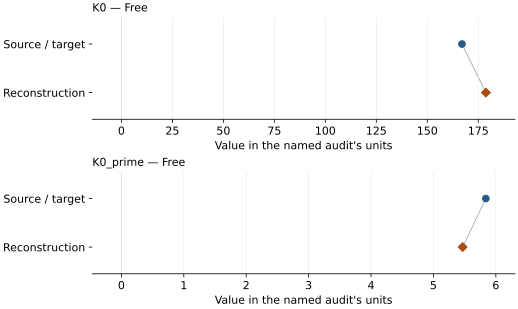

This is a **coefficient comparison**, not an observation or residual plot.
Each panel uses its coefficient's audit units and includes zero. Markers show
stored central values only. Error widths are retained in the table below;
no confidence interval or uncertainty band is inferred. Fixed/adopted values are constraints.

| Parameter | Source / target | Source error | Reconstruction | Reconstruction error | Fit role |
| --- | --- | --- | --- | --- | --- |
| K0 | 167.0 | 3.0 | 178.7131955926287 | Not specified | Free |
| K0\_prime | 5.84 | 0.02 | 5.468332069803775 | Not specified | Free |

Values and reported errors are copied without rounding or conversion from the named audit. Missing errors mean unknown, not zero. Parameter names and volume conventions follow that audit; error widths do not imply a confidence convention.

Recorded diagnostics, covariance and additional protocol

- **Observed pressure range gpa:** \[34.4, 242.6\]
- **Solver success:** True
- **Solver message:** \`ftol\` termination condition is satisfied.
- **Comparison scope:** joint\_system

### Detailed evidence and existing plots

- [Earlier detailed record investigation](../primary-eos-refits.md#investigation-gold_dorfman_2012_tange_mgo_k0_free_vinet).
- [Record-by-record numerical ledger](../primary-eos-refits.md#records).
- [Source-audit reports](../source-audits.md).

Observation curves and residual plots are provided by the supporting reports where available. Their absence is not filled by a reconstructed curve presented as measured data.

[Machine-readable comparison ledger](https://github.com/CPrescher/peritheos/blob/main/docs/data/primary-eos-refits.json) — look up `gold_dorfman_2012_tange_mgo_k0_free_vinet`.
[Complete native EOSMAT file](https://github.com/CPrescher/peritheos/blob/main/peritheos/data/materials/gold.eosmat).

## Ye et al. (2017), Au Vinet 300 K co-compression fit

Record: `gold_ye_2017_vinet_300k` · Model: `Vinet`

**Outcome: Coefficient parity achieved.**

**Scope:** Comparison with the source parameterization.
**Comparison basis:** Every compared free coefficient meets both the recorded combined-two-sigma comparison and parameter-specific numerical similarity screen. Error conventions and fit qualifications remain applicable.

[Stored EOS coefficients and source](../material-summaries/gold.md#record-gold_ye_2017_vinet_300k)

### What this result establishes

**Separate source-review status:** primary\_source\_validated.
**Usage recommendation:** See the stored EOS qualifications; no recommendation is inferred here.

- The corrected Ye et al. (2017) co-compression inputs for the selected pathway are bundled. The source-described V0/K0-fixed co-compression pathway reproduces the K0-prime point estimate and its 1 GPa-scatter standard error at the precision printed by Ye et al. (2017).
- This named numerical assessment alone does not establish author-workflow reproduction, physical accuracy or recommendation for use.

### Data and reconstruction method

- **Dataset identifiers:** ye\_2017\_data\_s1\_au\_mgo\_300k
- **Observations:** 28
- **Fit kind:** staged\_cocompression\_vinet\_k0\_prime
- **Selection:** All corrected Ye et al. (2017) co-compression rows in the selected Au\_from\_MgO pathway
- **Objective:** unweighted pressure differences between co-compressed phases
- **Absolute sigma:** True
- **Free parameters:** K0\_prime
- **Fixed parameters:** V0; K0

Unspecified selections, weights, fixed values or error conventions remain unknown; they have not been inferred for this report.

### Source versus reconstruction

This is a **coefficient comparison**, not an observation or residual plot.
Each panel uses its coefficient's audit units and includes zero. Markers show
stored central values only. Error widths are retained in the table below;
no confidence interval or uncertainty band is inferred. Fixed/adopted values are constraints.

| Parameter | Source / target | Source error | Reconstruction | Reconstruction error | Fit role |
| --- | --- | --- | --- | --- | --- |
| K0\_prime | 5.897 | 0.022 | 5.896768070200478 | 0.02222069212640481 | Free |

Values and reported errors are copied without rounding or conversion from the named audit. Missing errors mean unknown, not zero. Parameter names and volume conventions follow that audit; error widths do not imply a confidence convention.

Recorded diagnostics, covariance and additional protocol

- **Observed pressure range gpa:** \[19.03783589777603, 120.2715154156598\]
- **Solver success:** True
- **Solver message:** \`ftol\` termination condition is satisfied.
- **Rmse gpa:** 0.5712382190658275

### Detailed evidence and existing plots

- [Record-by-record numerical ledger](../primary-eos-refits.md#records).
- [Source-audit reports](../source-audits.md).

Observation curves and residual plots are provided by the supporting reports where available. Their absence is not filled by a reconstructed curve presented as measured data.

[Machine-readable comparison ledger](https://github.com/CPrescher/peritheos/blob/main/docs/data/primary-eos-refits.json) — look up `gold_ye_2017_vinet_300k`.
[Complete native EOSMAT file](https://github.com/CPrescher/peritheos/blob/main/peritheos/data/materials/gold.eosmat).

## Zhu et al. (2025), Au internally consistent P-V-T EOS

Record: `gold_zhu_2025_pvt` · Model: `Vinet`

**Outcome: Coefficient parity achieved.**

**Scope:** Comparison with the source parameterization.
**Comparison basis:** Every compared free coefficient meets both the recorded combined-two-sigma comparison and parameter-specific numerical similarity screen. Error conventions and fit qualifications remain applicable.

[Stored EOS coefficients and source](../material-summaries/gold.md#record-gold_zhu_2025_pvt)

### What this result establishes

**Separate source-review status:** primary\_source\_validated.
**Usage recommendation:** See the stored EOS qualifications; no recommendation is inferred here.

- Every released v3 fit-input row is included in an independent translation of Zhu's iterative energy-balance and robust-bisquare optimization. The fitted gamma0 and b reproduce the rounded optimizer/property parameter set at its stated numerical precision. The inconsistent standalone v3 calculators are not used as the fit target.
- This named numerical assessment alone does not establish author-workflow reproduction, physical accuracy or recommendation for use.

### Data and reconstruction method

- **Dataset identifiers:** zhu\_2025\_au\_shock; zhu\_2025\_au\_zero\_pressure\_thermal\_expansion
- **Observations:** 22
- **Fit kind:** iterative\_robust\_bisquare\_gruneisen\_refit
- **Selection:** All released v3 fit-input rows for this material
- **Objective:** Released v3 energy-balance transformation followed by robust bisquare nonlinear least squares
- **Free parameters:** gamma0; b
- **Fixed parameters:** V0; K0; K0\_prime; Tr; theta0; a; n; beta0; m

Unspecified selections, weights, fixed values or error conventions remain unknown; they have not been inferred for this report.

### Source versus reconstruction

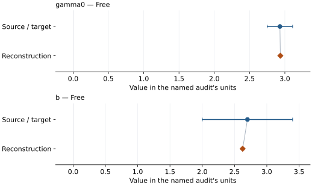

This is a **coefficient comparison**, not an observation or residual plot.
Each panel uses its coefficient's audit units and includes zero. Markers show
stored central values only. Error widths are retained in the table below;
no confidence interval or uncertainty band is inferred. Fixed/adopted values are constraints.

| Parameter | Source / target | Source error | Reconstruction | Reconstruction error | Fit role |
| --- | --- | --- | --- | --- | --- |
| gamma0 | 2.93 | 0.18 | 2.9359999606410345 | Not specified | Free |
| b | 2.7 | 0.7 | 2.6255991244983807 | Not specified | Free |

Values and reported errors are copied without rounding or conversion from the named audit. Missing errors mean unknown, not zero. Parameter names and volume conventions follow that audit; error widths do not imply a confidence convention.

Recorded diagnostics, covariance and additional protocol

- **Observed pressure range gpa:** \[0.0, 197.039\]
- **Solver success:** True
- **Solver message:** released v3 robust thermal refit converged in 7 outer iterations
- **Rmse gpa:** 2.4861289701518188

### Detailed evidence and existing plots

- [Record-by-record numerical ledger](../primary-eos-refits.md#records).
- [Source-audit reports](../source-audits.md).

Observation curves and residual plots are provided by the supporting reports where available. Their absence is not filled by a reconstructed curve presented as measured data.

[Machine-readable comparison ledger](https://github.com/CPrescher/peritheos/blob/main/docs/data/primary-eos-refits.json) — look up `gold_zhu_2025_pvt`.
[Complete native EOSMAT file](https://github.com/CPrescher/peritheos/blob/main/peritheos/data/materials/gold.eosmat).

## Hirose et al. (2008), thermal BM3 fit #2 (preferred)

Record: `gold_hirose_2008_bm3_fit2` · Model: `BM3`

**Outcome: Numerically similar, with qualifications.**

**Scope:** Comparison with the source parameterization.
**Comparison basis:** Every compared free coefficient meets either the recorded combined-two-sigma comparison or parameter-specific numerical similarity screen; the audit does not classify the complete comparison as parity.

[Stored EOS coefficients and source](../material-summaries/gold.md#record-gold_hirose_2008_bm3_fit2)

### What this result establishes

**Separate source-review status:** primary\_source\_validated.
**Usage recommendation:** See the stored EOS qualifications; no recommendation is inferred here.

- Complete published PVT selection recovered. Original residual coordinate, weights, covariance and unrounded observations remain unspecified. Weighted sensitivity treats printed pressure errors as relative weights only, not established sigma; it omits Au-volume and temperature uncertainty and correlated calibration errors. Ambient expansivity coefficients are source-fixed, not refitted from unavailable Touloukian data.
- This named numerical assessment alone does not establish author-workflow reproduction, physical accuracy or recommendation for use.

### Data and reconstruction method

- **Dataset identifiers:** gold\_hirose\_2008\_table1; gold\_fei\_2004\_table1
- **Observations:** 38
- **Fit kind:** diagnostic\_unweighted\_pressure
- **Fixed parameters:** V0; K0; K0\_prime; Tr; alpha0; alpha1; dK\_dT

Unspecified selections, weights, fixed values or error conventions remain unknown; they have not been inferred for this report.

### Source versus reconstruction

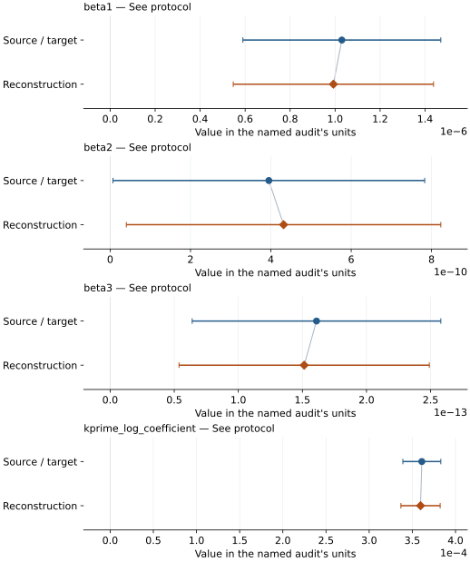

This is a **coefficient comparison**, not an observation or residual plot.
Each panel uses its coefficient's audit units and includes zero. Markers show
stored central values only. Error widths are retained in the table below;
no confidence interval or uncertainty band is inferred. Fixed/adopted values are constraints.

| Parameter | Source / target | Source error | Reconstruction | Reconstruction error | Fit role |
| --- | --- | --- | --- | --- | --- |
| beta1 | 1.03e-06 | 4.4e-07 | 9.924306426760731e-07 | 4.4515812720505623e-07 | See protocol |
| beta2 | 3.95e-10 | 3.88e-10 | 4.317111941012275e-10 | 3.914573391230663e-10 | See protocol |
| beta3 | 1.61e-13 | 9.7e-14 | 1.5138015223907164e-13 | 9.764421605205168e-14 | See protocol |
| kprime\_log\_coefficient | 0.000361 | 2.2e-05 | 0.0003594895172822541 | 2.2723108298574738e-05 | See protocol |

Values and reported errors are copied without rounding or conversion from the named audit. Missing errors mean unknown, not zero. Parameter names and volume conventions follow that audit; error widths do not imply a confidence convention.

Recorded diagnostics, covariance and additional protocol

- **Solver success:** True
- **Rmse gpa:** 0.445141799111663
- **Published rmse gpa:** 0.4479194129604852

### Detailed evidence and existing plots

- [Earlier detailed record investigation](../primary-eos-refits.md#investigation-gold_hirose_2008_bm3_fit2).
- [Record-by-record numerical ledger](../primary-eos-refits.md#records).
- [Source-audit reports](../source-audits.md).

Observation curves and residual plots are provided by the supporting reports where available. Their absence is not filled by a reconstructed curve presented as measured data.

[Machine-readable comparison ledger](https://github.com/CPrescher/peritheos/blob/main/docs/data/primary-eos-refits.json) — look up `gold_hirose_2008_bm3_fit2`.
[Complete native EOSMAT file](https://github.com/CPrescher/peritheos/blob/main/peritheos/data/materials/gold.eosmat).

## Hirose et al. (2008), thermal BM3 fit #1 (DAC only)

Record: `gold_hirose_2008_bm3_fit1` · Model: `BM3`

**Outcome: Numerically similar, with qualifications.**

**Scope:** Comparison with the source parameterization.
**Comparison basis:** Every compared free coefficient meets either the recorded combined-two-sigma comparison or parameter-specific numerical similarity screen; the audit does not classify the complete comparison as parity.

[Stored EOS coefficients and source](../material-summaries/gold.md#record-gold_hirose_2008_bm3_fit1)

### What this result establishes

**Separate source-review status:** primary\_source\_validated.
**Usage recommendation:** See the stored EOS qualifications; no recommendation is inferred here.

- Published row selection and fixed reference coefficients retained. Unweighted pressure residuals are diagnostic because the source does not specify its objective, weights, or covariance. Published coefficients remain unchanged.
- This named numerical assessment alone does not establish author-workflow reproduction, physical accuracy or recommendation for use.

### Data and reconstruction method

- **Dataset identifiers:** gold\_hirose\_2008\_table1
- **Observations:** 12
- **Fit kind:** diagnostic\_unweighted\_pressure
- **Free parameters:** dK\_dT; alpha0; alpha1
- **Fixed parameters:** V0; K0; K0\_prime; Tr

Unspecified selections, weights, fixed values or error conventions remain unknown; they have not been inferred for this report.

### Source versus reconstruction

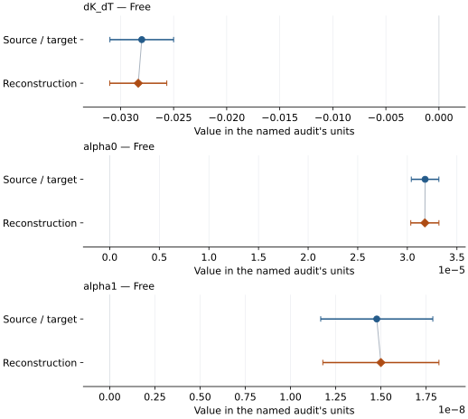

This is a **coefficient comparison**, not an observation or residual plot.
Each panel uses its coefficient's audit units and includes zero. Markers show
stored central values only. Error widths are retained in the table below;
no confidence interval or uncertainty band is inferred. Fixed/adopted values are constraints.

| Parameter | Source / target | Source error | Reconstruction | Reconstruction error | Fit role |
| --- | --- | --- | --- | --- | --- |
| dK\_dT | -0.028 | 0.003 | -0.028332495756161705 | Not specified | Free |
| alpha0 | 3.179e-05 | 1.39e-06 | 3.176726251212547e-05 | Not specified | Free |
| alpha1 | 1.477e-08 | 3.1e-09 | 1.499812911963746e-08 | Not specified | Free |

Values and reported errors are copied without rounding or conversion from the named audit. Missing errors mean unknown, not zero. Parameter names and volume conventions follow that audit; error widths do not imply a confidence convention.

Recorded diagnostics, covariance and additional protocol

- **Solver success:** True
- **Rmse gpa:** 0.38847700498905835
- **Published rmse gpa:** 0.4595254485710879

### Detailed evidence and existing plots

- [Earlier detailed record investigation](../primary-eos-refits.md#investigation-gold_hirose_2008_bm3_fit1).
- [Record-by-record numerical ledger](../primary-eos-refits.md#records).
- [Source-audit reports](../source-audits.md).

Observation curves and residual plots are provided by the supporting reports where available. Their absence is not filled by a reconstructed curve presented as measured data.

[Machine-readable comparison ledger](https://github.com/CPrescher/peritheos/blob/main/docs/data/primary-eos-refits.json) — look up `gold_hirose_2008_bm3_fit1`.
[Complete native EOSMAT file](https://github.com/CPrescher/peritheos/blob/main/peritheos/data/materials/gold.eosmat).

## Hirose et al. (2008), 300 K BM3 on Speziale MgO scale

Record: `gold_hirose_2008_bm3_300k` · Model: `BM3`

**Outcome: Numerically similar, with qualifications.**

**Scope:** Comparison with the source parameterization.
**Comparison basis:** Every compared free coefficient meets either the recorded combined-two-sigma comparison or parameter-specific numerical similarity screen; the audit does not classify the complete comparison as parity.

[Stored EOS coefficients and source](../material-summaries/gold.md#record-gold_hirose_2008_bm3_300k)

### What this result establishes

**Separate source-review status:** primary\_source\_validated.
**Usage recommendation:** See the stored EOS qualifications; no recommendation is inferred here.

- Published row selection and fixed reference coefficients retained. Unweighted pressure residuals are diagnostic because the source does not specify its objective, weights, or covariance. Published coefficients remain unchanged.
- This named numerical assessment alone does not establish author-workflow reproduction, physical accuracy or recommendation for use.

### Data and reconstruction method

- **Dataset identifiers:** gold\_hirose\_2008\_table1
- **Observations:** 9
- **Fit kind:** diagnostic\_unweighted\_pressure
- **Free parameters:** K0\_prime
- **Fixed parameters:** V0; K0

Unspecified selections, weights, fixed values or error conventions remain unknown; they have not been inferred for this report.

### Source versus reconstruction

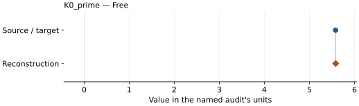

This is a **coefficient comparison**, not an observation or residual plot.
Each panel uses its coefficient's audit units and includes zero. Markers show
stored central values only. Error widths are retained in the table below;
no confidence interval or uncertainty band is inferred. Fixed/adopted values are constraints.

| Parameter | Source / target | Source error | Reconstruction | Reconstruction error | Fit role |
| --- | --- | --- | --- | --- | --- |
| K0\_prime | 5.58 | 0.02 | 5.583345175577682 | Not specified | Free |

Values and reported errors are copied without rounding or conversion from the named audit. Missing errors mean unknown, not zero. Parameter names and volume conventions follow that audit; error widths do not imply a confidence convention.

Recorded diagnostics, covariance and additional protocol

- **Solver success:** True
- **Rmse gpa:** 0.6697309596138137
- **Published rmse gpa:** 0.6706550807731002

### Detailed evidence and existing plots

- [Earlier detailed record investigation](../primary-eos-refits.md#investigation-gold_hirose_2008_bm3_300k).
- [Record-by-record numerical ledger](../primary-eos-refits.md#records).
- [Source-audit reports](../source-audits.md).

Observation curves and residual plots are provided by the supporting reports where available. Their absence is not filled by a reconstructed curve presented as measured data.

[Machine-readable comparison ledger](https://github.com/CPrescher/peritheos/blob/main/docs/data/primary-eos-refits.json) — look up `gold_hirose_2008_bm3_300k`.
[Complete native EOSMAT file](https://github.com/CPrescher/peritheos/blob/main/peritheos/data/materials/gold.eosmat).

## Fei et al. (2004), gold BM3-MGD on Speziale MgO scale

Record: `gold_fei_2004_bm3_mgd` · Model: `BM3`

**Outcome: Complete independent refit unavailable.**

**Scope:** Comparison with the source parameterization.
**Comparison basis:** Unweighted pressure residuals, printed volumes and pressures; residual-scaled linearized standard errors are diagnostic only. No source weights, covariance, confidence or calibration-error correlations. Pt V0 and theta0 fixed for this diagnostic; source does not enumerate its full fitted/fixed list. Au q fit excludes upstream shock observations and is not the source joint compromise.

[Stored EOS coefficients and source](../material-summaries/gold.md#record-gold_fei_2004_bm3_mgd)

### What this result establishes

**Separate source-review status:** primary\_source\_validated.
**Usage recommendation:** See the stored EOS qualifications; no recommendation is inferred here.

- This named numerical assessment alone does not establish author-workflow reproduction, physical accuracy or recommendation for use.

### Data and reconstruction method

- **Dataset identifiers:** gold\_fei\_2004\_table1
- **Observations:** 26
- **Fit kind:** diagnostic\_unweighted\_pressure
- **Fixed parameters:** V0; K0; K0\_prime; Tr; theta0; gamma0; n

Unspecified selections, weights, fixed values or error conventions remain unknown; they have not been inferred for this report.

### Source versus reconstruction

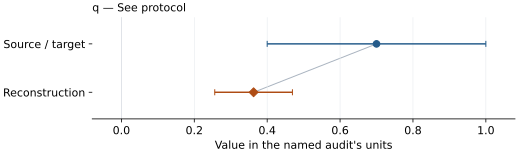

This is a **coefficient comparison**, not an observation or residual plot.
Each panel uses its coefficient's audit units and includes zero. Markers show
stored central values only. Error widths are retained in the table below;
no confidence interval or uncertainty band is inferred. Fixed/adopted values are constraints.

| Parameter | Source / target | Source error | Reconstruction | Reconstruction error | Fit role |
| --- | --- | --- | --- | --- | --- |
| q | 0.7 | 0.3 | 0.36269762382732457 | 0.10660429662399096 | See protocol |

Values and reported errors are copied without rounding or conversion from the named audit. Missing errors mean unknown, not zero. Parameter names and volume conventions follow that audit; error widths do not imply a confidence convention.

Recorded diagnostics, covariance and additional protocol

- **Solver success:** True
- **Rmse gpa:** 0.3252921712897166
- **Published rmse gpa:** 0.38380272463080667

### Detailed evidence and existing plots

- [Record-by-record numerical ledger](../primary-eos-refits.md#records).
- [Source-audit reports](../source-audits.md).

Observation curves and residual plots are provided by the supporting reports where available. Their absence is not filled by a reconstructed curve presented as measured data.

[Machine-readable comparison ledger](https://github.com/CPrescher/peritheos/blob/main/docs/data/primary-eos-refits.json) — look up `gold_fei_2004_bm3_mgd`.
[Complete native EOSMAT file](https://github.com/CPrescher/peritheos/blob/main/peritheos/data/materials/gold.eosmat).

## Yokoo et al. (2009), Au fitted BM3 isotherm, 300 K

Record: `gold_yokoo_2009_bm3_300k` · Model: `BM3`

**Outcome: Complete independent refit unavailable.**

**Scope:** Comparison with the source parameterization.
**Comparison basis:** Table II publishes separate 300 K BM3/Vinet fits. Table III is derived full thermal model output, not independent observations. Corrected upstream electronic pressure nodes are recovered. Complete Au shock/ambient selections, numerical electronic energy/DOS, original objective/weights and exact cold/phonon normalization remain unavailable. See \[Au audit\](literature-reproductions/yokoo-2009-gold.md).

[Stored EOS coefficients and source](../material-summaries/gold.md#record-gold_yokoo_2009_bm3_300k)

### What this result establishes

**Separate source-review status:** primary\_source\_validated.
**Usage recommendation:** See the stored EOS qualifications; no recommendation is inferred here.

- This named numerical assessment alone does not establish author-workflow reproduction, physical accuracy or recommendation for use.
- No reconstructed coefficient table is recorded for this assessment; no missing values have been inferred.

### Data and reconstruction method

- **Dataset identifiers:** gold\_yokoo\_2009\_table3\_isochores; tsuchiya\_kawamura\_2002\_table1\_electronic\_pressure
- **Observations:** 0
- **Fit kind:** published\_reference\_isotherm\_from\_joint\_shock\_thermodynamic\_model
- **Fixed parameters:** V0

Unspecified selections, weights, fixed values or error conventions remain unknown; they have not been inferred for this report.

### Why no coefficient graph is shown

No numeric source/reconstruction pair is recorded for this assessment. A graph would require information that is not available here; no values or observations have been invented.

### Detailed evidence and existing plots

- [Supporting source report: yokoo-2009-gold](../literature-reproductions/yokoo-2009-gold.md).
- [Record-by-record numerical ledger](../primary-eos-refits.md#records).
- [Source-audit reports](../source-audits.md).

Observation curves and residual plots are provided by the supporting reports where available. Their absence is not filled by a reconstructed curve presented as measured data.

[Machine-readable comparison ledger](https://github.com/CPrescher/peritheos/blob/main/docs/data/primary-eos-refits.json) — look up `gold_yokoo_2009_bm3_300k`.
[Complete native EOSMAT file](https://github.com/CPrescher/peritheos/blob/main/peritheos/data/materials/gold.eosmat).

## Yokoo et al. (2009), Au fitted Vinet isotherm, 300 K

Record: `gold_yokoo_2009_vinet_300k` · Model: `Vinet`

**Outcome: Complete independent refit unavailable.**

**Scope:** Comparison with the source parameterization.
**Comparison basis:** Table II publishes separate 300 K BM3/Vinet fits. Table III is derived full thermal model output, not independent observations. Corrected upstream electronic pressure nodes are recovered. Complete Au shock/ambient selections, numerical electronic energy/DOS, original objective/weights and exact cold/phonon normalization remain unavailable. See \[Au audit\](literature-reproductions/yokoo-2009-gold.md).

[Stored EOS coefficients and source](../material-summaries/gold.md#record-gold_yokoo_2009_vinet_300k)

### What this result establishes

**Separate source-review status:** primary\_source\_validated.
**Usage recommendation:** See the stored EOS qualifications; no recommendation is inferred here.

- This named numerical assessment alone does not establish author-workflow reproduction, physical accuracy or recommendation for use.
- No reconstructed coefficient table is recorded for this assessment; no missing values have been inferred.

### Data and reconstruction method

- **Dataset identifiers:** gold\_yokoo\_2009\_table3\_isochores; tsuchiya\_kawamura\_2002\_table1\_electronic\_pressure
- **Observations:** 0
- **Fit kind:** published\_reference\_isotherm\_from\_joint\_shock\_thermodynamic\_model
- **Fixed parameters:** V0

Unspecified selections, weights, fixed values or error conventions remain unknown; they have not been inferred for this report.

### Why no coefficient graph is shown

No numeric source/reconstruction pair is recorded for this assessment. A graph would require information that is not available here; no values or observations have been invented.

### Detailed evidence and existing plots

- [Supporting source report: yokoo-2009-gold](../literature-reproductions/yokoo-2009-gold.md).
- [Record-by-record numerical ledger](../primary-eos-refits.md#records).
- [Source-audit reports](../source-audits.md).

Observation curves and residual plots are provided by the supporting reports where available. Their absence is not filled by a reconstructed curve presented as measured data.

[Machine-readable comparison ledger](https://github.com/CPrescher/peritheos/blob/main/docs/data/primary-eos-refits.json) — look up `gold_yokoo_2009_vinet_300k`.
[Complete native EOSMAT file](https://github.com/CPrescher/peritheos/blob/main/peritheos/data/materials/gold.eosmat).

## Yokoo et al. (2009), Gold PVT — diagnostic Table III reconstruction

Record: `gold_yokoo_2009_pvt_reconstruction` · Model: `BM3`

**Outcome: Source calculation reconstructed.**

**Scope:** Reconstruction of a source equation or calculation.
**Comparison basis:** Numerically checked diagnostic reconstruction of published table outputs. The published analytical PVT parameterization remains unreproduced: Au uses altered phonon coefficients and Pt adds an empirical pressure correction. This source-output status does not validate the published Yokoo pressure standard. The separate pressure-convention audit rules out cold-reference offsets and tests last-digit rounding; no caloric or original-fit inputs are required for PVT evaluation.

[Stored EOS coefficients and source](../material-summaries/gold.md#record-gold_yokoo_2009_pvt_reconstruction)

### What this result establishes

**Separate source-review status:** not\_reproduced.
**Usage recommendation:** See the stored EOS qualifications; no recommendation is inferred here.

- This named numerical assessment alone does not establish author-workflow reproduction, physical accuracy or recommendation for use.
- No reconstructed coefficient table is recorded for this assessment; no missing values have been inferred.

### Data and reconstruction method

- **Dataset identifiers:** gold\_yokoo\_2009\_table3\_isochores; tsuchiya\_kawamura\_2002\_table1\_electronic\_pressure
- **Observations:** 0
- **Fixed parameters:** K0; Tr; theta0; n

Unspecified selections, weights, fixed values or error conventions remain unknown; they have not been inferred for this report.

### Why no coefficient graph is shown

No numeric source/reconstruction pair is recorded for this assessment. A graph would require information that is not available here; no values or observations have been invented.

Recorded diagnostics, covariance and additional protocol

- **Rmse gpa:** 0.008922681886743658
- **Reconstruction kind:** derived\_table\_output\_pressure\_reconstruction

### Detailed evidence and existing plots

- [Related illustrated report explicitly naming this EOS: yokoo-2009-gold](../literature-reproductions/yokoo-2009-gold.md).
- [Record-by-record numerical ledger](../primary-eos-refits.md#records).
- [Source-audit reports](../source-audits.md).

Observation curves and residual plots are provided by the supporting reports where available. Their absence is not filled by a reconstructed curve presented as measured data.

[Machine-readable comparison ledger](https://github.com/CPrescher/peritheos/blob/main/docs/data/primary-eos-refits.json) — look up `gold_yokoo_2009_pvt_reconstruction`.
[Complete native EOSMAT file](https://github.com/CPrescher/peritheos/blob/main/peritheos/data/materials/gold.eosmat).

## Peritheos refit: Hirose (2008) + Fei (2004), Au on author-confirmed Speziale (2001) MgO

Record: `gold_hirose_2008_fei_2004_speziale_2001_bm3_refit` · Model: `BM3`

**Outcome: Coefficient parity achieved.**

**Scope:** Reproduction of a stored independent Peritheos refit.
**Comparison basis:** Reproduction of the registered Peritheos refit's stored coefficients under its declared protocol.

[Stored EOS coefficients and source](../material-summaries/gold.md#record-gold_hirose_2008_fei_2004_speziale_2001_bm3_refit)

### What this result establishes

**Separate source-review status:** primary\_source\_validated.
**Usage recommendation:** See the stored EOS qualifications; no recommendation is inferred here.

- This comparison concerns the stored independent Peritheos refit, not recovery of the original publication's coefficients or author workflow.
- Independent Peritheos staged refit of Hirose (2008) and Fei (2004) Au-MgO measurements. All 47 pressure targets are recalculated with the published, author-confirmed Speziale (2001) variable-q Debye EOS. Nine 300 K Hirose rows determine K0-prime with V0=67.85 A^3 and K0=167 GPa fixed; K0-prime is then fixed while 26 Fei and 12 hot Hirose rows determine beta1,beta2,beta3 and the logarithmic Kprime coefficient. Ambient expansivity remains source-fixed. Equal pressure-residual weights are an analyst choice. This is not a Hirose/Fei author fit or a Fei EOS refit. Stage-conditional curvature widths/covariance are archived only; catalog parameter errors remain unset because predictor, calibrant, fixed-anchor and inter-stage uncertainty/covariance are not propagated. Numerical reproducibility does not establish absolute pressure accuracy or independent predictive validity.
- Original publication reproduction status: not\_reproduced

### Data and reconstruction method

The source/target column below is the stored **Peritheos refit**. Agreement with it does not reproduce the original publication's coefficients.

- **Dataset identifiers:** gold\_hirose\_2008\_fei\_2004\_speziale\_2001\_recalculated\_pvt
- **Observations:** 47
- **Fit kind:** staged\_cold\_then\_thermal\_bm3\_reference\_state
- **Objective:** sum of squared pressure residuals with equal weights at each stage
- **Fixed parameters:** V0; K0; Tr; alpha0; alpha1; dK\_dT

Unspecified selections, weights, fixed values or error conventions remain unknown; they have not been inferred for this report.

### Source versus reconstruction

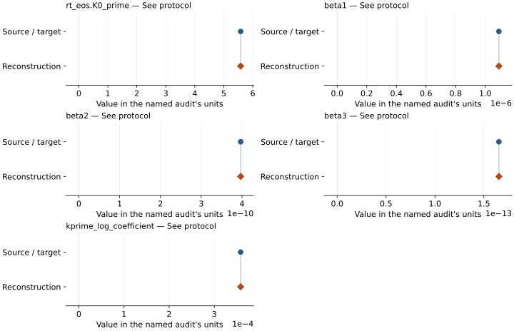

This is a **coefficient comparison**, not an observation or residual plot.
Each panel uses its coefficient's audit units and includes zero. Markers show
stored central values only. Error widths are retained in the table below;
no confidence interval or uncertainty band is inferred. Fixed/adopted values are constraints.

| Parameter | Source / target | Source error | Reconstruction | Reconstruction error | Fit role |
| --- | --- | --- | --- | --- | --- |
| rt\_eos.K0\_prime | 5.581150323572888 | Not specified | 5.581150323572888 | Not specified | See protocol |
| beta1 | 1.0917527108795146e-06 | Not specified | 1.0917527108795146e-06 | Not specified | See protocol |
| beta2 | 3.9664802649941097e-10 | Not specified | 3.9664802649941097e-10 | Not specified | See protocol |
| beta3 | 1.6537830789802096e-13 | Not specified | 1.6537830789802096e-13 | Not specified | See protocol |
| kprime\_log\_coefficient | 0.0003583216931587801 | Not specified | 0.0003583216931587801 | Not specified | See protocol |

Values and reported errors are copied without rounding or conversion from the named audit. Missing errors mean unknown, not zero. Parameter names and volume conventions follow that audit; error widths do not imply a confidence convention.

Recorded diagnostics, covariance and additional protocol

- **Solver success:** True
- **Rmse gpa:** 0.3964628457007681

### Detailed evidence and existing plots

- [Record-by-record numerical ledger](../primary-eos-refits.md#records).
- [Source-audit reports](../source-audits.md).

Observation curves and residual plots are provided by the supporting reports where available. Their absence is not filled by a reconstructed curve presented as measured data.

[Machine-readable comparison ledger](https://github.com/CPrescher/peritheos/blob/main/docs/data/primary-eos-refits.json) — look up `gold_hirose_2008_fei_2004_speziale_2001_bm3_refit`.
[Complete native EOSMAT file](https://github.com/CPrescher/peritheos/blob/main/peritheos/data/materials/gold.eosmat).
