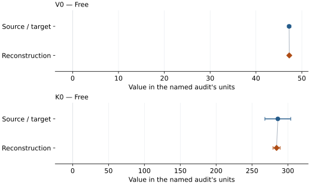

# Hydrous silica CaCl2 type (Nisr 2017): EOS reconstruction reports

<!-- Generated by scripts.generate_reconstruction_reports; edit EOSMAT instead. -->

[All reconstruction reports](index.md) · [Material and EOS parameters](../material-summaries/hydrous_silica_cacl2_nisr_2017.md)

These reports explain the assessments already stored in EOSMAT. Generating
this page does not refit observations, change classifications or replace source coefficients.

Use [scientific label definitions](../eos-labels.md) to distinguish coefficient
agreement, source verification, author-workflow reproduction and recommendation for use.

| EOS record | Recorded outcome | Coefficient comparison |
| --- | --- | --- |
| [Nisr et al. (2017), hydrous CaCl2-type silica BM2](#record-hydrous_silica_cacl2_nisr_2017_bm2) | Coefficient parity achieved | Graph and table |

## Nisr et al. (2017), hydrous CaCl2-type silica BM2

Record: `hydrous_silica_cacl2_nisr_2017_bm2` · Model: `BM2`

**Outcome: Coefficient parity achieved.**

**Scope:** Comparison with the source parameterization.
**Comparison basis:** Every compared free coefficient meets both the recorded combined-two-sigma comparison and parameter-specific numerical similarity screen. Error conventions and fit qualifications remain applicable.

[Stored EOS coefficients and source](../material-summaries/hydrous_silica_cacl2_nisr_2017.md#record-hydrous_silica_cacl2_nisr_2017_bm2)

### What this result establishes

**Separate source-review status:** primary\_source\_validated.
**Usage recommendation:** See the stored EOS qualifications; no recommendation is inferred here.

- Coefficient parity within published 1-sigma widths, not recovery of an unpublished weighting protocol. Pressure errors, gold volumes and source covariance are absent. Printed zero volume errors are retained, never treated as infinite weights. Volume-objective sensitivity fits are in the paper-specific reproduction.
- Original least-squares dependent variable and weights are unspecified; diagnostic objective is explicit.
- Pressure marker variant and row-wise marker observations unavailable.
- This named numerical assessment alone does not establish author-workflow reproduction, physical accuracy or recommendation for use.

### Data and reconstruction method

- **Dataset identifiers:** nisr\_2017\_silica\_tables\_s1\_s4
- **Observations:** 8
- **Fit kind:** diagnostic\_unweighted\_pressure
- **Selection:** All Table S4 rows, including its ambient row when present; Table S3 coexistence rows excluded.
- **Objective:** unweighted pressure residuals; source dependent variable and weights unspecified
- **Absolute sigma:** False
- **Free parameters:** V0; K0
- **Fixed parameters:** None declared

Unspecified selections, weights, fixed values or error conventions remain unknown; they have not been inferred for this report.

### Source versus reconstruction

This is a **coefficient comparison**, not an observation or residual plot.
Each panel uses its coefficient's audit units and includes zero. Markers show
stored central values only. Error widths are retained in the table below;
no confidence interval or uncertainty band is inferred. Fixed/adopted values are constraints.

| Parameter | Source / target | Source error | Reconstruction | Reconstruction error | Fit role |
| --- | --- | --- | --- | --- | --- |
| V0 | 47.23 | 0.36 | 47.26776659985669 | 0.09096853257033174 | Free |
| K0 | 286.0 | 18.0 | 284.2176104350147 | 4.983794925908353 | Free |

Values and reported errors are copied without rounding or conversion from the named audit. Missing errors mean unknown, not zero. Parameter names and volume conventions follow that audit; error widths do not imply a confidence convention.

Recorded diagnostics, covariance and additional protocol

- **Observed pressure range gpa:** \[42.225, 62.934\]
- **Degrees of freedom:** 6
- **Solver success:** True
- **Rmse gpa:** 0.18052922464767193
- **Published rmse gpa:** 0.19094366489555822

### Detailed evidence and existing plots

- [Supporting source report: nisr-2017-hydrous-silica](../literature-reproductions/nisr-2017-hydrous-silica.md).
- [Record-by-record numerical ledger](../primary-eos-refits.md#records).
- [Source-audit reports](../source-audits.md).

Observation curves and residual plots are provided by the supporting reports where available. Their absence is not filled by a reconstructed curve presented as measured data.

[Machine-readable comparison ledger](https://github.com/CPrescher/peritheos/blob/main/docs/data/primary-eos-refits.json) — look up `hydrous_silica_cacl2_nisr_2017_bm2`.
[Complete native EOSMAT file](https://github.com/CPrescher/peritheos/blob/main/peritheos/data/materials/hydrous_silica_cacl2_nisr_2017.eosmat).
