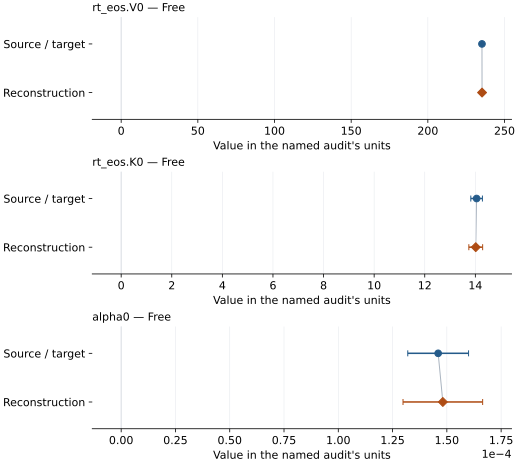

# Ice VI: EOS reconstruction reports

<!-- Generated by scripts.generate_reconstruction_reports; edit EOSMAT instead. -->

[All reconstruction reports](index.md) · [Material and EOS parameters](../material-summaries/ice_vi.md)

These reports explain the assessments already stored in EOSMAT. Generating
this page does not refit observations, change classifications or replace source coefficients.

Use [scientific label definitions](../eos-labels.md) to distinguish coefficient
agreement, source verification, author-workflow reproduction and recommendation for use.

| EOS record | Recorded outcome | Coefficient comparison |
| --- | --- | --- |
| [Bezacier et al. (2014), PVT BM2](#record-ice_vi_bezacier_2014_bm2_1) | Coefficient parity achieved | Graph and table |

## Bezacier et al. (2014), PVT BM2

Record: `ice_vi_bezacier_2014_bm2_1` · Model: `BM2`

**Outcome: Coefficient parity achieved.**

**Scope:** Comparison with the source parameterization.
**Comparison basis:** Every compared free coefficient meets both the recorded combined-two-sigma comparison and parameter-specific numerical similarity screen. Error conventions and fit qualifications remain applicable.

[Stored EOS coefficients and source](../material-summaries/ice_vi.md#record-ice_vi_bezacier_2014_bm2_1)

### What this result establishes

**Separate source-review status:** primary\_source\_validated.
**Usage recommendation:** See the stored EOS qualifications; no recommendation is inferred here.

- Source-scope reproduction: Figure 2 displays the ice-VI PVT data as the 300 K and 340 K isotherms. The 15 intermediate-temperature rows in Table I form a pressure-temperature ramp and are not plotted there. The best-supported reconstruction selects the 23 rows at 298.7-300.7 K and the seven rows at 340.0-340.7 K; it recovers V0, K0, and alpha0 within combined two-sigma uncertainty.
- This named numerical assessment alone does not establish author-workflow reproduction, physical accuracy or recommendation for use.

### Data and reconstruction method

- **Dataset identifiers:** ice\_vi\_bezacier\_2014\_table1\_pvt
- **Observations:** 30
- **Fit kind:** joint\_pvt
- **Selection:** 23 rows at 298.7-300.7 K and seven rows at 340.0-340.7 K
- **Objective:** errors\_in\_variables
- **Absolute sigma:** True
- **Free parameters:** rt\_eos.V0; rt\_eos.K0; alpha0
- **Fixed parameters:** dK\_dT; Tr

Unspecified selections, weights, fixed values or error conventions remain unknown; they have not been inferred for this report.

### Source versus reconstruction

This is a **coefficient comparison**, not an observation or residual plot.
Each panel uses its coefficient's audit units and includes zero. Markers show
stored central values only. Error widths are retained in the table below;
no confidence interval or uncertainty band is inferred. Fixed/adopted values are constraints.

| Parameter | Source / target | Source error | Reconstruction | Reconstruction error | Fit role |
| --- | --- | --- | --- | --- | --- |
| rt\_eos.V0 | 235.2983858185 | 0.3321078134 | 235.3537684335085 | 0.3884730523499238 | Free |
| rt\_eos.K0 | 14.05 | 0.23 | 14.015825053757764 | 0.272882340924503 | Free |
| alpha0 | 0.000146 | 1.4e-05 | 0.00014815262758176244 | 1.833756244128889e-05 | Free |

Values and reported errors are copied without rounding or conversion from the named audit. Missing errors mean unknown, not zero. Parameter names and volume conventions follow that audit; error widths do not imply a confidence convention.

Recorded diagnostics, covariance and additional protocol

- **Columns:**
    - **Pressure:** pressure\_gpa
    - **Temperature:** temperature\_k
    - **Volume:** unit\_cell\_volume\_a3
- **Observed pressure range gpa:** \[1.26, 2.81\]
- **Observed temperature range k:** \[298.7, 340.7\]
- **Observed volume range:** \[202.779, 217.944\]
- **Degrees of freedom:** 27
- **Solver success:** True
- **Solver message:** \`xtol\` termination condition is satisfied.
- **Rmse gpa:** 0.010204620341662998
- **Published rmse gpa:** 0.010440591210967413
- **Reduced chi square:** 0.13962648236191608

### Detailed evidence and existing plots

- [Record-by-record numerical ledger](../primary-eos-refits.md#records).
- [Source-audit reports](../source-audits.md).

Observation curves and residual plots are provided by the supporting reports where available. Their absence is not filled by a reconstructed curve presented as measured data.

[Machine-readable comparison ledger](https://github.com/CPrescher/peritheos/blob/main/docs/data/primary-eos-refits.json) — look up `ice_vi_bezacier_2014_bm2_1`.
[Complete native EOSMAT file](https://github.com/CPrescher/peritheos/blob/main/peritheos/data/materials/ice_vi.eosmat).
