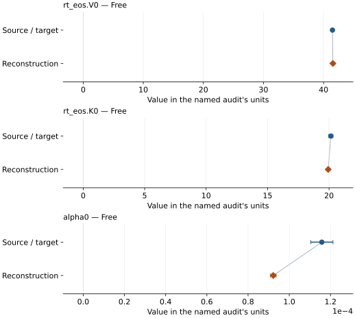
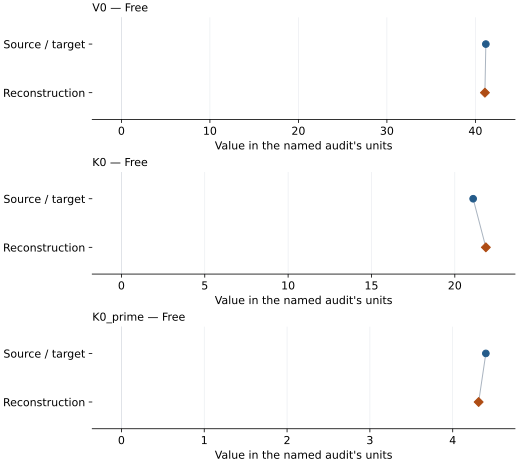

# Ice VII: EOS reconstruction reports

<!-- Generated by scripts.generate_reconstruction_reports; edit EOSMAT instead. -->

[All reconstruction reports](index.md) · [Material and EOS parameters](../material-summaries/ice_vii.md)

These reports explain the assessments already stored in EOSMAT. Generating
this page does not refit observations, change classifications or replace source coefficients.

Use [scientific label definitions](../eos-labels.md) to distinguish coefficient
agreement, source verification, author-workflow reproduction and recommendation for use.

| EOS record | Recorded outcome | Coefficient comparison |
| --- | --- | --- |
| [Bezacier et al. (2014), PVT BM2](#record-ice_vii_bezacier_2014_bm2_1) | Numerically similar, with qualifications | Graph and table |
| [Frank et al. (2004), 300 K BM3](#record-ice_vii_frank_2004_bm3_2) | Coefficient parity achieved | Graph and table |

## Bezacier et al. (2014), PVT BM2

Record: `ice_vii_bezacier_2014_bm2_1` · Model: `BM2`

**Outcome: Numerically similar, with qualifications.**

**Scope:** Comparison with the source parameterization.
**Comparison basis:** Every compared free coefficient meets either the recorded combined-two-sigma comparison or parameter-specific numerical similarity screen; the audit does not classify the complete comparison as parity.

[Stored EOS coefficients and source](../material-summaries/ice_vii.md#record-ice_vii_bezacier_2014_bm2_1)

### What this result establishes

**Separate source-review status:** primary\_source\_validated.
**Usage recommendation:** See the stored EOS qualifications; no recommendation is inferred here.

- This named numerical assessment alone does not establish author-workflow reproduction, physical accuracy or recommendation for use.

### Data and reconstruction method

- **Dataset identifiers:** ice\_vii\_bezacier\_2014\_table1\_pvt
- **Observations:** 92
- **Fit kind:** joint\_pvt
- **Selection:** all rows
- **Objective:** errors\_in\_variables
- **Absolute sigma:** True
- **Free parameters:** rt\_eos.V0; rt\_eos.K0; alpha0
- **Fixed parameters:** dK\_dT; Tr

Unspecified selections, weights, fixed values or error conventions remain unknown; they have not been inferred for this report.

### Source versus reconstruction

This is a **coefficient comparison**, not an observation or residual plot.
Each panel uses its coefficient's audit units and includes zero. Markers show
stored central values only. Error widths are retained in the table below;
no confidence interval or uncertainty band is inferred. Fixed/adopted values are constraints.

| Parameter | Source / target | Source error | Reconstruction | Reconstruction error | Fit role |
| --- | --- | --- | --- | --- | --- |
| rt\_eos.V0 | 41.480265898 | 0.0332107813 | 41.55358402869297 | 0.013208758333520476 | Free |
| rt\_eos.K0 | 20.15 | 0.17 | 19.932688058963176 | 0.04103511520857246 | Free |
| alpha0 | 0.0001158 | 5.4e-06 | 9.223772350344142e-05 | 1.332752771369834e-06 | Free |

Values and reported errors are copied without rounding or conversion from the named audit. Missing errors mean unknown, not zero. Parameter names and volume conventions follow that audit; error widths do not imply a confidence convention.

Recorded diagnostics, covariance and additional protocol

- **Columns:**
    - **Pressure:** pressure\_gpa
    - **Temperature:** temperature\_k
    - **Volume:** unit\_cell\_volume\_a3
- **Observed pressure range gpa:** \[2.14, 10.11\]
- **Observed temperature range k:** \[300.5, 451.2\]
- **Observed volume range:** \[31.538, 38.223\]
- **Degrees of freedom:** 89
- **Solver success:** True
- **Solver message:** \`xtol\` termination condition is satisfied.
- **Rmse gpa:** 0.11902454437975105
- **Published rmse gpa:** 0.14774331647132496
- **Reduced chi square:** 21.096497578090744

### Detailed evidence and existing plots

- [Earlier detailed record investigation](../primary-eos-refits.md#investigation-ice_vii_bezacier_2014_bm2_1).
- [Record-by-record numerical ledger](../primary-eos-refits.md#records).
- [Source-audit reports](../source-audits.md).

Observation curves and residual plots are provided by the supporting reports where available. Their absence is not filled by a reconstructed curve presented as measured data.

[Machine-readable comparison ledger](https://github.com/CPrescher/peritheos/blob/main/docs/data/primary-eos-refits.json) — look up `ice_vii_bezacier_2014_bm2_1`.
[Complete native EOSMAT file](https://github.com/CPrescher/peritheos/blob/main/peritheos/data/materials/ice_vii.eosmat).

## Frank et al. (2004), 300 K BM3

Record: `ice_vii_frank_2004_bm3_2` · Model: `BM3`

**Outcome: Coefficient parity achieved.**

**Scope:** Comparison with the source parameterization.
**Comparison basis:** Every compared free coefficient meets both the recorded combined-two-sigma comparison and parameter-specific numerical similarity screen. Error conventions and fit qualifications remain applicable.

[Stored EOS coefficients and source](../material-summaries/ice_vii.md#record-ice_vii_frank_2004_bm3_2)

### What this result establishes

**Separate source-review status:** primary\_source\_validated.
**Usage recommendation:** See the stored EOS qualifications; no recommendation is inferred here.

- This named numerical assessment alone does not establish author-workflow reproduction, physical accuracy or recommendation for use.

### Data and reconstruction method

- **Dataset identifiers:** ice\_vii\_frank\_2004\_table1\_pvt
- **Observations:** 21
- **Fit kind:** isothermal\_pv
- **Selection:** all rows; reference-T rows
- **Objective:** errors\_in\_variables
- **Absolute sigma:** True
- **Free parameters:** V0; K0; K0\_prime
- **Fixed parameters:** None declared

Unspecified selections, weights, fixed values or error conventions remain unknown; they have not been inferred for this report.

### Source versus reconstruction

This is a **coefficient comparison**, not an observation or residual plot.
Each panel uses its coefficient's audit units and includes zero. Markers show
stored central values only. Error widths are retained in the table below;
no confidence interval or uncertainty band is inferred. Fixed/adopted values are constraints.

| Parameter | Source / target | Source error | Reconstruction | Reconstruction error | Fit role |
| --- | --- | --- | --- | --- | --- |
| V0 | 41.1813688659 | 0.3321078134 | 41.07505008213134 | 0.35871983396319973 | Free |
| K0 | 21.1 | 1.3 | 21.861609206257885 | 1.3672099756013576 | Free |
| K0\_prime | 4.4 | 0.1 | 4.313073806814339 | 0.09232363037943034 | Free |

Values and reported errors are copied without rounding or conversion from the named audit. Missing errors mean unknown, not zero. Parameter names and volume conventions follow that audit; error widths do not imply a confidence convention.

Recorded diagnostics, covariance and additional protocol

- **Columns:**
    - **Pressure:** pressure\_gpa
    - **Temperature:** temperature\_k
    - **Volume:** ice\_molar\_volume\_cm3\_mol
- **Observed pressure range gpa:** \[6.82, 60.52\]
- **Observed temperature range k:** \[300.0, 300.0\]
- **Observed volume range:** \[21.4541647478861, 33.94141853303343\]
- **Degrees of freedom:** 18
- **Solver success:** True
- **Solver message:** \`ftol\` termination condition is satisfied.
- **Rmse gpa:** 0.6874730280428482
- **Published rmse gpa:** 0.7818213443077109
- **Reduced chi square:** 62.34723584187763

### Detailed evidence and existing plots

- [Record-by-record numerical ledger](../primary-eos-refits.md#records).
- [Source-audit reports](../source-audits.md).

Observation curves and residual plots are provided by the supporting reports where available. Their absence is not filled by a reconstructed curve presented as measured data.

[Machine-readable comparison ledger](https://github.com/CPrescher/peritheos/blob/main/docs/data/primary-eos-refits.json) — look up `ice_vii_frank_2004_bm3_2`.
[Complete native EOSMAT file](https://github.com/CPrescher/peritheos/blob/main/peritheos/data/materials/ice_vii.eosmat).
