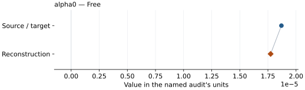

# Iridium: EOS reconstruction reports

<!-- Generated by scripts.generate_reconstruction_reports; edit EOSMAT instead. -->

[All reconstruction reports](index.md) · [Material and EOS parameters](../material-summaries/iridium.md)

These reports explain the assessments already stored in EOSMAT. Generating
this page does not refit observations, change classifications or replace source coefficients.

Use [scientific label definitions](../eos-labels.md) to distinguish coefficient
agreement, source verification, author-workflow reproduction and recommendation for use.

| EOS record | Recorded outcome | Coefficient comparison |
| --- | --- | --- |
| [Anzellini et al. (2025), BM3 + HP](#record-iridium_anzellini_2025_bm3_1) | Coefficient parity achieved | Graph and table |

## Anzellini et al. (2025), BM3 + HP

Record: `iridium_anzellini_2025_bm3_1` · Model: `BM3`

**Outcome: Coefficient parity achieved.**

**Scope:** Comparison with the source parameterization.
**Comparison basis:** Every compared free coefficient meets both the recorded combined-two-sigma comparison and parameter-specific numerical similarity screen. Error conventions and fit qualifications remain applicable.

[Stored EOS coefficients and source](../material-summaries/iridium.md#record-iridium_anzellini_2025_bm3_1)

### What this result establishes

**Separate source-review status:** primary\_source\_validated.
**Usage recommendation:** See the stored EOS qualifications; no recommendation is inferred here.

- The exact Equations 1-3 thermal correction and source temperature average are reproduced. With the published BM3 reference held fixed, all 122 laser-heating rows independently refit alpha0. A second, explicitly plot-derived reconstruction uses the vector marker centers for the missing 300 K and 830 K series and the source's stated +/-100 K temperature bands. It materially approaches all four published coefficients, but is not source parity because the original numerical rows, exact averaging/selection algorithm, weights, and covariance remain unpublished.
- This named numerical assessment alone does not establish author-workflow reproduction, physical accuracy or recommendation for use.

### Data and reconstruction method

- **Dataset identifiers:** iridium\_anzellini\_2025\_tables\_s1\_s3\_pvt
- **Observations:** 122
- **Fit kind:** conditional\_holland\_powell\_thermal\_pressure
- **Selection:** all 122 Supplementary Tables 1-3 laser-heating rows
- **Objective:** unweighted\_pressure\_residuals
- **Absolute sigma:** False
- **Free parameters:** alpha0
- **Fixed parameters:** Tr; theta; n

Unspecified selections, weights, fixed values or error conventions remain unknown; they have not been inferred for this report.

### Source versus reconstruction

This is a **coefficient comparison**, not an observation or residual plot.
Each panel uses its coefficient's audit units and includes zero. Markers show
stored central values only. Error widths are retained in the table below;
no confidence interval or uncertainty band is inferred. Fixed/adopted values are constraints.

| Parameter | Source / target | Source error | Reconstruction | Reconstruction error | Fit role |
| --- | --- | --- | --- | --- | --- |
| alpha0 | 1.87e-05 | 8e-07 | 1.7740295689829463e-05 | 3.2880224447968415e-07 | Free |

Values and reported errors are copied without rounding or conversion from the named audit. Missing errors mean unknown, not zero. Parameter names and volume conventions follow that audit; error widths do not imply a confidence convention.

Recorded diagnostics, covariance and additional protocol

- **Columns:**
    - **Pressure:** pressure\_gpa
    - **Temperature:** mean\_temperature\_k
    - **Volume:** iridium\_lattice\_a\_angstrom
- **Observed pressure range gpa:** \[22.7, 91.5\]
- **Observed temperature range k:** \[300.0, 5560.5\]
- **Observed volume range:** \[47.911251968, 54.958685608\]
- **Degrees of freedom:** 121
- **Solver success:** True
- **Solver message:** \`ftol\` termination condition is satisfied.
- **Rmse gpa:** 3.0325674077570715
- **Published rmse gpa:** 3.1375096434286185
- **Reduced chi square:** 9.272468926248218

### Detailed evidence and existing plots

- [Record-by-record numerical ledger](../primary-eos-refits.md#records).
- [Source-audit reports](../source-audits.md).

Observation curves and residual plots are provided by the supporting reports where available. Their absence is not filled by a reconstructed curve presented as measured data.

[Machine-readable comparison ledger](https://github.com/CPrescher/peritheos/blob/main/docs/data/primary-eos-refits.json) — look up `iridium_anzellini_2025_bm3_1`.
[Complete native EOSMAT file](https://github.com/CPrescher/peritheos/blob/main/peritheos/data/materials/iridium.eosmat).
